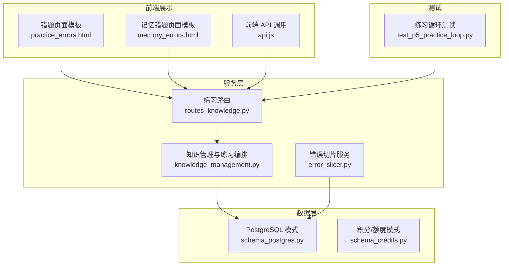
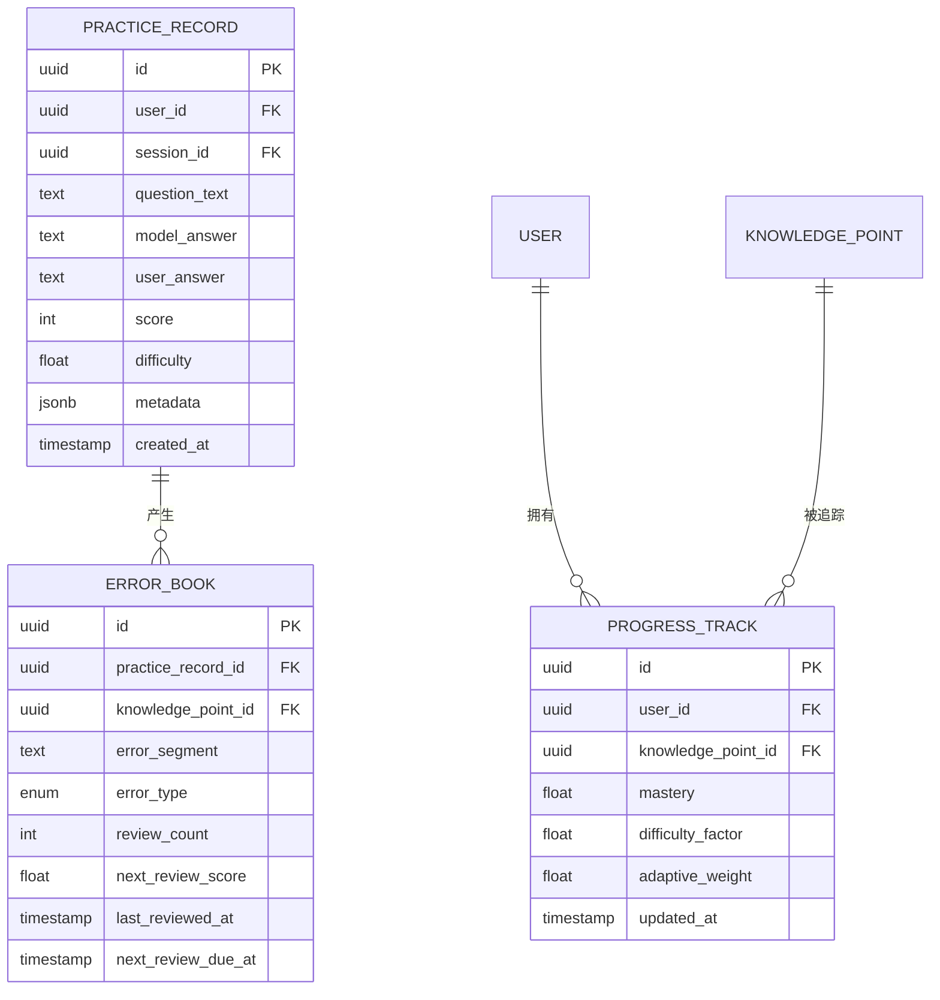
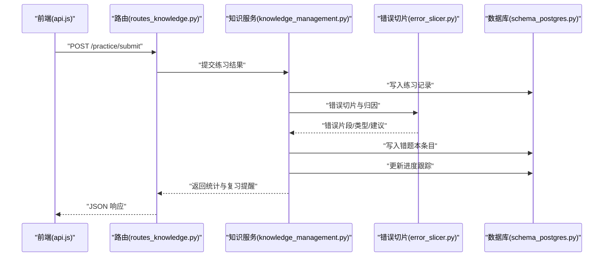
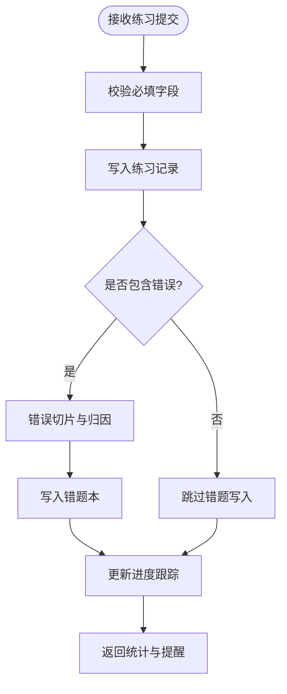
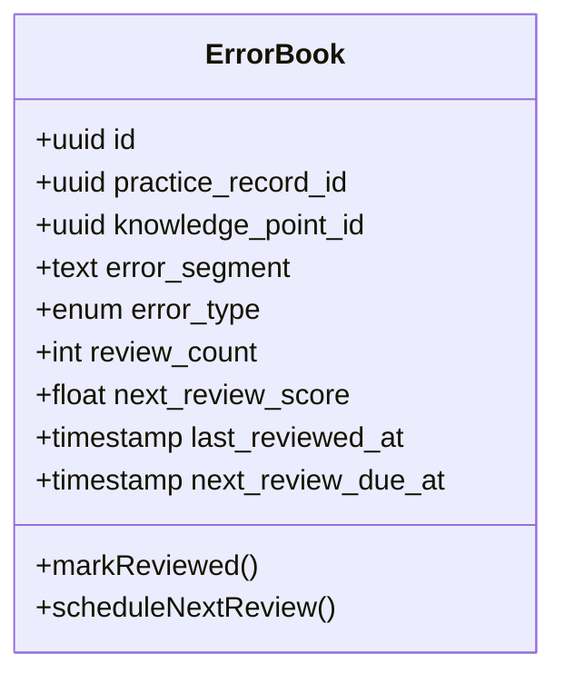
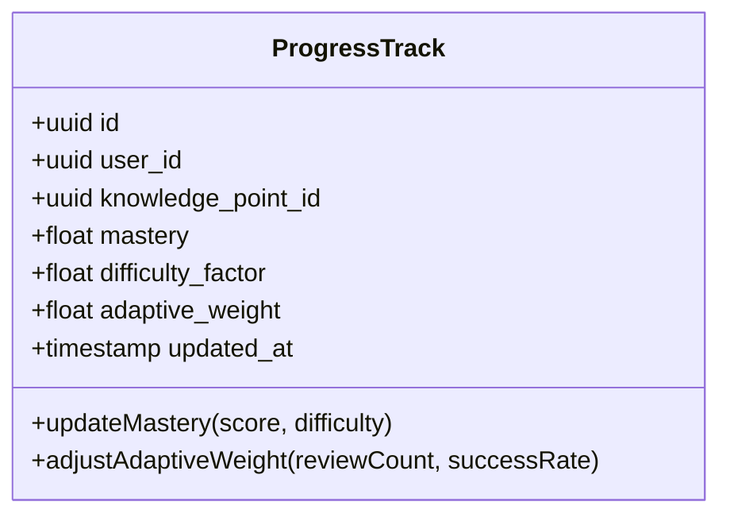
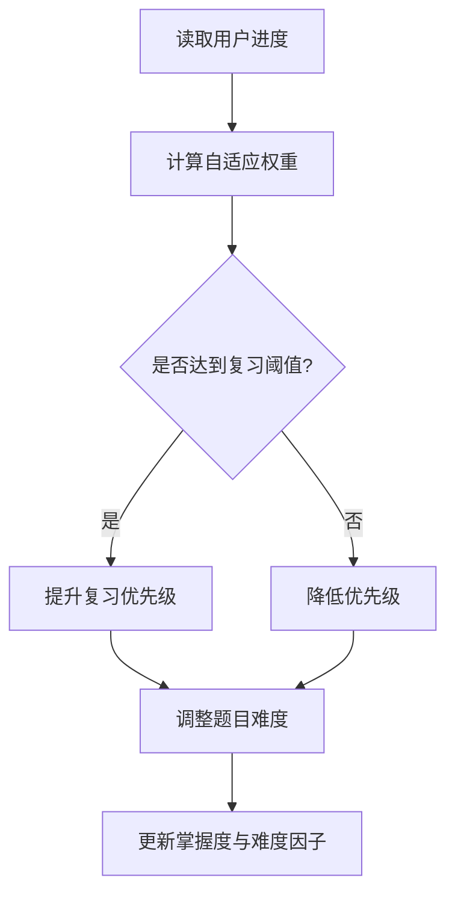
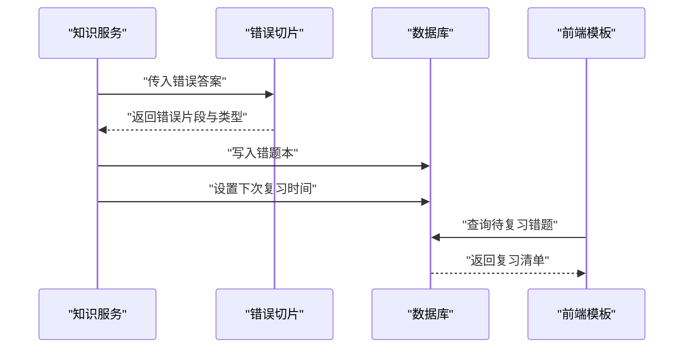
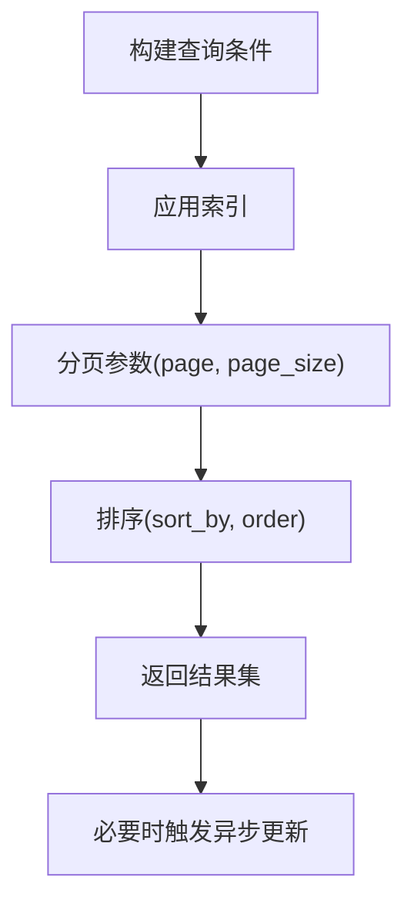
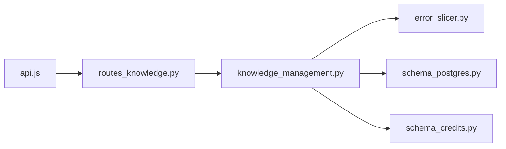

# 练习数据模型

<cite>
**本文引用的文件**   
- [server/database/schema_postgres.py](file://server/database/schema_postgres.py)
- [server/database/schema_credits.py](file://server/database/schema_credits.py)
- [server/routes_knowledge.py](file://server/routes_knowledge.py)
- [server/knowledge_management.py](file://server/knowledge_management.py)
- [server/services/error_slicer.py](file://server/services/error_slicer.py)
- [server/templates/pages/practice_errors.html](file://server/templates/pages/practice_errors.html)
- [server/templates/pages/memory_errors.html](file://server/templates/pages/memory_errors.html)
- [server/static/js/api.js](file://server/static/js/api.js)
- [server/tests/test_p5_practice_loop.py](file://server/tests/test_p5_practice_loop.py)
</cite>

## 目录
1. [引言](#引言)
2. [项目结构](#项目结构)
3. [核心组件](#核心组件)
4. [架构总览](#架构总览)
5. [详细组件分析](#详细组件分析)
6. [依赖关系分析](#依赖关系分析)
7. [性能与可扩展性](#性能与可扩展性)
8. [故障排查指南](#故障排查指南)
9. [结论](#结论)

## 引言
本文件面向“练习系统”的数据模型，聚焦以下目标：
- 定义并解释练习记录表、错题本表、进度跟踪表的结构设计与字段语义。
- 说明练习状态管理、难度等级与自适应算法的数据支撑点。
- 文档化练习结果存储、错误分析与复习提醒机制。
- 给出练习数据的统计分析、成绩计算与趋势分析方法。
- 提供查询优化、分页处理与大数据量处理方案。

## 项目结构
围绕练习数据模型，相关代码主要分布在数据库模式定义、知识/练习服务层、错误切片服务以及前端模板与接口脚本中。下图给出与本主题相关的模块组织关系。

**图表来源**
- [server/database/schema_postgres.py](file://server/database/schema_postgres.py)
- [server/database/schema_credits.py](file://server/database/schema_credits.py)
- [server/knowledge_management.py](file://server/knowledge_management.py)
- [server/services/error_slicer.py](file://server/services/error_slicer.py)
- [server/routes_knowledge.py](file://server/routes_knowledge.py)
- [server/templates/pages/practice_errors.html](file://server/templates/pages/practice_errors.html)
- [server/templates/pages/memory_errors.html](file://server/templates/pages/memory_errors.html)
- [server/static/js/api.js](file://server/static/js/api.js)
- [server/tests/test_p5_practice_loop.py](file://server/tests/test_p5_practice_loop.py)

**章节来源**
- [server/database/schema_postgres.py](file://server/database/schema_postgres.py)
- [server/database/schema_credits.py](file://server/database/schema_credits.py)
- [server/knowledge_management.py](file://server/knowledge_management.py)
- [server/services/error_slicer.py](file://server/services/error_slicer.py)
- [server/routes_knowledge.py](file://server/routes_knowledge.py)
- [server/templates/pages/practice_errors.html](file://server/templates/pages/practice_errors.html)
- [server/templates/pages/memory_errors.html](file://server/templates/pages/memory_errors.html)
- [server/static/js/api.js](file://server/static/js/api.js)
- [server/tests/test_p5_practice_loop.py](file://server/tests/test_p5_practice_loop.py)

## 核心组件
本节从数据模型角度梳理练习系统的核心实体与关系，重点覆盖：
- 练习记录表：用于持久化每次练习的输入、输出、评分、耗时、知识点关联等。
- 错题本表：用于沉淀错误题目、错误片段、错误类型、复习间隔与提醒状态。
- 进度跟踪表：用于记录用户对知识点或题型的掌握度、熟练度、难度系数与自适应权重。

为便于理解，下面给出概念性的实体关系图（不绑定具体实现）：

[本图为概念示意，未直接映射到具体源码文件]

## 架构总览
练习数据在系统中的流转路径如下：
- 前端通过 api.js 发起练习提交、错题查询、进度查询等请求。
- routes_knowledge.py 暴露 REST 接口，协调 knowledge_management.py 的业务逻辑。
- knowledge_management.py 负责练习编排、结果落库、错题生成与进度更新。
- error_slicer.py 对错误答案进行切片与归因，辅助错题入库与复习策略。
- schema_postgres.py 定义 PostgreSQL 表结构与索引；schema_credits.py 定义积分/额度相关表，可能影响练习次数或资源配额。

**图表来源**
- [server/static/js/api.js](file://server/static/js/api.js)
- [server/routes_knowledge.py](file://server/routes_knowledge.py)
- [server/knowledge_management.py](file://server/knowledge_management.py)
- [server/services/error_slicer.py](file://server/services/error_slicer.py)
- [server/database/schema_postgres.py](file://server/database/schema_postgres.py)

**章节来源**
- [server/static/js/api.js](file://server/static/js/api.js)
- [server/routes_knowledge.py](file://server/routes_knowledge.py)
- [server/knowledge_management.py](file://server/knowledge_management.py)
- [server/services/error_slicer.py](file://server/services/error_slicer.py)
- [server/database/schema_postgres.py](file://server/database/schema_postgres.py)

## 详细组件分析

### 练习记录表（Practice Record）
- 设计要点
  - 唯一标识与用户/会话维度：确保练习可追溯、可聚合。
  - 题目与答案：支持文本型问题与模型/用户答案对比。
  - 评分与难度：score 表示得分，difficulty 表示题目难度或自适应难度因子。
  - 元数据：metadata 使用 JSONB 扩展字段，容纳题型、知识点标签、时间戳、环境信息等。
  - 时间戳：created_at 用于统计与趋势分析。
- 关键字段语义
  - id：主键，UUID。
  - user_id：外键，指向用户。
  - session_id：外键，指向练习会话。
  - question_text：题目内容。
  - model_answer：标准答案或期望输出。
  - user_answer：用户作答。
  - score：数值型分数。
  - difficulty：浮点难度值。
  - metadata：结构化扩展信息。
  - created_at：创建时间。
- 查询与索引建议
  - 按 user_id、session_id、created_at 建立复合索引以加速历史查询与分页。
  - 对 metadata 中的常用标签建立 GIN 索引以提升过滤效率。
- 与错题本和进度的关系
  - 一条练习记录可产生多条错题条目。
  - 练习结果驱动进度表的 mastery、adaptive_weight 更新。

**图表来源**
- [server/knowledge_management.py](file://server/knowledge_management.py)
- [server/services/error_slicer.py](file://server/services/error_slicer.py)
- [server/database/schema_postgres.py](file://server/database/schema_postgres.py)

**章节来源**
- [server/database/schema_postgres.py](file://server/database/schema_postgres.py)
- [server/knowledge_management.py](file://server/knowledge_management.py)

### 错题本表（Error Book）
- 设计要点
  - 与练习记录的强关联：error_book.practice_record_id 指向具体练习。
  - 错误片段与类型：error_segment 保存错误定位，error_type 用于分类（如拼写、语法、逻辑）。
  - 复习策略：review_count 记录已复习次数，next_review_score 作为下次复习阈值，last_reviewed_at 与 next_review_due_at 控制复习周期。
- 关键字段语义
  - id：主键，UUID。
  - practice_record_id：外键，关联练习记录。
  - knowledge_point_id：外键，关联知识点。
  - error_segment：错误片段文本。
  - error_type：枚举类型，错误类别。
  - review_count：整数，复习计数。
  - next_review_score：浮点，下次复习阈值。
  - last_reviewed_at：最近复习时间。
  - next_review_due_at：下次复习到期时间。
- 复习提醒机制
  - 基于 next_review_due_at 与当前时间比较，筛选待复习错题。
  - 结合 review_count 与 next_review_score 动态调整复习间隔。
- 前端展示
  - practice_errors.html 与 memory_errors.html 分别渲染不同场景下的错题列表与复习入口。

**图表来源**
- [server/database/schema_postgres.py](file://server/database/schema_postgres.py)
- [server/templates/pages/practice_errors.html](file://server/templates/pages/practice_errors.html)
- [server/templates/pages/memory_errors.html](file://server/templates/pages/memory_errors.html)

**章节来源**
- [server/database/schema_postgres.py](file://server/database/schema_postgres.py)
- [server/templates/pages/practice_errors.html](file://server/templates/pages/practice_errors.html)
- [server/templates/pages/memory_errors.html](file://server/templates/pages/memory_errors.html)

### 进度跟踪表（Progress Track）
- 设计要点
  - 用户与知识点双维：user_id 与 knowledge_point_id 组合描述掌握情况。
  - 掌握度与难度因子：mastery 表示掌握程度，difficulty_factor 反映该知识点在当前阶段的难度。
  - 自适应权重：adaptive_weight 用于自适应算法选择题目或调整难度。
  - 更新时间：updated_at 用于增量同步与审计。
- 关键字段语义
  - id：主键，UUID。
  - user_id：外键，指向用户。
  - knowledge_point_id：外键，指向知识点。
  - mastery：浮点掌握度。
  - difficulty_factor：浮点难度因子。
  - adaptive_weight：浮点自适应权重。
  - updated_at：更新时间。
- 自适应算法数据支撑
  - 根据 mastery 与 adaptive_weight 动态调整后续题目的难度与出现频率。
  - 结合错题本的 review_count 与 next_review_score 修正掌握度。

**图表来源**
- [server/database/schema_postgres.py](file://server/database/schema_postgres.py)
- [server/knowledge_management.py](file://server/knowledge_management.py)

**章节来源**
- [server/database/schema_postgres.py](file://server/database/schema_postgres.py)
- [server/knowledge_management.py](file://server/knowledge_management.py)

### 练习状态管理、难度等级与自适应算法
- 练习状态管理
  - 通过练习记录的 score 与 metadata 中的状态位（如 is_completed、is_flagged）表达练习生命周期。
  - 错题本条目通过 review_count 与 next_review_due_at 表达复习状态。
- 难度等级
  - difficulty 字段表示题目难度；difficulty_factor 表示知识点层面的难度因子。
  - 自适应算法依据 mastery 与 adaptive_weight 动态调整难度。
- 自适应算法
  - 输入：score、difficulty、mastery、adaptive_weight、review_count。
  - 输出：下一题难度、复习优先级、掌握度更新。
  - 数据支撑：progress_track.adaptive_weight 与 error_book.next_review_score。

**图表来源**
- [server/knowledge_management.py](file://server/knowledge_management.py)
- [server/database/schema_postgres.py](file://server/database/schema_postgres.py)

**章节来源**
- [server/knowledge_management.py](file://server/knowledge_management.py)
- [server/database/schema_postgres.py](file://server/database/schema_postgres.py)

### 练习结果存储、错误分析与复习提醒
- 练习结果存储
  - 将 question_text、model_answer、user_answer、score、difficulty、metadata 持久化至练习记录表。
- 错误分析
  - error_slicer.py 对错误答案进行切片，提取 error_segment 与 error_type，辅助归因与复习。
- 复习提醒
  - 基于 next_review_due_at 与当前时间比较，生成待复习清单。
  - 前端模板 practice_errors.html 与 memory_errors.html 渲染复习入口与统计摘要。

**图表来源**
- [server/knowledge_management.py](file://server/knowledge_management.py)
- [server/services/error_slicer.py](file://server/services/error_slicer.py)
- [server/templates/pages/practice_errors.html](file://server/templates/pages/practice_errors.html)
- [server/templates/pages/memory_errors.html](file://server/templates/pages/memory_errors.html)

**章节来源**
- [server/services/error_slicer.py](file://server/services/error_slicer.py)
- [server/templates/pages/practice_errors.html](file://server/templates/pages/practice_errors.html)
- [server/templates/pages/memory_errors.html](file://server/templates/pages/memory_errors.html)

### 练习数据的统计分析、成绩计算与趋势分析
- 统计分析
  - 按用户维度统计练习次数、正确率、平均难度、复习覆盖率。
  - 按知识点维度统计掌握度变化、错误类型分布。
- 成绩计算
  - 综合 score、difficulty、mastery 计算加权成绩。
  - 结合 review_count 与 next_review_score 评估复习效果。
- 趋势分析
  - 基于 created_at 与 updated_at 的时间序列分析掌握度与复习间隔的变化趋势。
  - 使用滑动窗口计算近 N 次练习的正确率与难度曲线。

[本节为方法论说明，未直接分析具体源码文件]

### 查询优化、分页处理与大数据量处理方案
- 查询优化
  - 针对 user_id、session_id、created_at 建立复合索引。
  - 对 metadata 中的常用标签建立 GIN 索引。
  - 对 error_book.next_review_due_at 建立索引以加速复习提醒查询。
- 分页处理
  - 使用基于游标或偏移的分页策略，避免深翻页性能问题。
  - 前端 api.js 传递 page、page_size、sort_by、order 参数。
- 大数据量处理
  - 分区表：按时间（如按月）对练习记录表进行分区。
  - 归档策略：将历史练习记录迁移至冷存储，保留热数据在在线库。
  - 异步任务：批量更新进度与复习计划时采用后台任务队列。

**图表来源**
- [server/static/js/api.js](file://server/static/js/api.js)
- [server/database/schema_postgres.py](file://server/database/schema_postgres.py)

**章节来源**
- [server/static/js/api.js](file://server/static/js/api.js)
- [server/database/schema_postgres.py](file://server/database/schema_postgres.py)

## 依赖关系分析
- 模块耦合
  - routes_knowledge.py 依赖 knowledge_management.py 进行业务编排。
  - knowledge_management.py 依赖 database schema 与 error_slicer.py。
  - 前端 api.js 依赖 routes_knowledge.py 提供的接口。
- 外部依赖
  - PostgreSQL 作为主数据存储。
  - 积分/额度系统（schema_credits.py）可能限制练习次数或资源配额。

**图表来源**
- [server/static/js/api.js](file://server/static/js/api.js)
- [server/routes_knowledge.py](file://server/routes_knowledge.py)
- [server/knowledge_management.py](file://server/knowledge_management.py)
- [server/services/error_slicer.py](file://server/services/error_slicer.py)
- [server/database/schema_postgres.py](file://server/database/schema_postgres.py)
- [server/database/schema_credits.py](file://server/database/schema_credits.py)

**章节来源**
- [server/static/js/api.js](file://server/static/js/api.js)
- [server/routes_knowledge.py](file://server/routes_knowledge.py)
- [server/knowledge_management.py](file://server/knowledge_management.py)
- [server/services/error_slicer.py](file://server/services/error_slicer.py)
- [server/database/schema_postgres.py](file://server/database/schema_postgres.py)
- [server/database/schema_credits.py](file://server/database/schema_credits.py)

## 性能与可扩展性
- 读写分离：读多写少场景下，可将统计类查询下沉至只读副本。
- 缓存层：对热点知识点进度与复习清单进行缓存，减少数据库压力。
- 批处理：批量更新进度与复习计划时使用事务与批量插入。
- 监控与告警：对慢查询、索引缺失、分区异常进行监控。

[本节为通用指导，未直接分析具体源码文件]

## 故障排查指南
- 常见问题
  - 复习提醒不生效：检查 next_review_due_at 是否正确设置与索引是否存在。
  - 进度更新延迟：确认异步任务是否执行成功，查看 updated_at 是否更新。
  - 错题归类错误：核对 error_type 与 error_segment 的切片逻辑。
- 调试建议
  - 使用 test_p5_practice_loop.py 验证练习流程端到端行为。
  - 在前端模板中打印复习清单与统计摘要，快速定位显示问题。

**章节来源**
- [server/tests/test_p5_practice_loop.py](file://server/tests/test_p5_practice_loop.py)
- [server/templates/pages/practice_errors.html](file://server/templates/pages/practice_errors.html)
- [server/templates/pages/memory_errors.html](file://server/templates/pages/memory_errors.html)

## 结论
本数据模型围绕练习记录、错题本与进度跟踪三大核心实体展开，支撑练习状态管理、难度等级与自适应算法。通过合理的索引、分页与分区策略，可在大数据量下保持查询性能与可扩展性。错误切片与复习提醒机制进一步提升了学习闭环的有效性。建议在实施过程中持续监控关键指标，并根据业务反馈迭代自适应算法与复习策略。