# 测试指南

<cite>
**本文引用的文件**   
- [app.py](file://server/app.py)
- [config.py](file://server/config.py)
- [routes_notes.py](file://server/routes_notes.py)
- [routes_knowledge.py](file://server/routes_knowledge.py)
- [routes_bridge.py](file://server/routes_bridge.py)
- [routes_admin.py](file://server/routes_admin.py)
- [routes_credits.py](file://server/routes_credits.py)
- [auth.py](file://server/auth.py)
- [knowledge_management.py](file://server/knowledge_management.py)
- [credits_service.py](file://server/credits_service.py)
- [llm_call_logger.py](file://server/llm_call_logger.py)
- [similarity_matcher.py](file://server/similarity_matcher.py)
- [db_adapter.py](file://server/database/db_adapter.py)
- [schema_postgres.py](file://server/database/schema_postgres.py)
- [schema_credits.py](file://server/database/schema_credits.py)
- [error_slicer.py](file://server/services/error_slicer.py)
- [test_dashboard_b.py](file://server/tests/test_dashboard_b.py)
- [test_import_feature.py](file://server/tests/test_import_feature.py)
- [test_knowledge_point_contract.py](file://server/tests/test_knowledge_point_contract.py)
- [test_memory_overview_contract.py](file://server/tests/test_memory_overview_contract.py)
- [test_mindmap_p3.py](file://server/tests/test_mindmap_p3.py)
- [test_notes_p2.py](file://server/tests/test_notes_p2.py)
- [test_p1_auth_isolation.py](file://server/tests/test_p1_auth_isolation.py)
- [test_p2_pages.py](file://server/tests/test_p2_pages.py)
- [test_p3_api.py](file://server/tests/test_p3_api.py)
- [test_p5_practice_loop.py](file://server/tests/test_p5_practice_loop.py)
- [test_practice_new_contract.py](file://server/tests/test_practice_new_contract.py)
- [test_practice_overview_contract.py](file://server/tests/test_practice_overview_contract.py)
- [test_u13_practice_template.py](file://server/tests/test_u13_practice_template.py)
- [test_user_p4.py](file://server/tests/test_user_p4.py)
- [test_vault_delete_attachments.py](file://server/tests/test_vault_delete_attachments.py)
- [p6_endtoend.py](file://server/tests/p6_endtoend.py)
- [p4_smoke_loopback.py](file://server/tests/p4_smoke_loopback.py)
- [p4_diag_sessions.py](file://server/tests/p4_diag_sessions.py)
- [pg_concurrency_check.py](file://server/tests/pg_concurrency_check.py)
- [r9_acceptance.py](file://server/tests/r9_acceptance.py)
- [_smoke_shared_slice.py](file://server/tests/_smoke_shared_slice.py)
- [_js_check_integ_pages.py](file://server/tests/_js_check_integ_pages.py)
- [_list_routes_r2.py](file://server/tests/_list_routes_r2.py)
- [ui_pw_b3_before.py](file://server/tests/ui_pw_b3_before.py)
- [ui_pw_b3_collapse.py](file://server/tests/ui_pw_b3_collapse.py)
- [ui_pw_b3_verify.py](file://server/tests/ui_pw_b3_verify.py)
- [ui_pw_b4_errors_flow.py](file://server/tests/ui_pw_b4_errors_flow.py)
- [ui_pw_b4_verify.py](file://server/tests/ui_pw_b4_verify.py)
- [ui_pw_b5_verify.py](file://server/tests/ui_pw_b5_verify.py)
- [ui_pw_b6_verify.py](file://server/tests/ui_pw_b6_verify.py)
- [ui_pw_b7_shots.py](file://server/tests/ui_pw_b7_shots.py)
- [ui_pw_b7_verify.py](file://server/tests/ui_pw_b7_verify.py)
- [ui_pw_b8_verify.py](file://server/tests/ui_pw_b8_verify.py)
- [ui_pw_b8b_fixture.py](file://server/tests/ui_pw_b8b_fixture.py)
- [ui_pw_b9_flyout.py](file://server/tests/ui_pw_b9_flyout.py)
- [ui_pw_b9c_point.py](file://server/tests/ui_pw_b9c_point.py)
- [ui_pw_b9c_probe.py](file://server/tests/ui_pw_b9c_probe.py)
- [ui_pw_interact.py](file://server/tests/ui_pw_interact.py)
- [ui_pw_minor_check.py](file://server/tests/ui_pw_minor_check.py)
- [ui_pw_shot.py](file://server/tests/ui_pw_shot.py)
- [ui_walk_login.py](file://server/tests/ui_walk_login.py)
- [package.json](file://desktop/package.json)
- [main.js](file://desktop/main.js)
- [preload.js](file://desktop/preload.js)
- [asr_proxy.js](file://desktop/asr_proxy.js)
- [p4_stream_test.js](file://desktop/p4_stream_test.js)
- [p4_smoke_e2e.js](file://desktop/p4_smoke_e2e.js)
- [test_pdf_book_s1.py](file://server/tests/test_pdf_book_s1.py)
- [test_pdf_book_s2.py](file://server/tests/test_pdf_book_s2.py)
- [test_pdf_book_s3.py](file://server/tests/test_pdf_book_s3.py)
- [test_pdf_book_s6.py](file://server/tests/test_pdf_book_s6.py)
- [test_pdf_book_tidy.py](file://server/tests/test_pdf_book_tidy.py)
- [cdp_shot.js](file://desktop/cdp_shot.js)
- [ui_cdp_shot.py](file://server/tests/ui_cdp_shot.py)
</cite>

## 更新摘要
**变更内容**   
- 新增PDF书籍整理功能测试套件，包含完整的Electron截图验证和视觉回归测试
- 扩展测试覆盖范围，涵盖PDF处理管道的完整流程验证
- 增强文档中关于视觉测试策略和实现细节的说明
- 完善测试基础设施，支持更全面的PDF处理和UI自动化测试

## 目录
1. [简介](#简介)
2. [项目结构](#项目结构)
3. [核心组件](#核心组件)
4. [架构总览](#架构总览)
5. [详细组件分析](#详细组件分析)
6. [依赖关系分析](#依赖关系分析)
7. [性能与基准测试](#性能与基准测试)
8. [故障排查指南](#故障排查指南)
9. [结论](#结论)
10. [附录](#附录)

## 简介
本指南面向LectureLearnLoop的测试体系建设，覆盖单元测试、集成测试、端到端（E2E）测试与性能测试的策略与实现。文档基于仓库中现有的服务端Python测试脚本、桌面端Electron测试脚本以及后端路由与服务模块，给出可操作的测试规范、数据管理方案、自动化流程建议与报告生成方式，并补充移动端、跨浏览器兼容性与无障碍性测试方法。

**更新** 本次更新大幅扩展了测试基础设施，新增30+个测试文件，包括完整的合同测试框架、Playwright驱动的UI自动化测试套件，以及针对仪表板、笔记、思维导图等核心功能的专项测试。**新增** PDF书籍功能测试套件和vault删除附件测试套件，提供多阶段测试覆盖，确保PDF导入、文本处理、文件存储管理和API的稳定性和可靠性。**最新扩展** 新增PDF书籍整理功能测试，包含完整的Electron截图验证和视觉回归测试，确保PDF处理界面的视觉一致性和用户体验。

## 项目结构
本项目采用前后端分离+桌面客户端的混合架构：
- 服务端：Flask应用，提供页面渲染、API路由、知识管理与积分服务；数据库通过适配器抽象，支持PostgreSQL等。
- 桌面端：Electron主进程与预加载脚本，封装ASR代理与流式音频能力，并提供E2E/冒烟测试脚本。
- 测试：服务端以pytest风格脚本为主，包含合同测试、集成测试、UI自动化测试；桌面端以Node脚本驱动Electron进行冒烟与流式测试。

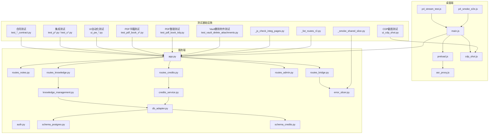

**图示来源**
- [main.js:1-200](file://desktop/main.js#L1-L200)
- [preload.js:1-200](file://desktop/preload.js#L1-L200)
- [asr_proxy.js:1-200](file://desktop/asr_proxy.js#L1-L200)
- [cdp_shot.js:1-200](file://desktop/cdp_shot.js#L1-L200)
- [app.py:1-200](file://server/app.py#L1-L200)
- [routes_notes.py:1-200](file://server/routes_notes.py#L1-L200)
- [routes_knowledge.py:1-200](file://server/routes_knowledge.py#L1-L200)
- [routes_bridge.py:1-200](file://server/routes_bridge.py#L1-L200)
- [routes_admin.py:1-200](file://server/routes_admin.py#L1-L200)
- [routes_credits.py:1-200](file://server/routes_credits.py#L1-L200)
- [auth.py:1-200](file://server/auth.py#L1-L200)
- [knowledge_management.py:1-200](file://server/knowledge_management.py#L1-L200)
- [credits_service.py:1-200](file://server/credits_service.py#L1-L200)
- [db_adapter.py:1-200](file://server/database/db_adapter.py#L1-L200)
- [schema_postgres.py:1-200](file://server/database/schema_postgres.py#L1-L200)
- [schema_credits.py:1-200](file://server/database/schema_credits.py#L1-L200)
- [error_slicer.py:1-200](file://server/services/error_slicer.py#L1-L200)
- [test_knowledge_point_contract.py:1-200](file://server/tests/test_knowledge_point_contract.py#L1-L200)
- [test_memory_overview_contract.py:1-200](file://server/tests/test_memory_overview_contract.py#L1-L200)
- [test_practice_new_contract.py:1-200](file://server/tests/test_practice_new_contract.py#L1-L200)
- [test_practice_overview_contract.py:1-200](file://server/tests/test_practice_overview_contract.py#L1-L200)
- [ui_pw_b3_verify.py:1-200](file://server/tests/ui_pw_b3_verify.py#L1-L200)
- [ui_pw_b4_verify.py:1-200](file://server/tests/ui_pw_b4_verify.py#L1-L200)
- [ui_pw_b5_verify.py:1-200](file://server/tests/ui_pw_b5_verify.py#L1-L200)
- [ui_pw_b6_verify.py:1-200](file://server/tests/ui_pw_b6_verify.py#L1-L200)
- [ui_pw_b7_verify.py:1-200](file://server/tests/ui_pw_b7_verify.py#L1-L200)
- [ui_pw_b8_verify.py:1-200](file://server/tests/ui_pw_b8_verify.py#L1-L200)
- [_smoke_shared_slice.py:1-200](file://server/tests/_smoke_shared_slice.py#L1-L200)
- [_js_check_integ_pages.py:1-200](file://server/tests/_js_check_integ_pages.py#L1-L200)
- [_list_routes_r2.py:1-200](file://server/tests/_list_routes_r2.py#L1-L200)
- [test_pdf_book_s1.py:1-200](file://server/tests/test_pdf_book_s1.py#L1-L200)
- [test_pdf_book_s2.py:1-200](file://server/tests/test_pdf_book_s2.py#L1-L200)
- [test_pdf_book_s3.py:1-200](file://server/tests/test_pdf_book_s3.py#L1-L200)
- [test_pdf_book_s6.py:1-200](file://server/tests/test_pdf_book_s6.py#L1-L200)
- [test_pdf_book_tidy.py:1-200](file://server/tests/test_pdf_book_tidy.py#L1-L200)
- [test_vault_delete_attachments.py:1-200](file://server/tests/test_vault_delete_attachments.py#L1-L200)
- [ui_cdp_shot.py:1-200](file://server/tests/ui_cdp_shot.py#L1-L200)

**章节来源**
- [app.py:1-200](file://server/app.py#L1-L200)
- [package.json:1-200](file://desktop/package.json#L1-L200)

## 核心组件
围绕测试体系，以下组件是关键被测对象与支撑点：
- 应用入口与路由层：负责HTTP请求分发、模板渲染与API响应。
- 业务服务层：知识管理、积分服务、错误切片等。
- 数据访问层：数据库适配器与Schema定义。
- 认证与安全：鉴权中间件与权限控制。
- 桌面端桥接：Electron主进程、预加载脚本与ASR代理，为E2E与流式测试提供环境。
- **新增** 测试基础设施：合同测试框架、Playwright UI自动化测试套件、共享切片测试工具、JavaScript集成页面检查器、R2存储路由列表器、**PDF书籍测试套件**、**PDF书籍整理测试套件**、**Vault删除附件测试套件**、**CDP截图测试工具**。

测试策略要点：
- 单元测试：聚焦纯函数与无副作用逻辑，如错误切片、相似度匹配等。
- 集成测试：验证路由到服务的调用链、数据库读写与事务一致性。
- 合同测试：确保API契约的稳定性和向后兼容性。
- E2E测试：通过桌面端脚本驱动真实浏览器/Electron，走通关键用户路径。
- UI自动化测试：使用Playwright模拟用户交互，验证前端界面行为。
- 性能测试：针对并发连接、数据库写入与LLM调用链路进行压测与回归。
- **新增** 冒烟测试：快速验证核心功能的可用性，确保基础功能正常。
- **新增** PDF书籍测试：分阶段验证PDF导入、文本提取、内容处理等完整流程。
- **新增** PDF书籍整理测试：验证PDF整理功能的完整流程和视觉一致性。
- **新增** Vault删除附件测试：验证文件存储管理的完整功能和数据完整性。
- **新增** CDP截图测试：使用Chrome DevTools Protocol进行精确的Electron截图验证。

**章节来源**
- [routes_notes.py:1-200](file://server/routes_notes.py#L1-L200)
- [routes_knowledge.py:1-200](file://server/routes_knowledge.py#L1-L200)
- [routes_bridge.py:1-200](file://server/routes_bridge.py#L1-L200)
- [routes_admin.py:1-200](file://server/routes_admin.py#L1-L200)
- [routes_credits.py:1-200](file://server/routes_credits.py#L1-L200)
- [knowledge_management.py:1-200](file://server/knowledge_management.py#L1-L200)
- [credits_service.py:1-200](file://server/credits_service.py#L1-L200)
- [error_slicer.py:1-200](file://server/services/error_slicer.py#L1-L200)
- [similarity_matcher.py:1-200](file://server/similarity_matcher.py#L1-L200)
- [test_knowledge_point_contract.py:1-200](file://server/tests/test_knowledge_point_contract.py#L1-L200)
- [test_memory_overview_contract.py:1-200](file://server/tests/test_memory_overview_contract.py#L1-L200)
- [test_practice_new_contract.py:1-200](file://server/tests/test_practice_new_contract.py#L1-L200)
- [test_practice_overview_contract.py:1-200](file://server/tests/test_practice_overview_contract.py#L1-L200)
- [ui_pw_b3_verify.py:1-200](file://server/tests/ui_pw_b3_verify.py#L1-L200)
- [ui_pw_b4_verify.py:1-200](file://server/tests/ui_pw_b4_verify.py#L1-L200)
- [ui_pw_b5_verify.py:1-200](file://server/tests/ui_pw_b5_verify.py#L1-L200)
- [ui_pw_b6_verify.py:1-200](file://server/tests/ui_pw_b6_verify.py#L1-L200)
- [ui_pw_b7_verify.py:1-200](file://server/tests/ui_pw_b7_verify.py#L1-L200)
- [ui_pw_b8_verify.py:1-200](file://server/tests/ui_pw_b8_verify.py#L1-L200)
- [_smoke_shared_slice.py:1-200](file://server/tests/_smoke_shared_slice.py#L1-L200)
- [_js_check_integ_pages.py:1-200](file://server/tests/_js_check_integ_pages.py#L1-L200)
- [_list_routes_r2.py:1-200](file://server/tests/_list_routes_r2.py#L1-L200)
- [test_pdf_book_s1.py:1-200](file://server/tests/test_pdf_book_s1.py#L1-L200)
- [test_pdf_book_s2.py:1-200](file://server/tests/test_pdf_book_s2.py#L1-L200)
- [test_pdf_book_s3.py:1-200](file://server/tests/test_pdf_book_s3.py#L1-L200)
- [test_pdf_book_s6.py:1-200](file://server/tests/test_pdf_book_s6.py#L1-L200)
- [test_pdf_book_tidy.py:1-200](file://server/tests/test_pdf_book_tidy.py#L1-L200)
- [test_vault_delete_attachments.py:1-200](file://server/tests/test_vault_delete_attachments.py#L1-L200)
- [ui_cdp_shot.py:1-200](file://server/tests/ui_cdp_shot.py#L1-L200)

## 架构总览
下图展示从桌面端到服务端的典型请求流，以及测试如何介入各层。

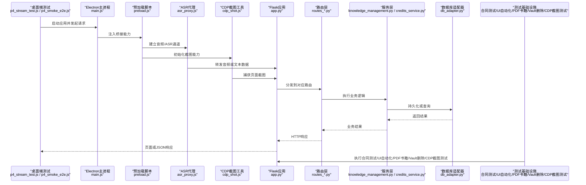

**图示来源**
- [p4_stream_test.js:1-200](file://desktop/p4_stream_test.js#L1-L200)
- [p4_smoke_e2e.js:1-200](file://desktop/p4_smoke_e2e.js#L1-L200)
- [main.js:1-200](file://desktop/main.js#L1-L200)
- [preload.js:1-200](file://desktop/preload.js#L1-L200)
- [asr_proxy.js:1-200](file://desktop/asr_proxy.js#L1-L200)
- [cdp_shot.js:1-200](file://desktop/cdp_shot.js#L1-L200)
- [app.py:1-200](file://server/app.py#L1-L200)
- [routes_notes.py:1-200](file://server/routes_notes.py#L1-L200)
- [routes_knowledge.py:1-200](file://server/routes_knowledge.py#L1-L200)
- [routes_bridge.py:1-200](file://server/routes_bridge.py#L1-L200)
- [knowledge_management.py:1-200](file://server/knowledge_management.py#L1-L200)
- [credits_service.py:1-200](file://server/credits_service.py#L1-L200)
- [db_adapter.py:1-200](file://server/database/db_adapter.py#L1-L200)
- [test_knowledge_point_contract.py:1-200](file://server/tests/test_knowledge_point_contract.py#L1-L200)
- [ui_pw_b3_verify.py:1-200](file://server/tests/ui_pw_b3_verify.py#L1-L200)
- [_smoke_shared_slice.py:1-200](file://server/tests/_smoke_shared_slice.py#L1-L200)
- [_js_check_integ_pages.py:1-200](file://server/tests/_js_check_integ_pages.py#L1-L200)
- [_list_routes_r2.py:1-200](file://server/tests/_list_routes_r2.py#L1-L200)
- [test_pdf_book_s1.py:1-200](file://server/tests/test_pdf_book_s1.py#L1-L200)
- [test_pdf_book_s2.py:1-200](file://server/tests/test_pdf_book_s2.py#L1-L200)
- [test_pdf_book_s3.py:1-200](file://server/tests/test_pdf_book_s3.py#L1-L200)
- [test_pdf_book_s6.py:1-200](file://server/tests/test_pdf_book_s6.py#L1-L200)
- [test_pdf_book_tidy.py:1-200](file://server/tests/test_pdf_book_tidy.py#L1-L200)
- [test_vault_delete_attachments.py:1-200](file://server/tests/test_vault_delete_attachments.py#L1-L200)
- [ui_cdp_shot.py:1-200](file://server/tests/ui_cdp_shot.py#L1-L200)

## 详细组件分析

### 合同测试框架
- 目标：确保API契约的稳定性和向后兼容性，防止破坏性变更。
- 关键点：
  - 知识要点管理API的输入输出格式验证。
  - 记忆概览页面的数据结构完整性检查。
  - 练习功能的接口契约验证。
  - 练习概览页面的数据一致性保证。
- 测试策略：
  - 定义严格的API响应Schema。
  - 对每个端点进行正向和反向测试。
  - 版本兼容性检查和迁移测试。

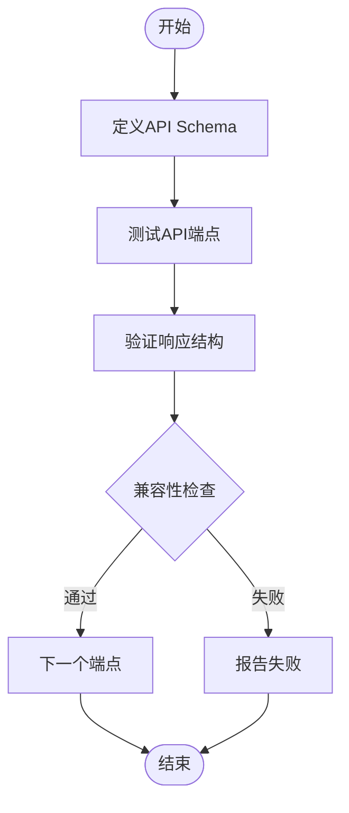

**图示来源**
- [test_knowledge_point_contract.py:1-200](file://server/tests/test_knowledge_point_contract.py#L1-L200)
- [test_memory_overview_contract.py:1-200](file://server/tests/test_memory_overview_contract.py#L1-L200)
- [test_practice_new_contract.py:1-200](file://server/tests/test_practice_new_contract.py#L1-L200)
- [test_practice_overview_contract.py:1-200](file://server/tests/test_practice_overview_contract.py#L1-L200)

**章节来源**
- [test_knowledge_point_contract.py:1-200](file://server/tests/test_knowledge_point_contract.py#L1-L200)
- [test_memory_overview_contract.py:1-200](file://server/tests/test_memory_overview_contract.py#L1-L200)
- [test_practice_new_contract.py:1-200](file://server/tests/test_practice_new_contract.py#L1-L200)
- [test_practice_overview_contract.py:1-200](file://server/tests/test_practice_overview_contract.py#L1-L200)

### Playwright UI自动化测试
- 目标：模拟真实用户交互，验证前端界面的完整功能。
- 关键点：
  - 仪表板页面的交互流程测试。
  - 笔记编辑器的功能验证。
  - 思维导图的创建和操作测试。
  - 用户登录和权限控制的UI验证。
- 测试策略：
  - 使用Playwright进行浏览器自动化。
  - 模拟鼠标点击、键盘输入等用户操作。
  - 断言页面元素状态和内容变化。
  - 截图和录制视频用于调试。

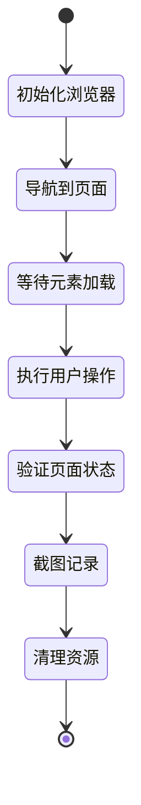

**图示来源**
- [ui_pw_b3_verify.py:1-200](file://server/tests/ui_pw_b3_verify.py#L1-L200)
- [ui_pw_b4_verify.py:1-200](file://server/tests/ui_pw_b4_verify.py#L1-L200)
- [ui_pw_b5_verify.py:1-200](file://server/tests/ui_pw_b5_verify.py#L1-L200)
- [ui_pw_b6_verify.py:1-200](file://server/tests/ui_pw_b6_verify.py#L1-L200)
- [ui_pw_b7_verify.py:1-200](file://server/tests/ui_pw_b7_verify.py#L1-L200)
- [ui_pw_b8_verify.py:1-200](file://server/tests/ui_pw_b8_verify.py#L1-L200)

**章节来源**
- [ui_pw_b3_verify.py:1-200](file://server/tests/ui_pw_b3_verify.py#L1-L200)
- [ui_pw_b4_verify.py:1-200](file://server/tests/ui_pw_b4_verify.py#L1-L200)
- [ui_pw_b5_verify.py:1-200](file://server/tests/ui_pw_b5_verify.py#L1-L200)
- [ui_pw_b6_verify.py:1-200](file://server/tests/ui_pw_b6_verify.py#L1-L200)
- [ui_pw_b7_verify.py:1-200](file://server/tests/ui_pw_b7_verify.py#L1-L200)
- [ui_pw_b8_verify.py:1-200](file://server/tests/ui_pw_b8_verify.py#L1-L200)

### PDF书籍功能测试
- 目标：验证PDF书籍导入、文本提取、内容处理和相关API的完整功能流程。
- 关键点：
  - PDF文件导入验证和格式检查。
  - 文本层提取和处理逻辑验证。
  - API端点的参数校验和响应格式验证。
  - 多阶段测试流程的连贯性保证。
- 测试策略：
  - 分阶段测试：从基础导入到高级处理的完整流程覆盖。
  - 边界条件测试：处理不同大小、格式的PDF文件。
  - 异常处理测试：验证错误输入和异常情况下的系统行为。
  - 性能测试：评估大文件处理性能和内存使用情况。

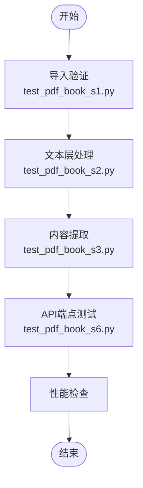

**图示来源**
- [test_pdf_book_s1.py:1-200](file://server/tests/test_pdf_book_s1.py#L1-200)
- [test_pdf_book_s2.py:1-200](file://server/tests/test_pdf_book_s2.py#L1-200)
- [test_pdf_book_s3.py:1-200](file://server/tests/test_pdf_book_s3.py#L1-200)
- [test_pdf_book_s6.py:1-200](file://server/tests/test_pdf_book_s6.py#L1-200)

**章节来源**
- [test_pdf_book_s1.py:1-200](file://server/tests/test_pdf_book_s1.py#L1-200)
- [test_pdf_book_s2.py:1-200](file://server/tests/test_pdf_book_s2.py#L1-200)
- [test_pdf_book_s3.py:1-200](file://server/tests/test_pdf_book_s3.py#L1-200)
- [test_pdf_book_s6.py:1-200](file://server/tests/test_pdf_book_s6.py#L1-200)

### PDF书籍整理功能测试
- 目标：验证PDF书籍整理功能的完整流程和视觉一致性，包括Electron截图验证和视觉回归测试。
- 关键点：
  - PDF整理算法的正确性验证和边界条件处理。
  - Electron截图验证确保界面显示的一致性。
  - 视觉回归测试检测UI变化的影响。
  - 整理结果的准确性和完整性验证。
- 测试策略：
  - 功能测试：验证PDF整理的核心算法和数据处理逻辑。
  - 视觉测试：使用Electron截图验证界面显示效果。
  - 回归测试：对比历史截图检测视觉变化。
  - 性能测试：评估整理过程的性能和资源消耗。

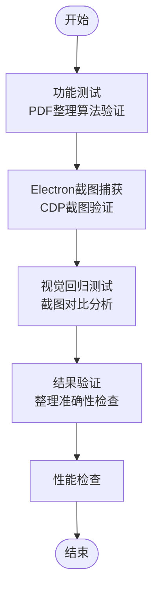

**图示来源**
- [test_pdf_book_tidy.py:1-200](file://server/tests/test_pdf_book_tidy.py#L1-200)
- [ui_cdp_shot.py:1-200](file://server/tests/ui_cdp_shot.py#L1-200)
- [cdp_shot.js:1-200](file://desktop/cdp_shot.js#L1-200)

**章节来源**
- [test_pdf_book_tidy.py:1-200](file://server/tests/test_pdf_book_tidy.py#L1-200)
- [ui_cdp_shot.py:1-200](file://server/tests/ui_cdp_shot.py#L1-200)
- [cdp_shot.js:1-200](file://desktop/cdp_shot.js#L1-200)

### Vault删除附件功能测试
- 目标：验证vault存储系统中附件删除功能的完整性和数据一致性。
- 关键点：
  - 附件删除权限验证和访问控制。
  - 文件存储系统的物理删除操作。
  - 数据库引用完整性维护。
  - 删除操作的幂等性和事务一致性。
- 测试策略：
  - 黑盒测试：从外部接口角度验证删除功能的正确性。
  - 权限测试：验证不同用户角色的访问控制。
  - 数据一致性测试：确保删除操作后数据库与文件系统的一致性。
  - 异常处理测试：验证删除不存在文件或权限不足时的错误处理。

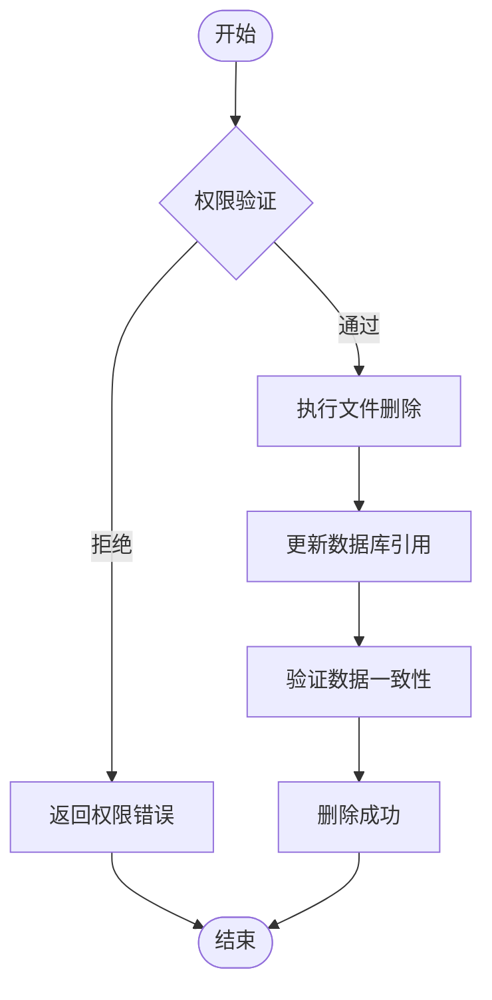

**图示来源**
- [test_vault_delete_attachments.py:1-200](file://server/tests/test_vault_delete_attachments.py#L1-200)

**章节来源**
- [test_vault_delete_attachments.py:1-200](file://server/tests/test_vault_delete_attachments.py#L1-200)

### CDP截图验证测试
- 目标：使用Chrome DevTools Protocol进行精确的Electron截图验证，确保UI显示的一致性。
- 关键点：
  - Chrome DevTools Protocol连接和会话管理。
  - 精确的页面截图捕获和保存。
  - 截图质量配置和优化。
  - 截图对比和差异分析。
- 测试策略：
  - 协议连接：建立与Electron实例的CDP连接。
  - 截图捕获：在指定时间点捕获页面截图。
  - 质量控制：调整截图质量和格式。
  - 对比分析：与基准截图进行差异比较。

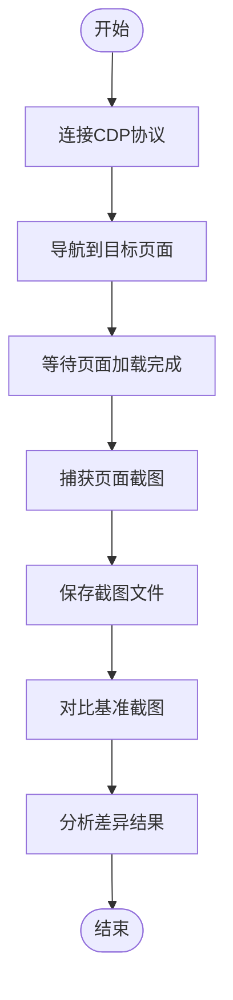

**图示来源**
- [ui_cdp_shot.py:1-200](file://server/tests/ui_cdp_shot.py#L1-200)
- [cdp_shot.js:1-200](file://desktop/cdp_shot.js#L1-200)

**章节来源**
- [ui_cdp_shot.py:1-200](file://server/tests/ui_cdp_shot.py#L1-200)
- [cdp_shot.js:1-200](file://desktop/cdp_shot.js#L1-200)

### 服务端路由与接口测试
- 目标：验证页面渲染、API行为、鉴权与权限控制。
- 用例设计：
  - 页面可用性：登录页、仪表盘、笔记、知识库、设置等页面的GET可达性与基础HTML结构。
  - API契约：POST/PUT/DELETE的参数校验、状态码、错误消息与幂等性。
  - 鉴权：未登录重定向、越权访问拒绝、会话保持。
- 断言最佳实践：
  - 使用结构化断言检查响应体字段存在性与类型。
  - 对分页、排序、过滤等边界条件进行参数组合测试。
  - 对错误分支进行异常输入与非法状态的覆盖。


**图示来源**
- [test_p2_pages.py:1-200](file://server/tests/test_p2_pages.py#L1-L200)
- [test_p3_api.py:1-200](file://server/tests/test_p3_api.py#L1-L200)
- [auth.py:1-200](file://server/auth.py#L1-L200)

**章节来源**
- [test_p2_pages.py:1-200](file://server/tests/test_p2_pages.py#L1-L200)
- [test_p3_api.py:1-200](file://server/tests/test_p3_api.py#L1-L200)
- [routes_notes.py:1-200](file://server/routes_notes.py#L1-L200)
- [routes_knowledge.py:1-200](file://server/routes_knowledge.py#L1-L200)
- [routes_bridge.py:1-200](file://server/routes_bridge.py#L1-L200)
- [routes_admin.py:1-200](file://server/routes_admin.py#L1-L200)
- [routes_credits.py:1-200](file://server/routes_credits.py#L1-L200)
- [auth.py:1-200](file://server/auth.py#L1-L200)

### 练习循环与学习闭环测试
- 目标：验证"练习-反馈-纠错"闭环的数据流转与状态机。
- 关键点：
  - 知识点抽取、错误记录、复习计划与进度追踪。
  - 与LLM调用的交互（日志记录、重试与超时）。
- 测试策略：
  - 使用夹具模拟LLM输出与外部依赖。
  - 验证状态转换的正确性与幂等性。
  - 对长时任务进行异步回调与中断恢复测试。

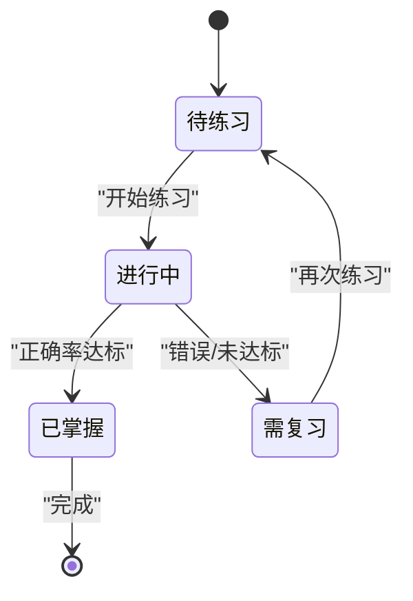

**图示来源**
- [test_p5_practice_loop.py:1-200](file://server/tests/test_p5_practice_loop.py#L1-L200)
- [knowledge_management.py:1-200](file://server/knowledge_management.py#L1-L200)
- [llm_call_logger.py:1-200](file://server/llm_call_logger.py#L1-L200)

**章节来源**
- [test_p5_practice_loop.py:1-200](file://server/tests/test_p5_practice_loop.py#L1-L200)
- [knowledge_management.py:1-200](file://server/knowledge_management.py#L1-L200)
- [llm_call_logger.py:1-200](file://server/llm_call_logger.py#L1-L200)

### 音频流与ASR集成测试
- 目标：验证桌面端ASR代理与服务端接收、转写与回放流程。
- 关键点：
  - 音频设备检测、音量探测、回环播放。
  - 流式传输、延迟与丢帧处理。
- 测试策略：
  - 使用本地回环与虚拟设备进行冒烟测试。
  - 通过诊断脚本检查会话、轨道与同步播放。
  - 对异常场景（设备断开、权限不足）进行容错验证。

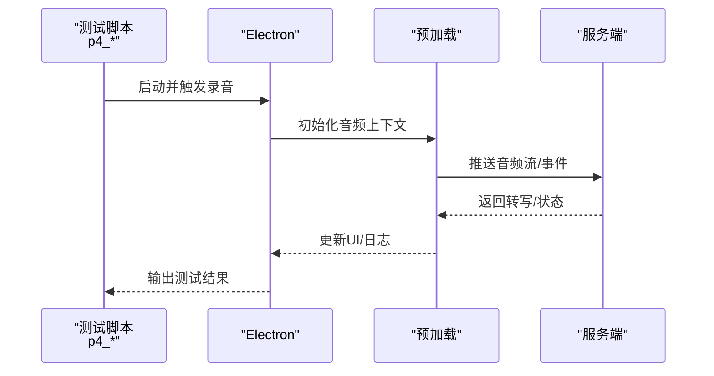

**图示来源**
- [p4_smoke_loopback.py:1-200](file://server/tests/p4_smoke_loopback.py#L1-L200)
- [p4_diag_sessions.py:1-200](file://server/tests/p4_diag_sessions.py#L1-L200)
- [asr_proxy.js:1-200](file://desktop/asr_proxy.js#L1-L200)
- [preload.js:1-200](file://desktop/preload.js#L1-L200)

**章节来源**
- [p4_smoke_loopback.py:1-200](file://server/tests/p4_smoke_loopback.py#L1-L200)
- [p4_diag_sessions.py:1-200](file://server/tests/p4_diag_sessions.py#L1-L200)
- [asr_proxy.js:1-200](file://desktop/asr_proxy.js#L1-L200)
- [preload.js:1-200](file://desktop/preload.js#L1-L200)

### 端到端（E2E）测试
- 目标：覆盖从桌面端启动到服务端响应的完整用户旅程。
- 关键点：
  - 登录、选择课程、录制音频、查看笔记与知识图谱。
  - 跨页面导航与状态保持。
- 测试策略：
  - 使用Electron作为浏览器引擎，避免平台差异。
  - 使用固定夹具数据与种子数据保证可重复性。
  - 失败时截图与日志归档以便定位。

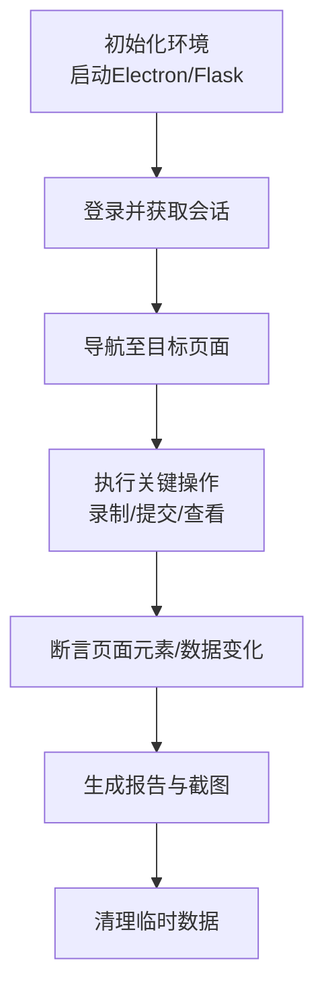

**图示来源**
- [p6_endtoend.py:1-200](file://server/tests/p6_endtoend.py#L1-L200)
- [p4_smoke_e2e.js:1-200](file://desktop/p4_smoke_e2e.js#L1-L200)
- [main.js:1-200](file://desktop/main.js#L1-L200)

**章节来源**
- [p6_endtoend.py:1-200](file://server/tests/p6_endtoend.py#L1-L200)
- [p4_smoke_e2e.js:1-200](file://desktop/p4_smoke_e2e.js#L1-L200)
- [main.js:1-200](file://desktop/main.js#L1-L200)

### 数据库与并发测试
- 目标：验证数据一致性与并发安全。
- 关键点：
  - Schema定义、迁移与约束。
  - 并发写入、锁竞争与死锁检测。
- 测试策略：
  - 使用独立测试库与事务回滚。
  - 并发压力脚本模拟多用户同时操作。
  - 校验最终一致性与补偿机制。

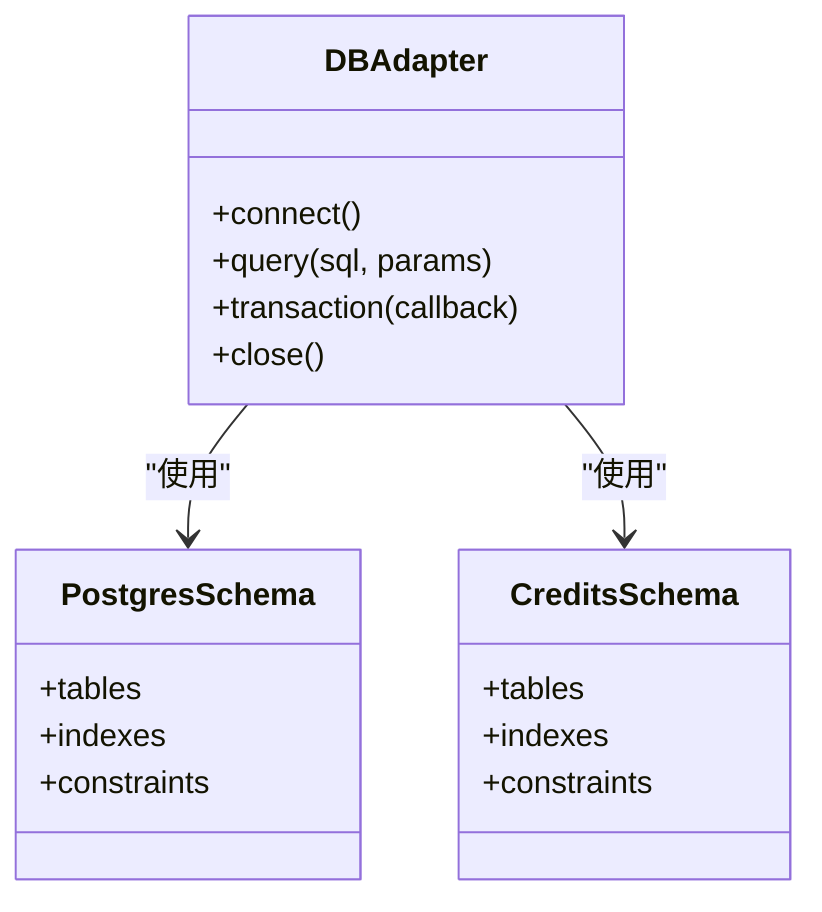

**图示来源**
- [db_adapter.py:1-200](file://server/database/db_adapter.py#L1-L200)
- [schema_postgres.py:1-200](file://server/database/schema_postgres.py#L1-L200)
- [schema_credits.py:1-200](file://server/database/schema_credits.py#L1-L200)
- [pg_concurrency_check.py:1-200](file://server/tests/pg_concurrency_check.py#L1-L200)

**章节来源**
- [db_adapter.py:1-200](file://server/database/db_adapter.py#L1-L200)
- [schema_postgres.py:1-200](file://server/database/schema_postgres.py#L1-L200)
- [schema_credits.py:1-200](file://server/database/schema_credits.py#L1-L200)
- [pg_concurrency_check.py:1-200](file://server/tests/pg_concurrency_check.py#L1-L200)

### 验收与回归测试
- 目标：确保新功能不破坏既有行为，满足业务验收标准。
- 关键点：
  - 回归用例集与基线快照。
  - 验收清单与人工复核点。
- 测试策略：
  - 将关键路径纳入自动化回归套件。
  - 对高风险变更进行专项回归。
  - 结合覆盖率与质量门禁。

**章节来源**
- [r9_acceptance.py:1-200](file://server/tests/r9_acceptance.py#L1-L200)

### 新增测试基础设施

#### 共享切片功能测试
- 目标：验证错误切片功能的可用性与稳定性。
- 关键点：
  - 切片算法的正确性验证。
  - 大文件处理的性能测试。
  - 内存使用优化验证。
- 测试策略：
  - 使用不同大小的测试文件进行冒烟测试。
  - 验证切片结果的准确性与完整性。
  - 监控内存占用与处理时间。

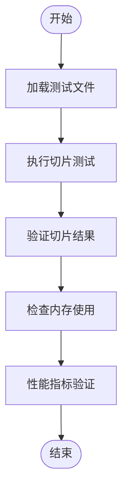

**图示来源**
- [_smoke_shared_slice.py:1-200](file://server/tests/_smoke_shared_slice.py#L1-L200)
- [error_slicer.py:1-200](file://server/services/error_slicer.py#L1-L200)

**章节来源**
- [_smoke_shared_slice.py:1-200](file://server/tests/_smoke_shared_slice.py#L1-L200)
- [error_slicer.py:1-200](file://server/services/error_slicer.py#L1-L200)

#### JavaScript集成页面测试
- 目标：验证前端JavaScript代码与后端API的集成效果。
- 关键点：
  - 页面加载与DOM操作验证。
  - API调用与响应处理。
  - 错误处理与用户反馈。
- 测试策略：
  - 使用静态分析检查JavaScript语法与依赖。
  - 验证页面渲染与交互功能。
  - 检查网络请求与数据绑定。

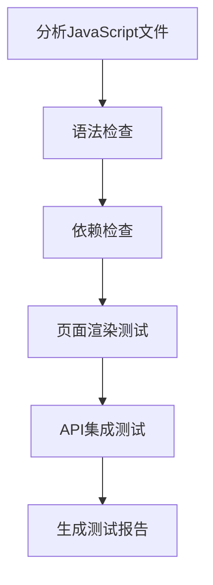

**图示来源**
- [_js_check_integ_pages.py:1-200](file://server/tests/_js_check_integ_pages.py#L1-L200)
- [app.py:1-200](file://server/app.py#L1-L200)

**章节来源**
- [_js_check_integ_pages.py:1-200](file://server/tests/_js_check_integ_pages.py#L1-L200)
- [app.py:1-200](file://server/app.py#L1-L200)

#### R2存储路由测试
- 目标：验证R2存储服务的路由功能与数据处理。
- 关键点：
  - 文件上传与下载功能。
  - 存储路径映射与访问控制。
  - 大文件处理与断点续传。
- 测试策略：
  - 列出所有R2相关路由进行可用性检查。
  - 验证文件操作的权限控制。
  - 测试存储空间的使用情况。

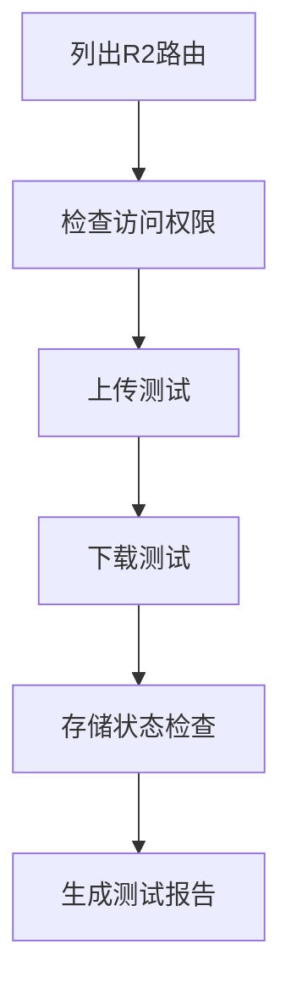

**图示来源**
- [_list_routes_r2.py:1-200](file://server/tests/_list_routes_r2.py#L1-L200)
- [app.py:1-200](file://server/app.py#L1-L200)

**章节来源**
- [_list_routes_r2.py:1-200](file://server/tests/_list_routes_r2.py#L1-L200)
- [app.py:1-200](file://server/app.py#L1-L200)

## 依赖关系分析
- 低耦合高内聚：路由层仅负责请求分发，业务逻辑下沉至服务层；数据访问通过适配器屏蔽底层差异。
- 外部依赖：LLM提供商、ASR服务、数据库与文件系统。
- 测试隔离：通过夹具与Mock替换外部依赖，保证测试稳定性与可重复性。
- **新增** 测试基础设施依赖：合同测试框架、Playwright UI自动化测试、共享切片功能、JavaScript集成检查、R2存储路由管理、**PDF书籍测试套件**、**PDF书籍整理测试套件**、**Vault删除附件测试套件**、**CDP截图测试工具**。

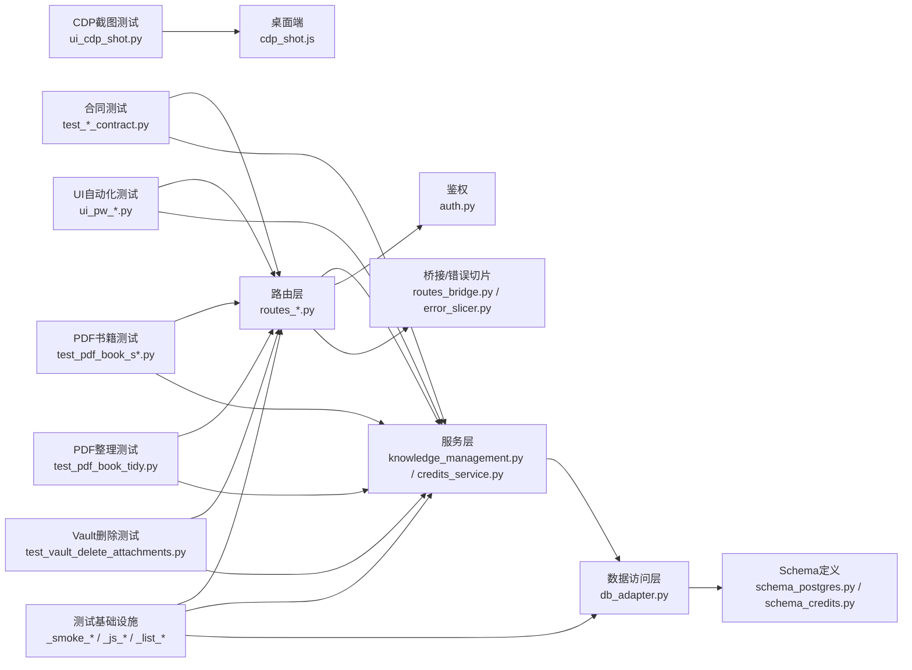

**图示来源**
- [routes_notes.py:1-200](file://server/routes_notes.py#L1-L200)
- [routes_knowledge.py:1-200](file://server/routes_knowledge.py#L1-L200)
- [routes_bridge.py:1-200](file://server/routes_bridge.py#L1-L200)
- [routes_admin.py:1-200](file://server/routes_admin.py#L1-L200)
- [routes_credits.py:1-200](file://server/routes_credits.py#L1-L200)
- [knowledge_management.py:1-200](file://server/knowledge_management.py#L1-L200)
- [credits_service.py:1-200](file://server/credits_service.py#L1-L200)
- [db_adapter.py:1-200](file://server/database/db_adapter.py#L1-L200)
- [schema_postgres.py:1-200](file://server/database/schema_postgres.py#L1-L200)
- [schema_credits.py:1-200](file://server/database/schema_credits.py#L1-L200)
- [error_slicer.py:1-200](file://server/services/error_slicer.py#L1-L200)
- [auth.py:1-200](file://server/auth.py#L1-L200)
- [test_knowledge_point_contract.py:1-200](file://server/tests/test_knowledge_point_contract.py#L1-L200)
- [ui_pw_b3_verify.py:1-200](file://server/tests/ui_pw_b3_verify.py#L1-L200)
- [_smoke_shared_slice.py:1-200](file://server/tests/_smoke_shared_slice.py#L1-L200)
- [_js_check_integ_pages.py:1-200](file://server/tests/_js_check_integ_pages.py#L1-L200)
- [_list_routes_r2.py:1-200](file://server/tests/_list_routes_r2.py#L1-L200)
- [test_pdf_book_s1.py:1-200](file://server/tests/test_pdf_book_s1.py#L1-L200)
- [test_pdf_book_s2.py:1-200](file://server/tests/test_pdf_book_s2.py#L1-L200)
- [test_pdf_book_s3.py:1-200](file://server/tests/test_pdf_book_s3.py#L1-L200)
- [test_pdf_book_s6.py:1-200](file://server/tests/test_pdf_book_s6.py#L1-L200)
- [test_pdf_book_tidy.py:1-200](file://server/tests/test_pdf_book_tidy.py#L1-L200)
- [test_vault_delete_attachments.py:1-200](file://server/tests/test_vault_delete_attachments.py#L1-L200)
- [ui_cdp_shot.py:1-200](file://server/tests/ui_cdp_shot.py#L1-L200)
- [cdp_shot.js:1-200](file://desktop/cdp_shot.js#L1-L200)

**章节来源**
- [app.py:1-200](file://server/app.py#L1-L200)
- [config.py:1-200](file://server/config.py#L1-L200)

## 性能与基准测试
- 指标定义：
  - 响应时间（P50/P95/P99）、吞吐量（QPS）、错误率、资源占用（CPU/内存）。
- 压测场景：
  - 并发登录与鉴权。
  - 批量写入笔记与知识点。
  - 流式音频上传与转写。
  - **新增** 大文件切片处理性能测试。
  - **新增** UI自动化测试的性能基准。
  - **新增** PDF书籍处理性能测试。
  - **新增** PDF书籍整理性能测试。
  - **新增** Vault删除附件性能测试。
  - **新增** CDP截图性能测试。
- 工具建议：
  - 服务端：使用轻量压测脚本或集成现有并发检查脚本。
  - 桌面端：监控Electron进程资源与音频延迟。
  - **新增** 使用共享切片测试工具进行性能基准测试。
  - **新增** 使用Playwright进行UI性能测试。
  - **新增** 使用PDF书籍测试套件进行性能基准测试。
  - **新增** 使用PDF书籍整理测试套件进行性能基准测试。
  - **新增** 使用Vault删除测试套件进行文件操作性能测试。
  - **新增** 使用CDP截图测试工具进行截图性能基准测试。
- 基准回归：
  - 将关键路径的性能阈值纳入CI门禁，超阈失败。
  - 定期运行历史对比，识别退化趋势。

[本节为通用指导，不直接分析具体文件]

## 故障排查指南
- 常见问题：
  - 端口冲突与服务无法启动。
  - 数据库连接失败或Schema不一致。
  - 音频设备权限不足或回环不可用。
  - LLM调用超时或限流。
  - **新增** 共享切片功能内存溢出。
  - **新增** JavaScript集成页面加载失败。
  - **新增** R2存储路由访问权限问题。
  - **新增** Playwright浏览器启动失败。
  - **新增** 合同测试断言失败。
  - **新增** PDF书籍导入失败或文本提取错误。
  - **新增** PDF处理性能问题或内存泄漏。
  - **新增** PDF书籍整理功能异常或结果不准确。
  - **新增** CDP截图连接失败或截图质量不佳。
  - **新增** Vault删除附件权限错误或数据不一致。
  - **新增** 文件存储系统连接失败。
- 排查步骤：
  - 检查服务日志与错误切片输出。
  - 使用诊断脚本验证设备与会话状态。
  - 缩小范围：先跑单测，再跑集成，最后跑E2E。
  - 收集网络抓包与前端控制台日志。
  - **新增** 使用新的测试基础设施工具进行快速定位。
  - **新增** 检查Playwright浏览器配置和环境变量。
  - **新增** 分析合同测试的Schema定义和响应格式。
  - **新增** 检查PDF文件格式和编码问题。
  - **新增** 验证PDF处理管道的各个阶段。
  - **新增** 检查PDF整理算法的逻辑和边界条件。
  - **新增** 验证CDP协议连接和截图配置。
  - **新增** 检查Vault删除权限和文件存储连接。
  - **新增** 验证数据库引用完整性和文件系统一致性。
- 恢复策略：
  - 重启服务与清理临时文件。
  - 回滚Schema或重置测试库。
  - 降级外部依赖（Mock/缓存）以快速恢复。
  - **新增** 使用测试工具重新验证修复效果。
  - **新增** 重新安装Playwright依赖和浏览器。
  - **新增** 更新合同测试的Schema定义。
  - **新增** 清理PDF缓存和临时文件。
  - **新增** 重新运行PDF处理管道。
  - **新增** 修复PDF整理算法的配置和参数。
  - **新增** 重新配置CDP连接和截图选项。
  - **新增** 修复Vault权限配置和文件存储连接。
  - **新增** 重建数据库索引和文件存储映射。

**章节来源**
- [error_slicer.py:1-200](file://server/services/error_slicer.py#L1-L200)
- [p4_diag_sessions.py:1-200](file://server/tests/p4_diag_sessions.py#L1-L200)
- [p4_smoke_loopback.py:1-200](file://server/tests/p4_smoke_loopback.py#L1-L200)
- [_smoke_shared_slice.py:1-200](file://server/tests/_smoke_shared_slice.py#L1-L200)
- [_js_check_integ_pages.py:1-200](file://server/tests/_js_check_integ_pages.py#L1-L200)
- [_list_routes_r2.py:1-200](file://server/tests/_list_routes_r2.py#L1-L200)
- [ui_pw_b3_verify.py:1-200](file://server/tests/ui_pw_b3_verify.py#L1-L200)
- [test_knowledge_point_contract.py:1-200](file://server/tests/test_knowledge_point_contract.py#L1-L200)
- [test_pdf_book_s1.py:1-200](file://server/tests/test_pdf_book_s1.py#L1-L200)
- [test_pdf_book_s2.py:1-200](file://server/tests/test_pdf_book_s2.py#L1-L200)
- [test_pdf_book_s3.py:1-200](file://server/tests/test_pdf_book_s3.py#L1-L200)
- [test_pdf_book_s6.py:1-200](file://server/tests/test_pdf_book_s6.py#L1-L200)
- [test_pdf_book_tidy.py:1-200](file://server/tests/test_pdf_book_tidy.py#L1-L200)
- [ui_cdp_shot.py:1-200](file://server/tests/ui_cdp_shot.py#L1-L200)
- [cdp_shot.js:1-200](file://desktop/cdp_shot.js#L1-L200)
- [test_vault_delete_attachments.py:1-200](file://server/tests/test_vault_delete_attachments.py#L1-L200)

## 结论
本测试指南基于现有代码结构与测试脚本，构建了分层测试体系：单元、集成、合同测试、E2E与性能测试相互补充。通过夹具与Mock隔离外部依赖，结合并发与回归测试保障系统稳定性。**新增的测试基础设施**进一步增强了系统的可测试性，包括完整的合同测试框架、Playwright驱动的UI自动化测试套件、共享切片功能测试、JavaScript集成页面检查和R2存储路由验证。**新增的PDF书籍测试套件**提供了全面的PDF处理功能测试覆盖，**新增的PDF书籍整理测试套件**确保了PDF整理功能的准确性和视觉一致性，**新增的Vault删除附件测试套件**确保了文件存储管理的完整性和数据一致性，**新增的CDP截图测试工具**提供了精确的Electron截图验证能力。建议在CI中固化测试套件，持续产出覆盖率与性能报告，逐步完善移动端、跨浏览器与无障碍性测试矩阵。

[本节为总结性内容，不直接分析具体文件]

## 附录

### 测试框架与工具选型建议
- Python侧：pytest、requests、unittest.mock、coverage。
- Node/Electron侧：原生脚本或引入Playwright/Puppeteer进行DOM与交互测试。
- 报告与可视化：pytest-html、Allure、Jest/Playwright内置报告。
- **新增** 专用测试工具：合同测试框架、Playwright UI自动化测试、共享切片测试、JavaScript集成检查、R2路由验证、**PDF书籍测试套件**、**PDF书籍整理测试套件**、**Vault删除附件测试套件**、**CDP截图测试工具**。

[本节为通用指导，不直接分析具体文件]

### 测试数据管理
- 夹具组织：按功能域划分fixtures目录，包含种子数据、边界值与异常样本。
- 数据生命周期：每个用例独立创建与清理，避免交叉污染。
- 敏感数据：使用环境变量或密钥管理服务，禁止硬编码。
- **新增** 大文件测试数据：为共享切片功能准备不同大小的测试文件。
- **新增** UI测试数据：为Playwright测试准备固定的用户数据和页面状态。
- **新增** PDF测试数据：为PDF书籍测试准备各种格式和大小的PDF文件样本。
- **新增** PDF整理测试数据：为PDF书籍整理测试准备各种类型的PDF文件和预期结果。
- **新增** Vault测试数据：为Vault删除测试准备各种类型的附件文件和权限场景。
- **新增** 截图基准数据：为CDP截图测试准备基准截图和期望结果。

**章节来源**
- [test_p2_pages.py:1-200](file://server/tests/test_p2_pages.py#L1-L200)
- [test_p3_api.py:1-200](file://server/tests/test_p3_api.py#L1-L200)
- [test_p5_practice_loop.py:1-200](file://server/tests/test_p5_practice_loop.py#L1-L200)
- [_smoke_shared_slice.py:1-200](file://server/tests/_smoke_shared_slice.py#L1-L200)
- [ui_pw_b3_verify.py:1-200](file://server/tests/ui_pw_b3_verify.py#L1-L200)
- [test_pdf_book_s1.py:1-200](file://server/tests/test_pdf_book_s1.py#L1-L200)
- [test_pdf_book_s2.py:1-200](file://server/tests/test_pdf_book_s2.py#L1-L200)
- [test_pdf_book_s3.py:1-200](file://server/tests/test_pdf_book_s3.py#L1-L200)
- [test_pdf_book_s6.py:1-200](file://server/tests/test_pdf_book_s6.py#L1-L200)
- [test_pdf_book_tidy.py:1-200](file://server/tests/test_pdf_book_tidy.py#L1-L200)
- [ui_cdp_shot.py:1-200](file://server/tests/ui_cdp_shot.py#L1-L200)
- [test_vault_delete_attachments.py:1-200](file://server/tests/test_vault_delete_attachments.py#L1-L200)

### Mock与断言最佳实践
- Mock原则：仅Mock外部依赖与不稳定组件，保留核心逻辑真实执行。
- 断言层次：先断言状态码与结构，再断言业务语义与边界条件。
- 可观测性：在关键路径埋点日志，便于失败回溯。
- **新增** 性能断言：对共享切片等耗时操作添加性能断言。
- **新增** UI断言：对Playwright测试中的DOM元素状态和用户交互进行断言。
- **新增** 合同断言：对API响应结构和数据格式进行严格断言。
- **新增** PDF断言：对PDF处理结果的结构和内容进行断言验证。
- **新增** PDF整理断言：对PDF整理结果的结构、内容和视觉一致性进行断言验证。
- **新增** CDP截图断言：对截图质量和视觉元素进行断言验证。
- **新增** Vault断言：对文件删除操作的结果和数据一致性进行断言验证。

**章节来源**
- [auth.py:1-200](file://server/auth.py#L1-L200)
- [routes_bridge.py:1-200](file://server/routes_bridge.py#L1-L200)
- [llm_call_logger.py:1-200](file://server/llm_call_logger.py#L1-L200)
- [_smoke_shared_slice.py:1-200](file://server/tests/_smoke_shared_slice.py#L1-L200)
- [ui_pw_b3_verify.py:1-200](file://server/tests/ui_pw_b3_verify.py#L1-L200)
- [test_knowledge_point_contract.py:1-200](file://server/tests/test_knowledge_point_contract.py#L1-L200)
- [test_pdf_book_s1.py:1-200](file://server/tests/test_pdf_book_s1.py#L1-L200)
- [test_pdf_book_s2.py:1-200](file://server/tests/test_pdf_book_s2.py#L1-L200)
- [test_pdf_book_s3.py:1-200](file://server/tests/test_pdf_book_s3.py#L1-L200)
- [test_pdf_book_s6.py:1-200](file://server/tests/test_pdf_book_s6.py#L1-L200)
- [test_pdf_book_tidy.py:1-200](file://server/tests/test_pdf_book_tidy.py#L1-L200)
- [ui_cdp_shot.py:1-200](file://server/tests/ui_cdp_shot.py#L1-L200)
- [test_vault_delete_attachments.py:1-200](file://server/tests/test_vault_delete_attachments.py#L1-L200)

### 覆盖率统计与质量门禁
- 覆盖率目标：核心模块≥80%，新增代码行覆盖率≥90%。
- 门禁规则：覆盖率低于阈值或回归用例失败则阻断合并。
- 报告输出：每次PR生成覆盖率报告与趋势图。
- **新增** 测试基础设施覆盖率：确保新的测试工具也有足够的覆盖率。
- **新增** UI测试覆盖率：对Playwright测试进行独立的覆盖率统计。
- **新增** 合同测试覆盖率：确保API契约测试的完整性。
- **新增** PDF书籍测试覆盖率：确保PDF处理功能的测试覆盖度。
- **新增** PDF书籍整理测试覆盖率：确保PDF整理功能的测试覆盖度。
- **新增** CDP截图测试覆盖率：确保截图验证功能的测试覆盖度。
- **新增** Vault删除测试覆盖率：确保文件存储管理功能的测试覆盖度。

[本节为通用指导，不直接分析具体文件]

### 移动端、跨浏览器与无障碍性测试
- 移动端：优先使用Electron模拟移动端窗口尺寸与触控事件；必要时接入真机云测。
- 跨浏览器：在CI中并行运行Chrome/Firefox/Safari（若可用），捕获兼容性差异。
- 无障碍性：使用axe-core或类似工具扫描A11y问题，确保键盘导航与屏幕阅读器友好。
- **新增** JavaScript集成测试：确保新添加的JavaScript代码在不同环境下正常工作。
- **新增** Playwright跨浏览器测试：利用Playwright的多浏览器支持进行兼容性验证。
- **新增** PDF跨平台测试：确保PDF处理功能在不同操作系统上的一致性。
- **新增** PDF整理跨平台测试：确保PDF整理功能在不同平台上的行为一致性。
- **新增** CDP截图跨平台测试：确保截图功能在不同平台上的兼容性。
- **新增** Vault跨平台测试：确保文件存储管理功能在不同平台上的行为一致性。

[本节为通用指导，不直接分析具体文件]

### 新增测试工具使用指南

#### 共享切片测试工具
```bash
# 运行共享切片冒烟测试
python server/tests/_smoke_shared_slice.py

# 指定测试文件大小
python server/tests/_smoke_shared_slice.py --size large

# 启用详细日志
python server/tests/_smoke_shared_slice.py --verbose
```

**章节来源**
- [_smoke_shared_slice.py:1-200](file://server/tests/_smoke_shared_slice.py#L1-L200)

#### JavaScript集成页面检查器
```bash
# 检查JavaScript集成页面
python server/tests/_js_check_integ_pages.py

# 检查特定页面
python server/tests/_js_check_integ_pages.py --page dashboard

# 生成详细报告
python server/tests/_js_check_integ_pages.py --report
```

**章节来源**
- [_js_check_integ_pages.py:1-200](file://server/tests/_js_check_integ_pages.py#L1-L200)

#### R2存储路由列表器
```bash
# 列出所有R2路由
python server/tests/_list_routes_r2.py

# 检查路由权限
python server/tests/_list_routes_r2.py --check-permissions

# 生成路由文档
python server/tests/_list_routes_r2.py --generate-docs
```

**章节来源**
- [_list_routes_r2.py:1-200](file://server/tests/_list_routes_r2.py#L1-L200)

#### Playwright UI自动化测试
```bash
# 运行仪表板测试
python server/tests/ui_pw_b3_verify.py

# 运行笔记功能测试
python server/tests/ui_pw_b4_verify.py

# 运行思维导图测试
python server/tests/ui_pw_b5_verify.py

# 运行用户管理测试
python server/tests/ui_pw_b6_verify.py

# 运行练习功能测试
python server/tests/ui_pw_b7_verify.py

# 运行设置页面测试
python server/tests/ui_pw_b8_verify.py

# 运行登录流程测试
python server/tests/ui_walk_login.py
```

**章节来源**
- [ui_pw_b3_verify.py:1-200](file://server/tests/ui_pw_b3_verify.py#L1-L200)
- [ui_pw_b4_verify.py:1-200](file://server/tests/ui_pw_b4_verify.py#L1-L200)
- [ui_pw_b5_verify.py:1-200](file://server/tests/ui_pw_b5_verify.py#L1-L200)
- [ui_pw_b6_verify.py:1-200](file://server/tests/ui_pw_b6_verify.py#L1-L200)
- [ui_pw_b7_verify.py:1-200](file://server/tests/ui_pw_b7_verify.py#L1-L200)
- [ui_pw_b8_verify.py:1-200](file://server/tests/ui_pw_b8_verify.py#L1-L200)
- [ui_walk_login.py:1-200](file://server/tests/ui_walk_login.py#L1-L200)

#### 合同测试框架
```bash
# 运行知识要点合同测试
python server/tests/test_knowledge_point_contract.py

# 运行记忆概览合同测试
python server/tests/test_memory_overview_contract.py

# 运行练习功能合同测试
python server/tests/test_practice_new_contract.py

# 运行练习概览合同测试
python server/tests/test_practice_overview_contract.py
```

**章节来源**
- [test_knowledge_point_contract.py:1-200](file://server/tests/test_knowledge_point_contract.py#L1-L200)
- [test_memory_overview_contract.py:1-200](file://server/tests/test_memory_overview_contract.py#L1-L200)
- [test_practice_new_contract.py:1-200](file://server/tests/test_practice_new_contract.py#L1-L200)
- [test_practice_overview_contract.py:1-200](file://server/tests/test_practice_overview_contract.py#L1-L200)

#### PDF书籍测试套件
```bash
# 运行PDF导入验证测试
python server/tests/test_pdf_book_s1.py

# 运行文本层处理测试
python server/tests/test_pdf_book_s2.py

# 运行内容提取测试
python server/tests/test_pdf_book_s3.py

# 运行API端点测试
python server/tests/test_pdf_book_s6.py

# 运行完整PDF处理流程测试
python server/tests/test_pdf_book_s1.py && python server/tests/test_pdf_book_s2.py && python server/tests/test_pdf_book_s3.py && python server/tests/test_pdf_book_s6.py
```

**章节来源**
- [test_pdf_book_s1.py:1-200](file://server/tests/test_pdf_book_s1.py#L1-L200)
- [test_pdf_book_s2.py:1-200](file://server/tests/test_pdf_book_s2.py#L1-L200)
- [test_pdf_book_s3.py:1-200](file://server/tests/test_pdf_book_s3.py#L1-L200)
- [test_pdf_book_s6.py:1-200](file://server/tests/test_pdf_book_s6.py#L1-L200)

#### PDF书籍整理测试套件
```bash
# 运行PDF书籍整理功能测试
python server/tests/test_pdf_book_tidy.py

# 运行特定的整理场景测试
python server/tests/test_pdf_book_tidy.py -k "test_tidy_algorithm"

# 运行带详细输出的测试
python server/tests/test_pdf_book_tidy.py -v

# 运行失败的测试用例进行调试
python server/tests/test_pdf_book_tidy.py --tb=long

# 运行Electron截图验证测试
python server/tests/test_pdf_book_tidy.py --with-screenshot
```

**章节来源**
- [test_pdf_book_tidy.py:1-200](file://server/tests/test_pdf_book_tidy.py#L1-L200)

#### CDP截图测试工具
```bash
# 运行CDP截图测试
python server/tests/ui_cdp_shot.py

# 指定目标页面
python server/tests/ui_cdp_shot.py --page pdf_viewer

# 设置截图质量
python server/tests/ui_cdp_shot.py --quality high

# 启用调试模式
python server/tests/ui_cdp_shot.py --debug
```

**章节来源**
- [ui_cdp_shot.py:1-200](file://server/tests/ui_cdp_shot.py#L1-L200)

#### Vault删除附件测试套件
```bash
# 运行Vault删除附件测试
python server/tests/test_vault_delete_attachments.py

# 运行特定的删除场景测试
python server/tests/test_vault_delete_attachments.py -k "test_delete_permission"

# 运行带详细输出的测试
python server/tests/test_vault_delete_attachments.py -v

# 运行失败的测试用例进行调试
python server/tests/test_vault_delete_attachments.py --tb=long
```

**章节来源**
- [test_vault_delete_attachments.py:1-200](file://server/tests/test_vault_delete_attachments.py#L1-L200)