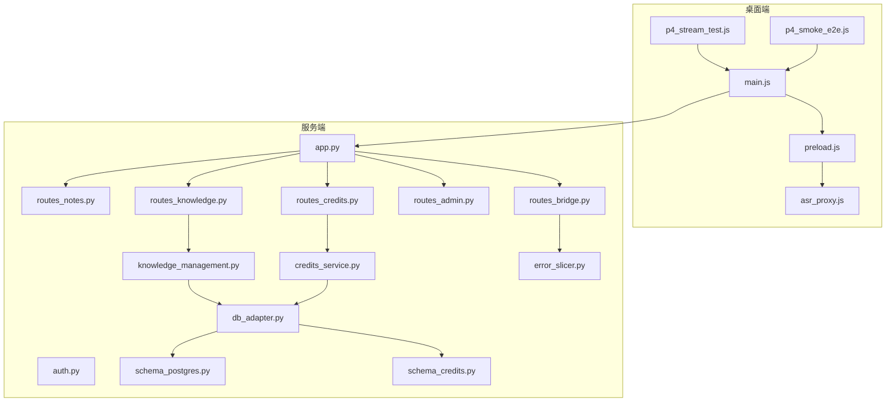
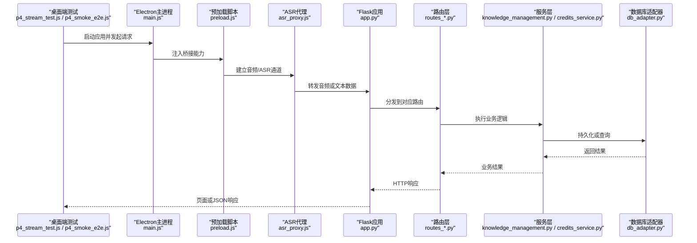
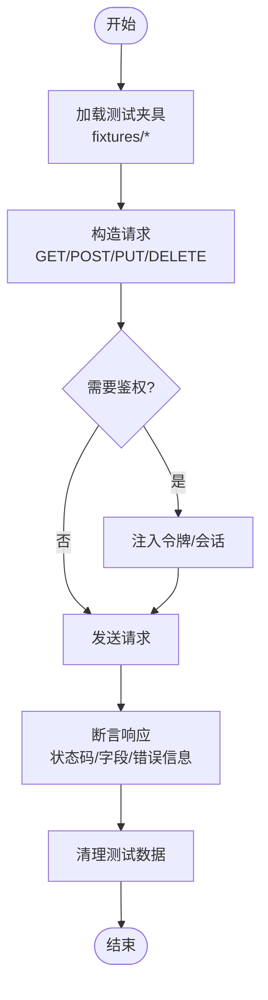
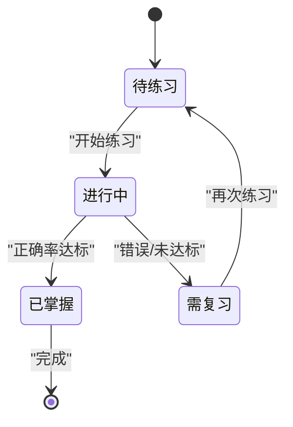
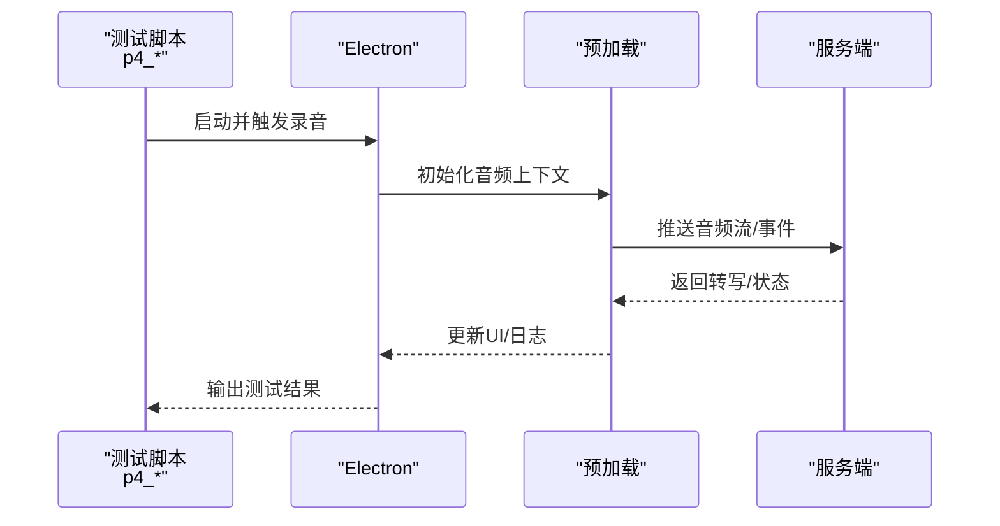
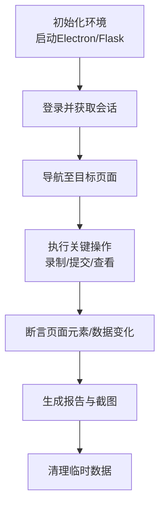
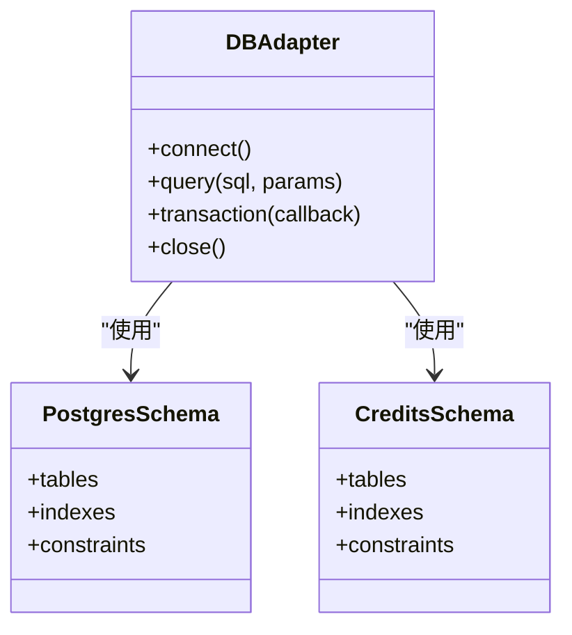
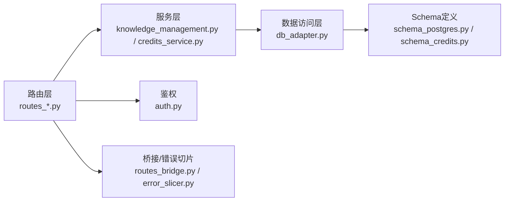

# 测试指南

<cite>
**本文引用的文件**   
- [app.py](file://server/app.py)
- [config.py](file://server/config.py)
- [routes_notes.py](file://server/routes_notes.py)
- [routes_knowledge.py](file://server/routes_knowledge.py)
- [routes_bridge.py](file://server/routes_bridge.py)
- [routes_admin.py](file://server/routes_admin.py)
- [routes_credits.py](file://server/routes_credits.py)
- [auth.py](file://server/auth.py)
- [knowledge_management.py](file://server/knowledge_management.py)
- [credits_service.py](file://server/credits_service.py)
- [llm_call_logger.py](file://server/llm_call_logger.py)
- [similarity_matcher.py](file://server/similarity_matcher.py)
- [db_adapter.py](file://server/database/db_adapter.py)
- [schema_postgres.py](file://server/database/schema_postgres.py)
- [schema_credits.py](file://server/database/schema_credits.py)
- [error_slicer.py](file://server/services/error_slicer.py)
- [test_p2_pages.py](file://server/tests/test_p2_pages.py)
- [test_p3_api.py](file://server/tests/test_p3_api.py)
- [test_p5_practice_loop.py](file://server/tests/test_p5_practice_loop.py)
- [test_user_p4.py](file://server/tests/test_user_p4.py)
- [p6_endtoend.py](file://server/tests/p6_endtoend.py)
- [p4_smoke_loopback.py](file://server/tests/p4_smoke_loopback.py)
- [p4_diag_sessions.py](file://server/tests/p4_diag_sessions.py)
- [pg_concurrency_check.py](file://server/tests/pg_concurrency_check.py)
- [r9_acceptance.py](file://server/tests/r9_acceptance.py)
- [package.json](file://desktop/package.json)
- [main.js](file://desktop/main.js)
- [preload.js](file://desktop/preload.js)
- [asr_proxy.js](file://desktop/asr_proxy.js)
- [p4_stream_test.js](file://desktop/p4_stream_test.js)
- [p4_smoke_e2e.js](file://desktop/p4_smoke_e2e.js)
</cite>

## 目录
1. [简介](#简介)
2. [项目结构](#项目结构)
3. [核心组件](#核心组件)
4. [架构总览](#架构总览)
5. [详细组件分析](#详细组件分析)
6. [依赖关系分析](#依赖关系分析)
7. [性能与基准测试](#性能与基准测试)
8. [故障排查指南](#故障排查指南)
9. [结论](#结论)
10. [附录](#附录)

## 简介
本指南面向LectureLearnLoop的测试体系建设，覆盖单元测试、集成测试、端到端（E2E）测试与性能测试的策略与实现。文档基于仓库中现有的服务端Python测试脚本、桌面端Electron测试脚本以及后端路由与服务模块，给出可操作的测试规范、数据管理方案、自动化流程建议与报告生成方式，并补充移动端、跨浏览器兼容性与无障碍性测试方法。

## 项目结构
本项目采用前后端分离+桌面客户端的混合架构：
- 服务端：Flask应用，提供页面渲染、API路由、知识管理与积分服务；数据库通过适配器抽象，支持PostgreSQL等。
- 桌面端：Electron主进程与预加载脚本，封装ASR代理与流式音频能力，并提供E2E/冒烟测试脚本。
- 测试：服务端以pytest风格脚本为主，桌面端以Node脚本驱动Electron进行冒烟与流式测试。

**图示来源**
- [main.js:1-200](file://desktop/main.js#L1-L200)
- [preload.js:1-200](file://desktop/preload.js#L1-L200)
- [asr_proxy.js:1-200](file://desktop/asr_proxy.js#L1-L200)
- [app.py:1-200](file://server/app.py#L1-L200)
- [routes_notes.py:1-200](file://server/routes_notes.py#L1-L200)
- [routes_knowledge.py:1-200](file://server/routes_knowledge.py#L1-L200)
- [routes_bridge.py:1-200](file://server/routes_bridge.py#L1-L200)
- [routes_admin.py:1-200](file://server/routes_admin.py#L1-L200)
- [routes_credits.py:1-200](file://server/routes_credits.py#L1-L200)
- [auth.py:1-200](file://server/auth.py#L1-L200)
- [knowledge_management.py:1-200](file://server/knowledge_management.py#L1-L200)
- [credits_service.py:1-200](file://server/credits_service.py#L1-L200)
- [db_adapter.py:1-200](file://server/database/db_adapter.py#L1-L200)
- [schema_postgres.py:1-200](file://server/database/schema_postgres.py#L1-L200)
- [schema_credits.py:1-200](file://server/database/schema_credits.py#L1-L200)
- [error_slicer.py:1-200](file://server/services/error_slicer.py#L1-L200)

**章节来源**
- [app.py:1-200](file://server/app.py#L1-L200)
- [package.json:1-200](file://desktop/package.json#L1-L200)

## 核心组件
围绕测试体系，以下组件是关键被测对象与支撑点：
- 应用入口与路由层：负责HTTP请求分发、模板渲染与API响应。
- 业务服务层：知识管理、积分服务、错误切片等。
- 数据访问层：数据库适配器与Schema定义。
- 认证与安全：鉴权中间件与权限控制。
- 桌面端桥接：Electron主进程、预加载脚本与ASR代理，为E2E与流式测试提供环境。

测试策略要点：
- 单元测试：聚焦纯函数与无副作用逻辑，如错误切片、相似度匹配等。
- 集成测试：验证路由到服务的调用链、数据库读写与事务一致性。
- E2E测试：通过桌面端脚本驱动真实浏览器/Electron，走通关键用户路径。
- 性能测试：针对并发连接、数据库写入与LLM调用链路进行压测与回归。

**章节来源**
- [routes_notes.py:1-200](file://server/routes_notes.py#L1-L200)
- [routes_knowledge.py:1-200](file://server/routes_knowledge.py#L1-L200)
- [routes_bridge.py:1-200](file://server/routes_bridge.py#L1-L200)
- [routes_admin.py:1-200](file://server/routes_admin.py#L1-L200)
- [routes_credits.py:1-200](file://server/routes_credits.py#L1-L200)
- [knowledge_management.py:1-200](file://server/knowledge_management.py#L1-L200)
- [credits_service.py:1-200](file://server/credits_service.py#L1-L200)
- [error_slicer.py:1-200](file://server/services/error_slicer.py#L1-L200)
- [similarity_matcher.py:1-200](file://server/similarity_matcher.py#L1-L200)

## 架构总览
下图展示从桌面端到服务端的典型请求流，以及测试如何介入各层。

**图示来源**
- [p4_stream_test.js:1-200](file://desktop/p4_stream_test.js#L1-L200)
- [p4_smoke_e2e.js:1-200](file://desktop/p4_smoke_e2e.js#L1-L200)
- [main.js:1-200](file://desktop/main.js#L1-L200)
- [preload.js:1-200](file://desktop/preload.js#L1-L200)
- [asr_proxy.js:1-200](file://desktop/asr_proxy.js#L1-L200)
- [app.py:1-200](file://server/app.py#L1-L200)
- [routes_notes.py:1-200](file://server/routes_notes.py#L1-L200)
- [routes_knowledge.py:1-200](file://server/routes_knowledge.py#L1-L200)
- [routes_bridge.py:1-200](file://server/routes_bridge.py#L1-L200)
- [knowledge_management.py:1-200](file://server/knowledge_management.py#L1-L200)
- [credits_service.py:1-200](file://server/credits_service.py#L1-L200)
- [db_adapter.py:1-200](file://server/database/db_adapter.py#L1-L200)

## 详细组件分析

### 服务端路由与接口测试
- 目标：验证页面渲染、API行为、鉴权与权限控制。
- 用例设计：
  - 页面可用性：登录页、仪表盘、笔记、知识库、设置等页面的GET可达性与基础HTML结构。
  - API契约：POST/PUT/DELETE的参数校验、状态码、错误消息与幂等性。
  - 鉴权：未登录重定向、越权访问拒绝、会话保持。
- 断言最佳实践：
  - 使用结构化断言检查响应体字段存在性与类型。
  - 对分页、排序、过滤等边界条件进行参数组合测试。
  - 对错误分支进行异常输入与非法状态的覆盖。

**图示来源**
- [test_p2_pages.py:1-200](file://server/tests/test_p2_pages.py#L1-L200)
- [test_p3_api.py:1-200](file://server/tests/test_p3_api.py#L1-L200)
- [auth.py:1-200](file://server/auth.py#L1-L200)

**章节来源**
- [test_p2_pages.py:1-200](file://server/tests/test_p2_pages.py#L1-L200)
- [test_p3_api.py:1-200](file://server/tests/test_p3_api.py#L1-L200)
- [routes_notes.py:1-200](file://server/routes_notes.py#L1-L200)
- [routes_knowledge.py:1-200](file://server/routes_knowledge.py#L1-L200)
- [routes_bridge.py:1-200](file://server/routes_bridge.py#L1-L200)
- [routes_admin.py:1-200](file://server/routes_admin.py#L1-L200)
- [routes_credits.py:1-200](file://server/routes_credits.py#L1-L200)
- [auth.py:1-200](file://server/auth.py#L1-L200)

### 练习循环与学习闭环测试
- 目标：验证“练习-反馈-纠错”闭环的数据流转与状态机。
- 关键点：
  - 知识点抽取、错误记录、复习计划与进度追踪。
  - 与LLM调用的交互（日志记录、重试与超时）。
- 测试策略：
  - 使用夹具模拟LLM输出与外部依赖。
  - 验证状态转换的正确性与幂等性。
  - 对长时任务进行异步回调与中断恢复测试。

**图示来源**
- [test_p5_practice_loop.py:1-200](file://server/tests/test_p5_practice_loop.py#L1-L200)
- [knowledge_management.py:1-200](file://server/knowledge_management.py#L1-L200)
- [llm_call_logger.py:1-200](file://server/llm_call_logger.py#L1-L200)

**章节来源**
- [test_p5_practice_loop.py:1-200](file://server/tests/test_p5_practice_loop.py#L1-L200)
- [knowledge_management.py:1-200](file://server/knowledge_management.py#L1-L200)
- [llm_call_logger.py:1-200](file://server/llm_call_logger.py#L1-L200)

### 音频流与ASR集成测试
- 目标：验证桌面端ASR代理与服务端接收、转写与回放流程。
- 关键点：
  - 音频设备检测、音量探测、回环播放。
  - 流式传输、延迟与丢帧处理。
- 测试策略：
  - 使用本地回环与虚拟设备进行冒烟测试。
  - 通过诊断脚本检查会话、轨道与同步播放。
  - 对异常场景（设备断开、权限不足）进行容错验证。

**图示来源**
- [p4_smoke_loopback.py:1-200](file://server/tests/p4_smoke_loopback.py#L1-L200)
- [p4_diag_sessions.py:1-200](file://server/tests/p4_diag_sessions.py#L1-L200)
- [asr_proxy.js:1-200](file://desktop/asr_proxy.js#L1-L200)
- [preload.js:1-200](file://desktop/preload.js#L1-L200)

**章节来源**
- [p4_smoke_loopback.py:1-200](file://server/tests/p4_smoke_loopback.py#L1-L200)
- [p4_diag_sessions.py:1-200](file://server/tests/p4_diag_sessions.py#L1-L200)
- [asr_proxy.js:1-200](file://desktop/asr_proxy.js#L1-L200)
- [preload.js:1-200](file://desktop/preload.js#L1-L200)

### 端到端（E2E）测试
- 目标：覆盖从桌面端启动到服务端响应的完整用户旅程。
- 关键点：
  - 登录、选择课程、录制音频、查看笔记与知识图谱。
  - 跨页面导航与状态保持。
- 测试策略：
  - 使用Electron作为浏览器引擎，避免平台差异。
  - 使用固定夹具数据与种子数据保证可重复性。
  - 失败时截图与日志归档以便定位。

**图示来源**
- [p6_endtoend.py:1-200](file://server/tests/p6_endtoend.py#L1-L200)
- [p4_smoke_e2e.js:1-200](file://desktop/p4_smoke_e2e.js#L1-L200)
- [main.js:1-200](file://desktop/main.js#L1-L200)

**章节来源**
- [p6_endtoend.py:1-200](file://server/tests/p6_endtoend.py#L1-L200)
- [p4_smoke_e2e.js:1-200](file://desktop/p4_smoke_e2e.js#L1-L200)
- [main.js:1-200](file://desktop/main.js#L1-L200)

### 数据库与并发测试
- 目标：验证数据一致性与并发安全。
- 关键点：
  - Schema定义、迁移与约束。
  - 并发写入、锁竞争与死锁检测。
- 测试策略：
  - 使用独立测试库与事务回滚。
  - 并发压力脚本模拟多用户同时操作。
  - 校验最终一致性与补偿机制。

**图示来源**
- [db_adapter.py:1-200](file://server/database/db_adapter.py#L1-L200)
- [schema_postgres.py:1-200](file://server/database/schema_postgres.py#L1-L200)
- [schema_credits.py:1-200](file://server/database/schema_credits.py#L1-L200)
- [pg_concurrency_check.py:1-200](file://server/tests/pg_concurrency_check.py#L1-L200)

**章节来源**
- [db_adapter.py:1-200](file://server/database/db_adapter.py#L1-L200)
- [schema_postgres.py:1-200](file://server/database/schema_postgres.py#L1-L200)
- [schema_credits.py:1-200](file://server/database/schema_credits.py#L1-L200)
- [pg_concurrency_check.py:1-200](file://server/tests/pg_concurrency_check.py#L1-L200)

### 验收与回归测试
- 目标：确保新功能不破坏既有行为，满足业务验收标准。
- 关键点：
  - 回归用例集与基线快照。
  - 验收清单与人工复核点。
- 测试策略：
  - 将关键路径纳入自动化回归套件。
  - 对高风险变更进行专项回归。
  - 结合覆盖率与质量门禁。

**章节来源**
- [r9_acceptance.py:1-200](file://server/tests/r9_acceptance.py#L1-L200)

## 依赖关系分析
- 低耦合高内聚：路由层仅负责请求分发，业务逻辑下沉至服务层；数据访问通过适配器屏蔽底层差异。
- 外部依赖：LLM提供商、ASR服务、数据库与文件系统。
- 测试隔离：通过夹具与Mock替换外部依赖，保证测试稳定性与可重复性。

**图示来源**
- [routes_notes.py:1-200](file://server/routes_notes.py#L1-L200)
- [routes_knowledge.py:1-200](file://server/routes_knowledge.py#L1-L200)
- [routes_bridge.py:1-200](file://server/routes_bridge.py#L1-L200)
- [routes_admin.py:1-200](file://server/routes_admin.py#L1-L200)
- [routes_credits.py:1-200](file://server/routes_credits.py#L1-L200)
- [knowledge_management.py:1-200](file://server/knowledge_management.py#L1-L200)
- [credits_service.py:1-200](file://server/credits_service.py#L1-L200)
- [db_adapter.py:1-200](file://server/database/db_adapter.py#L1-L200)
- [schema_postgres.py:1-200](file://server/database/schema_postgres.py#L1-L200)
- [schema_credits.py:1-200](file://server/database/schema_credits.py#L1-L200)
- [error_slicer.py:1-200](file://server/services/error_slicer.py#L1-L200)
- [auth.py:1-200](file://server/auth.py#L1-L200)

**章节来源**
- [app.py:1-200](file://server/app.py#L1-L200)
- [config.py:1-200](file://server/config.py#L1-L200)

## 性能与基准测试
- 指标定义：
  - 响应时间（P50/P95/P99）、吞吐量（QPS）、错误率、资源占用（CPU/内存）。
- 压测场景：
  - 并发登录与鉴权。
  - 批量写入笔记与知识点。
  - 流式音频上传与转写。
- 工具建议：
  - 服务端：使用轻量压测脚本或集成现有并发检查脚本。
  - 桌面端：监控Electron进程资源与音频延迟。
- 基准回归：
  - 将关键路径的性能阈值纳入CI门禁，超阈失败。
  - 定期运行历史对比，识别退化趋势。

[本节为通用指导，不直接分析具体文件]

## 故障排查指南
- 常见问题：
  - 端口冲突与服务无法启动。
  - 数据库连接失败或Schema不一致。
  - 音频设备权限不足或回环不可用。
  - LLM调用超时或限流。
- 排查步骤：
  - 检查服务日志与错误切片输出。
  - 使用诊断脚本验证设备与会话状态。
  - 缩小范围：先跑单测，再跑集成，最后跑E2E。
  - 收集网络抓包与前端控制台日志。
- 恢复策略：
  - 重启服务与清理临时文件。
  - 回滚Schema或重置测试库。
  - 降级外部依赖（Mock/缓存）以快速恢复。

**章节来源**
- [error_slicer.py:1-200](file://server/services/error_slicer.py#L1-L200)
- [p4_diag_sessions.py:1-200](file://server/tests/p4_diag_sessions.py#L1-L200)
- [p4_smoke_loopback.py:1-200](file://server/tests/p4_smoke_loopback.py#L1-L200)

## 结论
本测试指南基于现有代码结构与测试脚本，构建了分层测试体系：单元、集成、E2E与性能测试相互补充。通过夹具与Mock隔离外部依赖，结合并发与回归测试保障系统稳定性。建议在CI中固化测试套件，持续产出覆盖率与性能报告，逐步完善移动端、跨浏览器与无障碍性测试矩阵。

[本节为总结性内容，不直接分析具体文件]

## 附录

### 测试框架与工具选型建议
- Python侧：pytest、requests、unittest.mock、coverage。
- Node/Electron侧：原生脚本或引入Playwright/Puppeteer进行DOM与交互测试。
- 报告与可视化：pytest-html、Allure、Jest/Playwright内置报告。

[本节为通用指导，不直接分析具体文件]

### 测试数据管理
- 夹具组织：按功能域划分fixtures目录，包含种子数据、边界值与异常样本。
- 数据生命周期：每个用例独立创建与清理，避免交叉污染。
- 敏感数据：使用环境变量或密钥管理服务，禁止硬编码。

**章节来源**
- [test_p2_pages.py:1-200](file://server/tests/test_p2_pages.py#L1-L200)
- [test_p3_api.py:1-200](file://server/tests/test_p3_api.py#L1-L200)
- [test_p5_practice_loop.py:1-200](file://server/tests/test_p5_practice_loop.py#L1-L200)

### Mock与断言最佳实践
- Mock原则：仅Mock外部依赖与不稳定组件，保留核心逻辑真实执行。
- 断言层次：先断言状态码与结构，再断言业务语义与边界条件。
- 可观测性：在关键路径埋点日志，便于失败回溯。

**章节来源**
- [auth.py:1-200](file://server/auth.py#L1-L200)
- [routes_bridge.py:1-200](file://server/routes_bridge.py#L1-L200)
- [llm_call_logger.py:1-200](file://server/llm_call_logger.py#L1-L200)

### 覆盖率统计与质量门禁
- 覆盖率目标：核心模块≥80%，新增代码行覆盖率≥90%。
- 门禁规则：覆盖率低于阈值或回归用例失败则阻断合并。
- 报告输出：每次PR生成覆盖率报告与趋势图。

[本节为通用指导，不直接分析具体文件]

### 移动端、跨浏览器与无障碍性测试
- 移动端：优先使用Electron模拟移动端窗口尺寸与触控事件；必要时接入真机云测。
- 跨浏览器：在CI中并行运行Chrome/Firefox/Safari（若可用），捕获兼容性差异。
- 无障碍性：使用axe-core或类似工具扫描A11y问题，确保键盘导航与屏幕阅读器友好。

[本节为通用指导，不直接分析具体文件]