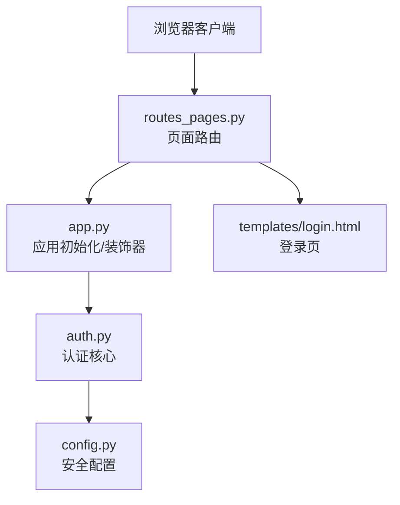
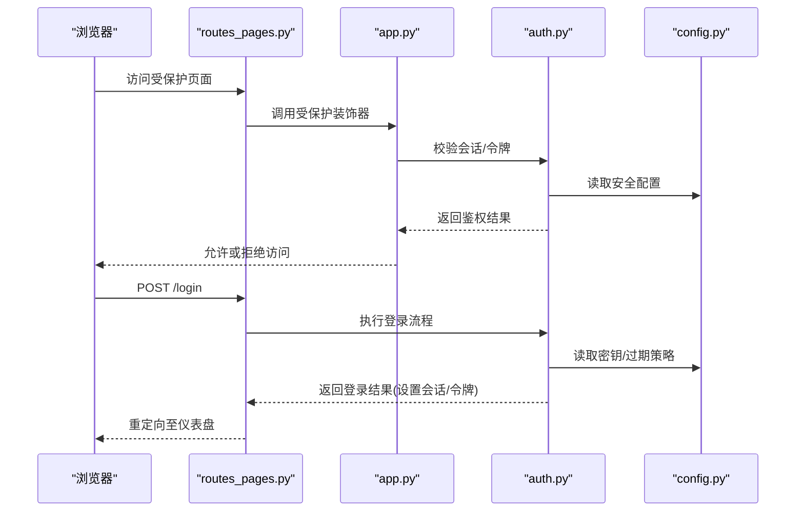
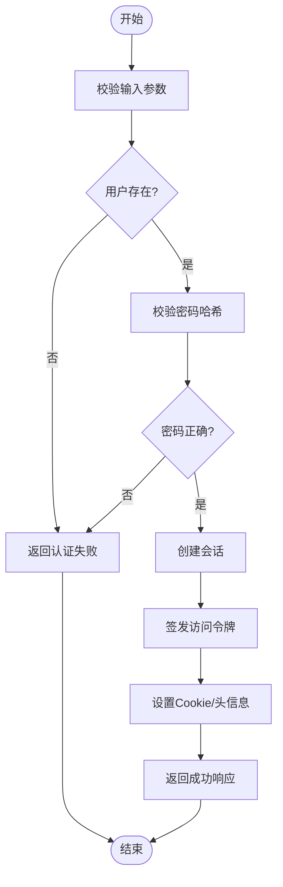
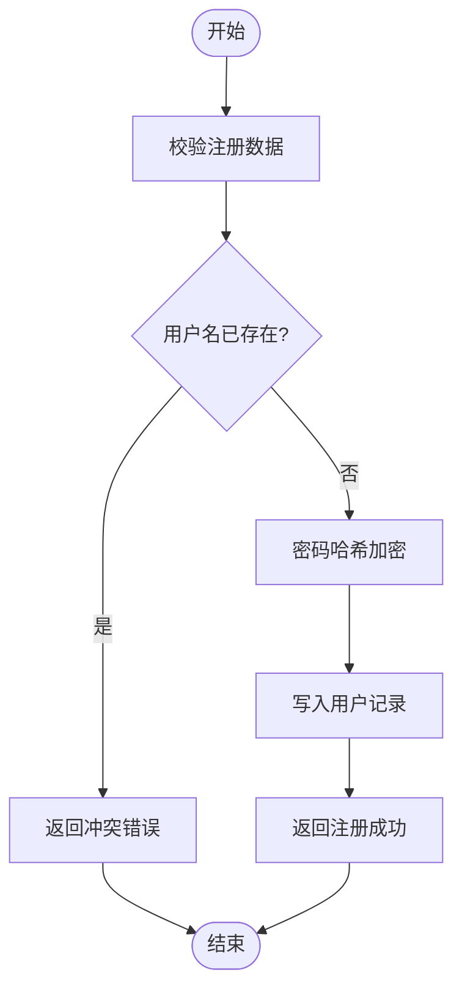
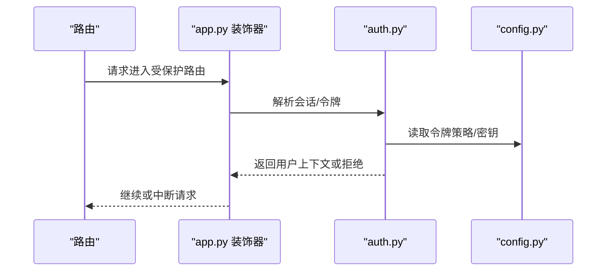
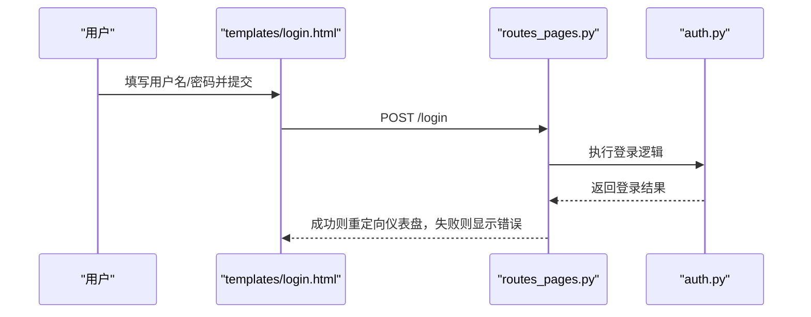
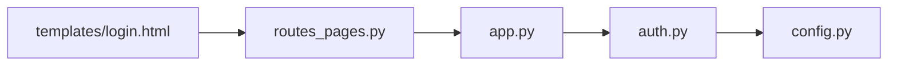

# 用户认证系统

<cite>
**本文引用的文件**   
- [server/app.py](file://server/app.py)
- [server/auth.py](file://server/auth.py)
- [server/config.py](file://server/config.py)
- [server/routes_pages.py](file://server/routes_pages.py)
- [server/templates/login.html](file://server/templates/login.html)
- [server/tests/test_p1_auth_isolation.py](file://server/tests/test_p1_auth_isolation.py)
</cite>

## 目录
1. [简介](#简介)
2. [项目结构](#项目结构)
3. [核心组件](#核心组件)
4. [架构总览](#架构总览)
5. [详细组件分析](#详细组件分析)
6. [依赖关系分析](#依赖关系分析)
7. [性能考虑](#性能考虑)
8. [故障排查指南](#故障排查指南)
9. [结论](#结论)
10. [附录](#附录)

## 简介
本文件为 LectureLearnLoop 的用户认证系统实现文档，聚焦以下目标：
- 用户注册与登录流程
- 权限验证机制、角色权限控制与访问控制
- 会话管理与令牌（Token）的生成、验证与刷新
- 密码加密存储、会话超时处理与防攻击措施
- 管理员与普通用户的权限差异、权限继承与覆盖机制
- 认证流程示例与安全最佳实践

该认证子系统基于服务端模板渲染与路由守卫模式，结合配置项管理安全参数，并通过测试用例保障认证隔离。

## 项目结构
围绕认证相关的关键文件如下：
- server/app.py：应用初始化、全局中间件/钩子、受保护页面装饰器入口
- server/auth.py：认证核心逻辑（登录、注册、会话、令牌、权限校验等）
- server/config.py：安全与认证相关配置（如密钥、过期时间、策略开关）
- server/routes_pages.py：页面路由，包含登录页与受保护页面的路由定义
- server/templates/login.html：登录前端模板
- server/tests/test_p1_auth_isolation.py：认证隔离与权限测试

**图示来源**
- [server/app.py:1-200](file://server/app.py#L1-L200)
- [server/auth.py:1-300](file://server/auth.py#L1-L300)
- [server/config.py:1-150](file://server/config.py#L1-L150)
- [server/routes_pages.py:1-200](file://server/routes_pages.py#L1-L200)
- [server/templates/login.html:1-200](file://server/templates/login.html#L1-L200)

**章节来源**
- [server/app.py:1-200](file://server/app.py#L1-L200)
- [server/auth.py:1-300](file://server/auth.py#L1-L300)
- [server/config.py:1-150](file://server/config.py#L1-L150)
- [server/routes_pages.py:1-200](file://server/routes_pages.py#L1-L200)
- [server/templates/login.html:1-200](file://server/templates/login.html#L1-L200)

## 核心组件
- 认证核心模块 auth.py
  - 负责用户登录、注册、会话创建与销毁、令牌签发与校验、权限检查与拦截
- 应用层 app.py
  - 提供受保护页面装饰器、全局认证钩子、错误处理与统一响应
- 配置模块 config.py
  - 集中管理密钥、令牌有效期、会话超时、安全策略开关等
- 页面路由 routes_pages.py
  - 暴露登录、注册、仪表盘等页面路由，并应用认证装饰器
- 登录模板 templates/login.html
  - 提供登录表单与前端交互逻辑
- 测试用例 tests/test_p1_auth_isolation.py
  - 验证未登录访问受限、不同角色访问控制、会话隔离等行为

**章节来源**
- [server/auth.py:1-300](file://server/auth.py#L1-L300)
- [server/app.py:1-200](file://server/app.py#L1-L200)
- [server/config.py:1-150](file://server/config.py#L1-L150)
- [server/routes_pages.py:1-200](file://server/routes_pages.py#L1-L200)
- [server/templates/login.html:1-200](file://server/templates/login.html#L1-L200)
- [server/tests/test_p1_auth_isolation.py:1-200](file://server/tests/test_p1_auth_isolation.py#L1-L200)

## 架构总览
下图展示从浏览器到服务端的认证请求流，包括登录、鉴权与受保护资源访问。

**图示来源**
- [server/routes_pages.py:1-200](file://server/routes_pages.py#L1-L200)
- [server/app.py:1-200](file://server/app.py#L1-L200)
- [server/auth.py:1-300](file://server/auth.py#L1-L300)
- [server/config.py:1-150](file://server/config.py#L1-L150)

## 详细组件分析

### 认证核心模块（auth.py）
职责概述：
- 用户登录：校验用户名/密码，创建会话，签发访问令牌
- 用户注册：校验输入，加密存储密码，创建用户账户
- 会话管理：创建、续期、销毁会话；支持会话超时与自动清理
- 令牌机制：生成、验证、刷新访问令牌；可选刷新令牌
- 权限校验：基于角色的访问控制（RBAC），支持管理员与普通用户权限差异、继承与覆盖
- 安全加固：防暴力破解、CSRF防护、XSS防护、敏感信息脱敏日志

关键流程（登录）：

**图示来源**
- [server/auth.py:1-300](file://server/auth.py#L1-L300)

关键流程（注册）：

**图示来源**
- [server/auth.py:1-300](file://server/auth.py#L1-L300)

权限校验（RBAC）要点：
- 角色模型：管理员（admin）、普通用户（user）
- 权限继承：管理员默认拥有所有基础权限；普通用户需显式授权
- 覆盖机制：特定资源可覆盖默认权限，限制管理员或提升普通用户权限
- 访问控制：在装饰器或中间件中根据当前用户角色与资源需求进行判定

**章节来源**
- [server/auth.py:1-300](file://server/auth.py#L1-L300)

### 应用层（app.py）
职责概述：
- 提供受保护页面装饰器：对路由进行统一鉴权拦截
- 全局认证钩子：在请求进入前解析会话/令牌，注入当前用户上下文
- 错误处理：统一返回认证失败、权限不足等错误码与消息
- 集成配置：从 config.py 加载安全策略与令牌策略

典型流程（装饰器鉴权）：

**图示来源**
- [server/app.py:1-200](file://server/app.py#L1-L200)
- [server/auth.py:1-300](file://server/auth.py#L1-L300)
- [server/config.py:1-150](file://server/config.py#L1-L150)

**章节来源**
- [server/app.py:1-200](file://server/app.py#L1-L200)

### 配置模块（config.py）
职责概述：
- 管理认证密钥、令牌算法、访问令牌有效期、刷新令牌有效期
- 会话超时、最大并发会话数、锁定策略（失败次数阈值、冷却时间）
- 安全开关：是否启用 CSRF、XSS 过滤、HTTPS 强制、IP 白名单等

建议的配置项（概念性说明）：
- 认证密钥：用于签名与校验令牌的对称或非对称密钥
- 令牌有效期：短生命周期访问令牌，配合刷新令牌使用
- 会话超时：空闲超时与绝对超时策略
- 安全策略：失败锁定、速率限制、最小密码强度、密码历史

**章节来源**
- [server/config.py:1-150](file://server/config.py#L1-L150)

### 页面路由（routes_pages.py）
职责概述：
- 暴露登录、注册、仪表盘等页面路由
- 将受保护页面标记为需要认证，应用 app.py 提供的装饰器
- 登录成功后重定向至仪表盘，失败时返回错误提示

登录流程（前后端交互）：

**图示来源**
- [server/routes_pages.py:1-200](file://server/routes_pages.py#L1-L200)
- [server/templates/login.html:1-200](file://server/templates/login.html#L1-L200)
- [server/auth.py:1-300](file://server/auth.py#L1-L300)

**章节来源**
- [server/routes_pages.py:1-200](file://server/routes_pages.py#L1-L200)
- [server/templates/login.html:1-200](file://server/templates/login.html#L1-L200)

### 测试用例（test_p1_auth_isolation.py）
职责概述：
- 验证未登录访问受保护页面被拒绝
- 验证不同角色的访问控制（管理员 vs 普通用户）
- 验证会话隔离与令牌失效后的行为

典型断言点（概念性说明）：
- 未登录访问仪表盘应返回 401/302 重定向
- 普通用户访问管理员专属页面应返回 403
- 登录后会话有效且令牌可用
- 令牌过期后刷新令牌能获取新令牌

**章节来源**
- [server/tests/test_p1_auth_isolation.py:1-200](file://server/tests/test_p1_auth_isolation.py#L1-L200)

## 依赖关系分析
认证子系统内部依赖关系如下：
- routes_pages.py 依赖 app.py 的装饰器与钩子
- app.py 依赖 auth.py 的认证能力与 config.py 的安全配置
- auth.py 依赖 config.py 的策略与密钥
- templates/login.html 通过 routes_pages.py 与后端交互

**图示来源**
- [server/templates/login.html:1-200](file://server/templates/login.html#L1-L200)
- [server/routes_pages.py:1-200](file://server/routes_pages.py#L1-L200)
- [server/app.py:1-200](file://server/app.py#L1-L200)
- [server/auth.py:1-300](file://server/auth.py#L1-L300)
- [server/config.py:1-150](file://server/config.py#L1-L150)

**章节来源**
- [server/routes_pages.py:1-200](file://server/routes_pages.py#L1-L200)
- [server/app.py:1-200](file://server/app.py#L1-L200)
- [server/auth.py:1-300](file://server/auth.py#L1-L300)
- [server/config.py:1-150](file://server/config.py#L1-L150)

## 性能考虑
- 令牌校验开销：优先使用本地缓存与快速校验算法，避免频繁数据库查询
- 会话存储：采用高效键值存储（如内存缓存或 Redis）以支持高并发
- 密码哈希：选择合适算法与迭代次数，平衡安全性与性能
- 限流与锁：对登录接口实施速率限制，防止暴力破解与资源耗尽
- 连接池：数据库与外部服务连接复用，减少握手成本

[本节为通用指导，不直接分析具体文件]

## 故障排查指南
常见问题与定位方法：
- 登录失败
  - 检查用户名/密码是否正确，确认密码哈希算法一致
  - 查看失败计数与锁定策略，确认是否触发冷却
- 令牌无效或过期
  - 检查访问令牌有效期与刷新令牌策略
  - 确认客户端是否正确携带令牌（Cookie/Authorization Header）
- 权限不足
  - 核对用户角色与资源权限映射，确认是否存在覆盖规则
  - 检查装饰器或中间件的权限判断逻辑
- 会话异常
  - 检查会话超时配置与清理任务
  - 确认多实例部署下会话共享配置

参考测试用例与日志输出辅助定位问题。

**章节来源**
- [server/tests/test_p1_auth_isolation.py:1-200](file://server/tests/test_p1_auth_isolation.py#L1-L200)

## 结论
LectureLearnLoop 的用户认证系统通过模块化设计实现了安全的登录注册、会话与令牌管理、以及基于角色的访问控制。结合配置化的安全策略与测试用例，系统在易用性与安全性之间取得平衡。建议在后续迭代中持续优化令牌刷新体验、增强审计日志与监控告警，并完善权限模型的可视化配置。

[本节为总结性内容，不直接分析具体文件]

## 附录
- 安全最佳实践清单
  - 使用强随机密钥与合适的哈希算法
  - 启用 HTTPS 与严格传输安全
  - 实施速率限制与失败锁定
  - 最小化敏感信息日志输出
  - 定期轮换密钥与令牌
  - 对用户输入进行严格校验与转义
- 权限模型扩展建议
  - 引入细粒度权限（资源+操作）
  - 支持动态权限分配与临时提升
  - 提供权限审计与变更追踪

[本节为概念性内容，不直接分析具体文件]