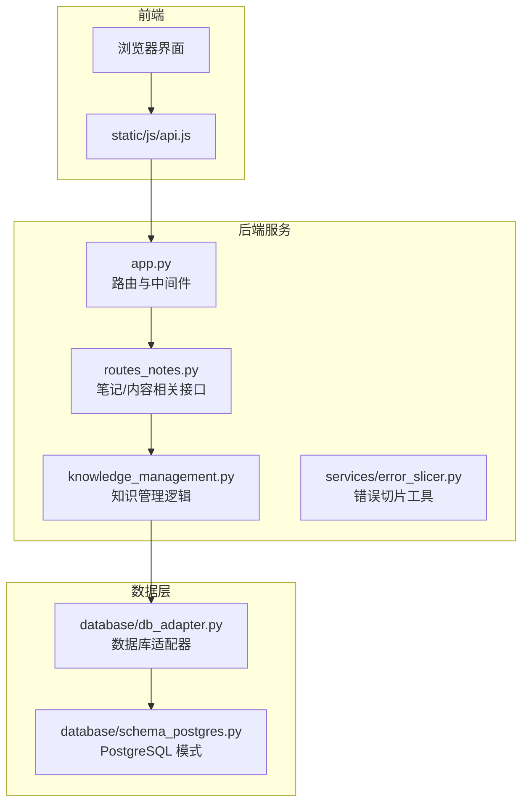
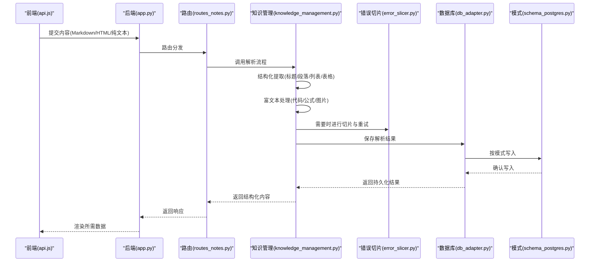
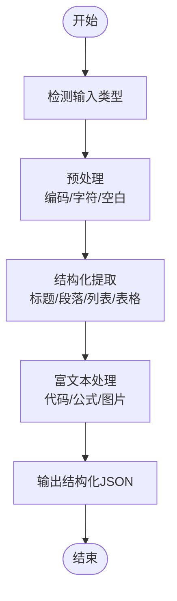
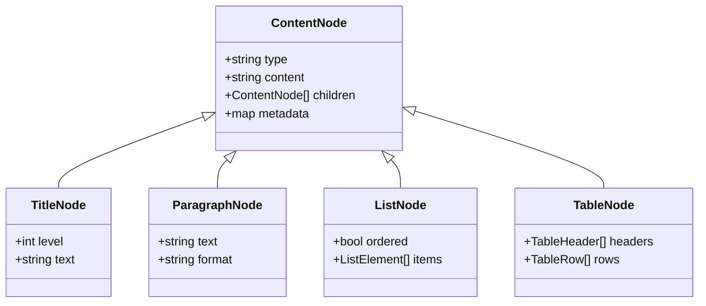
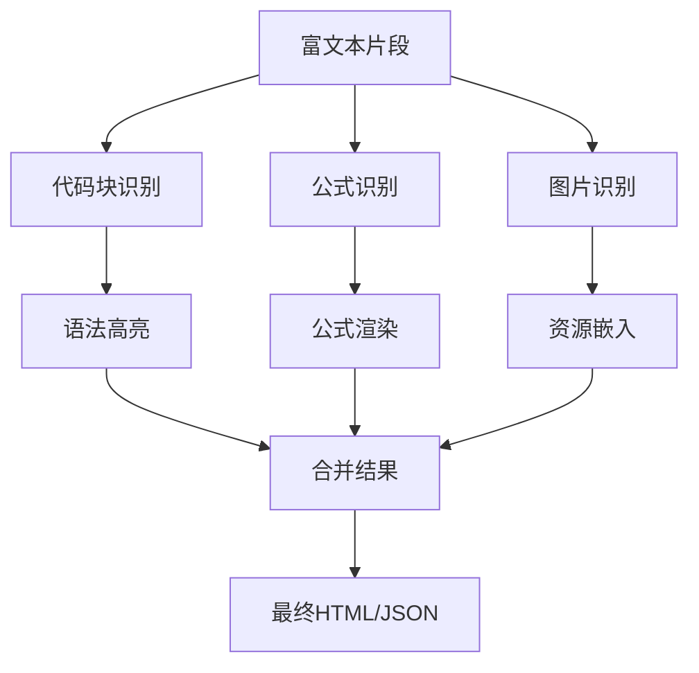
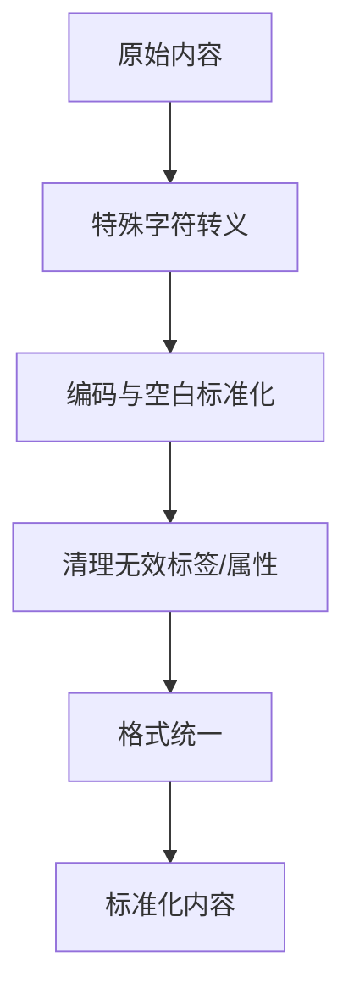
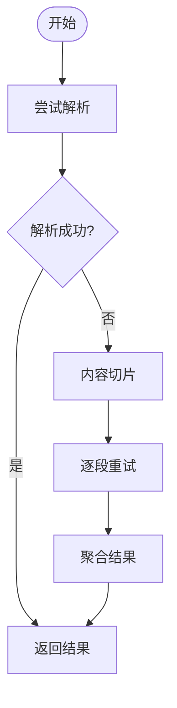
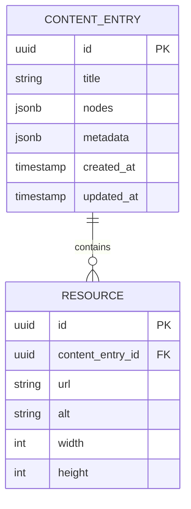
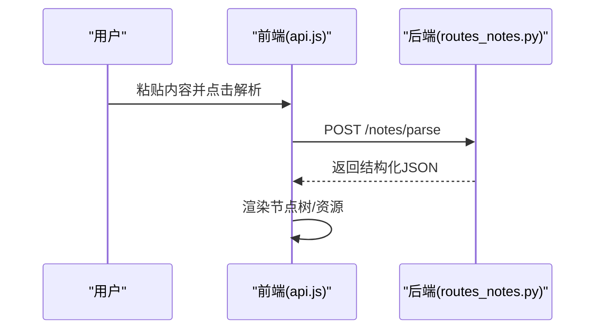
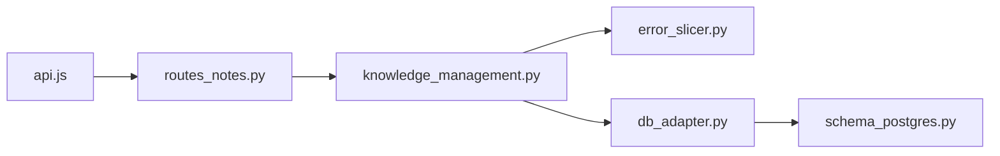

# 内容解析引擎

<cite>
**本文引用的文件**   
- [app.py](file://server/app.py)
- [routes_notes.py](file://server/routes_notes.py)
- [knowledge_management.py](file://server/knowledge_management.py)
- [error_slicer.py](file://server/services/error_slicer.py)
- [db_adapter.py](file://server/database/db_adapter.py)
- [schema_postgres.py](file://server/database/schema_postgres.py)
- [api.js](file://server/static/js/api.js)
</cite>

## 目录
1. [简介](#简介)
2. [项目结构](#项目结构)
3. [核心组件](#核心组件)
4. [架构总览](#架构总览)
5. [详细组件分析](#详细组件分析)
6. [依赖关系分析](#依赖关系分析)
7. [性能考虑](#性能考虑)
8. [故障排查指南](#故障排查指南)
9. [结论](#结论)
10. [附录](#附录)

## 简介
本技术文档面向“内容解析引擎”，聚焦于从多种输入格式（Markdown、HTML、纯文本等）中抽取结构化内容，并支持富文本处理（代码高亮、数学公式渲染、图片嵌入）、内容清洗与标准化（特殊字符处理、编码转换、格式统一）。文档同时覆盖错误处理机制、性能优化策略与缓存方案，并提供可操作的示例与排障指引。

## 项目结构
本项目采用前后端分离的 Web 应用结构：
- 前端通过静态 JS 调用后端 API，负责页面渲染与交互。
- 后端基于 Python 提供 REST 接口，负责内容解析、知识管理与持久化。
- 数据库层使用 PostgreSQL，通过适配器封装 SQL 操作。

**图示来源**
- [app.py:1-200](file://server/app.py#L1-L200)
- [routes_notes.py:1-200](file://server/routes_notes.py#L1-L200)
- [knowledge_management.py:1-200](file://server/knowledge_management.py#L1-L200)
- [error_slicer.py:1-100](file://server/services/error_slicer.py#L1-L100)
- [db_adapter.py:1-150](file://server/database/db_adapter.py#L1-L150)
- [schema_postgres.py:1-150](file://server/database/schema_postgres.py#L1-L150)
- [api.js:1-200](file://server/static/js/api.js#L1-L200)

**章节来源**
- [app.py:1-200](file://server/app.py#L1-L200)
- [routes_notes.py:1-200](file://server/routes_notes.py#L1-L200)
- [knowledge_management.py:1-200](file://server/knowledge_management.py#L1-L200)
- [db_adapter.py:1-150](file://server/database/db_adapter.py#L1-L150)
- [schema_postgres.py:1-150](file://server/database/schema_postgres.py#L1-L150)
- [api.js:1-200](file://server/static/js/api.js#L1-L200)

## 核心组件
- 内容解析入口：由笔记相关路由接收 Markdown/HTML/纯文本，触发解析流程。
- 知识管理模块：负责结构化提取（标题、段落、列表、表格）、富文本处理（代码块、公式、图片）以及清洗与标准化。
- 错误切片工具：对长内容或失败片段进行切分与重试，提升鲁棒性。
- 数据库适配器与模式：将解析结果持久化为结构化记录，便于检索与展示。
- 前端 API 客户端：封装请求参数与响应处理，支持上传内容与获取解析结果。

**章节来源**
- [routes_notes.py:1-200](file://server/routes_notes.py#L1-L200)
- [knowledge_management.py:1-200](file://server/knowledge_management.py#L1-L200)
- [error_slicer.py:1-100](file://server/services/error_slicer.py#L1-L100)
- [db_adapter.py:1-150](file://server/database/db_adapter.py#L1-L150)
- [schema_postgres.py:1-150](file://server/database/schema_postgres.py#L1-L150)
- [api.js:1-200](file://server/static/js/api.js#L1-L200)

## 架构总览
内容解析引擎的整体流程如下：
- 前端通过 api.js 发起请求，携带原始内容（Markdown/HTML/纯文本）与解析选项。
- 后端 app.py 路由分发到 routes_notes.py，后者调用 knowledge_management.py 执行解析。
- knowledge_management.py 完成结构化提取与富文本处理，必要时使用 error_slicer.py 进行切片与重试。
- 解析结果经 db_adapter.py 写入 schema_postgres.py 定义的表结构中。
- 前端根据返回的结构化数据渲染页面，包括代码高亮、公式渲染与图片展示。

**图示来源**
- [api.js:1-200](file://server/static/js/api.js#L1-L200)
- [app.py:1-200](file://server/app.py#L1-L200)
- [routes_notes.py:1-200](file://server/routes_notes.py#L1-L200)
- [knowledge_management.py:1-200](file://server/knowledge_management.py#L1-L200)
- [error_slicer.py:1-100](file://server/services/error_slicer.py#L1-L100)
- [db_adapter.py:1-150](file://server/database/db_adapter.py#L1-L150)
- [schema_postgres.py:1-150](file://server/database/schema_postgres.py#L1-L150)

## 详细组件分析

### 输入格式支持与解析流程
- 支持的输入格式：
  - Markdown：标题、段落、列表、表格、代码块、链接、图片等。
  - HTML：保留语义标签，清理冗余样式与脚本，提取正文与媒体资源。
  - 纯文本：按行分割为段落，识别常见标记（如编号、缩进）以重建结构。
- 解析流程：
  - 检测输入类型（扩展名、MIME、内容特征）。
  - 预处理：编码归一化、特殊字符转义、空白规范化。
  - 结构化提取：标题层级、段落边界、列表项、表格行列。
  - 富文本处理：代码块语法高亮、数学公式渲染、图片路径与尺寸处理。
  - 输出：统一的 JSON 结构，包含节点树、元数据与资源清单。

**图示来源**
- [routes_notes.py:1-200](file://server/routes_notes.py#L1-L200)
- [knowledge_management.py:1-200](file://server/knowledge_management.py#L1-L200)

**章节来源**
- [routes_notes.py:1-200](file://server/routes_notes.py#L1-L200)
- [knowledge_management.py:1-200](file://server/knowledge_management.py#L1-L200)

### 内容结构提取算法
- 标题识别：
  - Markdown：依据 ATX/Setext 语法构建层级树。
  - HTML：依据 h1-h6 标签映射层级。
  - 纯文本：依据前缀规则（如“第X章”、“1.”）推断层级。
- 段落分割：
  - 依据空行、换行与语义边界（如列表结束、表格结束）进行分割。
- 列表解析：
  - 有序/无序列表递归展开，维护序号与缩进层级。
- 表格处理：
  - 解析表头与行数据，生成二维结构；合并单元格与跨列信息需额外标注。

**图示来源**
- [knowledge_management.py:1-200](file://server/knowledge_management.py#L1-L200)

**章节来源**
- [knowledge_management.py:1-200](file://server/knowledge_management.py#L1-L200)

### 富文本处理功能
- 代码高亮：
  - 识别语言标记，调用高亮库生成带类名的 HTML 片段。
  - 支持主题切换与行号显示。
- 数学公式渲染：
  - 识别行内与块级公式，转换为 LaTeX 或 MathML，并在前端渲染。
- 图片嵌入：
  - 提取 src、alt、width/height，生成资源清单与占位符。
  - 支持懒加载与尺寸自适应。

**图示来源**
- [knowledge_management.py:1-200](file://server/knowledge_management.py#L1-L200)

**章节来源**
- [knowledge_management.py:1-200](file://server/knowledge_management.py#L1-L200)

### 内容清洗与标准化
- 特殊字符处理：
  - 转义 HTML 敏感字符，避免注入；对 Markdown 特殊符号进行安全处理。
- 编码转换：
  - 统一为 UTF-8，处理 BOM 与混合编码。
- 格式统一：
  - 去除多余空白、标准化换行、统一标点与全角/半角。
  - 清理无效标签与属性，确保输出稳定。

**图示来源**
- [knowledge_management.py:1-200](file://server/knowledge_management.py#L1-L200)

**章节来源**
- [knowledge_management.py:1-200](file://server/knowledge_management.py#L1-L200)

### 错误处理与切片重试
- 错误切片：
  - 当内容过长或解析失败时，按段落或固定长度切分为子任务。
  - 对每个子任务独立解析与重试，聚合成功结果。
- 异常分类：
  - 输入非法、解析超时、外部依赖不可用等。
- 恢复策略：
  - 指数退避重试、降级为纯文本解析、记录日志与指标。

**图示来源**
- [error_slicer.py:1-100](file://server/services/error_slicer.py#L1-L100)
- [knowledge_management.py:1-200](file://server/knowledge_management.py#L1-L200)

**章节来源**
- [error_slicer.py:1-100](file://server/services/error_slicer.py#L1-L100)
- [knowledge_management.py:1-200](file://server/knowledge_management.py#L1-L200)

### 数据模型与持久化
- 主要实体：
  - 内容条目：包含标题、正文、资源清单、元数据。
  - 节点树：表示结构化内容层次。
  - 资源清单：图片、附件等资源的 URL 与属性。
- 表结构要点：
  - 主键、唯一约束、索引优化查询。
  - JSONB 字段存储灵活结构（如节点树、元数据）。

**图示来源**
- [schema_postgres.py:1-150](file://server/database/schema_postgres.py#L1-L150)

**章节来源**
- [schema_postgres.py:1-150](file://server/database/schema_postgres.py#L1-L150)
- [db_adapter.py:1-150](file://server/database/db_adapter.py#L1-L150)

### 前端集成与示例
- 前端通过 api.js 发起请求：
  - 上传内容（Markdown/HTML/纯文本）与解析选项。
  - 获取结构化 JSON 与资源清单。
- 示例流程：
  - 用户粘贴 Markdown，点击“解析”。
  - 前端调用后端接口，后端返回节点树与资源。
  - 前端渲染代码高亮、公式与图片。

**图示来源**
- [api.js:1-200](file://server/static/js/api.js#L1-L200)
- [routes_notes.py:1-200](file://server/routes_notes.py#L1-L200)

**章节来源**
- [api.js:1-200](file://server/static/js/api.js#L1-L200)
- [routes_notes.py:1-200](file://server/routes_notes.py#L1-L200)

## 依赖关系分析
- 组件耦合：
  - routes_notes.py 依赖 knowledge_management.py 进行解析。
  - knowledge_management.py 依赖 error_slicer.py 进行切片与重试。
  - 所有持久化操作通过 db_adapter.py 访问 schema_postgres.py 定义的模式。
- 外部依赖：
  - 前端依赖浏览器环境渲染富文本（代码高亮、公式、图片）。
  - 后端可能依赖第三方库进行 Markdown/HTML 解析与富文本处理。

**图示来源**
- [routes_notes.py:1-200](file://server/routes_notes.py#L1-L200)
- [knowledge_management.py:1-200](file://server/knowledge_management.py#L1-L200)
- [error_slicer.py:1-100](file://server/services/error_slicer.py#L1-L100)
- [db_adapter.py:1-150](file://server/database/db_adapter.py#L1-L150)
- [schema_postgres.py:1-150](file://server/database/schema_postgres.py#L1-L150)
- [api.js:1-200](file://server/static/js/api.js#L1-L200)

**章节来源**
- [routes_notes.py:1-200](file://server/routes_notes.py#L1-L200)
- [knowledge_management.py:1-200](file://server/knowledge_management.py#L1-L200)
- [error_slicer.py:1-100](file://server/services/error_slicer.py#L1-L100)
- [db_adapter.py:1-150](file://server/database/db_adapter.py#L1-L150)
- [schema_postgres.py:1-150](file://server/database/schema_postgres.py#L1-L150)
- [api.js:1-200](file://server/static/js/api.js#L1-L200)

## 性能考虑
- 解析优化：
  - 增量解析：仅对变更部分重新解析。
  - 并行处理：对多个子任务并行解析与重试。
- 缓存机制：
  - 内容哈希缓存：相同内容的解析结果复用。
  - 富文本渲染缓存：代码高亮与公式渲染结果缓存。
- I/O 优化：
  - 批量写入：聚合多条记录后一次性持久化。
  - 连接池：数据库连接复用，减少握手开销。
- 前端优化：
  - 懒加载资源：按需加载图片与脚本。
  - 虚拟滚动：大文档渲染优化。

[本节为通用指导，不直接分析具体文件]

## 故障排查指南
- 常见问题：
  - 输入编码异常：检查是否混入非 UTF-8 编码。
  - 解析超时：检查内容长度与外部依赖可用性。
  - 富文本渲染失败：检查前端依赖库加载与 CSP 策略。
- 定位方法：
  - 查看后端日志与错误切片输出。
  - 检查数据库写入状态与事务回滚情况。
  - 前端控制台查看网络请求与渲染错误。

**章节来源**
- [error_slicer.py:1-100](file://server/services/error_slicer.py#L1-L100)
- [db_adapter.py:1-150](file://server/database/db_adapter.py#L1-L150)

## 结论
内容解析引擎通过多格式输入支持、结构化提取与富文本处理，实现了从原始内容到可渲染结构的完整流水线。结合错误切片与重试机制、缓存与 I/O 优化，系统在鲁棒性与性能方面具备良好表现。建议在生产环境中启用内容哈希缓存与并行解析，并持续监控解析成功率与延迟指标。

[本节为总结性内容，不直接分析具体文件]

## 附录
- 术语表：
  - 结构化提取：将非结构化内容转换为具有层级与语义的数据结构。
  - 富文本处理：对代码、公式、图片等元素进行增强与渲染。
  - 内容清洗：去除无效信息与格式噪声，保证输出一致性。
- 参考实现路径：
  - 解析入口与路由：[routes_notes.py:1-200](file://server/routes_notes.py#L1-L200)
  - 知识管理逻辑：[knowledge_management.py:1-200](file://server/knowledge_management.py#L1-L200)
  - 错误切片工具：[error_slicer.py:1-100](file://server/services/error_slicer.py#L1-L100)
  - 数据库适配与模式：[db_adapter.py:1-150](file://server/database/db_adapter.py#L1-L150), [schema_postgres.py:1-150](file://server/database/schema_postgres.py#L1-L150)
  - 前端 API 客户端：[api.js:1-200](file://server/static/js/api.js#L1-L200)