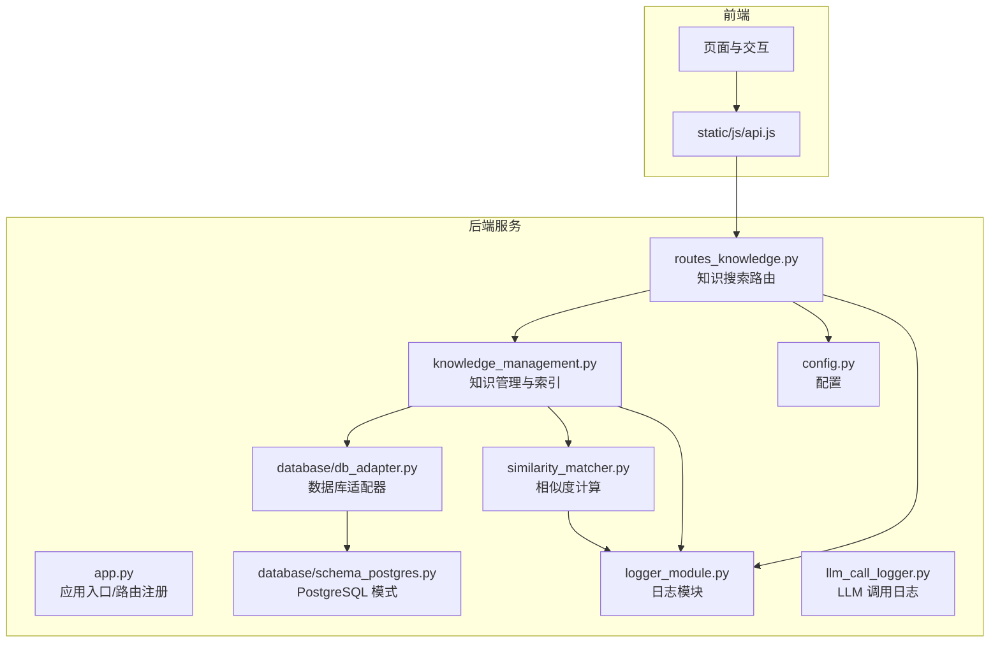
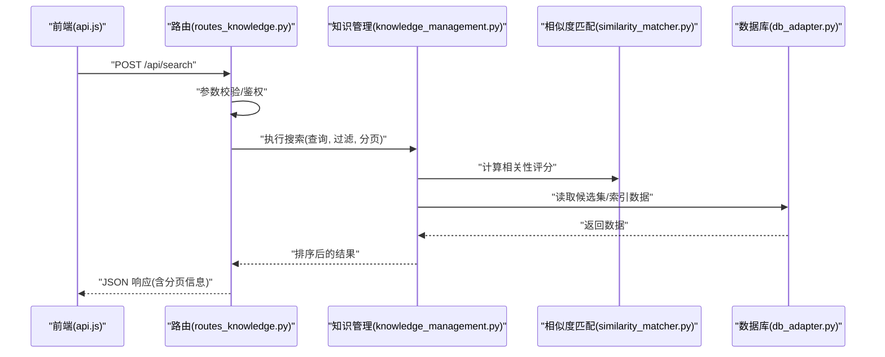
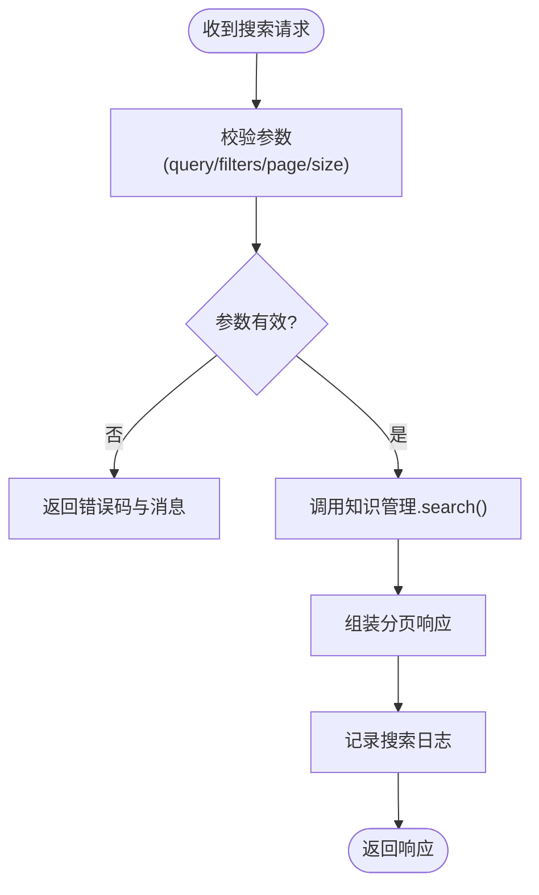
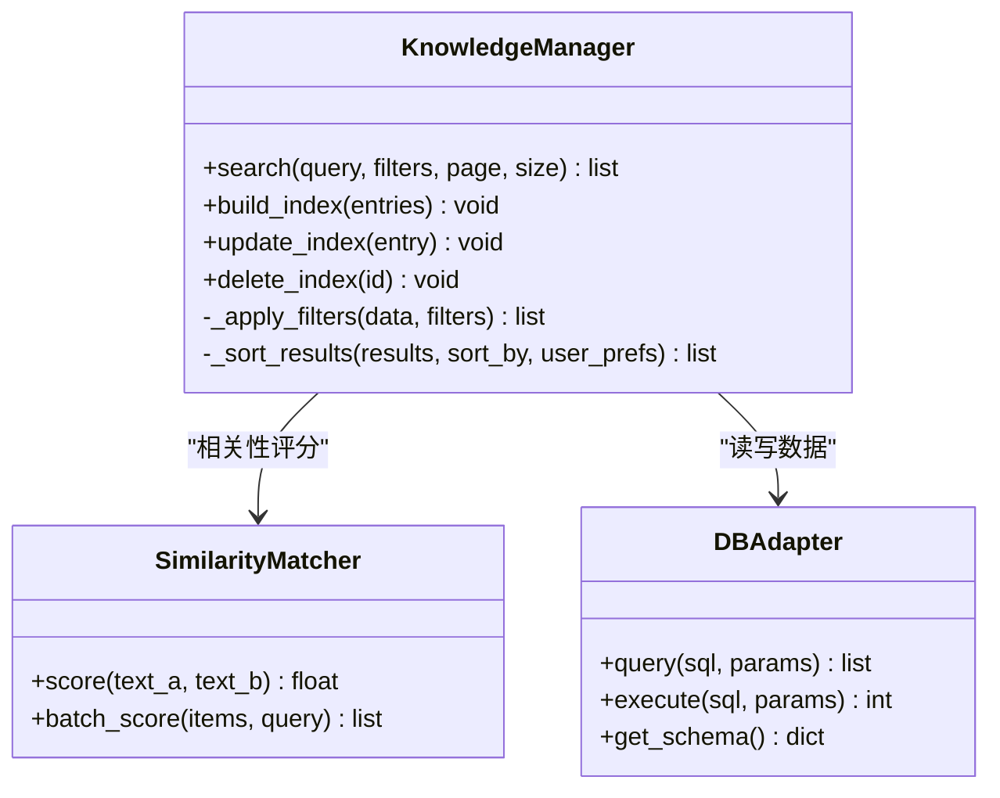
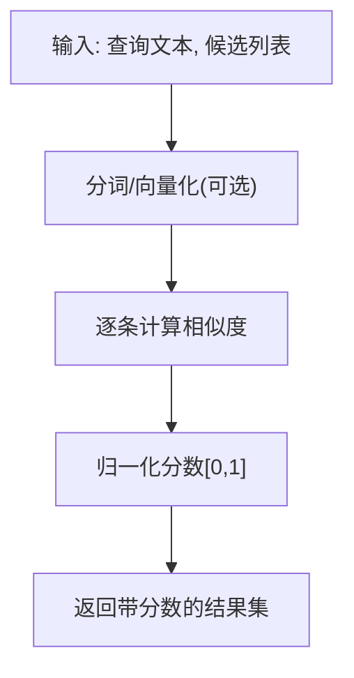
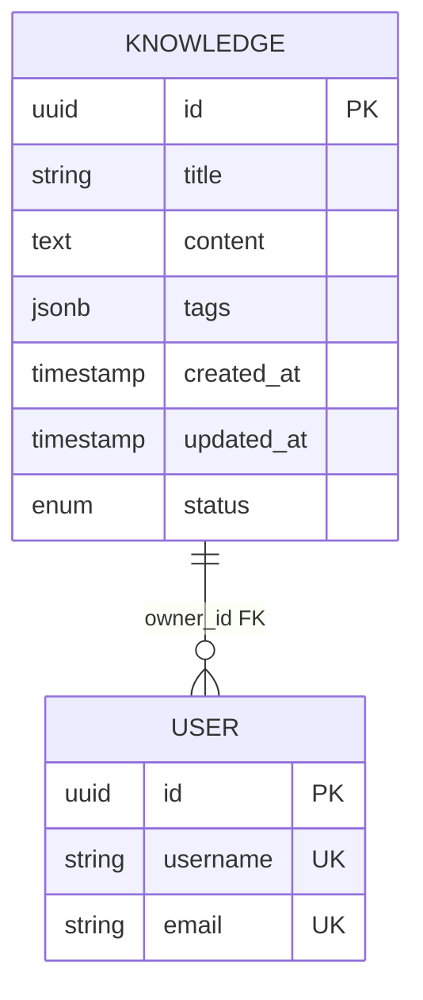
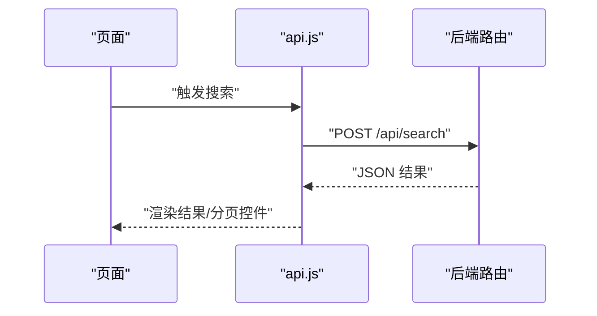
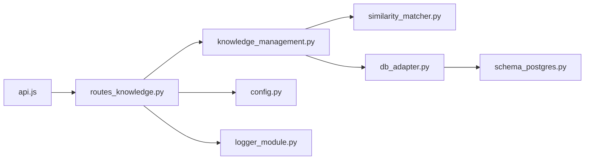

# 搜索功能

<cite>
**本文引用的文件**   
- [app.py](file://server/app.py)
- [routes_knowledge.py](file://server/routes_knowledge.py)
- [knowledge_management.py](file://server/knowledge_management.py)
- [similarity_matcher.py](file://server/similarity_matcher.py)
- [db_adapter.py](file://server/database/db_adapter.py)
- [schema_postgres.py](file://server/database/schema_postgres.py)
- [config.py](file://server/config.py)
- [logger_module.py](file://server/logger_module.py)
- [llm_call_logger.py](file://server/llm_call_logger.py)
- [api.js](file://server/static/js/api.js)
</cite>

## 目录
1. [简介](#简介)
2. [项目结构](#项目结构)
3. [核心组件](#核心组件)
4. [架构总览](#架构总览)
5. [详细组件分析](#详细组件分析)
6. [依赖关系分析](#依赖关系分析)
7. [性能考虑](#性能考虑)
8. [故障排查指南](#故障排查指南)
9. [结论](#结论)
10. [附录](#附录)

## 简介
本指南面向“练记系统”的搜索能力，覆盖从用户可见的搜索交互到后端实现、索引与检索、排序与分页、日志与监控的全链路说明。文档重点包括：
- 全文搜索的实现原理：倒排索引构建、分词策略、查询解析
- 高级搜索语法：布尔查询、模糊匹配、范围查询
- 搜索结果排序：相关性评分、时间权重、用户偏好
- 性能优化：索引缓存、查询预编译、分页加载
- API 使用示例与最佳实践
- 搜索日志记录与性能监控机制

## 项目结构
搜索相关代码主要位于 server 目录下，围绕知识管理、相似度匹配、数据库适配与路由层展开。前端通过静态 JS 调用后端 API。

**图表来源**
- [app.py:1-200](file://server/app.py#L1-L200)
- [routes_knowledge.py:1-200](file://server/routes_knowledge.py#L1-L200)
- [knowledge_management.py:1-200](file://server/knowledge_management.py#L1-L200)
- [similarity_matcher.py:1-200](file://server/similarity_matcher.py#L1-L200)
- [db_adapter.py:1-200](file://server/database/db_adapter.py#L1-L200)
- [schema_postgres.py:1-200](file://server/database/schema_postgres.py#L1-L200)
- [config.py:1-200](file://server/config.py#L1-L200)
- [logger_module.py:1-200](file://server/logger_module.py#L1-L200)
- [llm_call_logger.py:1-200](file://server/llm_call_logger.py#L1-L200)
- [api.js:1-200](file://server/static/js/api.js#L1-L200)

**章节来源**
- [app.py:1-200](file://server/app.py#L1-L200)
- [routes_knowledge.py:1-200](file://server/routes_knowledge.py#L1-L200)
- [knowledge_management.py:1-200](file://server/knowledge_management.py#L1-L200)
- [similarity_matcher.py:1-200](file://server/similarity_matcher.py#L1-L200)
- [db_adapter.py:1-200](file://server/database/db_adapter.py#L1-L200)
- [schema_postgres.py:1-200](file://server/database/schema_postgres.py#L1-L200)
- [config.py:1-200](file://server/config.py#L1-L200)
- [logger_module.py:1-200](file://server/logger_module.py#L1-L200)
- [llm_call_logger.py:1-200](file://server/llm_call_logger.py#L1-L200)
- [api.js:1-200](file://server/static/js/api.js#L1-L200)

## 核心组件
- 应用入口与路由注册：负责挂载搜索相关路由，统一鉴权、参数校验与响应封装。
- 知识管理模块：负责知识条目（笔记、知识点等）的增删改查、索引构建与更新。
- 相似度匹配器：提供文本相似度计算、向量或关键词匹配策略，支撑相关性评分。
- 数据库适配器与模式：封装 PostgreSQL 访问，定义知识表结构与索引字段。
- 配置模块：集中管理搜索开关、分词参数、分页大小、缓存策略等。
- 日志模块：统一记录搜索请求、耗时、错误与关键指标；LLM 调用日志用于可观测性。
- 前端 API 客户端：封装搜索接口调用，处理分页、过滤与结果渲染。

**章节来源**
- [app.py:1-200](file://server/app.py#L1-L200)
- [routes_knowledge.py:1-200](file://server/routes_knowledge.py#L1-L200)
- [knowledge_management.py:1-200](file://server/knowledge_management.py#L1-L200)
- [similarity_matcher.py:1-200](file://server/similarity_matcher.py#L1-L200)
- [db_adapter.py:1-200](file://server/database/db_adapter.py#L1-L200)
- [schema_postgres.py:1-200](file://server/database/schema_postgres.py#L1-L200)
- [config.py:1-200](file://server/config.py#L1-L200)
- [logger_module.py:1-200](file://server/logger_module.py#L1-L200)
- [llm_call_logger.py:1-200](file://server/llm_call_logger.py#L1-L200)
- [api.js:1-200](file://server/static/js/api.js#L1-L200)

## 架构总览
搜索流程从前端发起，经后端路由进入知识管理模块，结合相似度匹配器进行相关性打分，最终通过数据库适配器返回结果。

**图表来源**
- [routes_knowledge.py:1-200](file://server/routes_knowledge.py#L1-L200)
- [knowledge_management.py:1-200](file://server/knowledge_management.py#L1-L200)
- [similarity_matcher.py:1-200](file://server/similarity_matcher.py#L1-L200)
- [db_adapter.py:1-200](file://server/database/db_adapter.py#L1-L200)
- [api.js:1-200](file://server/static/js/api.js#L1-L200)

## 详细组件分析

### 搜索路由与接口契约
- 职责：接收搜索请求，校验输入参数（如 query、filters、page、size），调用知识管理模块执行检索，并返回标准化 JSON。
- 典型行为：
  - 参数校验与默认值填充
  - 权限与审计日志记录
  - 调用知识管理模块获取结果
  - 分页封装与错误处理

**图表来源**
- [routes_knowledge.py:1-200](file://server/routes_knowledge.py#L1-L200)
- [logger_module.py:1-200](file://server/logger_module.py#L1-L200)

**章节来源**
- [routes_knowledge.py:1-200](file://server/routes_knowledge.py#L1-L200)
- [logger_module.py:1-200](file://server/logger_module.py#L1-L200)

### 知识管理与索引构建
- 职责：维护知识条目集合，提供索引构建与更新、按条件筛选、排序与分页。
- 关键点：
  - 索引字段设计：标题、正文、标签、时间戳等
  - 增量更新：新增/修改/删除时同步索引
  - 过滤条件：布尔组合、范围条件（时间、分数等）
  - 排序策略：相关性、时间衰减、用户偏好加权

**图表来源**
- [knowledge_management.py:1-200](file://server/knowledge_management.py#L1-L200)
- [similarity_matcher.py:1-200](file://server/similarity_matcher.py#L1-L200)
- [db_adapter.py:1-200](file://server/database/db_adapter.py#L1-L200)

**章节来源**
- [knowledge_management.py:1-200](file://server/knowledge_management.py#L1-L200)
- [similarity_matcher.py:1-200](file://server/similarity_matcher.py#L1-L200)
- [db_adapter.py:1-200](file://server/database/db_adapter.py#L1-L200)

### 相似度匹配与相关性评分
- 职责：对候选结果与查询进行相似度计算，输出归一化的相关性分数。
- 常见策略：
  - 关键词重叠度（TF-IDF 或 BM25 思想）
  - 语义相似度（向量模型，若启用）
  - 多字段加权（标题 > 正文 > 标签）
- 输出：每条结果的 score，供上层排序使用。

**图表来源**
- [similarity_matcher.py:1-200](file://server/similarity_matcher.py#L1-L200)

**章节来源**
- [similarity_matcher.py:1-200](file://server/similarity_matcher.py#L1-L200)

### 数据库模式与索引
- 职责：定义知识表结构、字段类型、约束与索引，确保检索性能。
- 要点：
  - 主键与唯一约束
  - 全文检索字段（如 tsvector 或外部搜索引擎字段）
  - 时间戳与状态字段便于范围查询与过滤
  - 外键关联（如需）

**图表来源**
- [schema_postgres.py:1-200](file://server/database/schema_postgres.py#L1-L200)

**章节来源**
- [schema_postgres.py:1-200](file://server/database/schema_postgres.py#L1-L200)

### 配置项与开关
- 职责：集中管理搜索相关配置，如是否启用全文检索、分词粒度、分页上限、缓存开关等。
- 建议配置项：
  - search.enabled: 是否启用搜索
  - search.index_fields: 参与索引的字段列表
  - search.default_page_size: 默认分页大小
  - search.cache_ttl: 索引缓存过期时间
  - search.similarity_threshold: 最低相关性阈值

**章节来源**
- [config.py:1-200](file://server/config.py#L1-L200)

### 前端 API 客户端
- 职责：封装搜索接口调用，处理分页、过滤、错误提示与结果渲染。
- 典型方法：
  - search(query, filters, page, size)
  - getSearchHistory()
  - clearSearchCache()

**图表来源**
- [api.js:1-200](file://server/static/js/api.js#L1-L200)
- [routes_knowledge.py:1-200](file://server/routes_knowledge.py#L1-L200)

**章节来源**
- [api.js:1-200](file://server/static/js/api.js#L1-L200)

## 依赖关系分析
- 路由层依赖知识管理模块与日志模块
- 知识管理模块依赖相似度匹配器与数据库适配器
- 数据库适配器依赖 PostgreSQL 模式定义
- 前端依赖后端 API 契约

**图表来源**
- [api.js:1-200](file://server/static/js/api.js#L1-L200)
- [routes_knowledge.py:1-200](file://server/routes_knowledge.py#L1-L200)
- [knowledge_management.py:1-200](file://server/knowledge_management.py#L1-L200)
- [similarity_matcher.py:1-200](file://server/similarity_matcher.py#L1-L200)
- [db_adapter.py:1-200](file://server/database/db_adapter.py#L1-L200)
- [schema_postgres.py:1-200](file://server/database/schema_postgres.py#L1-L200)
- [config.py:1-200](file://server/config.py#L1-L200)
- [logger_module.py:1-200](file://server/logger_module.py#L1-L200)

**章节来源**
- [routes_knowledge.py:1-200](file://server/routes_knowledge.py#L1-L200)
- [knowledge_management.py:1-200](file://server/knowledge_management.py#L1-L200)
- [similarity_matcher.py:1-200](file://server/similarity_matcher.py#L1-L200)
- [db_adapter.py:1-200](file://server/database/db_adapter.py#L1-L200)
- [schema_postgres.py:1-200](file://server/database/schema_postgres.py#L1-L200)
- [config.py:1-200](file://server/config.py#L1-L200)
- [logger_module.py:1-200](file://server/logger_module.py#L1-L200)
- [api.js:1-200](file://server/static/js/api.js#L1-L200)

## 性能考虑
- 索引缓存
  - 在内存中缓存热点查询或最近构建的索引片段，减少重复计算与 IO。
  - 建议设置 TTL 与失效策略（如写操作后局部刷新）。
- 查询预编译
  - 将常用过滤条件与排序规则预编译为模板，降低解析开销。
- 分页加载
  - 限制每页大小，避免一次性返回大量数据；支持游标或基于 ID 的分页。
- 相关性阈值
  - 通过最小分数阈值过滤低质量结果，减少后续处理成本。
- 并发与连接池
  - 数据库连接复用，控制最大并发查询数，避免资源耗尽。
- 异步任务
  - 索引构建与更新采用后台任务，避免阻塞请求路径。

[本节为通用性能指导，不直接分析具体文件]

## 故障排查指南
- 常见问题定位
  - 搜索无结果：检查 query 是否为空、过滤器是否过严、相关性阈值是否过高。
  - 结果不准确：调整字段权重、分词策略或相似度算法参数。
  - 性能退化：检查索引是否重建、缓存命中率、数据库慢查询。
- 日志与监控
  - 使用统一日志模块记录搜索请求、耗时、错误堆栈与关键指标。
  - 结合 LLM 调用日志追踪外部依赖异常与延迟。
- 快速恢复
  - 重置索引缓存、回滚未完成的索引构建任务、重启服务以释放连接。

**章节来源**
- [logger_module.py:1-200](file://server/logger_module.py#L1-L200)
- [llm_call_logger.py:1-200](file://server/llm_call_logger.py#L1-L200)

## 结论
本搜索功能以知识管理为核心，结合相似度匹配与数据库索引，提供可扩展的全文检索能力。通过合理的索引设计、相关性评分与分页策略，兼顾准确性与性能。配合统一的日志与监控，便于问题定位与持续优化。

[本节为总结性内容，不直接分析具体文件]

## 附录

### 搜索 API 使用示例与最佳实践
- 基本搜索
  - 请求：POST /api/search，body 包含 query、filters、page、size
  - 响应：包含 results、total、page、size、has_next
- 高级语法
  - 布尔查询：filters 支持 AND/OR/NOT 组合
  - 模糊匹配：在 query 中使用通配符或编辑距离参数
  - 范围查询：filters 支持时间区间、数值区间
- 排序与偏好
  - sort_by: relevance/time/popularity
  - user_prefs: 自定义权重字段（如作者、标签）
- 最佳实践
  - 合理设置 page_size（建议 20-50）
  - 使用 filters 缩小候选集，提升性能
  - 对高频查询启用缓存
  - 定期重建索引以保持新鲜度

[本节为概念性说明，不直接分析具体文件]