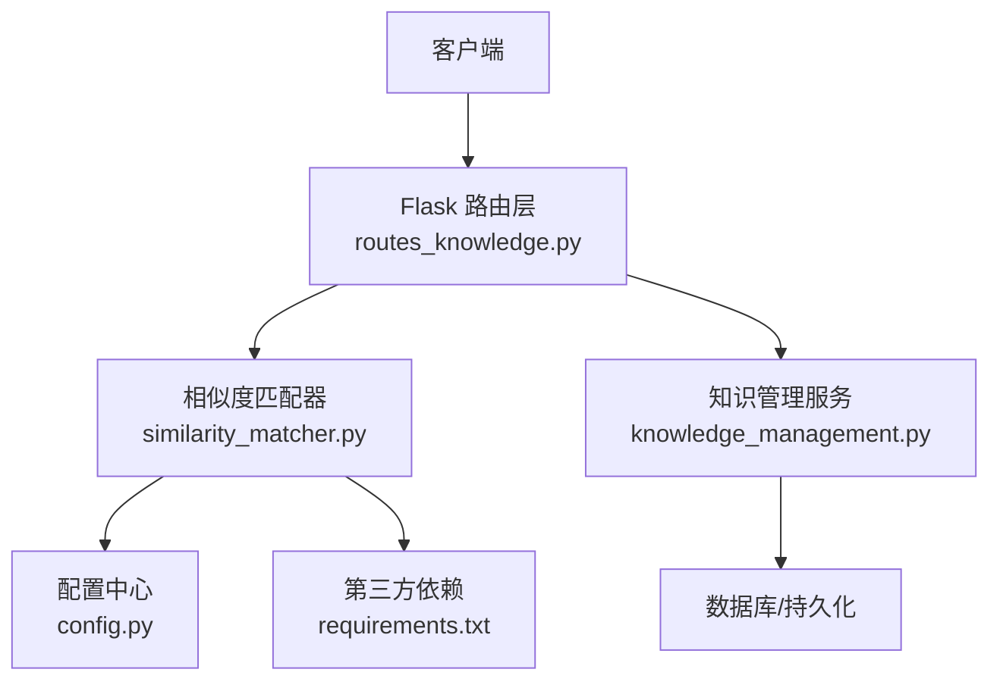
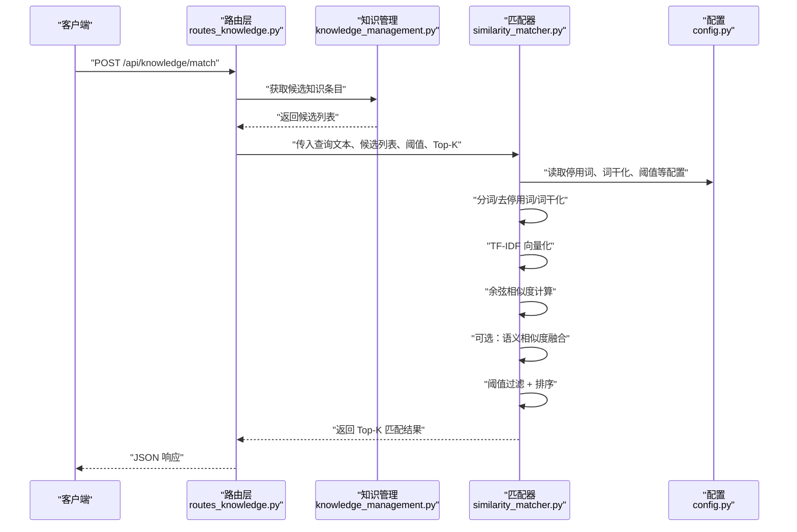
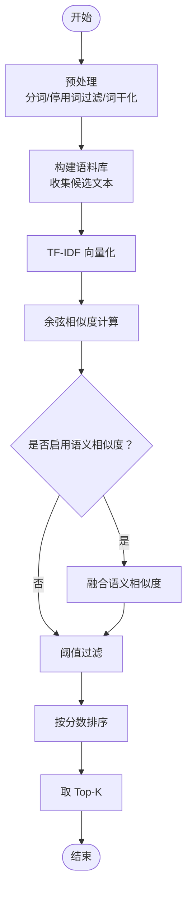
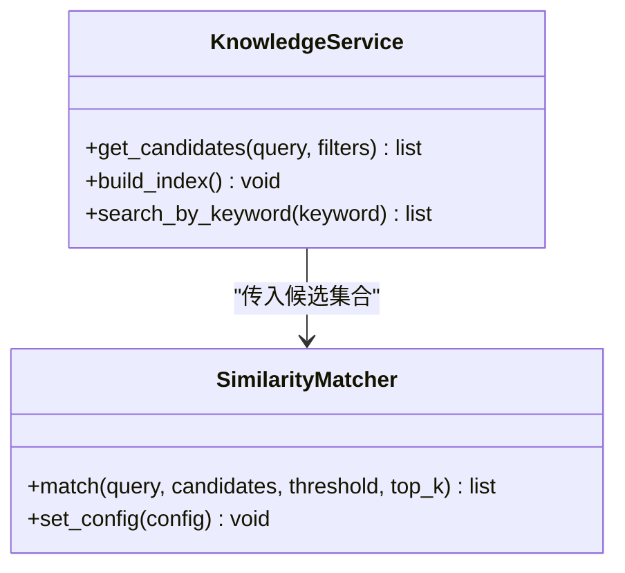
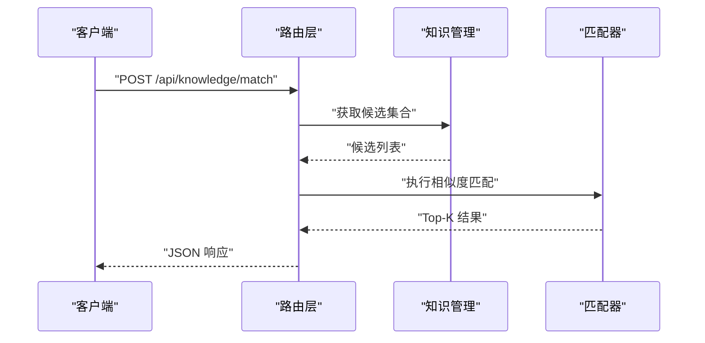
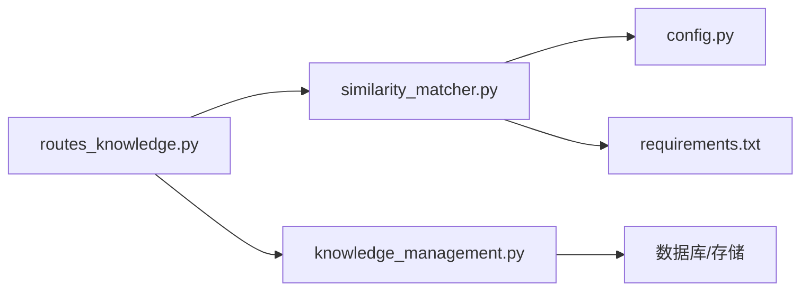
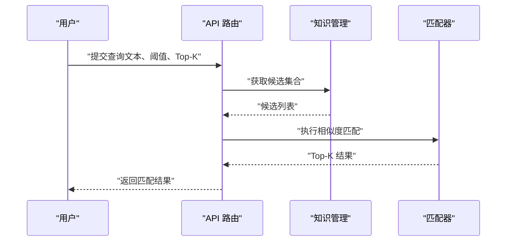
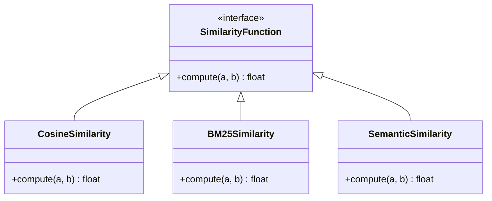

# 相似度匹配算法

<cite>
**本文引用的文件**   
- [similarity_matcher.py](file://server/similarity_matcher.py)
- [routes_knowledge.py](file://server/routes_knowledge.py)
- [knowledge_management.py](file://server/knowledge_management.py)
- [config.py](file://server/config.py)
- [requirements.txt](file://server/requirements.txt)
</cite>

## 目录
1. [简介](#简介)
2. [项目结构](#项目结构)
3. [核心组件](#核心组件)
4. [架构总览](#架构总览)
5. [详细组件分析](#详细组件分析)
6. [依赖关系分析](#依赖关系分析)
7. [性能考虑](#性能考虑)
8. [故障排查指南](#故障排查指南)
9. [结论](#结论)
10. [附录](#附录)

## 简介
本技术文档围绕相似度匹配算法展开，重点覆盖文本相似度计算的核心方法（TF-IDF、余弦相似度、语义相似度）、向量空间模型的构建与特征提取、关键词权重分配、停用词过滤与词干化处理、相似度阈值配置与匹配精度调优，并提供可复现的匹配示例与性能基准测试建议。同时说明算法的可扩展性与自定义相似度函数的实现方式，帮助读者在现有工程基础上进行二次开发与优化。

## 项目结构
本项目在服务端使用 Python 实现相似度匹配能力，并通过 Flask 路由暴露接口；知识管理模块负责数据访问与业务编排；配置文件集中管理相似度相关参数；依赖库通过 requirements.txt 声明。

**图示来源** 
- [routes_knowledge.py](file://server/routes_knowledge.py)
- [similarity_matcher.py](file://server/similarity_matcher.py)
- [knowledge_management.py](file://server/knowledge_management.py)
- [config.py](file://server/config.py)
- [requirements.txt](file://server/requirements.txt)

**章节来源**
- [routes_knowledge.py](file://server/routes_knowledge.py)
- [similarity_matcher.py](file://server/similarity_matcher.py)
- [knowledge_management.py](file://server/knowledge_management.py)
- [config.py](file://server/config.py)
- [requirements.txt](file://server/requirements.txt)

## 核心组件
- 相似度匹配器：封装 TF-IDF 向量化、余弦相似度计算、可选的语义相似度计算、阈值过滤与结果排序。
- 知识管理：提供知识条目检索、批量索引构建、与匹配器的集成调用。
- 配置中心：集中管理停用词表、词干化策略、阈值、Top-K、是否启用语义相似度等开关与参数。
- 依赖库：声明 TF-IDF、稀疏矩阵、可选的语义模型依赖。

**章节来源**
- [similarity_matcher.py](file://server/similarity_matcher.py)
- [knowledge_management.py](file://server/knowledge_management.py)
- [config.py](file://server/config.py)
- [requirements.txt](file://server/requirements.txt)

## 架构总览
相似度匹配的整体流程如下：
- 客户端发起查询请求至 Flask 路由。
- 路由层解析参数并调用知识管理模块获取候选集合。
- 将查询文本与候选集合送入相似度匹配器。
- 匹配器执行分词、停用词过滤、词干化、TF-IDF 向量化、余弦相似度计算，并在开启语义相似度时调用相应模型。
- 根据阈值过滤、按分数排序后返回 Top-K 结果。

**图示来源** 
- [routes_knowledge.py](file://server/routes_knowledge.py)
- [knowledge_management.py](file://server/knowledge_management.py)
- [similarity_matcher.py](file://server/similarity_matcher.py)
- [config.py](file://server/config.py)

## 详细组件分析

### 相似度匹配器（TF-IDF + 余弦相似度）
- 功能职责
  - 文本预处理：分词、停用词过滤、词干化（语言相关）。
  - 特征构建：基于语料库构建 TF-IDF 向量空间。
  - 相似度计算：对查询向量与候选向量计算余弦相似度。
  - 语义增强（可选）：在开启语义相似度时，融合嵌入向量相似度。
  - 结果处理：阈值过滤、Top-K 排序、返回结构化结果。
- 关键输入输出
  - 输入：查询文本、候选文本集合、阈值、Top-K、是否启用语义相似度。
  - 输出：按相似度降序排列的命中条目及其分数。
- 复杂度分析
  - 预处理：O(N·L)，N 为候选数，L 为平均文本长度。
  - TF-IDF 构建：O(V·N)，V 为词汇表大小。
  - 余弦相似度：O(D·N)，D 为向量维度（稀疏表示下实际非零项数量）。
  - 语义相似度（可选）：取决于模型推理成本，通常为 O(M·N)，M 为嵌入维度。
- 可扩展点
  - 替换或扩展预处理管线（如添加 N-gram、实体识别）。
  - 接入新的相似度度量（如 Jaccard、BM25）。
  - 支持多语言词干化与停用词表。

**图示来源** 
- [similarity_matcher.py](file://server/similarity_matcher.py)

**章节来源**
- [similarity_matcher.py](file://server/similarity_matcher.py)

### 知识管理模块（候选集构建与集成）
- 功能职责
  - 从知识库中检索候选条目，供匹配器进行相似度计算。
  - 与路由层协作，完成参数校验与结果组装。
- 与匹配器的交互
  - 接收查询上下文与筛选条件，返回候选文本集合。
  - 将匹配结果回写日志或缓存（可选）。

**图示来源** 
- [knowledge_management.py](file://server/knowledge_management.py)
- [similarity_matcher.py](file://server/similarity_matcher.py)

**章节来源**
- [knowledge_management.py](file://server/knowledge_management.py)
- [similarity_matcher.py](file://server/similarity_matcher.py)

### 路由层（API 入口）
- 功能职责
  - 暴露相似度匹配 API，接收查询文本、阈值、Top-K 等参数。
  - 调用知识管理获取候选集，再调用匹配器执行计算。
  - 统一错误处理与响应格式。

**图示来源** 
- [routes_knowledge.py](file://server/routes_knowledge.py)
- [knowledge_management.py](file://server/knowledge_management.py)
- [similarity_matcher.py](file://server/similarity_matcher.py)

**章节来源**
- [routes_knowledge.py](file://server/routes_knowledge.py)
- [knowledge_management.py](file://server/knowledge_management.py)
- [similarity_matcher.py](file://server/similarity_matcher.py)

### 配置中心（阈值与策略）
- 管理内容
  - 停用词表路径或内嵌列表。
  - 词干化策略（语言、规则）。
  - 相似度阈值、Top-K、是否启用语义相似度。
  - 其他可调参数（如最小词频、最大向量维度）。
- 作用范围
  - 被匹配器与路由层读取，确保行为一致与可配置性。

**章节来源**
- [config.py](file://server/config.py)

### 依赖库（TF-IDF 与可选语义模型）
- 主要依赖
  - TF-IDF 向量化与稀疏矩阵运算库。
  - 可选的语义模型库（用于生成文本嵌入）。
- 版本约束
  - 通过 requirements.txt 锁定版本，保证环境一致性。

**章节来源**
- [requirements.txt](file://server/requirements.txt)

## 依赖关系分析
- 组件耦合
  - 路由层依赖知识管理与匹配器。
  - 匹配器依赖配置与依赖库。
  - 知识管理依赖数据库或外部存储。
- 外部依赖
  - TF-IDF 与稀疏矩阵库用于高效向量计算。
  - 可选语义模型库用于嵌入生成与相似度融合。

**图示来源** 
- [routes_knowledge.py](file://server/routes_knowledge.py)
- [similarity_matcher.py](file://server/similarity_matcher.py)
- [knowledge_management.py](file://server/knowledge_management.py)
- [config.py](file://server/config.py)
- [requirements.txt](file://server/requirements.txt)

**章节来源**
- [routes_knowledge.py](file://server/routes_knowledge.py)
- [similarity_matcher.py](file://server/similarity_matcher.py)
- [knowledge_management.py](file://server/knowledge_management.py)
- [config.py](file://server/config.py)
- [requirements.txt](file://server/requirements.txt)

## 性能考虑
- 预处理优化
  - 批量分词与缓存停用词表，减少重复 IO。
  - 针对长文本进行截断或摘要，降低向量维度。
- 向量化优化
  - 使用稀疏矩阵存储 TF-IDF，避免全稠密向量。
  - 限制词汇表大小与最小词频，控制维度爆炸。
- 相似度计算优化
  - 优先使用向量化余弦相似度计算，避免循环。
  - 对候选集进行预过滤（如关键词交集），减少无效计算。
- 语义相似度优化
  - 离线生成嵌入并缓存，在线仅做向量相似度计算。
  - 使用近似最近邻搜索（ANN）加速大规模检索。
- 资源监控
  - 记录各阶段耗时与内存占用，定位瓶颈。
  - 设置超时与重试机制，提升鲁棒性。

[本节为通用性能指导，不直接分析具体文件]

## 故障排查指南
- 常见问题
  - 阈值设置不当导致无匹配或误匹配过多。
  - 停用词表缺失或不完整，影响分词效果。
  - 词干化策略与目标语言不匹配，造成特征丢失。
  - 语义模型加载失败或显存不足。
- 排查步骤
  - 检查配置中心中的阈值、Top-K、停用词表路径与词干化策略。
  - 验证依赖库安装与版本兼容性。
  - 打印中间结果（分词、TF-IDF 向量、相似度分数）以定位问题。
  - 逐步关闭语义相似度，确认是否为模型侧问题。
- 恢复措施
  - 调整阈值与 Top-K，重新评估匹配精度。
  - 更新停用词表与词干化规则。
  - 降级到纯 TF-IDF+余弦相似度模式。

**章节来源**
- [config.py](file://server/config.py)
- [requirements.txt](file://server/requirements.txt)

## 结论
本相似度匹配方案以 TF-IDF 与余弦相似度为基础，结合可选的语义相似度增强，形成稳定且可扩展的文本匹配能力。通过配置中心统一管理阈值与策略，配合知识管理模块与路由层，可在生产环境中快速落地。建议在大规模场景下引入 ANN 与嵌入缓存，进一步提升检索效率与稳定性。

[本节为总结性内容，不直接分析具体文件]

## 附录

### 匹配示例（端到端流程）
- 输入
  - 查询文本：用户输入的关键词或句子。
  - 阈值：相似度下限。
  - Top-K：返回前 K 条结果。
- 处理
  - 路由层接收请求，调用知识管理获取候选集合。
  - 匹配器执行预处理、TF-IDF 向量化、余弦相似度计算，必要时融合语义相似度。
  - 按阈值过滤并排序，返回 Top-K。
- 输出
  - 命中条目 ID、标题、摘要、相似度分数。

**图示来源** 
- [routes_knowledge.py](file://server/routes_knowledge.py)
- [knowledge_management.py](file://server/knowledge_management.py)
- [similarity_matcher.py](file://server/similarity_matcher.py)

### 性能基准测试建议
- 数据集
  - 小规模：数百条知识条目，验证正确性与基本性能。
  - 中规模：数千至数万条，评估 TF-IDF 与余弦相似度的吞吐与延迟。
  - 大规模：十万级以上，引入 ANN 与嵌入缓存，评估扩展性。
- 指标
  - 延迟：P50/P95/P99 响应时间。
  - 吞吐：每秒查询数（QPS）。
  - 准确率：Precision@K、Recall@K、MAP/NDCG（需标注集）。
- 基线
  - 纯 TF-IDF+余弦相似度。
  - 加入语义相似度后的对比。
- 工具
  - 压测脚本模拟并发请求。
  - 监控 CPU/GPU、内存、IO 使用率。

[本节为通用测试指导，不直接分析具体文件]

### 可扩展性与自定义相似度函数
- 扩展点
  - 预处理管线：支持 N-gram、实体识别、命名实体消歧。
  - 相似度度量：支持 BM25、Jaccard、Dice、KL 散度等。
  - 语义模型：支持多种嵌入模型与融合策略（加权、门控）。
- 自定义相似度函数
  - 定义接口：输入两个向量或文本，输出相似度分数。
  - 注册机制：在匹配器中注册自定义函数，按策略融合。
  - 测试与验证：单元测试覆盖边界情况，A/B 实验评估效果。

**图示来源** 
- [similarity_matcher.py](file://server/similarity_matcher.py)