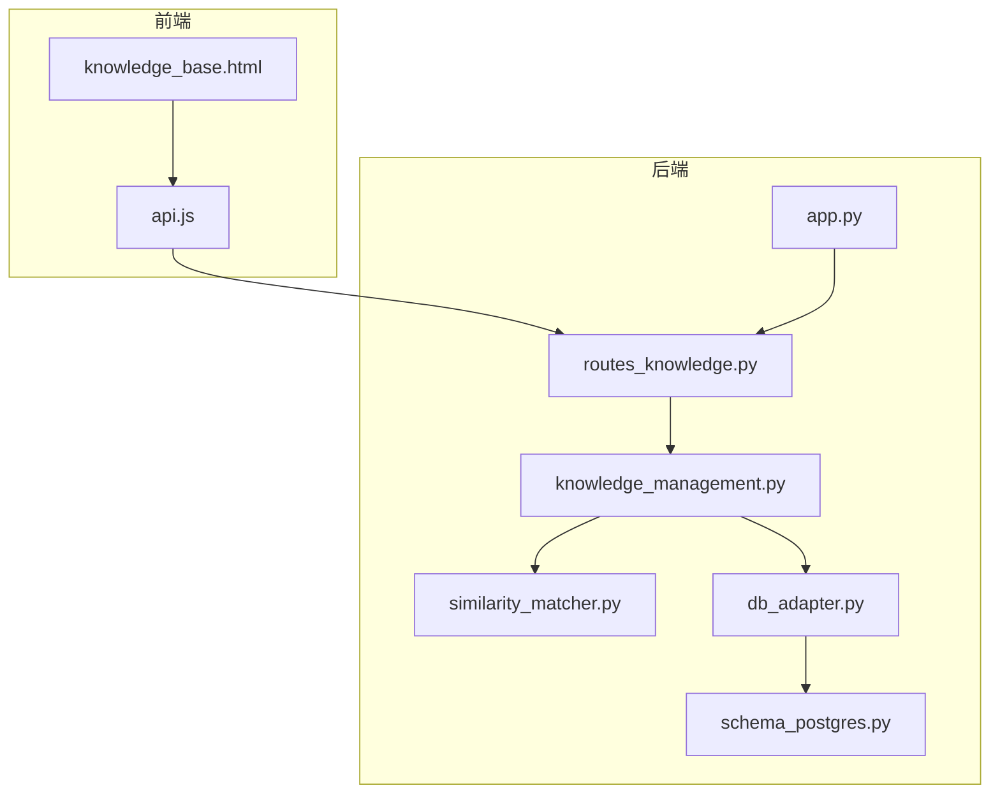
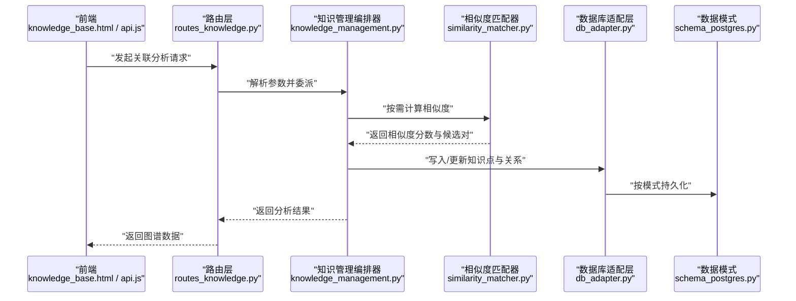
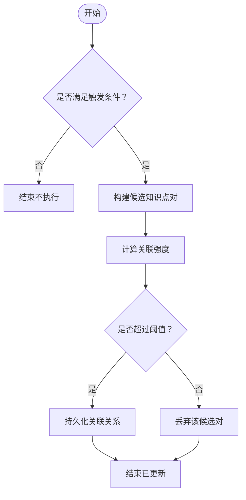
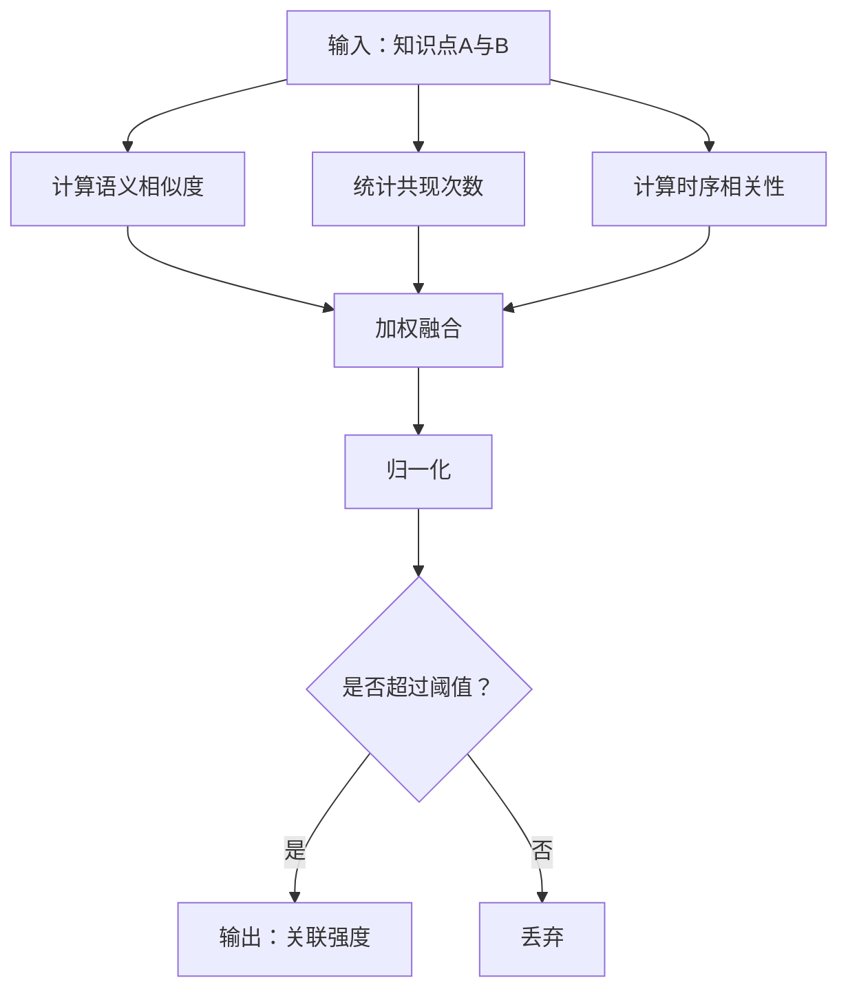
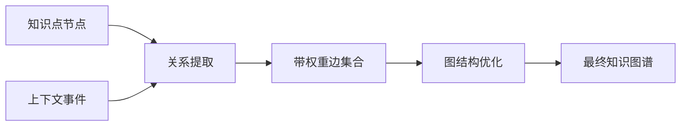
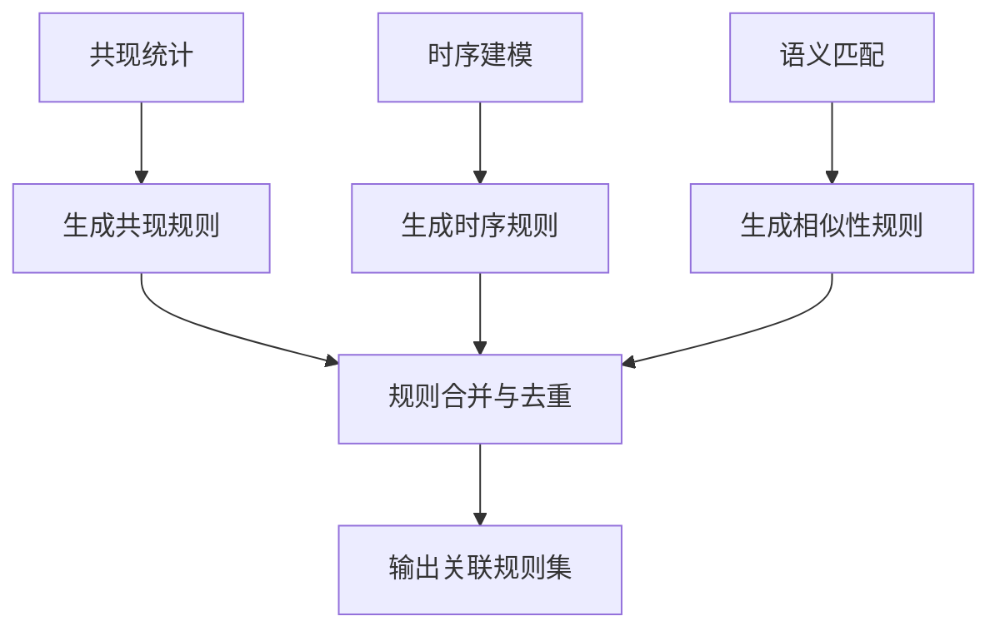
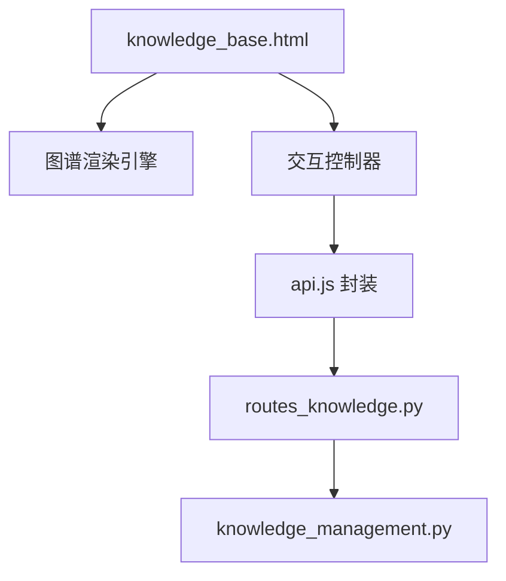
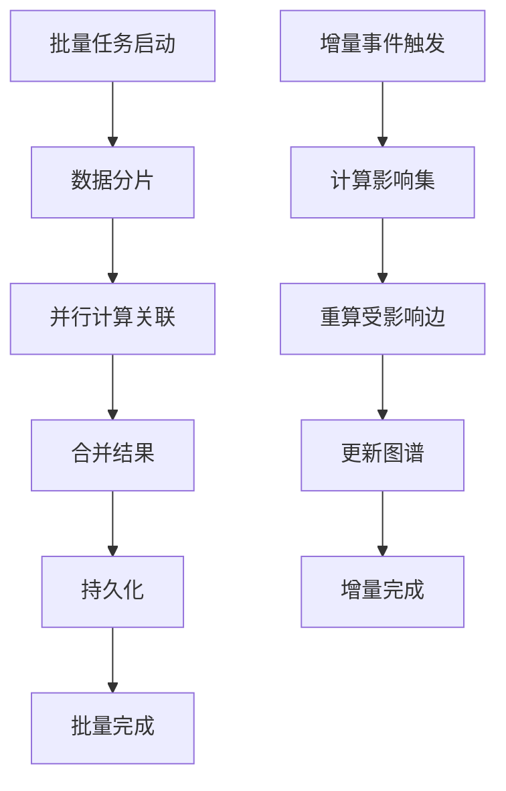
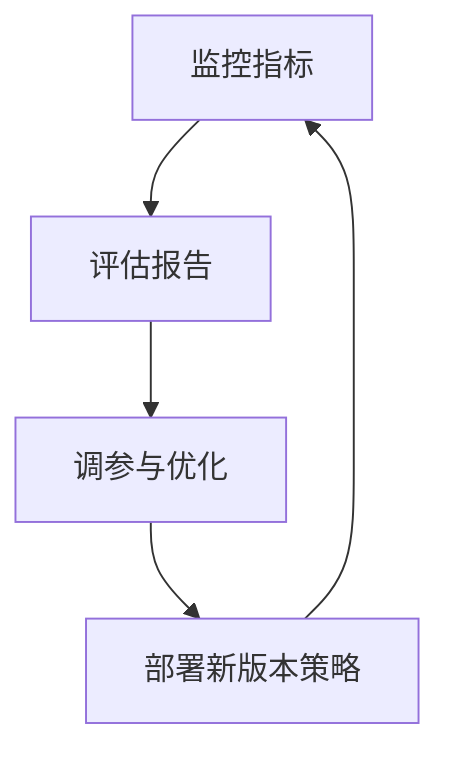
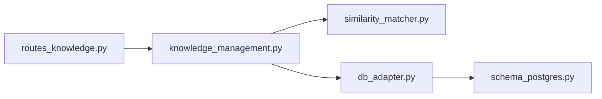

# 知识关联分析

<cite>
**本文引用的文件**   
- [server/knowledge_management.py](file://server/knowledge_management.py)
- [server/routes_knowledge.py](file://server/routes_knowledge.py)
- [server/similarity_matcher.py](file://server/similarity_matcher.py)
- [server/app.py](file://server/app.py)
- [server/database/db_adapter.py](file://server/database/db_adapter.py)
- [server/database/schema_postgres.py](file://server/database/schema_postgres.py)
- [server/templates/pages/knowledge_base.html](file://server/templates/pages/knowledge_base.html)
- [server/static/js/api.js](file://server/static/js/api.js)
- [docs/业务规则/业务规则总览.md](file://docs/业务规则/业务规则总览.md)
</cite>

## 目录
1. [引言](#引言)
2. [项目结构](#项目结构)
3. [核心组件](#核心组件)
4. [架构总览](#架构总览)
5. [详细组件分析](#详细组件分析)
6. [依赖关系分析](#依赖关系分析)
7. [性能与可扩展性](#性能与可扩展性)
8. [故障排查指南](#故障排查指南)
9. [结论](#结论)
10. [附录](#附录)

## 引言
本文件面向“知识关联分析”功能，系统性说明知识点自动关联的触发条件、关联强度计算方法、知识图谱构建算法（节点关系提取、边权重计算、图结构优化）、关联规则发现机制（共现分析、时序关联、内容相似性匹配）、可视化表示与交互操作、批量处理流程与增量更新机制，以及关联质量评估指标与优化策略。文档在技术实现与可理解性之间取得平衡，既适合开发者深入阅读，也便于非技术读者把握整体思路。

## 项目结构
围绕知识关联分析的相关代码主要位于后端服务层与前端模板/脚本中：
- 后端服务
  - 知识管理编排：knowledge_management.py
  - 相似度匹配器：similarity_matcher.py
  - Web 路由：routes_knowledge.py
  - 应用入口与路由注册：app.py
  - 数据库适配与模式定义：database/db_adapter.py、database/schema_postgres.py
- 前端展示
  - 知识图谱页面模板：templates/pages/knowledge_base.html
  - 前端 API 调用封装：static/js/api.js
- 业务规则参考
  - docs/业务规则/业务规则总览.md

**图示来源**
- [server/app.py](file://server/app.py)
- [server/routes_knowledge.py](file://server/routes_knowledge.py)
- [server/knowledge_management.py](file://server/knowledge_management.py)
- [server/similarity_matcher.py](file://server/similarity_matcher.py)
- [server/database/db_adapter.py](file://server/database/db_adapter.py)
- [server/database/schema_postgres.py](file://server/database/schema_postgres.py)
- [server/templates/pages/knowledge_base.html](file://server/templates/pages/knowledge_base.html)
- [server/static/js/api.js](file://server/static/js/api.js)

**章节来源**
- [server/app.py](file://server/app.py)
- [server/routes_knowledge.py](file://server/routes_knowledge.py)
- [server/knowledge_management.py](file://server/knowledge_management.py)
- [server/similarity_matcher.py](file://server/similarity_matcher.py)
- [server/database/db_adapter.py](file://server/database/db_adapter.py)
- [server/database/schema_postgres.py](file://server/database/schema_postgres.py)
- [server/templates/pages/knowledge_base.html](file://server/templates/pages/knowledge_base.html)
- [server/static/js/api.js](file://server/static/js/api.js)
- [docs/业务规则/业务规则总览.md](file://docs/业务规则/业务规则总览.md)

## 核心组件
- 知识管理编排器（knowledge_management.py）
  - 负责知识点抽取、关联触发、图谱构建、批量任务调度与增量更新。
- 相似度匹配器（similarity_matcher.py）
  - 提供文本语义相似度计算、阈值判定与候选对生成。
- 知识路由（routes_knowledge.py）
  - 暴露 REST 接口，接收前端请求并委派给知识管理编排器。
- 数据库适配层（db_adapter.py + schema_postgres.py）
  - 统一数据访问抽象，承载知识点、关系、事件等实体与索引。
- 前端页面与 API 封装（knowledge_base.html + api.js）
  - 渲染知识图谱、支持交互操作（筛选、展开、重算、导出）。

**章节来源**
- [server/knowledge_management.py](file://server/knowledge_management.py)
- [server/similarity_matcher.py](file://server/similarity_matcher.py)
- [server/routes_knowledge.py](file://server/routes_knowledge.py)
- [server/database/db_adapter.py](file://server/database/db_adapter.py)
- [server/database/schema_postgres.py](file://server/database/schema_postgres.py)
- [server/templates/pages/knowledge_base.html](file://server/templates/pages/knowledge_base.html)
- [server/static/js/api.js](file://server/static/js/api.js)

## 架构总览
知识关联分析的整体流程如下：
- 前端通过 api.js 调用 routes_knowledge.py 提供的接口。
- 路由层将请求转发至 knowledge_management.py 进行编排。
- 编排器根据触发条件选择关联策略，必要时调用 similarity_matcher.py 进行相似度计算。
- 结果持久化到数据库（db_adapter.py），由 schema_postgres.py 定义的数据模型支撑。
- 前端 knowledge_base.html 渲染图谱并进行交互。

**图示来源**
- [server/routes_knowledge.py](file://server/routes_knowledge.py)
- [server/knowledge_management.py](file://server/knowledge_management.py)
- [server/similarity_matcher.py](file://server/similarity_matcher.py)
- [server/database/db_adapter.py](file://server/database/db_adapter.py)
- [server/database/schema_postgres.py](file://server/database/schema_postgres.py)

## 详细组件分析

### 知识点自动关联触发条件
- 触发时机
  - 新增或更新知识点时触发增量关联。
  - 用户主动点击“重新关联”或“批量关联”时触发全量或范围关联。
  - 后台定时任务扫描未关联或弱关联的知识点对。
- 触发条件
  - 内容维度：关键词重叠、主题标签一致、语义相似度超过阈值。
  - 上下文维度：同课程/同会话/同时间窗内出现。
  - 业务规则：依据业务规则总览中的约束决定是否允许建立关联。
- 去重与幂等
  - 基于（源知识点ID，目标知识点ID，关系类型）三元组去重。
  - 同一批次内避免重复计算与重复写入。

**图示来源**
- [server/knowledge_management.py](file://server/knowledge_management.py)
- [server/similarity_matcher.py](file://server/similarity_matcher.py)
- [docs/业务规则/业务规则总览.md](file://docs/业务规则/业务规则总览.md)

**章节来源**
- [server/knowledge_management.py](file://server/knowledge_management.py)
- [docs/业务规则/业务规则总览.md](file://docs/业务规则/业务规则总览.md)

### 关联强度计算方法
- 多因子加权
  - 语义相似度：来自 similarity_matcher.py 的向量或嵌入相似度。
  - 共现强度：在同一上下文窗口内的出现频次。
  - 时序相关性：先后出现的顺序一致性与时序衰减。
  - 业务权重：依据业务规则赋予不同关系类型的权重。
- 归一化与阈值
  - 对原始分数进行归一化，确保跨主题可比。
  - 设置全局/局部阈值以过滤噪声边。
- 稳定性控制
  - 引入历史边权重平滑，避免单次波动导致剧烈变化。
  - 对高频但低质量的边进行降权或屏蔽。

**图示来源**
- [server/similarity_matcher.py](file://server/similarity_matcher.py)
- [server/knowledge_management.py](file://server/knowledge_management.py)

**章节来源**
- [server/similarity_matcher.py](file://server/similarity_matcher.py)
- [server/knowledge_management.py](file://server/knowledge_management.py)

### 知识图谱构建算法
- 节点关系提取
  - 从知识点元数据、文本内容与上下文事件中提取潜在关系。
  - 关系类型包括：前置知识、后继知识、并列概念、冲突修正、示例-概念等。
- 边权重计算
  - 使用上述关联强度方法为每条边赋权。
  - 结合关系类型进行差异化缩放。
- 图结构优化
  - 剪枝：移除低于阈值的边，降低图密度。
  - 聚类：对高连通子图进行社区划分，辅助导航与折叠。
  - 布局：采用力导向或层次布局提升可读性。
  - 索引：为常用查询字段建立索引，加速检索与遍历。

**图示来源**
- [server/knowledge_management.py](file://server/knowledge_management.py)
- [server/database/schema_postgres.py](file://server/database/schema_postgres.py)

**章节来源**
- [server/knowledge_management.py](file://server/knowledge_management.py)
- [server/database/schema_postgres.py](file://server/database/schema_postgres.py)

### 关联规则发现机制
- 共现分析
  - 统计知识点在同一会话/课程/时间窗内的共现频率。
  - 使用置信度与支持度筛选强规则。
- 时序关联
  - 基于先后出现顺序构建有向边，考虑时序衰减函数。
  - 识别典型学习路径与常见误区序列。
- 内容相似性匹配
  - 借助 similarity_matcher.py 计算语义相似度，合并近义知识点。
  - 对相似度高但无显式关系的知识点建立“近似等价”边。

**图示来源**
- [server/knowledge_management.py](file://server/knowledge_management.py)
- [server/similarity_matcher.py](file://server/similarity_matcher.py)

**章节来源**
- [server/knowledge_management.py](file://server/knowledge_management.py)
- [server/similarity_matcher.py](file://server/similarity_matcher.py)

### 可视化表示与交互操作
- 可视化
  - 以节点表示知识点，边表示关联关系，边粗细/颜色映射权重。
  - 支持按主题、关系类型、权重区间筛选。
- 交互
  - 点击节点展开/收起关联子图。
  - 拖拽调整布局，双击查看知识点详情。
  - 批量操作：选中多条知识点后一键重算关联。
  - 导出：导出当前视图为图片或 JSON。
- 前端实现要点
  - knowledge_base.html 负责渲染与事件绑定。
  - api.js 封装与后端接口的通信，处理分页与加载状态。

**图示来源**
- [server/templates/pages/knowledge_base.html](file://server/templates/pages/knowledge_base.html)
- [server/static/js/api.js](file://server/static/js/api.js)
- [server/routes_knowledge.py](file://server/routes_knowledge.py)
- [server/knowledge_management.py](file://server/knowledge_management.py)

**章节来源**
- [server/templates/pages/knowledge_base.html](file://server/templates/pages/knowledge_base.html)
- [server/static/js/api.js](file://server/static/js/api.js)
- [server/routes_knowledge.py](file://server/routes_knowledge.py)
- [server/knowledge_management.py](file://server/knowledge_management.py)

### 批量处理流程与增量更新机制
- 批量处理
  - 支持按课程/会话/日期范围拉取知识点子集。
  - 分片并行计算，限制并发数以避免资源争用。
  - 失败重试与断点续算，保证任务可恢复。
- 增量更新
  - 监听知识点变更事件，仅对受影响的知识点对重算。
  - 维护变更日志与版本号，支持回滚与审计。
  - 定期清理孤立节点与过期关系。

**图示来源**
- [server/knowledge_management.py](file://server/knowledge_management.py)
- [server/database/db_adapter.py](file://server/database/db_adapter.py)

**章节来源**
- [server/knowledge_management.py](file://server/knowledge_management.py)
- [server/database/db_adapter.py](file://server/database/db_adapter.py)

### 关联质量评估指标与优化策略
- 评估指标
  - 精确率/召回率：基于人工标注或抽样校验。
  - F1 值：综合衡量准确性与完整性。
  - 覆盖率：被关联知识点占总知识点的比例。
  - 平均边权重：反映整体关联强度水平。
  - 图密度与连通分量数：衡量图结构与可导航性。
- 优化策略
  - 动态阈值：根据数据集规模与分布自适应调整。
  - 负样本挖掘：识别误报边并加入惩罚项。
  - 特征工程：引入更多上下文特征（如章节位置、难度等级）。
  - 在线学习：随用户反馈逐步校准权重与阈值。

**图示来源**
- [server/knowledge_management.py](file://server/knowledge_management.py)
- [server/similarity_matcher.py](file://server/similarity_matcher.py)

**章节来源**
- [server/knowledge_management.py](file://server/knowledge_management.py)
- [server/similarity_matcher.py](file://server/similarity_matcher.py)

## 依赖关系分析
- 模块耦合
  - routes_knowledge.py 依赖 knowledge_management.py 与 db_adapter.py。
  - knowledge_management.py 依赖 similarity_matcher.py 与 db_adapter.py。
  - db_adapter.py 依赖 schema_postgres.py 定义的数据模式。
- 外部依赖
  - 数据库：PostgreSQL（由 schema_postgres.py 描述）。
  - 前端：浏览器端 JS 运行环境。
- 循环依赖检查
  - 当前分层清晰，未见明显循环依赖。

**图示来源**
- [server/routes_knowledge.py](file://server/routes_knowledge.py)
- [server/knowledge_management.py](file://server/knowledge_management.py)
- [server/similarity_matcher.py](file://server/similarity_matcher.py)
- [server/database/db_adapter.py](file://server/database/db_adapter.py)
- [server/database/schema_postgres.py](file://server/database/schema_postgres.py)

**章节来源**
- [server/routes_knowledge.py](file://server/routes_knowledge.py)
- [server/knowledge_management.py](file://server/knowledge_management.py)
- [server/similarity_matcher.py](file://server/similarity_matcher.py)
- [server/database/db_adapter.py](file://server/database/db_adapter.py)
- [server/database/schema_postgres.py](file://server/database/schema_postgres.py)

## 性能与可扩展性
- 计算复杂度
  - 相似度计算通常为 O(n^2) 级别，需通过分片与缓存降低开销。
  - 图遍历与布局算法复杂度与节点/边数量相关，建议按需加载子图。
- 缓存与索引
  - 缓存热点知识点与相似度结果，减少重复计算。
  - 为常用查询字段建立复合索引，提升检索性能。
- 扩展性
  - 支持横向扩展：将相似度计算与批量任务拆分为独立服务。
  - 插件化策略：允许替换相似度算法与关系提取规则。

[本节为通用指导，不涉及具体文件分析]

## 故障排查指南
- 常见问题
  - 关联过少：检查阈值设置、相似度模型与业务规则。
  - 关联过多：提高阈值、增加负样本惩罚、启用图剪枝。
  - 更新延迟：检查增量事件队列与并发配置。
  - 可视化卡顿：减少一次性渲染节点数，启用分页与懒加载。
- 定位步骤
  - 查看后端日志与错误堆栈。
  - 核对数据库记录与索引状态。
  - 在前端控制台检查 API 响应与网络耗时。
- 恢复措施
  - 重置阈值并重新运行增量任务。
  - 清理无效边与孤立节点。
  - 回滚到上一稳定版本策略。

**章节来源**
- [server/knowledge_management.py](file://server/knowledge_management.py)
- [server/database/db_adapter.py](file://server/database/db_adapter.py)

## 结论
知识关联分析通过“触发条件—强度计算—图谱构建—规则发现—可视化—批处理/增量—评估优化”的闭环，实现了从原始知识点到结构化知识图谱的自动化转化。系统在模块化设计下具备良好的可扩展性与可维护性，同时通过多维度评估与持续优化策略保障关联质量。未来可进一步引入在线学习与用户反馈闭环，持续提升关联精度与用户体验。

[本节为总结性内容，不涉及具体文件分析]

## 附录
- 术语表
  - 知识点：系统内最小可关联的学习单元。
  - 关联强度：衡量两个知识点之间关联程度的数值。
  - 共现：在同一上下文中同时出现。
  - 时序关联：基于出现顺序建立的有向关联。
  - 图剪枝：移除低质量边的过程。
- 参考
  - 业务规则总览用于约束关联策略与边界条件。

**章节来源**
- [docs/业务规则/业务规则总览.md](file://docs/业务规则/业务规则总览.md)