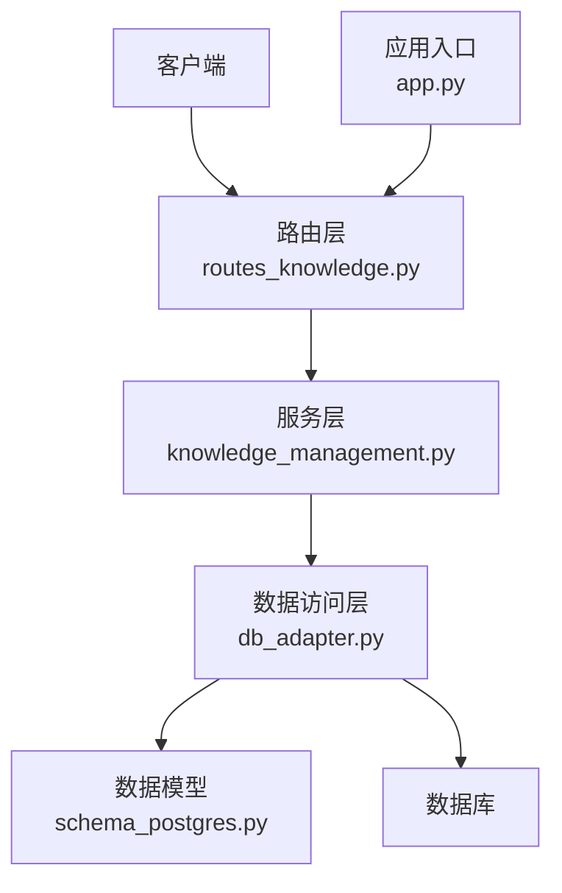
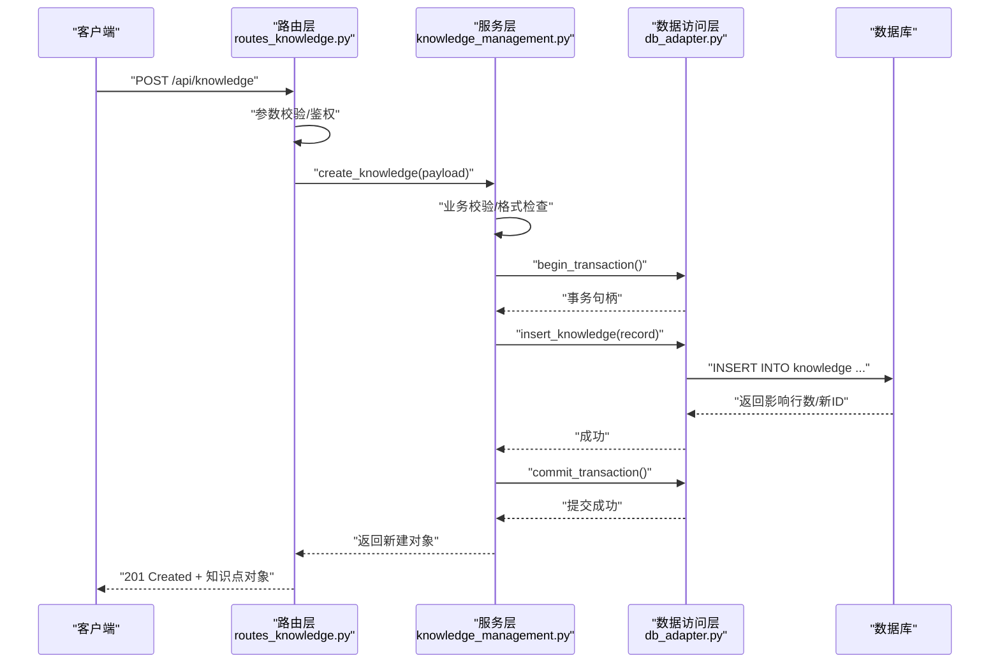
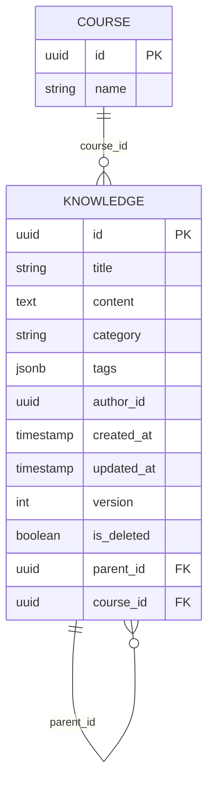
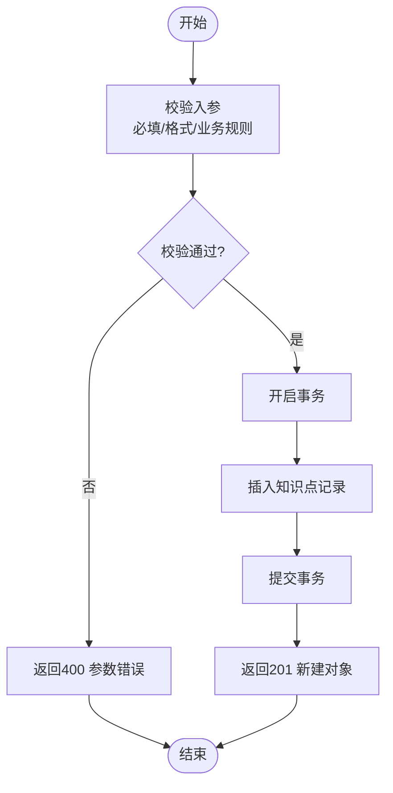
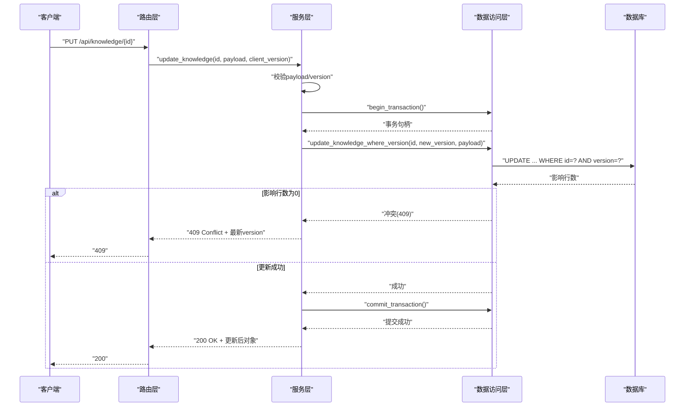
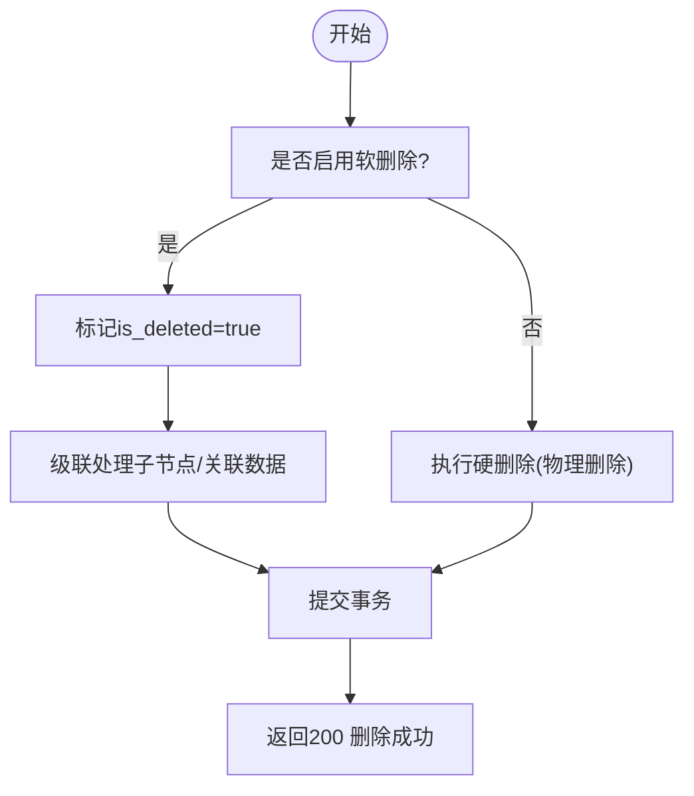
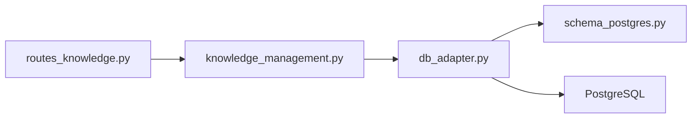

# 知识点CRUD操作

<cite>
**本文引用的文件**   
- [routes_knowledge.py](file://server/routes_knowledge.py)
- [knowledge_management.py](file://server/knowledge_management.py)
- [db_adapter.py](file://server/database/db_adapter.py)
- [schema_postgres.py](file://server/database/schema_postgres.py)
- [app.py](file://server/app.py)
</cite>

## 目录
1. [简介](#简介)
2. [项目结构](#项目结构)
3. [核心组件](#核心组件)
4. [架构总览](#架构总览)
5. [详细组件分析](#详细组件分析)
6. [依赖关系分析](#依赖关系分析)
7. [性能与并发](#性能与并发)
8. [故障排查指南](#故障排查指南)
9. [结论](#结论)
10. [附录：API使用示例](#附录api使用示例)

## 简介
本文件面向“知识点”实体的增删改查（CRUD）能力，系统性说明其数据结构、字段定义、业务规则、创建流程、更新版本控制与冲突处理、删除策略（含级联与软删除）、事务与并发控制机制，并提供完整的API调用示例路径。文档以代码仓库中的路由层、服务层、数据库适配器和数据模型为依据进行梳理，确保读者既能快速上手，也能深入理解实现细节。

## 项目结构
围绕知识点CRUD的相关代码主要分布在以下模块：
- 路由层：对外暴露HTTP接口，负责参数校验、鉴权、响应封装
- 服务层：封装知识点的业务逻辑，包括创建、更新、查询、删除等
- 数据访问层：提供数据库连接、事务、SQL执行等通用能力
- 数据模型：定义知识点表结构与约束

**图表来源** 
- [routes_knowledge.py:1-200](file://server/routes_knowledge.py#L1-L200)
- [knowledge_management.py:1-200](file://server/knowledge_management.py#L1-L200)
- [db_adapter.py:1-200](file://server/database/db_adapter.py#L1-L200)
- [schema_postgres.py:1-200](file://server/database/schema_postgres.py#L1-L200)
- [app.py:1-100](file://server/app.py#L1-L100)

**章节来源**
- [routes_knowledge.py:1-200](file://server/routes_knowledge.py#L1-L200)
- [knowledge_management.py:1-200](file://server/knowledge_management.py#L1-L200)
- [db_adapter.py:1-200](file://server/database/db_adapter.py#L1-L200)
- [schema_postgres.py:1-200](file://server/database/schema_postgres.py#L1-L200)
- [app.py:1-100](file://server/app.py#L1-L100)

## 核心组件
- 路由层（routes_knowledge.py）
  - 职责：注册/暴露知识点相关REST API；统一入参校验、错误码包装；鉴权与权限控制；调用服务层完成业务逻辑。
  - 关键端点：创建、批量创建、更新、批量更新、查询列表、按ID查询、删除、批量删除、软删除恢复、统计等。
- 服务层（knowledge_management.py）
  - 职责：封装知识点领域逻辑；实现版本控制、冲突检测与合并策略；组织事务边界；协调DAL进行持久化。
  - 关键能力：创建校验与格式化、更新版本比较与冲突解决、级联删除、软删除标记与恢复、分页与过滤。
- 数据访问层（db_adapter.py）
  - 职责：数据库连接管理、事务封装、SQL执行、结果映射；提供重试与超时控制。
- 数据模型（schema_postgres.py）
  - 职责：定义知识点实体表结构、索引、约束、默认值、触发器（如更新时间戳）。

**章节来源**
- [routes_knowledge.py:1-200](file://server/routes_knowledge.py#L1-L200)
- [knowledge_management.py:1-200](file://server/knowledge_management.py#L1-L200)
- [db_adapter.py:1-200](file://server/database/db_adapter.py#L1-L200)
- [schema_postgres.py:1-200](file://server/database/schema_postgres.py#L1-L200)

## 架构总览
下图展示一次“创建知识点”的端到端调用链，体现从HTTP请求到数据库落库的全过程。

**图表来源**
- [routes_knowledge.py:1-200](file://server/routes_knowledge.py#L1-L200)
- [knowledge_management.py:1-200](file://server/knowledge_management.py#L1-L200)
- [db_adapter.py:1-200](file://server/database/db_adapter.py#L1-L200)

## 详细组件分析

### 知识点实体与数据结构
- 设计要点
  - 主键：自增或UUID（依据具体DDL）
  - 文本字段：标题、内容、摘要等，支持富文本或Markdown
  - 元数据：标签、分类、来源、作者、时间戳（创建/更新）
  - 状态与版本：可见性、是否软删除、版本号、乐观锁字段
  - 关联信息：所属课程/材料ID、父知识点ID（树形结构）
- 约束与索引
  - 唯一性：标题+分类组合唯一（可选）
  - 索引：分类、标签、更新时间、作者等常用查询字段
  - 外键：与课程/材料表的关联约束（可配置）
- 业务规则
  - 必填字段校验：标题、内容、分类
  - 长度限制：标题不超过N字符，内容不超过M字符
  - 敏感词过滤：内容中禁止特定词汇（可选）
  - 版本递增：每次更新版本号+1，并记录变更原因

**图表来源**
- [schema_postgres.py:1-200](file://server/database/schema_postgres.py#L1-L200)

**章节来源**
- [schema_postgres.py:1-200](file://server/database/schema_postgres.py#L1-L200)

### 创建知识点流程
- 输入校验
  - 必填项：标题、内容、分类
  - 格式：标题去空白、内容HTML/Markdown清洗、标签数组规范化
  - 业务规则：重复标题+分类检查、敏感词过滤
- 存储逻辑
  - 开启事务
  - 插入知识点记录，设置初始版本=1
  - 提交事务，返回新建对象
- 异常处理
  - 参数错误：返回400及具体字段错误
  - 唯一性冲突：返回409 Conflict
  - 数据库异常：返回500并附带日志ID

**图表来源**
- [routes_knowledge.py:1-200](file://server/routes_knowledge.py#L1-L200)
- [knowledge_management.py:1-200](file://server/knowledge_management.py#L1-L200)
- [db_adapter.py:1-200](file://server/database/db_adapter.py#L1-L200)

**章节来源**
- [routes_knowledge.py:1-200](file://server/routes_knowledge.py#L1-L200)
- [knowledge_management.py:1-200](file://server/knowledge_management.py#L1-L200)
- [db_adapter.py:1-200](file://server/database/db_adapter.py#L1-L200)

### 更新知识点与版本控制
- 版本控制机制
  - 乐观锁：基于version字段，更新时要求传入当前version
  - 冲突检测：若数据库version与传入不一致，判定为冲突
  - 冲突处理策略：
    - 拒绝更新并返回409，附带服务端最新version与差异提示
    - 可选择“强制覆盖”模式（需显式参数），但会丢失中间版本
- 更新流程
  - 校验入参与版本一致性
  - 计算新版本号=旧version+1
  - 在事务内执行UPDATE WHERE id=? AND version=?
  - 提交事务，返回更新后的对象
- 审计与历史
  - 建议维护变更记录表，记录变更人、变更时间、变更原因（可选）

**图表来源**
- [routes_knowledge.py:1-200](file://server/routes_knowledge.py#L1-L200)
- [knowledge_management.py:1-200](file://server/knowledge_management.py#L1-L200)
- [db_adapter.py:1-200](file://server/database/db_adapter.py#L1-L200)

**章节来源**
- [routes_knowledge.py:1-200](file://server/routes_knowledge.py#L1-L200)
- [knowledge_management.py:1-200](file://server/knowledge_management.py#L1-L200)
- [db_adapter.py:1-200](file://server/database/db_adapter.py#L1-L200)

### 删除知识点与软删除
- 删除策略
  - 硬删除：物理删除记录（谨慎使用，通常仅用于测试或清理）
  - 软删除：将is_deleted置为true，保留历史数据以便恢复与审计
- 级联删除规则
  - 子知识点：递归标记所有子节点为已删除
  - 关联数据：根据外键约束决定是否级联删除或仅标记
- 恢复机制
  - 提供恢复接口，将is_deleted置回false，并恢复子节点状态
- 事务保证
  - 软删除与子节点更新在同一事务中完成，保证一致性

**图表来源**
- [routes_knowledge.py:1-200](file://server/routes_knowledge.py#L1-L200)
- [knowledge_management.py:1-200](file://server/knowledge_management.py#L1-L200)
- [db_adapter.py:1-200](file://server/database/db_adapter.py#L1-L200)

**章节来源**
- [routes_knowledge.py:1-200](file://server/routes_knowledge.py#L1-L200)
- [knowledge_management.py:1-200](file://server/knowledge_management.py#L1-L200)
- [db_adapter.py:1-200](file://server/database/db_adapter.py#L1-L200)

### 查询知识点
- 查询维度
  - 按ID精确查询
  - 按分类、标签、作者、时间范围过滤
  - 分页与排序（默认按更新时间倒序）
- 软删除过滤
  - 默认不返回已软删除的记录，可通过参数选择包含
- 性能优化
  - 常用查询字段建立索引
  - 大结果集采用游标或分页

**章节来源**
- [routes_knowledge.py:1-200](file://server/routes_knowledge.py#L1-L200)
- [knowledge_management.py:1-200](file://server/knowledge_management.py#L1-L200)
- [schema_postgres.py:1-200](file://server/database/schema_postgres.py#L1-L200)

## 依赖关系分析
- 路由层依赖服务层
- 服务层依赖数据访问层
- 数据访问层依赖数据库驱动与ORM/SQL构建器
- 数据模型由DDL脚本或迁移工具生成

**图表来源**
- [routes_knowledge.py:1-200](file://server/routes_knowledge.py#L1-L200)
- [knowledge_management.py:1-200](file://server/knowledge_management.py#L1-L200)
- [db_adapter.py:1-200](file://server/database/db_adapter.py#L1-L200)
- [schema_postgres.py:1-200](file://server/database/schema_postgres.py#L1-L200)

**章节来源**
- [routes_knowledge.py:1-200](file://server/routes_knowledge.py#L1-L200)
- [knowledge_management.py:1-200](file://server/knowledge_management.py#L1-L200)
- [db_adapter.py:1-200](file://server/database/db_adapter.py#L1-L200)
- [schema_postgres.py:1-200](file://server/database/schema_postgres.py#L1-L200)

## 性能与并发
- 事务处理
  - 所有写操作（创建、更新、删除）均在事务中执行，保证原子性与一致性
  - 短事务原则：避免长事务持有锁，减少阻塞
- 并发控制
  - 乐观锁：基于version字段，冲突时返回409，客户端可重试或提示用户
  - 幂等性：对批量操作提供幂等键（可选），防止重复提交
- 索引与查询
  - 针对高频查询字段建立复合索引
  - 分页查询避免全表扫描
- 资源保护
  - 连接池与超时配置，防止连接泄漏
  - 慢查询监控与告警

[本节为通用指导，无需引用具体文件]

## 故障排查指南
- 常见错误
  - 400 参数错误：检查必填字段、格式、长度限制
  - 409 冲突：更新时version不一致，获取最新版本后重试或合并
  - 404 未找到：ID不存在或已被软删除且未包含软删除数据
  - 500 服务器错误：查看后端日志，定位数据库异常或事务失败
- 诊断步骤
  - 确认请求体是否符合API规范
  - 检查鉴权与权限是否正确
  - 查看数据库事务日志与慢查询日志
  - 复现问题并抓取trace ID

**章节来源**
- [routes_knowledge.py:1-200](file://server/routes_knowledge.py#L1-L200)
- [knowledge_management.py:1-200](file://server/knowledge_management.py#L1-L200)
- [db_adapter.py:1-200](file://server/database/db_adapter.py#L1-L200)

## 结论
本方案通过清晰的分层架构与严格的事务与并发控制，实现了知识点实体的稳定CRUD能力。版本控制与软删除保障了数据的可追溯性与安全性，配合合理的索引与查询策略，满足高并发场景下的性能需求。建议在后续迭代中完善审计日志与变更历史，进一步提升可观测性与合规性。

[本节为总结性内容，无需引用具体文件]

## 附录：API使用示例
以下为知识点CRUD操作的API调用示例路径，便于前端或外部系统对接。请根据实际部署环境替换域名与端口。

- 创建知识点
  - 方法：POST
  - 路径：/api/knowledge
  - 请求体：包含标题、内容、分类、标签等字段
  - 响应：201 Created + 新建对象
  - 参考实现位置：[routes_knowledge.py:1-200](file://server/routes_knowledge.py#L1-L200), [knowledge_management.py:1-200](file://server/knowledge_management.py#L1-L200)

- 批量创建知识点
  - 方法：POST
  - 路径：/api/knowledge/batch
  - 请求体：知识点数组
  - 响应：201 Created + 批量结果
  - 参考实现位置：[routes_knowledge.py:1-200](file://server/routes_knowledge.py#L1-L200)

- 更新知识点
  - 方法：PUT
  - 路径：/api/knowledge/{id}
  - 请求体：包含要更新的字段与client_version
  - 响应：200 OK + 更新后对象；409 Conflict（版本冲突）
  - 参考实现位置：[routes_knowledge.py:1-200](file://server/routes_knowledge.py#L1-L200), [knowledge_management.py:1-200](file://server/knowledge_management.py#L1-L200)

- 批量更新知识点
  - 方法：PUT
  - 路径：/api/knowledge/batch
  - 请求体：知识点数组（每个元素含id、client_version、更新字段）
  - 响应：200 OK + 批量结果
  - 参考实现位置：[routes_knowledge.py:1-200](file://server/routes_knowledge.py#L1-L200)

- 查询知识点列表
  - 方法：GET
  - 路径：/api/knowledge
  - 查询参数：category、tags、author_id、created_after、created_before、page、size、sort_by
  - 响应：200 OK + 分页结果
  - 参考实现位置：[routes_knowledge.py:1-200](file://server/routes_knowledge.py#L1-L200)

- 按ID查询知识点
  - 方法：GET
  - 路径：/api/knowledge/{id}
  - 响应：200 OK + 知识点对象；404 Not Found
  - 参考实现位置：[routes_knowledge.py:1-200](file://server/routes_knowledge.py#L1-L200)

- 删除知识点
  - 方法：DELETE
  - 路径：/api/knowledge/{id}
  - 响应：200 OK 或 404 Not Found
  - 参考实现位置：[routes_knowledge.py:1-200](file://server/routes_knowledge.py#L1-L200)

- 批量删除知识点
  - 方法：DELETE
  - 路径：/api/knowledge/batch
  - 请求体：ID数组
  - 响应：200 OK + 批量结果
  - 参考实现位置：[routes_knowledge.py:1-200](file://server/routes_knowledge.py#L1-L200)

- 恢复软删除知识点
  - 方法：PATCH
  - 路径：/api/knowledge/{id}/restore
  - 响应：200 OK + 恢复后对象；404 Not Found
  - 参考实现位置：[routes_knowledge.py:1-200](file://server/routes_knowledge.py#L1-L200)

- 统计知识点数量
  - 方法：GET
  - 路径：/api/knowledge/stats
  - 查询参数：category、author_id等
  - 响应：200 OK + 统计数据
  - 参考实现位置：[routes_knowledge.py:1-200](file://server/routes_knowledge.py#L1-L200)