# 知识管理系统

<cite>
**本文引用的文件**   
- [app.py](file://server/app.py)
- [config.py](file://server/config.py)
- [knowledge_management.py](file://server/knowledge_management.py)
- [routes_knowledge.py](file://server/routes_knowledge.py)
- [similarity_matcher.py](file://server/similarity_matcher.py)
- [db_adapter.py](file://server/database/db_adapter.py)
- [schema_postgres.py](file://server/database/schema_postgres.py)
- [routes_bridge.py](file://server/routes_bridge.py)
- [routes_notes.py](file://server/routes_notes.py)
- [api.js](file://server/static/js/api.js)
- [knowledge_base.html](file://server/templates/pages/knowledge_base.html)
- [memory_knowledge.html](file://server/templates/pages/memory_knowledge.html)
- [practice_knowledge.html](file://server/templates/pages/practice_knowledge.html)
- [AGENTS.md](file://AGENTS.md)
</cite>

## 目录
1. [引言](#引言)
2. [项目结构](#项目结构)
3. [核心组件](#核心组件)
4. [架构总览](#架构总览)
5. [详细组件分析](#详细组件分析)
6. [依赖关系分析](#依赖关系分析)
7. [性能与索引优化](#性能与索引优化)
8. [故障排查指南](#故障排查指南)
9. [结论](#结论)
10. [附录：API与数据模型](#附录api与数据模型)

## 引言
本文件为 LectureLearnLoop 知识管理系统的实现文档，聚焦以下目标：
- 知识点 CRUD 的完整流程与前后端交互
- 内容解析引擎（Markdown/富文本）工作原理
- 自动分类机制、相似度匹配算法与知识图谱构建
- 搜索功能、索引优化与查询性能
- 版本管理、历史追踪与回滚机制
- 面向开发者的代码级示例路径与排错建议

## 项目结构
系统采用“后端 Python + 前端模板/JS”的分层架构。后端提供 REST API，负责知识点的持久化、检索、关联与相似度计算；前端通过 HTML 模板与 JS 调用 API，完成录入、编辑、关联与检索等交互。

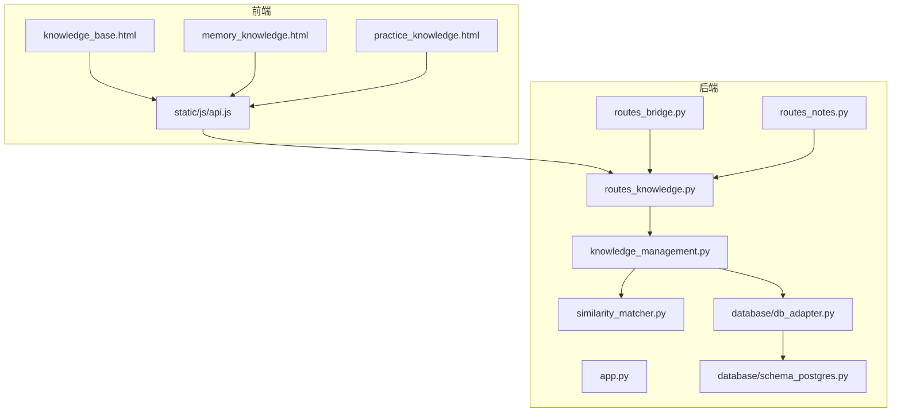

**图表来源**
- [app.py:1-200](file://server/app.py#L1-L200)
- [routes_knowledge.py:1-200](file://server/routes_knowledge.py#L1-L200)
- [knowledge_management.py:1-200](file://server/knowledge_management.py#L1-L200)
- [similarity_matcher.py:1-200](file://server/similarity_matcher.py#L1-L200)
- [db_adapter.py:1-200](file://server/database/db_adapter.py#L1-L200)
- [schema_postgres.py:1-200](file://server/database/schema_postgres.py#L1-L200)
- [routes_bridge.py:1-200](file://server/routes_bridge.py#L1-L200)
- [routes_notes.py:1-200](file://server/routes_notes.py#L1-L200)
- [api.js:1-200](file://server/static/js/api.js#L1-L200)
- [knowledge_base.html:1-200](file://server/templates/pages/knowledge_base.html#L1-L200)
- [memory_knowledge.html:1-200](file://server/templates/pages/memory_knowledge.html#L1-L200)
- [practice_knowledge.html:1-200](file://server/templates/pages/practice_knowledge.html#L1-L200)

**章节来源**
- [AGENTS.md:1-200](file://AGENTS.md#L1-L200)
- [app.py:1-200](file://server/app.py#L1-L200)

## 核心组件
- 路由层：暴露 REST API，处理请求校验、鉴权与响应封装
- 业务层：知识点生命周期管理、自动分类、相似度计算、图谱构建
- 数据访问层：数据库连接、事务、SQL 抽象与迁移
- 前端层：页面模板与 JS 客户端，统一调用后端 API

关键职责划分：
- routes_knowledge.py：知识点相关接口定义与参数校验
- knowledge_management.py：知识点领域逻辑（CRUD、分类、关联、图谱）
- similarity_matcher.py：相似度计算与自动分类策略
- db_adapter.py：数据库适配与通用操作
- schema_postgres.py：PostgreSQL 表结构与约束
- api.js：前端 API 封装
- templates/pages/*：知识管理相关页面

**章节来源**
- [routes_knowledge.py:1-200](file://server/routes_knowledge.py#L1-L200)
- [knowledge_management.py:1-200](file://server/knowledge_management.py#L1-L200)
- [similarity_matcher.py:1-200](file://server/similarity_matcher.py#L1-L200)
- [db_adapter.py:1-200](file://server/database/db_adapter.py#L1-L200)
- [schema_postgres.py:1-200](file://server/database/schema_postgres.py#L1-L200)
- [api.js:1-200](file://server/static/js/api.js#L1-L200)

## 架构总览
系统以 Flask 应用为中心，注册多条路由，包括知识点、笔记、桥接服务等。知识点模块内部遵循“路由→服务→数据访问”的分层模式，并通过相似度匹配器进行自动分类与关联推荐。

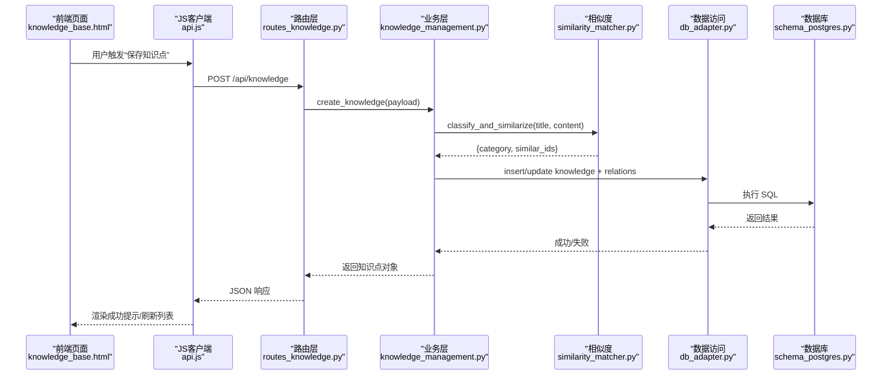

**图表来源**
- [routes_knowledge.py:1-200](file://server/routes_knowledge.py#L1-L200)
- [knowledge_management.py:1-200](file://server/knowledge_management.py#L1-L200)
- [similarity_matcher.py:1-200](file://server/similarity_matcher.py#L1-L200)
- [db_adapter.py:1-200](file://server/database/db_adapter.py#L1-L200)
- [schema_postgres.py:1-200](file://server/database/schema_postgres.py#L1-L200)
- [api.js:1-200](file://server/static/js/api.js#L1-L200)
- [knowledge_base.html:1-200](file://server/templates/pages/knowledge_base.html#L1-L200)

## 详细组件分析

### 知识点 CRUD 流程
- 创建：前端提交标题、正文、标签、分类等字段；后端校验后写入知识库，并触发自动分类与相似推荐
- 读取：支持按 ID、关键词、标签、分类、时间范围检索；返回分页结果
- 更新：增量更新字段，保留版本号与更新时间戳
- 删除：软删除或物理删除（由配置决定），同时清理关联关系

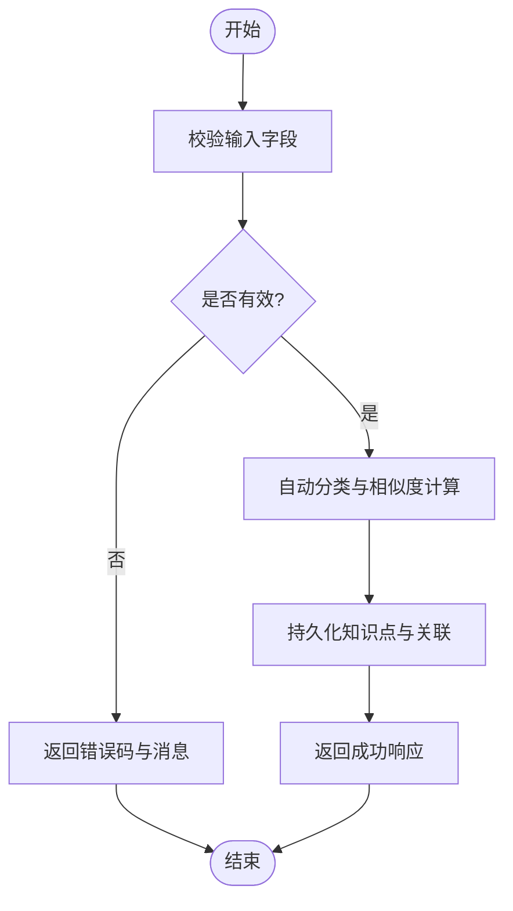

**图表来源**
- [routes_knowledge.py:1-200](file://server/routes_knowledge.py#L1-L200)
- [knowledge_management.py:1-200](file://server/knowledge_management.py#L1-L200)
- [similarity_matcher.py:1-200](file://server/similarity_matcher.py#L1-L200)
- [db_adapter.py:1-200](file://server/database/db_adapter.py#L1-L200)

**章节来源**
- [routes_knowledge.py:1-200](file://server/routes_knowledge.py#L1-L200)
- [knowledge_management.py:1-200](file://server/knowledge_management.py#L1-L200)

### 内容解析引擎（Markdown/富文本）
- 输入格式：支持 Markdown 语法与基础富文本标记
- 解析流程：清洗输入 → 提取结构化片段（标题、段落、列表、链接、图片）→ 生成可检索的纯文本摘要与结构化元数据
- 输出产物：用于展示的 HTML 片段、用于检索的文本向量/词袋、用于图谱的实体抽取结果

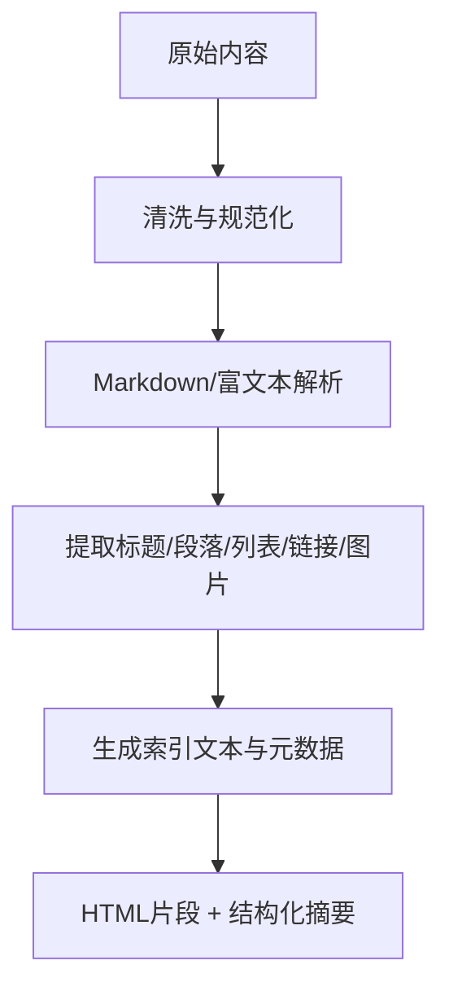

**图表来源**
- [knowledge_management.py:1-200](file://server/knowledge_management.py#L1-L200)

**章节来源**
- [knowledge_management.py:1-200](file://server/knowledge_management.py#L1-L200)

### 自动分类机制与相似度匹配算法
- 自动分类：基于标题与内容的特征（词频、关键词、规则字典）进行类别判定
- 相似度匹配：对候选知识点计算语义/词汇相似度，返回 Top-N 相似项
- 关联推荐：根据相似度阈值与业务规则建立“知识点→知识点”的关系边

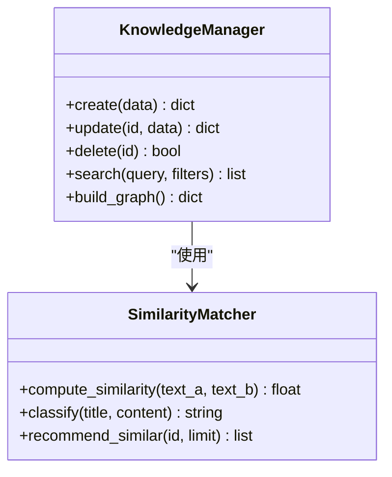

**图表来源**
- [similarity_matcher.py:1-200](file://server/similarity_matcher.py#L1-L200)
- [knowledge_management.py:1-200](file://server/knowledge_management.py#L1-L200)

**章节来源**
- [similarity_matcher.py:1-200](file://server/similarity_matcher.py#L1-L200)
- [knowledge_management.py:1-200](file://server/knowledge_management.py#L1-L200)

### 知识图谱构建
- 节点：知识点实体（ID、标题、摘要、分类、时间戳）
- 边：相似关系、引用关系、主题聚合关系
- 构建流程：遍历知识点集合 → 计算相似度 → 过滤阈值 → 写入关系表 → 导出图结构

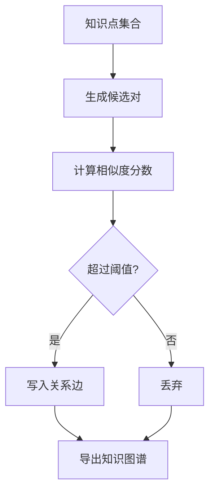

**图表来源**
- [knowledge_management.py:1-200](file://server/knowledge_management.py#L1-L200)
- [similarity_matcher.py:1-200](file://server/similarity_matcher.py#L1-L200)

**章节来源**
- [knowledge_management.py:1-200](file://server/knowledge_management.py#L1-L200)

### 搜索功能、索引优化与查询性能
- 搜索维度：全文检索、标签筛选、分类筛选、时间范围、作者/来源
- 索引策略：倒排索引（词项→文档ID）、向量化检索（可选）、缓存热点查询
- 性能优化：分页、延迟加载、批量写入、异步任务（图谱构建）

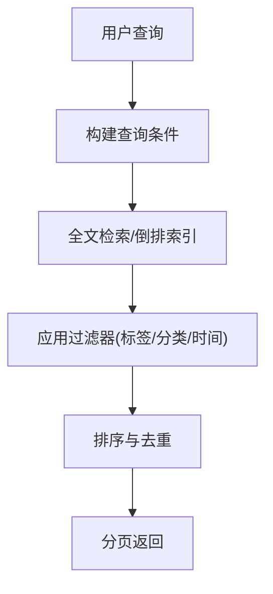

**图表来源**
- [routes_knowledge.py:1-200](file://server/routes_knowledge.py#L1-L200)
- [knowledge_management.py:1-200](file://server/knowledge_management.py#L1-L200)
- [db_adapter.py:1-200](file://server/database/db_adapter.py#L1-L200)

**章节来源**
- [routes_knowledge.py:1-200](file://server/routes_knowledge.py#L1-L200)
- [knowledge_management.py:1-200](file://server/knowledge_management.py#L1-L200)

### 版本管理、历史追踪与回滚
- 版本控制：每次更新递增版本号，记录变更时间与变更人
- 历史追踪：保留历史快照，支持对比差异
- 回滚机制：根据版本 ID 恢复指定快照，并记录回滚日志

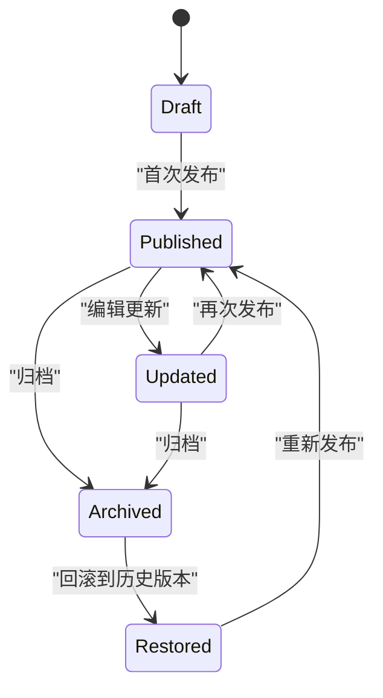

**图表来源**
- [knowledge_management.py:1-200](file://server/knowledge_management.py#L1-L200)
- [schema_postgres.py:1-200](file://server/database/schema_postgres.py#L1-L200)

**章节来源**
- [knowledge_management.py:1-200](file://server/knowledge_management.py#L1-L200)
- [schema_postgres.py:1-200](file://server/database/schema_postgres.py#L1-L200)

### 前端集成与交互示例
- 知识点录入：在 knowledge_base.html 中填写表单，调用 api.js 的保存接口
- 知识点编辑：打开 memory_knowledge.html 或 practice_knowledge.html，加载已有知识点并修改
- 关联与检索：在页面内选择相似知识点进行关联，或通过搜索框进行检索

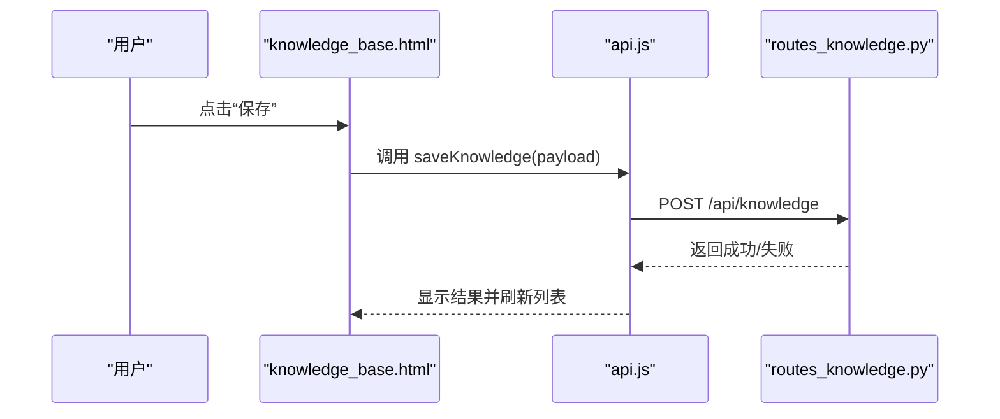

**图表来源**
- [knowledge_base.html:1-200](file://server/templates/pages/knowledge_base.html#L1-L200)
- [api.js:1-200](file://server/static/js/api.js#L1-L200)
- [routes_knowledge.py:1-200](file://server/routes_knowledge.py#L1-L200)

**章节来源**
- [knowledge_base.html:1-200](file://server/templates/pages/knowledge_base.html#L1-L200)
- [memory_knowledge.html:1-200](file://server/templates/pages/memory_knowledge.html#L1-L200)
- [practice_knowledge.html:1-200](file://server/templates/pages/practice_knowledge.html#L1-L200)
- [api.js:1-200](file://server/static/js/api.js#L1-L200)

## 依赖关系分析
- 路由层依赖业务层与数据访问层
- 业务层依赖相似度匹配器与数据访问层
- 数据访问层依赖数据库适配器与 Schema 定义
- 前端依赖 JS 客户端与后端 API

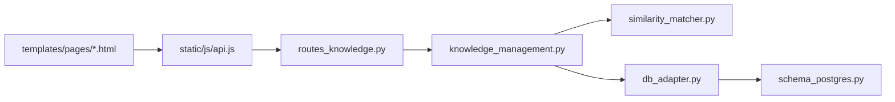

**图表来源**
- [routes_knowledge.py:1-200](file://server/routes_knowledge.py#L1-L200)
- [knowledge_management.py:1-200](file://server/knowledge_management.py#L1-L200)
- [similarity_matcher.py:1-200](file://server/similarity_matcher.py#L1-L200)
- [db_adapter.py:1-200](file://server/database/db_adapter.py#L1-L200)
- [schema_postgres.py:1-200](file://server/database/schema_postgres.py#L1-L200)
- [api.js:1-200](file://server/static/js/api.js#L1-L200)
- [knowledge_base.html:1-200](file://server/templates/pages/knowledge_base.html#L1-L200)

**章节来源**
- [routes_knowledge.py:1-200](file://server/routes_knowledge.py#L1-L200)
- [knowledge_management.py:1-200](file://server/knowledge_management.py#L1-L200)
- [similarity_matcher.py:1-200](file://server/similarity_matcher.py#L1-L200)
- [db_adapter.py:1-200](file://server/database/db_adapter.py#L1-L200)
- [schema_postgres.py:1-200](file://server/database/schema_postgres.py#L1-L200)
- [api.js:1-200](file://server/static/js/api.js#L1-L200)
- [knowledge_base.html:1-200](file://server/templates/pages/knowledge_base.html#L1-L200)

## 性能与索引优化
- 查询优化：合理使用分页、避免全表扫描、利用索引列（如分类、标签、时间戳）
- 写入优化：批量插入、事务合并、异步任务处理图谱构建
- 缓存策略：热点查询结果缓存、相似度计算结果缓存
- 资源监控：慢查询日志、接口耗时统计、内存占用监控

[本节为通用指导，不直接分析具体文件]

## 故障排查指南
- 常见问题
  - 接口 400/422：检查请求体字段是否缺失或类型错误
  - 接口 500：查看后端日志，确认数据库连接与权限
  - 搜索无结果：检查索引是否重建、分词是否正确
  - 相似度不准确：调整阈值与权重参数
- 定位步骤
  - 从前端控制台查看网络请求与响应
  - 在后端日志中查找对应请求的 trace
  - 核对数据库表结构与约束是否符合预期
  - 验证相似度计算输入数据的清洗与标准化

**章节来源**
- [routes_knowledge.py:1-200](file://server/routes_knowledge.py#L1-L200)
- [knowledge_management.py:1-200](file://server/knowledge_management.py#L1-L200)
- [db_adapter.py:1-200](file://server/database/db_adapter.py#L1-L200)

## 结论
本系统围绕知识点的全生命周期管理，构建了从内容解析、自动分类、相似度匹配到知识图谱的一体化能力。通过分层架构与清晰的依赖关系，系统在可扩展性与可维护性方面具备良好基础。后续可在索引策略、缓存机制与异步任务方面持续优化，以提升大规模知识管理的性能与体验。

[本节为总结性内容，不直接分析具体文件]

## 附录：API与数据模型

### 主要 API 定义（知识点）
- 创建知识点
  - 方法：POST
  - 路径：/api/knowledge
  - 请求体：包含标题、正文、标签、分类等字段
  - 响应：返回知识点对象与状态码
- 更新知识点
  - 方法：PUT/PATCH
  - 路径：/api/knowledge/{id}
  - 请求体：需要更新的字段
  - 响应：返回更新后的知识点对象
- 删除知识点
  - 方法：DELETE
  - 路径：/api/knowledge/{id}
  - 响应：返回删除状态
- 检索知识点
  - 方法：GET
  - 路径：/api/knowledge
  - 查询参数：关键词、标签、分类、时间范围、分页参数
  - 响应：返回分页结果集

**章节来源**
- [routes_knowledge.py:1-200](file://server/routes_knowledge.py#L1-L200)
- [api.js:1-200](file://server/static/js/api.js#L1-L200)

### 数据模型（知识点与关系）
- 知识点表
  - 字段：ID、标题、正文、摘要、分类、标签、作者、时间戳、版本号、状态
- 关系表
  - 字段：源ID、目标ID、关系类型、权重、创建时间
- 历史表
  - 字段：知识点ID、版本、快照内容、变更说明、时间戳

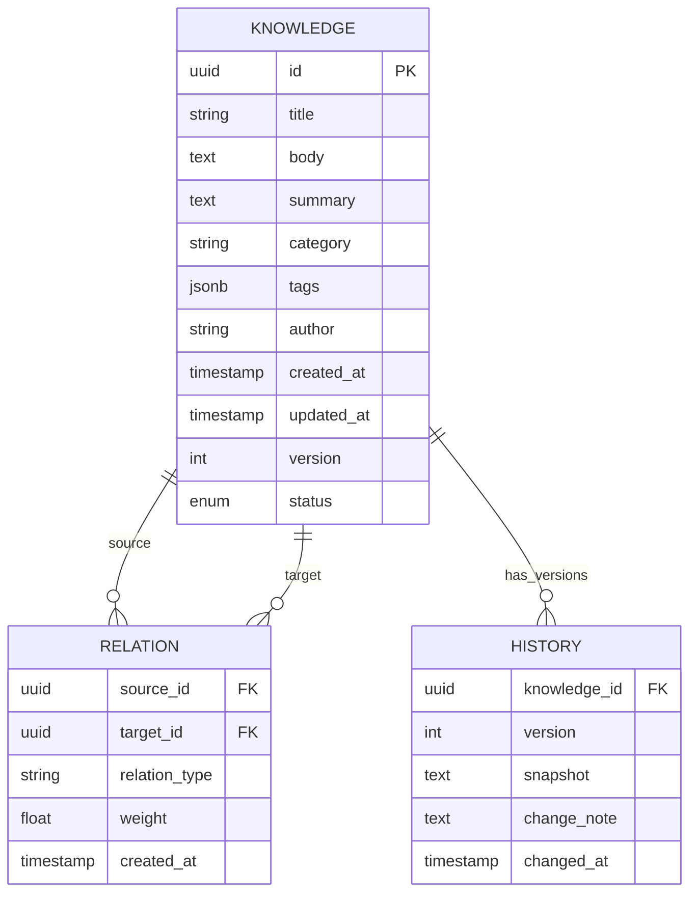

**图表来源**
- [schema_postgres.py:1-200](file://server/database/schema_postgres.py#L1-L200)

**章节来源**
- [schema_postgres.py:1-200](file://server/database/schema_postgres.py#L1-L200)