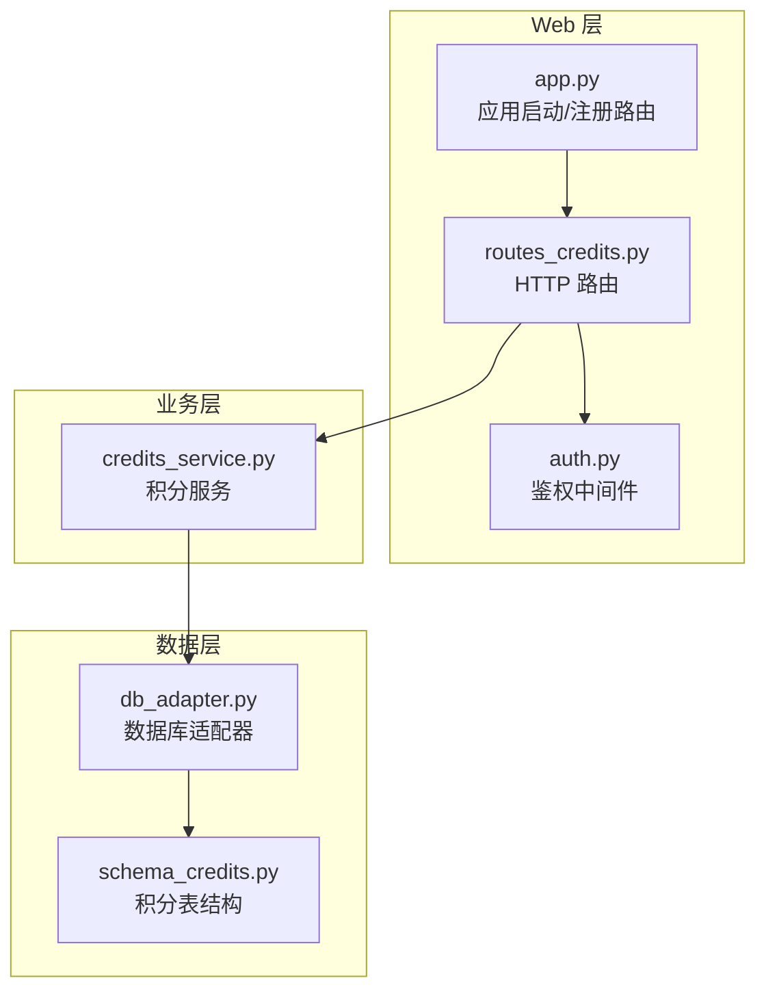
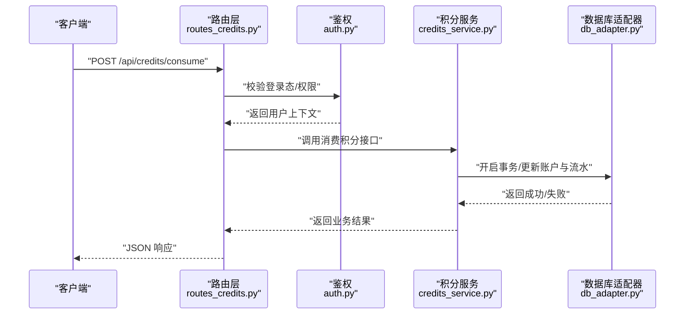
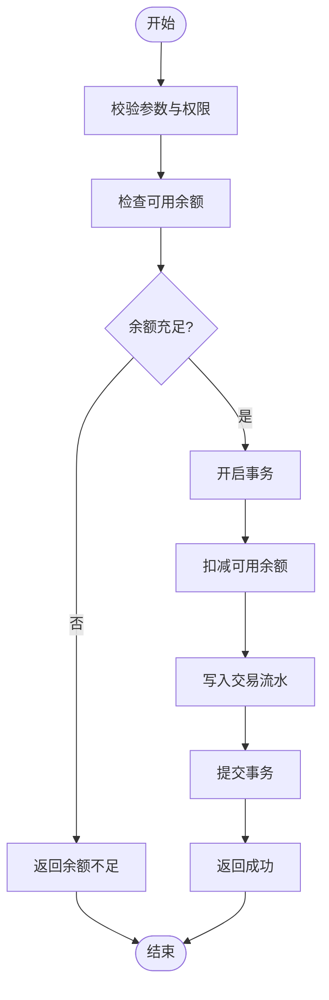
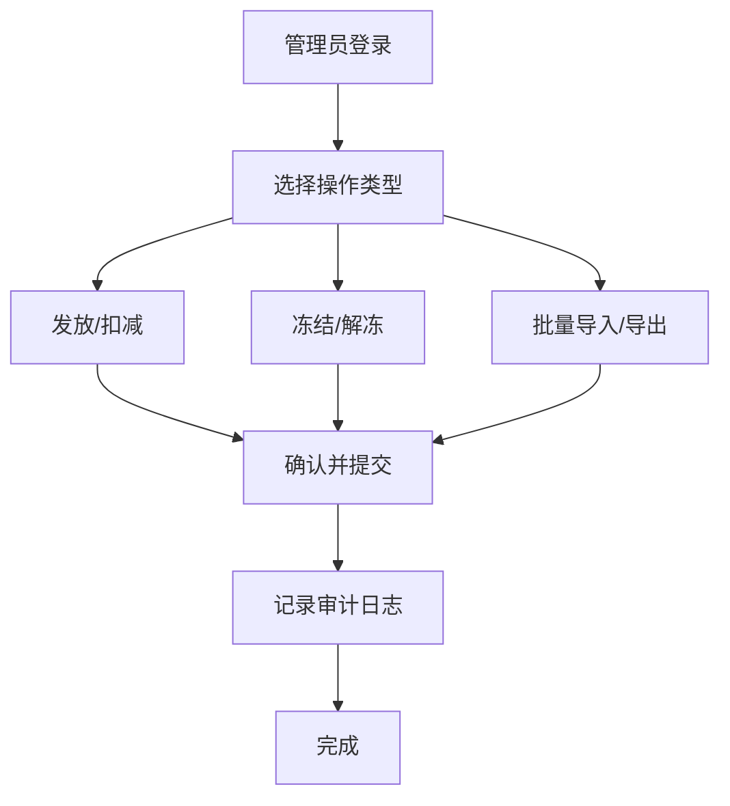
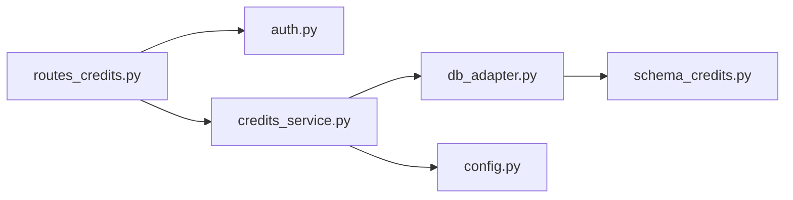

# 积分系统

<cite>
**本文引用的文件**   
- [server/credits_service.py](file://server/credits_service.py)
- [server/routes_credits.py](file://server/routes_credits.py)
- [server/database/schema_credits.py](file://server/database/schema_credits.py)
- [server/database/db_adapter.py](file://server/database/db_adapter.py)
- [server/templates/pages/admin_credits.html](file://server/templates/pages/admin_credits.html)
- [server/app.py](file://server/app.py)
- [server/auth.py](file://server/auth.py)
- [server/config.py](file://server/config.py)
</cite>

## 目录
1. [引言](#引言)
2. [项目结构](#项目结构)
3. [核心组件](#核心组件)
4. [架构总览](#架构总览)
5. [详细组件分析](#详细组件分析)
6. [依赖关系分析](#依赖关系分析)
7. [性能与扩展性](#性能与扩展性)
8. [故障排查指南](#故障排查指南)
9. [结论](#结论)
10. [附录：API 与报表](#附录api-与报表)

## 引言
本文件为 LectureLearnLoop 积分系统的实现文档，围绕积分规则设计、交易记录管理、排行榜功能、账户余额查询、交易历史查询、兑换与有效期管理、防作弊与审计日志、管理员后台批量操作等主题进行系统化说明。目标是帮助开发者与运营人员快速理解并正确使用该积分子系统。

## 项目结构
积分系统主要位于 server 目录下，采用“路由层 + 服务层 + 数据访问层”的分层组织方式：
- 路由层：对外暴露 HTTP API，负责参数校验、权限控制与响应封装
- 服务层：封装积分业务逻辑（获取、消耗、兑换、统计、排行榜）
- 数据访问层：定义积分相关表结构与数据库适配

**图示来源**
- [server/routes_credits.py:1-200](file://server/routes_credits.py#L1-L200)
- [server/credits_service.py:1-200](file://server/credits_service.py#L1-L200)
- [server/database/schema_credits.py:1-200](file://server/database/schema_credits.py#L1-L200)
- [server/database/db_adapter.py:1-200](file://server/database/db_adapter.py#L1-L200)
- [server/app.py:1-200](file://server/app.py#L1-L200)
- [server/auth.py:1-200](file://server/auth.py#L1-L200)

**章节来源**
- [server/app.py:1-200](file://server/app.py#L1-L200)
- [server/routes_credits.py:1-200](file://server/routes_credits.py#L1-L200)
- [server/credits_service.py:1-200](file://server/credits_service.py#L1-L200)
- [server/database/schema_credits.py:1-200](file://server/database/schema_credits.py#L1-L200)
- [server/database/db_adapter.py:1-200](file://server/database/db_adapter.py#L1-L200)

## 核心组件
- 积分服务 credits_service：封装积分获取、消耗、兑换、冻结解冻、过期处理、统计与排行榜等核心业务
- 路由 routes_credits：提供用户侧与管理侧的 HTTP 接口，统一鉴权、参数校验与错误码
- 数据模型 schema_credits：定义积分账户、交易流水、兑换券、排行榜快照等表结构
- 数据库适配器 db_adapter：封装连接、事务、SQL 执行与结果映射
- 模板 admin_credits.html：管理员后台页面，支持积分发放、扣减、冻结、批量导入导出与审计查看

**章节来源**
- [server/credits_service.py:1-200](file://server/credits_service.py#L1-L200)
- [server/routes_credits.py:1-200](file://server/routes_credits.py#L1-L200)
- [server/database/schema_credits.py:1-200](file://server/database/schema_credits.py#L1-L200)
- [server/database/db_adapter.py:1-200](file://server/database/db_adapter.py#L1-L200)
- [server/templates/pages/admin_credits.html:1-200](file://server/templates/pages/admin_credits.html#L1-L200)

## 架构总览
积分系统遵循典型分层架构：
- 客户端通过浏览器或桌面端调用后端 HTTP API
- 路由层完成鉴权、参数校验与请求分发
- 服务层执行业务规则，保证原子性与一致性
- 数据层持久化积分账户、交易流水与配置信息

**图示来源**
- [server/routes_credits.py:1-200](file://server/routes_credits.py#L1-L200)
- [server/auth.py:1-200](file://server/auth.py#L1-L200)
- [server/credits_service.py:1-200](file://server/credits_service.py#L1-L200)
- [server/database/db_adapter.py:1-200](file://server/database/db_adapter.py#L1-L200)

## 详细组件分析

### 积分服务 credits_service
职责范围：
- 积分获取：活动奖励、学习行为奖励、邀请奖励等
- 积分消耗：课程解锁、练习解锁、道具购买等
- 兑换规则：积分兑换优惠券/实物/权益，生成兑换券并绑定有效期
- 冻结与解冻：风控冻结、退款解冻
- 过期处理：定时任务扫描过期未使用额度并回收
- 统计与排行榜：个人累计、周期排行、类目排行

关键流程（以“消费积分”为例）：

**图示来源**
- [server/credits_service.py:1-200](file://server/credits_service.py#L1-L200)
- [server/database/db_adapter.py:1-200](file://server/database/db_adapter.py#L1-L200)

**章节来源**
- [server/credits_service.py:1-200](file://server/credits_service.py#L1-L200)

### 路由层 routes_credits
职责范围：
- 用户侧接口：查询余额、交易历史、领取奖励、消费积分、兑换
- 管理侧接口：发放/扣减、冻结/解冻、批量导入、审计日志导出
- 统一鉴权：基于 auth.py 的用户上下文注入
- 参数校验与错误码：统一入参校验、异常捕获与标准化响应

典型接口示例（概念描述）：
- GET /api/credits/balance：查询当前可用余额与冻结金额
- POST /api/credits/consume：消费积分，传入业务类型、金额、业务单号
- POST /api/credits/redeem：积分兑换，返回兑换券编号与有效期
- GET /api/credits/history：分页查询交易历史，支持按类型、时间筛选
- POST /admin/credits/grant：管理员发放积分（需管理员权限）

**章节来源**
- [server/routes_credits.py:1-200](file://server/routes_credits.py#L1-L200)
- [server/auth.py:1-200](file://server/auth.py#L1-L200)

### 数据模型 schema_credits
定义的核心实体与字段（概念说明）：
- 积分账户表：用户ID、可用余额、冻结余额、累计获得、累计消耗、更新时间
- 交易流水表：流水号、用户ID、变动类型（获取/消耗/兑换/冻结/解冻/过期）、金额、方向（+/-）、业务单号、业务类型、备注、创建时间
- 兑换券表：券编号、用户ID、关联订单号、面值、状态（未使用/已使用/已过期）、有效期起止
- 排行榜快照表：用户ID、周期标识、排名、积分值、快照时间

约束与索引建议：
- 用户ID + 业务单号唯一约束，防止重复入账
- 交易流水按用户ID与时间索引，优化查询
- 兑换券编号唯一，状态变更需幂等

**章节来源**
- [server/database/schema_credits.py:1-200](file://server/database/schema_credits.py#L1-L200)

### 数据库适配器 db_adapter
职责范围：
- 连接池与多数据库支持（SQLite/PostgreSQL）
- 事务封装：自动提交/回滚，异常时回滚
- SQL 执行与结果映射：统一查询接口，支持分页与条件构建

关键点：
- 所有积分写操作必须通过事务执行，确保账户与流水的一致性
- 对高并发场景提供行级锁或乐观锁策略（如版本号）

**章节来源**
- [server/database/db_adapter.py:1-200](file://server/database/db_adapter.py#L1-L200)

### 管理员后台 admin_credits.html
功能点：
- 积分发放/扣减：输入用户ID与金额，选择原因与审批人
- 冻结/解冻：针对可疑账户进行额度冻结，风控解除后解冻
- 批量操作：CSV 导入/导出，批量发放、批量冻结、批量过期清理
- 审计日志：查看操作记录、导出审计报表

交互流程（概念）：

**图示来源**
- [server/templates/pages/admin_credits.html:1-200](file://server/templates/pages/admin_credits.html#L1-L200)

**章节来源**
- [server/templates/pages/admin_credits.html:1-200](file://server/templates/pages/admin_credits.html#L1-L200)

## 依赖关系分析
- 路由层依赖鉴权模块与积分服务
- 积分服务依赖数据库适配器与配置
- 数据层依赖具体数据库驱动（由 db_adapter 抽象）

**图示来源**
- [server/routes_credits.py:1-200](file://server/routes_credits.py#L1-L200)
- [server/auth.py:1-200](file://server/auth.py#L1-L200)
- [server/credits_service.py:1-200](file://server/credits_service.py#L1-L200)
- [server/database/db_adapter.py:1-200](file://server/database/db_adapter.py#L1-L200)
- [server/database/schema_credits.py:1-200](file://server/database/schema_credits.py#L1-L200)
- [server/config.py:1-200](file://server/config.py#L1-L200)

**章节来源**
- [server/routes_credits.py:1-200](file://server/routes_credits.py#L1-L200)
- [server/credits_service.py:1-200](file://server/credits_service.py#L1-L200)
- [server/database/db_adapter.py:1-200](file://server/database/db_adapter.py#L1-L200)
- [server/database/schema_credits.py:1-200](file://server/database/schema_credits.py#L1-L200)
- [server/config.py:1-200](file://server/config.py#L1-L200)

## 性能与扩展性
- 读写分离：读多写少场景可引入只读副本，排行榜与历史查询走从库
- 缓存策略：热点用户余额与排行榜短期缓存，设置合理 TTL 与失效策略
- 分库分表：按用户ID哈希分片，缓解单表膨胀
- 异步任务：过期清理、统计报表生成、批量导入导出使用消息队列异步处理
- 幂等与去重：业务单号唯一约束，避免重复入账；兑换券状态机幂等更新

[本节为通用指导，不直接分析具体文件]

## 故障排查指南
常见问题与定位步骤：
- 余额不足：检查交易流水中最近一次消费是否成功，核对可用余额与冻结金额
- 重复入账：核查业务单号是否重复，检查路由与服务层的幂等校验
- 兑换券未生效：检查券状态与有效期，确认兑换流程是否完整提交
- 排行榜延迟：检查统计任务是否执行，核对快照时间与刷新频率
- 管理员操作失败：查看审计日志与错误堆栈，确认权限与参数合法性

建议日志与监控：
- 关键操作审计日志：发放、扣减、冻结、解冻、兑换、过期
- 指标监控：积分发放量、消耗量、兑换率、冻结比例、过期回收量
- 告警规则：异常峰值、负余额尝试、频繁失败、长时间未提交事务

**章节来源**
- [server/routes_credits.py:1-200](file://server/routes_credits.py#L1-L200)
- [server/credits_service.py:1-200](file://server/credits_service.py#L1-L200)
- [server/templates/pages/admin_credits.html:1-200](file://server/templates/pages/admin_credits.html#L1-L200)

## 结论
本积分系统通过清晰的分层架构与严格的事务控制，实现了安全的积分获取、消耗、兑换与统计能力。配合管理员后台与审计日志，满足运营与风控需求。建议在后续迭代中引入缓存、异步任务与分库分表，进一步提升性能与可扩展性。

[本节为总结性内容，不直接分析具体文件]

## 附录：API 与报表

### 用户侧 API（概念）
- 查询余额：GET /api/credits/balance
- 消费积分：POST /api/credits/consume
- 领取奖励：POST /api/credits/claim
- 兑换积分：POST /api/credits/redeem
- 交易历史：GET /api/credits/history

### 管理侧 API（概念）
- 发放/扣减：POST /admin/credits/grant
- 冻结/解冻：POST /admin/credits/freeze
- 批量导入：POST /admin/credits/batch/import
- 审计导出：GET /admin/credits/audit/export

### 统计报表（概念）
- 个人累计：累计获得、累计消耗、净增额
- 周期排行：日/周/月排行，按积分值排序
- 类目排行：按业务类型（课程、练习、活动）排行
- 兑换统计：兑换总量、成功率、过期率

**章节来源**
- [server/routes_credits.py:1-200](file://server/routes_credits.py#L1-L200)
- [server/credits_service.py:1-200](file://server/credits_service.py#L1-L200)
- [server/templates/pages/admin_credits.html:1-200](file://server/templates/pages/admin_credits.html#L1-L200)