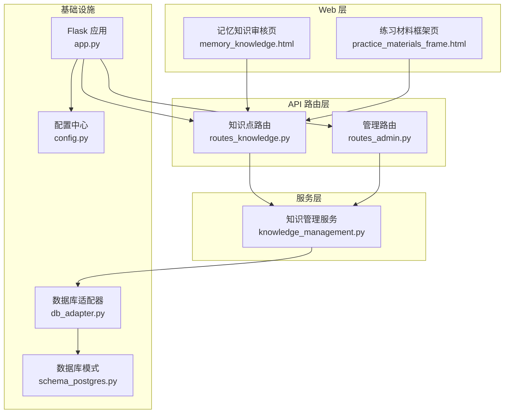
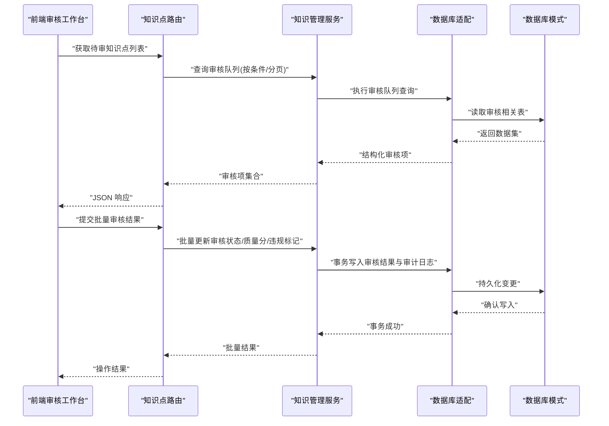
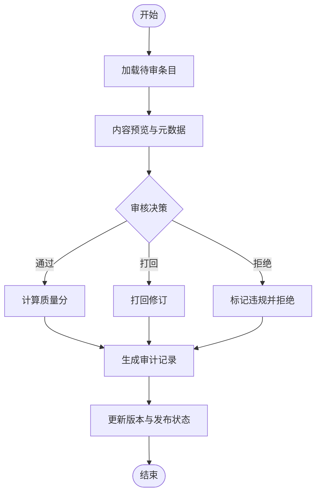
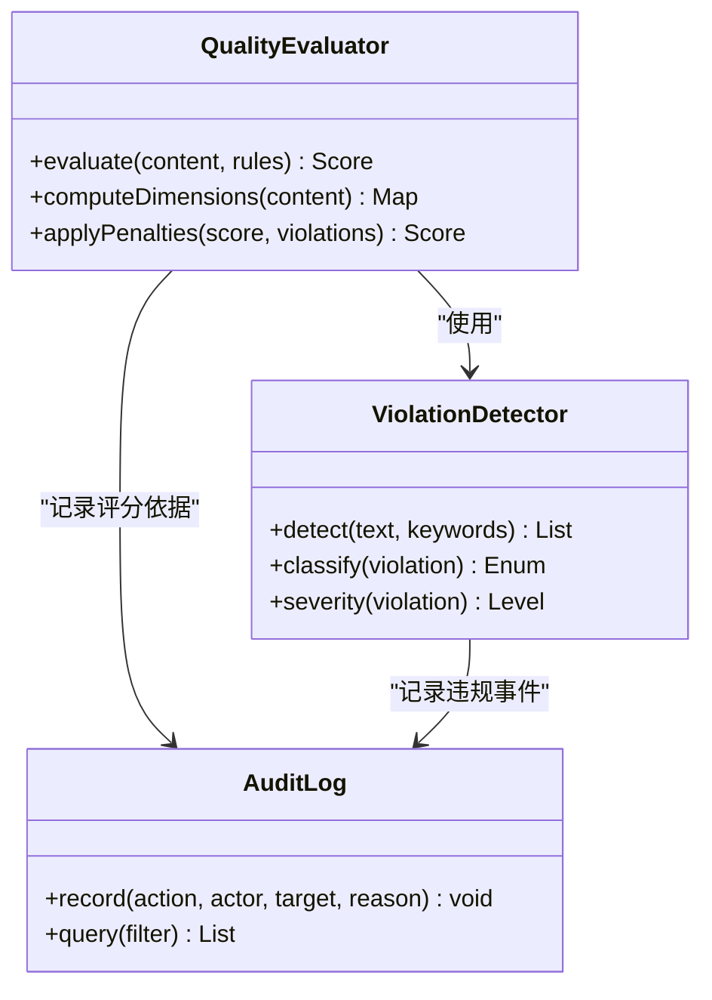
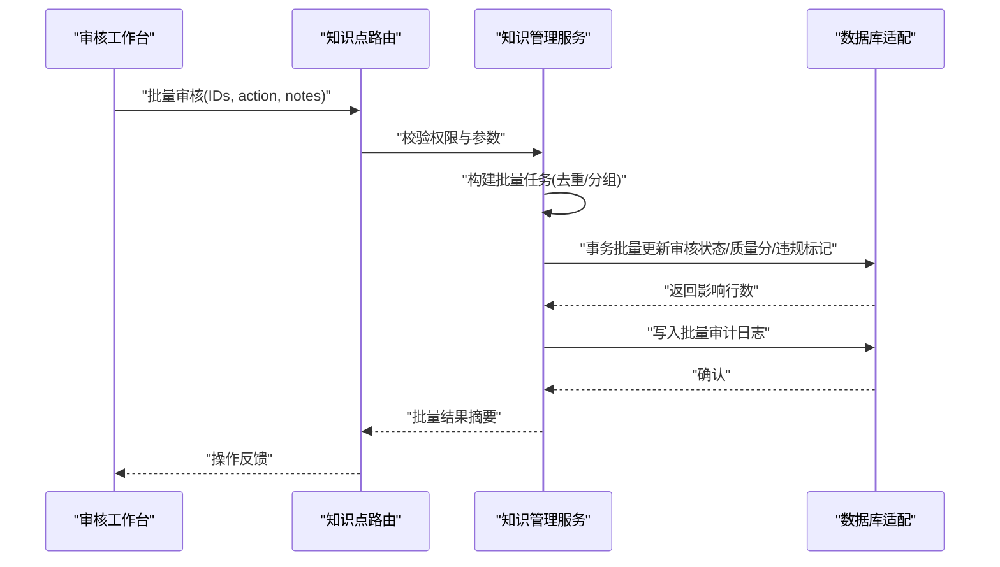
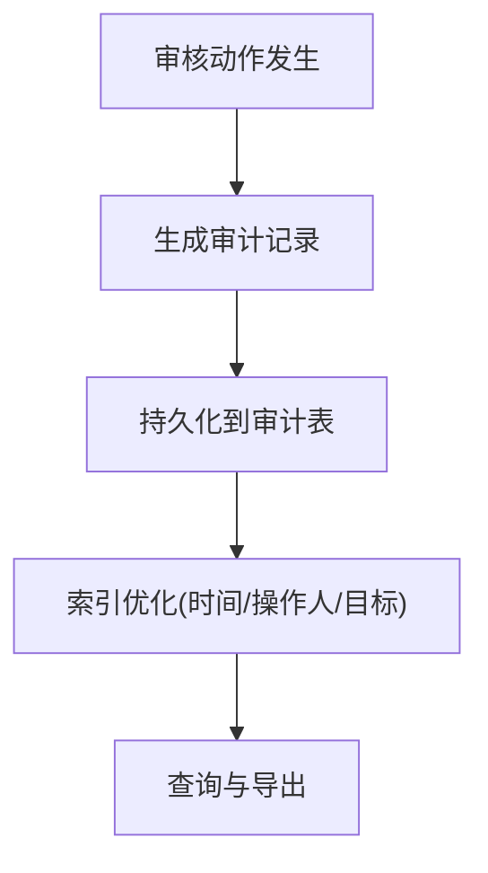
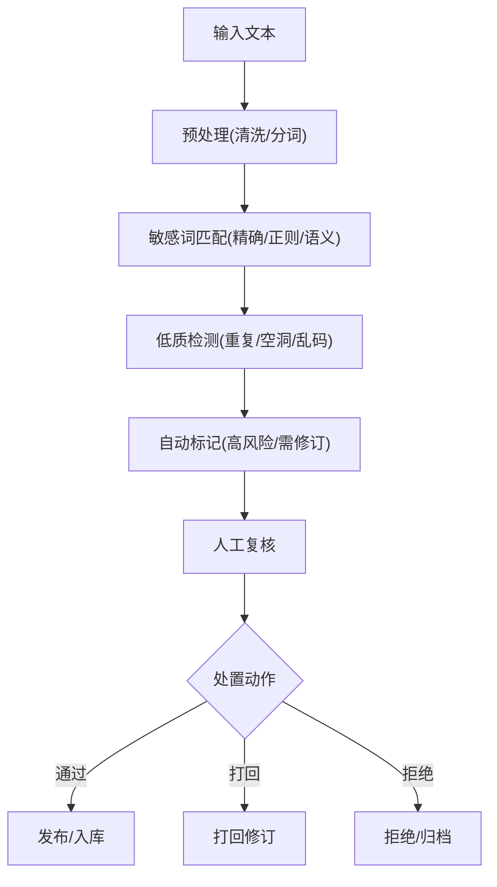
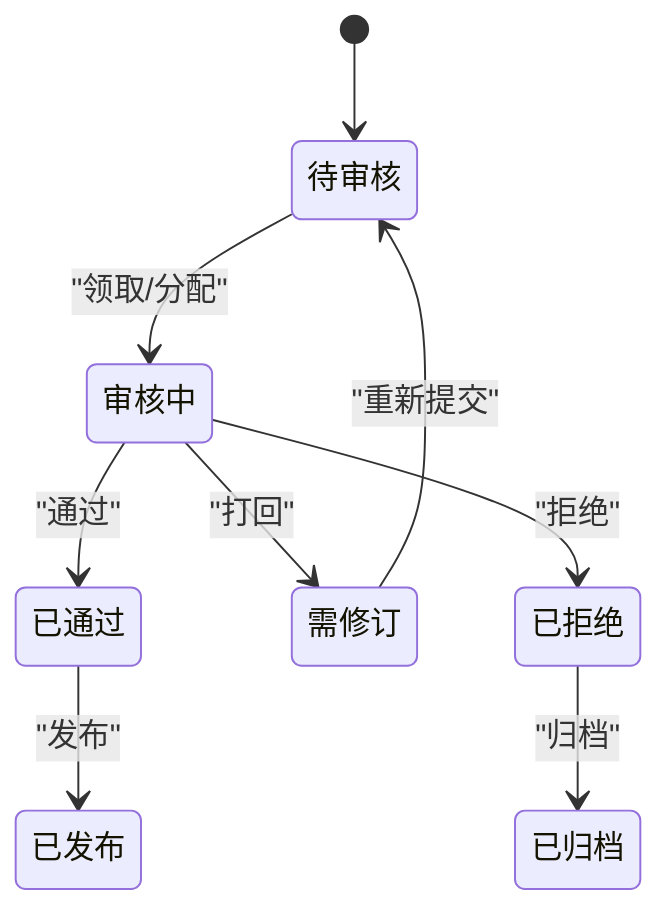
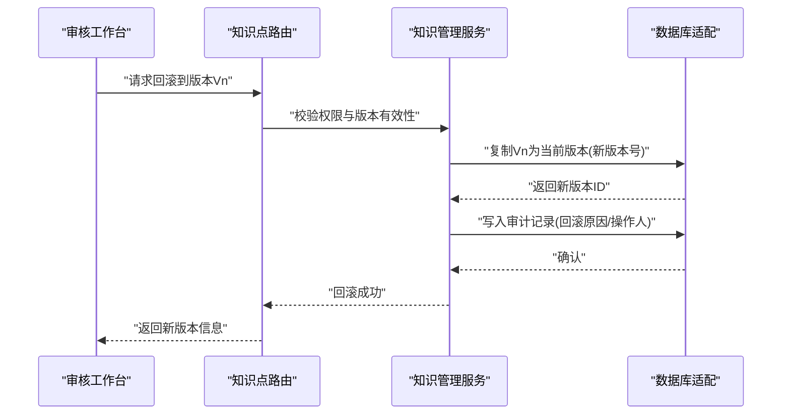
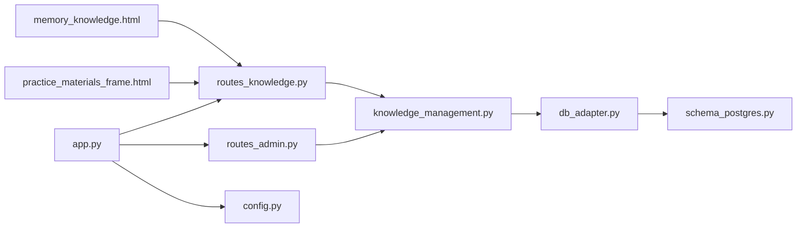

# 内容审核

<cite>
**本文引用的文件**   
- [routes_knowledge.py](file://server/routes_knowledge.py)
- [knowledge_management.py](file://server/knowledge_management.py)
- [routes_admin.py](file://server/routes_admin.py)
- [app.py](file://server/app.py)
- [config.py](file://server/config.py)
- [db_adapter.py](file://server/database/db_adapter.py)
- [schema_postgres.py](file://server/database/schema_postgres.py)
- [memory_knowledge.html](file://server/templates/pages/memory_knowledge.html)
- [practice_materials_frame.html](file://server/templates/pages/practice_materials_frame.html)
- [AGENTS.md](file://AGENTS.md)
</cite>

## 目录
1. [简介](#简介)
2. [项目结构](#项目结构)
3. [核心组件](#核心组件)
4. [架构总览](#架构总览)
5. [详细组件分析](#详细组件分析)
6. [依赖关系分析](#依赖关系分析)
7. [性能考量](#性能考量)
8. [故障排查指南](#故障排查指南)
9. [结论](#结论)
10. [附录](#附录)

## 简介
本文件为 LectureLearnLoop 的“内容审核”能力提供系统化文档，聚焦知识点审核流程、内容质量评估与违规处理、审核队列与批量操作、审核历史与审计追踪、内容过滤与敏感词检测、自动标记、工作流配置与标准、版本管理与回滚机制，以及自动化程度与人工干预点。文档面向技术与非技术读者，既给出高层架构视图，也深入到路由、服务层与数据模型的具体实现路径。

## 项目结构
围绕内容审核的相关代码主要分布在以下位置：
- 后端路由与服务：routes_knowledge.py、routes_admin.py、knowledge_management.py
- Web 应用入口与配置：app.py、config.py
- 数据库适配与模式：db_adapter.py、schema_postgres.py
- 前端模板（审核工作台）：memory_knowledge.html、practice_materials_frame.html
- 业务规则与规范：AGENTS.md

图表来源
- [app.py:1-200](file://server/app.py#L1-L200)
- [routes_knowledge.py:1-200](file://server/routes_knowledge.py#L1-L200)
- [routes_admin.py:1-200](file://server/routes_admin.py#L1-L200)
- [knowledge_management.py:1-200](file://server/knowledge_management.py#L1-L200)
- [db_adapter.py:1-200](file://server/database/db_adapter.py#L1-L200)
- [schema_postgres.py:1-200](file://server/database/schema_postgres.py#L1-L200)
- [memory_knowledge.html:1-200](file://server/templates/pages/memory_knowledge.html#L1-L200)
- [practice_materials_frame.html:1-200](file://server/templates/pages/practice_materials_frame.html#L1-L200)

章节来源
- [app.py:1-200](file://server/app.py#L1-L200)
- [routes_knowledge.py:1-200](file://server/routes_knowledge.py#L1-L200)
- [routes_admin.py:1-200](file://server/routes_admin.py#L1-L200)
- [knowledge_management.py:1-200](file://server/knowledge_management.py#L1-L200)
- [db_adapter.py:1-200](file://server/database/db_adapter.py#L1-L200)
- [schema_postgres.py:1-200](file://server/database/schema_postgres.py#L1-L200)
- [memory_knowledge.html:1-200](file://server/templates/pages/memory_knowledge.html#L1-L200)
- [practice_materials_frame.html:1-200](file://server/templates/pages/practice_materials_frame.html#L1-L200)

## 核心组件
- 知识点审核路由：提供审核任务查询、批量审核、审核结果提交等接口，支撑审核工作台的数据交互。
- 知识管理服务：封装审核状态机、质量评分、违规判定、版本与审计记录等核心逻辑。
- 管理路由：提供管理员视角的审核策略配置、敏感词库维护、批量任务调度等能力。
- 数据库适配与模式：定义审核相关表结构、索引与约束，保障审核数据的完整性与可追溯性。
- 前端审核工作台：呈现待审条目、审核表单、批量操作与历史记录。

章节来源
- [routes_knowledge.py:1-200](file://server/routes_knowledge.py#L1-L200)
- [knowledge_management.py:1-200](file://server/knowledge_management.py#L1-L200)
- [routes_admin.py:1-200](file://server/routes_admin.py#L1-L200)
- [db_adapter.py:1-200](file://server/database/db_adapter.py#L1-L200)
- [schema_postgres.py:1-200](file://server/database/schema_postgres.py#L1-L200)
- [memory_knowledge.html:1-200](file://server/templates/pages/memory_knowledge.html#L1-L200)

## 架构总览
内容审核系统采用分层架构：前端通过路由层调用服务层，服务层通过数据库适配访问持久化层；配置中心统一注入策略参数；Flask 应用负责路由注册与生命周期管理。

图表来源
- [routes_knowledge.py:1-200](file://server/routes_knowledge.py#L1-L200)
- [knowledge_management.py:1-200](file://server/knowledge_management.py#L1-L200)
- [db_adapter.py:1-200](file://server/database/db_adapter.py#L1-L200)
- [schema_postgres.py:1-200](file://server/database/schema_postgres.py#L1-L200)

## 详细组件分析

### 知识点审核流程
- 触发来源：自动生成或导入的内容进入“待审核”状态。
- 审核步骤：
  - 加载待审条目（支持按课程、标签、时间范围筛选）。
  - 展示内容预览与元数据（创建者、版本、质量初评、违规风险）。
  - 审核员进行判断：通过/打回/修改建议/拒绝。
  - 系统根据策略计算质量分与违规等级，并生成审计记录。
  - 更新内容版本与发布状态。

图表来源
- [routes_knowledge.py:1-200](file://server/routes_knowledge.py#L1-L200)
- [knowledge_management.py:1-200](file://server/knowledge_management.py#L1-L200)

章节来源
- [routes_knowledge.py:1-200](file://server/routes_knowledge.py#L1-L200)
- [knowledge_management.py:1-200](file://server/knowledge_management.py#L1-L200)

### 内容质量评估与违规处理
- 质量评估维度：准确性、完整性、可读性、相关性、格式合规。
- 违规类型：敏感词命中、版权风险、低质重复、不当内容。
- 处理策略：
  - 自动标记：基于规则引擎对敏感词与低质特征进行预标记。
  - 人工复核：审核员对自动标记进行确认或修正。
  - 处置动作：打回修订、限制可见、删除归档、加入黑名单。

图表来源
- [knowledge_management.py:1-200](file://server/knowledge_management.py#L1-L200)
- [routes_knowledge.py:1-200](file://server/routes_knowledge.py#L1-L200)

章节来源
- [knowledge_management.py:1-200](file://server/knowledge_management.py#L1-L200)
- [routes_knowledge.py:1-200](file://server/routes_knowledge.py#L1-L200)

### 审核队列管理与批量审核
- 队列特性：
  - 优先级：按紧急度、来源可信度、过期时间排序。
  - 分页与筛选：按课程、标签、作者、时间、质量分区间筛选。
  - 并发控制：同一条目仅允许单人审核，避免冲突。
- 批量操作：
  - 批量通过/打回/拒绝，支持条件批量。
  - 批量质量分调整与违规标记。
  - 批量导出审核结果与审计日志。

图表来源
- [routes_knowledge.py:1-200](file://server/routes_knowledge.py#L1-L200)
- [knowledge_management.py:1-200](file://server/knowledge_management.py#L1-L200)
- [db_adapter.py:1-200](file://server/database/db_adapter.py#L1-L200)

章节来源
- [routes_knowledge.py:1-200](file://server/routes_knowledge.py#L1-L200)
- [knowledge_management.py:1-200](file://server/knowledge_management.py#L1-L200)

### 审核历史记录与审计追踪
- 审计字段：操作人、操作时间、目标ID、动作类型、原因、前后版本差异摘要。
- 查询能力：按时间范围、操作人、动作类型、目标对象筛选。
- 导出与报表：支持导出 CSV/JSON，用于合规审计与复盘。

图表来源
- [knowledge_management.py:1-200](file://server/knowledge_management.py#L1-L200)
- [db_adapter.py:1-200](file://server/database/db_adapter.py#L1-L200)
- [schema_postgres.py:1-200](file://server/database/schema_postgres.py#L1-L200)

章节来源
- [knowledge_management.py:1-200](file://server/knowledge_management.py#L1-L200)
- [db_adapter.py:1-200](file://server/database/db_adapter.py#L1-L200)
- [schema_postgres.py:1-200](file://server/database/schema_postgres.py#L1-L200)

### 内容过滤规则、敏感词检测与自动标记
- 过滤规则：
  - 敏感词库：支持动态增删改，匹配模式含精确匹配、正则、上下文语义。
  - 低质检测：重复率、空洞内容、乱码、外链异常。
- 自动标记：
  - 命中敏感词即标记高风险，需人工复核。
  - 低质内容标记为“需修订”，不直接拒绝。
- 策略配置：
  - 阈值可调：敏感度阈值、低质分数阈值。
  - 白名单：特定用户/课程豁免。

图表来源
- [knowledge_management.py:1-200](file://server/knowledge_management.py#L1-L200)
- [routes_admin.py:1-200](file://server/routes_admin.py#L1-L200)

章节来源
- [knowledge_management.py:1-200](file://server/knowledge_management.py#L1-L200)
- [routes_admin.py:1-200](file://server/routes_admin.py#L1-L200)

### 审核工作流配置与审核标准设置
- 工作流配置：
  - 角色与权限：审核员、高级审核员、管理员。
  - 流转规则：单级/多级审核，条件分支（如高风险必须二级审核）。
  - 通知机制：超时提醒、驳回通知、批量任务完成通知。
- 审核标准：
  - 质量标准：各维度权重与阈值。
  - 违规标准：违规类型与对应处置动作。
  - 策略开关：是否启用自动标记、是否强制二次审核。

图表来源
- [routes_admin.py:1-200](file://server/routes_admin.py#L1-L200)
- [knowledge_management.py:1-200](file://server/knowledge_management.py#L1-L200)

章节来源
- [routes_admin.py:1-200](file://server/routes_admin.py#L1-L200)
- [knowledge_management.py:1-200](file://server/knowledge_management.py#L1-L200)

### 内容版本管理、回滚机制与审计追踪
- 版本管理：
  - 每次审核变更生成新版本，保留旧版本快照。
  - 版本差异摘要：关键字段变更、质量分变化、违规标记变化。
- 回滚机制：
  - 支持回滚至指定版本，需审计记录与权限校验。
  - 回滚后自动触发二次审核（可选）。
- 审计追踪：
  - 所有版本变更均记录审计日志，支持溯源与报表。

图表来源
- [routes_knowledge.py:1-200](file://server/routes_knowledge.py#L1-L200)
- [knowledge_management.py:1-200](file://server/knowledge_management.py#L1-L200)
- [db_adapter.py:1-200](file://server/database/db_adapter.py#L1-L200)

章节来源
- [routes_knowledge.py:1-200](file://server/routes_knowledge.py#L1-L200)
- [knowledge_management.py:1-200](file://server/knowledge_management.py#L1-L200)
- [db_adapter.py:1-200](file://server/database/db_adapter.py#L1-L200)

### 自动化程度与人工干预点
- 自动化：
  - 敏感词与低质检测自动标记。
  - 批量审核与批量策略生效。
  - 审计日志自动生成。
- 人工干预：
  - 高风险内容必须人工复核。
  - 策略阈值与白名单由管理员配置。
  - 复杂争议内容由高级审核员裁决。

章节来源
- [knowledge_management.py:1-200](file://server/knowledge_management.py#L1-L200)
- [routes_admin.py:1-200](file://server/routes_admin.py#L1-L200)

## 依赖关系分析
- 路由层依赖服务层：知识点路由与管理路由均依赖知识管理服务。
- 服务层依赖数据库适配：审核状态、质量分、审计日志均通过数据库适配读写。
- 配置中心注入策略：敏感词库、阈值、工作流规则由配置中心统一管理。
- 前端模板依赖路由：审核工作台通过路由接口获取数据与提交操作。

图表来源
- [routes_knowledge.py:1-200](file://server/routes_knowledge.py#L1-L200)
- [routes_admin.py:1-200](file://server/routes_admin.py#L1-L200)
- [knowledge_management.py:1-200](file://server/knowledge_management.py#L1-L200)
- [db_adapter.py:1-200](file://server/database/db_adapter.py#L1-L200)
- [schema_postgres.py:1-200](file://server/database/schema_postgres.py#L1-L200)
- [app.py:1-200](file://server/app.py#L1-L200)
- [config.py:1-200](file://server/config.py#L1-L200)
- [memory_knowledge.html:1-200](file://server/templates/pages/memory_knowledge.html#L1-L200)
- [practice_materials_frame.html:1-200](file://server/templates/pages/practice_materials_frame.html#L1-L200)

章节来源
- [routes_knowledge.py:1-200](file://server/routes_knowledge.py#L1-L200)
- [routes_admin.py:1-200](file://server/routes_admin.py#L1-L200)
- [knowledge_management.py:1-200](file://server/knowledge_management.py#L1-L200)
- [db_adapter.py:1-200](file://server/database/db_adapter.py#L1-L200)
- [schema_postgres.py:1-200](file://server/database/schema_postgres.py#L1-L200)
- [app.py:1-200](file://server/app.py#L1-L200)
- [config.py:1-200](file://server/config.py#L1-L200)
- [memory_knowledge.html:1-200](file://server/templates/pages/memory_knowledge.html#L1-L200)
- [practice_materials_frame.html:1-200](file://server/templates/pages/practice_materials_frame.html#L1-L200)

## 性能考量
- 批量操作：采用事务批量更新，减少往返次数，提升吞吐。
- 索引设计：审核队列与审计日志按时间、操作人、目标ID建立索引，加速查询。
- 缓存策略：敏感词库与策略配置可缓存，降低频繁IO。
- 并发控制：条目级锁或乐观锁，避免多人同时审核导致数据不一致。
- 分页与筛选：审核队列分页加载，避免一次性加载大量数据。

[本节为通用性能指导，无需具体文件引用]

## 故障排查指南
- 审核队列无数据：
  - 检查内容是否进入“待审核”状态。
  - 检查筛选条件是否过严。
- 批量审核失败：
  - 检查权限与参数合法性。
  - 查看事务日志与审计记录定位失败条目。
- 敏感词未命中：
  - 检查敏感词库是否生效与匹配模式是否正确。
  - 检查白名单与豁免策略。
- 版本回滚异常：
  - 校验版本存在性与权限。
  - 查看审计日志中的回滚原因与操作人。

章节来源
- [routes_knowledge.py:1-200](file://server/routes_knowledge.py#L1-L200)
- [knowledge_management.py:1-200](file://server/knowledge_management.py#L1-L200)
- [routes_admin.py:1-200](file://server/routes_admin.py#L1-L200)

## 结论
LectureLearnLoop 的内容审核体系以“自动化标记+人工复核”为核心，结合严格的质量评估与违规处理策略，确保知识点内容的准确性与合规性。通过审核队列管理、批量操作、审计追踪与版本回滚，系统在效率与可控性之间取得平衡。未来可进一步引入更智能的低质检测与语义敏感词识别，提升自动化水平并降低人工负担。

[本节为总结性内容，无需具体文件引用]

## 附录
- 业务规则参考：AGENTS.md 中对内容生产与审核的总体原则与边界。

章节来源
- [AGENTS.md:1-200](file://AGENTS.md#L1-L200)