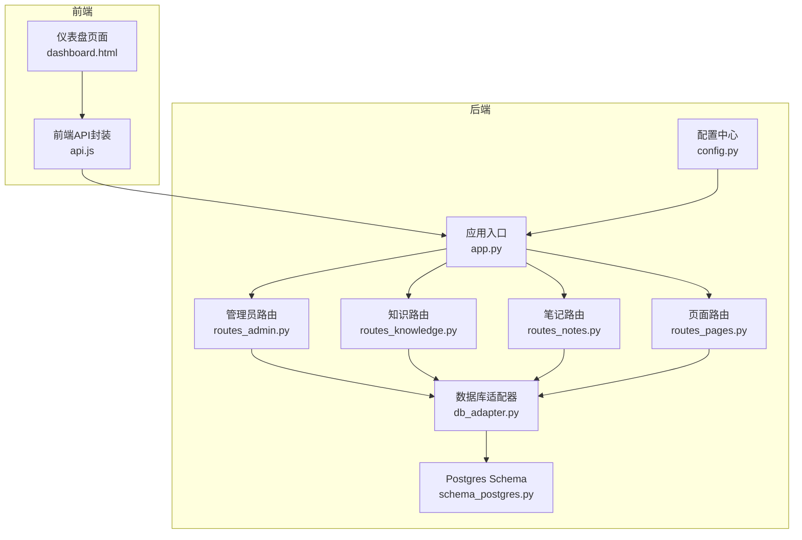
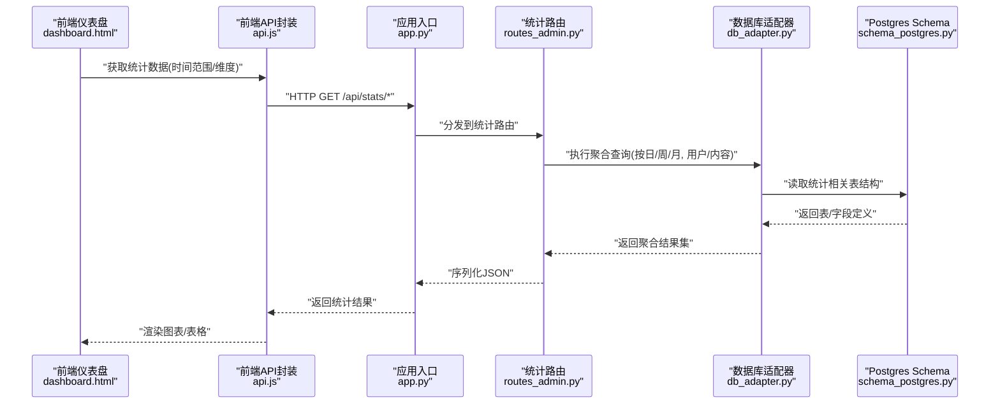
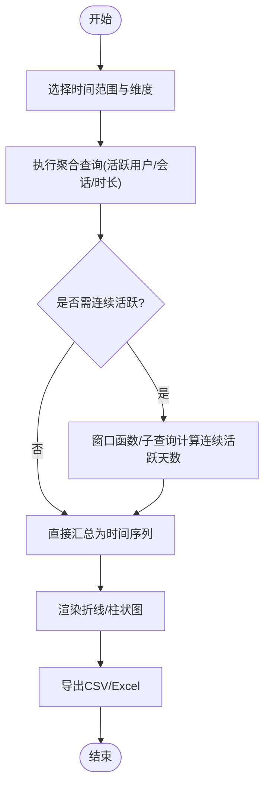
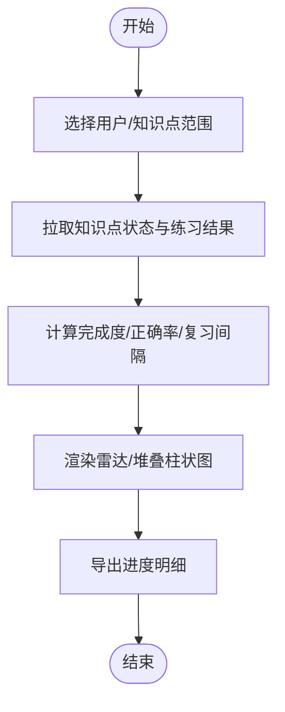
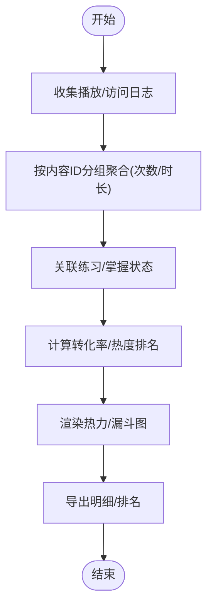
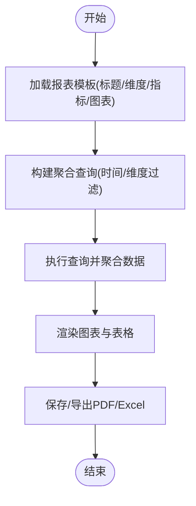
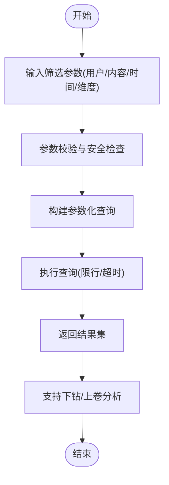
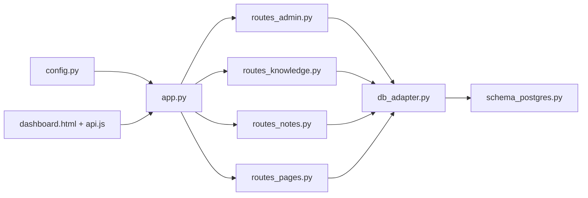

# 数据统计

<cite>
**本文引用的文件**   
- [app.py](file://server/app.py)
- [routes_admin.py](file://server/routes_admin.py)
- [routes_knowledge.py](file://server/routes_knowledge.py)
- [routes_notes.py](file://server/routes_notes.py)
- [routes_pages.py](file://server/routes_pages.py)
- [config.py](file://server/config.py)
- [database/db_adapter.py](file://server/database/db_adapter.py)
- [database/schema_postgres.py](file://server/database/schema_postgres.py)
- [templates/pages/dashboard.html](file://server/templates/pages/dashboard.html)
- [static/js/api.js](file://server/static/js/api.js)
</cite>

## 目录
1. [引言](#引言)
2. [项目结构](#项目结构)
3. [核心组件](#核心组件)
4. [架构总览](#架构总览)
5. [详细组件分析](#详细组件分析)
6. [依赖关系分析](#依赖关系分析)
7. [性能与优化](#性能与优化)
8. [故障排查指南](#故障排查指南)
9. [结论](#结论)
10. [附录](#附录)

## 引言
本文件面向LectureLearnLoop的数据统计功能，围绕用户活跃度分析、学习进度统计和内容使用率计算展开，系统说明报表生成、数据可视化图表与趋势分析方法。文档同时覆盖自定义查询、数据导出和多维度分析能力，给出统计指标定义、报表模板配置建议，并解释数据聚合算法、缓存策略与查询优化方法，帮助读者理解数据分析结果的业务价值与应用场景。

## 项目结构
本项目采用后端Python服务+前端模板/JS的架构：
- 后端提供路由接口、业务逻辑、数据库访问与配置管理
- 前端通过模板渲染页面，并通过JS调用API进行数据展示与交互
- 数据库层封装适配器与Schema定义，支撑多环境部署

**图示来源**
- [app.py:1-200](file://server/app.py#L1-L200)
- [routes_admin.py:1-200](file://server/routes_admin.py#L1-L200)
- [routes_knowledge.py:1-200](file://server/routes_knowledge.py#L1-L200)
- [routes_notes.py:1-200](file://server/routes_notes.py#L1-L200)
- [routes_pages.py:1-200](file://server/routes_pages.py#L1-L200)
- [config.py:1-200](file://server/config.py#L1-L200)
- [database/db_adapter.py:1-200](file://server/database/db_adapter.py#L1-L200)
- [database/schema_postgres.py:1-200](file://server/database/schema_postgres.py#L1-L200)

**章节来源**
- [app.py:1-200](file://server/app.py#L1-L200)
- [config.py:1-200](file://server/config.py#L1-L200)

## 核心组件
- 应用入口与路由注册：负责挂载统计相关路由、统一异常处理与中间件
- 管理员路由：暴露统计数据查询、报表生成与导出的API
- 知识/笔记/页面路由：提供与学习内容相关的统计维度（知识点掌握、笔记活跃、页面访问）
- 数据库适配器：封装SQL执行、连接池、事务与分页等通用能力
- Schema定义：明确统计所需表结构与字段语义
- 前端仪表盘与API封装：渲染图表、发起请求、处理响应与错误

**章节来源**
- [routes_admin.py:1-200](file://server/routes_admin.py#L1-L200)
- [routes_knowledge.py:1-200](file://server/routes_knowledge.py#L1-L200)
- [routes_notes.py:1-200](file://server/routes_notes.py#L1-L200)
- [routes_pages.py:1-200](file://server/routes_pages.py#L1-L200)
- [database/db_adapter.py:1-200](file://server/database/db_adapter.py#L1-L200)
- [database/schema_postgres.py:1-200](file://server/database/schema_postgres.py#L1-L200)
- [templates/pages/dashboard.html:1-200](file://server/templates/pages/dashboard.html#L1-L200)
- [static/js/api.js:1-200](file://server/static/js/api.js#L1-L200)

## 架构总览
统计功能的端到端流程如下：
- 前端仪表盘加载后，通过JS API发起统计请求
- 后端路由接收请求，校验参数并调用数据库适配器执行聚合查询
- 数据库层根据Schema返回聚合结果
- 后端将结果序列化并返回给前端
- 前端渲染图表并进行交互式筛选与导出

**图示来源**
- [app.py:1-200](file://server/app.py#L1-L200)
- [routes_admin.py:1-200](file://server/routes_admin.py#L1-L200)
- [database/db_adapter.py:1-200](file://server/database/db_adapter.py#L1-L200)
- [database/schema_postgres.py:1-200](file://server/database/schema_postgres.py#L1-L200)
- [templates/pages/dashboard.html:1-200](file://server/templates/pages/dashboard.html#L1-L200)
- [static/js/api.js:1-200](file://server/static/js/api.js#L1-L200)

## 详细组件分析

### 用户活跃度分析
- 指标定义
  - 日/周/月活跃用户数：去重计数
  - 会话次数与平均时长：基于登录/退出或活动事件聚合
  - 连续活跃天数：滑动窗口统计
  - 新用户占比：新增用户/总活跃用户
- 数据来源
  - 用户行为日志、登录记录、页面访问记录
- 聚合算法
  - 按时间粒度分组，结合DISTINCT与COUNT实现去重计数
  - 使用窗口函数或子查询计算连续活跃天数
- 可视化
  - 折线图展示趋势，柱状图对比不同维度（如课程/知识点）
- 导出
  - 支持CSV/Excel导出，包含时间、维度与指标列

**图示来源**
- [routes_admin.py:1-200](file://server/routes_admin.py#L1-L200)
- [database/db_adapter.py:1-200](file://server/database/db_adapter.py#L1-L200)
- [database/schema_postgres.py:1-200](file://server/database/schema_postgres.py#L1-L200)
- [templates/pages/dashboard.html:1-200](file://server/templates/pages/dashboard.html#L1-L200)
- [static/js/api.js:1-200](file://server/static/js/api.js#L1-L200)

**章节来源**
- [routes_admin.py:1-200](file://server/routes_admin.py#L1-L200)
- [database/db_adapter.py:1-200](file://server/database/db_adapter.py#L1-L200)
- [database/schema_postgres.py:1-200](file://server/database/schema_postgres.py#L1-L200)
- [templates/pages/dashboard.html:1-200](file://server/templates/pages/dashboard.html#L1-L200)
- [static/js/api.js:1-200](file://server/static/js/api.js#L1-L200)

### 学习进度统计
- 指标定义
  - 知识点完成度：已掌握/总知识点比例
  - 练习正确率：正确题数/总题数
  - 复习间隔与遗忘曲线拟合：基于历史练习结果估算
- 数据来源
  - 知识点状态、练习结果、复习记录
- 聚合算法
  - 按用户/知识点维度聚合，计算比率与均值
  - 对复习间隔做分布统计，辅助个性化推荐
- 可视化
  - 雷达图展示各知识点掌握情况
  - 堆叠柱状图展示练习正确率变化
- 导出
  - 按用户或知识点导出进度明细

**图示来源**
- [routes_knowledge.py:1-200](file://server/routes_knowledge.py#L1-L200)
- [routes_notes.py:1-200](file://server/routes_notes.py#L1-L200)
- [database/db_adapter.py:1-200](file://server/database/db_adapter.py#L1-L200)
- [database/schema_postgres.py:1-200](file://server/database/schema_postgres.py#L1-L200)
- [templates/pages/dashboard.html:1-200](file://server/templates/pages/dashboard.html#L1-L200)
- [static/js/api.js:1-200](file://server/static/js/api.js#L1-L200)

**章节来源**
- [routes_knowledge.py:1-200](file://server/routes_knowledge.py#L1-L200)
- [routes_notes.py:1-200](file://server/routes_notes.py#L1-L200)
- [database/db_adapter.py:1-200](file://server/database/db_adapter.py#L1-L200)
- [database/schema_postgres.py:1-200](file://server/database/schema_postgres.py#L1-L200)
- [templates/pages/dashboard.html:1-200](file://server/templates/pages/dashboard.html#L1-L200)
- [static/js/api.js:1-200](file://server/static/js/api.js#L1-L200)

### 内容使用率计算
- 指标定义
  - 内容播放次数/时长：音频/视频/材料的使用量
  - 内容热度排名：按播放次数/时长排序
  - 内容转化率：从浏览到练习/掌握的转化比例
- 数据来源
  - 媒体播放日志、材料访问日志、练习关联
- 聚合算法
  - 按内容ID分组，累计次数与时长
  - 关联练习/掌握状态计算转化率
- 可视化
  - 热力图展示内容热度
  - 漏斗图展示浏览→练习→掌握转化
- 导出
  - 内容使用率明细与排名导出

**图示来源**
- [routes_pages.py:1-200](file://server/routes_pages.py#L1-L200)
- [routes_notes.py:1-200](file://server/routes_notes.py#L1-L200)
- [database/db_adapter.py:1-200](file://server/database/db_adapter.py#L1-L200)
- [database/schema_postgres.py:1-200](file://server/database/schema_postgres.py#L1-L200)
- [templates/pages/dashboard.html:1-200](file://server/templates/pages/dashboard.html#L1-L200)
- [static/js/api.js:1-200](file://server/static/js/api.js#L1-L200)

**章节来源**
- [routes_pages.py:1-200](file://server/routes_pages.py#L1-L200)
- [routes_notes.py:1-200](file://server/routes_notes.py#L1-L200)
- [database/db_adapter.py:1-200](file://server/database/db_adapter.py#L1-L200)
- [database/schema_postgres.py:1-200](file://server/database/schema_postgres.py#L1-L200)
- [templates/pages/dashboard.html:1-200](file://server/templates/pages/dashboard.html#L1-L200)
- [static/js/api.js:1-200](file://server/static/js/api.js#L1-L200)

### 报表生成与模板配置
- 报表类型
  - 日报/周报/月报：按时间粒度汇总关键指标
  - 专题报告：针对特定课程/知识点/用户的深度分析
- 模板配置
  - 标题、时间范围、维度筛选、指标集合、图表类型、导出格式
  - 可复用模板存储于配置或数据库，便于批量生成
- 生成流程
  - 解析模板 → 构建查询 → 执行聚合 → 渲染图表 → 输出PDF/Excel

**图示来源**
- [routes_admin.py:1-200](file://server/routes_admin.py#L1-L200)
- [database/db_adapter.py:1-200](file://server/database/db_adapter.py#L1-L200)
- [database/schema_postgres.py:1-200](file://server/database/schema_postgres.py#L1-L200)
- [templates/pages/dashboard.html:1-200](file://server/templates/pages/dashboard.html#L1-L200)
- [static/js/api.js:1-200](file://server/static/js/api.js#L1-L200)

**章节来源**
- [routes_admin.py:1-200](file://server/routes_admin.py#L1-L200)
- [database/db_adapter.py:1-200](file://server/database/db_adapter.py#L1-L200)
- [database/schema_postgres.py:1-200](file://server/database/schema_postgres.py#L1-L200)
- [templates/pages/dashboard.html:1-200](file://server/templates/pages/dashboard.html#L1-L200)
- [static/js/api.js:1-200](file://server/static/js/api.js#L1-L200)

### 自定义查询与多维度分析
- 自定义查询
  - 支持按用户、内容、时间、维度自由组合筛选
  - 提供SQL片段或参数化查询接口，限制危险操作
- 多维度分析
  - 用户×内容、用户×时间、内容×时间等多维交叉分析
  - 下钻与上卷：从总体到细分，或从细分汇总到总体
- 安全与权限
  - 仅允许只读查询，限制最大返回行数与超时

**图示来源**
- [routes_admin.py:1-200](file://server/routes_admin.py#L1-L200)
- [database/db_adapter.py:1-200](file://server/database/db_adapter.py#L1-L200)
- [database/schema_postgres.py:1-200](file://server/database/schema_postgres.py#L1-L200)
- [templates/pages/dashboard.html:1-200](file://server/templates/pages/dashboard.html#L1-L200)
- [static/js/api.js:1-200](file://server/static/js/api.js#L1-L200)

**章节来源**
- [routes_admin.py:1-200](file://server/routes_admin.py#L1-L200)
- [database/db_adapter.py:1-200](file://server/database/db_adapter.py#L1-L200)
- [database/schema_postgres.py:1-200](file://server/database/schema_postgres.py#L1-L200)
- [templates/pages/dashboard.html:1-200](file://server/templates/pages/dashboard.html#L1-L200)
- [static/js/api.js:1-200](file://server/static/js/api.js#L1-L200)

### 数据导出
- 支持格式
  - CSV、Excel、PDF（报表）
- 导出内容
  - 原始明细、聚合结果、图表截图（PDF）
- 性能考虑
  - 大结果集分块导出，避免内存溢出
  - 异步任务队列（可选）提升用户体验

**章节来源**
- [routes_admin.py:1-200](file://server/routes_admin.py#L1-L200)
- [database/db_adapter.py:1-200](file://server/database/db_adapter.py#L1-L200)
- [templates/pages/dashboard.html:1-200](file://server/templates/pages/dashboard.html#L1-L200)
- [static/js/api.js:1-200](file://server/static/js/api.js#L1-L200)

## 依赖关系分析
统计模块依赖关系如下：
- 路由层依赖数据库适配器执行查询
- 数据库适配器依赖Schema定义确保字段一致性
- 前端依赖后端API返回结构化数据
- 配置中心统一管理统计开关、缓存策略与导出设置

**图示来源**
- [app.py:1-200](file://server/app.py#L1-L200)
- [routes_admin.py:1-200](file://server/routes_admin.py#L1-L200)
- [routes_knowledge.py:1-200](file://server/routes_knowledge.py#L1-L200)
- [routes_notes.py:1-200](file://server/routes_notes.py#L1-L200)
- [routes_pages.py:1-200](file://server/routes_pages.py#L1-L200)
- [database/db_adapter.py:1-200](file://server/database/db_adapter.py#L1-L200)
- [database/schema_postgres.py:1-200](file://server/database/schema_postgres.py#L1-L200)
- [config.py:1-200](file://server/config.py#L1-L200)
- [templates/pages/dashboard.html:1-200](file://server/templates/pages/dashboard.html#L1-L200)
- [static/js/api.js:1-200](file://server/static/js/api.js#L1-L200)

**章节来源**
- [app.py:1-200](file://server/app.py#L1-L200)
- [routes_admin.py:1-200](file://server/routes_admin.py#L1-L200)
- [routes_knowledge.py:1-200](file://server/routes_knowledge.py#L1-L200)
- [routes_notes.py:1-200](file://server/routes_notes.py#L1-L200)
- [routes_pages.py:1-200](file://server/routes_pages.py#L1-L200)
- [database/db_adapter.py:1-200](file://server/database/db_adapter.py#L1-L200)
- [database/schema_postgres.py:1-200](file://server/database/schema_postgres.py#L1-L200)
- [config.py:1-200](file://server/config.py#L1-L200)
- [templates/pages/dashboard.html:1-200](file://server/templates/pages/dashboard.html#L1-L200)
- [static/js/api.js:1-200](file://server/static/js/api.js#L1-L200)

## 性能与优化
- 数据聚合算法
  - 优先在数据库层完成GROUP BY、窗口函数与聚合计算，减少网络传输
  - 对高频指标建立物化视图或汇总表，降低实时计算压力
- 缓存策略
  - 对热点指标（如近7日活跃）启用短期缓存，设置合理TTL
  - 缓存键包含时间范围与维度，避免脏读
- 查询优化
  - 为常用筛选字段建立索引（用户ID、内容ID、时间戳）
  - 限制返回行数与超时，防止慢查询拖垮服务
- 前端优化
  - 图表按需加载与懒渲染，避免一次性绘制大量数据点
  - 分页与增量更新，提升交互流畅度

[本节为通用指导，不直接分析具体文件]

## 故障排查指南
- 常见问题
  - 统计结果为空：检查时间范围与维度筛选是否正确
  - 数据不一致：确认Schema字段与聚合逻辑一致
  - 导出失败：检查文件格式与权限，确认结果集大小
- 定位步骤
  - 查看后端日志与错误堆栈
  - 验证数据库连接与权限
  - 复现查询并在数据库客户端执行，确认结果集
- 恢复措施
  - 调整查询参数或增加索引
  - 清理过期缓存并重试
  - 分批导出大结果集

**章节来源**
- [routes_admin.py:1-200](file://server/routes_admin.py#L1-L200)
- [database/db_adapter.py:1-200](file://server/database/db_adapter.py#L1-L200)
- [database/schema_postgres.py:1-200](file://server/database/schema_postgres.py#L1-L200)
- [templates/pages/dashboard.html:1-200](file://server/templates/pages/dashboard.html#L1-L200)
- [static/js/api.js:1-200](file://server/static/js/api.js#L1-L200)

## 结论
LectureLearnLoop的数据统计功能以清晰的后端路由与数据库适配为核心，结合前端仪表盘与API封装，实现了用户活跃度、学习进度与内容使用率的全面分析。通过报表模板、自定义查询与多维度分析，满足多样化业务需求；配合缓存与查询优化，保障性能与稳定性。该体系为教学运营、内容优化与用户增长提供了可靠的数据支撑。

[本节为总结性内容，不直接分析具体文件]

## 附录
- 统计指标字典
  - 活跃用户数、会话次数、平均时长、连续活跃天数、新用户占比
  - 知识点完成度、练习正确率、复习间隔、内容播放次数/时长、内容转化率
- 报表模板字段
  - 标题、时间范围、维度、指标集合、图表类型、导出格式
- 最佳实践
  - 优先数据库聚合、合理使用缓存、建立索引、限制返回规模、前端懒渲染

[本节为补充信息，不直接分析具体文件]