# 用户管理

<cite>
**本文引用的文件**   
- [app.py](file://server/app.py)
- [auth.py](file://server/auth.py)
- [routes_admin.py](file://server/routes_admin.py)
- [config.py](file://server/config.py)
- [login.html](file://server/templates/spa/login.html)
- [user_settings.html](file://server/templates/components/user_settings.html)
- [settings.html](file://server/templates/pages/settings.html)
- [api.js](file://server/static/js/api.js)
- [unified_logger.js](file://server/static/js/unified_logger.js)
- [test_user_p4.py](file://server/tests/test_user_p4.py)
</cite>

## 目录
1. [简介](#简介)
2. [项目结构](#项目结构)
3. [核心组件](#核心组件)
4. [架构总览](#架构总览)
5. [详细组件分析](#详细组件分析)
6. [依赖关系分析](#依赖关系分析)
7. [性能考虑](#性能考虑)
8. [故障排查指南](#故障排查指南)
9. [结论](#结论)
10. [附录](#附录)

## 简介
本文件为 LectureLearnLoop 的用户管理功能提供系统化文档，覆盖以下主题：
- 用户CRUD操作、权限与角色管理、账户状态控制
- 用户注册审核、登录日志追踪与会话管理
- 用户分组、批量操作与数据导出
- 用户管理界面操作示例与权限配置方法
- 安全策略、密码重置与账户锁定机制
- 用户行为审计与异常检测

该文档面向产品、研发与运维人员，既提供高层架构视图，也给出代码级实现要点与排错建议。

## 项目结构
围绕用户管理的相关代码主要分布在后端路由、认证模块、前端模板与静态脚本中：
- 后端
  - app.py：应用入口与全局中间件/错误处理
  - auth.py：认证、鉴权、会话、密码哈希等核心逻辑
  - routes_admin.py：管理员接口（用户CRUD、分组、批量操作、导出）
  - config.py：系统配置（含安全相关开关）
- 前端
  - templates/spa/login.html：登录页
  - templates/components/user_settings.html：用户设置组件
  - templates/pages/settings.html：设置页面容器
  - static/js/api.js：API调用封装
  - static/js/unified_logger.js：统一日志记录（用于审计与调试）
- 测试
  - tests/test_user_p4.py：用户相关端到端/集成测试

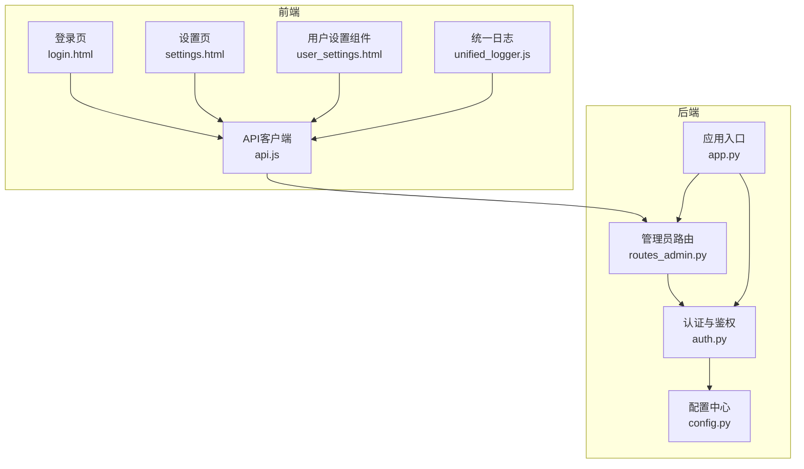

**图表来源**
- [app.py:1-200](file://server/app.py#L1-L200)
- [auth.py:1-200](file://server/auth.py#L1-L200)
- [routes_admin.py:1-200](file://server/routes_admin.py#L1-L200)
- [config.py:1-200](file://server/config.py#L1-L200)
- [login.html:1-200](file://server/templates/spa/login.html#L1-L200)
- [user_settings.html:1-200](file://server/templates/components/user_settings.html#L1-L200)
- [settings.html:1-200](file://server/templates/pages/settings.html#L1-L200)
- [api.js:1-200](file://server/static/js/api.js#L1-L200)
- [unified_logger.js:1-200](file://server/static/js/unified_logger.js#L1-L200)

**章节来源**
- [app.py:1-200](file://server/app.py#L1-L200)
- [auth.py:1-200](file://server/auth.py#L1-L200)
- [routes_admin.py:1-200](file://server/routes_admin.py#L1-L200)
- [config.py:1-200](file://server/config.py#L1-L200)
- [login.html:1-200](file://server/templates/spa/login.html#L1-L200)
- [user_settings.html:1-200](file://server/templates/components/user_settings.html#L1-L200)
- [settings.html:1-200](file://server/templates/pages/settings.html#L1-L200)
- [api.js:1-200](file://server/static/js/api.js#L1-L200)
- [unified_logger.js:1-200](file://server/static/js/unified_logger.js#L1-L200)

## 核心组件
- 认证与鉴权(auth.py)
  - 负责用户身份验证、权限校验、会话创建与销毁、密码哈希与校验、账户状态检查、登录失败计数与锁定策略。
- 管理员路由(routes_admin.py)
  - 暴露用户CRUD、分组管理、批量操作、数据导出等管理接口；受鉴权中间件保护。
- 应用入口(app.py)
  - 注册路由、全局错误处理、跨域与安全头、中间件链（鉴权、审计日志）。
- 配置(config.py)
  - 集中管理安全策略参数（如密码强度、锁定阈值、会话超时、审计开关等）。
- 前端交互(login.html, user_settings.html, settings.html, api.js, unified_logger.js)
  - 登录流程、用户设置表单、API调用封装、统一日志上报。

**章节来源**
- [auth.py:1-200](file://server/auth.py#L1-L200)
- [routes_admin.py:1-200](file://server/routes_admin.py#L1-L200)
- [app.py:1-200](file://server/app.py#L1-L200)
- [config.py:1-200](file://server/config.py#L1-L200)
- [login.html:1-200](file://server/templates/spa/login.html#L1-L200)
- [user_settings.html:1-200](file://server/templates/components/user_settings.html#L1-L200)
- [settings.html:1-200](file://server/templates/pages/settings.html#L1-L200)
- [api.js:1-200](file://server/static/js/api.js#L1-L200)
- [unified_logger.js:1-200](file://server/static/js/unified_logger.js#L1-L200)

## 架构总览
下图展示用户管理的端到端流程：前端通过API发起请求，后端路由进行鉴权与业务处理，认证模块执行安全策略，必要时触发审计日志。

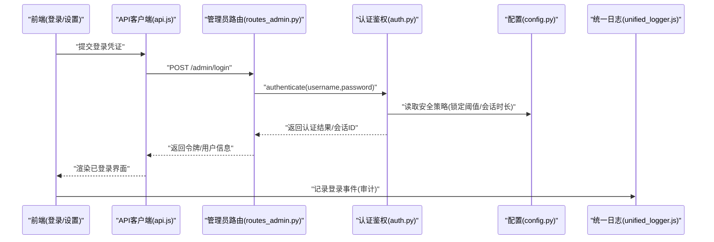

**图表来源**
- [routes_admin.py:1-200](file://server/routes_admin.py#L1-L200)
- [auth.py:1-200](file://server/auth.py#L1-L200)
- [config.py:1-200](file://server/config.py#L1-L200)
- [api.js:1-200](file://server/static/js/api.js#L1-L200)
- [unified_logger.js:1-200](file://server/static/js/unified_logger.js#L1-L200)

## 详细组件分析

### 认证与鉴权(auth.py)
- 职责
  - 用户认证：校验用户名/密码，支持密码哈希与盐值。
  - 权限校验：基于角色/权限表判断访问控制。
  - 会话管理：创建/刷新/销毁会话，维护会话有效期。
  - 账户状态：启用/禁用/锁定/待审核等状态流转。
  - 安全策略：登录失败次数限制、自动锁定、密码复杂度要求。
- 关键流程
  - 登录：校验凭证 -> 更新失败计数 -> 成功则创建会话 -> 记录审计日志。
  - 鉴权：解析会话/令牌 -> 加载用户角色 -> 匹配资源权限 -> 放行或拒绝。
  - 密码重置：生成一次性令牌 -> 校验时效 -> 更新密码 -> 清理临时令牌。
  - 账户锁定：超过失败阈值 -> 标记锁定 -> 冷却时间后解锁。

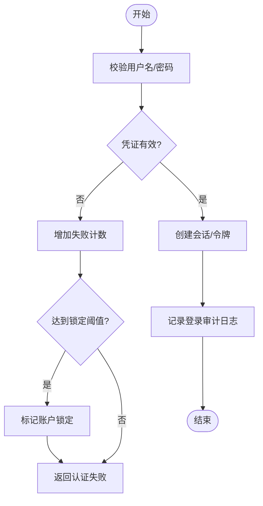

**图表来源**
- [auth.py:1-200](file://server/auth.py#L1-L200)
- [config.py:1-200](file://server/config.py#L1-L200)

**章节来源**
- [auth.py:1-200](file://server/auth.py#L1-L200)
- [config.py:1-200](file://server/config.py#L1-L200)

### 管理员路由(routes_admin.py)
- 职责
  - 用户CRUD：新增、查询、修改、删除用户。
  - 分组管理：用户分组增删改查、批量分配。
  - 批量操作：批量启用/禁用、批量角色变更、批量导出。
  - 数据导出：按条件筛选并导出CSV/JSON。
  - 权限控制：仅管理员可访问，需携带有效会话/令牌。
- 典型接口
  - GET /admin/users：分页查询用户列表
  - POST /admin/users：创建新用户
  - PUT /admin/users/{id}：更新用户信息
  - DELETE /admin/users/{id}：删除用户
  - POST /admin/users/batch：批量操作
  - GET /admin/users/export：导出数据

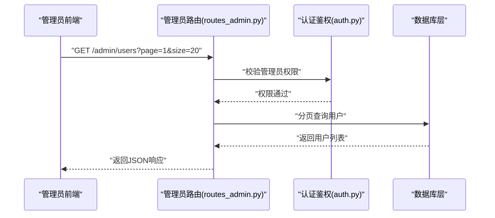

**图表来源**
- [routes_admin.py:1-200](file://server/routes_admin.py#L1-L200)
- [auth.py:1-200](file://server/auth.py#L1-L200)

**章节来源**
- [routes_admin.py:1-200](file://server/routes_admin.py#L1-L200)

### 应用入口(app.py)
- 职责
  - 路由注册：挂载管理员路由、公共路由。
  - 中间件：鉴权、审计日志、错误处理、安全头。
  - 全局配置：从config.py加载安全策略与运行时参数。
- 关键点
  - 统一错误处理：捕获未处理异常，返回标准化错误码。
  - 审计日志：对敏感操作（登录、修改用户、批量操作）进行记录。

**章节来源**
- [app.py:1-200](file://server/app.py#L1-L200)

### 配置中心(config.py)
- 职责
  - 安全策略：密码最小长度、复杂度规则、登录失败阈值、锁定冷却时间、会话过期时间。
  - 功能开关：是否启用审计、是否允许自助注册、是否允许密码重置。
  - 导出格式：默认导出类型、字段白名单。
- 使用方式
  - 在认证与鉴权模块中读取策略，动态调整行为。

**章节来源**
- [config.py:1-200](file://server/config.py#L1-L200)

### 前端交互(login.html, user_settings.html, settings.html, api.js, unified_logger.js)
- 登录页(login.html)
  - 收集用户名/密码，调用API，接收令牌并存储到本地存储/会话存储。
  - 失败时显示错误提示，支持重试与锁定倒计时。
- 用户设置(user_settings.html)
  - 展示当前用户信息，支持修改昵称、邮箱、头像等。
  - 触发“修改密码”流程，遵循后端安全策略。
- 设置页面(settings.html)
  - 聚合各类设置项，包含用户偏好、通知、隐私等。
- API客户端(api.js)
  - 封装HTTP请求，统一添加鉴权头、错误处理、重试策略。
- 统一日志(unified_logger.js)
  - 记录用户行为（登录、登出、修改密码、批量操作），上报至后端审计接口。

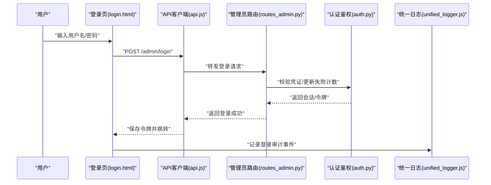

**图表来源**
- [login.html:1-200](file://server/templates/spa/login.html#L1-L200)
- [api.js:1-200](file://server/static/js/api.js#L1-L200)
- [routes_admin.py:1-200](file://server/routes_admin.py#L1-L200)
- [auth.py:1-200](file://server/auth.py#L1-L200)
- [unified_logger.js:1-200](file://server/static/js/unified_logger.js#L1-L200)

**章节来源**
- [login.html:1-200](file://server/templates/spa/login.html#L1-L200)
- [user_settings.html:1-200](file://server/templates/components/user_settings.html#L1-L200)
- [settings.html:1-200](file://server/templates/pages/settings.html#L1-L200)
- [api.js:1-200](file://server/static/js/api.js#L1-L200)
- [unified_logger.js:1-200](file://server/static/js/unified_logger.js#L1-L200)

### 用户注册审核
- 流程
  - 用户提交注册表单 -> 后端校验必填字段与密码策略 -> 写入待审核状态 -> 管理员审核通过/拒绝 -> 通过后激活账户。
- 控制点
  - 是否允许自助注册由配置开关控制。
  - 审核状态变更需记录审计日志。

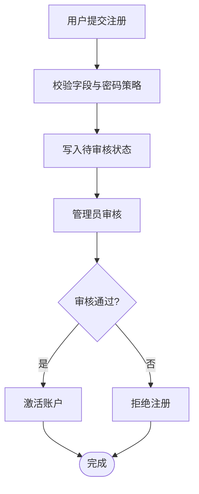

**图表来源**
- [routes_admin.py:1-200](file://server/routes_admin.py#L1-L200)
- [auth.py:1-200](file://server/auth.py#L1-L200)
- [config.py:1-200](file://server/config.py#L1-L200)

**章节来源**
- [routes_admin.py:1-200](file://server/routes_admin.py#L1-L200)
- [auth.py:1-200](file://server/auth.py#L1-L200)
- [config.py:1-200](file://server/config.py#L1-L200)

### 登录日志追踪与会话管理
- 登录日志
  - 每次登录尝试均记录：时间、IP、设备信息、结果、失败原因（如有）。
  - 审计日志可通过统一日志组件上报。
- 会话管理
  - 会话创建：认证成功后生成会话ID，设置过期时间。
  - 会话刷新：根据活动频率延长有效期。
  - 会话销毁：主动登出或超时自动失效。

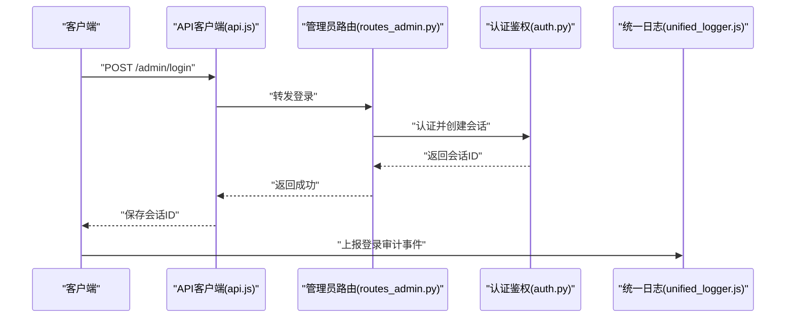

**图表来源**
- [api.js:1-200](file://server/static/js/api.js#L1-L200)
- [routes_admin.py:1-200](file://server/routes_admin.py#L1-L200)
- [auth.py:1-200](file://server/auth.py#L1-L200)
- [unified_logger.js:1-200](file://server/static/js/unified_logger.js#L1-L200)

**章节来源**
- [routes_admin.py:1-200](file://server/routes_admin.py#L1-L200)
- [auth.py:1-200](file://server/auth.py#L1-L200)
- [api.js:1-200](file://server/static/js/api.js#L1-L200)
- [unified_logger.js:1-200](file://server/static/js/unified_logger.js#L1-L200)

### 用户分组、批量操作与数据导出
- 用户分组
  - 支持创建/编辑/删除分组，将用户分配到多个分组。
  - 分组可用于权限继承与批量操作目标。
- 批量操作
  - 批量启用/禁用、批量角色变更、批量分组分配。
  - 所有批量操作需记录审计日志。
- 数据导出
  - 支持按条件筛选用户并导出CSV/JSON。
  - 导出字段可由配置控制，避免敏感信息泄露。

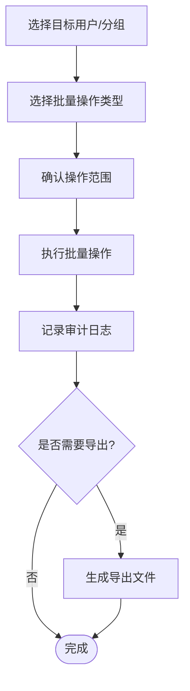

**图表来源**
- [routes_admin.py:1-200](file://server/routes_admin.py#L1-L200)
- [config.py:1-200](file://server/config.py#L1-L200)

**章节来源**
- [routes_admin.py:1-200](file://server/routes_admin.py#L1-L200)
- [config.py:1-200](file://server/config.py#L1-L200)

### 用户管理界面操作示例与权限配置方法
- 操作示例
  - 新增用户：进入“用户管理”，填写基本信息与初始角色，提交后进入待审核或直接激活（取决于配置）。
  - 修改用户：搜索用户，编辑信息或调整角色/分组，保存后生效。
  - 批量操作：勾选多个用户，选择“批量启用/禁用”或“批量分配分组”，确认后执行。
  - 数据导出：选择筛选条件，点击“导出”，下载CSV/JSON文件。
- 权限配置
  - 管理员角色具备用户管理全部权限。
  - 自定义角色可通过权限矩阵配置，限制对特定资源的访问。
  - 权限变更需记录审计日志。

**章节来源**
- [routes_admin.py:1-200](file://server/routes_admin.py#L1-L200)
- [auth.py:1-200](file://server/auth.py#L1-L200)

### 安全策略、密码重置与账户锁定机制
- 安全策略
  - 密码最小长度与复杂度要求。
  - 登录失败阈值与自动锁定。
  - 会话超时与空闲回收。
- 密码重置
  - 用户发起重置 -> 生成一次性令牌 -> 校验时效 -> 更新密码 -> 清理令牌。
- 账户锁定
  - 连续失败超过阈值 -> 锁定账户 -> 冷却时间后自动解锁或管理员手动解锁。

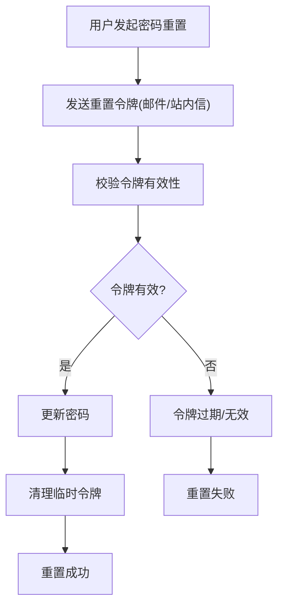

**图表来源**
- [auth.py:1-200](file://server/auth.py#L1-L200)
- [config.py:1-200](file://server/config.py#L1-L200)

**章节来源**
- [auth.py:1-200](file://server/auth.py#L1-L200)
- [config.py:1-200](file://server/config.py#L1-L200)

### 用户行为审计与异常检测
- 审计
  - 记录关键操作：登录、登出、修改密码、批量操作、权限变更。
  - 审计日志包含时间、用户、IP、动作、结果、上下文。
- 异常检测
  - 基于登录失败率、异地登录、频繁批量操作等行为指标进行告警。
  - 可结合外部SIEM系统进行聚合分析。

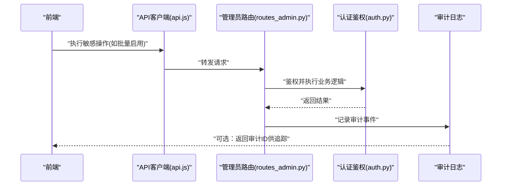

**图表来源**
- [api.js:1-200](file://server/static/js/api.js#L1-L200)
- [routes_admin.py:1-200](file://server/routes_admin.py#L1-L200)
- [auth.py:1-200](file://server/auth.py#L1-L200)

**章节来源**
- [routes_admin.py:1-200](file://server/routes_admin.py#L1-L200)
- [auth.py:1-200](file://server/auth.py#L1-L200)
- [api.js:1-200](file://server/static/js/api.js#L1-L200)

## 依赖关系分析
- 组件耦合
  - routes_admin.py 依赖 auth.py 进行鉴权与用户数据访问。
  - auth.py 依赖 config.py 获取安全策略。
  - 前端 api.js 与 unified_logger.js 协同完成请求与审计上报。
- 外部依赖
  - 数据库层（DAL/DB适配器）用于持久化用户、分组、会话与审计日志。
  - 邮件服务（可选）用于密码重置与注册通知。

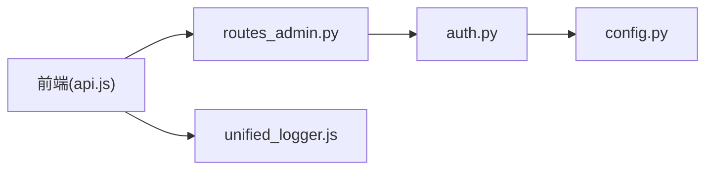

**图表来源**
- [routes_admin.py:1-200](file://server/routes_admin.py#L1-L200)
- [auth.py:1-200](file://server/auth.py#L1-L200)
- [config.py:1-200](file://server/config.py#L1-L200)
- [api.js:1-200](file://server/static/js/api.js#L1-L200)
- [unified_logger.js:1-200](file://server/static/js/unified_logger.js#L1-L200)

**章节来源**
- [routes_admin.py:1-200](file://server/routes_admin.py#L1-L200)
- [auth.py:1-200](file://server/auth.py#L1-L200)
- [config.py:1-200](file://server/config.py#L1-L200)
- [api.js:1-200](file://server/static/js/api.js#L1-L200)
- [unified_logger.js:1-200](file://server/static/js/unified_logger.js#L1-L200)

## 性能考虑
- 分页与过滤：用户列表与导出应支持分页与高效过滤，避免全表扫描。
- 会话存储：使用高性能缓存（如Redis）存储会话，降低数据库压力。
- 审计日志：异步写入，避免阻塞主流程；定期归档与压缩。
- 批量操作：采用事务与分批提交，防止长事务锁表。

[本节为通用指导，不直接分析具体文件]

## 故障排查指南
- 常见问题
  - 登录失败：检查凭证是否正确、账户是否被锁定、失败计数是否超限。
  - 权限不足：确认用户角色与资源权限配置是否正确。
  - 会话丢失：检查会话过期时间与浏览器Cookie设置。
  - 导出为空：确认筛选条件与字段白名单配置。
- 排查步骤
  - 查看审计日志定位操作轨迹。
  - 检查配置项（锁定阈值、会话时长、审计开关）。
  - 复现问题并抓取前后端日志。

**章节来源**
- [test_user_p4.py:1-200](file://server/tests/test_user_p4.py#L1-L200)

## 结论
LectureLearnLoop 的用户管理模块以 auth.py 为核心，配合 routes_admin.py 提供完整的管理能力，并通过 config.py 集中管控安全策略。前端通过 api.js 与 unified_logger.js 实现交互与审计上报。整体架构清晰、可扩展性强，适合企业级场景下的用户治理与合规审计需求。

[本节为总结性内容，不直接分析具体文件]

## 附录
- 术语
  - 会话：登录后服务端生成的身份标识，用于维持用户状态。
  - 审计：对用户关键操作的记录与分析，用于合规与追溯。
  - 分组：用户的集合，便于批量管理与权限继承。
- 参考
  - 测试用例：tests/test_user_p4.py 提供了用户相关功能的测试基线。

[本节为补充信息，不直接分析具体文件]