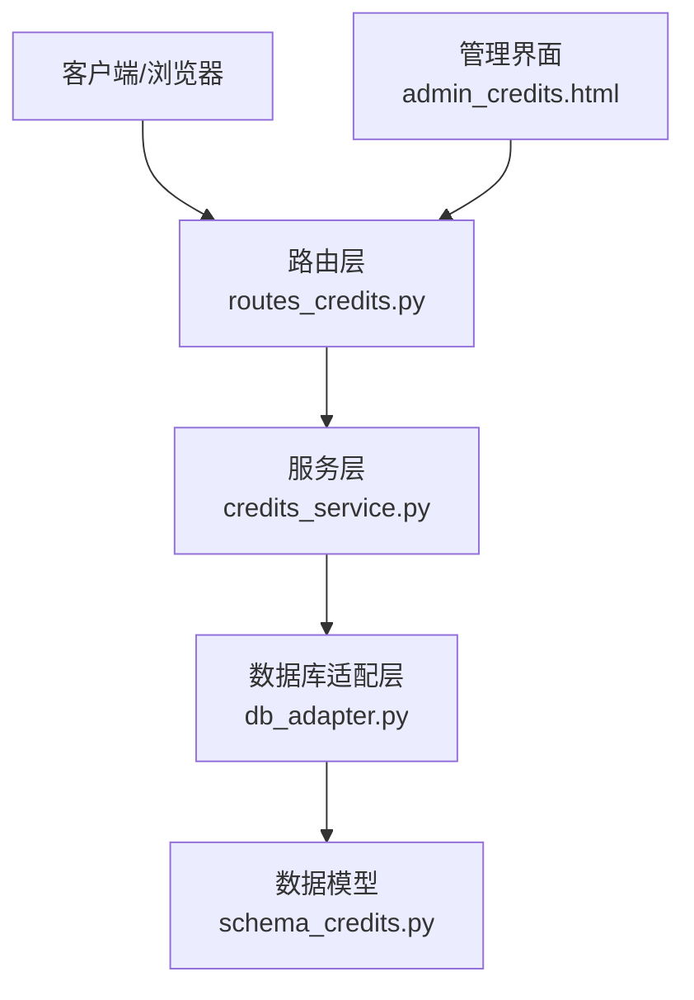
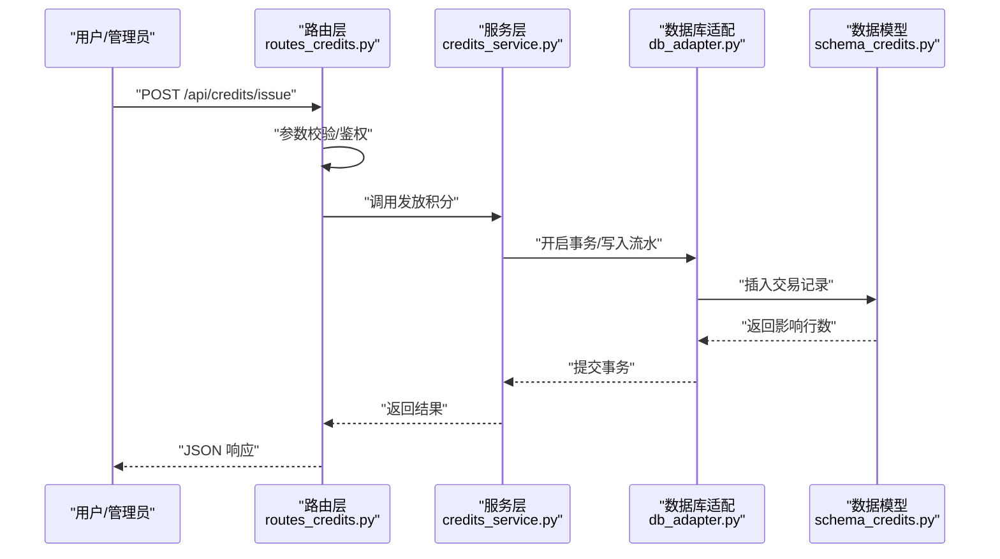
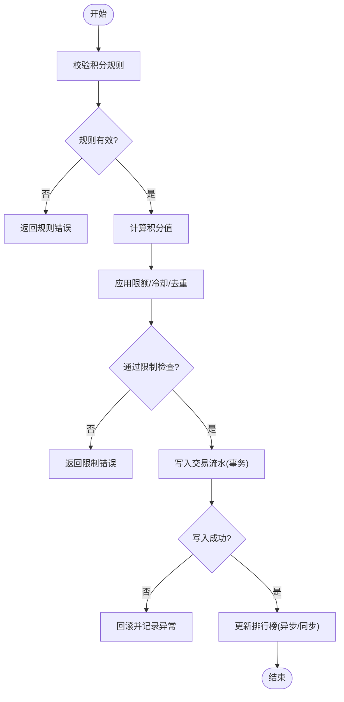
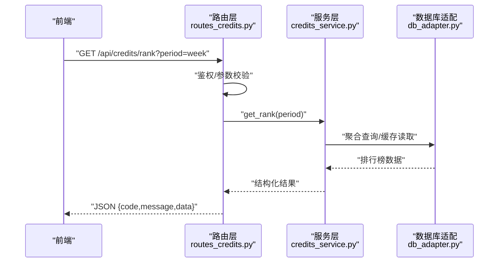
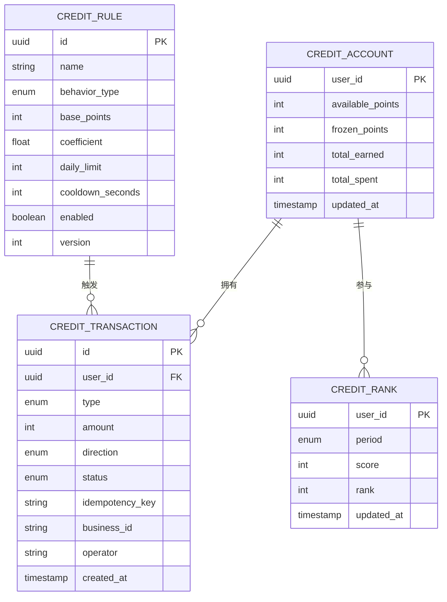
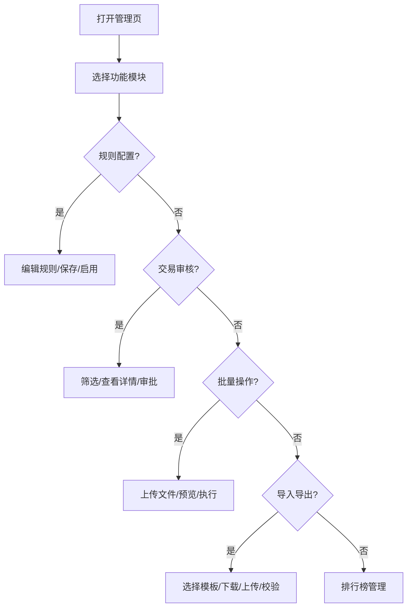

# 积分管理

<cite>
**本文引用的文件**   
- [credits_service.py](file://server/credits_service.py)
- [routes_credits.py](file://server/routes_credits.py)
- [schema_credits.py](file://server/database/schema_credits.py)
- [db_adapter.py](file://server/database/db_adapter.py)
- [admin_credits.html](file://server/templates/pages/admin_credits.html)
- [app.py](file://server/app.py)
</cite>

## 目录
1. [引言](#引言)
2. [项目结构](#项目结构)
3. [核心组件](#核心组件)
4. [架构总览](#架构总览)
5. [详细组件分析](#详细组件分析)
6. [依赖关系分析](#依赖关系分析)
7. [性能考虑](#性能考虑)
8. [故障排查指南](#故障排查指南)
9. [结论](#结论)
10. [附录](#附录)

## 引言
本文件为 LectureLearnLoop 项目的“积分管理”子系统提供完整技术文档，覆盖以下关键主题：
- 积分规则配置与发放策略
- 交易记录管理与审计追踪
- 排行榜维护与查询优化
- 消费审核流程、异常处理与安全防刷
- 积分兑换管理、批量操作与数据导入导出
- 业务逻辑与扩展性设计

目标读者包括后端开发者、产品运营与系统管理员。

## 项目结构
积分管理相关代码主要位于 server 目录下，包含服务层、路由层、数据库模型与模板页面：
- 服务层：credits_service.py（积分核心业务）
- 路由层：routes_credits.py（HTTP API 入口）
- 数据模型：schema_credits.py（积分表结构定义）
- 数据库适配：db_adapter.py（统一数据库访问封装）
- 管理界面：admin_credits.html（积分管理前端页面）
- 应用装配：app.py（蓝图注册与中间件）

**图表来源**
- [routes_credits.py:1-200](file://server/routes_credits.py#L1-L200)
- [credits_service.py:1-300](file://server/credits_service.py#L1-L300)
- [db_adapter.py:1-200](file://server/database/db_adapter.py#L1-L200)
- [schema_credits.py:1-200](file://server/database/schema_credits.py#L1-L200)
- [admin_credits.html:1-200](file://server/templates/pages/admin_credits.html#L1-L200)

**章节来源**
- [app.py:1-120](file://server/app.py#L1-L120)
- [routes_credits.py:1-200](file://server/routes_credits.py#L1-L200)
- [credits_service.py:1-300](file://server/credits_service.py#L1-L300)
- [schema_credits.py:1-200](file://server/database/schema_credits.py#L1-L200)
- [db_adapter.py:1-200](file://server/database/db_adapter.py#L1-L200)
- [admin_credits.html:1-200](file://server/templates/pages/admin_credits.html#L1-L200)

## 核心组件
- 积分服务（CreditsService）
  - 负责积分规则解析、发放、扣减、冻结、解冻、兑换、审计日志写入、排行榜计算等核心业务。
- 路由控制器（CreditsRoutes）
  - 暴露 RESTful API，接收并校验请求参数，调用服务层完成业务处理，返回统一响应。
- 数据模型（Schema Credits）
  - 定义积分账户、交易流水、规则配置、排行榜等表结构与约束。
- 数据库适配（DB Adapter）
  - 提供事务、连接池、SQL 执行、分页与聚合查询等通用能力。
- 管理界面（Admin Credits UI）
  - 提供积分规则配置、交易审核、批量操作、导入导出等可视化功能。

**章节来源**
- [credits_service.py:1-300](file://server/credits_service.py#L1-L300)
- [routes_credits.py:1-200](file://server/routes_credits.py#L1-L200)
- [schema_credits.py:1-200](file://server/database/schema_credits.py#L1-L200)
- [db_adapter.py:1-200](file://server/database/db_adapter.py#L1-L200)
- [admin_credits.html:1-200](file://server/templates/pages/admin_credits.html#L1-L200)

## 架构总览
积分管理采用分层架构：路由层负责接口契约与参数校验；服务层实现业务编排与策略；数据层通过适配层统一访问数据库；管理界面通过路由层进行交互。

**图表来源**
- [routes_credits.py:1-200](file://server/routes_credits.py#L1-L200)
- [credits_service.py:1-300](file://server/credits_service.py#L1-L300)
- [db_adapter.py:1-200](file://server/database/db_adapter.py#L1-L200)
- [schema_credits.py:1-200](file://server/database/schema_credits.py#L1-L200)

## 详细组件分析

### 积分服务（CreditsService）
职责与关键点：
- 积分发放策略
  - 支持按行为类型（学习、练习、贡献等）匹配规则，计算基础分值与奖励系数。
  - 支持上限控制、冷却时间、重复行为去重。
- 积分扣减与冻结
  - 支持预冻结（兑换前）、确认扣减、失败解冻。
  - 支持部分扣减与回滚。
- 交易记录与审计
  - 每笔变动生成不可变流水，包含来源、去向、金额、状态、操作人、时间戳、关联业务ID。
  - 支持按用户、时间范围、类型、状态筛选与分页。
- 排行榜维护
  - 支持日榜、周榜、月榜与总榜，增量更新与全量重建双模式。
  - 支持同分排序规则（如最近活跃优先）。
- 异常处理
  - 余额不足、规则不存在、并发冲突、幂等键重复等错误分类与重试建议。
- 安全与防刷
  - 基于用户ID+业务ID+动作的幂等键；频率限制；风控阈值（单日/单行为上限）。
  - 敏感操作需二次确认与审计日志。

**图表来源**
- [credits_service.py:1-300](file://server/credits_service.py#L1-L300)

**章节来源**
- [credits_service.py:1-300](file://server/credits_service.py#L1-L300)

### 路由层（CreditsRoutes）
职责与关键点：
- 接口契约
  - 提供积分发放、扣减、冻结/解冻、兑换、查询流水、排行榜、批量操作、导入导出等API。
- 参数校验与鉴权
  - 使用统一校验器验证必填字段、类型、取值范围；鉴权中间件确保操作者身份与权限。
- 响应格式
  - 统一返回结构：code、message、data、trace_id，便于前端与监控。
- 错误映射
  - 将服务层异常映射为HTTP状态码与友好消息。

**图表来源**
- [routes_credits.py:1-200](file://server/routes_credits.py#L1-L200)
- [credits_service.py:1-300](file://server/credits_service.py#L1-L300)
- [db_adapter.py:1-200](file://server/database/db_adapter.py#L1-L200)

**章节来源**
- [routes_credits.py:1-200](file://server/routes_credits.py#L1-L200)

### 数据模型（Schema Credits）
主要实体与关系：
- 积分账户（credit_account）
  - 字段：用户ID、可用积分、冻结积分、累计获得、累计消耗、更新时间。
- 交易流水（credit_transaction）
  - 字段：流水号、用户ID、类型（发放/扣减/冻结/解冻/兑换）、金额、方向、状态、幂等键、业务ID、操作人、时间戳。
- 积分规则（credit_rule）
  - 字段：规则ID、名称、行为类型、基础分值、系数、上限、冷却时间、启用状态、版本。
- 排行榜（credit_rank）
  - 字段：用户ID、周期（日/周/月/总）、分数、排名、更新时间。

**图表来源**
- [schema_credits.py:1-200](file://server/database/schema_credits.py#L1-L200)

**章节来源**
- [schema_credits.py:1-200](file://server/database/schema_credits.py#L1-L200)

### 数据库适配（DB Adapter）
职责与关键点：
- 事务管理
  - 提供 begin/commit/rollback 封装，保证积分变动的原子性。
- 连接池与重试
  - 连接复用、超时控制、自动重试与退避策略。
- 通用查询
  - 分页、条件构建、聚合统计、批量插入/更新。
- 审计与追踪
  - 注入 trace_id、操作人上下文，便于链路追踪。

**章节来源**
- [db_adapter.py:1-200](file://server/database/db_adapter.py#L1-L200)

### 管理界面（Admin Credits UI）
功能点：
- 积分规则配置
  - 新增/编辑/启用禁用规则，设置行为类型、基础分值、系数、上限、冷却时间。
- 交易审核
  - 列表查看、筛选、详情、批准/拒绝、备注填写。
- 批量操作
  - 批量发放、批量冻结/解冻、批量调整。
- 数据导入导出
  - CSV/Excel 导入规则与流水，导出报表与对账文件。
- 排行榜管理
  - 查看各周期榜单、重置榜单、导出榜单。

**图表来源**
- [admin_credits.html:1-200](file://server/templates/pages/admin_credits.html#L1-L200)

**章节来源**
- [admin_credits.html:1-200](file://server/templates/pages/admin_credits.html#L1-L200)

## 依赖关系分析
- 路由层依赖服务层与鉴权中间件。
- 服务层依赖数据库适配层与配置中心（规则、开关、阈值）。
- 数据模型由数据库适配层统一访问。
- 管理界面通过路由层与后端交互。

**图表来源**
- [routes_credits.py:1-200](file://server/routes_credits.py#L1-L200)
- [credits_service.py:1-300](file://server/credits_service.py#L1-L300)
- [db_adapter.py:1-200](file://server/database/db_adapter.py#L1-L200)
- [schema_credits.py:1-200](file://server/database/schema_credits.py#L1-L200)
- [admin_credits.html:1-200](file://server/templates/pages/admin_credits.html#L1-L200)

**章节来源**
- [routes_credits.py:1-200](file://server/routes_credits.py#L1-L200)
- [credits_service.py:1-300](file://server/credits_service.py#L1-L300)
- [db_adapter.py:1-200](file://server/database/db_adapter.py#L1-L200)
- [schema_credits.py:1-200](file://server/database/schema_credits.py#L1-L200)
- [admin_credits.html:1-200](file://server/templates/pages/admin_credits.html#L1-L200)

## 性能考虑
- 排行榜计算
  - 采用增量更新为主、全量重建为辅的策略；热点榜单可引入缓存层（如内存缓存或Redis）以降低数据库压力。
- 交易写入
  - 批量写入与异步落库结合；高并发场景下使用队列削峰。
- 查询优化
  - 针对常用筛选条件建立复合索引（user_id、created_at、type、status）。
- 事务粒度
  - 缩小事务范围，避免长事务导致锁竞争。
- 限流与熔断
  - 对高频接口实施限流；异常率升高时快速降级。

[本节为通用指导，不直接分析具体文件]

## 故障排查指南
常见问题与定位步骤：
- 积分未到账
  - 检查规则是否启用、行为类型是否匹配、是否存在冷却或上限限制。
  - 查看交易流水状态是否为“已入账”，核对幂等键是否重复。
- 扣款失败
  - 检查可用余额是否充足、冻结金额是否正确、是否存在并发冲突。
  - 查看异常日志中的错误码与堆栈信息。
- 排行榜异常
  - 确认周期计算逻辑与时间窗口；检查是否有脏数据或未提交的交易。
- 导入导出失败
  - 校验文件格式与字段映射；检查必填项与数据类型；查看导入校验报告。

建议工具：
- 使用 trace_id 在日志中串联请求链路。
- 通过管理界面的“交易审核”与“排行榜管理”进行人工核验与修正。

**章节来源**
- [credits_service.py:1-300](file://server/credits_service.py#L1-L300)
- [routes_credits.py:1-200](file://server/routes_credits.py#L1-L200)
- [admin_credits.html:1-200](file://server/templates/pages/admin_credits.html#L1-L200)

## 结论
积分管理系统以清晰的分层架构与严谨的事务保障为基础，实现了从规则配置、交易审计到排行榜维护的全链路能力。通过幂等键、频率限制与风控阈值构建了有效的防刷机制；借助管理界面提供了便捷的运营能力。系统在扩展性方面预留了规则引擎与排行榜多周期的扩展点，便于后续接入更多业务场景。

[本节为总结性内容，不直接分析具体文件]

## 附录
- 积分规则配置示例（说明）
  - 行为类型：学习打卡、练习完成、知识贡献、社区互动等。
  - 基础分值：根据行为价值设定初始分值。
  - 系数：按用户等级、活跃度、时间段等动态调整。
  - 上限：单日/单行为最高可获得积分。
  - 冷却：同一行为的最小间隔时间。
- 管理界面操作要点
  - 规则配置：新增后需启用并观察灰度效果。
  - 交易审核：重点关注异常状态与大额变动。
  - 批量操作：先小批量试跑，再全量执行。
  - 导入导出：严格遵循模板规范，注意编码与分隔符。

[本节为补充说明，不直接分析具体文件]