# 管理后台

<cite>
**本文引用的文件**   
- [app.py](file://server/app.py)
- [auth.py](file://server/auth.py)
- [config.py](file://server/config.py)
- [routes_admin.py](file://server/routes_admin.py)
- [routes_pages.py](file://server/routes_pages.py)
- [templates/pages/dashboard.html](file://server/templates/pages/dashboard.html)
- [templates/pages/settings.html](file://server/templates/pages/settings.html)
- [templates/pages/llm_logs.html](file://server/templates/pages/llm_logs.html)
- [templates/pages/knowledge_base.html](file://server/templates/pages/knowledge_base.html)
- [templates/pages/admin_credits.html](file://server/templates/pages/admin_credits.html)
- [static/js/api.js](file://server/static/js/api.js)
- [database/db_adapter.py](file://server/database/db_adapter.py)
- [database/schema_postgres.py](file://server/database/schema_postgres.py)
- [credits_service.py](file://server/credits_service.py)
- [knowledge_management.py](file://server/knowledge_management.py)
- [llm_call_logger.py](file://server/llm_call_logger.py)
- [logger_module.py](file://server/logger_module.py)
</cite>

## 目录
1. [简介](#简介)
2. [项目结构](#项目结构)
3. [核心组件](#核心组件)
4. [架构总览](#架构总览)
5. [详细组件分析](#详细组件分析)
6. [依赖关系分析](#依赖关系分析)
7. [性能与监控](#性能与监控)
8. [故障诊断与维护](#故障诊断与维护)
9. [结论](#结论)
10. [附录：操作示例与报表](#附录操作示例与报表)

## 简介
本文件为 LectureLearnLoop 管理后台的实现文档，围绕用户管理、权限控制、内容审核、系统配置、管理员日志、健康检查与故障诊断、数据导出与备份恢复、实时监控指标与告警、性能分析等主题进行系统化说明。文档面向产品、研发与运维人员，既提供高层架构视图，也给出代码级实现要点与可操作的示例路径。

## 项目结构
管理后台基于 Python Web 应用组织，主要模块包括：
- 路由层：页面路由与 API 路由分离，便于前后端解耦
- 模板层：Jinja2 模板承载管理界面
- 静态资源：前端脚本与样式
- 服务层：业务逻辑（如积分、知识管理）
- 数据访问层：数据库适配与模式定义
- 工具与日志：统一日志、LLM 调用审计

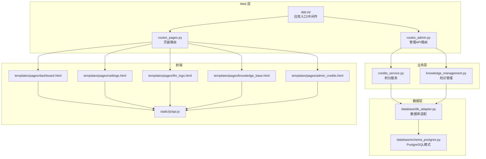

图表来源
- [app.py:1-200](file://server/app.py#L1-L200)
- [routes_admin.py:1-200](file://server/routes_admin.py#L1-L200)
- [routes_pages.py:1-200](file://server/routes_pages.py#L1-L200)
- [credits_service.py:1-200](file://server/credits_service.py#L1-L200)
- [knowledge_management.py:1-200](file://server/knowledge_management.py#L1-L200)
- [database/db_adapter.py:1-200](file://server/database/db_adapter.py#L1-L200)
- [database/schema_postgres.py:1-200](file://server/database/schema_postgres.py#L1-L200)
- [templates/pages/dashboard.html:1-200](file://server/templates/pages/dashboard.html#L1-L200)
- [templates/pages/settings.html:1-200](file://server/templates/pages/settings.html#L1-L200)
- [templates/pages/llm_logs.html:1-200](file://server/templates/pages/llm_logs.html#L1-L200)
- [templates/pages/knowledge_base.html:1-200](file://server/templates/pages/knowledge_base.html#L1-L200)
- [templates/pages/admin_credits.html:1-200](file://server/templates/pages/admin_credits.html#L1-L200)
- [static/js/api.js:1-200](file://server/static/js/api.js#L1-L200)

章节来源
- [app.py:1-200](file://server/app.py#L1-L200)
- [routes_pages.py:1-200](file://server/routes_pages.py#L1-L200)
- [routes_admin.py:1-200](file://server/routes_admin.py#L1-L200)

## 核心组件
- 认证与授权：集中鉴权、会话管理与权限校验
- 管理路由：用户管理、内容审核、系统配置、积分管理等 API
- 页面路由：渲染管理后台各页面
- 业务服务：积分服务、知识管理
- 数据访问：数据库适配器与 PostgreSQL 模式
- 日志与审计：统一日志、LLM 调用审计
- 前端交互：通用 API 客户端与模板页面

章节来源
- [auth.py:1-200](file://server/auth.py#L1-L200)
- [routes_admin.py:1-200](file://server/routes_admin.py#L1-L200)
- [routes_pages.py:1-200](file://server/routes_pages.py#L1-L200)
- [credits_service.py:1-200](file://server/credits_service.py#L1-L200)
- [knowledge_management.py:1-200](file://server/knowledge_management.py#L1-L200)
- [database/db_adapter.py:1-200](file://server/database/db_adapter.py#L1-L200)
- [database/schema_postgres.py:1-200](file://server/database/schema_postgres.py#L1-L200)
- [llm_call_logger.py:1-200](file://server/llm_call_logger.py#L1-L200)
- [logger_module.py:1-200](file://server/logger_module.py#L1-L200)

## 架构总览
管理后台采用“路由-服务-数据”分层架构，配合模板与静态资源形成完整的管理界面。鉴权贯穿所有管理接口，确保只有具备相应权限的管理员才能执行敏感操作。

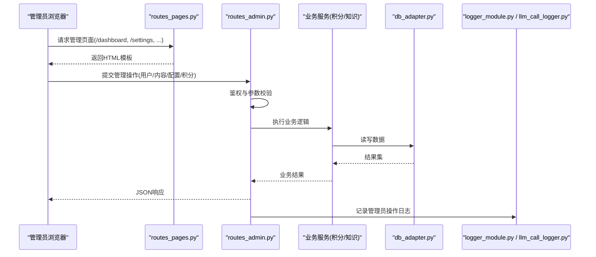

图表来源
- [routes_pages.py:1-200](file://server/routes_pages.py#L1-L200)
- [routes_admin.py:1-200](file://server/routes_admin.py#L1-L200)
- [database/db_adapter.py:1-200](file://server/database/db_adapter.py#L1-L200)
- [logger_module.py:1-200](file://server/logger_module.py#L1-L200)
- [llm_call_logger.py:1-200](file://server/llm_call_logger.py#L1-L200)

## 详细组件分析

### 用户管理与权限控制
- 功能范围
  - 用户列表查询、新增、编辑、禁用/启用
  - 角色与权限分配
  - 登录与会话管理
  - 密码策略与安全设置
- 关键实现
  - 鉴权中间件在路由层统一拦截，校验会话与权限
  - 管理 API 对敏感操作进行二次校验与审计记录
  - 前端通过 api.js 发起统一请求，后端返回结构化响应
- 安全建议
  - 最小权限原则，按角色粒度控制
  - 敏感操作需二次确认与审计日志
  - 密码与密钥使用加密存储

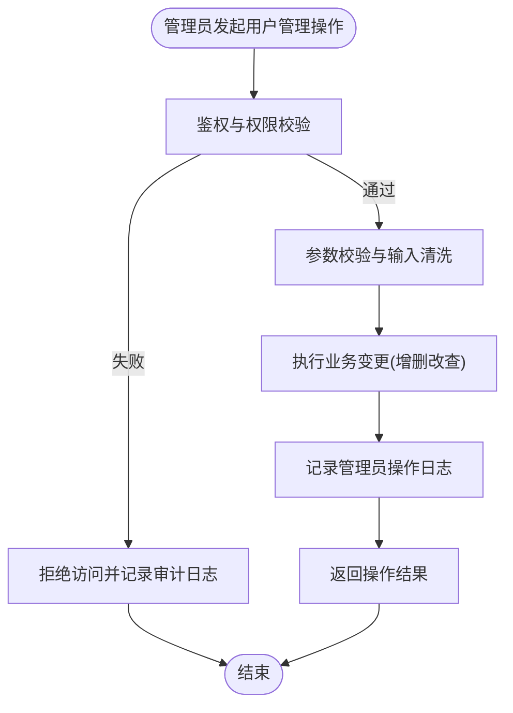

图表来源
- [auth.py:1-200](file://server/auth.py#L1-L200)
- [routes_admin.py:1-200](file://server/routes_admin.py#L1-L200)
- [static/js/api.js:1-200](file://server/static/js/api.js#L1-200)
- [logger_module.py:1-200](file://server/logger_module.py#L1-200)

章节来源
- [auth.py:1-200](file://server/auth.py#L1-L200)
- [routes_admin.py:1-200](file://server/routes_admin.py#L1-L200)
- [static/js/api.js:1-200](file://server/static/js/api.js#L1-200)

### 系统监控面板
- 功能范围
  - 仪表盘展示关键运行指标（在线用户、任务队列、错误率、资源占用）
  - 实时刷新与历史趋势图
  - 快速跳转至问题定位页
- 关键实现
  - 页面由 dashboard.html 渲染，通过 api.js 拉取指标数据
  - 后端聚合系统状态与业务指标，提供稳定接口
- 可视化建议
  - 使用折线图展示趋势，柱状图对比维度
  - 阈值告警以颜色标记异常区间

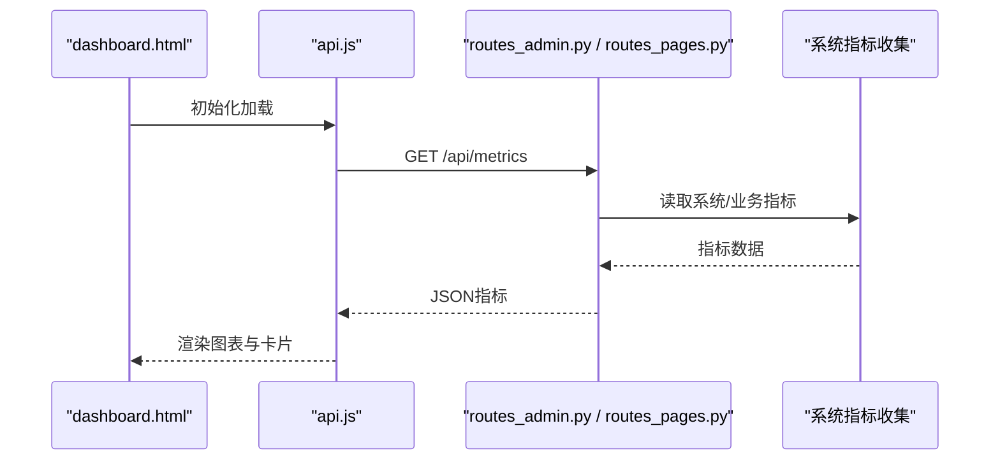

图表来源
- [templates/pages/dashboard.html:1-200](file://server/templates/pages/dashboard.html#L1-L200)
- [static/js/api.js:1-200](file://server/static/js/api.js#L1-200)
- [routes_admin.py:1-200](file://server/routes_admin.py#L1-L200)
- [routes_pages.py:1-200](file://server/routes_pages.py#L1-L200)

章节来源
- [templates/pages/dashboard.html:1-200](file://server/templates/pages/dashboard.html#L1-L200)
- [static/js/api.js:1-200](file://server/static/js/api.js#L1-200)

### 数据与统计分析
- 功能范围
  - 知识点统计、练习正确率、学习时长分布
  - 用户活跃度与留存分析
  - 导出报表（CSV/Excel）
- 关键实现
  - 统计逻辑在服务层聚合，支持分页与过滤
  - 导出功能异步生成，完成后通知下载
- 数据模型建议
  - 用户、知识点、练习记录、学习行为事件表

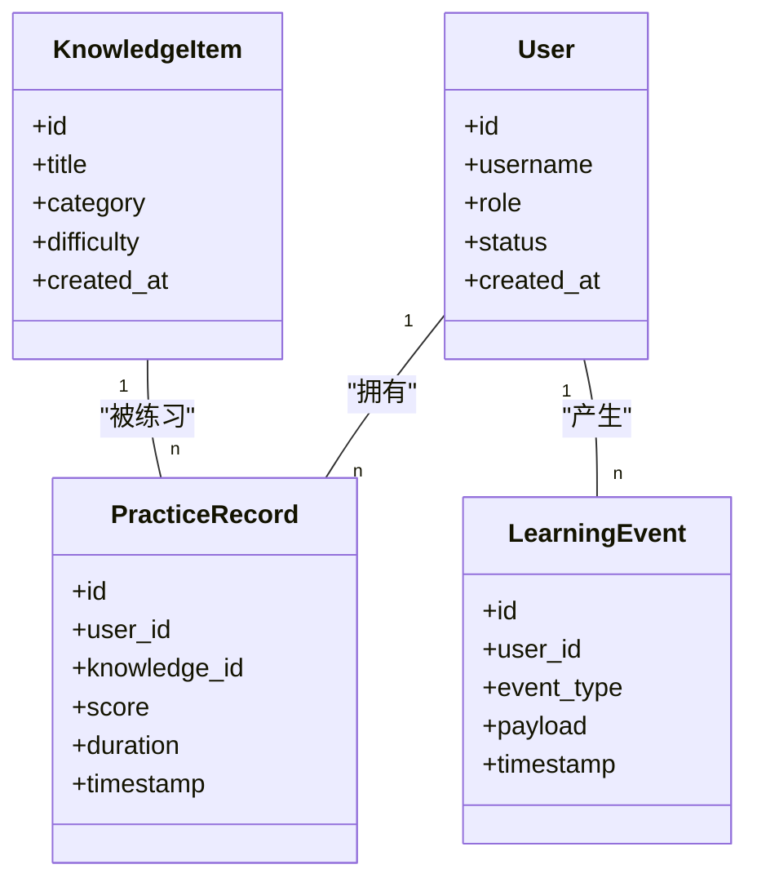

图表来源
- [database/schema_postgres.py:1-200](file://server/database/schema_postgres.py#L1-L200)
- [knowledge_management.py:1-200](file://server/knowledge_management.py#L1-L200)

章节来源
- [database/schema_postgres.py:1-200](file://server/database/schema_postgres.py#L1-L200)
- [knowledge_management.py:1-200](file://server/knowledge_management.py#L1-L200)

### 内容审核
- 功能范围
  - 知识点与笔记的审核流程（待审/通过/驳回）
  - 批量审核与优先级排序
  - 审核意见与版本留痕
- 关键实现
  - 审核状态机在服务层维护
  - 审核操作需管理员权限并记录审计日志
  - 前端提供审核工作台与筛选条件

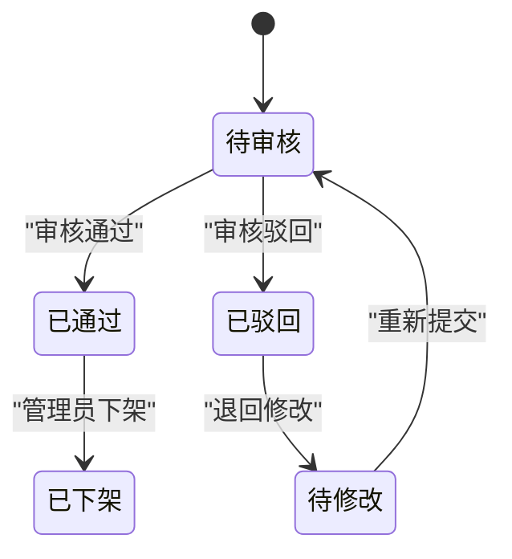

图表来源
- [knowledge_management.py:1-200](file://server/knowledge_management.py#L1-L200)
- [routes_admin.py:1-200](file://server/routes_admin.py#L1-L200)

章节来源
- [knowledge_management.py:1-200](file://server/knowledge_management.py#L1-L200)
- [routes_admin.py:1-200](file://server/routes_admin.py#L1-L200)

### 系统配置界面
- 功能范围
  - 全局开关、缓存策略、第三方服务接入
  - LLM 提供商配置、超时与重试策略
  - 安全策略（密码复杂度、会话过期）
- 关键实现
  - 配置项集中管理，支持热更新或重启生效
  - 配置变更需审计记录与回滚能力
  - 前端表单校验与后端强校验双重保障

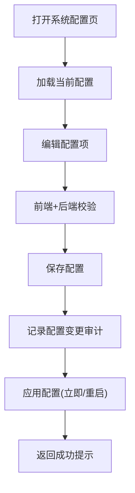

图表来源
- [templates/pages/settings.html:1-200](file://server/templates/pages/settings.html#L1-L200)
- [routes_admin.py:1-200](file://server/routes_admin.py#L1-L200)
- [config.py:1-200](file://server/config.py#L1-L200)

章节来源
- [templates/pages/settings.html:1-200](file://server/templates/pages/settings.html#L1-L200)
- [routes_admin.py:1-200](file://server/routes_admin.py#L1-L200)
- [config.py:1-200](file://server/config.py#L1-L200)

### 管理员操作日志
- 功能范围
  - 记录管理员身份、操作类型、目标对象、结果与时间戳
  - 支持检索、导出与归档
- 关键实现
  - 统一日志模块输出结构化日志
  - LLM 调用审计单独记录，便于追踪外部服务调用

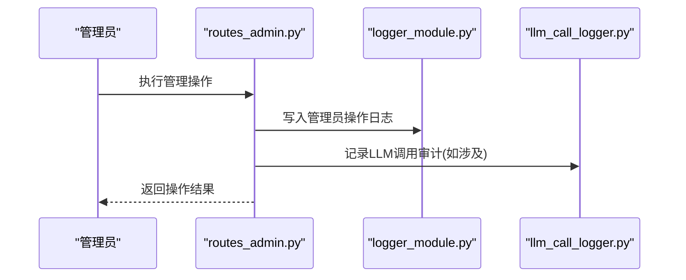

图表来源
- [routes_admin.py:1-200](file://server/routes_admin.py#L1-L200)
- [logger_module.py:1-200](file://server/logger_module.py#L1-L200)
- [llm_call_logger.py:1-200](file://server/llm_call_logger.py#L1-L200)

章节来源
- [routes_admin.py:1-200](file://server/routes_admin.py#L1-L200)
- [logger_module.py:1-200](file://server/logger_module.py#L1-L200)
- [llm_call_logger.py:1-200](file://server/llm_call_logger.py#L1-L200)

### 积分与权益管理
- 功能范围
  - 用户积分增减、发放规则、消费明细
  - 管理员手动调整与批量处理
- 关键实现
  - 积分服务封装原子操作，保证一致性
  - 变更记录持久化，支持审计与对账

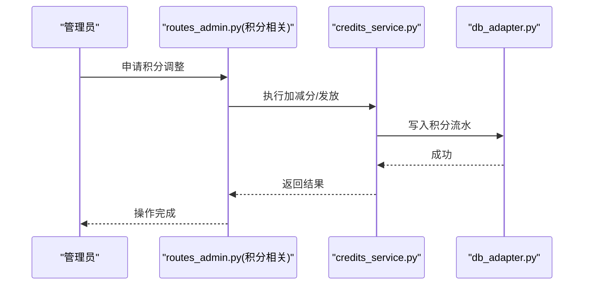

图表来源
- [routes_admin.py:1-200](file://server/routes_admin.py#L1-L200)
- [credits_service.py:1-200](file://server/credits_service.py#L1-L200)
- [database/db_adapter.py:1-200](file://server/database/db_adapter.py#L1-L200)
- [templates/pages/admin_credits.html:1-200](file://server/templates/pages/admin_credits.html#L1-L200)

章节来源
- [credits_service.py:1-200](file://server/credits_service.py#L1-L200)
- [routes_admin.py:1-200](file://server/routes_admin.py#L1-L200)
- [templates/pages/admin_credits.html:1-200](file://server/templates/pages/admin_credits.html#L1-L200)

### LLM 调用审计与日志
- 功能范围
  - 记录每次 LLM 调用的输入、输出、耗时、成本与状态
  - 支持按用户、会话、模型维度检索
- 关键实现
  - 审计日志独立于业务日志，便于合规与排障
  - 前端提供检索与导出能力

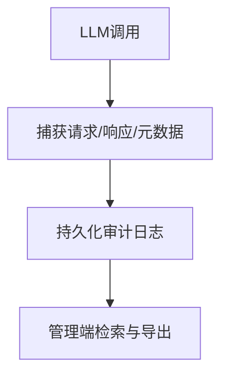

图表来源
- [llm_call_logger.py:1-200](file://server/llm_call_logger.py#L1-L200)
- [templates/pages/llm_logs.html:1-200](file://server/templates/pages/llm_logs.html#L1-L200)

章节来源
- [llm_call_logger.py:1-200](file://server/llm_call_logger.py#L1-L200)
- [templates/pages/llm_logs.html:1-200](file://server/templates/pages/llm_logs.html#L1-L200)

## 依赖关系分析
- 耦合关系
  - 路由层依赖业务服务与鉴权模块
  - 业务服务依赖数据访问层
  - 前端模板依赖静态脚本
- 外部依赖
  - 数据库（PostgreSQL）
  - LLM 提供商（通过工厂与配置注入）
- 潜在风险
  - 路由与服务间接口契约变化需同步测试
  - 配置项变更需考虑兼容性与回滚

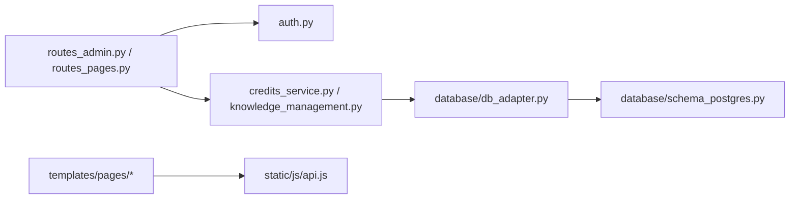

图表来源
- [routes_admin.py:1-200](file://server/routes_admin.py#L1-L200)
- [routes_pages.py:1-200](file://server/routes_pages.py#L1-L200)
- [auth.py:1-200](file://server/auth.py#L1-L200)
- [credits_service.py:1-200](file://server/credits_service.py#L1-L200)
- [knowledge_management.py:1-200](file://server/knowledge_management.py#L1-L200)
- [database/db_adapter.py:1-200](file://server/database/db_adapter.py#L1-L200)
- [database/schema_postgres.py:1-200](file://server/database/schema_postgres.py#L1-L200)
- [templates/pages/dashboard.html:1-200](file://server/templates/pages/dashboard.html#L1-L200)
- [static/js/api.js:1-200](file://server/static/js/api.js#L1-200)

章节来源
- [routes_admin.py:1-200](file://server/routes_admin.py#L1-L200)
- [routes_pages.py:1-200](file://server/routes_pages.py#L1-L200)
- [auth.py:1-200](file://server/auth.py#L1-L200)
- [credits_service.py:1-200](file://server/credits_service.py#L1-L200)
- [knowledge_management.py:1-200](file://server/knowledge_management.py#L1-L200)
- [database/db_adapter.py:1-200](file://server/database/db_adapter.py#L1-L200)
- [database/schema_postgres.py:1-200](file://server/database/schema_postgres.py#L1-L200)

## 性能与监控
- 实时监控指标
  - 系统层面：CPU、内存、磁盘、网络 I/O
  - 应用层面：QPS、延迟、错误率、连接池使用率
  - 业务层面：在线用户数、任务积压、审核队列长度
- 告警机制
  - 阈值告警（超过阈值触发通知）
  - 异常模式告警（突发错误、慢查询）
- 性能分析
  - 慢查询分析与索引优化
  - 热点接口压测与容量规划
  - LLM 调用成本与延迟监控

[本节为通用指导，不直接分析具体文件]

## 故障诊断与维护
- 健康检查
  - 数据库连通性、表结构与索引检查
  - 第三方服务可用性探测（LLM、ASR/TTS）
- 诊断工具
  - 日志检索与聚合（管理员操作日志、LLM 审计日志）
  - 配置差异比对与回滚
  - 数据一致性校验与修复脚本
- 备份与恢复
  - 全量与增量备份策略
  - 恢复演练与验证
- 维护窗口
  - 计划内停机与灰度发布
  - 数据迁移与兼容性测试

章节来源
- [logger_module.py:1-200](file://server/logger_module.py#L1-L200)
- [llm_call_logger.py:1-200](file://server/llm_call_logger.py#L1-L200)
- [database/db_adapter.py:1-200](file://server/database/db_adapter.py#L1-L200)

## 结论
管理后台以清晰的层次架构与严格的鉴权机制为基础，覆盖用户管理、内容审核、系统配置、积分权益、LLM 审计与监控告警等核心场景。通过统一的日志与审计体系，结合数据导出与备份恢复能力，为平台的安全、稳定与可观测性提供了坚实支撑。建议在后续迭代中持续完善指标采集、告警策略与自动化运维能力。

[本节为总结性内容，不直接分析具体文件]

## 附录：操作示例与报表
- 用户管理示例
  - 新增用户：填写用户名、角色、初始密码；提交后系统校验并创建账户，记录审计日志
  - 禁用用户：选择用户并禁用，系统限制登录并记录原因
  - 权限调整：为用户分配角色，即时生效
- 内容审核示例
  - 待审列表：按类别与难度筛选，批量通过或驳回
  - 审核意见：填写意见并留痕，支持版本回溯
- 系统配置示例
  - 开启/关闭某功能开关，保存后观察效果
  - 配置 LLM 提供商参数，进行连通性测试
- 报表生成示例
  - 知识点掌握度报表：按用户与知识点维度导出
  - 学习行为报表：按时间段导出活跃与停留时长
  - 积分流水报表：按用户与日期导出对账

[本节为概念性示例，不直接分析具体文件]