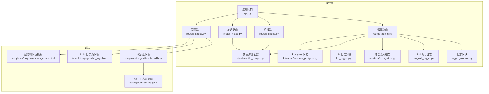
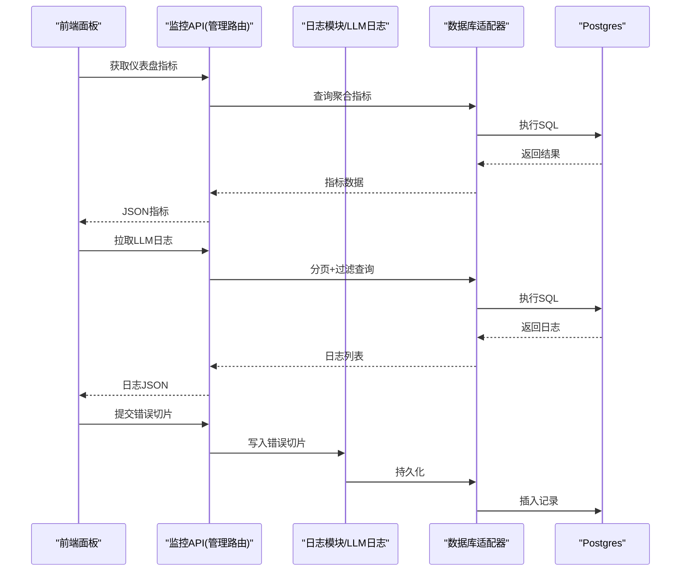
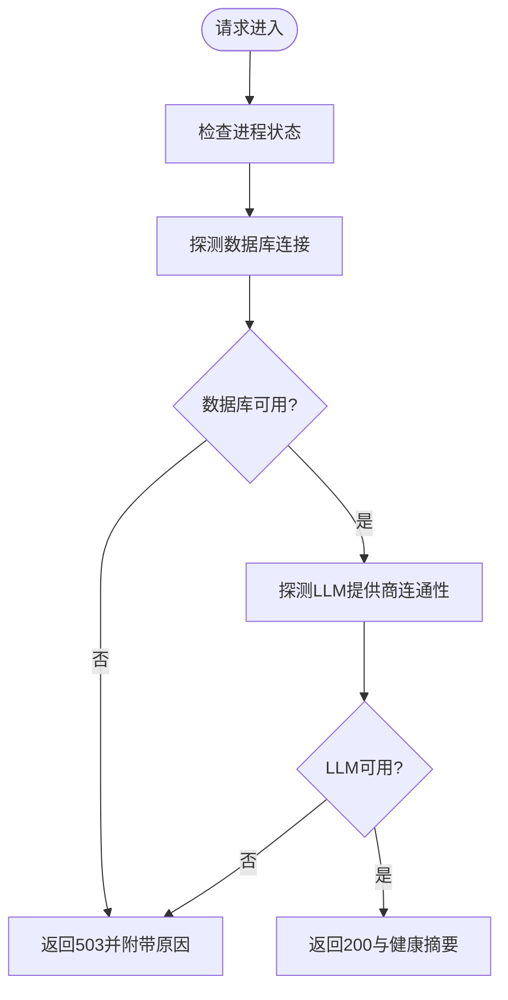
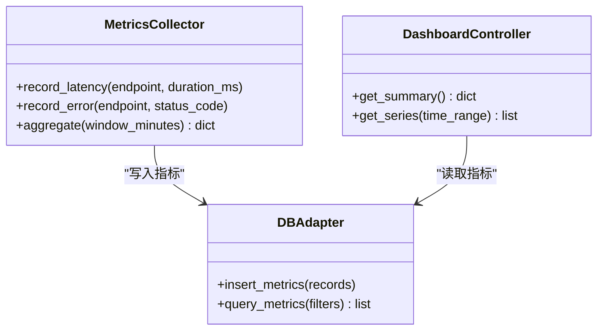
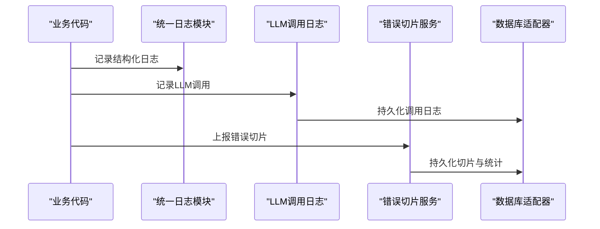
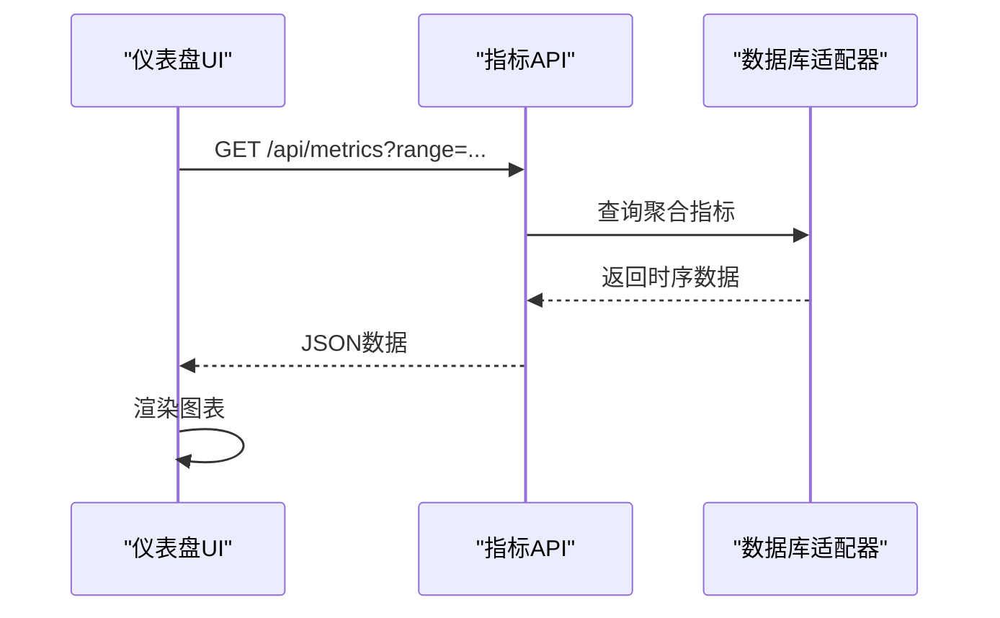
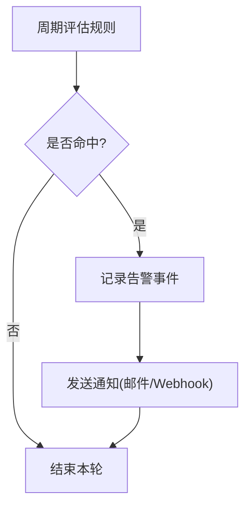
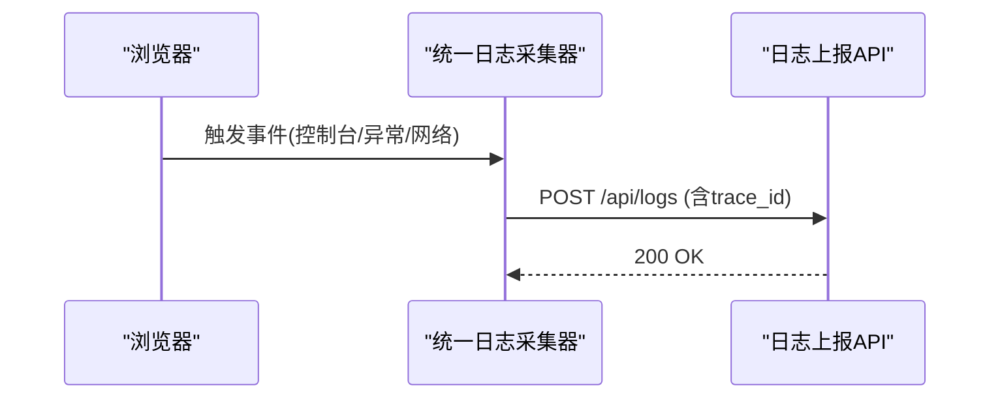
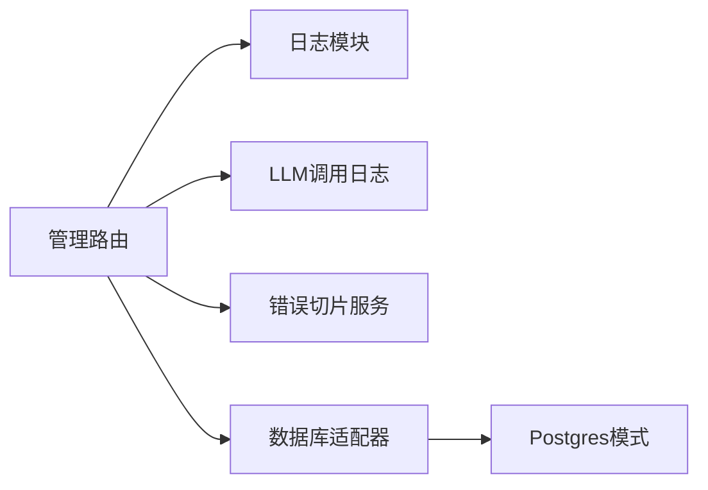

# 系统监控

<cite>
**本文引用的文件**   
- [app.py](file://server/app.py)
- [config.py](file://server/config.py)
- [logger_module.py](file://server/logger_module.py)
- [llm_call_logger.py](file://server/llm_call_logger.py)
- [llm_logger.py](file://server/llm_logger.py)
- [routes_admin.py](file://server/routes_admin.py)
- [routes_bridge.py](file://server/routes_bridge.py)
- [routes_notes.py](file://server/routes_notes.py)
- [routes_pages.py](file://server/routes_pages.py)
- [database/db_adapter.py](file://server/database/db_adapter.py)
- [database/schema_postgres.py](file://server/database/schema_postgres.py)
- [services/error_slicer.py](file://server/services/error_slicer.py)
- [static/js/unified_logger.js](file://server/static/js/unified_logger.js)
- [templates/pages/dashboard.html](file://server/templates/pages/dashboard.html)
- [templates/pages/llm_logs.html](file://server/templates/pages/llm_logs.html)
- [templates/pages/memory_errors.html](file://server/templates/pages/memory_errors.html)
- [tests/test_dashboard_b.py](file://server/tests/test_dashboard_b.py)
</cite>

## 目录
1. [简介](#简介)
2. [项目结构](#项目结构)
3. [核心组件](#核心组件)
4. [架构总览](#架构总览)
5. [详细组件分析](#详细组件分析)
6. [依赖关系分析](#依赖关系分析)
7. [性能与容量规划](#性能与容量规划)
8. [故障排查指南](#故障排查指南)
9. [结论](#结论)
10. [附录：配置与告警示例](#附录配置与告警示例)

## 简介
本文件为 LectureLearnLoop 系统的“系统监控”专题文档，聚焦以下能力：
- 系统健康检查、性能指标监控与资源使用跟踪
- 应用日志收集、错误日志分析与系统告警机制
- 实时监控面板、历史数据查询与趋势分析
- 监控配置示例与告警规则设置
- 系统诊断工具、故障排查方法与性能优化建议
- 监控数据存储、备份策略与报告生成

本说明以服务端 Python 应用为核心，结合前端模板与 JS 日志采集器，形成端到端的可观测性闭环。

## 项目结构
围绕监控相关代码，主要涉及以下模块：
- 应用入口与路由层：负责暴露监控接口、渲染监控页面
- 日志子系统：统一日志、LLM 调用日志、错误切片与持久化
- 数据库适配层：监控数据的存储与查询
- 前端监控面板：仪表盘、LLM 日志页、记忆错误页等
- 测试用例：对监控页面的冒烟验证

**图表来源**
- [app.py:1-200](file://server/app.py#L1-L200)
- [routes_admin.py:1-200](file://server/routes_admin.py#L1-L200)
- [routes_bridge.py:1-200](file://server/routes_bridge.py#L1-L200)
- [routes_notes.py:1-200](file://server/routes_notes.py#L1-L200)
- [routes_pages.py:1-200](file://server/routes_pages.py#L1-L200)
- [logger_module.py:1-200](file://server/logger_module.py#L1-L200)
- [llm_call_logger.py:1-200](file://server/llm_call_logger.py#L1-L200)
- [llm_logger.py:1-200](file://server/llm_logger.py#L1-L200)
- [db_adapter.py:1-200](file://server/database/db_adapter.py#L1-L200)
- [schema_postgres.py:1-200](file://server/database/schema_postgres.py#L1-L200)
- [error_slicer.py:1-200](file://server/services/error_slicer.py#L1-L200)
- [dashboard.html:1-200](file://server/templates/pages/dashboard.html#L1-L200)
- [llm_logs.html:1-200](file://server/templates/pages/llm_logs.html#L1-L200)
- [memory_errors.html:1-200](file://server/templates/pages/memory_errors.html#L1-L200)
- [unified_logger.js:1-200](file://server/static/js/unified_logger.js#L1-L200)

**章节来源**
- [app.py:1-200](file://server/app.py#L1-L200)
- [routes_pages.py:1-200](file://server/routes_pages.py#L1-L200)

## 核心组件
- 应用入口与路由
  - 应用启动、蓝图注册、中间件与全局异常处理
  - 提供监控相关页面与 API 端点（如仪表盘、LLM 日志、错误列表）
- 日志子系统
  - 统一日志模块：集中输出结构化日志
  - LLM 调用日志：记录模型调用请求/响应、耗时、状态码
  - 错误切片服务：将长堆栈或批量错误切分为可检索片段
- 数据库适配层
  - 统一数据库访问封装，支持 Postgres 模式定义
  - 监控指标与日志的持久化、分页与聚合查询
- 前端监控面板
  - 仪表盘：展示关键指标、实时刷新
  - LLM 日志页：按时间、模型、状态筛选与导出
  - 记忆错误页：错误分类、统计与定位
  - 统一日志采集器：浏览器侧事件、网络请求、控制台日志上报

**章节来源**
- [routes_admin.py:1-200](file://server/routes_admin.py#L1-L200)
- [logger_module.py:1-200](file://server/logger_module.py#L1-L200)
- [llm_call_logger.py:1-200](file://server/llm_call_logger.py#L1-L200)
- [error_slicer.py:1-200](file://server/services/error_slicer.py#L1-L200)
- [db_adapter.py:1-200](file://server/database/db_adapter.py#L1-L200)
- [schema_postgres.py:1-200](file://server/database/schema_postgres.py#L1-L200)
- [dashboard.html:1-200](file://server/templates/pages/dashboard.html#L1-L200)
- [llm_logs.html:1-200](file://server/templates/pages/llm_logs.html#L1-L200)
- [memory_errors.html:1-200](file://server/templates/pages/memory_errors.html#L1-L200)
- [unified_logger.js:1-200](file://server/static/js/unified_logger.js#L1-L200)

## 架构总览
监控体系由“采集—传输—存储—展示—告警”五段组成：
- 采集：后端结构化日志、LLM 调用埋点、前端统一日志采集器
- 传输：HTTP API 暴露给前端与外部系统；内部通过数据库适配器写入
- 存储：Postgres 中维护指标表、日志表、错误切片表
- 展示：仪表盘、LLM 日志页、记忆错误页
- 告警：基于阈值与规则的告警（可在管理路由中扩展）

**图表来源**
- [routes_admin.py:1-200](file://server/routes_admin.py#L1-L200)
- [db_adapter.py:1-200](file://server/database/db_adapter.py#L1-L200)
- [schema_postgres.py:1-200](file://server/database/schema_postgres.py#L1-L200)
- [llm_call_logger.py:1-200](file://server/llm_call_logger.py#L1-L200)
- [error_slicer.py:1-200](file://server/services/error_slicer.py#L1-L200)

## 详细组件分析

### 健康检查与系统状态
- 健康检查端点
  - 提供进程存活、依赖服务连通性（数据库、外部 LLM 提供商）检测
  - 返回状态码与简要诊断信息
- 实现要点
  - 在管理路由中暴露 /health 或类似路径
  - 通过数据库适配器进行连通性探测
  - 对外暴露简洁 JSON 响应，便于外部探针轮询

**图表来源**
- [routes_admin.py:1-200](file://server/routes_admin.py#L1-L200)
- [db_adapter.py:1-200](file://server/database/db_adapter.py#L1-L200)

**章节来源**
- [routes_admin.py:1-200](file://server/routes_admin.py#L1-L200)
- [db_adapter.py:1-200](file://server/database/db_adapter.py#L1-L200)

### 性能指标监控与资源使用跟踪
- 指标范围
  - 应用级：QPS、P95/P99 延迟、错误率、线程/进程数、内存占用
  - 业务级：LLM 调用成功率、平均耗时、失败原因分布
  - 系统级：CPU、磁盘 I/O、网络吞吐（可通过扩展采集器接入）
- 采集与聚合
  - 在关键路由与外部调用处埋点，记录耗时与状态
  - 定时任务或请求路径内聚合到时间窗口，落库供查询
- 展示
  - 仪表盘按时间维度渲染折线/柱状图
  - 支持按模型、接口、错误类型筛选

**图表来源**
- [routes_admin.py:1-200](file://server/routes_admin.py#L1-L200)
- [db_adapter.py:1-200](file://server/database/db_adapter.py#L1-L200)

**章节来源**
- [routes_admin.py:1-200](file://server/routes_admin.py#L1-L200)
- [db_adapter.py:1-200](file://server/database/db_adapter.py#L1-L200)

### 应用日志收集与错误日志分析
- 统一日志
  - 集中式 logger 模块，输出结构化日志（时间、级别、模块、trace_id）
  - 支持按模块/级别过滤与滚动归档
- LLM 调用日志
  - 记录请求参数摘要、响应摘要、耗时、状态码、重试次数
  - 支持按模型、用户、会话维度检索
- 错误切片
  - 将长堆栈或批量错误切分为固定长度片段，便于检索与去重
  - 提供错误聚类与高频错误统计

**图表来源**
- [logger_module.py:1-200](file://server/logger_module.py#L1-L200)
- [llm_call_logger.py:1-200](file://server/llm_call_logger.py#L1-L200)
- [error_slicer.py:1-200](file://server/services/error_slicer.py#L1-L200)
- [db_adapter.py:1-200](file://server/database/db_adapter.py#L1-L200)

**章节来源**
- [logger_module.py:1-200](file://server/logger_module.py#L1-L200)
- [llm_call_logger.py:1-200](file://server/llm_call_logger.py#L1-L200)
- [error_slicer.py:1-200](file://server/services/error_slicer.py#L1-L200)

### 实时监控面板与历史查询
- 实时监控
  - 仪表盘页面通过轮询 API 获取最新指标
  - 支持自动刷新与手动刷新
- 历史查询
  - 支持按时间范围、模型、接口、错误类型筛选
  - 分页加载与导出功能
- 趋势分析
  - 基于时间序列计算同比/环比、移动平均、异常点检测（可扩展）

**图表来源**
- [routes_admin.py:1-200](file://server/routes_admin.py#L1-L200)
- [db_adapter.py:1-200](file://server/database/db_adapter.py#L1-L200)
- [dashboard.html:1-200](file://server/templates/pages/dashboard.html#L1-L200)

**章节来源**
- [routes_admin.py:1-200](file://server/routes_admin.py#L1-L200)
- [dashboard.html:1-200](file://server/templates/pages/dashboard.html#L1-L200)

### 告警机制
- 规则类型
  - 阈值类：错误率、延迟、LLM 失败率超过阈值
  - 突增类：单位时间内错误数量突增
  - 缺失类：健康检查连续失败
- 触发与通知
  - 后台任务周期性评估规则，命中后写入告警记录
  - 支持邮件、Webhook 等通知渠道（可扩展）
- 可视化
  - 告警列表与详情，包含触发条件、影响范围、恢复状态

**图表来源**
- [routes_admin.py:1-200](file://server/routes_admin.py#L1-L200)

**章节来源**
- [routes_admin.py:1-200](file://server/routes_admin.py#L1-L200)

### 前端统一日志采集器
- 功能
  - 捕获控制台日志、未捕获异常、XHR/Fetch 请求失败
  - 将日志序列化后上报至后端统一日志接口
- 优势
  - 统一前端可观测性，便于与后端日志关联（trace_id）
  - 降低调试成本，提升问题定位效率

**图表来源**
- [unified_logger.js:1-200](file://server/static/js/unified_logger.js#L1-L200)
- [routes_admin.py:1-200](file://server/routes_admin.py#L1-L200)

**章节来源**
- [unified_logger.js:1-200](file://server/static/js/unified_logger.js#L1-L200)

## 依赖关系分析
- 组件耦合
  - 管理路由依赖日志模块、LLM 日志、错误切片与数据库适配器
  - 数据库适配器依赖具体数据库驱动与模式定义
- 外部依赖
  - Postgres 作为监控数据与日志的持久化存储
  - LLM 提供商用于业务与监控中的连通性探测
- 潜在循环依赖
  - 当前分层清晰，未见明显循环依赖

**图表来源**
- [routes_admin.py:1-200](file://server/routes_admin.py#L1-L200)
- [db_adapter.py:1-200](file://server/database/db_adapter.py#L1-L200)
- [schema_postgres.py:1-200](file://server/database/schema_postgres.py#L1-L200)

**章节来源**
- [routes_admin.py:1-200](file://server/routes_admin.py#L1-L200)
- [db_adapter.py:1-200](file://server/database/db_adapter.py#L1-L200)
- [schema_postgres.py:1-200](file://server/database/schema_postgres.py#L1-L200)

## 性能与容量规划
- 指标采样与聚合
  - 在高 QPS 场景下，采用滑动窗口聚合与降采样，减少写放大
- 日志写入
  - 批量写入与异步队列，避免阻塞主流程
- 查询优化
  - 为常用查询字段建立索引（时间、模型、状态码、trace_id）
- 存储规划
  - 按月分区或分表，配合保留策略清理历史数据
- 缓存策略
  - 仪表盘热点指标短期缓存，降低数据库压力

[本节为通用指导，不直接分析具体文件]

## 故障排查指南
- 常见问题
  - 健康检查失败：数据库不可用、LLM 提供商超时
  - 指标缺失：埋点未生效、聚合任务未运行
  - 日志丢失：上报接口不可用、写入失败未重试
- 排查步骤
  - 查看健康检查响应与最近告警
  - 校验数据库连接与权限
  - 检查 LLM 调用日志的状态码与耗时分布
  - 使用错误切片快速定位高频错误
- 工具与命令
  - 通过管理路由提供的诊断端点获取运行时信息
  - 使用测试脚本对监控页面进行冒烟验证

**章节来源**
- [routes_admin.py:1-200](file://server/routes_admin.py#L1-L200)
- [test_dashboard_b.py:1-200](file://server/tests/test_dashboard_b.py#L1-L200)

## 结论
本监控系统以统一日志与 LLM 调用日志为核心，结合错误切片与数据库持久化，构建了从采集到展示的完整链路。通过健康检查、指标聚合与告警机制，保障系统在复杂环境下的可观测性与稳定性。后续可进一步引入更丰富的系统指标采集、智能告警与自动化修复能力。

[本节为总结性内容，不直接分析具体文件]

## 附录：配置与告警示例
- 监控配置项
  - 指标采集间隔、聚合窗口大小、日志保留天数
  - LLM 调用日志采样比例、敏感字段脱敏开关
  - 告警阈值与冷却时间
- 告警规则示例
  - 错误率 > 5% 持续 5 分钟
  - P99 延迟 > 2s 持续 10 分钟
  - LLM 失败率 > 10% 持续 5 分钟
- 数据备份策略
  - 定期全量备份与增量 WAL 备份
  - 监控数据与日志分离存储，按保留策略归档
- 报告生成
  - 每日/每周自动生成运营与质量报告
  - 包含错误趋势、性能波动、LLM 调用质量

[本节为概念性说明，不直接分析具体文件]