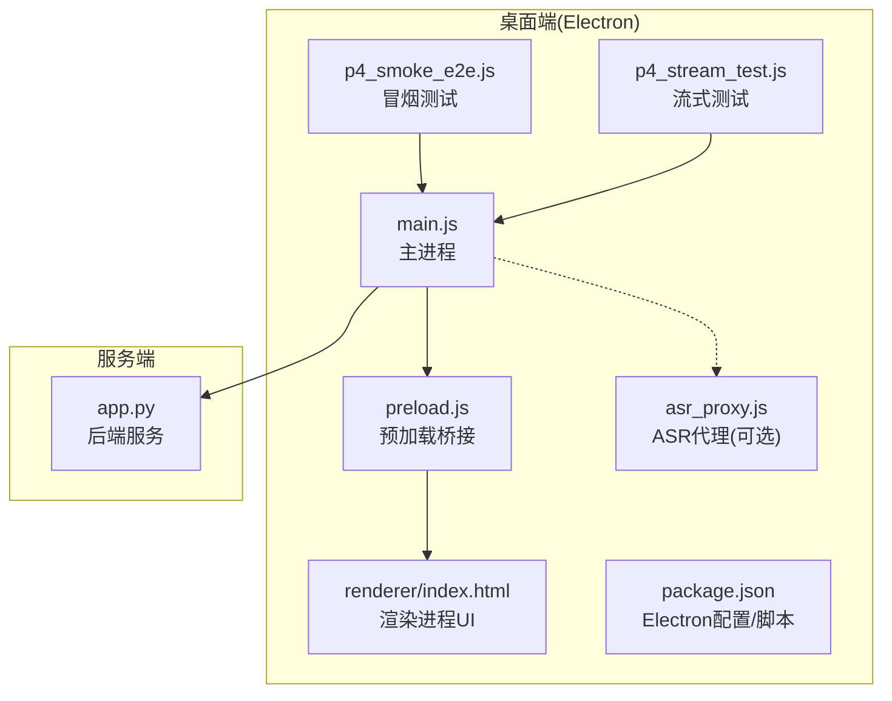
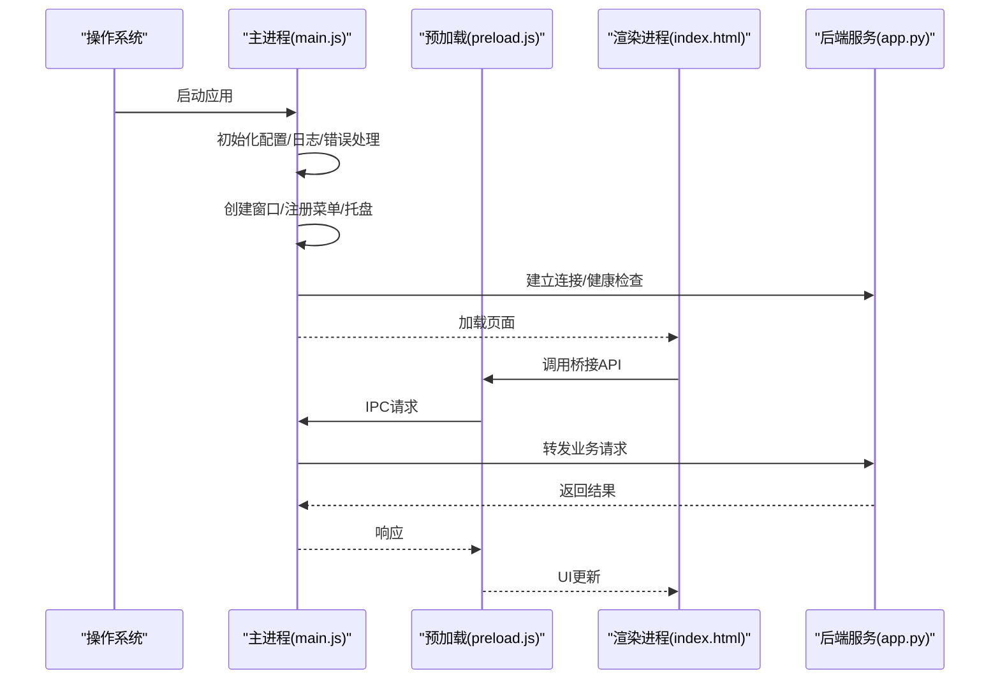
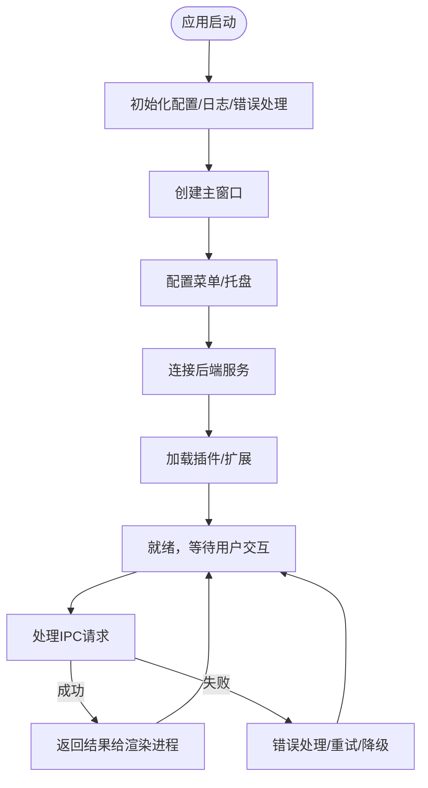
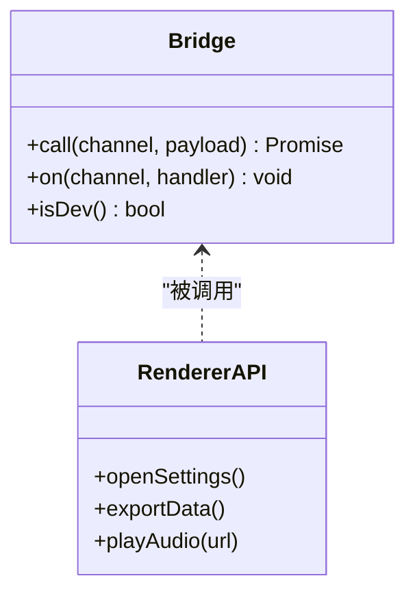
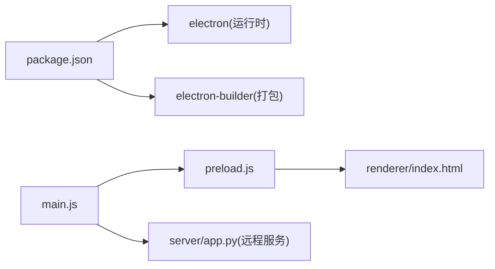

# Electron应用结构

<cite>
**本文引用的文件**   
- [desktop/main.js](file://desktop/main.js)
- [desktop/preload.js](file://desktop/preload.js)
- [desktop/renderer/index.html](file://desktop/renderer/index.html)
- [desktop/package.json](file://desktop/package.json)
- [desktop/asr_proxy.js](file://desktop/asr_proxy.js)
- [desktop/p4_smoke_e2e.js](file://desktop/p4_smoke_e2e.js)
- [desktop/p4_stream_test.js](file://desktop/p4_stream_test.js)
- [server/app.py](file://server/app.py)
- [start_app.ps1](file://start_app.ps1)
</cite>

## 目录
1. [简介](#简介)
2. [项目结构](#项目结构)
3. [核心组件](#核心组件)
4. [架构总览](#架构总览)
5. [详细组件分析](#详细组件分析)
6. [依赖关系分析](#依赖关系分析)
7. [性能与兼容性](#性能与兼容性)
8. [故障排查指南](#故障排查指南)
9. [结论](#结论)
10. [附录：配置与脚本详解](#附录配置与脚本详解)

## 简介
本文件为LectureLearnLoop的Electron桌面端提供结构化文档，聚焦主进程职责、生命周期管理、窗口与菜单/托盘集成、初始化流程、进程间通信、插件加载机制、错误处理策略，以及package.json中的Electron配置、构建脚本与依赖管理。同时给出启动流程图、进程架构图和跨平台兼容性与调试建议，帮助开发者快速上手并稳定维护。

## 项目结构
Electron桌面端位于desktop目录，包含主进程入口、预加载脚本、渲染页面与若干测试/辅助脚本；服务端位于server目录，提供Web API与模板渲染能力。PowerShell脚本start_app.ps1用于本地联调启动。

图表来源
- [desktop/main.js](file://desktop/main.js)
- [desktop/preload.js](file://desktop/preload.js)
- [desktop/renderer/index.html](file://desktop/renderer/index.html)
- [desktop/asr_proxy.js](file://desktop/asr_proxy.js)
- [desktop/package.json](file://desktop/package.json)
- [server/app.py](file://server/app.py)

章节来源
- [desktop/main.js](file://desktop/main.js)
- [desktop/package.json](file://desktop/package.json)
- [server/app.py](file://server/app.py)
- [start_app.ps1](file://start_app.ps1)

## 核心组件
- 主进程(main.js)
  - 负责应用生命周期、窗口创建与管理、系统菜单与托盘、IPC通道注册、外部服务连接、插件加载与错误上报。
- 预加载(preload.js)
  - 在渲染进程暴露安全API桥接，封装对主进程与服务端的调用。
- 渲染页面(renderer/index.html)
  - 前端UI入口，通过预加载暴露的API与主进程/后端交互。
- ASR代理(asr_proxy.js)
  - 可选音频识别代理，供主进程或渲染进程按需调用。
- 测试脚本(p4_smoke_e2e.js, p4_stream_test.js)
  - 端到端冒烟与流式能力验证脚本，便于CI与本地回归。
- 服务端(app.py)
  - 提供业务接口与页面模板，Electron主进程通过HTTP或IPC与其协作。

章节来源
- [desktop/main.js](file://desktop/main.js)
- [desktop/preload.js](file://desktop/preload.js)
- [desktop/renderer/index.html](file://desktop/renderer/index.html)
- [desktop/asr_proxy.js](file://desktop/asr_proxy.js)
- [desktop/p4_smoke_e2e.js](file://desktop/p4_smoke_e2e.js)
- [desktop/p4_stream_test.js](file://desktop/p4_stream_test.js)
- [server/app.py](file://server/app.py)

## 架构总览
Electron采用“主进程+渲染进程”双进程模型，结合后端服务形成三层架构：
- 主进程：系统级能力（窗口、菜单、托盘、文件系统、网络）与全局状态管理。
- 渲染进程：用户界面与交互逻辑，通过预加载桥接访问受限API。
- 后端服务：业务逻辑、数据持久化与第三方服务集成。

图表来源
- [desktop/main.js](file://desktop/main.js)
- [desktop/preload.js](file://desktop/preload.js)
- [desktop/renderer/index.html](file://desktop/renderer/index.html)
- [server/app.py](file://server/app.py)

## 详细组件分析

### 主进程(main.js)
职责与关键点
- 生命周期管理：监听应用事件（如ready、window-all-closed、before-quit），确保资源释放与优雅退出。
- 窗口管理：创建主窗口，设置尺寸、位置、显示选项，处理最大化/最小化/关闭行为，必要时启用DevTools以便调试。
- 菜单与托盘：构建应用菜单与系统托盘图标，绑定常用操作（打开、设置、退出等）。
- 进程间通信：注册IPC通道，接收渲染进程请求，执行权限校验后转发至后端或调用本地能力。
- 插件加载：按配置动态加载扩展模块，支持热重载与错误隔离。
- 错误处理：集中捕获未捕获异常与Promise拒绝，记录日志并上报。

图表来源
- [desktop/main.js](file://desktop/main.js)

章节来源
- [desktop/main.js](file://desktop/main.js)

### 预加载(preload.js)
职责与关键点
- 安全桥接：仅暴露必要的API给渲染进程，避免直接访问Node/Electron内部对象。
- IPC封装：将复杂的主进程调用封装为简洁的异步方法，统一错误处理与超时控制。
- 环境检测：根据运行环境（开发/生产）切换API地址与调试开关。

图表来源
- [desktop/preload.js](file://desktop/preload.js)

章节来源
- [desktop/preload.js](file://desktop/preload.js)

### 渲染页面(renderer/index.html)
职责与关键点
- 作为SPA入口，挂载UI框架与路由。
- 通过预加载暴露的Bridge调用主进程能力，如打开设置、导出数据、播放音频等。
- 与后端服务通过主进程转发的API进行数据交互。

章节来源
- [desktop/renderer/index.html](file://desktop/renderer/index.html)

### ASR代理(asr_proxy.js)
职责与关键点
- 封装音频识别相关能力，提供统一的调用接口。
- 在主进程或渲染进程中按需加载，支持多后端适配与错误回退。

章节来源
- [desktop/asr_proxy.js](file://desktop/asr_proxy.js)

### 测试脚本(p4_smoke_e2e.js, p4_stream_test.js)
职责与关键点
- 端到端冒烟：验证主窗口创建、菜单可用、基础页面加载。
- 流式测试：验证音频流式识别与实时反馈链路。
- 可集成到CI流水线，自动化回归。

章节来源
- [desktop/p4_smoke_e2e.js](file://desktop/p4_smoke_e2e.js)
- [desktop/p4_stream_test.js](file://desktop/p4_stream_test.js)

### 后端服务(app.py)
职责与关键点
- 提供REST/WS接口，承载业务逻辑与数据持久化。
- 与Electron主进程通过HTTP或IPC协作，渲染进程不直接访问数据库。

章节来源
- [server/app.py](file://server/app.py)

## 依赖关系分析
Electron桌面端依赖如下：
- electron运行时与node_modules中的Electron相关包。
- 可选的音频/媒体库（由ASR代理引入）。
- 与后端服务的网络通信库（如http/fetch）。
- 构建工具链（如electron-builder）由package.json脚本驱动。

图表来源
- [desktop/package.json](file://desktop/package.json)
- [desktop/main.js](file://desktop/main.js)
- [desktop/preload.js](file://desktop/preload.js)
- [desktop/renderer/index.html](file://desktop/renderer/index.html)
- [server/app.py](file://server/app.py)

章节来源
- [desktop/package.json](file://desktop/package.json)

## 性能与兼容性
- 性能优化
  - 窗口懒加载：仅在需要时创建子窗口，减少内存占用。
  - IPC批处理：合并高频小消息，降低序列化开销。
  - 资源压缩：静态资源使用gzip/brotli，图片按需缩放。
  - 后端缓存：热点数据在服务端缓存，减少重复计算。
- 跨平台兼容
  - 路径分隔符统一使用path.join。
  - 托盘图标在不同平台使用不同尺寸与格式。
  - 快捷键冲突检测与平台差异化处理。
- 调试方法
  - 主进程启用DevTools：在开发模式下自动开启。
  - 渲染进程控制台：通过菜单命令打开。
  - 日志分级：区分info/warn/error，输出到文件与控制台。

[本节为通用指导，不直接分析具体文件]

## 故障排查指南
常见问题与定位步骤
- 无法启动
  - 检查端口占用与后端服务是否已启动。
  - 查看主进程日志中是否有未捕获异常。
- 窗口空白或白屏
  - 确认渲染页面路径正确，静态资源未被拦截。
  - 检查预加载脚本是否抛出错误。
- IPC无响应
  - 核对频道名称与参数类型，确认主进程已注册对应处理器。
  - 增加超时与重试机制，观察网络层错误。
- 托盘/菜单不可用
  - 检查平台差异与图标路径是否正确。
  - 在Linux下确认桌面环境支持托盘。

章节来源
- [desktop/main.js](file://desktop/main.js)
- [desktop/preload.js](file://desktop/preload.js)

## 结论
LectureLearnLoop的Electron桌面端以主进程为核心，结合预加载桥接与后端服务，形成清晰的分层架构。通过规范的IPC、插件机制与错误处理，保证可扩展性与稳定性。配合完善的测试脚本与本地启动脚本，便于开发与持续集成。

[本节为总结性内容，不直接分析具体文件]

## 附录：配置与脚本详解

### package.json关键项说明
- scripts
  - dev/start：启动开发服务器与Electron主进程。
  - build：调用打包工具生成各平台安装包。
- dependencies/devDependencies
  - electron、electron-builder等运行时与构建依赖。
- electron配置
  - main入口指向main.js。
  - window初始大小、标题、是否启用DevTools等。

章节来源
- [desktop/package.json](file://desktop/package.json)

### 启动脚本(start_app.ps1)
- 作用
  - 一键安装依赖、启动后端服务、启动Electron主进程。
- 注意事项
  - 确保Node与Python环境版本匹配。
  - 首次运行需执行依赖安装。

章节来源
- [start_app.ps1](file://start_app.ps1)