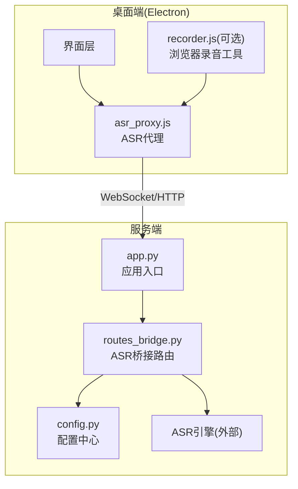
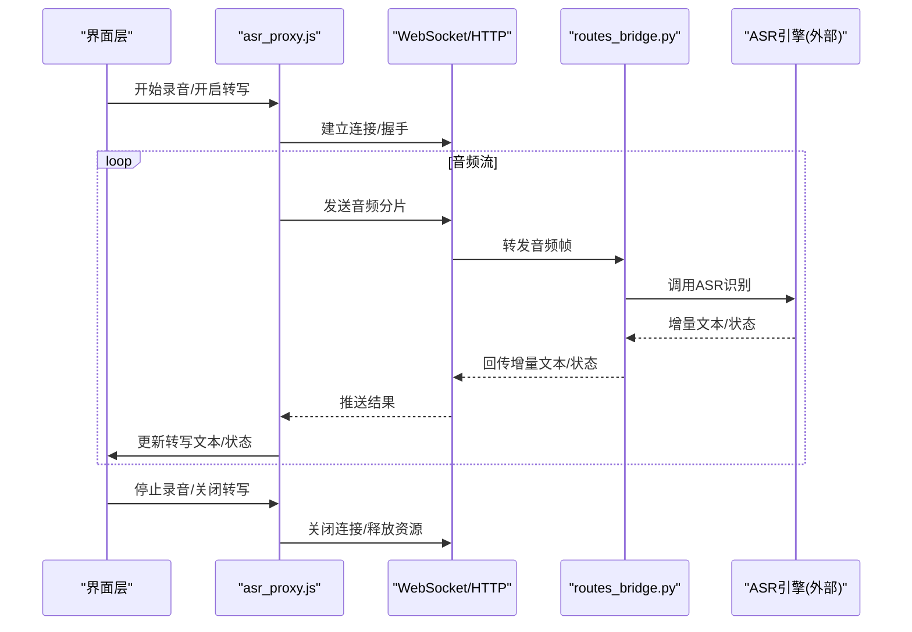
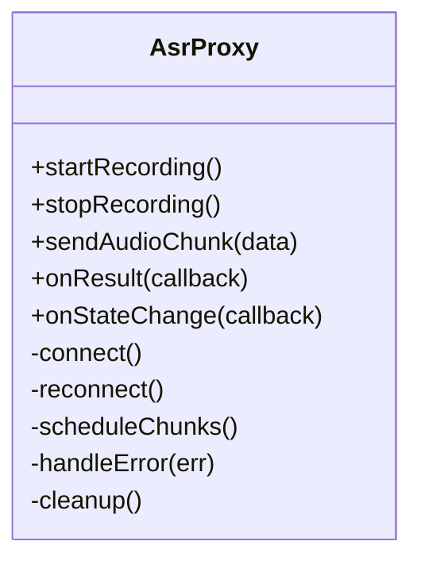
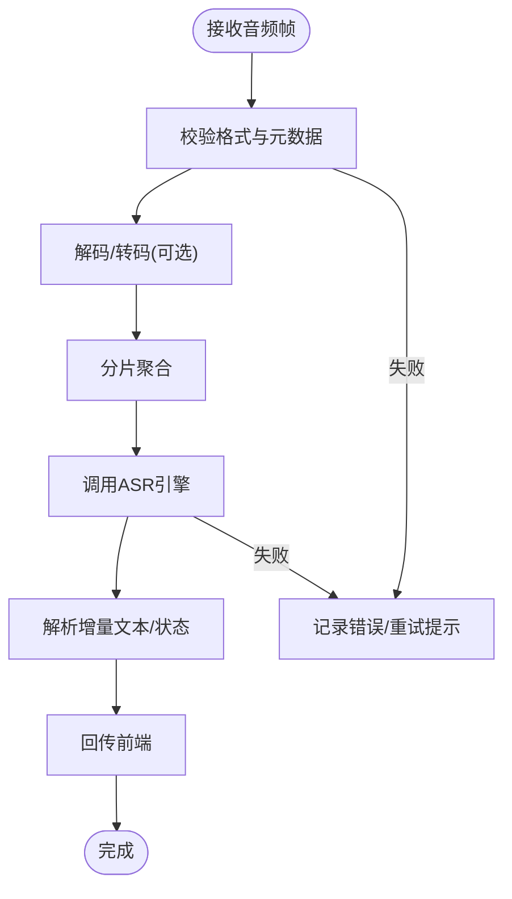
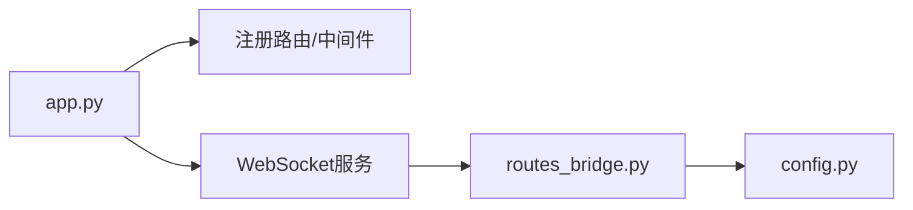
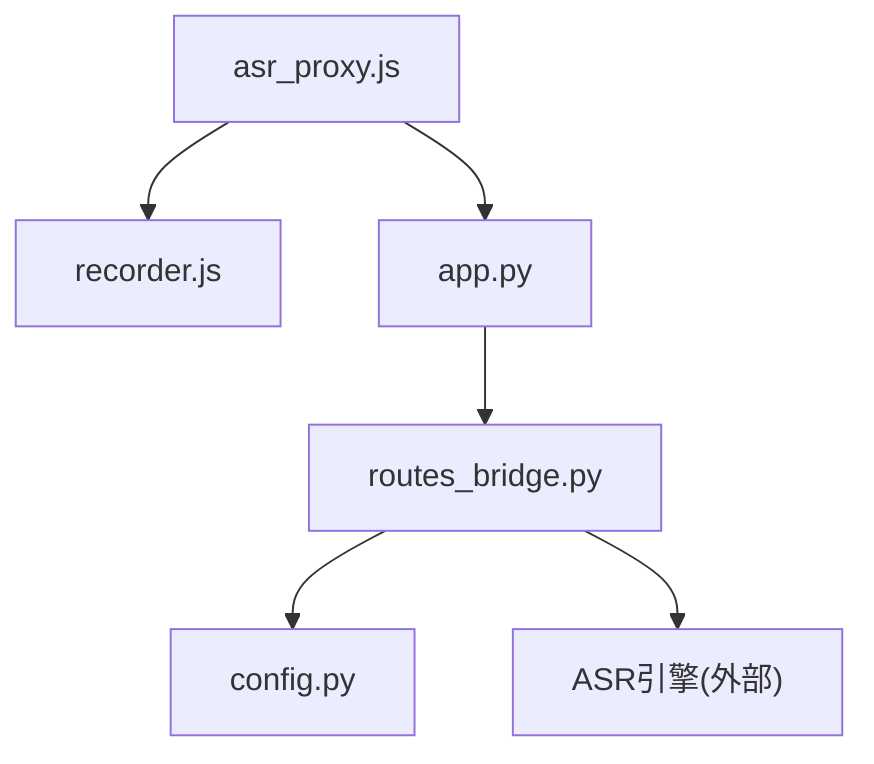

# ASR代理集成

<cite>
**本文引用的文件**   
- [asr_proxy.js](file://desktop/asr_proxy.js)
- [routes_bridge.py](file://server/routes_bridge.py)
- [app.py](file://server/app.py)
- [config.py](file://server/config.py)
- [recorder.js](file://server/static/js/recorder.js)
- [p4_stream_test.js](file://desktop/p4_stream_test.js)
</cite>

## 目录
1. [简介](#简介)
2. [项目结构](#项目结构)
3. [核心组件](#核心组件)
4. [架构总览](#架构总览)
5. [详细组件分析](#详细组件分析)
6. [依赖关系分析](#依赖关系分析)
7. [性能与调优](#性能与调优)
8. [故障诊断指南](#故障诊断指南)
9. [结论](#结论)
10. [附录：集成示例与扩展指南](#附录集成示例与扩展指南)

## 简介
本文件为 LectureLearnLoop 的语音识别（ASR）代理集成提供系统化文档，重点说明前端 Electron 渲染进程中的 asr_proxy.js 如何封装和抽象语音识别服务，包括音频流处理、实时转写接口与服务端通信；同时阐述与后端 routes_bridge.py 的协作机制，涵盖音频数据传输、状态同步与错误恢复策略。文档还包含 ASR 配置项、音频格式支持、延迟优化、内存管理、并发能力、集成示例、排错方法与扩展新语音识别服务的指导。

## 项目结构
围绕 ASR 代理集成的关键文件分布如下：
- desktop/asr_proxy.js：Electron 渲染进程的 ASR 代理实现，负责音频采集、分片、发送、接收转写结果、状态管理与重试/重连逻辑。
- server/routes_bridge.py：后端桥接路由，暴露 WebSocket/HTTP 接口以接收音频帧并转发给底层 ASR 引擎，返回增量转写文本与状态事件。
- server/app.py：应用入口，注册路由与中间件，承载 WebSocket 生命周期。
- server/config.py：服务端配置中心，集中管理 ASR 相关参数（如采样率、编码、超时、重试等）。
- server/static/js/recorder.js：浏览器侧录音工具，用于测试或演示场景下的音频采集与上传。
- desktop/p4_stream_test.js：端到端流式测试脚本，验证前后端 ASR 链路连通性与稳定性。

**图表来源**
- [asr_proxy.js:1-200](file://desktop/asr_proxy.js#L1-L200)
- [routes_bridge.py:1-200](file://server/routes_bridge.py#L1-L200)
- [app.py:1-120](file://server/app.py#L1-L120)
- [config.py:1-120](file://server/config.py#L1-L120)
- [recorder.js:1-120](file://server/static/js/recorder.js#L1-L120)

**章节来源**
- [asr_proxy.js:1-200](file://desktop/asr_proxy.js#L1-L200)
- [routes_bridge.py:1-200](file://server/routes_bridge.py#L1-L200)
- [app.py:1-120](file://server/app.py#L1-L120)
- [config.py:1-120](file://server/config.py#L1-L120)
- [recorder.js:1-120](file://server/static/js/recorder.js#L1-L120)

## 核心组件
- ASR代理(asr_proxy.js)
  - 职责：封装音频采集、分片、传输、结果解析、状态机、重试与重连、资源清理。
  - 关键点：
    - 音频流处理：按固定时长切片，控制缓冲区大小，避免内存增长。
    - 实时转写：通过 WebSocket/HTTP 流式接口持续发送音频帧，接收增量文本。
    - 状态同步：维护连接、录制、转写、错误等状态，向调用方广播事件。
    - 错误恢复：网络异常自动重试、断线重连、降级策略（如降低码率/增大切片）。
- 后端桥接(routes_bridge.py)
  - 职责：接收客户端音频帧，校验与路由到具体 ASR 引擎，聚合增量结果，回传状态与文本。
  - 关键点：
    - 协议适配：统一 WebSocket/HTTP 接口，兼容不同 ASR 供应商。
    - 状态同步：将“开始/结束/静音检测/错误”等事件透传给前端。
    - 错误恢复：对上游 ASR 的错误进行捕获、日志记录与重试提示。
- 应用入口(app.py)
  - 职责：注册路由、初始化中间件、启动 WebSocket 服务。
- 配置(config.py)
  - 职责：集中管理 ASR 相关参数（采样率、编码、切片时长、超时、重试次数、并发限制等）。
- 录音工具(recorder.js)
  - 职责：在浏览器环境中采集麦克风音频，生成可传输的音频片段，供测试或演示使用。
- 流式测试(p4_stream_test.js)
  - 职责：模拟真实流式场景，验证端到端链路稳定性与延迟表现。

**章节来源**
- [asr_proxy.js:1-200](file://desktop/asr_proxy.js#L1-L200)
- [routes_bridge.py:1-200](file://server/routes_bridge.py#L1-L200)
- [app.py:1-120](file://server/app.py#L1-L120)
- [config.py:1-120](file://server/config.py#L1-L120)
- [recorder.js:1-120](file://server/static/js/recorder.js#L1-L120)
- [p4_stream_test.js:1-120](file://desktop/p4_stream_test.js#L1-L120)

## 架构总览
ASR 代理采用“前端代理 + 后端桥接 + 外部ASR引擎”的分层架构。前端负责低延迟音频采集与稳定传输，后端负责协议适配与引擎调度，外部引擎提供实际语音识别能力。

**图表来源**
- [asr_proxy.js:1-200](file://desktop/asr_proxy.js#L1-L200)
- [routes_bridge.py:1-200](file://server/routes_bridge.py#L1-L200)
- [app.py:1-120](file://server/app.py#L1-L120)

## 详细组件分析

### asr_proxy.js 组件分析
asr_proxy.js 是前端 ASR 的核心代理，承担以下职责：
- 音频流处理
  - 按固定时长切片音频数据，控制缓冲区大小，防止内存泄漏。
  - 支持多种音频格式（如 PCM/WAV/Opus），根据配置选择编码与采样率。
- 实时转写接口
  - 通过 WebSocket/HTTP 流式接口持续发送音频分片。
  - 解析服务端返回的增量文本与状态事件，驱动界面更新。
- 状态机与事件
  - 维护连接、录制、转写、错误等状态，向调用方广播事件。
  - 支持静音检测与自适应切片长度调整。
- 错误恢复与重试
  - 网络异常时自动重试与指数退避。
  - 断线后尝试重连，必要时降级参数（降低码率、增大切片）。
- 资源管理
  - 显式释放音频设备、WebSocket 连接与定时器。
  - 提供优雅关闭流程，确保无悬挂任务。

**图表来源**
- [asr_proxy.js:1-200](file://desktop/asr_proxy.js#L1-L200)

**章节来源**
- [asr_proxy.js:1-200](file://desktop/asr_proxy.js#L1-L200)

### routes_bridge.py 组件分析
routes_bridge.py 作为后端桥接，负责：
- 协议适配
  - 统一 WebSocket/HTTP 接口，屏蔽不同 ASR 供应商的差异。
- 音频帧处理
  - 校验音频格式与元数据，解码/转码（如需），分片聚合。
- 引擎调度
  - 将音频帧发送给外部 ASR 引擎，收集增量结果。
- 状态同步
  - 将“开始/结束/静音/错误”等事件回传给前端。
- 错误恢复
  - 捕获上游错误，记录日志，触发重试或降级策略。

**图表来源**
- [routes_bridge.py:1-200](file://server/routes_bridge.py#L1-L200)

**章节来源**
- [routes_bridge.py:1-200](file://server/routes_bridge.py#L1-L200)

### app.py 与 config.py 的作用
- app.py
  - 注册路由与中间件，启动 WebSocket 服务，管理生命周期。
- config.py
  - 集中管理 ASR 相关参数：采样率、编码、切片时长、超时、重试次数、并发限制等。

**图表来源**
- [app.py:1-120](file://server/app.py#L1-L120)
- [config.py:1-120](file://server/config.py#L1-L120)

**章节来源**
- [app.py:1-120](file://server/app.py#L1-L120)
- [config.py:1-120](file://server/config.py#L1-L120)

## 依赖关系分析
- 前端依赖
  - asr_proxy.js 依赖浏览器/Electron 的媒体 API 与网络栈。
  - recorder.js 提供浏览器侧录音能力，便于测试与演示。
- 后端依赖
  - routes_bridge.py 依赖 app.py 提供的路由与 WebSocket 基础设施。
  - 依赖外部 ASR 引擎（第三方 SDK/API）。
- 配置依赖
  - config.py 为前后端共享的配置中心，确保参数一致性。

**图表来源**
- [asr_proxy.js:1-200](file://desktop/asr_proxy.js#L1-L200)
- [recorder.js:1-120](file://server/static/js/recorder.js#L1-L120)
- [app.py:1-120](file://server/app.py#L1-L120)
- [routes_bridge.py:1-200](file://server/routes_bridge.py#L1-L200)
- [config.py:1-120](file://server/config.py#L1-L120)

**章节来源**
- [asr_proxy.js:1-200](file://desktop/asr_proxy.js#L1-L200)
- [recorder.js:1-120](file://server/static/js/recorder.js#L1-L120)
- [app.py:1-120](file://server/app.py#L1-L120)
- [routes_bridge.py:1-200](file://server/routes_bridge.py#L1-L200)
- [config.py:1-120](file://server/config.py#L1-L120)

## 性能与调优
- 延迟优化
  - 减小音频切片时长以降低端到端延迟。
  - 启用增量文本即时展示，减少渲染阻塞。
  - 合理设置 WebSocket 心跳与超时，避免频繁重连。
- 内存管理
  - 控制音频缓冲区大小，及时释放已发送分片。
  - 避免在回调中创建大对象，复用缓冲区。
- 并发能力
  - 限制并发连接数，防止服务端过载。
  - 对上游 ASR 引擎调用进行限流与队列化。
- 配置调优参数
  - 采样率与编码：根据带宽与质量需求选择。
  - 切片时长：平衡延迟与稳定性。
  - 超时与重试：根据网络环境调整。
  - 并发限制：依据服务器资源设定。

[本节为通用性能建议，不直接分析具体文件]

## 故障诊断指南
- 常见问题
  - 连接失败：检查 WebSocket/HTTP 端口、防火墙与证书。
  - 音频无法采集：确认权限、设备可用性与格式兼容性。
  - 转写结果缺失：检查音频格式、采样率与编码是否匹配。
  - 高延迟：调整切片时长、码率与并发限制。
  - 内存泄漏：检查缓冲区释放与定时器清理。
- 诊断步骤
  - 使用 p4_stream_test.js 进行端到端测试，观察连接与结果。
  - 查看服务端日志，定位上游 ASR 引擎错误。
  - 逐步降级参数（码率、切片时长）以隔离问题。
- 恢复策略
  - 自动重试与指数退避。
  - 断线重连与参数自适应。
  - 优雅关闭与资源回收。

**章节来源**
- [p4_stream_test.js:1-120](file://desktop/p4_stream_test.js#L1-L120)
- [routes_bridge.py:1-200](file://server/routes_bridge.py#L1-L200)
- [asr_proxy.js:1-200](file://desktop/asr_proxy.js#L1-L200)

## 结论
ASR 代理集成通过 asr_proxy.js 与 routes_bridge.py 的协同，实现了稳定的前端音频采集、流式传输与后端引擎调度。结合合理的配置与性能调优，可在保证转写质量的同时，显著降低延迟并提升系统稳定性。通过统一的错误恢复与资源管理机制，系统在复杂网络环境下仍具备良好鲁棒性。

[本节为总结性内容，不直接分析具体文件]

## 附录：集成示例与扩展指南
- 集成示例
  - 在前端初始化 asr_proxy.js，配置采样率、编码与切片时长。
  - 在后端 routes_bridge.py 中接入新的 ASR 引擎，实现协议适配与状态同步。
  - 使用 recorder.js 进行浏览器侧录音测试，或通过 p4_stream_test.js 进行端到端验证。
- 扩展新语音识别服务
  - 在 routes_bridge.py 中新增引擎适配器，定义输入输出契约。
  - 在 config.py 中添加新引擎的配置项（如密钥、端点、超时）。
  - 在 asr_proxy.js 中增加对新引擎的参数映射与错误处理。
  - 更新 p4_stream_test.js 以覆盖新引擎的测试用例。

[本节为概念性指导，不直接分析具体文件]