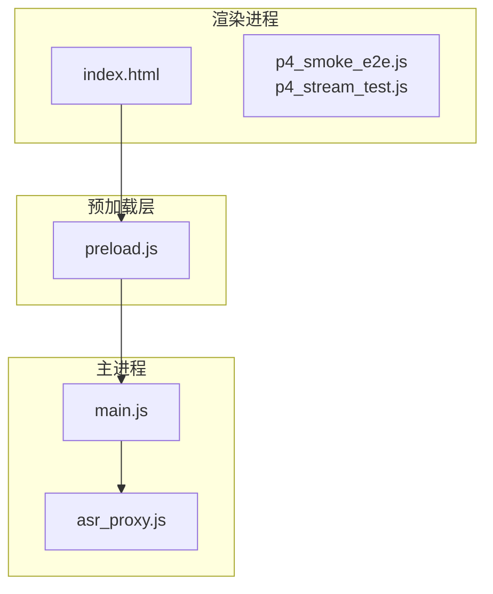
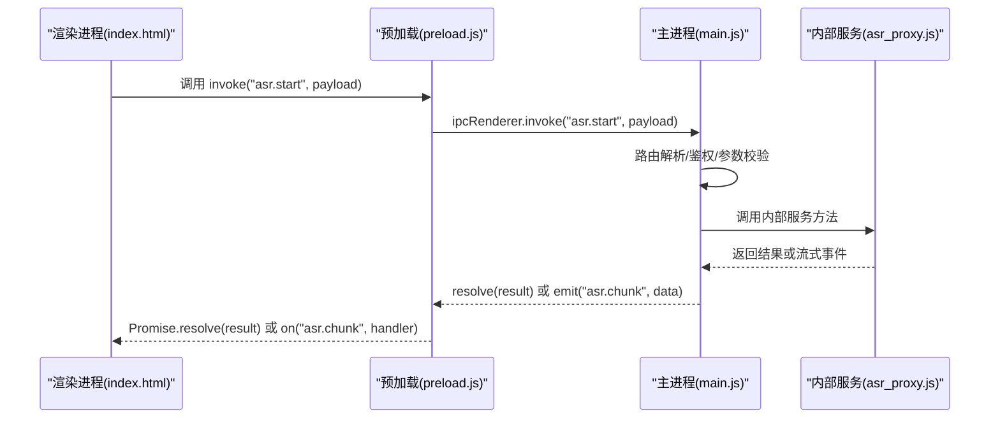
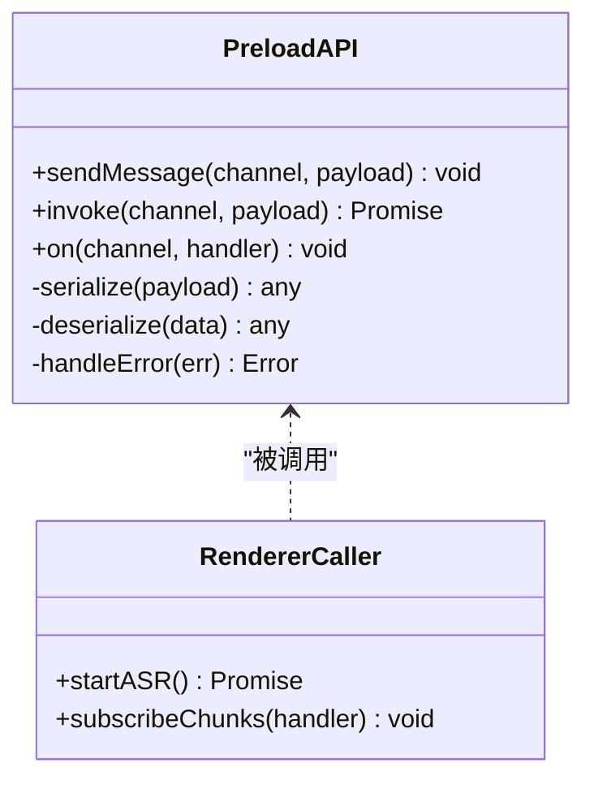
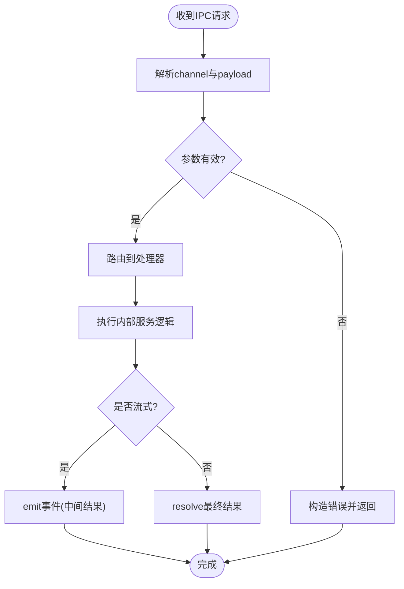
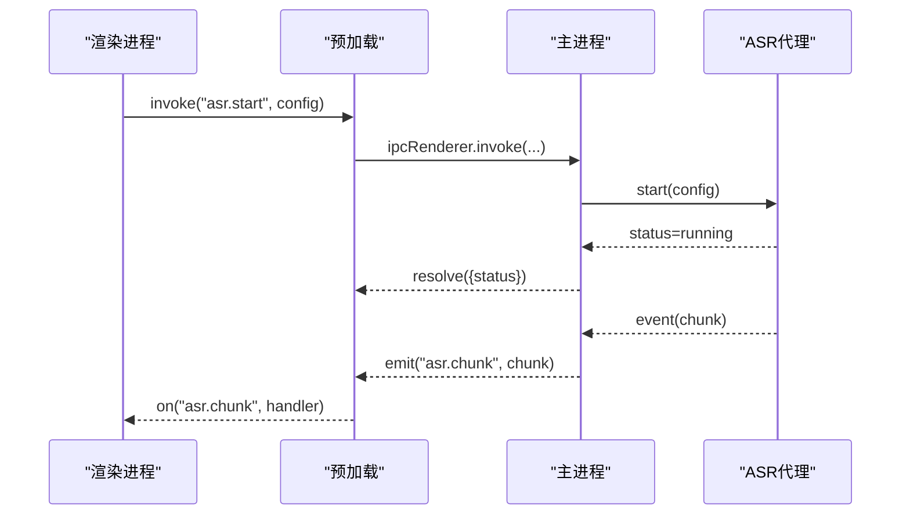
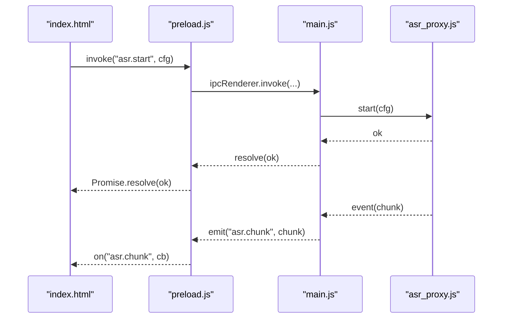
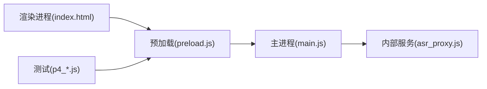

# IPC消息传递模式

<cite>
**本文引用的文件**   
- [main.js](file://desktop/main.js)
- [preload.js](file://desktop/preload.js)
- [index.html](file://desktop/renderer/index.html)
- [asr_proxy.js](file://desktop/asr_proxy.js)
- [p4_smoke_e2e.js](file://desktop/p4_smoke_e2e.js)
- [p4_stream_test.js](file://desktop/p4_stream_test.js)
</cite>

## 目录
1. [简介](#简介)
2. [项目结构](#项目结构)
3. [核心组件](#核心组件)
4. [架构总览](#架构总览)
5. [详细组件分析](#详细组件分析)
6. [依赖关系分析](#依赖关系分析)
7. [性能考虑](#性能考虑)
8. [故障排查指南](#故障排查指南)
9. [结论](#结论)
10. [附录](#附录)

## 简介
本文面向LectureLearnLoop的IPC（进程间通信）消息传递模式，聚焦主进程与渲染进程之间的通信架构。文档围绕事件驱动模型、异步消息处理与响应回调机制展开，深入解释sendMessage、invoke和on等核心方法的职责与使用场景，并给出消息序列化/反序列化、类型转换、错误传播、路由设计、批量处理、连接管理、调试与日志记录以及常见问题排查的实践建议。

## 项目结构
本项目采用Electron多进程架构：
- 主进程负责系统能力、资源管理与跨进程桥接；
- 预加载脚本暴露安全的API给渲染进程；
- 渲染进程通过预加载API进行业务交互；
- 辅助脚本用于ASR代理与端到端测试。

**图示来源**
- [main.js:1-200](file://desktop/main.js#L1-L200)
- [preload.js:1-200](file://desktop/preload.js#L1-L200)
- [index.html:1-200](file://desktop/renderer/index.html#L1-L200)
- [asr_proxy.js:1-200](file://desktop/asr_proxy.js#L1-L200)

**章节来源**
- [main.js:1-200](file://desktop/main.js#L1-L200)
- [preload.js:1-200](file://desktop/preload.js#L1-L200)
- [index.html:1-200](file://desktop/renderer/index.html#L1-L200)
- [asr_proxy.js:1-200](file://desktop/asr_proxy.js#L1-L200)

## 核心组件
- 主进程入口与IPC桥接：负责注册通道、监听事件、转发请求到内部服务或外部子系统，并维护连接状态。
- 预加载安全API：在渲染进程中暴露受控的IPC调用接口，封装sendMessage、invoke、on等方法，统一序列化/反序列化与错误处理。
- 渲染侧调用方：页面与测试脚本通过预加载API发起调用、订阅事件、处理回调。
- ASR代理：在主进程侧提供语音识别相关的IPC能力，供上层业务调用。

**章节来源**
- [main.js:1-200](file://desktop/main.js#L1-L200)
- [preload.js:1-200](file://desktop/preload.js#L1-L200)
- [asr_proxy.js:1-200](file://desktop/asr_proxy.js#L1-L200)

## 架构总览
下图展示了从渲染进程到主进程的完整调用链路，包括事件驱动、异步处理与回调返回。

**图示来源**
- [preload.js:1-200](file://desktop/preload.js#L1-L200)
- [main.js:1-200](file://desktop/main.js#L1-L200)
- [asr_proxy.js:1-200](file://desktop/asr_proxy.js#L1-L200)

## 详细组件分析

### 预加载层API（sendMessage / invoke / on）
- sendMessage：单向发送消息，不等待响应，适合高频事件上报或命令下发。
- invoke：双向调用，返回Promise，适合请求-响应语义的操作。
- on：订阅事件，支持一次性订阅与批量事件处理。

**图示来源**
- [preload.js:1-200](file://desktop/preload.js#L1-L200)

**章节来源**
- [preload.js:1-200](file://desktop/preload.js#L1-L200)

### 主进程IPC路由与服务分发
- 路由表：按channel映射到具体处理器，支持命名空间与版本控制。
- 参数校验：对入参进行类型检查与默认值填充。
- 错误传播：将异常包装为标准化错误对象，包含code、message、details。
- 流式事件：对长任务或流式输出，通过事件通道推送中间结果。

**图示来源**
- [main.js:1-200](file://desktop/main.js#L1-L200)

**章节来源**
- [main.js:1-200](file://desktop/main.js#L1-L200)

### ASR代理模块
- 提供语音识别相关能力（如开始/停止、分片数据、配置）。
- 在主进程内管理音频设备、编码器与后端服务。
- 通过IPC向渲染进程推送识别分片与状态变更。

**图示来源**
- [asr_proxy.js:1-200](file://desktop/asr_proxy.js#L1-L200)
- [main.js:1-200](file://desktop/main.js#L1-L200)
- [preload.js:1-200](file://desktop/preload.js#L1-L200)

**章节来源**
- [asr_proxy.js:1-200](file://desktop/asr_proxy.js#L1-L200)
- [main.js:1-200](file://desktop/main.js#L1-L200)
- [preload.js:1-200](file://desktop/preload.js#L1-L200)

### 渲染侧调用示例与测试
- index.html：页面集成预加载API，发起业务调用并订阅事件。
- p4_smoke_e2e.js / p4_stream_test.js：端到端与流式测试，验证IPC路径与事件流转。

**图示来源**
- [index.html:1-200](file://desktop/renderer/index.html#L1-L200)
- [preload.js:1-200](file://desktop/preload.js#L1-L200)
- [main.js:1-200](file://desktop/main.js#L1-L200)
- [asr_proxy.js:1-200](file://desktop/asr_proxy.js#L1-L200)

**章节来源**
- [index.html:1-200](file://desktop/renderer/index.html#L1-L200)
- [p4_smoke_e2e.js:1-200](file://desktop/p4_smoke_e2e.js#L1-L200)
- [p4_stream_test.js:1-200](file://desktop/p4_stream_test.js#L1-L200)

## 依赖关系分析
- 渲染进程依赖预加载API，避免直接访问Node/Electron API。
- 预加载层依赖ipcRenderer/ipcMain进行跨进程通信。
- 主进程依赖内部服务模块（如ASR代理），实现业务解耦。
- 测试脚本依赖预加载API与主进程通道，用于验证端到端流程。

**图示来源**
- [index.html:1-200](file://desktop/renderer/index.html#L1-L200)
- [preload.js:1-200](file://desktop/preload.js#L1-L200)
- [main.js:1-200](file://desktop/main.js#L1-L200)
- [asr_proxy.js:1-200](file://desktop/asr_proxy.js#L1-L200)
- [p4_smoke_e2e.js:1-200](file://desktop/p4_smoke_e2e.js#L1-L200)
- [p4_stream_test.js:1-200](file://desktop/p4_stream_test.js#L1-L200)

**章节来源**
- [preload.js:1-200](file://desktop/preload.js#L1-L200)
- [main.js:1-200](file://desktop/main.js#L1-L200)
- [asr_proxy.js:1-200](file://desktop/asr_proxy.js#L1-L200)
- [p4_smoke_e2e.js:1-200](file://desktop/p4_smoke_e2e.js#L1-L200)
- [p4_stream_test.js:1-200](file://desktop/p4_stream_test.js#L1-L200)

## 性能考虑
- 批量处理：对高频小消息进行合并与节流，减少IPC开销。
- 背压控制：当渲染端消费速度低于生产速度时，暂停上游事件或丢弃非关键数据。
- 序列化优化：优先使用结构化克隆支持的类型，避免大对象频繁拷贝。
- 流式传输：长任务使用事件通道推送分片，避免单次消息过大。
- 连接复用：保持主进程服务实例常驻，避免频繁创建销毁。

[本节为通用指导，不涉及具体文件]

## 故障排查指南
- 常见错误分类
  - 参数错误：缺少必填字段、类型不匹配、超出范围。
  - 权限错误：未授权调用敏感通道。
  - 运行时错误：内部服务异常、资源不可用。
- 错误传播规范
  - 统一错误对象：包含code、message、details、stack。
  - 客户端可见：渲染进程可读取错误信息并提示用户。
- 调试工具
  - 启用Electron开发者工具，查看控制台与网络面板。
  - 在预加载层增加日志打印，记录channel、payload、耗时。
- 定位步骤
  - 确认渲染端是否正确调用invoke/on。
  - 检查主进程路由是否注册对应channel。
  - 验证内部服务是否抛出异常或返回非法数据。
  - 观察事件是否被正确emit与订阅。

**章节来源**
- [preload.js:1-200](file://desktop/preload.js#L1-L200)
- [main.js:1-200](file://desktop/main.js#L1-L200)

## 结论
本IPC模式以预加载层为核心，统一了渲染进程与主进程的通信契约，通过sendMessage、invoke、on三种方式覆盖单向通知、请求-响应与事件订阅三类场景。主进程侧采用路由化与参数校验保障稳定性，结合流式事件与错误传播提升用户体验。配合批量处理、背压控制与调试日志，可在复杂业务中保持高性能与可观测性。

## 附录

### 消息格式规范
- 请求体
  - channel：字符串，标识目标通道。
  - payload：任意可序列化数据。
- 响应体
  - result：成功时的返回值。
  - error：失败时的标准错误对象。
- 事件体
  - channel：事件名称。
  - data：事件负载。

### 路由设计建议
- 命名空间：按模块划分channel前缀，如“asr.*”、“media.*”。
- 版本控制：在channel中包含版本号，便于向后兼容。
- 权限控制：对敏感通道进行白名单校验。

### 连接管理最佳实践
- 单例服务：主进程内服务实例全局唯一。
- 生命周期：在应用启动时初始化，退出时释放资源。
- 健康检查：定期检测内部服务状态，必要时自动恢复。

### 调试与日志
- 渲染端：记录invoke调用链路与耗时。
- 主进程：记录路由命中、参数校验结果与异常堆栈。
- 统一日志：集中收集并导出，便于离线分析。

[本节为通用指导，不涉及具体文件]