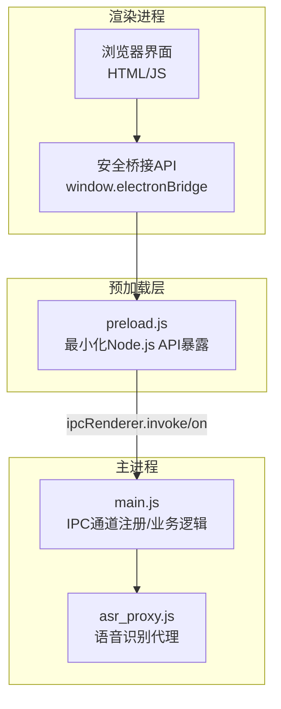
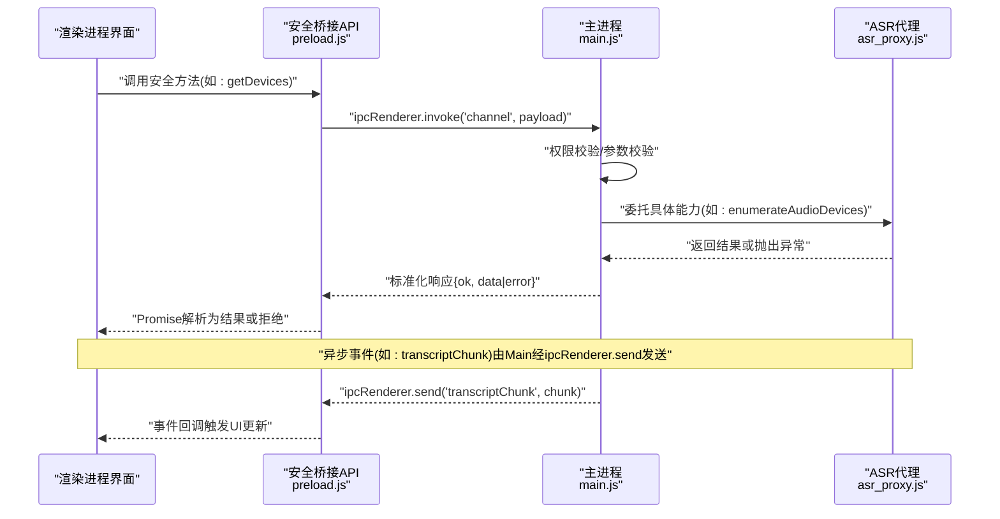
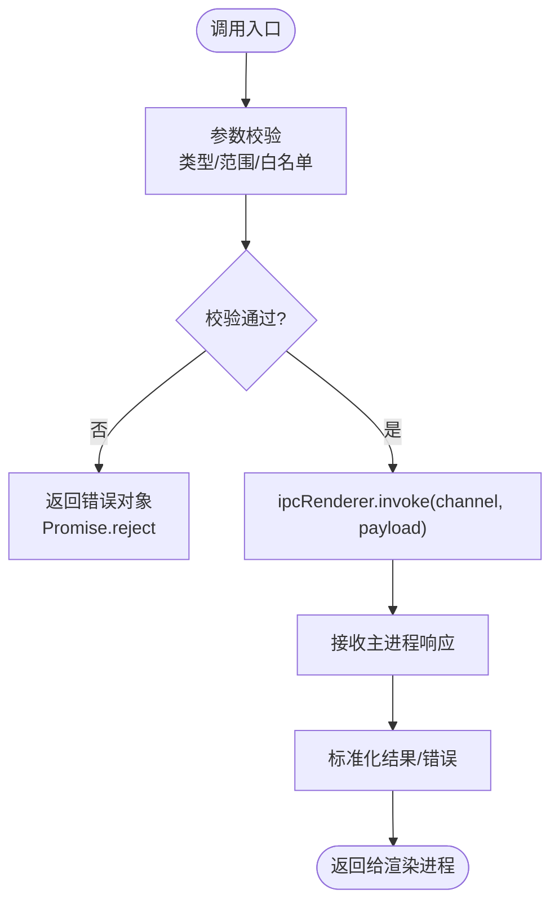
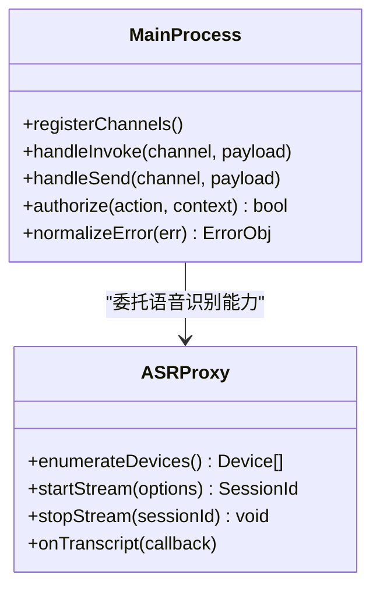
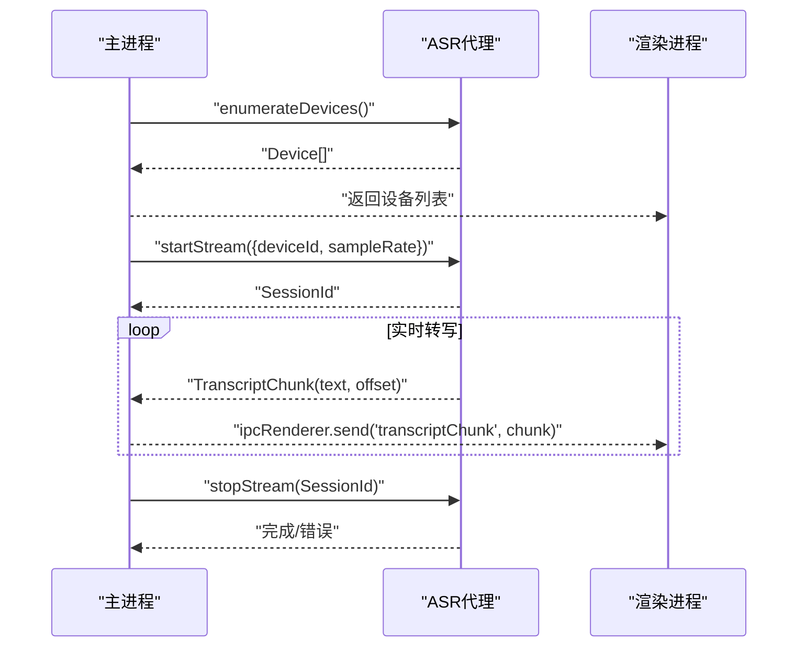
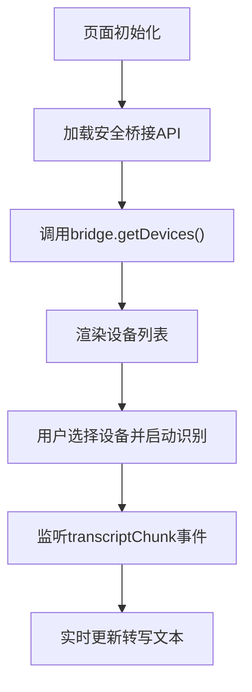
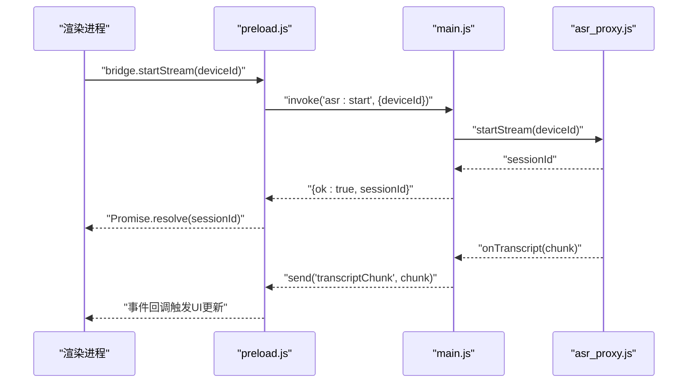

# IPC通信机制

<cite>
**本文引用的文件**   
- [preload.js](file://desktop/preload.js)
- [main.js](file://desktop/main.js)
- [asr_proxy.js](file://desktop/asr_proxy.js)
- [index.html](file://desktop/renderer/index.html)
</cite>

## 目录
1. [引言](#引言)
2. [项目结构](#项目结构)
3. [核心组件](#核心组件)
4. [架构总览](#架构总览)
5. [详细组件分析](#详细组件分析)
6. [依赖关系分析](#依赖关系分析)
7. [性能考虑](#性能考虑)
8. [故障排查指南](#故障排查指南)
9. [结论](#结论)
10. [附录](#附录)

## 引言
本文件面向LectureLearnLoop的IPC（进程间通信）机制，重点围绕Electron主进程与渲染进程之间的安全桥接、预加载脚本的安全暴露、ASR代理的语音识别接口封装与实时数据传输。文档将给出：
- 预加载脚本的安全桥接职责：Node.js API的最小化暴露、权限控制与数据校验
- 主进程与渲染进程的异步消息模式、错误传播与类型安全保证
- ASR代理的接口设计、流式数据转发与异常处理
- IPC调用流程图、消息格式规范与安全设计要点
- 最佳实践、调试工具与常见陷阱规避

## 项目结构
本项目采用Electron桌面应用架构，关键IPC相关文件位于desktop目录：
- desktop/main.js：主进程入口，负责创建窗口、注册IPC通道、管理系统级能力
- desktop/preload.js：预加载脚本，作为渲染进程与主进程之间的安全桥
- desktop/asr_proxy.js：ASR代理，封装语音识别相关能力并对外提供统一接口
- desktop/renderer/index.html：渲染进程页面入口，通过window暴露的安全API进行交互

**图示来源**
- [preload.js:1-200](file://desktop/preload.js#L1-L200)
- [main.js:1-200](file://desktop/main.js#L1-L200)
- [asr_proxy.js:1-200](file://desktop/asr_proxy.js#L1-L200)
- [index.html:1-200](file://desktop/renderer/index.html#L1-L200)

**章节来源**
- [preload.js:1-200](file://desktop/preload.js#L1-L200)
- [main.js:1-200](file://desktop/main.js#L1-L200)
- [asr_proxy.js:1-200](file://desktop/asr_proxy.js#L1-L200)
- [index.html:1-200](file://desktop/renderer/index.html#L1-L200)

## 核心组件
- 预加载脚本(preload.js)
  - 作用：在渲染进程上下文注入最小化的安全API，屏蔽直接访问Node.js API的能力
  - 职责：参数校验、权限检查、调用转发、结果包装、错误归一化
- 主进程(main.js)
  - 作用：承载系统级能力与业务逻辑，注册IPC通道，协调各子系统
  - 职责：通道路由、权限策略、资源生命周期管理、与ASR代理协作
- ASR代理(asr_proxy.js)
  - 作用：封装语音识别能力，提供统一的音频输入、转写、回调与状态管理接口
  - 职责：设备枚举、音频采集、流式传输、事件分发、异常恢复

**章节来源**
- [preload.js:1-200](file://desktop/preload.js#L1-L200)
- [main.js:1-200](file://desktop/main.js#L1-L200)
- [asr_proxy.js:1-200](file://desktop/asr_proxy.js#L1-L200)

## 架构总览
下图展示从渲染进程到主进程再到ASR代理的完整调用链路，包括同步调用与异步事件两种模式。

**图示来源**
- [preload.js:1-200](file://desktop/preload.js#L1-L200)
- [main.js:1-200](file://desktop/main.js#L1-L200)
- [asr_proxy.js:1-200](file://desktop/asr_proxy.js#L1-L200)

## 详细组件分析

### 预加载脚本(preload.js)的安全桥接
- 安全暴露原则
  - 仅暴露必要的方法集合，避免直接暴露fs、child_process等危险模块
  - 所有入参进行类型与范围校验，拒绝非法值
  - 对敏感操作增加权限判断（例如是否允许访问麦克风、文件系统）
- 数据验证与类型安全
  - 使用严格的白名单校验方法名与参数结构
  - 对字符串长度、数值范围、枚举值进行约束
  - 对对象字段进行必需性检查，缺失则拒绝调用
- 错误传播
  - 统一包装错误对象，包含code、message、details
  - 将主进程异常转换为渲染进程可消费的Promise拒绝
- 典型流程
  - 渲染进程调用window.electronBridge.xxx(...)
  - 预加载脚本校验参数后通过ipcRenderer.invoke转发至主进程
  - 主进程执行逻辑并返回标准化结果
  - 预加载脚本将结果返回给渲染进程

**图示来源**
- [preload.js:1-200](file://desktop/preload.js#L1-L200)

**章节来源**
- [preload.js:1-200](file://desktop/preload.js#L1-L200)

### 主进程(main.js)的消息路由与权限控制
- 通道注册
  - 集中定义IPC通道名称与方法映射，便于审计与维护
  - 区分同步调用通道与异步事件通道
- 权限控制
  - 基于用户会话、应用模式或功能开关进行权限判定
  - 对高风险能力（如文件系统、网络请求、音频设备）进行二次确认或限制
- 错误处理
  - 捕获底层异常，转换为统一错误码与消息
  - 记录必要的诊断信息（不泄露敏感数据）
- 与ASR代理协作
  - 将语音识别相关能力委托给asr_proxy.js
  - 管理ASR会话生命周期、并发限制与资源释放

**图示来源**
- [main.js:1-200](file://desktop/main.js#L1-L200)
- [asr_proxy.js:1-200](file://desktop/asr_proxy.js#L1-L200)

**章节来源**
- [main.js:1-200](file://desktop/main.js#L1-L200)

### ASR代理(asr_proxy.js)的语音识别接口封装
- 接口设计
  - 设备枚举：获取可用音频输入设备列表
  - 流式识别：启动/停止音频流，持续推送转写片段
  - 事件回调：向渲染进程推送转写增量、状态变更、错误通知
- 实时数据传输
  - 使用分块传输(chunked)方式降低内存占用
  - 对音频数据进行压缩或采样率适配以提升性能
- 异常处理与恢复
  - 设备不可用、权限拒绝、服务超时等场景的错误分类
  - 自动重试与降级策略（如切换设备、降低采样率）

**图示来源**
- [asr_proxy.js:1-200](file://desktop/asr_proxy.js#L1-L200)
- [main.js:1-200](file://desktop/main.js#L1-L200)

**章节来源**
- [asr_proxy.js:1-200](file://desktop/asr_proxy.js#L1-L200)

### 渲染进程(index.html)的集成方式
- 通过window.electronBridge调用安全方法
- 监听来自主进程的异步事件（如转写片段、状态变化）
- 将结果渲染到界面，并提供用户交互以控制ASR流程

**图示来源**
- [index.html:1-200](file://desktop/renderer/index.html#L1-L200)

**章节来源**
- [index.html:1-200](file://desktop/renderer/index.html#L1-L200)

## 依赖关系分析
- 耦合度
  - preload.js与main.js通过IPC通道解耦，但需保持通道契约一致
  - main.js与asr_proxy.js通过函数调用耦合，建议抽象接口以便替换实现
- 外部依赖
  - Electron ipcRenderer/ipcMain用于跨进程通信
  - Node.js媒体设备API用于音频设备枚举与采集
- 潜在循环依赖
  - 避免preload.js反向依赖main.js的具体实现细节
  - 确保asr_proxy.js不直接引用渲染进程代码

**图示来源**
- [preload.js:1-200](file://desktop/preload.js#L1-L200)
- [main.js:1-200](file://desktop/main.js#L1-L200)
- [asr_proxy.js:1-200](file://desktop/asr_proxy.js#L1-L200)

**章节来源**
- [preload.js:1-200](file://desktop/preload.js#L1-L200)
- [main.js:1-200](file://desktop/main.js#L1-L200)
- [asr_proxy.js:1-200](file://desktop/asr_proxy.js#L1-L200)

## 性能考虑
- 减少IPC开销
  - 批量聚合小消息，避免频繁短消息造成阻塞
  - 使用异步事件推送大体积数据（如音频帧、转写片段）
- 内存管理
  - 及时释放ASR会话与音频流资源
  - 对长时运行的转写任务进行分段处理与垃圾回收友好设计
- 线程与并发
  - 合理限制并发ASR会话数量，防止设备争用
  - 在主进程中串行化耗时操作，避免阻塞事件循环

[本节为通用指导，无需特定文件来源]

## 故障排查指南
- 常见问题定位
  - 权限拒绝：检查用户授权与系统权限设置
  - 设备不可用：枚举设备失败或设备被占用
  - 转写中断：网络或服务端异常导致流中断
- 日志与诊断
  - 在主进程记录错误码与上下文信息（不含敏感数据）
  - 在渲染进程捕获Promise拒绝并上报错误摘要
- 恢复策略
  - 自动重试与降级（降低采样率、切换设备）
  - 提供用户提示与手动重试入口

**章节来源**
- [main.js:1-200](file://desktop/main.js#L1-L200)
- [preload.js:1-200](file://desktop/preload.js#L1-L200)

## 结论
本IPC机制通过预加载脚本的安全桥接，实现了渲染进程与主进程之间的最小化、可控通信；主进程集中管理权限与资源，ASR代理封装语音识别能力并提供稳定的事件驱动接口。该设计兼顾安全性、类型安全与性能优化，适用于需要稳定音频处理与实时转写的桌面应用场景。

[本节为总结性内容，无需特定文件来源]

## 附录

### IPC调用流程图（端到端）

**图示来源**
- [preload.js:1-200](file://desktop/preload.js#L1-L200)
- [main.js:1-200](file://desktop/main.js#L1-L200)
- [asr_proxy.js:1-200](file://desktop/asr_proxy.js#L1-L200)

### 消息格式规范
- 同步调用响应
  - 成功：{ ok: true, data: any }
  - 失败：{ ok: false, error: { code: string, message: string, details?: any } }
- 异步事件载荷
  - 转写片段：{ type: 'transcriptChunk', text: string, offset: number }
  - 状态变更：{ type: 'sessionStatus', status: string, sessionId: string }
  - 错误通知：{ type: 'error', code: string, message: string }

[本节为概念性规范说明，无需特定文件来源]

### 安全性设计要点
- 最小权限原则：仅暴露必要API，禁止直接访问Node.js危险模块
- 白名单校验：严格限定方法名与参数结构
- 权限控制：对敏感能力进行会话级或功能级权限判定
- 数据脱敏：日志与错误信息不包含敏感数据

[本节为概念性安全设计，无需特定文件来源]

### IPC最佳实践
- 明确通道契约：统一命名与版本管理
- 错误归一化：统一错误码与消息结构
- 异步优先：避免阻塞渲染进程
- 资源清理：显式释放音频流与会话资源

[本节为通用最佳实践，无需特定文件来源]

### 调试工具与技巧
- 主进程日志：记录通道调用与异常堆栈
- 渲染进程控制台：捕获Promise拒绝与事件回调
- 设备诊断：枚举设备并测试可用性
- 性能剖析：监控IPC延迟与内存增长

[本节为通用调试建议，无需特定文件来源]

### 常见陷阱与规避
- 陷阱：直接暴露危险API导致安全风险
  - 规避：通过预加载脚本最小化暴露
- 陷阱：未做参数校验导致崩溃或越权
  - 规避：严格白名单与类型校验
- 陷阱：未释放ASR资源导致内存泄漏
  - 规避：显式关闭会话与音频流
- 陷阱：错误未归一化导致前端难以处理
  - 规避：统一错误结构与错误码

[本节为通用陷阱规避，无需特定文件来源]