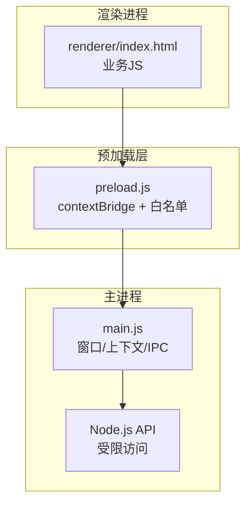
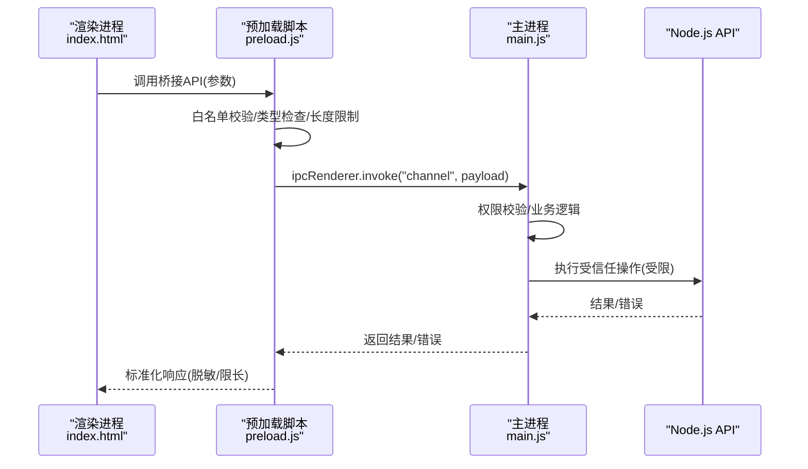
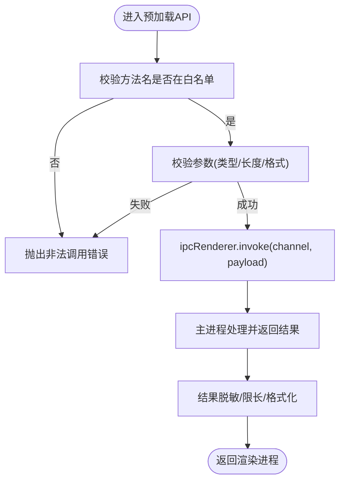
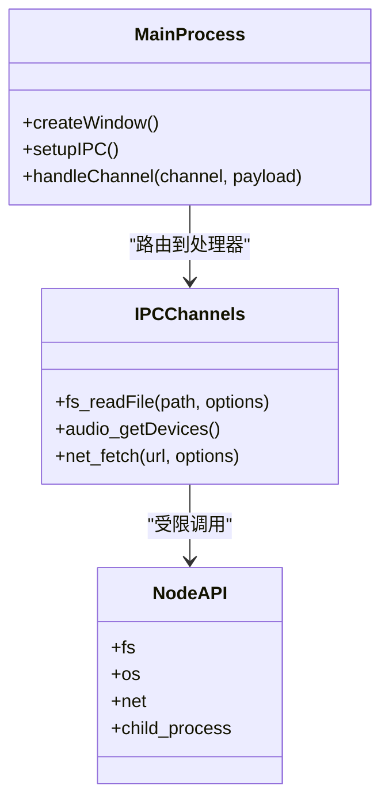
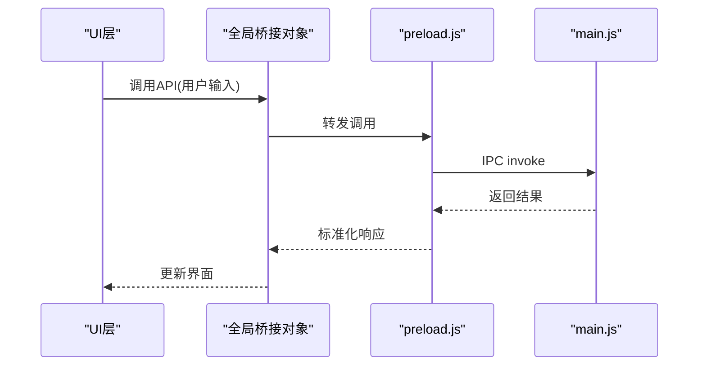
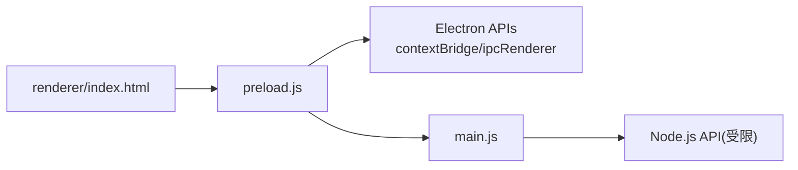

# 预加载脚本安全桥接

<cite>
**本文引用的文件**   
- [preload.js](file://desktop/preload.js)
- [main.js](file://desktop/main.js)
- [index.html](file://desktop/renderer/index.html)
- [package.json](file://desktop/package.json)
</cite>

## 目录
1. [简介](#简介)
2. [项目结构](#项目结构)
3. [核心组件](#核心组件)
4. [架构总览](#架构总览)
5. [详细组件分析](#详细组件分析)
6. [依赖关系分析](#依赖关系分析)
7. [性能考虑](#性能考虑)
8. [故障排查指南](#故障排查指南)
9. [结论](#结论)
10. [附录](#附录)

## 简介
本文件面向LectureLearnLoop的Electron应用，聚焦于渲染进程与主进程之间的“预加载脚本安全桥接”。目标是：
- 解释如何通过 preload.js 暴露最小、受控的Node.js API子集给渲染进程。
- 说明白名单机制、权限控制与数据验证策略。
- 描述基于 contextBridge 与 contextIsolation 的安全通信协议。
- 提供API调用示例、错误处理机制与安全最佳实践。
- 重点防范原型链污染、XSS攻击与数据泄露。
- 给出安全配置选项、调试方法与常见漏洞防护指南。

## 项目结构
本项目采用Electron标准分层：
- desktop/main.js：主进程入口，负责窗口创建、上下文隔离、预加载脚本注册以及IPC通道定义。
- desktop/preload.js：预加载脚本，作为渲染进程与主进程之间的安全桥，仅暴露白名单API。
- desktop/renderer/index.html：渲染进程页面，通过全局对象访问桥接API。
- desktop/package.json：Electron应用元信息（版本、启动入口等）。

**图示来源**
- [main.js:1-200](file://desktop/main.js#L1-L200)
- [preload.js:1-200](file://desktop/preload.js#L1-L200)
- [index.html:1-200](file://desktop/renderer/index.html#L1-L200)

**章节来源**
- [main.js:1-200](file://desktop/main.js#L1-L200)
- [preload.js:1-200](file://desktop/preload.js#L1-L200)
- [index.html:1-200](file://desktop/renderer/index.html#L1-L200)
- [package.json:1-50](file://desktop/package.json#L1-L50)

## 核心组件
- 主进程（main.js）
  - 创建BrowserWindow时启用 contextIsolation: true 与 nodeIntegration: false。
  - 指定 preload 脚本路径，建立安全的IPC通道（如 ipcMain.handle/on）。
  - 在IPC处理器中执行受信任的系统级操作（文件系统、网络、音频设备等），并对输入进行严格校验。
- 预加载脚本（preload.js）
  - 使用 contextBridge.exposeInMainWorld 暴露最小API集合。
  - 对每个API进行参数白名单校验、类型检查与长度限制。
  - 通过 ipcRenderer.invoke/send 与主进程通信，避免直接暴露Node API。
- 渲染进程（index.html）
  - 仅通过全局桥接对象调用API，不直接访问Node或系统能力。
  - 对用户输入进行二次校验，避免将不可信数据直接传给IPC。

**章节来源**
- [main.js:1-200](file://desktop/main.js#L1-L200)
- [preload.js:1-200](file://desktop/preload.js#L1-L200)
- [index.html:1-200](file://desktop/renderer/index.html#L1-L200)

## 架构总览
下图展示从渲染进程到主进程的完整调用链路，强调安全边界与数据流向。

**图示来源**
- [preload.js:1-200](file://desktop/preload.js#L1-L200)
- [main.js:1-200](file://desktop/main.js#L1-L200)

## 详细组件分析

### 预加载脚本（preload.js）
职责与实现要点：
- 使用 contextBridge.exposeInMainWorld 暴露一组命名空间化的API（例如 app.fs、app.audio、app.net 等），确保渲染进程只能通过这些接口访问能力。
- 对每个方法实施：
  - 白名单校验：仅允许已声明的方法名被调用。
  - 参数校验：类型、必填字段、枚举值、长度、格式（如URL、路径）等。
  - 资源限制：文件大小、请求体大小、超时时间等。
- 通过 ipcRenderer.invoke 与主进程通信，避免直接暴露Node模块。
- 对返回值进行脱敏与规范化，防止敏感信息泄露。

**图示来源**
- [preload.js:1-200](file://desktop/preload.js#L1-L200)

**章节来源**
- [preload.js:1-200](file://desktop/preload.js#L1-L200)

### 主进程（main.js）
职责与实现要点：
- 在创建BrowserWindow时设置：
  - contextIsolation: true
  - nodeIntegration: false
  - preload: path.join(__dirname, 'preload.js')
- 使用 ipcMain.handle 注册受信任的IPC处理器，按频道路由到具体业务逻辑。
- 在IPC处理器中进行权限校验（如用户角色、功能开关）、参数再校验与业务逻辑执行。
- 对Node.js API的使用进行最小化封装，避免直接暴露危险API（如 require('child_process')）。

**图示来源**
- [main.js:1-200](file://desktop/main.js#L1-L200)

**章节来源**
- [main.js:1-200](file://desktop/main.js#L1-L200)

### 渲染进程（index.html）
职责与实现要点：
- 通过全局桥接对象调用API，不直接访问Node或系统能力。
- 对用户输入进行二次校验，避免将恶意数据传入IPC。
- 对返回数据进行前端层面的展示与交互，不做敏感数据处理。

**图示来源**
- [index.html:1-200](file://desktop/renderer/index.html#L1-L200)
- [preload.js:1-200](file://desktop/preload.js#L1-L200)
- [main.js:1-200](file://desktop/main.js#L1-L200)

**章节来源**
- [index.html:1-200](file://desktop/renderer/index.html#L1-L200)

## 依赖关系分析
- 主进程依赖Electron的BrowserWindow、ipcMain、contextIsolation等能力。
- 预加载脚本依赖contextBridge、ipcRenderer，用于安全暴露与通信。
- 渲染进程仅依赖浏览器环境与全局桥接对象，不直接依赖Electron或Node。

**图示来源**
- [main.js:1-200](file://desktop/main.js#L1-L200)
- [preload.js:1-200](file://desktop/preload.js#L1-L200)
- [index.html:1-200](file://desktop/renderer/index.html#L1-L200)

**章节来源**
- [main.js:1-200](file://desktop/main.js#L1-L200)
- [preload.js:1-200](file://desktop/preload.js#L1-L200)
- [index.html:1-200](file://desktop/renderer/index.html#L1-L200)

## 性能考虑
- IPC调用开销：尽量减少频繁的小消息传输，合并批量操作。
- 数据序列化：避免传递超大对象，优先使用流式或分片传输。
- 白名单校验：保持轻量，避免在高频路径上引入复杂计算。
- 主进程负载：将重型任务下沉至Worker或外部服务，避免阻塞事件循环。

[本节为通用指导，不涉及具体文件]

## 故障排查指南
常见问题与定位方法：
- 渲染进程无法调用桥接API
  - 检查是否启用了 contextIsolation: true 且 preload 正确加载。
  - 确认 preload.js 中已通过 contextBridge.exposeInMainWorld 暴露对应方法。
- IPC无响应或报错
  - 检查 main.js 中是否注册了对应 ipcMain.handle 频道。
  - 查看主进程日志，确认参数校验与权限校验是否通过。
- 数据泄露或敏感信息出现在渲染端
  - 检查预加载脚本的返回值是否进行了脱敏与限长。
  - 审查主进程IPC处理器是否返回了不应暴露的数据。
- 原型链污染或XSS风险
  - 确保所有用户输入均经过白名单与类型校验。
  - 避免在渲染端直接使用innerHTML；使用DOM API或模板引擎转义。

**章节来源**
- [preload.js:1-200](file://desktop/preload.js#L1-L200)
- [main.js:1-200](file://desktop/main.js#L1-L200)
- [index.html:1-200](file://desktop/renderer/index.html#L1-L200)

## 结论
通过在主进程启用 contextIsolation 与 nodeIntegration:false，并在预加载脚本中使用 contextBridge 暴露最小API集合，LectureLearnLoop实现了渲染进程与主进程之间的安全桥接。配合严格的白名单、参数校验、权限控制与返回值脱敏，可有效降低原型链污染、XSS与数据泄露的风险。建议持续审计IPC通道与Node API使用面，遵循最小权限原则，并结合测试与监控保障长期安全。

[本节为总结性内容，不涉及具体文件]

## 附录

### 安全配置清单
- 主进程窗口配置
  - contextIsolation: true
  - nodeIntegration: false
  - preload: 指向 preload.js
- 预加载脚本
  - 仅暴露必要API
  - 参数白名单与类型校验
  - 返回值脱敏与限长
- 主进程IPC
  - 权限校验与业务逻辑分离
  - 输入再校验与资源限制
  - 错误统一封装与日志记录

**章节来源**
- [main.js:1-200](file://desktop/main.js#L1-L200)
- [preload.js:1-200](file://desktop/preload.js#L1-L200)

### 常见安全漏洞防护指南
- 原型链污染
  - 禁止直接扩展Object.prototype。
  - 对所有输入对象进行深拷贝后再处理。
  - 使用白名单过滤键名，拒绝未知属性。
- XSS攻击
  - 渲染端避免innerHTML，使用textContent或模板引擎。
  - 对输出内容进行HTML转义。
  - 设置合适的Content-Security-Policy（若适用）。
- 数据泄露
  - 主进程不返回敏感字段（如密钥、令牌）。
  - 预加载层对返回数据进行脱敏。
  - 日志中屏蔽敏感信息。

**章节来源**
- [preload.js:1-200](file://desktop/preload.js#L1-L200)
- [main.js:1-200](file://desktop/main.js#L1-L200)
- [index.html:1-200](file://desktop/renderer/index.html#L1-L200)