# 前端架构设计

<cite>
**本文引用的文件**   
- [desktop/main.js](file://desktop/main.js)
- [desktop/preload.js](file://desktop/preload.js)
- [desktop/renderer/index.html](file://desktop/renderer/index.html)
- [desktop/asr_proxy.js](file://desktop/asr_proxy.js)
- [server/app.py](file://server/app.py)
- [server/routes_bridge.py](file://server/routes_bridge.py)
- [server/static/js/api.js](file://server/static/js/api.js)
</cite>

## 目录
1. [引言](#引言)
2. [项目结构](#项目结构)
3. [核心组件](#核心组件)
4. [架构总览](#架构总览)
5. [详细组件分析](#详细组件分析)
6. [依赖关系分析](#依赖关系分析)
7. [性能考虑](#性能考虑)
8. [故障排查指南](#故障排查指南)
9. [结论](#结论)
10. [附录](#附录)

## 引言
本文件为 LectureLearnLoop 前端（Electron 桌面端）的架构文档，聚焦以下目标：
- 说明 Electron 主进程与渲染进程的分离设计与职责边界
- 解释预加载脚本的安全桥接作用与最小权限暴露原则
- 梳理 IPC 通信机制、页面路由管理、状态管理与组件组织模式
- 描述前后端数据同步策略、实时通信实现与错误处理机制
- 给出架构图、模块依赖图与通信流程图
- 强调安全性（权限控制、数据验证）、性能优化与可维护性设计
- 提供开发规范、调试技巧与常见问题解决方案

## 项目结构
本项目采用“桌面客户端 + Web 后端”的分层架构：
- desktop：Electron 应用入口、主进程、预加载脚本、渲染页容器
- server：Python 后端服务，提供 API、模板与静态资源
- docs/tools：测试与工具脚本（不在本文重点）

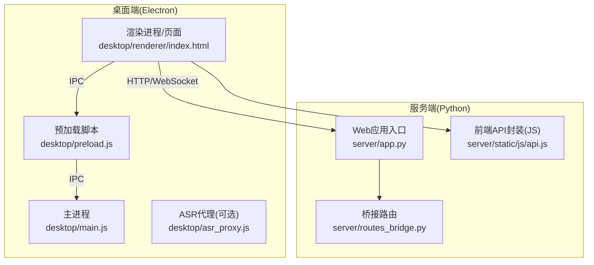

图表来源
- [desktop/main.js:1-200](file://desktop/main.js#L1-L200)
- [desktop/preload.js:1-200](file://desktop/preload.js#L1-L200)
- [desktop/renderer/index.html:1-200](file://desktop/renderer/index.html#L1-L200)
- [desktop/asr_proxy.js:1-200](file://desktop/asr_proxy.js#L1-L200)
- [server/app.py:1-200](file://server/app.py#L1-L200)
- [server/routes_bridge.py:1-200](file://server/routes_bridge.py#L1-L200)
- [server/static/js/api.js:1-200](file://server/static/js/api.js#L1-L200)

章节来源
- [desktop/main.js:1-200](file://desktop/main.js#L1-L200)
- [desktop/preload.js:1-200](file://desktop/preload.js#L1-L200)
- [desktop/renderer/index.html:1-200](file://desktop/renderer/index.html#L1-L200)
- [server/app.py:1-200](file://server/app.py#L1-L200)
- [server/routes_bridge.py:1-200](file://server/routes_bridge.py#L1-L200)
- [server/static/js/api.js:1-200](file://server/static/js/api.js#L1-L200)

## 核心组件
- 主进程（Main Process）
  - 负责应用生命周期、窗口管理、系统能力访问、安全策略配置
  - 通过 IPC 通道暴露受控能力给渲染进程
- 预加载脚本（Preload）
  - 在渲染进程上下文之前注入，建立最小权限的“安全桥”
  - 仅暴露必要的 API，避免直接暴露 Node/Electron 内部对象
- 渲染进程（Renderer）
  - 承载 UI 与业务逻辑，通过预加载脚本提供的 API 调用系统能力
  - 通过 HTTP/WebSocket 与服务端交互
- 服务端（Server）
  - 提供 REST API、WebSocket 实时通道、模板与静态资源
  - 桥接路由统一收敛外部请求，便于鉴权与审计

章节来源
- [desktop/main.js:1-200](file://desktop/main.js#L1-L200)
- [desktop/preload.js:1-200](file://desktop/preload.js#L1-L200)
- [desktop/renderer/index.html:1-200](file://desktop/renderer/index.html#L1-L200)
- [server/app.py:1-200](file://server/app.py#L1-L200)

## 架构总览
下图展示 Electron 主进程、预加载脚本、渲染进程与服务端的整体交互。

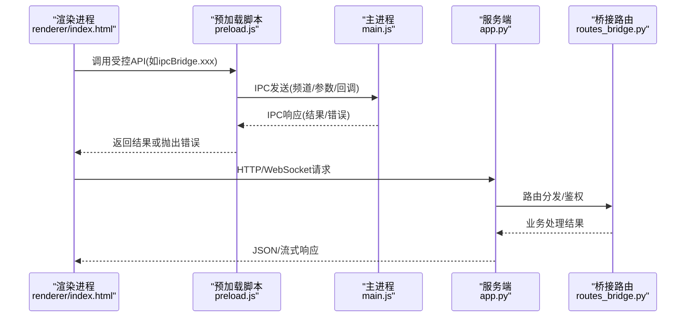

图表来源
- [desktop/preload.js:1-200](file://desktop/preload.js#L1-L200)
- [desktop/main.js:1-200](file://desktop/main.js#L1-L200)
- [server/app.py:1-200](file://server/app.py#L1-L200)
- [server/routes_bridge.py:1-200](file://server/routes_bridge.py#L1-L200)

## 详细组件分析

### 主进程与渲染进程分离设计
- 主进程职责
  - 创建并管理 BrowserWindow
  - 配置安全选项（如禁用Node集成、启用ContextIsolation）
  - 注册IPC处理器，集中校验与日志记录
- 渲染进程职责
  - 构建UI、处理用户交互
  - 通过预加载脚本暴露的API进行系统能力调用
  - 通过HTTP/WebSocket与服务端通信

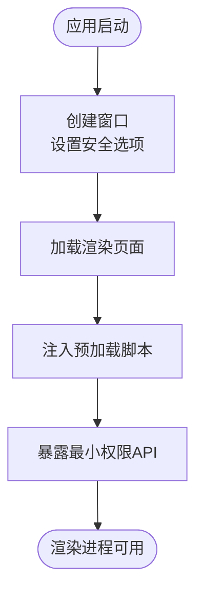

图表来源
- [desktop/main.js:1-200](file://desktop/main.js#L1-L200)
- [desktop/preload.js:1-200](file://desktop/preload.js#L1-L200)

章节来源
- [desktop/main.js:1-200](file://desktop/main.js#L1-L200)
- [desktop/preload.js:1-200](file://desktop/preload.js#L1-L200)

### 预加载脚本的安全桥接
- 隔离策略
  - 使用 ContextIsolation 与 nodeIntegration:false，防止渲染进程直接访问 Node/Electron
- 最小权限暴露
  - 仅暴露必要方法（如 ipcBridge.send、ipcBridge.invoke），对参数进行白名单校验
- 错误处理
  - 将底层异常包装为统一错误对象，包含错误码与消息，便于上层捕获

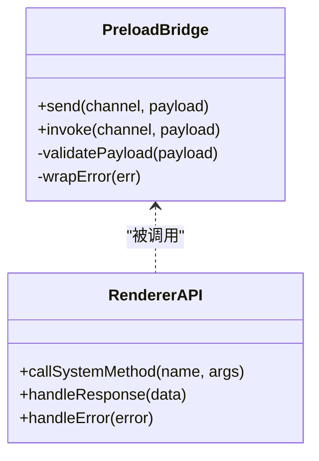

图表来源
- [desktop/preload.js:1-200](file://desktop/preload.js#L1-L200)

章节来源
- [desktop/preload.js:1-200](file://desktop/preload.js#L1-L200)

### IPC 通信机制
- 通道命名
  - 采用“领域.动作”命名（如 system.audio.open、bridge.http.get）
- 请求/响应模型
  - invoke：请求-响应；send：单向通知
- 安全校验
  - 主进程侧对频道与方法名进行白名单校验
  - 参数结构校验与类型检查
- 超时与重试
  - 为长耗时操作设置超时，必要时支持重试与退避

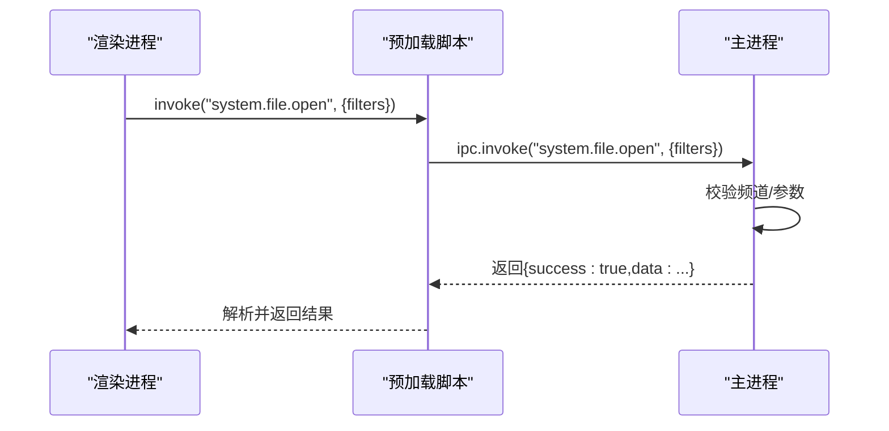

图表来源
- [desktop/preload.js:1-200](file://desktop/preload.js#L1-L200)
- [desktop/main.js:1-200](file://desktop/main.js#L1-L200)

章节来源
- [desktop/preload.js:1-200](file://desktop/preload.js#L1-L200)
- [desktop/main.js:1-200](file://desktop/main.js#L1-L200)

### 页面路由管理
- 单页应用（SPA）模式
  - 通过前端路由切换视图，避免整页刷新
- 路由守卫
  - 在进入敏感页面前进行鉴权与状态检查
- 懒加载
  - 按路由拆分代码块，按需加载以提升首屏性能

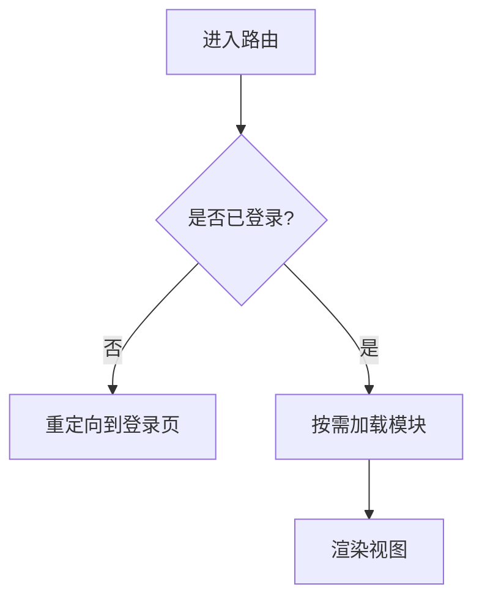

[此图为概念流程，不绑定具体源码]

### 状态管理与组件组织
- 状态管理
  - 全局状态集中管理（如用户信息、会话、设置）
  - 局部状态由组件自身维护
- 组件组织
  - 按功能域划分组件目录（如 audio、notes、knowledge）
  - 公共逻辑抽取为 hooks/utilities

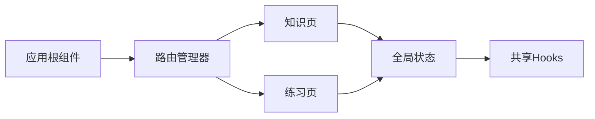

[此图为概念结构，不绑定具体源码]

### 前后端数据同步策略
- 初始同步
  - 登录后拉取用户配置与基础数据
- 增量同步
  - 基于时间戳或版本号进行增量更新
- 冲突解决
  - 以服务端为权威源，合并策略遵循“最后写入胜出”或字段级合并

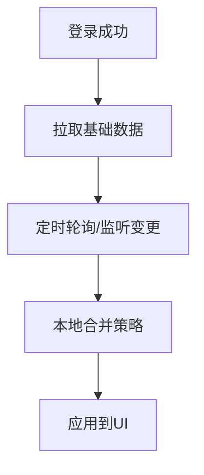

[此图为概念流程，不绑定具体源码]

### 实时通信实现
- WebSocket 连接
  - 建立后保持心跳，断线自动重连
- 消息协议
  - 定义统一的帧格式（type/payload/id/timestamp）
- 事件驱动
  - 前端订阅特定事件，触发UI更新或业务逻辑

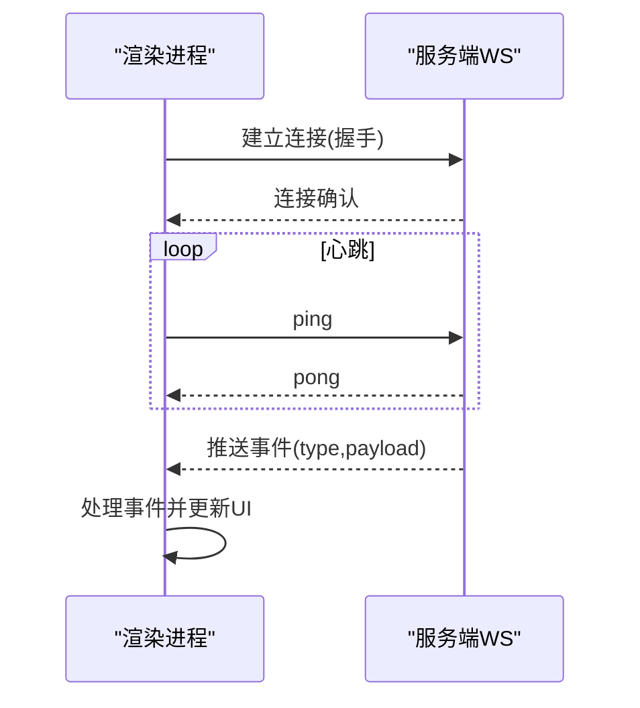

[此图为概念流程，不绑定具体源码]

### 错误处理机制
- 分层错误分类
  - 网络错误、业务错误、系统错误
- 统一错误对象
  - 包含 code/message/details，便于前端展示与上报
- 降级与恢复
  - 离线缓存、重试与回退策略

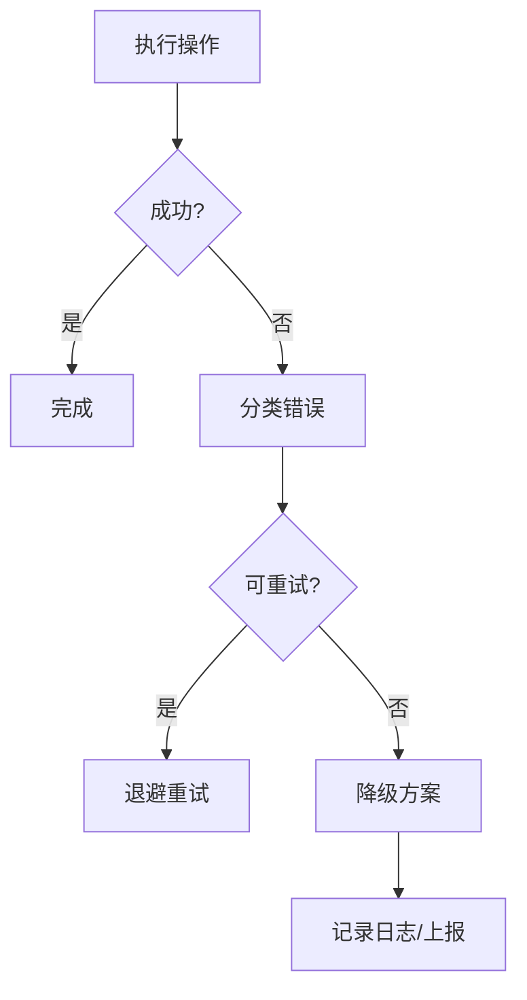

[此图为概念流程，不绑定具体源码]

## 依赖关系分析
- 模块耦合
  - 渲染进程依赖预加载脚本暴露的API
  - 预加载脚本依赖主进程IPC处理器
  - 渲染进程通过HTTP/WebSocket依赖服务端
- 外部依赖
  - Electron API（窗口、IPC、安全）
  - 浏览器API（fetch、WebSocket、Storage）
  - 服务端框架（Flask/FastAPI等）

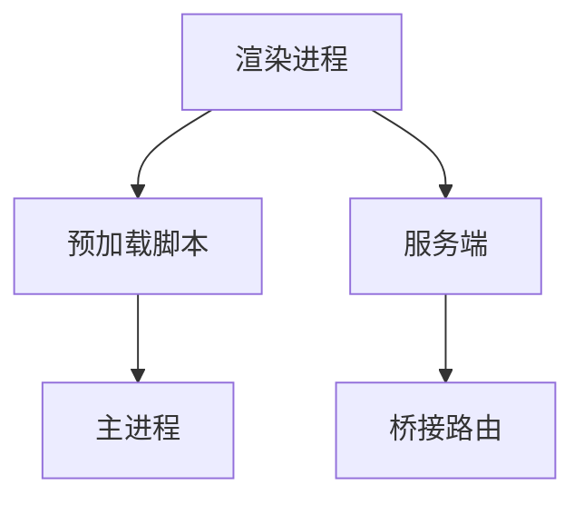

图表来源
- [desktop/main.js:1-200](file://desktop/main.js#L1-L200)
- [desktop/preload.js:1-200](file://desktop/preload.js#L1-L200)
- [server/app.py:1-200](file://server/app.py#L1-L200)
- [server/routes_bridge.py:1-200](file://server/routes_bridge.py#L1-L200)

章节来源
- [desktop/main.js:1-200](file://desktop/main.js#L1-L200)
- [desktop/preload.js:1-200](file://desktop/preload.js#L1-L200)
- [server/app.py:1-200](file://server/app.py#L1-L200)
- [server/routes_bridge.py:1-200](file://server/routes_bridge.py#L1-L200)

## 性能考虑
- 渲染性能
  - 虚拟列表、分页加载、图片懒加载
  - 减少重排重绘，批量更新状态
- IPC 性能
  - 合并小消息、避免频繁短消息
  - 使用 invoke 替代 send+on 模式以降低监听开销
- 网络性能
  - 压缩响应、缓存策略、CDN加速静态资源
  - WebSocket 心跳与自适应重连间隔
- 内存管理
  - 及时释放监听器与定时器
  - 大对象序列化注意体积与GC压力

[本节为通用指导，不引用具体源码]

## 故障排查指南
- 常见问题
  - IPC 调用无响应：检查频道白名单、参数校验、主进程处理器注册
  - 预加载脚本未生效：确认 ContextIsolation 与 preload 路径配置
  - WebSocket 频繁断开：检查心跳配置、网络环境与服务器负载
- 调试技巧
  - 使用 Electron DevTools 查看渲染进程控制台与网络面板
  - 在主进程打印 IPC 请求/响应日志，定位问题链路
  - 在服务端开启请求日志与错误堆栈，结合前端错误码定位
- 快速自检清单
  - 安全选项是否正确（nodeIntegration=false、contextIsolation=true）
  - 预加载脚本是否暴露了最小权限API
  - 路由守卫是否拦截未登录访问
  - 错误对象是否统一且包含必要信息

章节来源
- [desktop/main.js:1-200](file://desktop/main.js#L1-L200)
- [desktop/preload.js:1-200](file://desktop/preload.js#L1-L200)
- [server/app.py:1-200](file://server/app.py#L1-L200)

## 结论
本架构通过 Electron 主/渲染进程分离与预加载脚本的最小权限桥接，构建了安全的桌面端运行环境；配合服务端桥接路由与统一错误模型，实现了稳定可靠的前后端协作。建议在后续迭代中持续完善路由守卫、状态管理与性能监控，确保系统在扩展性与可维护性上稳步提升。

[本节为总结性内容，不引用具体源码]

## 附录

### 开发规范
- 命名规范
  - IPC 频道：领域.动作（如 system.audio.open）
  - API 方法：动词+名词（如 fetchKnowledgeList）
- 安全规范
  - 所有 IPC 调用必须经过预加载脚本桥接
  - 服务端对所有外部输入进行校验与鉴权
- 错误处理
  - 统一错误码与消息结构，前端统一捕获与展示
- 日志与监控
  - 关键操作记录结构化日志，错误上报至监控平台

[本节为通用规范，不引用具体源码]

### 调试技巧
- 启用 Electron DevTools
  - 在开发模式下打开开发者工具，查看控制台与网络请求
- 打印 IPC 日志
  - 在主进程与预加载脚本中打印请求/响应摘要
- 模拟失败场景
  - 在服务端模拟超时/错误，验证前端降级与重试逻辑

[本节为通用指导，不引用具体源码]

### 常见问题解决方案
- 无法访问系统能力
  - 检查主进程是否注册对应 IPC 处理器
  - 确认预加载脚本暴露的方法名与参数一致
- 页面路由跳转无效
  - 检查路由守卫条件与权限配置
  - 确认模块懒加载路径正确
- 实时消息丢失
  - 检查 WebSocket 心跳与重连逻辑
  - 确认服务端事件广播范围与过滤条件

[本节为通用指导，不引用具体源码]