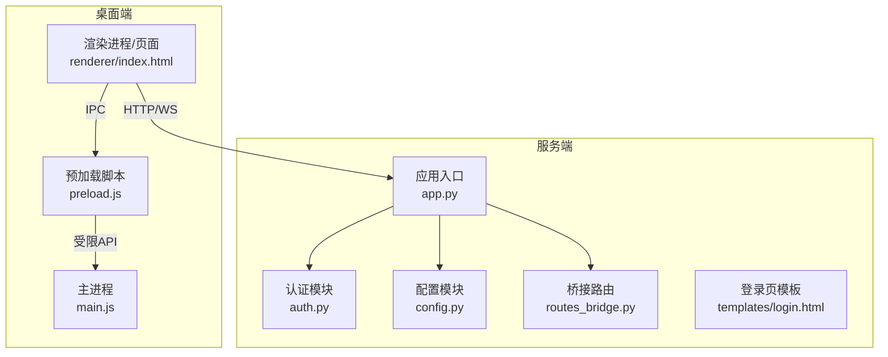
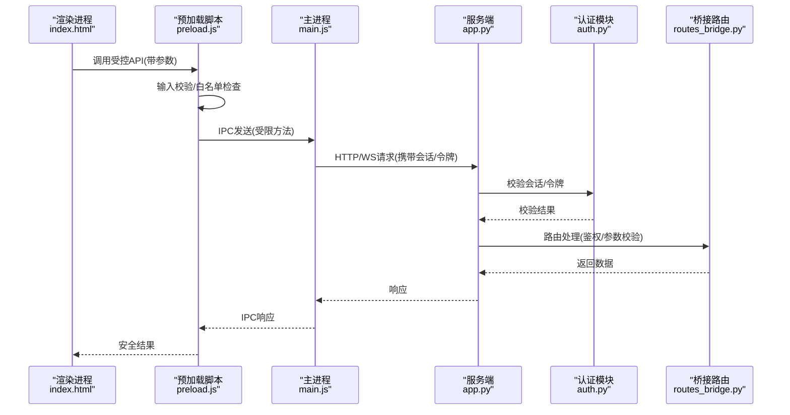
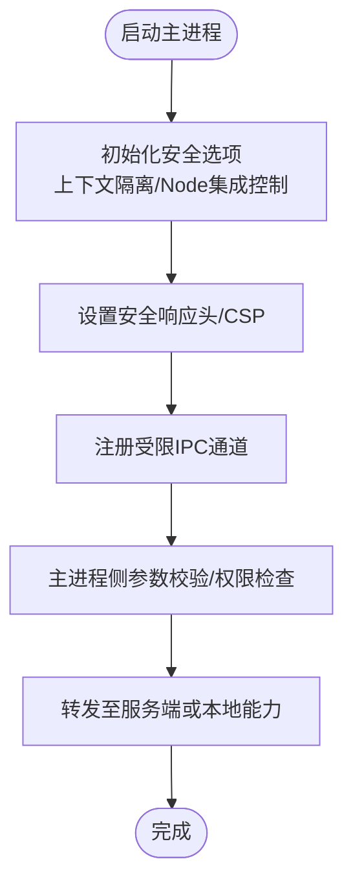
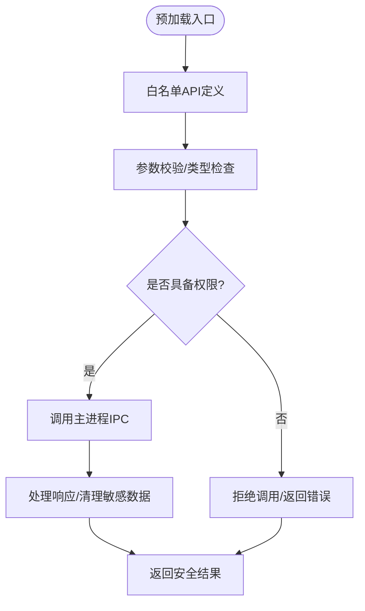
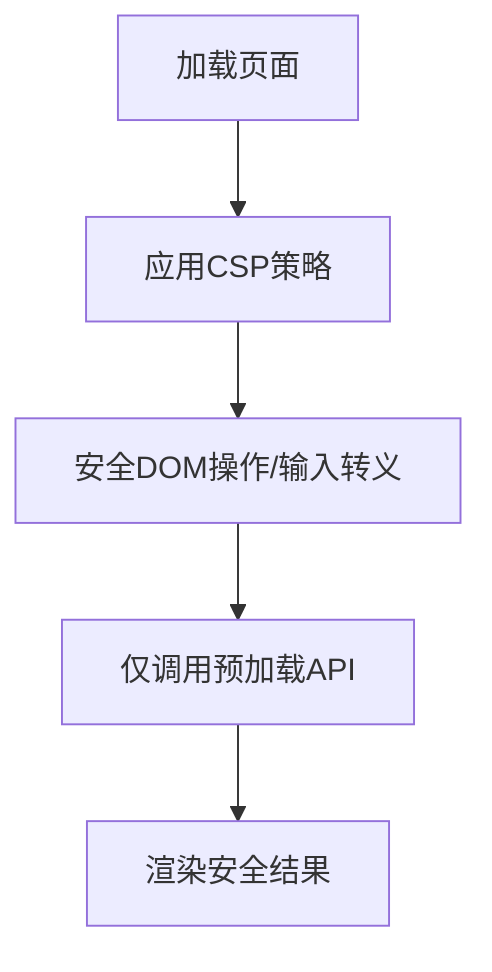
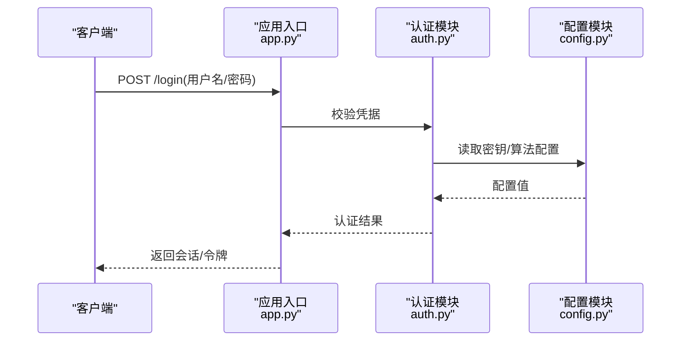
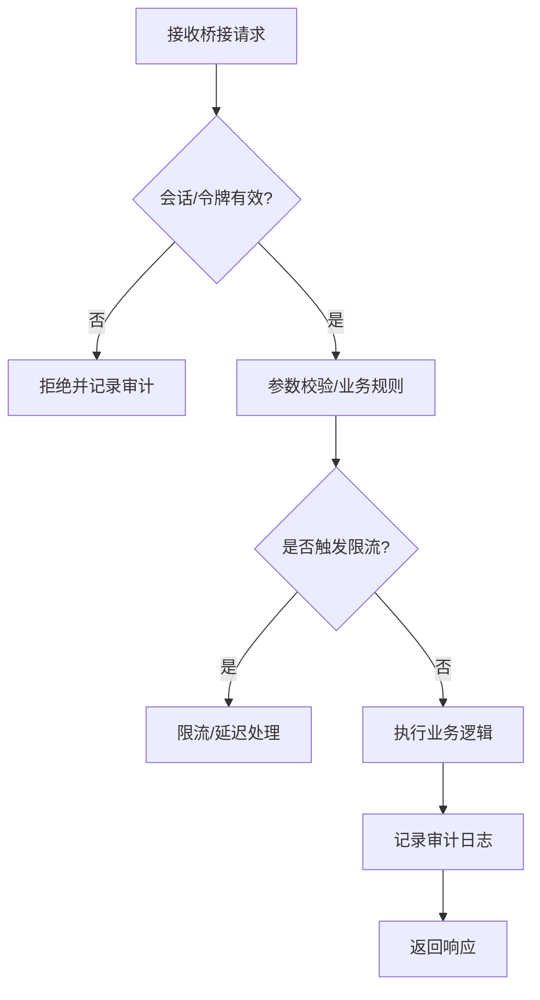
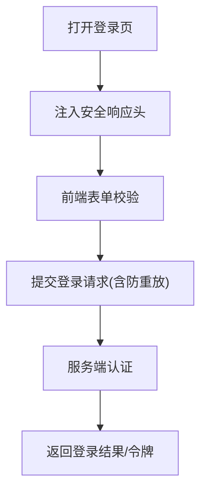
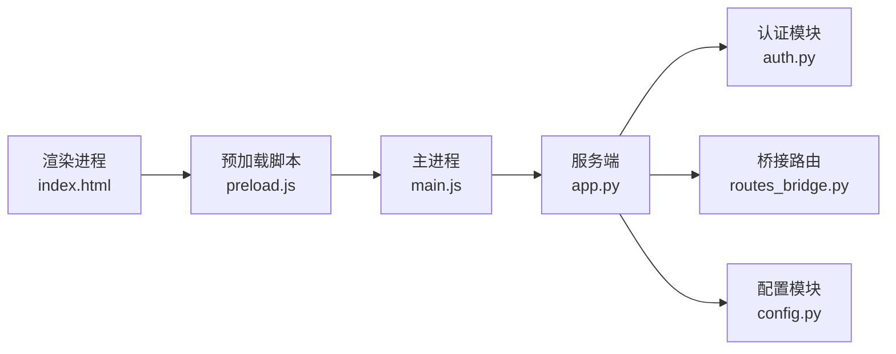

# 安全模型设计

<cite>
**本文引用的文件**   
- [main.js](file://desktop/main.js)
- [preload.js](file://desktop/preload.js)
- [index.html](file://desktop/renderer/index.html)
- [package.json](file://desktop/package.json)
- [app.py](file://server/app.py)
- [auth.py](file://server/auth.py)
- [config.py](file://server/config.py)
- [routes_bridge.py](file://server/routes_bridge.py)
- [login.html](file://server/templates/login.html)
</cite>

## 目录
1. [引言](#引言)
2. [项目结构](#项目结构)
3. [核心组件](#核心组件)
4. [架构总览](#架构总览)
5. [详细组件分析](#详细组件分析)
6. [依赖关系分析](#依赖关系分析)
7. [性能与安全权衡](#性能与安全权衡)
8. [故障排查指南](#故障排查指南)
9. [结论](#结论)
10. [附录：配置与审计清单](#附录配置与审计清单)

## 引言
本文件面向LectureLearnLoop的前端安全模型，聚焦Electron应用的安全最佳实践，包括上下文隔离、Node.js API访问控制、内容安全策略（CSP）配置；详细说明预加载脚本的安全边界、权限白名单设计与输入验证机制；解释前后端认证流程、会话管理与令牌处理策略；并给出XSS防护、CSRF防御和数据加密的实现建议。文档同时提供安全架构图、威胁模型分析与防护措施清单，以及安全配置指南、漏洞扫描方法与审计清单，帮助团队在开发与运维阶段持续保障系统安全。

## 项目结构
本项目采用“桌面客户端 + Web后端”的混合架构：
- 桌面端（Electron）：主进程负责窗口与系统能力管理，预加载脚本作为受信任桥接层，渲染进程运行业务页面。
- 服务端（Python）：提供认证、路由、API与模板渲染，承载Web界面与跨平台数据交互。

图表来源
- [main.js:1-200](file://desktop/main.js#L1-L200)
- [preload.js:1-200](file://desktop/preload.js#L1-L200)
- [index.html:1-200](file://desktop/renderer/index.html#L1-L200)
- [app.py:1-200](file://server/app.py#L1-L200)
- [auth.py:1-200](file://server/auth.py#L1-L200)
- [config.py:1-200](file://server/config.py#L1-L200)
- [routes_bridge.py:1-200](file://server/routes_bridge.py#L1-L200)
- [login.html:1-200](file://server/templates/login.html#L1-L200)

章节来源
- [main.js:1-200](file://desktop/main.js#L1-L200)
- [preload.js:1-200](file://desktop/preload.js#L1-L200)
- [index.html:1-200](file://desktop/renderer/index.html#L1-L200)
- [app.py:1-200](file://server/app.py#L1-L200)
- [auth.py:1-200](file://server/auth.py#L1-L200)
- [config.py:1-200](file://server/config.py#L1-L200)
- [routes_bridge.py:1-200](file://server/routes_bridge.py#L1-L200)
- [login.html:1-200](file://server/templates/login.html#L1-L200)

## 核心组件
- Electron主进程（main.js）：负责创建窗口、启用安全选项、注册IPC通道、限制Node集成与远程对象访问。
- 预加载脚本（preload.js）：暴露最小化、白名单化的API给渲染进程，集中进行输入校验与权限检查。
- 渲染进程页面（index.html）：通过CSP与安全的DOM操作避免XSS，仅调用预加载暴露的接口。
- 服务端应用（app.py）：统一入口，挂载路由、中间件、CORS与CSRF保护，提供认证与会话管理。
- 认证模块（auth.py）：实现登录、令牌签发与校验、会话绑定与过期策略。
- 配置模块（config.py）：集中管理密钥、端口、CSP、CORS、日志等安全相关配置。
- 桥接路由（routes_bridge.py）：为桌面端提供受控的数据通道，执行鉴权与参数校验。
- 登录模板（login.html）：前端登录表单与基础安全头注入点。

章节来源
- [main.js:1-200](file://desktop/main.js#L1-L200)
- [preload.js:1-200](file://desktop/preload.js#L1-L200)
- [index.html:1-200](file://desktop/renderer/index.html#L1-L200)
- [app.py:1-200](file://server/app.py#L1-L200)
- [auth.py:1-200](file://server/auth.py#L1-L200)
- [config.py:1-200](file://server/config.py#L1-L200)
- [routes_bridge.py:1-200](file://server/routes_bridge.py#L1-L200)
- [login.html:1-200](file://server/templates/login.html#L1-L200)

## 架构总览
下图展示从渲染进程到服务端的完整请求路径，以及关键安全控制点：

图表来源
- [index.html:1-200](file://desktop/renderer/index.html#L1-L200)
- [preload.js:1-200](file://desktop/preload.js#L1-L200)
- [main.js:1-200](file://desktop/main.js#L1-L200)
- [app.py:1-200](file://server/app.py#L1-L200)
- [auth.py:1-200](file://server/auth.py#L1-L200)
- [routes_bridge.py:1-200](file://server/routes_bridge.py#L1-L200)

## 详细组件分析

### Electron主进程安全配置（main.js）
- 启用上下文隔离与Node集成控制：确保渲染进程默认不直接访问Node API，减少攻击面。
- 禁用危险API：关闭contextBridge/contextIsolation不当组合，限制remote与nodeIntegration。
- 设置安全响应头：强制HTTPS、HSTS、X-Frame-Options、X-Content-Type-Options等。
- 注册IPC通道：仅暴露必要方法，并在主进程侧再次校验参数与权限。

图表来源
- [main.js:1-200](file://desktop/main.js#L1-L200)

章节来源
- [main.js:1-200](file://desktop/main.js#L1-L200)

### 预加载脚本安全边界（preload.js）
- 白名单API：仅暴露渲染进程需要的最小接口集合，避免直接暴露Node能力。
- 输入验证：对每个入参进行类型、长度、格式与范围校验，拒绝非法输入。
- 权限检查：根据用户角色或会话状态决定可调用API，防止越权。
- 错误处理：统一捕获异常并返回安全错误信息，不泄露内部细节。

图表来源
- [preload.js:1-200](file://desktop/preload.js#L1-L200)

章节来源
- [preload.js:1-200](file://desktop/preload.js#L1-L200)

### 渲染进程页面安全（index.html）
- CSP策略：限制脚本来源、样式、图片、字体、WebSocket与连接目标，阻断内联脚本与不安全来源。
- DOM安全：使用安全的DOM API，避免innerHTML等高风险操作；对用户输入进行转义与过滤。
- 通信安全：仅通过预加载暴露的API与主进程通信，不直接访问Node或系统资源。

图表来源
- [index.html:1-200](file://desktop/renderer/index.html#L1-L200)

章节来源
- [index.html:1-200](file://desktop/renderer/index.html#L1-L200)

### 服务端认证与会话（app.py, auth.py, config.py）
- 认证流程：登录成功后签发短期令牌，绑定会话ID，支持刷新与注销。
- 会话管理：服务端维护会话状态，设置过期时间，支持并发与锁机制。
- 令牌处理：使用签名令牌（如JWT），包含最小必要声明，设置过期与黑名单。
- 配置中心：集中管理密钥、CSP、CORS、日志级别等安全参数。

图表来源
- [app.py:1-200](file://server/app.py#L1-L200)
- [auth.py:1-200](file://server/auth.py#L1-L200)
- [config.py:1-200](file://server/config.py#L1-L200)

章节来源
- [app.py:1-200](file://server/app.py#L1-L200)
- [auth.py:1-200](file://server/auth.py#L1-L200)
- [config.py:1-200](file://server/config.py#L1-L200)

### 桥接路由与数据通道（routes_bridge.py）
- 鉴权：所有桥接请求必须携带有效会话/令牌，服务端校验通过后放行。
- 参数校验：严格校验请求体字段类型、长度、枚举值与业务约束。
- 速率限制：对高频接口实施限流，防止滥用与DoS。
- 审计日志：记录关键操作的来源IP、用户ID、时间戳与结果码。

图表来源
- [routes_bridge.py:1-200](file://server/routes_bridge.py#L1-L200)

章节来源
- [routes_bridge.py:1-200](file://server/routes_bridge.py#L1-L200)

### 登录页面与前端安全（login.html）
- 表单安全：提交前进行前端校验，避免无效请求；禁用自动填充敏感字段。
- 安全头：确保页面响应包含安全头，防止点击劫持与MIME嗅探。
- 防重放：登录请求携带一次性令牌或时间戳，服务端校验防重放。

图表来源
- [login.html:1-200](file://server/templates/login.html#L1-L200)

章节来源
- [login.html:1-200](file://server/templates/login.html#L1-L200)

## 依赖关系分析
- 桌面端依赖Electron运行时，主进程与预加载脚本强耦合，渲染进程通过IPC与预加载通信。
- 服务端依赖Python框架与数据库驱动，认证与会话模块与路由层解耦但紧密协作。
- 外部依赖：浏览器安全特性（CSP）、网络协议（HTTPS/WS）、第三方库（日志、加密）。

图表来源
- [index.html:1-200](file://desktop/renderer/index.html#L1-L200)
- [preload.js:1-200](file://desktop/preload.js#L1-L200)
- [main.js:1-200](file://desktop/main.js#L1-L200)
- [app.py:1-200](file://server/app.py#L1-L200)
- [auth.py:1-200](file://server/auth.py#L1-L200)
- [routes_bridge.py:1-200](file://server/routes_bridge.py#L1-L200)
- [config.py:1-200](file://server/config.py#L1-L200)

章节来源
- [index.html:1-200](file://desktop/renderer/index.html#L1-L200)
- [preload.js:1-200](file://desktop/preload.js#L1-L200)
- [main.js:1-200](file://desktop/main.js#L1-L200)
- [app.py:1-200](file://server/app.py#L1-L200)
- [auth.py:1-200](file://server/auth.py#L1-L200)
- [routes_bridge.py:1-200](file://server/routes_bridge.py#L1-L200)
- [config.py:1-200](file://server/config.py#L1-L200)

## 性能与安全权衡
- 上下文隔离会增加IPC开销，但显著降低渲染进程攻击面；建议在预加载层批量处理请求以减少往返次数。
- CSP严格模式可能影响第三方资源加载，需精细化白名单与子域策略，平衡可用性与安全性。
- 会话与令牌频繁校验带来CPU与I/O压力，可通过缓存与短生命周期令牌缓解。
- 输入校验与参数过滤增加处理时延，应结合异步与批处理优化。

[本节为通用指导，无需具体文件引用]

## 故障排查指南
- 渲染进程无法访问Node API：检查主进程是否禁用nodeIntegration与启用上下文隔离；确认预加载脚本是否正确暴露API。
- CSP拦截资源加载：检查CSP指令是否过于严格，必要时添加允许的源与哈希/nonce。
- 登录失败或会话失效：检查服务端认证模块配置、密钥与令牌有效期；查看审计日志定位失败原因。
- 桥接路由报错：检查鉴权头是否携带、参数是否符合校验规则、是否触发限流。

章节来源
- [main.js:1-200](file://desktop/main.js#L1-L200)
- [preload.js:1-200](file://desktop/preload.js#L1-L200)
- [index.html:1-200](file://desktop/renderer/index.html#L1-L200)
- [app.py:1-200](file://server/app.py#L1-L200)
- [auth.py:1-200](file://server/auth.py#L1-L200)
- [routes_bridge.py:1-200](file://server/routes_bridge.py#L1-L200)

## 结论
通过严格的Electron安全配置、最小化预加载API、精细的CSP策略与服务端认证与会话管理，LectureLearnLoop在前端安全模型上实现了纵深防御。建议持续进行安全测试与审计，完善自动化扫描与监控告警，确保系统在演进过程中保持高安全基线。

[本节为总结性内容，无需具体文件引用]

## 附录：配置与审计清单

### 安全配置指南
- Electron主进程
  - 启用上下文隔离，禁用nodeIntegration与remote。
  - 设置安全响应头：Strict-Transport-Security、X-Frame-Options、X-Content-Type-Options、Referrer-Policy。
  - 仅注册必要的IPC通道，主进程侧进行二次校验。
- 预加载脚本
  - 白名单API，严格参数校验与权限检查。
  - 统一错误处理，不泄露内部细节。
- 渲染进程
  - 配置CSP：script-src、style-src、img-src、font-src、connect-src、frame-src等。
  - 使用安全DOM API，避免innerHTML与eval。
- 服务端
  - 启用HTTPS与HSTS，配置CORS白名单。
  - 会话与令牌：短生命周期、签名校验、黑名单与刷新机制。
  - 输入校验与速率限制，审计日志记录关键操作。

章节来源
- [main.js:1-200](file://desktop/main.js#L1-L200)
- [preload.js:1-200](file://desktop/preload.js#L1-L200)
- [index.html:1-200](file://desktop/renderer/index.html#L1-L200)
- [app.py:1-200](file://server/app.py#L1-L200)
- [auth.py:1-200](file://server/auth.py#L1-L200)
- [config.py:1-200](file://server/config.py#L1-L200)
- [routes_bridge.py:1-200](file://server/routes_bridge.py#L1-L200)

### 威胁模型与防护措施
- XSS防护
  - 渲染进程CSP限制脚本来源，禁止内联脚本。
  - 预加载脚本对所有输入进行转义与过滤。
  - 服务端输出编码与CSP头。
- CSRF防御
  - 服务端启用CSRF令牌校验，跨站请求需携带有效令牌。
  - 同站Cookie策略与SameSite属性配置。
- 数据加密
  - 传输层TLS强制，敏感字段在客户端与服务端均进行加密存储。
  - 令牌签名与短期有效期，支持撤销与轮换。

章节来源
- [index.html:1-200](file://desktop/renderer/index.html#L1-L200)
- [preload.js:1-200](file://desktop/preload.js#L1-L200)
- [app.py:1-200](file://server/app.py#L1-L200)
- [auth.py:1-200](file://server/auth.py#L1-L200)
- [config.py:1-200](file://server/config.py#L1-L200)

### 漏洞扫描与安全审计清单
- 静态扫描
  - 检测硬编码密钥、不安全函数调用、弱CSP配置。
- 动态扫描
  - 覆盖登录、会话、桥接路由等关键路径，验证CSRF与XSS防护。
- 依赖审计
  - 定期更新Electron与Python依赖，修复已知漏洞。
- 渗透测试
  - 模拟越权、注入、重放与DoS攻击，验证防护有效性。

章节来源
- [app.py:1-200](file://server/app.py#L1-L200)
- [auth.py:1-200](file://server/auth.py#L1-L200)
- [routes_bridge.py:1-200](file://server/routes_bridge.py#L1-L200)
- [main.js:1-200](file://desktop/main.js#L1-L200)
- [preload.js:1-200](file://desktop/preload.js#L1-L200)
- [index.html:1-200](file://desktop/renderer/index.html#L1-L200)