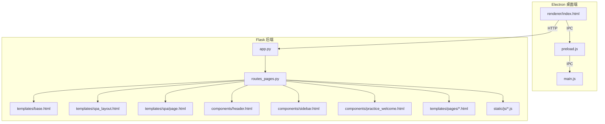
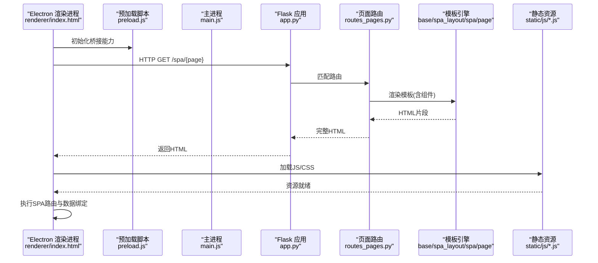
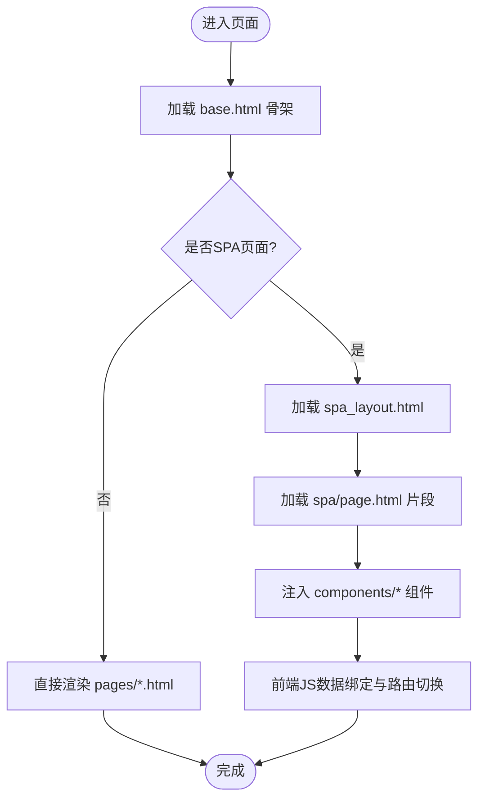
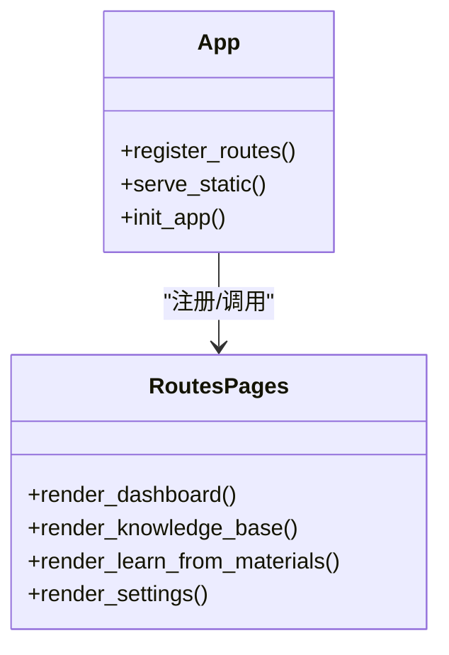
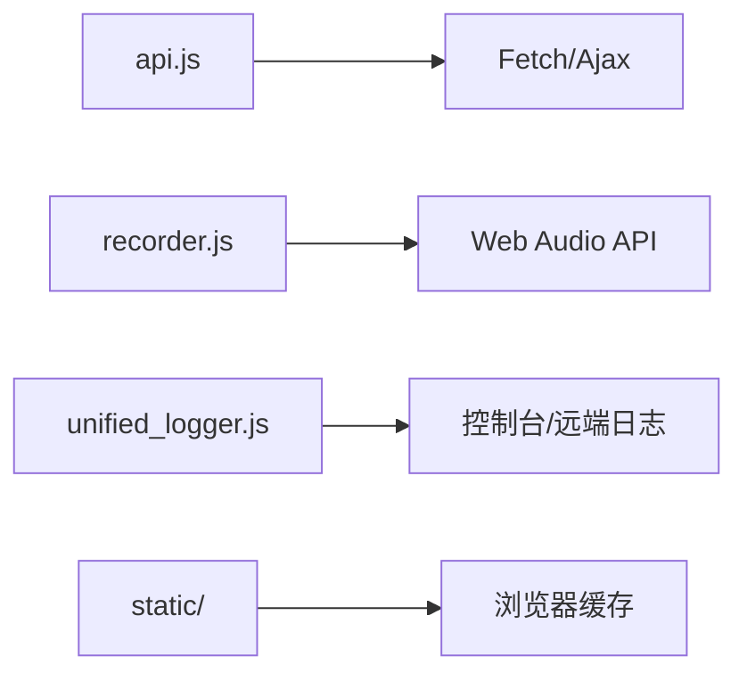
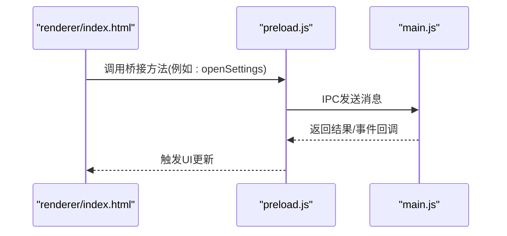
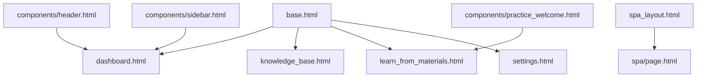
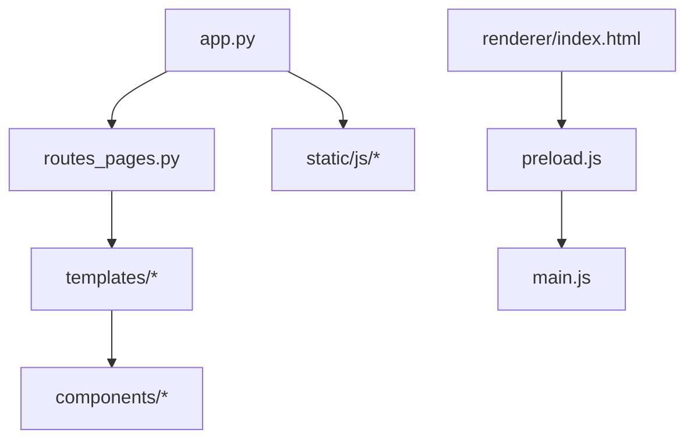

# 渲染进程架构

<cite>
**本文引用的文件**   
- [app.py](file://server/app.py)
- [routes_pages.py](file://server/routes_pages.py)
- [base.html](file://server/templates/base.html)
- [spa_layout.html](file://server/templates/spa_layout.html)
- [page.html](file://server/templates/spa/page.html)
- [header.html](file://server/templates/components/header.html)
- [sidebar.html](file://server/templates/components/sidebar.html)
- [practice_welcome.html](file://server/templates/components/practice_welcome.html)
- [dashboard.html](file://server/templates/pages/dashboard.html)
- [knowledge_base.html](file://server/templates/pages/knowledge_base.html)
- [learn_from_materials.html](file://server/templates/pages/learn_from_materials.html)
- [settings.html](file://server/templates/pages/settings.html)
- [api.js](file://server/static/js/api.js)
- [recorder.js](file://server/static/js/recorder.js)
- [unified_logger.js](file://server/static/js/unified_logger.js)
- [index.html](file://desktop/renderer/index.html)
- [main.js](file://desktop/main.js)
- [preload.js](file://desktop/preload.js)
</cite>

## 目录
1. [简介](#简介)
2. [项目结构](#项目结构)
3. [核心组件](#核心组件)
4. [架构总览](#架构总览)
5. [详细组件分析](#详细组件分析)
6. [依赖关系分析](#依赖关系分析)
7. [性能与兼容性](#性能与兼容性)
8. [故障排查指南](#故障排查指南)
9. [结论](#结论)
10. [附录：开发规范与调试建议](#附录开发规范与调试建议)

## 简介
本文件聚焦于LectureLearnLoop的渲染进程架构，围绕后端模板系统、SPA布局、前端资源管理、静态服务与CDN集成策略展开。文档说明基础模板继承、组件化组织、页面路由与数据绑定机制，并给出页面加载流程、组件关系图、样式组织规范、响应式设计与浏览器兼容性处理要点，以及性能优化技巧与调试方法。

## 项目结构
本项目采用“后端Flask + Jinja2模板 + 前端JS”的混合架构：
- 后端提供页面路由与模板渲染，同时承载静态资源服务。
- 模板层使用Jinja2实现基础模板继承与组件复用。
- SPA通过独立布局模板与页面片段组合，结合前端JS进行局部更新与路由切换。
- Electron桌面端通过renderer进程加载本地HTML，并通过preload桥接能力与主进程通信。

图示来源
- [app.py:1-200](file://server/app.py#L1-L200)
- [routes_pages.py:1-200](file://server/routes_pages.py#L1-L200)
- [base.html:1-200](file://server/templates/base.html#L1-L200)
- [spa_layout.html:1-200](file://server/templates/spa_layout.html#L1-L200)
- [page.html:1-200](file://server/templates/spa/page.html#L1-L200)
- [index.html:1-200](file://desktop/renderer/index.html#L1-L200)
- [main.js:1-200](file://desktop/main.js#L1-L200)
- [preload.js:1-200](file://desktop/preload.js#L1-L200)

章节来源
- [app.py:1-200](file://server/app.py#L1-L200)
- [routes_pages.py:1-200](file://server/routes_pages.py#L1-L200)
- [base.html:1-200](file://server/templates/base.html#L1-L200)
- [spa_layout.html:1-200](file://server/templates/spa_layout.html#L1-L200)
- [page.html:1-200](file://server/templates/spa/page.html#L1-L200)
- [index.html:1-200](file://desktop/renderer/index.html#L1-L200)
- [main.js:1-200](file://desktop/main.js#L1-L200)
- [preload.js:1-200](file://desktop/preload.js#L1-L200)

## 核心组件
- 模板引擎与基础模板
  - base.html：定义全局骨架、公共头部、侧边栏占位、脚本与样式引入位置、内容块注入点。
  - spa_layout.html：SPA专用布局，包含导航区、主内容区与底部信息区，配合page.html进行动态内容替换。
  - components/*：可复用UI片段（如header、sidebar、practice_welcome等），通过include或extends组合到页面中。
- 页面路由与控制器
  - routes_pages.py：集中管理页面级路由，将URL映射到具体模板与上下文数据。
  - app.py：注册蓝图/路由、配置静态资源路径、初始化应用。
- 前端资源与脚本
  - static/js/api.js：封装API调用，统一请求头、错误处理与重试策略。
  - static/js/recorder.js：录音与音频采集逻辑，适配Web Audio API。
  - static/js/unified_logger.js：统一日志输出，便于跨模块追踪问题。
- Electron渲染进程
  - renderer/index.html：Electron渲染入口，加载SPA布局与业务脚本。
  - preload.js：暴露安全桥接到主进程的能力，供渲染进程调用。
  - main.js：主进程生命周期管理与窗口创建。

章节来源
- [base.html:1-200](file://server/templates/base.html#L1-L200)
- [spa_layout.html:1-200](file://server/templates/spa_layout.html#L1-L200)
- [page.html:1-200](file://server/templates/spa/page.html#L1-L200)
- [routes_pages.py:1-200](file://server/routes_pages.py#L1-L200)
- [app.py:1-200](file://server/app.py#L1-L200)
- [api.js:1-200](file://server/static/js/api.js#L1-L200)
- [recorder.js:1-200](file://server/static/js/recorder.js#L1-L200)
- [unified_logger.js:1-200](file://server/static/js/unified_logger.js#L1-L200)
- [index.html:1-200](file://desktop/renderer/index.html#L1-L200)
- [preload.js:1-200](file://desktop/preload.js#L1-L200)
- [main.js:1-200](file://desktop/main.js#L1-L200)

## 架构总览
下图展示从Electron渲染进程发起请求，到Flask后端路由分发、模板渲染、静态资源返回的整体流程。

图示来源
- [index.html:1-200](file://desktop/renderer/index.html#L1-L200)
- [preload.js:1-200](file://desktop/preload.js#L1-L200)
- [main.js:1-200](file://desktop/main.js#L1-L200)
- [app.py:1-200](file://server/app.py#L1-L200)
- [routes_pages.py:1-200](file://server/routes_pages.py#L1-L200)
- [base.html:1-200](file://server/templates/base.html#L1-L200)
- [spa_layout.html:1-200](file://server/templates/spa_layout.html#L1-L200)
- [page.html:1-200](file://server/templates/spa/page.html#L1-L200)
- [api.js:1-200](file://server/static/js/api.js#L1-L200)

## 详细组件分析

### 模板系统与基础模板继承
- base.html
  - 定义全局HTML骨架、站点标题、公共CSS/JS引入、内容块（content）、侧边栏与头部占位。
  - 提供统一的元信息与SEO标签位置，便于各页面扩展。
- spa_layout.html
  - 面向SPA场景的布局，包含顶部导航、主内容容器与底部状态栏。
  - 通过JavaScript在客户端动态替换主内容区域，减少整页刷新。
- page.html
  - SPA页面片段模板，作为子视图被spa_layout.html嵌入，承载具体业务内容。
- components/*
  - header.html、sidebar.html、practice_welcome.html等组件，按职责拆分，支持在不同页面中复用。

图示来源
- [base.html:1-200](file://server/templates/base.html#L1-L200)
- [spa_layout.html:1-200](file://server/templates/spa_layout.html#L1-L200)
- [page.html:1-200](file://server/templates/spa/page.html#L1-L200)
- [header.html:1-200](file://server/templates/components/header.html#L1-L200)
- [sidebar.html:1-200](file://server/templates/components/sidebar.html#L1-L200)
- [practice_welcome.html:1-200](file://server/templates/components/practice_welcome.html#L1-L200)

章节来源
- [base.html:1-200](file://server/templates/base.html#L1-L200)
- [spa_layout.html:1-200](file://server/templates/spa_layout.html#L1-L200)
- [page.html:1-200](file://server/templates/spa/page.html#L1-L200)
- [header.html:1-200](file://server/templates/components/header.html#L1-L200)
- [sidebar.html:1-200](file://server/templates/components/sidebar.html#L1-L200)
- [practice_welcome.html:1-200](file://server/templates/components/practice_welcome.html#L1-L200)

### 页面路由与控制器
- routes_pages.py
  - 集中定义页面路由，将URL映射到对应模板与上下文数据。
  - 对SPA页面提供统一参数解析与模板变量注入。
- app.py
  - 注册路由、配置静态资源目录、设置应用启动参数。
  - 提供中间件或钩子用于鉴权、日志记录等横切关注点。

图示来源
- [app.py:1-200](file://server/app.py#L1-L200)
- [routes_pages.py:1-200](file://server/routes_pages.py#L1-L200)

章节来源
- [app.py:1-200](file://server/app.py#L1-L200)
- [routes_pages.py:1-200](file://server/routes_pages.py#L1-L200)

### 前端资源管理与静态服务
- 静态资源目录
  - static/js/api.js：统一API封装，负责请求构造、错误处理、重试与缓存策略。
  - static/js/recorder.js：录音与音频流处理，封装设备枚举、权限获取与播放控制。
  - static/js/unified_logger.js：统一日志接口，支持分级输出与聚合上报。
- 静态服务策略
  - Flask默认静态目录服务，可通过app.py配置缓存头、压缩与CDN回退。
  - 建议在部署时启用Gzip/Brotli压缩与浏览器缓存策略。

图示来源
- [api.js:1-200](file://server/static/js/api.js#L1-L200)
- [recorder.js:1-200](file://server/static/js/recorder.js#L1-L200)
- [unified_logger.js:1-200](file://server/static/js/unified_logger.js#L1-L200)
- [app.py:1-200](file://server/app.py#L1-L200)

章节来源
- [api.js:1-200](file://server/static/js/api.js#L1-L200)
- [recorder.js:1-200](file://server/static/js/recorder.js#L1-L200)
- [unified_logger.js:1-200](file://server/static/js/unified_logger.js#L1-L200)
- [app.py:1-200](file://server/app.py#L1-L200)

### Electron渲染进程与桥接
- renderer/index.html
  - 渲染进程入口，加载SPA布局与业务脚本，监听路由变化与用户交互。
- preload.js
  - 暴露安全的IPC桥接方法给渲染进程，避免直接访问Node API。
- main.js
  - 主进程负责窗口创建、菜单、系统集成与生命周期管理。

图示来源
- [index.html:1-200](file://desktop/renderer/index.html#L1-L200)
- [preload.js:1-200](file://desktop/preload.js#L1-L200)
- [main.js:1-200](file://desktop/main.js#L1-L200)

章节来源
- [index.html:1-200](file://desktop/renderer/index.html#L1-L200)
- [preload.js:1-200](file://desktop/preload.js#L1-L200)
- [main.js:1-200](file://desktop/main.js#L1-L200)

### 页面示例与组件关系
- dashboard.html、knowledge_base.html、learn_from_materials.html、settings.html
  - 这些页面通过base.html或spa_layout.html继承骨架，并在主内容区注入各自业务逻辑。
  - 组件header.html、sidebar.html、practice_welcome.html在这些页面中被复用，保证一致的导航与欢迎体验。

图示来源
- [base.html:1-200](file://server/templates/base.html#L1-L200)
- [spa_layout.html:1-200](file://server/templates/spa_layout.html#L1-L200)
- [page.html:1-200](file://server/templates/spa/page.html#L1-L200)
- [dashboard.html:1-200](file://server/templates/pages/dashboard.html#L1-L200)
- [knowledge_base.html:1-200](file://server/templates/pages/knowledge_base.html#L1-L200)
- [learn_from_materials.html:1-200](file://server/templates/pages/learn_from_materials.html#L1-L200)
- [settings.html:1-200](file://server/templates/pages/settings.html#L1-L200)
- [header.html:1-200](file://server/templates/components/header.html#L1-L200)
- [sidebar.html:1-200](file://server/templates/components/sidebar.html#L1-L200)
- [practice_welcome.html:1-200](file://server/templates/components/practice_welcome.html#L1-L200)

章节来源
- [dashboard.html:1-200](file://server/templates/pages/dashboard.html#L1-L200)
- [knowledge_base.html:1-200](file://server/templates/pages/knowledge_base.html#L1-L200)
- [learn_from_materials.html:1-200](file://server/templates/pages/learn_from_materials.html#L1-L200)
- [settings.html:1-200](file://server/templates/pages/settings.html#L1-L200)
- [header.html:1-200](file://server/templates/components/header.html#L1-L200)
- [sidebar.html:1-200](file://server/templates/components/sidebar.html#L1-L200)
- [practice_welcome.html:1-200](file://server/templates/components/practice_welcome.html#L1-L200)

## 依赖关系分析
- 后端依赖
  - Flask应用(app.py)依赖路由(routes_pages.py)与模板(base/spa_layout/spa)。
  - 静态资源由Flask内置服务提供，可通过配置调整缓存与压缩。
- 前端依赖
  - api.js为所有页面的网络请求中心；recorder.js为录音功能模块；unified_logger.js为日志基础设施。
- Electron依赖
  - renderer/index.html依赖preload.js提供的桥接能力；main.js负责窗口与系统集成。

图示来源
- [app.py:1-200](file://server/app.py#L1-L200)
- [routes_pages.py:1-200](file://server/routes_pages.py#L1-L200)
- [base.html:1-200](file://server/templates/base.html#L1-L200)
- [spa_layout.html:1-200](file://server/templates/spa_layout.html#L1-L200)
- [page.html:1-200](file://server/templates/spa/page.html#L1-L200)
- [index.html:1-200](file://desktop/renderer/index.html#L1-L200)
- [preload.js:1-200](file://desktop/preload.js#L1-L200)
- [main.js:1-200](file://desktop/main.js#L1-L200)

章节来源
- [app.py:1-200](file://server/app.py#L1-L200)
- [routes_pages.py:1-200](file://server/routes_pages.py#L1-L200)
- [base.html:1-200](file://server/templates/base.html#L1-L200)
- [spa_layout.html:1-200](file://server/templates/spa_layout.html#L1-L200)
- [page.html:1-200](file://server/templates/spa/page.html#L1-L200)
- [index.html:1-200](file://desktop/renderer/index.html#L1-L200)
- [preload.js:1-200](file://desktop/preload.js#L1-L200)
- [main.js:1-200](file://desktop/main.js#L1-L200)

## 性能与兼容性
- 模板渲染性能
  - 合理使用模板继承与组件复用，减少重复HTML生成。
  - 对大列表或复杂页面，优先在后端分页/懒加载，前端按需渲染。
- 静态资源优化
  - 启用Gzip/Brotli压缩，设置合理的Cache-Control与ETag。
  - 合并与压缩JS/CSS，必要时使用CDN加速与版本化文件名。
- 响应式设计
  - 使用媒体查询与弹性布局，确保移动端与桌面端一致体验。
  - 针对录音与音频播放，检测Web Audio API可用性并提供降级方案。
- 浏览器兼容性
  - 对旧版浏览器提供polyfill或功能检测，避免未实现API导致崩溃。
  - 在Electron环境中注意Node集成与CSP策略配置。

[本节为通用指导，不直接分析具体文件]

## 故障排查指南
- 模板渲染问题
  - 检查base.html与spa_layout.html的内容块是否正确闭合与继承。
  - 确认components/*组件的路径与include语法正确。
- 路由与页面加载
  - 核对routes_pages.py中的路由定义与URL匹配规则。
  - 验证app.py中静态资源目录配置与访问路径。
- 前端脚本错误
  - 使用unified_logger.js统一捕获异常与关键日志。
  - 检查api.js的请求头、错误码处理与重试逻辑。
- Electron桥接问题
  - 确认preload.js暴露的方法名与renderer/index.html调用一致。
  - 在主进程中监听IPC事件并返回预期结果。

章节来源
- [base.html:1-200](file://server/templates/base.html#L1-L200)
- [spa_layout.html:1-200](file://server/templates/spa_layout.html#L1-L200)
- [routes_pages.py:1-200](file://server/routes_pages.py#L1-L200)
- [app.py:1-200](file://server/app.py#L1-L200)
- [unified_logger.js:1-200](file://server/static/js/unified_logger.js#L1-L200)
- [api.js:1-200](file://server/static/js/api.js#L1-L200)
- [index.html:1-200](file://desktop/renderer/index.html#L1-L200)
- [preload.js:1-200](file://desktop/preload.js#L1-L200)
- [main.js:1-200](file://desktop/main.js#L1-L200)

## 结论
LectureLearnLoop的渲染进程架构以Flask+Jinja2模板为核心，结合SPA布局与组件化开发，形成清晰的前后端协作边界。通过统一的路由管理、静态资源服务与Electron桥接，实现了稳定的页面加载与交互体验。遵循本文的组织规范与性能优化建议，可进一步提升系统的可维护性与用户体验。

[本节为总结性内容，不直接分析具体文件]

## 附录：开发规范与调试建议
- 模板开发规范
  - 严格使用base.html与spa_layout.html作为骨架，新增页面优先复用现有组件。
  - 组件命名与路径保持一致，避免深层嵌套与循环引用。
- 前端代码组织
  - 将网络请求集中在api.js，业务逻辑分散在各页面脚本中。
  - 使用unified_logger.js记录关键操作与异常，便于定位问题。
- 调试方法
  - 在Electron中打开开发者工具，查看Console与Network面板。
  - 在后端开启调试日志，核对模板渲染与静态资源访问情况。
- 性能优化清单
  - 启用静态资源压缩与缓存。
  - 对大页面实施分页与懒加载。
  - 使用CDN加速静态资源，并对关键资源进行版本化。

[本节为通用指导，不直接分析具体文件]