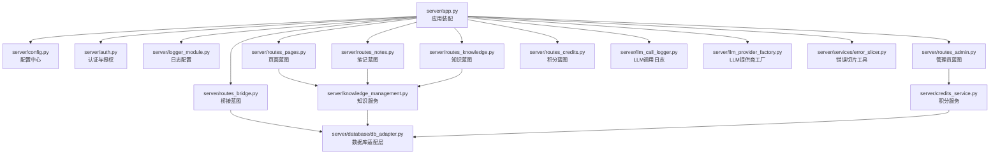
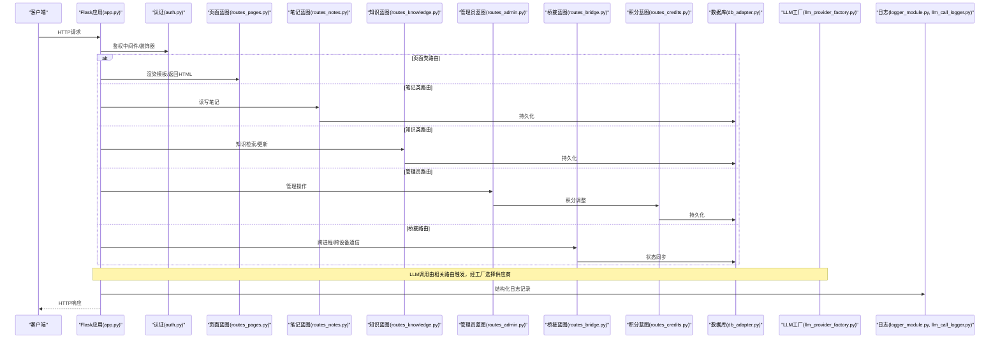
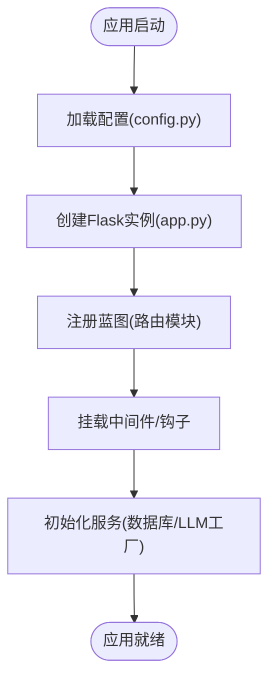
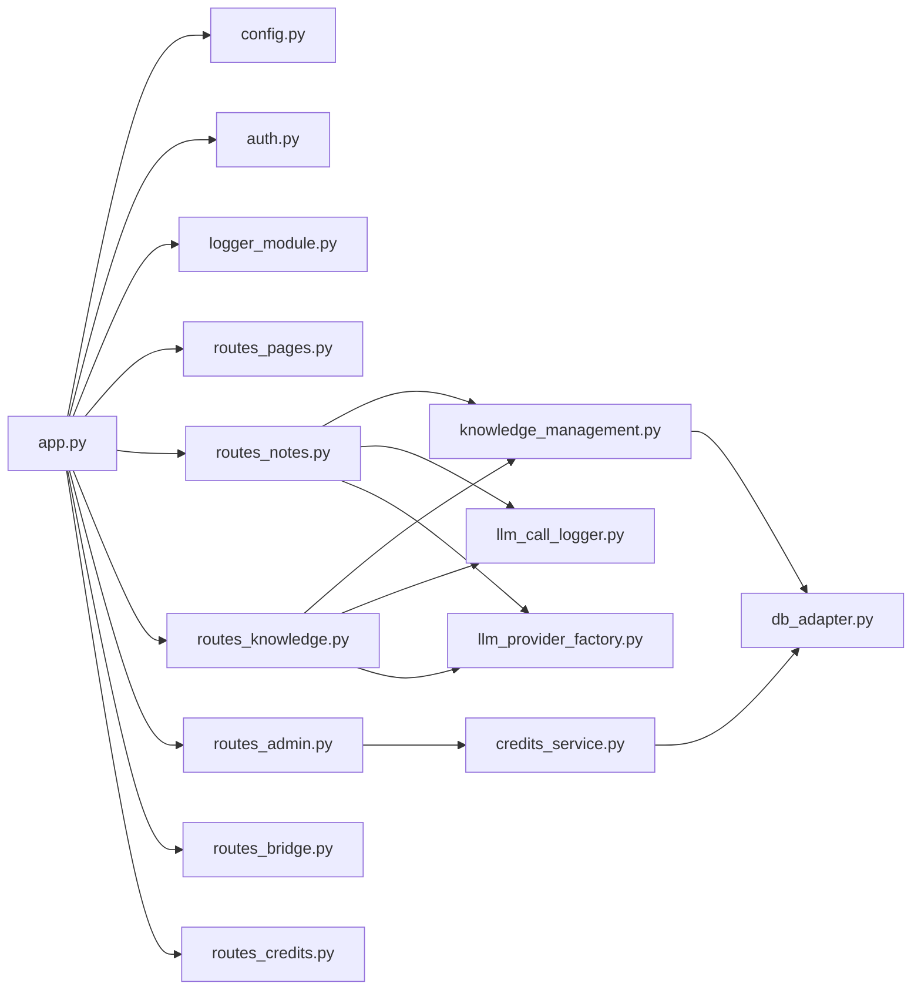

# Flask应用结构

<cite>
**本文引用的文件**   
- [server/app.py](file://server/app.py)
- [server/config.py](file://server/config.py)
- [server/auth.py](file://server/auth.py)
- [server/logger_module.py](file://server/logger_module.py)
- [server/routes_pages.py](file://server/routes_pages.py)
- [server/routes_notes.py](file://server/routes_notes.py)
- [server/routes_knowledge.py](file://server/routes_knowledge.py)
- [server/routes_admin.py](file://server/routes_admin.py)
- [server/routes_bridge.py](file://server/routes_bridge.py)
- [server/routes_credits.py](file://server/routes_credits.py)
- [server/llm_call_logger.py](file://server/llm_call_logger.py)
- [server/llm_provider_factory.py](file://server/llm_provider_factory.py)
- [server/knowledge_management.py](file://server/knowledge_management.py)
- [server/credits_service.py](file://server/credits_service.py)
- [server/database/db_adapter.py](file://server/database/db_adapter.py)
- [server/services/error_slicer.py](file://server/services/error_slicer.py)
</cite>

## 目录
1. [简介](#简介)
2. [项目结构](#项目结构)
3. [核心组件](#核心组件)
4. [架构总览](#架构总览)
5. [详细组件分析](#详细组件分析)
6. [依赖关系分析](#依赖关系分析)
7. [性能考虑](#性能考虑)
8. [故障排查指南](#故障排查指南)
9. [结论](#结论)
10. [附录](#附录)

## 简介
本文件为 LectureLearnLoop 的 Flask 后端应用提供系统化架构文档，覆盖应用初始化流程、配置管理、模块化组织、蓝图注册与中间件加载顺序、环境变量与部署选项、生命周期钩子、错误处理与日志策略，以及扩展点与第三方服务集成方案。目标读者包括后端开发者、运维工程师与产品技术负责人。

## 项目结构
Flask 应用位于 server 目录下，采用“按功能模块拆分”的组织方式：
- 入口与装配：app.py 负责创建应用实例、加载配置、注册蓝图、挂载中间件与错误处理器。
- 配置与环境：config.py 集中管理配置项与环境变量映射。
- 认证与安全：auth.py 提供鉴权逻辑与受保护路由装饰器。
- 日志系统：logger_module.py 统一日志配置；llm_call_logger.py 记录 LLM 调用轨迹。
- 业务路由（蓝图）：routes_*.py 分别承载页面、笔记、知识、管理员、桥接与积分等能力。
- 领域服务：knowledge_management.py、credits_service.py、services/error_slicer.py 封装核心业务逻辑。
- 数据访问：database/db_adapter.py 抽象数据库连接与查询。
- 外部服务：llm_provider_factory.py 作为 LLM 提供商工厂，便于扩展不同模型供应商。

图表来源
- [server/app.py:1-200](file://server/app.py#L1-L200)
- [server/config.py:1-200](file://server/config.py#L1-L200)
- [server/auth.py:1-200](file://server/auth.py#L1-L200)
- [server/logger_module.py:1-200](file://server/logger_module.py#L1-L200)
- [server/routes_pages.py:1-200](file://server/routes_pages.py#L1-L200)
- [server/routes_notes.py:1-200](file://server/routes_notes.py#L1-L200)
- [server/routes_knowledge.py:1-200](file://server/routes_knowledge.py#L1-L200)
- [server/routes_admin.py:1-200](file://server/routes_admin.py#L1-L200)
- [server/routes_bridge.py:1-200](file://server/routes_bridge.py#L1-L200)
- [server/routes_credits.py:1-200](file://server/routes_credits.py#L1-L200)
- [server/knowledge_management.py:1-200](file://server/knowledge_management.py#L1-L200)
- [server/credits_service.py:1-200](file://server/credits_service.py#L1-L200)
- [server/database/db_adapter.py:1-200](file://server/database/db_adapter.py#L1-L200)
- [server/llm_call_logger.py:1-200](file://server/llm_call_logger.py#L1-L200)
- [server/llm_provider_factory.py:1-200](file://server/llm_provider_factory.py#L1-L200)
- [server/services/error_slicer.py:1-200](file://server/services/error_slicer.py#L1-L200)

章节来源
- [server/app.py:1-200](file://server/app.py#L1-L200)
- [server/config.py:1-200](file://server/config.py#L1-L200)

## 核心组件
- 应用装配器：负责创建 Flask 实例、加载配置、注册蓝图、挂载中间件、注册错误处理器与生命周期钩子。
- 配置中心：统一读取环境变量与配置文件，提供类型安全的配置访问接口。
- 认证模块：提供登录态校验、权限控制与受保护路由装饰器。
- 日志系统：统一日志级别、输出格式与滚动策略，并针对 LLM 调用进行专项追踪。
- 蓝图集合：按功能域划分路由，降低耦合度，提升可维护性。
- 领域服务：封装知识管理与积分计算等业务规则。
- 数据适配层：屏蔽底层数据库差异，提供统一的查询与事务接口。
- LLM 工厂：根据配置动态选择模型供应商，支持热插拔扩展。

章节来源
- [server/app.py:1-200](file://server/app.py#L1-L200)
- [server/config.py:1-200](file://server/config.py#L1-L200)
- [server/auth.py:1-200](file://server/auth.py#L1-L200)
- [server/logger_module.py:1-200](file://server/logger_module.py#L1-L200)
- [server/llm_call_logger.py:1-200](file://server/llm_call_logger.py#L1-L200)
- [server/llm_provider_factory.py:1-200](file://server/llm_provider_factory.py#L1-L200)

## 架构总览
下图展示请求从进入 Flask 到各蓝图的流转路径，以及关键中间件与服务的协作关系。

图表来源
- [server/app.py:1-200](file://server/app.py#L1-L200)
- [server/auth.py:1-200](file://server/auth.py#L1-L200)
- [server/routes_pages.py:1-200](file://server/routes_pages.py#L1-L200)
- [server/routes_notes.py:1-200](file://server/routes_notes.py#L1-L200)
- [server/routes_knowledge.py:1-200](file://server/routes_knowledge.py#L1-L200)
- [server/routes_admin.py:1-200](file://server/routes_admin.py#L1-L200)
- [server/routes_bridge.py:1-200](file://server/routes_bridge.py#L1-L200)
- [server/routes_credits.py:1-200](file://server/routes_credits.py#L1-L200)
- [server/database/db_adapter.py:1-200](file://server/database/db_adapter.py#L1-L200)
- [server/llm_provider_factory.py:1-200](file://server/llm_provider_factory.py#L1-L200)
- [server/logger_module.py:1-200](file://server/logger_module.py#L1-L200)
- [server/llm_call_logger.py:1-200](file://server/llm_call_logger.py#L1-L200)

## 详细组件分析

### 应用初始化与启动流程
- 应用实例创建：在 app.py 中创建 Flask 应用对象，设置静态资源与模板目录。
- 配置加载：通过 config.py 将环境变量映射为应用配置，支持开发/测试/生产环境切换。
- 蓝图注册：依次注册 pages、notes、knowledge、admin、bridge、credits 等蓝图，形成清晰的路由边界。
- 中间件与钩子：挂载全局异常处理、请求前/后钩子、会话管理等。
- 启动入口：通过命令行参数或脚本启动，支持调试模式与端口绑定。

图表来源
- [server/app.py:1-200](file://server/app.py#L1-L200)
- [server/config.py:1-200](file://server/config.py#L1-L200)

章节来源
- [server/app.py:1-200](file://server/app.py#L1-L200)
- [server/config.py:1-200](file://server/config.py#L1-L200)

### 配置管理机制与环境变量
- 配置分层：默认配置、环境变量覆盖、运行时配置。
- 环境变量命名规范：以大写形式定义，如数据库连接串、密钥、LLM API Key、调试开关等。
- 安全敏感信息：通过环境变量注入，避免硬编码。
- 配置校验：在应用启动时校验必填项，失败则快速失败并给出明确提示。

章节来源
- [server/config.py:1-200](file://server/config.py#L1-L200)

### 蓝图注册机制与路由组织
- 蓝图职责分离：每个 routes_*.py 聚焦单一功能域，减少循环依赖。
- 路由命名空间：通过蓝图前缀组织 URL，便于前端调用与权限控制。
- 公共组件：模板片段与通用 JS 放在 templates 与 static 下，供多蓝图复用。

章节来源
- [server/routes_pages.py:1-200](file://server/routes_pages.py#L1-L200)
- [server/routes_notes.py:1-200](file://server/routes_notes.py#L1-L200)
- [server/routes_knowledge.py:1-200](file://server/routes_knowledge.py#L1-L200)
- [server/routes_admin.py:1-200](file://server/routes_admin.py#L1-L200)
- [server/routes_bridge.py:1-200](file://server/routes_bridge.py#L1-L200)
- [server/routes_credits.py:1-200](file://server/routes_credits.py#L1-L200)

### 中间件加载顺序与请求处理链
- 加载顺序：应用级中间件优先于蓝图级中间件，确保全局拦截有效。
- 典型中间件：认证检查、请求日志、CORS、CSRF、限流等。
- 钩子函数：before_request 用于鉴权与会话校验，after_request 用于响应头与审计日志。

章节来源
- [server/app.py:1-200](file://server/app.py#L1-L200)
- [server/auth.py:1-200](file://server/auth.py#L1-L200)

### 应用生命周期管理
- 启动阶段：初始化数据库连接池、缓存、LLM 工厂与任务队列。
- 运行阶段：请求处理、异步任务调度、健康检查端点。
- 关闭阶段：释放连接、刷新日志缓冲、优雅退出信号处理。

章节来源
- [server/app.py:1-200](file://server/app.py#L1-L200)

### 错误处理机制
- 全局异常捕获：统一返回友好错误页或 JSON 错误体。
- 业务异常分类：区分参数校验错误、权限不足、资源不存在等。
- 错误切片与上报：结合 services/error_slicer.py 对长错误栈进行切片，便于定位问题。

章节来源
- [server/app.py:1-200](file://server/app.py#L1-L200)
- [server/services/error_slicer.py:1-200](file://server/services/error_slicer.py#L1-L200)

### 日志记录策略
- 统一日志配置：logger_module.py 定义日志级别、格式、输出目标与轮转策略。
- LLM 调用追踪：llm_call_logger.py 记录输入、输出、耗时与供应商信息，便于性能分析与成本核算。
- 结构化日志：推荐 JSON 格式以便日志平台采集与分析。

章节来源
- [server/logger_module.py:1-200](file://server/logger_module.py#L1-L200)
- [server/llm_call_logger.py:1-200](file://server/llm_call_logger.py#L1-L200)

### 扩展点设计与插件注册
- LLM 提供商工厂：llm_provider_factory.py 根据配置选择具体实现，新增供应商只需实现统一接口并注册。
- 蓝图扩展：可在 app.py 中集中注册新蓝图，无需改动现有路由。
- 服务扩展：通过依赖注入或服务容器，向蓝图注入新的领域服务。

章节来源
- [server/llm_provider_factory.py:1-200](file://server/llm_provider_factory.py#L1-L200)
- [server/app.py:1-200](file://server/app.py#L1-L200)

### 第三方服务集成方案
- 数据库：database/db_adapter.py 抽象连接与查询，支持 SQLite/PostgreSQL 等后端。
- LLM 服务：通过工厂接入不同模型供应商，支持超时、重试与降级策略。
- 消息与队列：可按需引入 Celery/RQ 等异步任务框架，配合蓝图中的后台任务。

章节来源
- [server/database/db_adapter.py:1-200](file://server/database/db_adapter.py#L1-L200)
- [server/llm_provider_factory.py:1-200](file://server/llm_provider_factory.py#L1-L200)

## 依赖关系分析
- 低耦合高内聚：蓝图之间不直接互相导入，通过服务层与数据层交互。
- 关键依赖：
  - app.py 依赖 config.py、auth.py、logger_module.py 与各 routes_*.py。
  - routes_* 依赖 knowledge_management.py、credits_service.py、database/db_adapter.py。
  - llm_call_logger.py 与 llm_provider_factory.py 被需要 AI 能力的路由使用。

图表来源
- [server/app.py:1-200](file://server/app.py#L1-L200)
- [server/config.py:1-200](file://server/config.py#L1-L200)
- [server/auth.py:1-200](file://server/auth.py#L1-L200)
- [server/logger_module.py:1-200](file://server/logger_module.py#L1-L200)
- [server/routes_pages.py:1-200](file://server/routes_pages.py#L1-L200)
- [server/routes_notes.py:1-200](file://server/routes_notes.py#L1-L200)
- [server/routes_knowledge.py:1-200](file://server/routes_knowledge.py#L1-L200)
- [server/routes_admin.py:1-200](file://server/routes_admin.py#L1-L200)
- [server/routes_bridge.py:1-200](file://server/routes_bridge.py#L1-L200)
- [server/routes_credits.py:1-200](file://server/routes_credits.py#L1-L200)
- [server/knowledge_management.py:1-200](file://server/knowledge_management.py#L1-L200)
- [server/credits_service.py:1-200](file://server/credits_service.py#L1-L200)
- [server/database/db_adapter.py:1-200](file://server/database/db_adapter.py#L1-L200)
- [server/llm_call_logger.py:1-200](file://server/llm_call_logger.py#L1-L200)
- [server/llm_provider_factory.py:1-200](file://server/llm_provider_factory.py#L1-L200)

章节来源
- [server/app.py:1-200](file://server/app.py#L1-L200)

## 性能考虑
- 数据库连接池：合理设置连接数与超时，避免连接泄漏。
- 缓存策略：热点数据引入内存缓存，降低数据库压力。
- 异步任务：将耗时操作（如 LLM 调用、批量处理）放入队列，提高吞吐。
- 日志优化：生产环境降低日志级别，启用异步写入与采样。
- 静态资源：开启压缩与缓存，减少带宽占用。

[本节为通用指导，不涉及具体文件分析]

## 故障排查指南
- 启动失败：检查环境变量是否齐全，数据库连接是否正常，LLM API Key 是否有效。
- 鉴权异常：确认会话与 Cookie 配置，检查认证中间件是否生效。
- 路由 404：核对蓝图前缀与 URL 匹配规则，确认蓝图已正确注册。
- 数据库错误：查看 db_adapter.py 的错误日志与 SQL 语句，检查连接池与权限。
- LLM 调用失败：查看 llm_call_logger.py 的输出，确认供应商配置与网络连通性。
- 性能瓶颈：分析慢查询与 LLM 调用耗时，必要时引入缓存或异步化。

章节来源
- [server/app.py:1-200](file://server/app.py#L1-L200)
- [server/auth.py:1-200](file://server/auth.py#L1-L200)
- [server/database/db_adapter.py:1-200](file://server/database/db_adapter.py#L1-L200)
- [server/llm_call_logger.py:1-200](file://server/llm_call_logger.py#L1-L200)

## 结论
本应用通过清晰的模块化与蓝图组织，实现了高内聚、低耦合的后端架构。配置与环境变量统一管理，提升了可移植性与安全性。日志与错误处理体系完善，便于问题定位与性能优化。扩展点设计使新增功能与第三方服务集成更加便捷，适合持续演进与团队协作。

[本节为总结性内容，不涉及具体文件分析]

## 附录
- 部署建议：
  - 使用 gunicorn/uwsgi 作为 WSGI 服务器，配合反向代理（Nginx）。
  - 通过环境变量注入密钥与敏感配置，避免写入代码仓库。
  - 启用 HTTPS、CSRF、CORS 等安全策略。
- 监控与告警：
  - 接入 APM 与日志平台，收集请求指标与错误率。
  - 对 LLM 调用设置预算与配额，防止超支。

[本节为通用指导，不涉及具体文件分析]