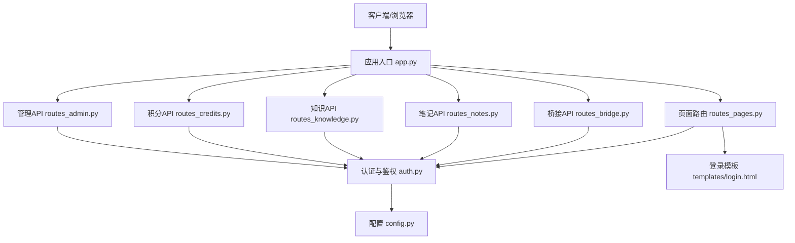
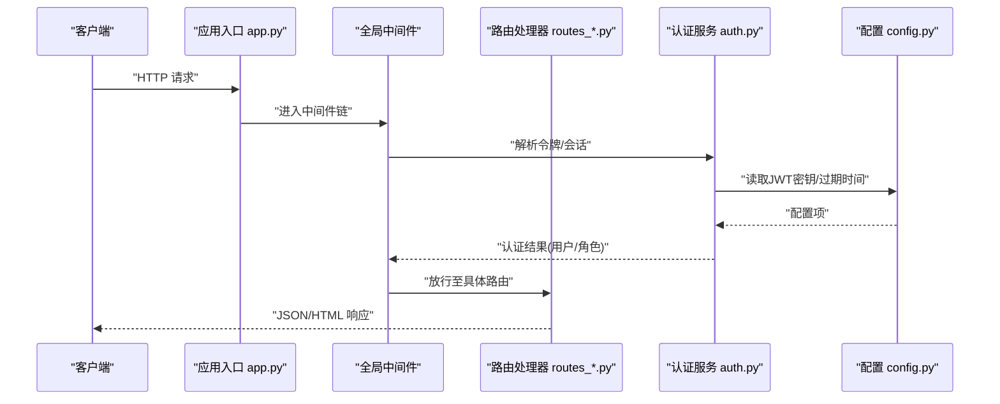
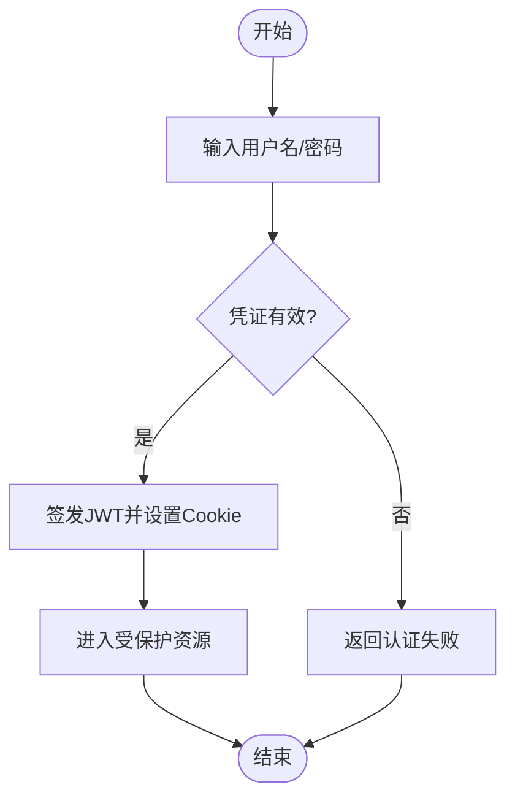
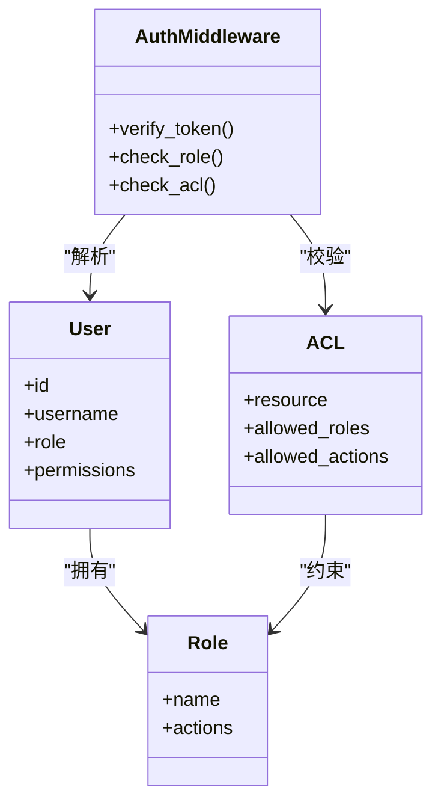
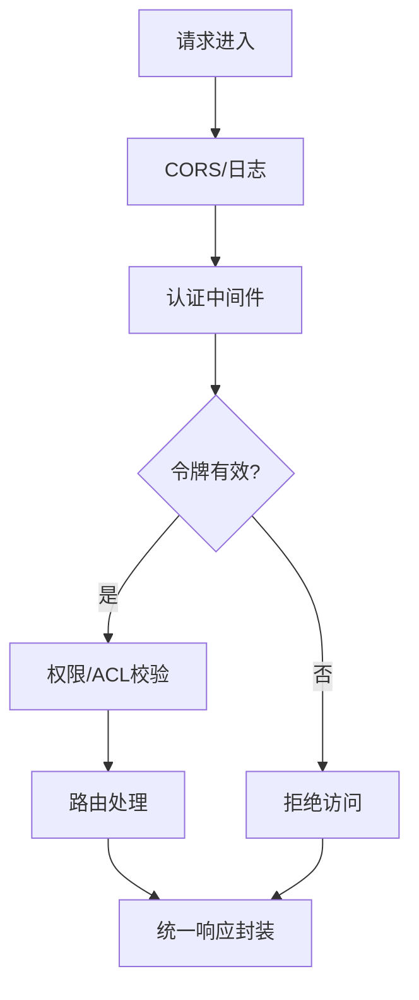
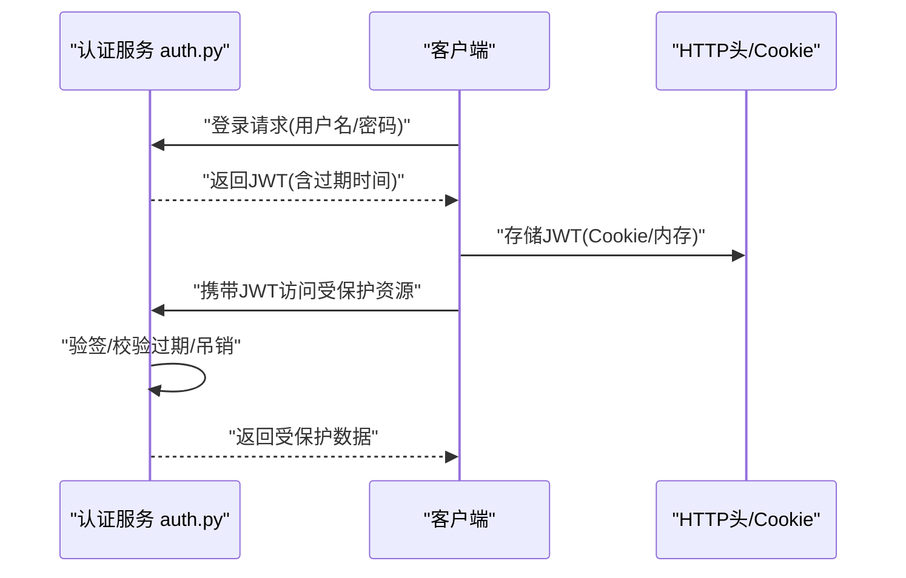
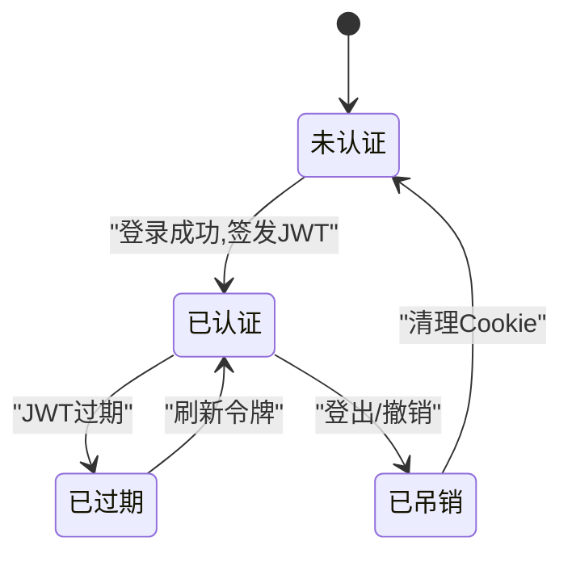
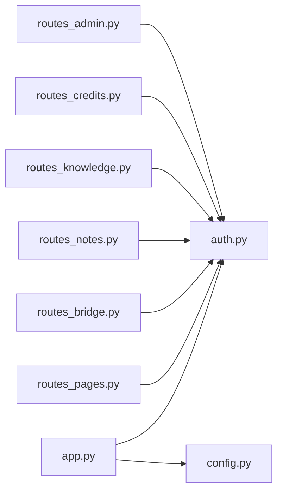

# 中间件与认证

<cite>
**本文引用的文件**   
- [app.py](file://server/app.py)
- [auth.py](file://server/auth.py)
- [config.py](file://server/config.py)
- [routes_pages.py](file://server/routes_pages.py)
- [routes_bridge.py](file://server/routes_bridge.py)
- [routes_notes.py](file://server/routes_notes.py)
- [routes_knowledge.py](file://server/routes_knowledge.py)
- [routes_credits.py](file://server/routes_credits.py)
- [routes_admin.py](file://server/routes_admin.py)
- [templates/login.html](file://server/templates/login.html)
- [tests/test_p1_auth_isolation.py](file://server/tests/test_p1_auth_isolation.py)
</cite>

## 目录
1. [简介](#简介)
2. [项目结构](#项目结构)
3. [核心组件](#核心组件)
4. [架构总览](#架构总览)
5. [详细组件分析](#详细组件分析)
6. [依赖关系分析](#依赖关系分析)
7. [性能考量](#性能考量)
8. [故障排查指南](#故障排查指南)
9. [结论](#结论)
10. [附录](#附录)

## 简介
本文件为 LectureLearnLoop 的中间件与认证系统提供全面架构文档，覆盖用户认证流程、会话管理、权限控制策略、JWT 令牌生成与验证、角色权限模型与访问控制列表（ACL）、中间件执行顺序、请求拦截机制与响应处理管道。同时给出安全最佳实践、防攻击措施、数据加密策略，以及扩展点设计（多因素认证、第三方 OAuth）。

## 项目结构
本项目后端基于 Python Web 框架组织，认证与安全相关代码集中在以下模块：
- 应用入口与路由注册：app.py
- 认证与鉴权逻辑：auth.py
- 配置与环境变量：config.py
- 页面路由与模板渲染：routes_pages.py
- 业务 API 路由：routes_bridge.py、routes_notes.py、routes_knowledge.py、routes_credits.py、routes_admin.py
- 登录模板：templates/login.html
- 认证隔离测试：tests/test_p1_auth_isolation.py

**图表来源**
- [app.py:1-200](file://server/app.py#L1-L200)
- [auth.py:1-200](file://server/auth.py#L1-L200)
- [config.py:1-200](file://server/config.py#L1-L200)
- [routes_pages.py:1-200](file://server/routes_pages.py#L1-L200)
- [routes_bridge.py:1-200](file://server/routes_bridge.py#L1-L200)
- [routes_notes.py:1-200](file://server/routes_notes.py#L1-L200)
- [routes_knowledge.py:1-200](file://server/routes_knowledge.py#L1-L200)
- [routes_credits.py:1-200](file://server/routes_credits.py#L1-L200)
- [routes_admin.py:1-200](file://server/routes_admin.py#L1-L200)
- [templates/login.html:1-200](file://server/templates/login.html#L1-L200)

**章节来源**
- [app.py:1-200](file://server/app.py#L1-L200)
- [auth.py:1-200](file://server/auth.py#L1-L200)
- [config.py:1-200](file://server/config.py#L1-L200)
- [routes_pages.py:1-200](file://server/routes_pages.py#L1-L200)
- [routes_bridge.py:1-200](file://server/routes_bridge.py#L1-L200)
- [routes_notes.py:1-200](file://server/routes_notes.py#L1-L200)
- [routes_knowledge.py:1-200](file://server/routes_knowledge.py#L1-L200)
- [routes_credits.py:1-200](file://server/routes_credits.py#L1-L200)
- [routes_admin.py:1-200](file://server/routes_admin.py#L1-L200)
- [templates/login.html:1-200](file://server/templates/login.html#L1-L200)

## 核心组件
- 认证与鉴权模块（auth.py）
  - 负责用户登录校验、JWT 签发与验签、会话状态维护、角色与权限检查、ACL 判定。
- 应用入口（app.py）
  - 注册全局中间件、挂载各路由蓝图、统一错误处理与响应格式。
- 配置模块（config.py）
  - 集中管理 JWT 密钥、过期时间、Cookie 属性、CORS、日志级别等安全相关配置。
- 页面路由（routes_pages.py）
  - 提供登录页、仪表盘等页面渲染；对受保护页面进行鉴权拦截。
- 业务路由（routes_*.py）
  - 暴露 RESTful API；在需要时调用鉴权装饰器或中间件进行权限校验。
- 登录模板（templates/login.html）
  - 前端登录表单与交互逻辑，提交凭证到后端认证接口。
- 测试（tests/test_p1_auth_isolation.py）
  - 验证认证隔离、未授权访问拦截、不同角色的访问边界。

**章节来源**
- [auth.py:1-200](file://server/auth.py#L1-L200)
- [app.py:1-200](file://server/app.py#L1-L200)
- [config.py:1-200](file://server/config.py#L1-L200)
- [routes_pages.py:1-200](file://server/routes_pages.py#L1-L200)
- [routes_bridge.py:1-200](file://server/routes_bridge.py#L1-L200)
- [routes_notes.py:1-200](file://server/routes_notes.py#L1-L200)
- [routes_knowledge.py:1-200](file://server/routes_knowledge.py#L1-L200)
- [routes_credits.py:1-200](file://server/routes_credits.py#L1-L200)
- [routes_admin.py:1-200](file://server/routes_admin.py#L1-L200)
- [templates/login.html:1-200](file://server/templates/login.html#L1-L200)
- [tests/test_p1_auth_isolation.py:1-200](file://server/tests/test_p1_auth_isolation.py#L1-L200)

## 架构总览
下图展示从客户端发起请求到鉴权决策的整体流程，包括中间件链、认证服务、路由处理器与响应返回。

**图表来源**
- [app.py:1-200](file://server/app.py#L1-L200)
- [auth.py:1-200](file://server/auth.py#L1-L200)
- [config.py:1-200](file://server/config.py#L1-L200)
- [routes_pages.py:1-200](file://server/routes_pages.py#L1-L200)
- [routes_bridge.py:1-200](file://server/routes_bridge.py#L1-L200)
- [routes_notes.py:1-200](file://server/routes_notes.py#L1-L200)
- [routes_knowledge.py:1-200](file://server/routes_knowledge.py#L1-L200)
- [routes_credits.py:1-200](file://server/routes_credits.py#L1-L200)
- [routes_admin.py:1-200](file://server/routes_admin.py#L1-L200)

## 详细组件分析

### 用户认证流程
- 登录入口
  - 前端通过登录模板提交用户名与密码。
  - 后端校验凭证后签发 JWT，并写入 Cookie 或返回给前端存储。
- 令牌签发与验签
  - 使用配置中的密钥与算法生成 JWT，包含用户标识、角色、过期时间等声明。
  - 后续请求携带令牌，中间件或装饰器验签并注入当前用户上下文。
- 会话管理
  - 支持基于 Token 的无状态会话；必要时可结合服务端会话存储实现刷新与撤销。
- 登出与令牌失效
  - 提供登出接口清除 Cookie 或使令牌提前失效（黑名单/短期有效期）。

**图表来源**
- [auth.py:1-200](file://server/auth.py#L1-L200)
- [templates/login.html:1-200](file://server/templates/login.html#L1-L200)
- [config.py:1-200](file://server/config.py#L1-L200)

**章节来源**
- [auth.py:1-200](file://server/auth.py#L1-L200)
- [templates/login.html:1-200](file://server/templates/login.html#L1-L200)
- [config.py:1-200](file://server/config.py#L1-L200)

### 权限控制与ACL
- 角色权限模型
  - 定义用户角色（如普通用户、管理员），并在 JWT 中携带角色信息。
  - 路由层根据角色限制访问范围。
- 访问控制列表（ACL）
  - 针对资源级权限（如笔记、知识库、积分管理）定义允许的操作集合。
  - 鉴权时比对当前用户角色与目标资源的 ACL。
- 装饰器/中间件
  - 在路由函数上添加权限装饰器或在中间件中统一校验。

**图表来源**
- [auth.py:1-200](file://server/auth.py#L1-L200)
- [routes_admin.py:1-200](file://server/routes_admin.py#L1-L200)
- [routes_notes.py:1-200](file://server/routes_notes.py#L1-L200)
- [routes_knowledge.py:1-200](file://server/routes_knowledge.py#L1-L200)
- [routes_credits.py:1-200](file://server/routes_credits.py#L1-L200)

**章节来源**
- [auth.py:1-200](file://server/auth.py#L1-L200)
- [routes_admin.py:1-200](file://server/routes_admin.py#L1-L200)
- [routes_notes.py:1-200](file://server/routes_notes.py#L1-L200)
- [routes_knowledge.py:1-200](file://server/routes_knowledge.py#L1-L200)
- [routes_credits.py:1-200](file://server/routes_credits.py#L1-L200)

### 中间件执行顺序与请求拦截
- 执行顺序
  - 请求进入应用入口后，依次经过全局中间件（如 CORS、日志、认证、限流、审计）。
  - 认证中间件优先执行，确保后续路由仅处理已认证请求。
- 请求拦截
  - 对未携带令牌或令牌无效的请求直接拒绝。
  - 对敏感路径（管理端、积分操作）进行额外权限校验。
- 响应处理
  - 统一封装成功/失败响应结构，附加必要的头部（如缓存控制、安全头）。

**图表来源**
- [app.py:1-200](file://server/app.py#L1-L200)
- [auth.py:1-200](file://server/auth.py#L1-L200)

**章节来源**
- [app.py:1-200](file://server/app.py#L1-L200)
- [auth.py:1-200](file://server/auth.py#L1-L200)

### JWT 令牌生成与验证
- 生成
  - 使用配置中的密钥与算法签发 JWT，包含子用户 ID、角色、过期时间等声明。
  - 可选将 Refresh Token 单独签发用于续期。
- 验证
  - 解析 Authorization 头或 Cookie 中的令牌，验签并提取用户上下文。
  - 校验过期时间与吊销状态。
- 安全建议
  - 使用强随机密钥与高强度算法。
  - 合理设置短期过期时间，配合刷新机制。
  - 避免在 URL 或日志中泄露令牌。

**图表来源**
- [auth.py:1-200](file://server/auth.py#L1-L200)
- [config.py:1-200](file://server/config.py#L1-L200)

**章节来源**
- [auth.py:1-200](file://server/auth.py#L1-L200)
- [config.py:1-200](file://server/config.py#L1-L200)

### 会话管理机制
- 无状态会话
  - 以 JWT 为核心，服务端不保存会话状态，提升可扩展性。
- 有状态补充
  - 如需撤销或审计，可引入服务端会话存储（Redis/数据库）记录令牌指纹或黑名单。
- 刷新与登出
  - 提供刷新接口更新短期令牌；登出时清除 Cookie 或加入黑名单。

**图表来源**
- [auth.py:1-200](file://server/auth.py#L1-L200)
- [config.py:1-200](file://server/config.py#L1-L200)

**章节来源**
- [auth.py:1-200](file://server/auth.py#L1-L200)
- [config.py:1-200](file://server/config.py#L1-L200)

### 安全最佳实践与防攻击措施
- 传输安全
  - 强制 HTTPS，启用 HSTS，严格 CORS 白名单。
- 令牌安全
  - 使用 HttpOnly、Secure、SameSite Cookie 属性；避免 XSS 窃取。
- 输入校验
  - 对所有输入进行严格校验与参数绑定，防止注入与越权。
- 速率限制
  - 对登录、刷新等敏感接口实施限流与账户锁定策略。
- 审计与日志
  - 记录认证事件与异常，脱敏敏感字段，便于追踪与取证。

[本节为通用指导，无需特定文件引用]

### 数据加密策略
- 静态数据
  - 对敏感字段（如密码）使用强哈希算法（如 bcrypt/argon2）存储。
- 传输数据
  - 全链路 TLS 加密，避免明文传输。
- 密钥管理
  - JWT 密钥、数据库凭据等通过环境变量或密钥管理服务注入。

[本节为通用指导，无需特定文件引用]

### 认证扩展点
- 多因素认证（MFA）
  - 在登录后增加二次验证步骤（短信/邮箱/TOTP），成功后再签发最终令牌。
- 第三方 OAuth
  - 集成 OAuth2/OIDC 提供商，完成授权码流程后映射本地用户与角色。
- 插件化鉴权
  - 将 ACL 规则与策略引擎抽象为可插拔模块，支持动态策略加载。

[本节为通用指导，无需特定文件引用]

## 依赖关系分析
- 模块耦合
  - app.py 依赖 auth.py 提供认证能力，依赖 config.py 提供配置。
  - 各业务路由 routes_*.py 依赖 auth.py 进行权限校验。
- 外部依赖
  - JWT 库、加密库、Web 框架中间件等。
- 潜在循环依赖
  - 应避免路由模块反向导入认证模块造成循环；采用装饰器或中间件解耦。

**图表来源**
- [app.py:1-200](file://server/app.py#L1-L200)
- [auth.py:1-200](file://server/auth.py#L1-L200)
- [config.py:1-200](file://server/config.py#L1-L200)
- [routes_pages.py:1-200](file://server/routes_pages.py#L1-L200)
- [routes_bridge.py:1-200](file://server/routes_bridge.py#L1-L200)
- [routes_notes.py:1-200](file://server/routes_notes.py#L1-L200)
- [routes_knowledge.py:1-200](file://server/routes_knowledge.py#L1-L200)
- [routes_credits.py:1-200](file://server/routes_credits.py#L1-L200)
- [routes_admin.py:1-200](file://server/routes_admin.py#L1-L200)

**章节来源**
- [app.py:1-200](file://server/app.py#L1-L200)
- [auth.py:1-200](file://server/auth.py#L1-L200)
- [config.py:1-200](file://server/config.py#L1-L200)
- [routes_pages.py:1-200](file://server/routes_pages.py#L1-L200)
- [routes_bridge.py:1-200](file://server/routes_bridge.py#L1-L200)
- [routes_notes.py:1-200](file://server/routes_notes.py#L1-L200)
- [routes_knowledge.py:1-200](file://server/routes_knowledge.py#L1-L200)
- [routes_credits.py:1-200](file://server/routes_credits.py#L1-L200)
- [routes_admin.py:1-200](file://server/routes_admin.py#L1-L200)

## 性能考量
- 令牌验签开销
  - 使用高效算法与缓存策略减少重复计算。
- 中间件链长度
  - 精简非必要中间件，避免过长链导致延迟。
- 并发与锁
  - 在高并发场景下注意令牌吊销与黑名单操作的原子性与一致性。
- 缓存
  - 对频繁查询的角色/权限信息进行缓存，降低数据库压力。

[本节为通用指导，无需特定文件引用]

## 故障排查指南
- 常见错误
  - 令牌缺失或签名无效：检查 JWT 密钥、算法与过期时间配置。
  - 权限不足：确认用户角色与 ACL 是否匹配目标资源。
  - 跨域问题：核对 CORS 配置与预检请求。
- 诊断方法
  - 开启调试日志，记录认证中间件的决策过程。
  - 使用单元测试与集成测试复现问题（参考认证隔离测试）。
- 恢复步骤
  - 重置 JWT 密钥并重新签发令牌。
  - 修正 ACL 策略并重启服务。

**章节来源**
- [tests/test_p1_auth_isolation.py:1-200](file://server/tests/test_p1_auth_isolation.py#L1-L200)
- [auth.py:1-200](file://server/auth.py#L1-L200)
- [config.py:1-200](file://server/config.py#L1-L200)

## 结论
本架构通过统一的中间件与认证模块，实现了清晰的请求拦截、JWT 令牌管理与细粒度权限控制。结合安全最佳实践与可扩展的认证扩展点，系统可在保障安全的前提下灵活演进，支持多因素认证与第三方 OAuth 集成。

[本节为总结性内容，无需特定文件引用]

## 附录
- 术语表
  - JWT：JSON Web Token，用于身份认证的令牌标准。
  - ACL：访问控制列表，描述主体对客体的访问权限。
  - CORS：跨源资源共享，浏览器安全策略的一部分。
- 参考实现位置
  - 认证与鉴权：[auth.py](file://server/auth.py)
  - 应用入口与中间件：[app.py](file://server/app.py)
  - 配置项：[config.py](file://server/config.py)
  - 页面与模板：[routes_pages.py](file://server/routes_pages.py)、[templates/login.html](file://server/templates/login.html)
  - 业务路由：[routes_bridge.py](file://server/routes_bridge.py)、[routes_notes.py](file://server/routes_notes.py)、[routes_knowledge.py](file://server/routes_knowledge.py)、[routes_credits.py](file://server/routes_credits.py)、[routes_admin.py](file://server/routes_admin.py)
  - 认证测试：[tests/test_p1_auth_isolation.py](file://server/tests/test_p1_auth_isolation.py)