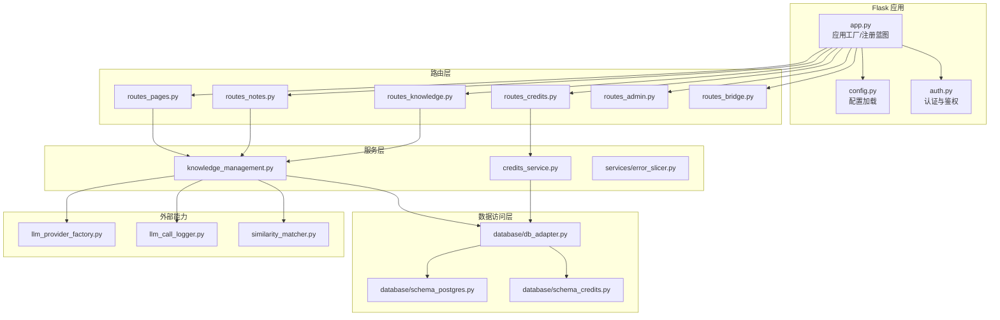
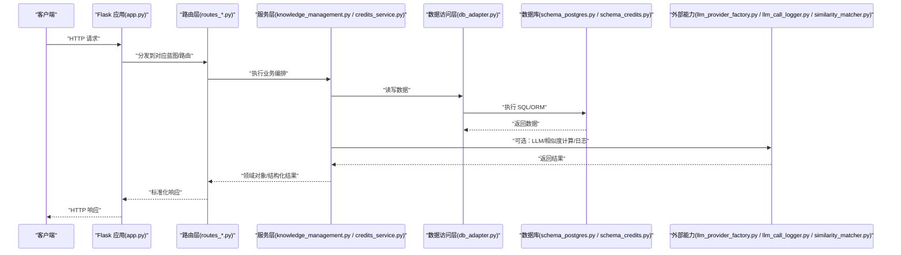
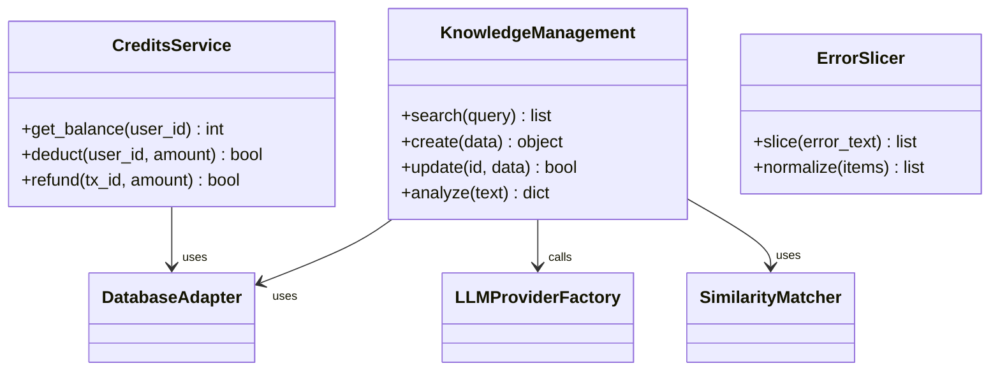
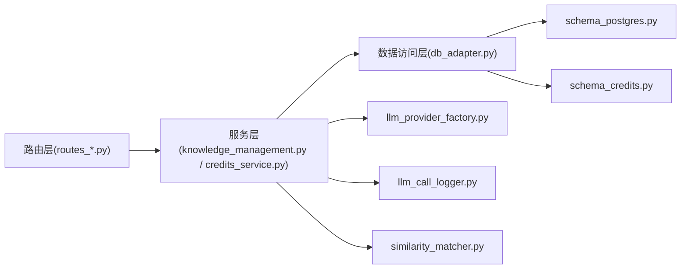

# 后端架构设计

<cite>
**本文引用的文件**   
- [app.py](file://server/app.py)
- [config.py](file://server/config.py)
- [auth.py](file://server/auth.py)
- [routes_pages.py](file://server/routes_pages.py)
- [routes_notes.py](file://server/routes_notes.py)
- [routes_knowledge.py](file://server/routes_knowledge.py)
- [routes_credits.py](file://server/routes_credits.py)
- [routes_admin.py](file://server/routes_admin.py)
- [routes_bridge.py](file://server/routes_bridge.py)
- [knowledge_management.py](file://server/knowledge_management.py)
- [credits_service.py](file://server/credits_service.py)
- [llm_provider_factory.py](file://server/llm_provider_factory.py)
- [llm_call_logger.py](file://server/llm_call_logger.py)
- [similarity_matcher.py](file://server/similarity_matcher.py)
- [database/db_adapter.py](file://server/database/db_adapter.py)
- [database/schema_postgres.py](file://server/database/schema_postgres.py)
- [database/schema_credits.py](file://server/database/schema_credits.py)
- [services/error_slicer.py](file://server/services/error_slicer.py)
</cite>

## 目录
1. [引言](#引言)
2. [项目结构](#项目结构)
3. [核心组件](#核心组件)
4. [架构总览](#架构总览)
5. [详细组件分析](#详细组件分析)
6. [依赖关系分析](#依赖关系分析)
7. [性能与扩展性](#性能与扩展性)
8. [故障排查指南](#故障排查指南)
9. [结论](#结论)
10. [附录：API 规范与集成要点](#附录api-规范与集成要点)

## 引言
本文件面向 LectureLearnLoop 后端，系统性梳理 Flask 应用的分层架构、模块职责、请求处理流程与响应格式。重点覆盖路由层、服务层、数据访问层的职责分离；中间件机制、认证授权、缓存策略、数据库连接池管理；以及模块化路由、业务逻辑封装、异常处理、扩展点与第三方服务集成方案。文档同时提供架构图、模块依赖图与请求处理流程图，帮助读者快速理解系统并指导后续扩展与维护。

## 项目结构
后端代码位于 server 目录，采用“按功能域划分路由 + 共享服务 + 数据访问”的组织方式：
- 应用入口与配置：app.py、config.py
- 认证与鉴权：auth.py
- 路由层（按功能域）：routes_pages.py、routes_notes.py、routes_knowledge.py、routes_credits.py、routes_admin.py、routes_bridge.py
- 服务层（业务编排）：knowledge_management.py、credits_service.py、services/error_slicer.py
- 数据访问层：database/db_adapter.py、database/schema_postgres.py、database/schema_credits.py
- 外部能力：llm_provider_factory.py、llm_call_logger.py、similarity_matcher.py

图表来源
- [app.py:1-120](file://server/app.py#L1-L120)
- [routes_pages.py:1-120](file://server/routes_pages.py#L1-L120)
- [routes_notes.py:1-120](file://server/routes_notes.py#L1-L120)
- [routes_knowledge.py:1-120](file://server/routes_knowledge.py#L1-L120)
- [routes_credits.py:1-120](file://server/routes_credits.py#L1-L120)
- [routes_admin.py:1-120](file://server/routes_admin.py#L1-L120)
- [routes_bridge.py:1-120](file://server/routes_bridge.py#L1-L120)
- [knowledge_management.py:1-120](file://server/knowledge_management.py#L1-L120)
- [credits_service.py:1-120](file://server/credits_service.py#L1-L120)
- [database/db_adapter.py:1-120](file://server/database/db_adapter.py#L1-L120)
- [database/schema_postgres.py:1-120](file://server/database/schema_postgres.py#L1-L120)
- [database/schema_credits.py:1-120](file://server/database/schema_credits.py#L1-L120)
- [llm_provider_factory.py:1-120](file://server/llm_provider_factory.py#L1-L120)
- [llm_call_logger.py:1-120](file://server/llm_call_logger.py#L1-L120)
- [similarity_matcher.py:1-120](file://server/similarity_matcher.py#L1-L120)

章节来源
- [app.py:1-120](file://server/app.py#L1-L120)
- [config.py:1-120](file://server/config.py#L1-L120)

## 核心组件
- 应用工厂与蓝图注册：集中创建 Flask 应用、加载配置、注册蓝图、挂载中间件与错误处理器。
- 认证与鉴权：基于会话或令牌的用户身份校验与权限控制，为受保护路由提供装饰器或钩子。
- 路由层：按功能域拆分，每个蓝图负责一组 URL 前缀与视图函数，保持高内聚低耦合。
- 服务层：封装跨路由复用的业务流程，协调数据访问与外部调用，返回领域对象或标准化结果。
- 数据访问层：统一数据库连接、事务与模型映射，屏蔽底层方言差异。
- 外部能力：LLM 提供者工厂、调用日志记录、相似度匹配等通用能力。

章节来源
- [app.py:1-120](file://server/app.py#L1-L120)
- [auth.py:1-120](file://server/auth.py#L1-L120)
- [routes_pages.py:1-120](file://server/routes_pages.py#L1-L120)
- [routes_notes.py:1-120](file://server/routes_notes.py#L1-L120)
- [routes_knowledge.py:1-120](file://server/routes_knowledge.py#L1-L120)
- [routes_credits.py:1-120](file://server/routes_credits.py#L1-L120)
- [routes_admin.py:1-120](file://server/routes_admin.py#L1-L120)
- [routes_bridge.py:1-120](file://server/routes_bridge.py#L1-L120)
- [knowledge_management.py:1-120](file://server/knowledge_management.py#L1-L120)
- [credits_service.py:1-120](file://server/credits_service.py#L1-L120)
- [database/db_adapter.py:1-120](file://server/database/db_adapter.py#L1-L120)

## 架构总览
下图展示从 HTTP 请求到数据持久化与外部调用的端到端流程，体现分层职责与关键扩展点。

图表来源
- [app.py:1-120](file://server/app.py#L1-L120)
- [routes_knowledge.py:1-120](file://server/routes_knowledge.py#L1-L120)
- [knowledge_management.py:1-120](file://server/knowledge_management.py#L1-L120)
- [database/db_adapter.py:1-120](file://server/database/db_adapter.py#L1-L120)
- [database/schema_postgres.py:1-120](file://server/database/schema_postgres.py#L1-L120)
- [database/schema_credits.py:1-120](file://server/database/schema_credits.py#L1-L120)
- [llm_provider_factory.py:1-120](file://server/llm_provider_factory.py#L1-L120)
- [llm_call_logger.py:1-120](file://server/llm_call_logger.py#L1-L120)
- [similarity_matcher.py:1-120](file://server/similarity_matcher.py#L1-L120)

## 详细组件分析

### 应用工厂与配置（app.py、config.py）
- 职责
  - 创建 Flask 实例，加载配置，注册蓝图与静态资源。
  - 挂载全局中间件（如请求日志、CORS、安全头）。
  - 定义全局错误处理器，统一异常转标准 JSON 响应。
  - 初始化数据库连接池、外部服务客户端。
- 关键点
  - 蓝图按功能域拆分，便于独立测试与部署。
  - 配置集中管理，支持多环境切换。
  - 错误处理遵循“先捕获、再分类、后格式化”的策略。

章节来源
- [app.py:1-120](file://server/app.py#L1-L120)
- [config.py:1-120](file://server/config.py#L1-L120)

### 认证与鉴权（auth.py）
- 职责
  - 用户登录、登出与会话/令牌管理。
  - 提供装饰器或钩子对受保护路由进行权限校验。
  - 维护角色/权限映射，支持细粒度访问控制。
- 关键点
  - 敏感信息加密存储，会话安全配置。
  - 失败路径统一返回标准错误码与消息。
  - 可插拔的认证后端（如本地、LDAP、OAuth）。

章节来源
- [auth.py:1-120](file://server/auth.py#L1-L120)

### 路由层（routes_*.py）
- 职责
  - 接收 HTTP 请求，参数校验与绑定。
  - 调用服务层完成业务编排。
  - 将服务层返回的对象序列化为标准响应格式。
- 设计原则
  - 路由薄、服务厚：路由不写复杂业务逻辑。
  - 统一状态码与错误体，便于前端消费。
  - 按功能域划分蓝图，URL 前缀清晰。

章节来源
- [routes_pages.py:1-120](file://server/routes_pages.py#L1-L120)
- [routes_notes.py:1-120](file://server/routes_notes.py#L1-L120)
- [routes_knowledge.py:1-120](file://server/routes_knowledge.py#L1-L120)
- [routes_credits.py:1-120](file://server/routes_credits.py#L1-L120)
- [routes_admin.py:1-120](file://server/routes_admin.py#L1-L120)
- [routes_bridge.py:1-120](file://server/routes_bridge.py#L1-L120)

### 服务层（knowledge_management.py、credits_service.py、services/error_slicer.py）
- knowledge_management.py
  - 知识点检索、生成、更新与关联分析。
  - 协调 LLM 调用、相似度匹配与数据库读写。
- credits_service.py
  - 积分/额度管理与扣减规则。
  - 事务性操作与幂等保障。
- services/error_slicer.py
  - 错误片段切分与归一化，辅助学习闭环。

图表来源
- [knowledge_management.py:1-120](file://server/knowledge_management.py#L1-L120)
- [credits_service.py:1-120](file://server/credits_service.py#L1-L120)
- [services/error_slicer.py:1-120](file://server/services/error_slicer.py#L1-L120)
- [database/db_adapter.py:1-120](file://server/database/db_adapter.py#L1-L120)
- [llm_provider_factory.py:1-120](file://server/llm_provider_factory.py#L1-L120)
- [similarity_matcher.py:1-120](file://server/similarity_matcher.py#L1-L120)

章节来源
- [knowledge_management.py:1-120](file://server/knowledge_management.py#L1-L120)
- [credits_service.py:1-120](file://server/credits_service.py#L1-L120)
- [services/error_slicer.py:1-120](file://server/services/error_slicer.py#L1-L120)

### 数据访问层（database/db_adapter.py、schema_postgres.py、schema_credits.py）
- db_adapter.py
  - 封装连接池、会话生命周期、事务边界。
  - 提供统一的查询/写入接口，屏蔽方言差异。
- schema_postgres.py / schema_credits.py
  - 定义表结构与迁移脚本，保证数据一致性。
- 关键点
  - 连接池大小与超时参数可配置。
  - 慢查询监控与重试策略。
  - 读写分离与只读副本接入点预留。

章节来源
- [database/db_adapter.py:1-120](file://server/database/db_adapter.py#L1-L120)
- [database/schema_postgres.py:1-120](file://server/database/schema_postgres.py#L1-L120)
- [database/schema_credits.py:1-120](file://server/database/schema_credits.py#L1-L120)

### 外部能力（llm_provider_factory.py、llm_call_logger.py、similarity_matcher.py）
- llm_provider_factory.py
  - 多厂商 LLM 抽象与工厂方法，支持热插拔。
- llm_call_logger.py
  - 记录 LLM 调用上下文、耗时与结果摘要，便于审计与排障。
- similarity_matcher.py
  - 文本相似度计算，支撑知识点去重与推荐。

章节来源
- [llm_provider_factory.py:1-120](file://server/llm_provider_factory.py#L1-L120)
- [llm_call_logger.py:1-120](file://server/llm_call_logger.py#L1-L120)
- [similarity_matcher.py:1-120](file://server/similarity_matcher.py#L1-L120)

## 依赖关系分析
- 路由层仅依赖服务层，避免直接访问数据库或外部服务。
- 服务层组合数据访问层与外部能力，形成稳定的业务边界。
- 数据访问层对数据库 schema 强依赖，对外暴露稳定接口。
- 外部能力通过工厂与适配器解耦，降低替换成本。

图表来源
- [routes_knowledge.py:1-120](file://server/routes_knowledge.py#L1-L120)
- [routes_credits.py:1-120](file://server/routes_credits.py#L1-L120)
- [knowledge_management.py:1-120](file://server/knowledge_management.py#L1-L120)
- [credits_service.py:1-120](file://server/credits_service.py#L1-L120)
- [database/db_adapter.py:1-120](file://server/database/db_adapter.py#L1-L120)
- [database/schema_postgres.py:1-120](file://server/database/schema_postgres.py#L1-L120)
- [database/schema_credits.py:1-120](file://server/database/schema_credits.py#L1-L120)
- [llm_provider_factory.py:1-120](file://server/llm_provider_factory.py#L1-L120)
- [llm_call_logger.py:1-120](file://server/llm_call_logger.py#L1-L120)
- [similarity_matcher.py:1-120](file://server/similarity_matcher.py#L1-L120)

## 性能与扩展性
- 性能
  - 数据库连接池：合理设置最大连接数、空闲回收与超时，避免连接泄漏。
  - 缓存策略：热点数据（如配置、字典表、热门知识点）使用内存缓存或 Redis，减少 DB 压力。
  - I/O 异步：LLM 调用与长任务建议走异步队列，避免阻塞请求线程。
  - 分页与索引：列表接口默认分页，关键字段建立索引，避免全表扫描。
- 扩展性
  - 插件机制：LLM 提供者、认证后端、存储后端均通过工厂/接口抽象，新增实现无需改动现有路由与服务。
  - 事件总线：在关键节点（如知识点创建、积分扣减）发布事件，供监听器异步处理。
  - 灰度与开关：通过配置中心控制新功能开关，逐步放量。

[本节为通用指导，不直接分析具体文件]

## 故障排查指南
- 常见问题定位
  - 认证失败：检查会话/令牌有效期、权限映射与中间件顺序。
  - 数据库连接异常：查看连接池配置、网络连通性与账号权限。
  - LLM 调用失败：核对密钥、配额与网络代理，查看调用日志。
  - 响应格式不一致：确认全局错误处理器与序列化逻辑。
- 诊断手段
  - 启用请求级日志，记录入参、耗时与下游调用。
  - 慢查询分析与执行计划审查。
  - 压测与链路追踪，定位瓶颈与抖动。

章节来源
- [app.py:1-120](file://server/app.py#L1-L120)
- [llm_call_logger.py:1-120](file://server/llm_call_logger.py#L1-L120)
- [database/db_adapter.py:1-120](file://server/database/db_adapter.py#L1-L120)

## 结论
本架构以 Flask 为核心，通过蓝图拆分路由、服务层聚合业务、数据访问层统一持久化，形成清晰的分层与松耦合依赖。结合工厂模式与适配器抽象，系统具备良好的可扩展性与可替换性。配合统一的错误处理、日志与监控，能够支撑知识学习与练习场景的稳定演进。

[本节为总结性内容，不直接分析具体文件]

## 附录：API 规范与集成要点
- API 设计规范
  - 统一响应体：包含状态码、消息、数据体与追踪 ID。
  - 错误码体系：区分参数错误、权限不足、业务异常与系统异常。
  - 版本化：URL 前缀或 Header 控制 API 版本，兼容升级。
- 认证授权
  - 登录态与会话安全，支持刷新令牌与单点登录。
  - 基于角色的访问控制（RBAC），最小权限原则。
- 缓存策略
  - 多级缓存：本地内存 + 分布式缓存，失效策略与预热机制。
  - 缓存穿透/雪崩防护：空值缓存、随机过期、限流降级。
- 数据库连接池
  - 连接池参数可调，健康检查与自动重连。
  - 事务边界在服务层明确，避免长事务。
- 第三方服务集成
  - LLM 提供者工厂：统一接口，支持多厂商切换。
  - 回调与重试：幂等键、退避重试与熔断降级。
  - 审计与合规：调用日志脱敏与留存策略。

[本节为通用指导，不直接分析具体文件]