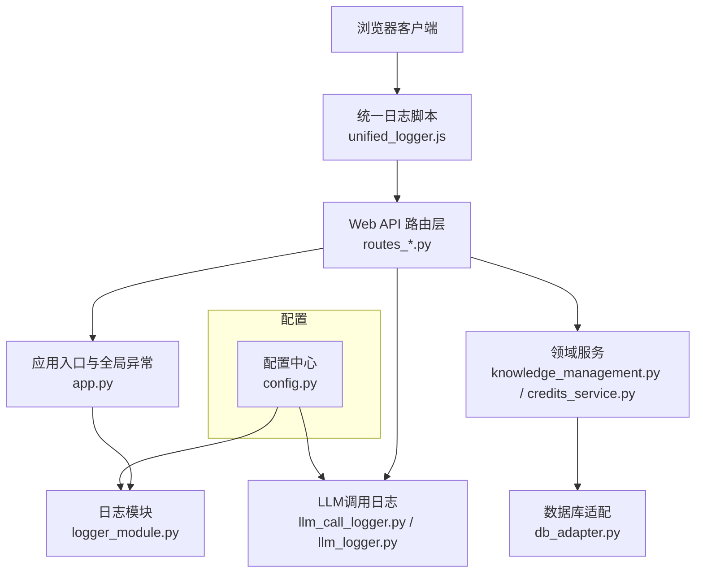
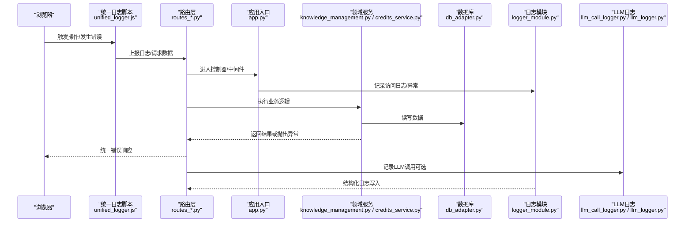
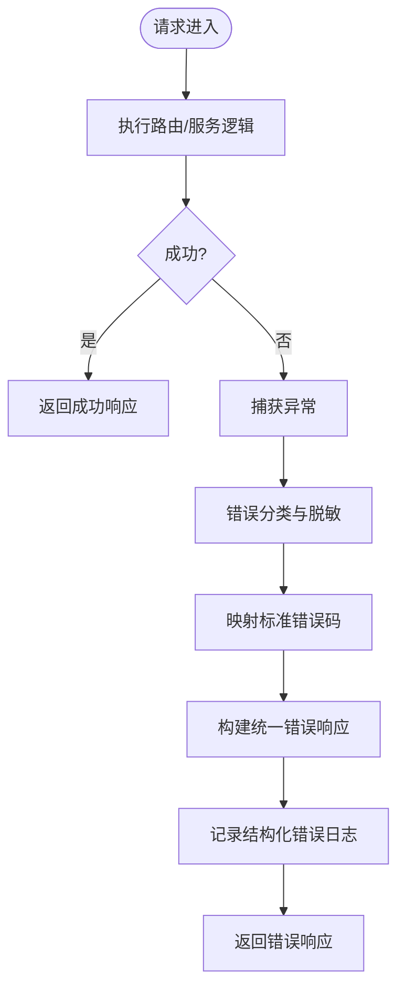
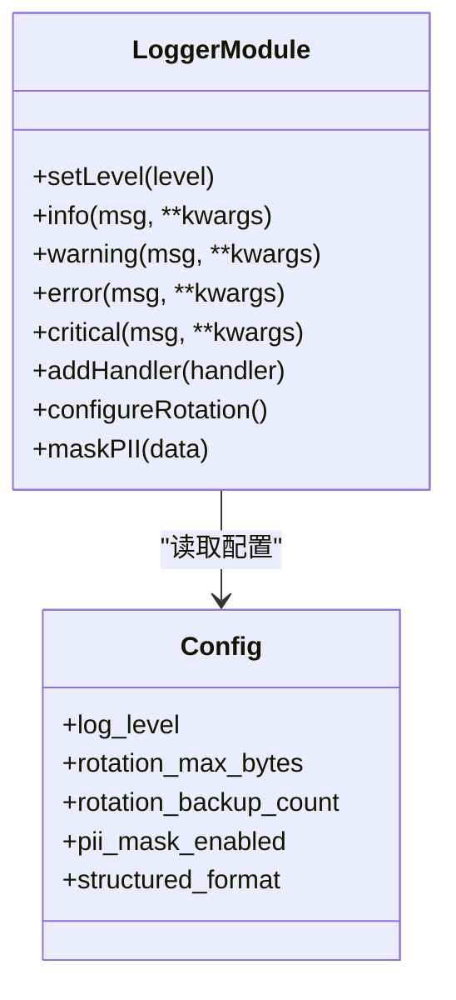
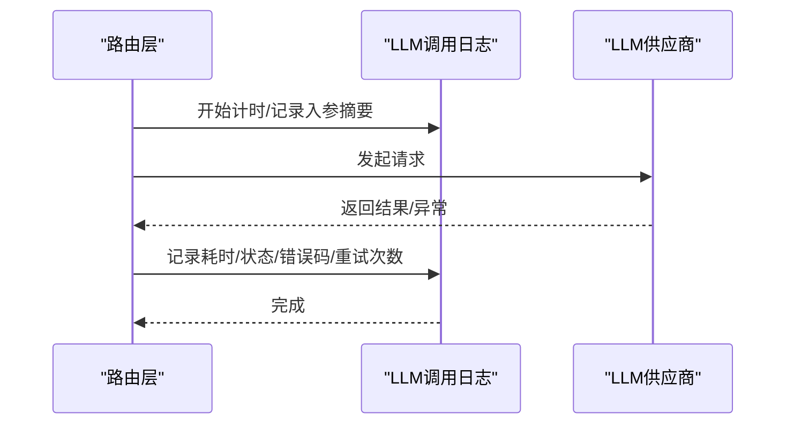
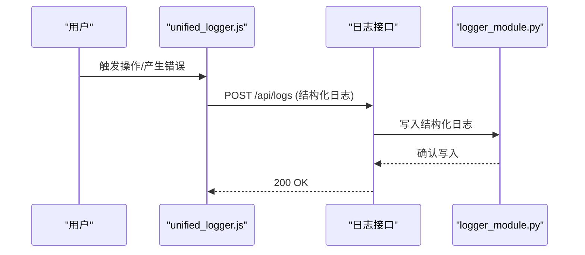
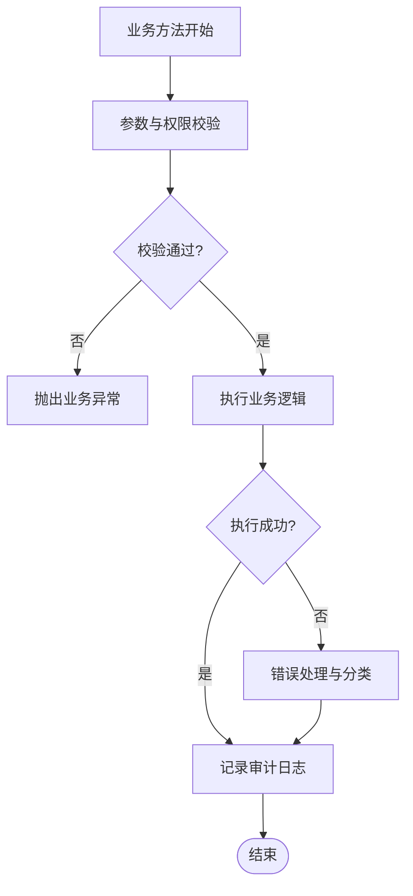
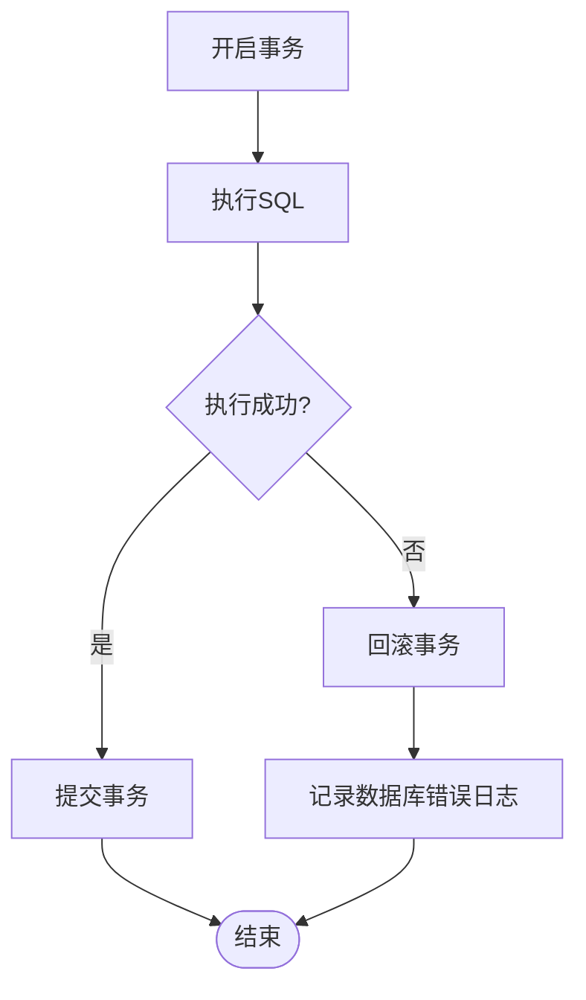
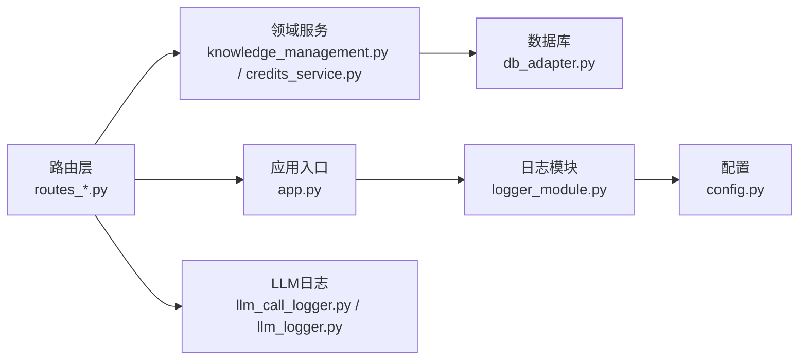

# 异常处理与日志

<cite>
**本文引用的文件**   
- [app.py](file://server/app.py)
- [logger_module.py](file://server/logger_module.py)
- [llm_call_logger.py](file://server/llm_call_logger.py)
- [llm_logger.py](file://server/llm_logger.py)
- [config.py](file://server/config.py)
- [routes_bridge.py](file://server/routes_bridge.py)
- [routes_notes.py](file://server/routes_notes.py)
- [routes_knowledge.py](file://server/routes_knowledge.py)
- [routes_admin.py](file://server/routes_admin.py)
- [routes_credits.py](file://server/routes_credits.py)
- [knowledge_management.py](file://server/knowledge_management.py)
- [credits_service.py](file://server/credits_service.py)
- [error_slicer.py](file://server/services/error_slicer.py)
- [db_adapter.py](file://server/database/db_adapter.py)
- [schema_postgres.py](file://server/database/schema_postgres.py)
- [schema_credits.py](file://server/database/schema_credits.py)
- [unified_logger.js](file://server/static/js/unified_logger.js)
</cite>

## 目录
1. [引言](#引言)
2. [项目结构](#项目结构)
3. [核心组件](#核心组件)
4. [架构总览](#架构总览)
5. [详细组件分析](#详细组件分析)
6. [依赖关系分析](#依赖关系分析)
7. [性能考虑](#性能考虑)
8. [故障排查指南](#故障排查指南)
9. [结论](#结论)
10. [附录](#附录)

## 引言
本章节为LectureLearnLoop的异常处理与日志系统提供系统化、可操作的架构文档。目标包括：
- 全局异常捕获机制与错误分类策略
- 用户友好的错误响应格式
- 多级日志记录、结构化日志格式与日志轮转策略
- LLM调用日志、性能监控指标与业务审计日志
- 错误追踪工具、告警机制与故障恢复策略
- 日志分析工具、性能调优建议与运维监控方案

## 项目结构
围绕异常与日志的核心代码主要位于后端服务目录中，前端通过统一日志脚本配合服务端进行可视化展示。关键路径如下：
- 应用入口与全局异常处理：server/app.py
- 日志模块与配置：server/logger_module.py、server/config.py
- LLM调用日志：server/llm_call_logger.py、server/llm_logger.py
- 路由层（API）：server/routes_*.py
- 领域服务：server/knowledge_management.py、server/credits_service.py
- 数据库适配与模式：server/database/db_adapter.py、server/database/schema_*.py
- 前端统一日志：server/static/js/unified_logger.js

图示来源
- [app.py:1-200](file://server/app.py#L1-L200)
- [logger_module.py:1-200](file://server/logger_module.py#L1-L200)
- [llm_call_logger.py:1-200](file://server/llm_call_logger.py#L1-L200)
- [llm_logger.py:1-200](file://server/llm_logger.py#L1-L200)
- [config.py:1-200](file://server/config.py#L1-L200)
- [routes_bridge.py:1-200](file://server/routes_bridge.py#L1-L200)
- [routes_notes.py:1-200](file://server/routes_notes.py#L1-L200)
- [routes_knowledge.py:1-200](file://server/routes_knowledge.py#L1-L200)
- [routes_admin.py:1-200](file://server/routes_admin.py#L1-L200)
- [routes_credits.py:1-200](file://server/routes_credits.py#L1-L200)
- [knowledge_management.py:1-200](file://server/knowledge_management.py#L1-L200)
- [credits_service.py:1-200](file://server/credits_service.py#L1-L200)
- [db_adapter.py:1-200](file://server/database/db_adapter.py#L1-L200)
- [schema_postgres.py:1-200](file://server/database/schema_postgres.py#L1-L200)
- [schema_credits.py:1-200](file://server/database/schema_credits.py#L1-L200)
- [unified_logger.js:1-200](file://server/static/js/unified_logger.js#L1-L200)

章节来源
- [app.py:1-200](file://server/app.py#L1-L200)
- [logger_module.py:1-200](file://server/logger_module.py#L1-L200)
- [config.py:1-200](file://server/config.py#L1-L200)

## 核心组件
- 全局异常捕获与错误分类：在应用入口处注册全局异常处理器，将异常按“输入校验失败、权限不足、资源不存在、外部依赖失败、内部错误”等类别进行分类，并返回统一的错误响应结构，便于前端展示与后续分析。
- 结构化日志模块：基于logger_module.py实现多级别日志（DEBUG/INFO/WARNING/ERROR/CRITICAL），支持JSON结构化输出、字段标准化（trace_id、span_id、user_id、endpoint、method、status_code、duration_ms、error_code、message）。
- LLM调用日志：通过llm_call_logger.py与llm_logger.py记录每次LLM请求的入参摘要、模型名称、供应商、耗时、状态码、重试次数、错误码与截断后的内容片段，避免敏感信息泄露。
- 前端统一日志：unified_logger.js聚合前端错误、网络请求结果与用户操作事件，上报至服务端统一日志接口，便于端到端追踪。
- 配置中心：config.py集中管理日志级别、轮转策略、存储路径、采样率、PII脱敏开关、LLM日志保留策略等。

章节来源
- [app.py:1-200](file://server/app.py#L1-L200)
- [logger_module.py:1-200](file://server/logger_module.py#L1-L200)
- [llm_call_logger.py:1-200](file://server/llm_call_logger.py#L1-L200)
- [llm_logger.py:1-200](file://server/llm_logger.py#L1-L200)
- [unified_logger.js:1-200](file://server/static/js/unified_logger.js#L1-L200)
- [config.py:1-200](file://server/config.py#L1-L200)

## 架构总览
下图展示了从前端到后端、从API到日志与数据库的整体交互流程，以及异常与日志在各层的落点。

图示来源
- [routes_bridge.py:1-200](file://server/routes_bridge.py#L1-L200)
- [routes_notes.py:1-200](file://server/routes_notes.py#L1-L200)
- [routes_knowledge.py:1-200](file://server/routes_knowledge.py#L1-L200)
- [routes_admin.py:1-200](file://server/routes_admin.py#L1-L200)
- [routes_credits.py:1-200](file://server/routes_credits.py#L1-L200)
- [app.py:1-200](file://server/app.py#L1-L200)
- [logger_module.py:1-200](file://server/logger_module.py#L1-L200)
- [llm_call_logger.py:1-200](file://server/llm_call_logger.py#L1-L200)
- [llm_logger.py:1-200](file://server/llm_logger.py#L1-L200)
- [knowledge_management.py:1-200](file://server/knowledge_management.py#L1-L200)
- [credits_service.py:1-200](file://server/credits_service.py#L1-L200)
- [db_adapter.py:1-200](file://server/database/db_adapter.py#L1-L200)

## 详细组件分析

### 全局异常捕获与错误分类
- 捕获位置：应用入口app.py中注册全局异常处理器，拦截未处理异常，统一转换为HTTP响应。
- 分类策略：根据异常类型与上下文（如是否来自数据库、外部API、权限校验）映射为标准错误码与消息模板；对敏感信息进行脱敏。
- 用户友好响应：返回包含code、message、details（可选）、trace_id的结构化JSON，便于前端提示与排障。
- 关联日志：每个异常均附带trace_id，并与访问日志、业务日志关联，形成完整链路。

图示来源
- [app.py:1-200](file://server/app.py#L1-L200)
- [logger_module.py:1-200](file://server/logger_module.py#L1-L200)

章节来源
- [app.py:1-200](file://server/app.py#L1-L200)

### 结构化日志模块与轮转策略
- 日志级别：DEBUG/INFO/WARNING/ERROR/CRITICAL，按模块与功能域分别设置级别。
- 结构化字段：trace_id、span_id、timestamp、level、module、endpoint、method、status_code、duration_ms、error_code、message、user_id、session_id等。
- 输出格式：默认JSON，便于ELK/ClickHouse等采集与分析；同时支持控制台彩色输出用于本地调试。
- 轮转策略：按大小与时间双维度轮转，保留N份历史日志，压缩归档，自动清理过期文件。
- PII脱敏：对手机号、邮箱、令牌等字段进行掩码或哈希处理，防止敏感信息泄露。

图示来源
- [logger_module.py:1-200](file://server/logger_module.py#L1-L200)
- [config.py:1-200](file://server/config.py#L1-L200)

章节来源
- [logger_module.py:1-200](file://server/logger_module.py#L1-L200)
- [config.py:1-200](file://server/config.py#L1-L200)

### LLM调用日志与性能指标
- 记录范围：每次LLM请求的模型名、供应商、入参摘要、出参摘要、耗时、重试次数、状态码、错误码、缓存命中情况。
- 安全策略：不记录原始敏感文本，仅记录摘要与必要元数据；必要时对token进行哈希。
- 性能指标：统计P50/P95/P99延迟、QPS、错误率、超时率、重试成功率，供仪表盘展示。
- 存储与查询：日志写入结构化存储，支持按模型、供应商、错误码、时间段检索。

图示来源
- [llm_call_logger.py:1-200](file://server/llm_call_logger.py#L1-L200)
- [llm_logger.py:1-200](file://server/llm_logger.py#L1-L200)

章节来源
- [llm_call_logger.py:1-200](file://server/llm_call_logger.py#L1-L200)
- [llm_logger.py:1-200](file://server/llm_logger.py#L1-L200)

### 前端统一日志与端到端追踪
- 功能：收集前端JS错误、网络请求结果、用户操作事件，生成trace_id并上报服务端。
- 上报接口：统一日志接口接收结构化日志，合并前后端链路，便于问题定位。
- 展示：提供LLM日志、内存错误、练习错误等页面，支持筛选与导出。

图示来源
- [unified_logger.js:1-200](file://server/static/js/unified_logger.js#L1-L200)
- [logger_module.py:1-200](file://server/logger_module.py#L1-L200)

章节来源
- [unified_logger.js:1-200](file://server/static/js/unified_logger.js#L1-L200)

### 领域服务中的错误处理与审计
- 知识管理与积分服务：在业务逻辑中捕获特定异常（如权限不足、余额不足、数据不一致），转换为标准错误码，并记录审计日志（谁、何时、做了什么、结果如何）。
- 错误切片：services/error_slicer.py提供错误片段提取与归一化能力，帮助快速定位根因。

图示来源
- [knowledge_management.py:1-200](file://server/knowledge_management.py#L1-L200)
- [credits_service.py:1-200](file://server/credits_service.py#L1-L200)
- [error_slicer.py:1-200](file://server/services/error_slicer.py#L1-L200)

章节来源
- [knowledge_management.py:1-200](file://server/knowledge_management.py#L1-L200)
- [credits_service.py:1-200](file://server/credits_service.py#L1-L200)
- [error_slicer.py:1-200](file://server/services/error_slicer.py#L1-L200)

### 数据库层异常与事务回滚
- 连接与查询：db_adapter.py封装数据库连接、查询与事务，统一捕获SQL异常并转换为标准错误码。
- 模式定义：schema_postgres.py与schema_credits.py定义表结构与约束，确保数据一致性。
- 回滚策略：在事务内发生异常时自动回滚，并记录错误上下文与堆栈摘要。

图示来源
- [db_adapter.py:1-200](file://server/database/db_adapter.py#L1-L200)
- [schema_postgres.py:1-200](file://server/database/schema_postgres.py#L1-L200)
- [schema_credits.py:1-200](file://server/database/schema_credits.py#L1-L200)

章节来源
- [db_adapter.py:1-200](file://server/database/db_adapter.py#L1-L200)
- [schema_postgres.py:1-200](file://server/database/schema_postgres.py#L1-L200)
- [schema_credits.py:1-200](file://server/database/schema_credits.py#L1-L200)

## 依赖关系分析
- 低耦合高内聚：路由层仅负责请求分发与参数校验，业务逻辑下沉至领域服务；日志与异常处理通过logger_module与app.py解耦。
- 外部依赖：LLM供应商、数据库、认证服务等通过适配器或工厂模式接入，便于替换与测试。
- 潜在循环依赖：应避免在logger_module中直接引用业务模块；若需要上下文，使用线程局部变量或请求上下文注入。

图示来源
- [routes_bridge.py:1-200](file://server/routes_bridge.py#L1-L200)
- [routes_notes.py:1-200](file://server/routes_notes.py#L1-L200)
- [routes_knowledge.py:1-200](file://server/routes_knowledge.py#L1-L200)
- [routes_admin.py:1-200](file://server/routes_admin.py#L1-L200)
- [routes_credits.py:1-200](file://server/routes_credits.py#L1-L200)
- [app.py:1-200](file://server/app.py#L1-L200)
- [logger_module.py:1-200](file://server/logger_module.py#L1-L200)
- [llm_call_logger.py:1-200](file://server/llm_call_logger.py#L1-L200)
- [llm_logger.py:1-200](file://server/llm_logger.py#L1-L200)
- [knowledge_management.py:1-200](file://server/knowledge_management.py#L1-L200)
- [credits_service.py:1-200](file://server/credits_service.py#L1-L200)
- [db_adapter.py:1-200](file://server/database/db_adapter.py#L1-L200)
- [config.py:1-200](file://server/config.py#L1-L200)

章节来源
- [app.py:1-200](file://server/app.py#L1-L200)
- [logger_module.py:1-200](file://server/logger_module.py#L1-L200)
- [config.py:1-200](file://server/config.py#L1-L200)

## 性能考虑
- 日志采样：在高并发场景下启用日志采样，降低IO压力；对ERROR/CRITICAL保持全量记录。
- 异步写入：日志写入采用异步队列，避免阻塞主线程；批量提交减少磁盘IO。
- 结构化索引：对trace_id、endpoint、error_code建立索引，提升查询效率。
- LLM调用优化：合理设置超时与重试退避策略，避免雪崩；对热点模型启用缓存与降级。
- 前端日志节流：对高频事件进行节流与去重，减少上报频率。

[本节为通用指导，无需具体文件引用]

## 故障排查指南
- 快速定位：通过trace_id串联前后端日志，结合endpoint与方法快速定位问题。
- 常见错误：
  - 输入校验失败：检查参数合法性与必填项。
  - 权限不足：核对用户角色与资源权限。
  - 外部依赖失败：检查LLM供应商状态、网络连通性与配额。
  - 数据库异常：查看SQL错误码与锁等待情况。
- 告警机制：对ERROR/CRITICAL、LLM超时、重试失败、数据库连接失败等阈值触发告警（邮件/IM/工单）。
- 恢复策略：
  - 自动重试与退避：对瞬时错误进行有限次重试。
  - 熔断与降级：当错误率超过阈值，暂时关闭非核心功能或返回缓存数据。
  - 数据一致性：事务回滚与补偿任务，保证最终一致。

章节来源
- [app.py:1-200](file://server/app.py#L1-L200)
- [logger_module.py:1-200](file://server/logger_module.py#L1-L200)
- [llm_call_logger.py:1-200](file://server/llm_call_logger.py#L1-L200)
- [llm_logger.py:1-200](file://server/llm_logger.py#L1-L200)
- [db_adapter.py:1-200](file://server/database/db_adapter.py#L1-L200)

## 结论
本架构通过全局异常捕获、结构化日志、LLM调用日志与前端统一日志，构建了端到端的可观测性体系。配合配置中心与轮转策略，既保证了可维护性，又兼顾了性能与安全。建议在上线前完善告警规则与演练恢复流程，持续优化日志质量与查询性能。

[本节为总结性内容，无需具体文件引用]

## 附录
- 统一错误响应字段建议：
  - code：标准错误码
  - message：面向用户的友好消息
  - details：技术细节（可选）
  - trace_id：链路追踪ID
- 结构化日志关键字段建议：
  - timestamp、level、module、endpoint、method、status_code、duration_ms、error_code、message、user_id、session_id、trace_id、span_id
- 日志轮转建议：
  - 按大小与时间双维度轮转
  - 保留最近N份，压缩归档
  - 自动清理过期文件

[本节为补充说明，无需具体文件引用]