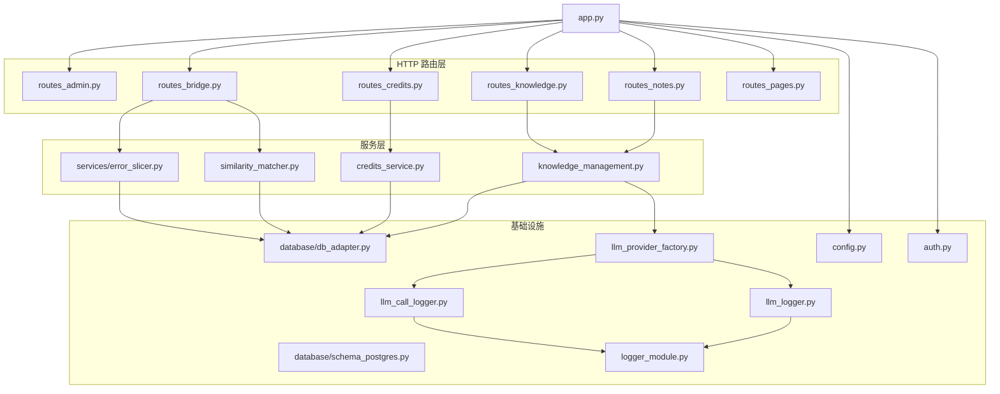
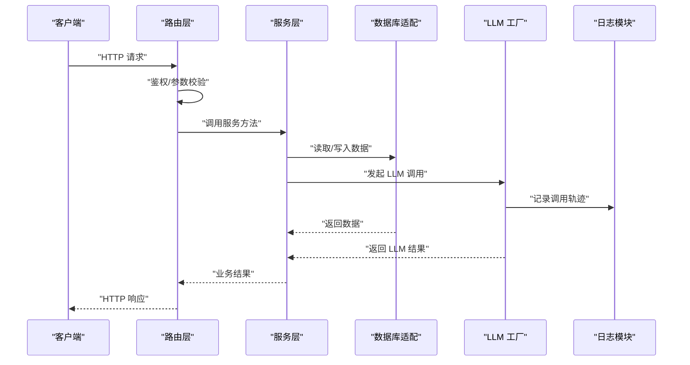
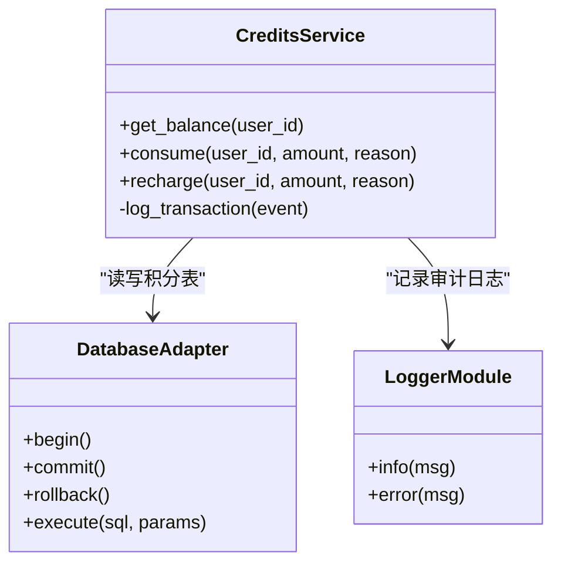
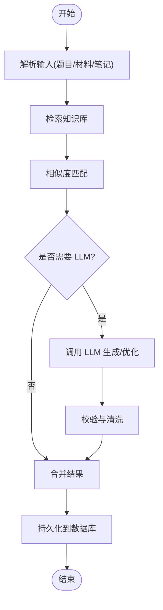
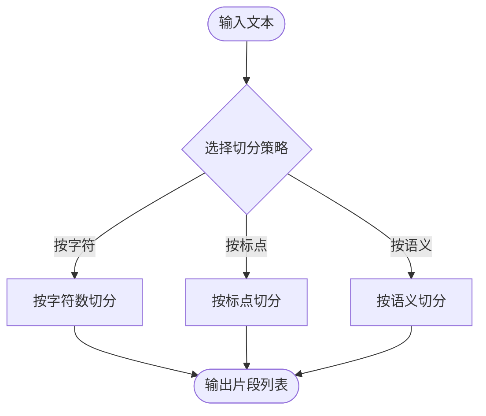
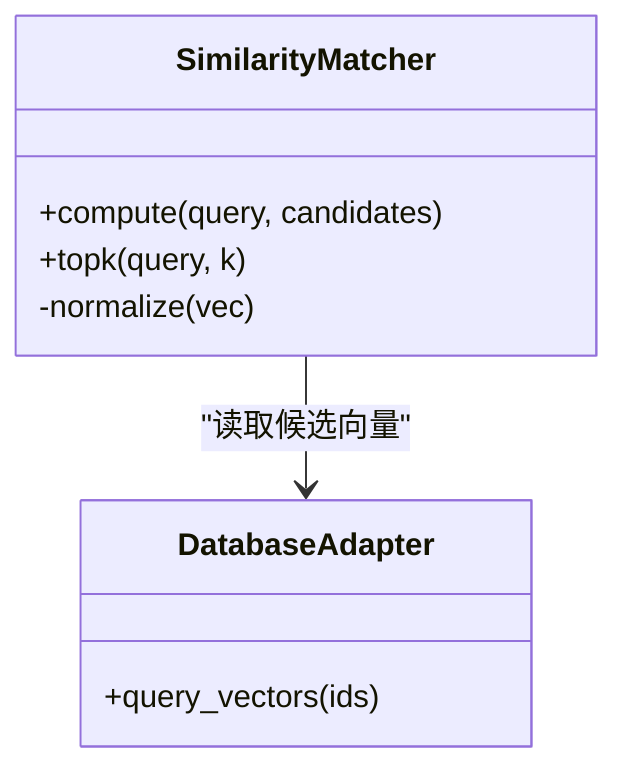
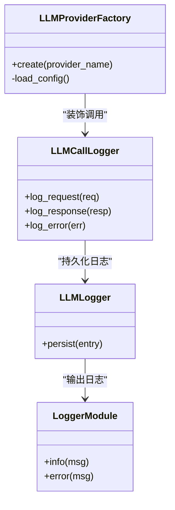
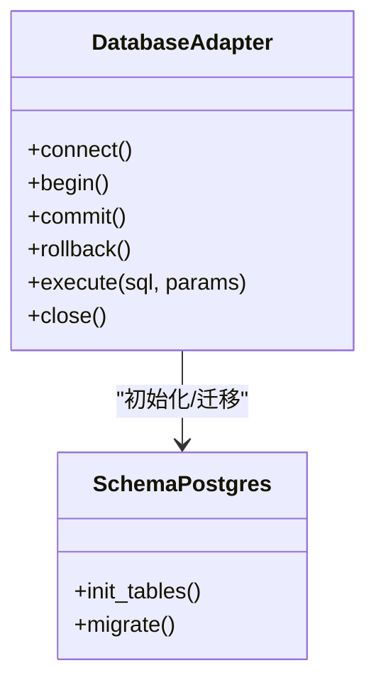
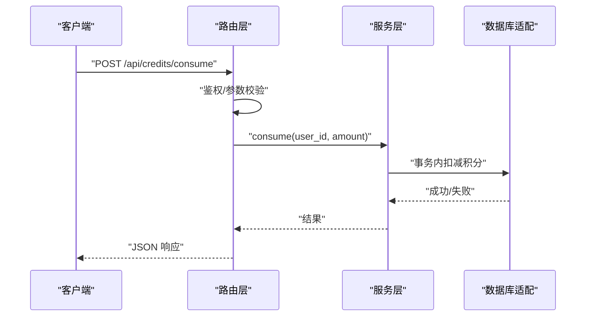
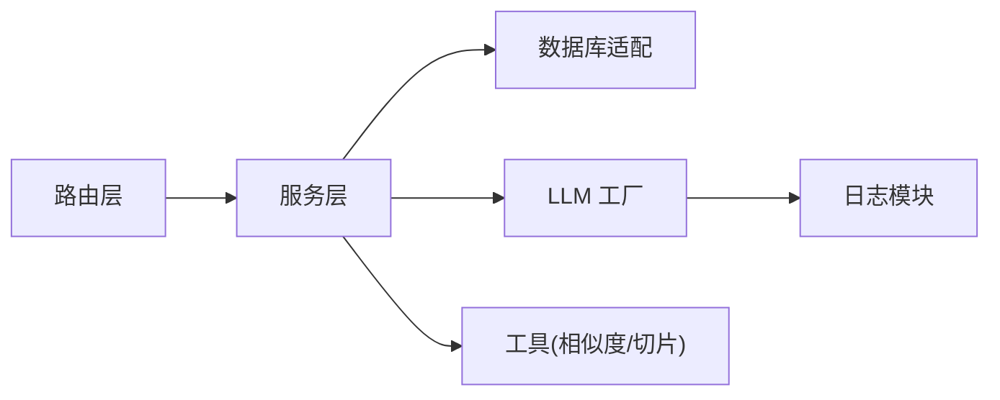

# 服务层架构

<cite>
**本文引用的文件**   
- [app.py](file://server/app.py)
- [config.py](file://server/config.py)
- [auth.py](file://server/auth.py)
- [credits_service.py](file://server/credits_service.py)
- [knowledge_management.py](file://server/knowledge_management.py)
- [llm_call_logger.py](file://server/llm_call_logger.py)
- [llm_logger.py](file://server/llm_logger.py)
- [llm_provider_factory.py](file://server/llm_provider_factory.py)
- [logger_module.py](file://server/logger_module.py)
- [routes_admin.py](file://server/routes_admin.py)
- [routes_bridge.py](file://server/routes_bridge.py)
- [routes_credits.py](file://server/routes_credits.py)
- [routes_knowledge.py](file://server/routes_knowledge.py)
- [routes_notes.py](file://server/routes_notes.py)
- [routes_pages.py](file://server/routes_pages.py)
- [similarity_matcher.py](file://server/similarity_matcher.py)
- [database/db_adapter.py](file://server/database/db_adapter.py)
- [database/schema_postgres.py](file://server/database/schema_postgres.py)
- [services/error_slicer.py](file://server/services/error_slicer.py)
</cite>

## 目录
1. [引言](#引言)
2. [项目结构](#项目结构)
3. [核心组件](#核心组件)
4. [架构总览](#架构总览)
5. [详细组件分析](#详细组件分析)
6. [依赖关系分析](#依赖关系分析)
7. [性能与可扩展性](#性能与可扩展性)
8. [故障排查指南](#故障排查指南)
9. [结论](#结论)

## 引言
本文件面向 LectureLearnLoop 的服务层，聚焦“服务层职责边界、业务逻辑封装模式、依赖注入机制、接口抽象与实现分离、服务间通信协议、事务管理与数据一致性、服务状态管理、缓存策略与异步处理、扩展点与插件化、第三方服务集成”等主题。文档以代码仓库中的服务端 Python 模块为依据，结合路由层、领域服务、数据访问层与外部 LLM 提供方，给出可落地的架构说明与改进建议。

## 项目结构
服务层位于 server 目录下，采用“路由层 + 服务层 + 数据访问层 + 工具与配置”的分层组织：
- 路由层：负责 HTTP 请求解析、鉴权、参数校验与响应组装，调用服务层完成业务编排。
- 服务层：封装领域业务逻辑，协调多个子系统（LLM、数据库、日志、积分等），对外暴露稳定的服务接口。
- 数据访问层：封装数据库连接、模型定义与查询细节，屏蔽底层差异。
- 工具与配置：提供通用能力（日志、相似度匹配、错误切片、LLM 工厂）与系统配置。

图示来源
- [app.py:1-200](file://server/app.py#L1-L200)
- [routes_credits.py:1-200](file://server/routes_credits.py#L1-L200)
- [routes_knowledge.py:1-200](file://server/routes_knowledge.py#L1-L200)
- [routes_notes.py:1-200](file://server/routes_notes.py#L1-L200)
- [routes_bridge.py:1-200](file://server/routes_bridge.py#L1-L200)
- [credits_service.py:1-200](file://server/credits_service.py#L1-L200)
- [knowledge_management.py:1-200](file://server/knowledge_management.py#L1-L200)
- [services/error_slicer.py:1-200](file://server/services/error_slicer.py#L1-L200)
- [similarity_matcher.py:1-200](file://server/similarity_matcher.py#L1-L200)
- [database/db_adapter.py:1-200](file://server/database/db_adapter.py#L1-L200)
- [database/schema_postgres.py:1-200](file://server/database/schema_postgres.py#L1-L200)
- [llm_provider_factory.py:1-200](file://server/llm_provider_factory.py#L1-L200)
- [llm_call_logger.py:1-200](file://server/llm_call_logger.py#L1-L200)
- [llm_logger.py:1-200](file://server/llm_logger.py#L1-L200)
- [logger_module.py:1-200](file://server/logger_module.py#L1-L200)
- [config.py:1-200](file://server/config.py#L1-L200)
- [auth.py:1-200](file://server/auth.py#L1-L200)

章节来源
- [app.py:1-200](file://server/app.py#L1-L200)
- [config.py:1-200](file://server/config.py#L1-L200)

## 核心组件
本节从服务层视角梳理关键角色与职责：
- 积分服务 credits_service：封装用户积分的获取、消费、充值与审计相关逻辑，作为财务类业务的统一入口。
- 知识管理 knowledge_management：聚合知识点检索、关联、更新与与 LLM 交互的业务流程，是学习闭环的核心编排者。
- 错误切片 services/error_slicer：将长文本或错误片段切分为可处理的单元，便于后续分析与展示。
- 相似度匹配 similarity_matcher：基于向量或规则进行内容相似度计算，支撑知识点去重与推荐。
- LLM 工厂 llm_provider_factory：按配置动态创建不同 LLM 提供商客户端，统一调用接口。
- LLM 日志 llm_call_logger / llm_logger：记录 LLM 调用轨迹与结果，辅助排障与审计。
- 数据库适配 database/db_adapter：封装数据库连接、会话与事务边界，屏蔽具体驱动差异。
- 配置与鉴权 config.py / auth.py：集中系统配置与认证授权逻辑。

章节来源
- [credits_service.py:1-200](file://server/credits_service.py#L1-L200)
- [knowledge_management.py:1-200](file://server/knowledge_management.py#L1-L200)
- [services/error_slicer.py:1-200](file://server/services/error_slicer.py#L1-L200)
- [similarity_matcher.py:1-200](file://server/similarity_matcher.py#L1-L200)
- [llm_provider_factory.py:1-200](file://server/llm_provider_factory.py#L1-L200)
- [llm_call_logger.py:1-200](file://server/llm_call_logger.py#L1-L200)
- [llm_logger.py:1-200](file://server/llm_logger.py#L1-L200)
- [database/db_adapter.py:1-200](file://server/database/db_adapter.py#L1-L200)
- [config.py:1-200](file://server/config.py#L1-L200)
- [auth.py:1-200](file://server/auth.py#L1-L200)

## 架构总览
服务层采用“路由层薄、服务层厚”的设计：路由层仅做请求解析、鉴权与响应包装；真正的业务编排集中在服务层。服务层通过依赖注入的方式使用数据库适配器、LLM 工厂与日志模块，避免硬编码耦合。

图示来源
- [routes_credits.py:1-200](file://server/routes_credits.py#L1-L200)
- [routes_knowledge.py:1-200](file://server/routes_knowledge.py#L1-L200)
- [routes_notes.py:1-200](file://server/routes_notes.py#L1-L200)
- [routes_bridge.py:1-200](file://server/routes_bridge.py#L1-L200)
- [credits_service.py:1-200](file://server/credits_service.py#L1-L200)
- [knowledge_management.py:1-200](file://server/knowledge_management.py#L1-L200)
- [database/db_adapter.py:1-200](file://server/database/db_adapter.py#L1-L200)
- [llm_provider_factory.py:1-200](file://server/llm_provider_factory.py#L1-L200)
- [llm_call_logger.py:1-200](file://server/llm_call_logger.py#L1-L200)
- [llm_logger.py:1-200](file://server/llm_logger.py#L1-L200)

## 详细组件分析

### 积分服务 credits_service
职责边界
- 对用户积分进行查询、扣减、充值与审计，确保财务类操作的原子性与可追溯性。
- 与路由层解耦，不直接操作 HTTP 上下文。

依赖注入
- 通过构造函数或模块级初始化注入数据库适配器与日志模块，便于测试替换。

事务与一致性
- 对涉及余额变动的写操作应置于数据库事务中，保证“读-改-写”的原子性。
- 引入幂等键（如交易流水号）防止重复扣费。

图示来源
- [credits_service.py:1-200](file://server/credits_service.py#L1-L200)
- [database/db_adapter.py:1-200](file://server/database/db_adapter.py#L1-L200)
- [logger_module.py:1-200](file://server/logger_module.py#L1-L200)

章节来源
- [credits_service.py:1-200](file://server/credits_service.py#L1-L200)
- [database/db_adapter.py:1-200](file://server/database/db_adapter.py#L1-L200)
- [logger_module.py:1-200](file://server/logger_module.py#L1-L200)

### 知识管理 knowledge_management
职责边界
- 编排知识点检索、生成、更新以及与 LLM 的交互流程。
- 协调相似度匹配与错误切片等子服务，形成学习闭环。

依赖注入
- 注入数据库适配器、LLM 工厂、相似度匹配器与日志模块。

业务流程

图示来源
- [knowledge_management.py:1-200](file://server/knowledge_management.py#L1-L200)
- [similarity_matcher.py:1-200](file://server/similarity_matcher.py#L1-L200)
- [llm_provider_factory.py:1-200](file://server/llm_provider_factory.py#L1-L200)
- [database/db_adapter.py:1-200](file://server/database/db_adapter.py#L1-L200)

章节来源
- [knowledge_management.py:1-200](file://server/knowledge_management.py#L1-L200)
- [similarity_matcher.py:1-200](file://server/similarity_matcher.py#L1-L200)
- [llm_provider_factory.py:1-200](file://server/llm_provider_factory.py#L1-L200)
- [database/db_adapter.py:1-200](file://server/database/db_adapter.py#L1-L200)

### 错误切片 services/error_slicer
职责边界
- 将长文本或错误片段切分为固定长度或语义单元的片段，便于后续入库与展示。

算法要点
- 支持按字符数、标点或语义边界切分。
- 保留上下文信息以便还原。

图示来源
- [services/error_slicer.py:1-200](file://server/services/error_slicer.py#L1-L200)

章节来源
- [services/error_slicer.py:1-200](file://server/services/error_slicer.py#L1-L200)

### 相似度匹配 similarity_matcher
职责边界
- 为知识点、错题、材料等提供相似度计算能力，用于去重、推荐与召回。

依赖
- 依赖数据库适配器读取向量或特征字段，必要时与 LLM 生成的嵌入向量配合。

图示来源
- [similarity_matcher.py:1-200](file://server/similarity_matcher.py#L1-L200)
- [database/db_adapter.py:1-200](file://server/database/db_adapter.py#L1-L200)

章节来源
- [similarity_matcher.py:1-200](file://server/similarity_matcher.py#L1-L200)
- [database/db_adapter.py:1-200](file://server/database/db_adapter.py#L1-L200)

### LLM 工厂与日志 llm_provider_factory / llm_call_logger / llm_logger
职责边界
- 工厂根据配置动态创建不同 LLM 客户端，统一调用接口。
- 日志模块记录每次调用的输入、输出、耗时与错误，便于审计与排障。

依赖注入
- 工厂接收配置对象与日志模块，避免在运行时解析配置。

图示来源
- [llm_provider_factory.py:1-200](file://server/llm_provider_factory.py#L1-L200)
- [llm_call_logger.py:1-200](file://server/llm_call_logger.py#L1-L200)
- [llm_logger.py:1-200](file://server/llm_logger.py#L1-L200)
- [logger_module.py:1-200](file://server/logger_module.py#L1-L200)

章节来源
- [llm_provider_factory.py:1-200](file://server/llm_provider_factory.py#L1-L200)
- [llm_call_logger.py:1-200](file://server/llm_call_logger.py#L1-L200)
- [llm_logger.py:1-200](file://server/llm_logger.py#L1-L200)
- [logger_module.py:1-200](file://server/logger_module.py#L1-L200)

### 数据库适配 database/db_adapter 与 schema_postgres
职责边界
- db_adapter 封装连接池、会话、事务与执行语句，屏蔽底层驱动差异。
- schema_postgres 定义 PostgreSQL 相关的表结构与迁移脚本。

事务与一致性
- 所有写操作应在显式事务中执行，失败时回滚。
- 对并发写场景引入行级锁或乐观锁字段。

图示来源
- [database/db_adapter.py:1-200](file://server/database/db_adapter.py#L1-L200)
- [database/schema_postgres.py:1-200](file://server/database/schema_postgres.py#L1-L200)

章节来源
- [database/db_adapter.py:1-200](file://server/database/db_adapter.py#L1-L200)
- [database/schema_postgres.py:1-200](file://server/database/schema_postgres.py#L1-L200)

### 路由与服务协作 routes_*
职责边界
- 路由层负责鉴权、参数校验、分页与响应格式化，调用服务层完成业务编排。
- 各路由文件对应不同业务域：admin、bridge、credits、knowledge、notes、pages。

依赖注入
- 路由层在服务实例化时注入服务层对象，避免全局单例带来的耦合。

图示来源
- [routes_credits.py:1-200](file://server/routes_credits.py#L1-L200)
- [credits_service.py:1-200](file://server/credits_service.py#L1-L200)
- [database/db_adapter.py:1-200](file://server/database/db_adapter.py#L1-L200)

章节来源
- [routes_credits.py:1-200](file://server/routes_credits.py#L1-L200)
- [routes_knowledge.py:1-200](file://server/routes_knowledge.py#L1-L200)
- [routes_notes.py:1-200](file://server/routes_notes.py#L1-L200)
- [routes_bridge.py:1-200](file://server/routes_bridge.py#L1-L200)
- [routes_admin.py:1-200](file://server/routes_admin.py#L1-L200)
- [routes_pages.py:1-200](file://server/routes_pages.py#L1-L200)

## 依赖关系分析
- 松耦合：服务层通过接口/抽象依赖数据库适配与 LLM 工厂，便于替换实现与单元测试。
- 低内聚风险：若服务层直接持有 HTTP 上下文或全局配置，会增加耦合度，应通过依赖注入传递。
- 外部依赖：LLM 提供方、数据库、日志系统均为外部依赖，需通过工厂与适配器隔离。

图示来源
- [app.py:1-200](file://server/app.py#L1-L200)
- [routes_credits.py:1-200](file://server/routes_credits.py#L1-L200)
- [credits_service.py:1-200](file://server/credits_service.py#L1-L200)
- [database/db_adapter.py:1-200](file://server/database/db_adapter.py#L1-L200)
- [llm_provider_factory.py:1-200](file://server/llm_provider_factory.py#L1-L200)
- [logger_module.py:1-200](file://server/logger_module.py#L1-L200)
- [similarity_matcher.py:1-200](file://server/similarity_matcher.py#L1-L200)
- [services/error_slicer.py:1-200](file://server/services/error_slicer.py#L1-L200)

章节来源
- [app.py:1-200](file://server/app.py#L1-L200)

## 性能与可扩展性
- 事务与一致性
  - 所有写操作进入显式事务，失败回滚；对热点账户（如积分）使用行级锁或版本号控制。
  - 引入幂等键，避免重复提交导致的数据不一致。
- 缓存策略
  - 对只读热点数据（如知识点元数据、配置项）增加本地或分布式缓存，设置合理过期时间。
  - 缓存失效策略：写后更新、定时刷新、事件驱动失效。
- 异步处理
  - 将耗时任务（LLM 调用、批量导入、索引构建）放入消息队列异步执行，路由层立即返回任务 ID。
  - 提供任务状态查询与回调通知机制。
- 扩展点与插件化
  - LLM 工厂支持多提供商接入，新增提供商只需实现统一接口并注册。
  - 相似度匹配器支持多种算法（余弦、Jaccard、自定义），通过策略模式切换。
- 第三方集成
  - 通过适配器封装第三方 SDK，统一异常与重试策略。
  - 敏感配置（密钥、端点）通过环境变量或配置中心注入。

[本节为通用指导，不直接分析具体文件]

## 故障排查指南
- LLM 调用失败
  - 检查 LLM 工厂配置与网络连通性。
  - 查看 llm_call_logger 与 llm_logger 的输出，定位请求/响应与错误堆栈。
- 数据库连接异常
  - 检查连接池配置与最大连接数。
  - 确认 schema_postgres 的表结构是否已正确初始化。
- 积分不一致
  - 核对事务是否提交成功，是否存在并发写未加锁。
  - 审计日志中查找重复消费或补偿记录。
- 相似度结果异常
  - 检查向量维度与归一化逻辑。
  - 验证候选集过滤条件是否正确。

章节来源
- [llm_call_logger.py:1-200](file://server/llm_call_logger.py#L1-L200)
- [llm_logger.py:1-200](file://server/llm_logger.py#L1-L200)
- [database/db_adapter.py:1-200](file://server/database/db_adapter.py#L1-L200)
- [database/schema_postgres.py:1-200](file://server/database/schema_postgres.py#L1-L200)
- [credits_service.py:1-200](file://server/credits_service.py#L1-L200)
- [similarity_matcher.py:1-200](file://server/similarity_matcher.py#L1-L200)

## 结论
LectureLearnLoop 的服务层以“路由层薄、服务层厚”的分层设计为核心，通过依赖注入将数据库适配、LLM 工厂与日志模块解耦，形成清晰的职责边界与可扩展的架构。建议在现有基础上进一步完善事务边界、幂等控制、缓存与异步任务机制，并通过策略模式与工厂模式增强扩展性，从而提升系统的稳定性、可维护性与可观测性。