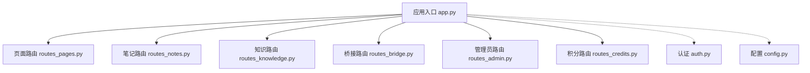
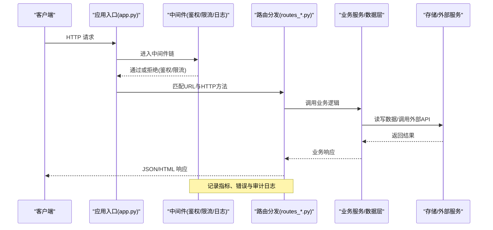
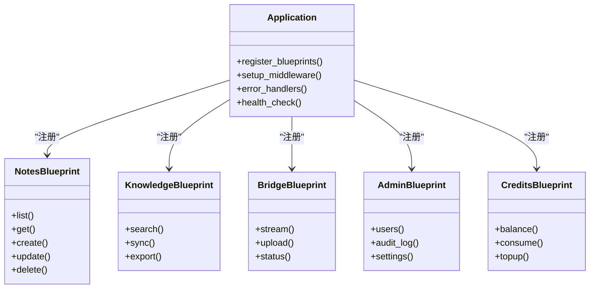
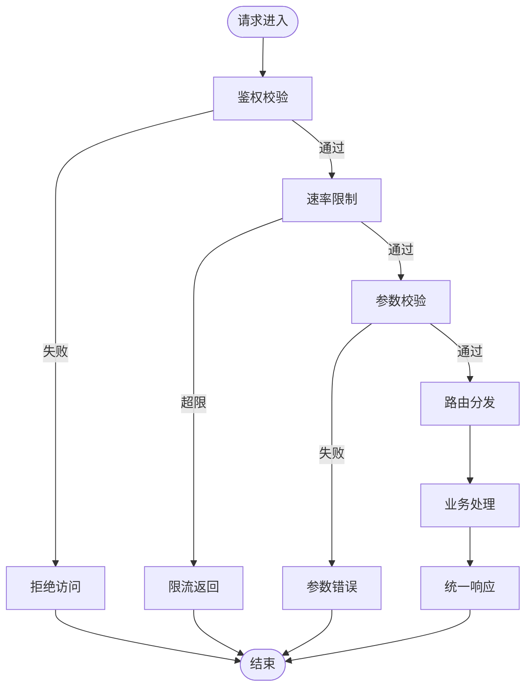
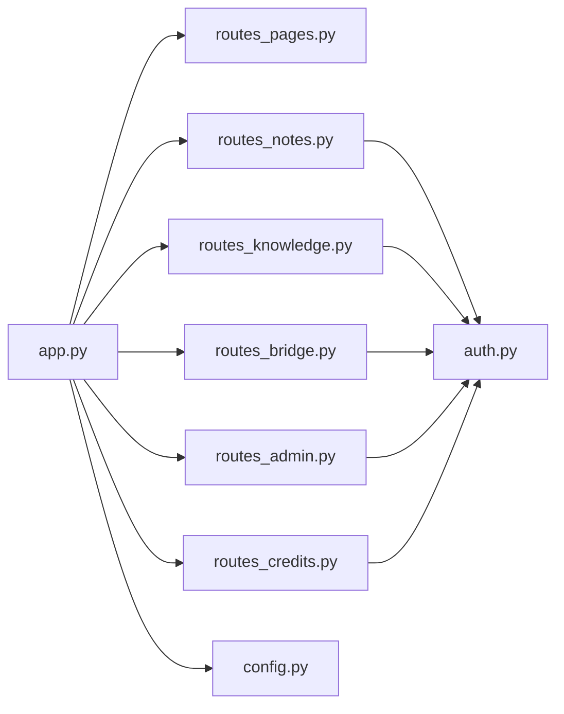

# 路由系统设计

<cite>
**本文引用的文件**   
- [app.py](file://server/app.py)
- [routes_pages.py](file://server/routes_pages.py)
- [routes_notes.py](file://server/routes_notes.py)
- [routes_knowledge.py](file://server/routes_knowledge.py)
- [routes_bridge.py](file://server/routes_bridge.py)
- [routes_admin.py](file://server/routes_admin.py)
- [routes_credits.py](file://server/routes_credits.py)
- [auth.py](file://server/auth.py)
- [config.py](file://server/config.py)
</cite>

## 目录
1. [引言](#引言)
2. [项目结构](#项目结构)
3. [核心组件](#核心组件)
4. [架构总览](#架构总览)
5. [详细组件分析](#详细组件分析)
6. [依赖关系分析](#依赖关系分析)
7. [性能与缓存](#性能与缓存)
8. [故障排查指南](#故障排查指南)
9. [结论](#结论)

## 引言
本文件为 LectureLearnLoop 后端的路由系统提供系统化、可操作的架构文档。重点覆盖：
- 模块化路由设计模式与职责划分
- RESTful API 规范与 URL 命名约定
- 路由分组策略、参数校验机制与请求过滤链
- API 版本控制、权限控制与访问频率限制
- 路由性能优化、缓存策略与负载均衡考虑
- 调试工具、监控指标与错误追踪方案

## 项目结构
后端采用“应用入口 + 按领域拆分的路由模块”的组织方式，配合认证与配置模块形成清晰的分层：
- 应用入口负责注册蓝图、挂载中间件、统一异常处理与基础配置
- 路由模块按业务域拆分（页面、笔记、知识、桥接、管理员、积分等）
- 认证模块提供鉴权装饰器与权限判断能力
- 配置模块集中管理运行期开关、日志级别、外部服务地址等

图表来源
- [app.py:1-120](file://server/app.py#L1-L120)
- [routes_pages.py:1-80](file://server/routes_pages.py#L1-L80)
- [routes_notes.py:1-80](file://server/routes_notes.py#L1-L80)
- [routes_knowledge.py:1-80](file://server/routes_knowledge.py#L1-L80)
- [routes_bridge.py:1-80](file://server/routes_bridge.py#L1-L80)
- [routes_admin.py:1-80](file://server/routes_admin.py#L1-L80)
- [routes_credits.py:1-80](file://server/routes_credits.py#L1-L80)
- [auth.py:1-120](file://server/auth.py#L1-L120)
- [config.py:1-120](file://server/config.py#L1-L120)

章节来源
- [app.py:1-120](file://server/app.py#L1-L120)
- [config.py:1-120](file://server/config.py#L1-L120)

## 核心组件
- 应用入口（app.py）
  - 创建并注册各业务蓝图的蓝图实例
  - 挂载全局中间件（如鉴权、限流、日志、CORS、压缩等）
  - 定义统一错误处理器、健康检查与调试端点
  - 加载配置、初始化日志与外部服务连接
- 路由模块（routes_*.py）
  - 按领域划分：页面渲染、笔记、知识、桥接、管理员、积分
  - 每个模块暴露一组相关接口，遵循一致的命名与返回格式
- 认证模块（auth.py）
  - 提供登录/登出、令牌签发与校验、角色/权限判断
  - 以装饰器形式注入到路由层进行权限拦截
- 配置模块（config.py）
  - 集中管理环境变量、数据库连接、第三方服务密钥、功能开关

章节来源
- [app.py:1-120](file://server/app.py#L1-L120)
- [auth.py:1-120](file://server/auth.py#L1-L120)
- [config.py:1-120](file://server/config.py#L1-L120)

## 架构总览
下图展示从客户端请求到具体路由处理的完整链路，包括鉴权、限流、日志与错误处理等横切关注点。

图表来源
- [app.py:1-120](file://server/app.py#L1-L120)
- [routes_notes.py:1-80](file://server/routes_notes.py#L1-L80)
- [routes_knowledge.py:1-80](file://server/routes_knowledge.py#L1-L80)
- [routes_bridge.py:1-80](file://server/routes_bridge.py#L1-L80)
- [routes_admin.py:1-80](file://server/routes_admin.py#L1-L80)
- [routes_credits.py:1-80](file://server/routes_credits.py#L1-L80)
- [auth.py:1-120](file://server/auth.py#L1-L120)

## 详细组件分析

### 模块化路由设计模式
- 蓝图化组织
  - 每个业务域一个蓝图，便于独立测试、复用与扩展
  - 路由前缀按领域划分，例如 /api/v1/notes、/api/v1/knowledge
- 分层职责
  - 路由层仅做参数解析、鉴权与调度
  - 业务逻辑下沉至服务层或DAL层
- 统一响应与错误
  - 成功响应使用统一结构体，包含状态码、消息与数据体
  - 错误响应包含错误码、可读消息与可选的调试信息

图表来源
- [app.py:1-120](file://server/app.py#L1-L120)
- [routes_notes.py:1-80](file://server/routes_notes.py#L1-L80)
- [routes_knowledge.py:1-80](file://server/routes_knowledge.py#L1-L80)
- [routes_bridge.py:1-80](file://server/routes_bridge.py#L1-L80)
- [routes_admin.py:1-80](file://server/routes_admin.py#L1-L80)
- [routes_credits.py:1-80](file://server/routes_credits.py#L1-L80)

章节来源
- [app.py:1-120](file://server/app.py#L1-L120)
- [routes_notes.py:1-80](file://server/routes_notes.py#L1-L80)
- [routes_knowledge.py:1-80](file://server/routes_knowledge.py#L1-L80)
- [routes_bridge.py:1-80](file://server/routes_bridge.py#L1-L80)
- [routes_admin.py:1-80](file://server/routes_admin.py#L1-L80)
- [routes_credits.py:1-80](file://server/routes_credits.py#L1-L80)

### RESTful API 规范与 URL 命名约定
- URL 命名
  - 资源名词复数形式，小写并用连字符分隔，如 /api/v1/notes、/api/v1/knowledge
  - 子资源使用路径嵌套，如 /api/v1/notes/{id}/comments
- HTTP 方法与语义
  - GET 查询列表/详情；POST 创建；PUT/PATCH 更新；DELETE 删除
- 查询参数
  - 分页：page、per_page；排序：sort_by、order；过滤：字段名+值
- 响应格式
  - 成功：{ code, message, data }
  - 失败：{ code, message, errors? }
- 状态码
  - 2xx 成功；4xx 客户端错误；5xx 服务端错误
- 版本控制
  - URL 前缀 /api/v1、/api/v2 区分大版本变更
  - 弃用策略：在响应头中携带 Deprecation 与 Sunset 时间

章节来源
- [routes_notes.py:1-80](file://server/routes_notes.py#L1-L80)
- [routes_knowledge.py:1-80](file://server/routes_knowledge.py#L1-L80)
- [routes_bridge.py:1-80](file://server/routes_bridge.py#L1-L80)
- [routes_admin.py:1-80](file://server/routes_admin.py#L1-L80)
- [routes_credits.py:1-80](file://server/routes_credits.py#L1-L80)

### 路由分组策略
- 按领域分组
  - 页面渲染：/pages/*
  - 业务API：/api/v1/*
  - 管理后台：/admin/*
  - 桥接服务：/bridge/*
- 按环境分组
  - 开发/测试/生产通过配置开关启用不同路由集合
- 按租户/多租户
  - 可在路径或请求头中注入租户标识，用于数据隔离

章节来源
- [app.py:1-120](file://server/app.py#L1-L120)
- [config.py:1-120](file://server/config.py#L1-L120)

### 参数验证机制与请求过滤链
- 参数验证
  - 路径参数类型与范围校验（如ID为正整数）
  - 查询参数枚举与默认值处理
  - 请求体验证（必填字段、长度、格式）
- 请求过滤链
  - 鉴权：校验令牌、角色与权限
  - 限流：基于IP/用户/接口维度的速率限制
  - 审计：记录关键操作与敏感数据访问
  - 输入清洗：防XSS/SQL注入等安全过滤

图表来源
- [auth.py:1-120](file://server/auth.py#L1-L120)
- [app.py:1-120](file://server/app.py#L1-L120)

章节来源
- [auth.py:1-120](file://server/auth.py#L1-L120)
- [app.py:1-120](file://server/app.py#L1-L120)

### API 版本控制
- 版本前缀
  - /api/v1、/api/v2 作为主要版本区分
- 兼容性策略
  - 新增字段保持向后兼容
  - 废弃字段保留一段时间并在响应头提示
- 灰度发布
  - 通过请求头 X-API-Version 或查询参数 v 指定版本
- 迁移指引
  - 在 /api/docs 或 /swagger 提供版本差异说明

章节来源
- [routes_notes.py:1-80](file://server/routes_notes.py#L1-L80)
- [routes_knowledge.py:1-80](file://server/routes_knowledge.py#L1-L80)

### 路由权限控制
- 基于角色的访问控制（RBAC）
  - 用户、编辑、管理员等角色对应不同路由权限
- 细粒度授权
  - 对资源级操作进行二次校验（如只能修改自己的笔记）
- 会话与令牌
  - 支持JWT或Session两种认证方式
- 审计日志
  - 记录谁在何时访问了哪些敏感接口

章节来源
- [auth.py:1-120](file://server/auth.py#L1-L120)
- [routes_admin.py:1-80](file://server/routes_admin.py#L1-L80)

### 访问频率限制
- 维度
  - IP、用户ID、接口路径组合计数
- 算法
  - 滑动窗口或令牌桶，避免突发流量冲击
- 策略
  - 不同接口设置不同配额（如上传接口更严格）
- 反馈
  - 返回标准限流状态码与重试建议

章节来源
- [app.py:1-120](file://server/app.py#L1-L120)

## 依赖关系分析
- 模块耦合
  - 应用入口依赖所有蓝图与中间件
  - 路由模块依赖认证与配置
  - 业务服务依赖数据访问层与外部服务
- 潜在循环依赖
  - 通过蓝图与函数式导入避免循环引用
- 外部依赖
  - 数据库、对象存储、LLM提供商、ASR/TTS服务等

图表来源
- [app.py:1-120](file://server/app.py#L1-L120)
- [routes_notes.py:1-80](file://server/routes_notes.py#L1-L80)
- [routes_knowledge.py:1-80](file://server/routes_knowledge.py#L1-L80)
- [routes_bridge.py:1-80](file://server/routes_bridge.py#L1-L80)
- [routes_admin.py:1-80](file://server/routes_admin.py#L1-L80)
- [routes_credits.py:1-80](file://server/routes_credits.py#L1-L80)
- [auth.py:1-120](file://server/auth.py#L1-L120)
- [config.py:1-120](file://server/config.py#L1-L120)

章节来源
- [app.py:1-120](file://server/app.py#L1-L120)
- [auth.py:1-120](file://server/auth.py#L1-L120)
- [config.py:1-120](file://server/config.py#L1-L120)

## 性能与缓存
- 路由性能优化
  - 静态资源走CDN，减少后端压力
  - 路由匹配优先命中高频路径
  - 批量接口替代多次小请求
- 缓存策略
  - 读多写少接口使用Redis缓存，设置合理TTL与失效策略
  - 热点数据本地缓存（进程内）+ 分布式缓存结合
  - ETag/Last-Modified 支持浏览器缓存
- 负载均衡
  - 无状态服务部署，水平扩展
  - 会话外置（Redis），保证多实例一致性
  - 健康检查与自动摘除不健康节点
- 异步与并发
  - 长耗时任务使用消息队列异步处理
  - 流式接口（SSE/WebSocket）提升交互体验

章节来源
- [app.py:1-120](file://server/app.py#L1-L120)
- [routes_bridge.py:1-80](file://server/routes_bridge.py#L1-L80)

## 故障排查指南
- 调试工具
  - 开启调试模式后输出详细堆栈与请求上下文
  - 提供 /debug/requests 查看最近请求快照
- 监控指标
  - QPS、P95/P99延迟、错误率、限流次数、鉴权失败次数
  - 接口级热力图与慢查询TopN
- 错误追踪
  - 结构化日志（trace_id、user_id、endpoint、latency）
  - 异常上报至APM平台（Sentry等）
- 常见问题
  - 401/403：检查令牌有效性与权限配置
  - 429：检查限流阈值与配额分配
  - 500：查看异常日志与依赖服务状态

章节来源
- [app.py:1-120](file://server/app.py#L1-L120)
- [auth.py:1-120](file://server/auth.py#L1-L120)

## 结论
本路由系统通过蓝图化与分层设计实现高内聚低耦合，RESTful 规范与统一的鉴权/限流/日志中间件保障一致性与可观测性。建议在后续迭代中持续完善版本治理、缓存策略与监控告警，确保系统在规模增长时保持稳定与高性能。