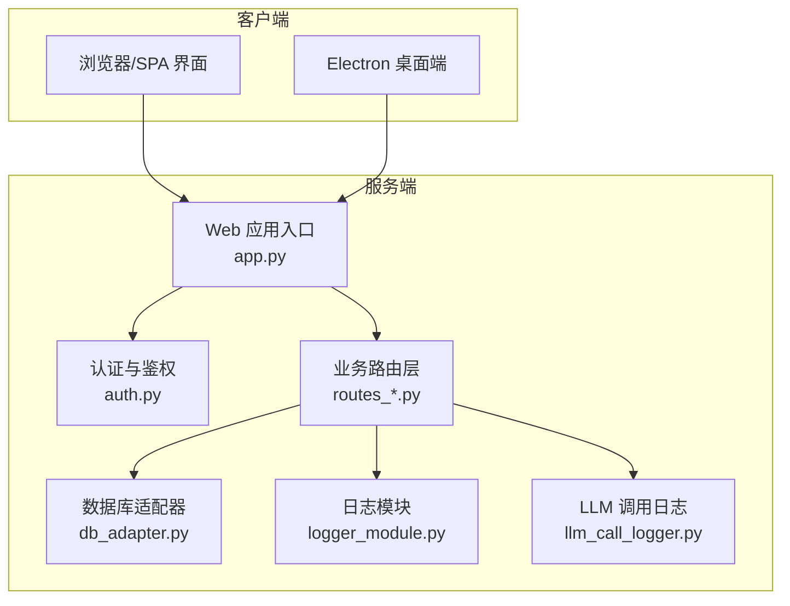
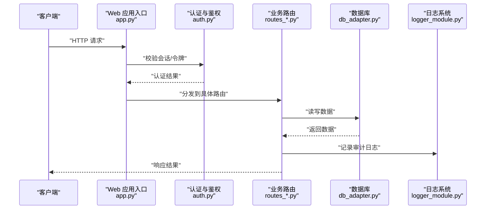
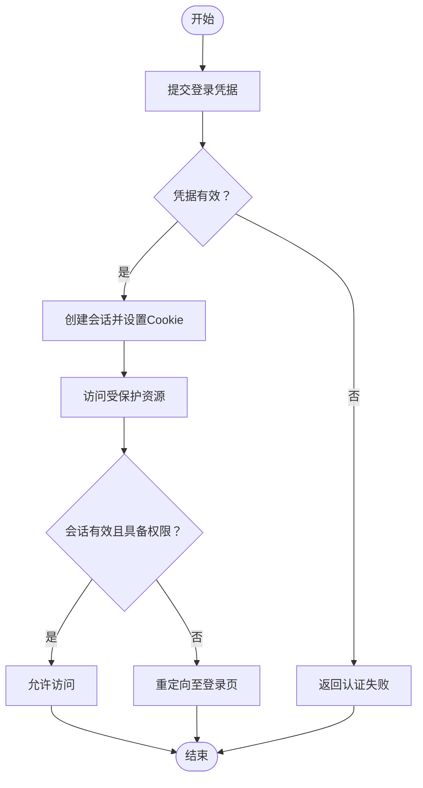
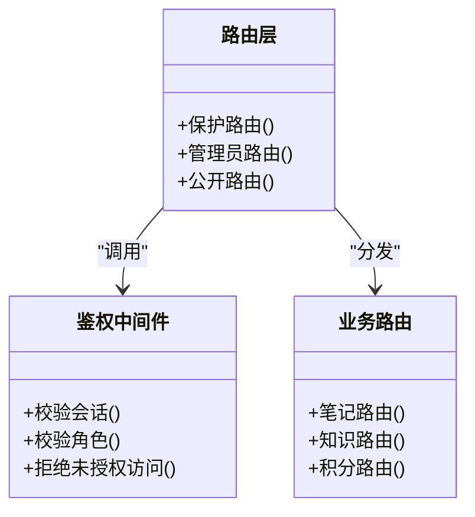
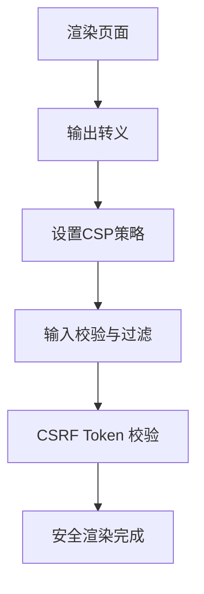
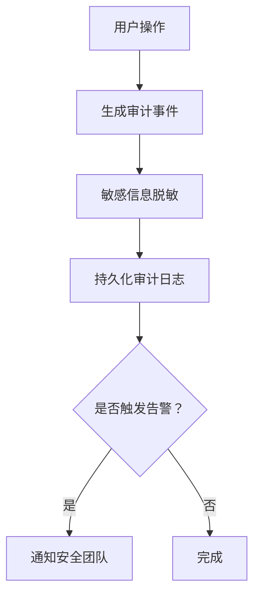
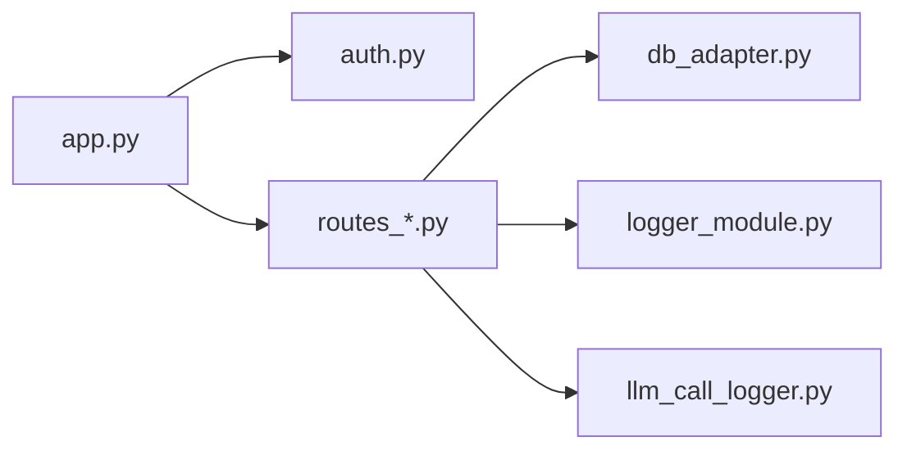

# 安全架构设计

<cite>
**本文引用的文件**   
- [app.py](file://server/app.py)
- [auth.py](file://server/auth.py)
- [config.py](file://server/config.py)
- [routes_pages.py](file://server/routes_pages.py)
- [routes_admin.py](file://server/routes_admin.py)
- [routes_notes.py](file://server/routes_notes.py)
- [routes_knowledge.py](file://server/routes_knowledge.py)
- [routes_credits.py](file://server/routes_credits.py)
- [templates/base.html](file://server/templates/base.html)
- [templates/spa_layout.html](file://server/templates/spa_layout.html)
- [static/js/api.js](file://server/static/js/api.js)
- [database/db_adapter.py](file://server/database/db_adapter.py)
- [logger_module.py](file://server/logger_module.py)
- [llm_call_logger.py](file://server/llm_call_logger.py)
- [start_app.ps1](file://start_app.ps1)
</cite>

## 目录
1. [引言](#引言)
2. [项目结构](#项目结构)
3. [核心组件](#核心组件)
4. [架构总览](#架构总览)
5. [详细组件分析](#详细组件分析)
6. [依赖关系分析](#依赖关系分析)
7. [性能与安全权衡](#性能与安全权衡)
8. [故障排查指南](#故障排查指南)
9. [结论](#结论)
10. [附录](#附录)

## 引言
本文件为 LectureLearnLoop 的安全架构文档，聚焦身份认证与授权、会话管理、权限控制、数据加密策略、前端安全防护（XSS/CSRF）、后端安全配置与安全头、敏感数据处理、日志脱敏与审计追踪。文档同时提供威胁模型、风险评估、渗透测试建议与应急响应预案，帮助开发、运维与安全团队在开发与生产环境中统一安全基线。

## 项目结构
本项目采用前后端混合架构：
- 后端基于 Python Web 框架，提供页面路由、API 接口、认证鉴权、数据库访问与日志记录。
- 前端通过模板渲染 SPA 布局，并通过静态 JS 调用后端 API。
- 桌面端 Electron 应用作为本地入口，负责 ASR 代理等能力。

**图表来源**
- [app.py:1-120](file://server/app.py#L1-L120)
- [auth.py:1-120](file://server/auth.py#L1-L120)
- [routes_pages.py:1-120](file://server/routes_pages.py#L1-L120)
- [routes_notes.py:1-120](file://server/routes_notes.py#L1-L120)
- [routes_knowledge.py:1-120](file://server/routes_knowledge.py#L1-L120)
- [routes_credits.py:1-120](file://server/routes_credits.py#L1-L120)
- [database/db_adapter.py:1-120](file://server/database/db_adapter.py#L1-L120)
- [logger_module.py:1-120](file://server/logger_module.py#L1-L120)
- [llm_call_logger.py:1-120](file://server/llm_call_logger.py#L1-L120)

**章节来源**
- [app.py:1-120](file://server/app.py#L1-L120)
- [config.py:1-120](file://server/config.py#L1-L120)

## 核心组件
- 认证与授权：集中式认证中间件，校验登录态与角色权限，保护受保护路由。
- 会话管理：基于服务端会话存储，支持会话生命周期、超时与清理。
- 权限控制：按角色与资源维度进行访问控制，区分普通用户与管理员。
- 数据加密：传输层使用 HTTPS；敏感字段在持久化前进行加密或哈希处理。
- 前端防护：模板输出转义、CSP 策略、输入校验与 CSRF Token 机制。
- 日志与审计：结构化日志、敏感信息脱敏、关键操作审计追踪。

**章节来源**
- [auth.py:1-120](file://server/auth.py#L1-L120)
- [routes_pages.py:1-120](file://server/routes_pages.py#L1-L120)
- [routes_admin.py:1-120](file://server/routes_admin.py#L1-L120)
- [templates/base.html:1-120](file://server/templates/base.html#L1-L120)
- [templates/spa_layout.html:1-120](file://server/templates/spa_layout.html#L1-L120)
- [static/js/api.js:1-120](file://server/static/js/api.js#L1-L120)
- [logger_module.py:1-120](file://server/logger_module.py#L1-L120)

## 架构总览
下图展示从客户端到服务端的请求路径，以及认证、鉴权、日志与数据库交互的关键节点。

**图表来源**
- [app.py:1-120](file://server/app.py#L1-L120)
- [auth.py:1-120](file://server/auth.py#L1-L120)
- [routes_notes.py:1-120](file://server/routes_notes.py#L1-L120)
- [database/db_adapter.py:1-120](file://server/database/db_adapter.py#L1-L120)
- [logger_module.py:1-120](file://server/logger_module.py#L1-L120)

## 详细组件分析

### 身份认证与授权流程
- 登录流程：客户端提交用户名与密码，服务端验证凭据并创建会话，设置会话 Cookie。
- 鉴权流程：受保护路由在进入前检查会话有效性及角色权限，未通过则拒绝访问。
- 会话管理：会话包含用户标识、角色、过期时间；服务端定期清理过期会话。
- 权限模型：基于角色的访问控制（RBAC），管理员与普通用户拥有不同权限集。

**图表来源**
- [auth.py:1-120](file://server/auth.py#L1-L120)
- [routes_pages.py:1-120](file://server/routes_pages.py#L1-L120)
- [routes_admin.py:1-120](file://server/routes_admin.py#L1-L120)

**章节来源**
- [auth.py:1-120](file://server/auth.py#L1-L120)
- [routes_pages.py:1-120](file://server/routes_pages.py#L1-L120)
- [routes_admin.py:1-120](file://server/routes_admin.py#L1-L120)

### 会话管理与安全配置
- 会话存储：服务端内存或持久化存储，支持并发访问与锁机制。
- 会话安全：Cookie 标记 HttpOnly、Secure、SameSite；会话 ID 随机生成且不可预测。
- 超时与清理：会话存在最大存活时间，后台任务定期清理过期会话。
- 环境配置：通过配置文件启用/禁用调试模式、会话存储类型、密钥轮换策略。

**章节来源**
- [config.py:1-120](file://server/config.py#L1-L120)
- [auth.py:1-120](file://server/auth.py#L1-L120)

### 权限控制与路由保护
- 路由保护：对需要权限的路由添加装饰器或中间件，校验用户角色。
- 资源级权限：针对笔记、知识库、积分管理等资源进行细粒度权限控制。
- 管理员功能：仅管理员可访问管理面板与敏感操作接口。

**图表来源**
- [routes_notes.py:1-120](file://server/routes_notes.py#L1-L120)
- [routes_knowledge.py:1-120](file://server/routes_knowledge.py#L1-L120)
- [routes_credits.py:1-120](file://server/routes_credits.py#L1-L120)
- [routes_admin.py:1-120](file://server/routes_admin.py#L1-L120)

**章节来源**
- [routes_notes.py:1-120](file://server/routes_notes.py#L1-L120)
- [routes_knowledge.py:1-120](file://server/routes_knowledge.py#L1-L120)
- [routes_credits.py:1-120](file://server/routes_credits.py#L1-L120)
- [routes_admin.py:1-120](file://server/routes_admin.py#L1-L120)

### 前端安全防护（XSS/CSRF）
- XSS 防护：模板引擎自动转义输出；对用户输入进行白名单校验；避免内联脚本执行。
- CSP 策略：通过 Content-Security-Policy 限制脚本来源、样式来源与连接目标。
- CSRF 防护：表单提交携带 CSRF Token；API 请求校验 Token 一致性。
- 静态资源安全：JS/CSS 文件通过 CDN 或同源加载，禁止任意来源注入。

**图表来源**
- [templates/base.html:1-120](file://server/templates/base.html#L1-L120)
- [templates/spa_layout.html:1-120](file://server/templates/spa_layout.html#L1-L120)
- [static/js/api.js:1-120](file://server/static/js/api.js#L1-L120)

**章节来源**
- [templates/base.html:1-120](file://server/templates/base.html#L1-L120)
- [templates/spa_layout.html:1-120](file://server/templates/spa_layout.html#L1-L120)
- [static/js/api.js:1-120](file://server/static/js/api.js#L1-L120)

### 数据加密与敏感数据处理
- 传输加密：全站启用 HTTPS，强制 HSTS，禁用不安全协议。
- 存储加密：用户密码使用强哈希算法；敏感字段（如手机号、邮箱）加密存储。
- 密钥管理：密钥与盐值存储在环境变量或密钥管理服务中，禁止硬编码。
- 数据最小化：仅收集必要数据，避免过度采集与长期留存。

**章节来源**
- [config.py:1-120](file://server/config.py#L1-L120)
- [database/db_adapter.py:1-120](file://server/database/db_adapter.py#L1-L120)

### 日志脱敏与审计追踪
- 日志脱敏：自动过滤敏感字段（密码、Token、身份证号等）。
- 审计日志：记录关键操作（登录、修改权限、删除数据）的时间、用户、IP、结果。
- 日志分级：INFO/WARN/ERROR 分级输出，便于监控与告警。
- 外部集成：可选将审计日志发送至 SIEM 或日志聚合平台。

**图表来源**
- [logger_module.py:1-120](file://server/logger_module.py#L1-L120)
- [llm_call_logger.py:1-120](file://server/llm_call_logger.py#L1-L120)

**章节来源**
- [logger_module.py:1-120](file://server/logger_module.py#L1-L120)
- [llm_call_logger.py:1-120](file://server/llm_call_logger.py#L1-L120)

## 依赖关系分析
- 组件耦合：认证模块被所有受保护路由依赖；日志模块被各业务路由调用。
- 外部依赖：数据库适配器、第三方 LLM 调用日志记录。
- 循环依赖：应避免路由层直接依赖认证实现细节，通过中间件解耦。

**图表来源**
- [app.py:1-120](file://server/app.py#L1-L120)
- [auth.py:1-120](file://server/auth.py#L1-L120)
- [routes_notes.py:1-120](file://server/routes_notes.py#L1-L120)
- [database/db_adapter.py:1-120](file://server/database/db_adapter.py#L1-L120)
- [logger_module.py:1-120](file://server/logger_module.py#L1-L120)
- [llm_call_logger.py:1-120](file://server/llm_call_logger.py#L1-L120)

**章节来源**
- [app.py:1-120](file://server/app.py#L1-L120)
- [auth.py:1-120](file://server/auth.py#L1-L120)
- [routes_notes.py:1-120](file://server/routes_notes.py#L1-L120)
- [database/db_adapter.py:1-120](file://server/database/db_adapter.py#L1-L120)
- [logger_module.py:1-120](file://server/logger_module.py#L1-L120)
- [llm_call_logger.py:1-120](file://server/llm_call_logger.py#L1-L120)

## 性能与安全权衡
- 会话存储：内存会话更快但易丢失；持久化会话更安全但增加 I/O。
- 日志级别：高详细度日志利于排障但影响性能与隐私；需平衡采样率与脱敏开销。
- 加密开销：字段级加密增加 CPU 消耗；可通过缓存与批量处理优化。
- CSP 严格模式：提升安全性但可能影响第三方脚本加载；需逐步收紧策略。

[本节为通用指导，不直接分析具体文件]

## 故障排查指南
- 认证失败：检查会话 Cookie 是否设置正确、服务器时间同步、密钥配置。
- 权限拒绝：确认用户角色与资源权限映射是否正确，查看审计日志定位原因。
- XSS 告警：检查模板输出是否转义、CSP 策略是否过宽、第三方脚本来源是否可信。
- CSRF 错误：确认表单 Token 是否传递、API 请求头是否包含必要字段。
- 日志缺失：检查日志级别、磁盘空间、外部日志服务连通性。

**章节来源**
- [logger_module.py:1-120](file://server/logger_module.py#L1-L120)
- [auth.py:1-120](file://server/auth.py#L1-L120)

## 结论
LectureLearnLoop 的安全架构围绕认证授权、会话管理、权限控制、数据加密、前端防护与日志审计展开。通过中间件与装饰器实现统一的鉴权入口，结合 CSP、输入校验与 CSRF Token 构建前端防线，配合敏感数据加密与日志脱敏保障数据安全。建议在部署阶段强化 HTTPS、HSTS、密钥轮换与最小权限原则，并持续进行渗透测试与应急响应演练。

[本节为总结性内容，不直接分析具体文件]

## 附录

### 威胁模型与风险评估
- 威胁主体：外部攻击者、内部恶意用户、第三方脚本注入。
- 主要风险：凭证泄露、会话劫持、越权访问、XSS/CSRF 攻击、数据泄露。
- 风险等级：高（凭证与会话）、中（权限与数据）、低（日志与配置）。
- 缓解措施：多因素认证、会话绑定设备指纹、细粒度 RBAC、输入白名单、CSP 严格模式、日志脱敏。

[本节为概念性内容，不直接分析具体文件]

### 安全配置清单
- 启用 HTTPS 与 HSTS，禁用明文 HTTP。
- 设置 Cookie 属性：HttpOnly、Secure、SameSite=Strict/Lax。
- 配置 CSP：限制脚本、样式、字体、媒体与连接来源。
- 启用输入校验与输出转义，禁用危险函数。
- 使用强哈希算法存储密码，敏感字段加密存储。
- 配置日志脱敏规则，限制日志保留周期。
- 最小权限原则运行服务进程，隔离数据库与密钥访问。

**章节来源**
- [config.py:1-120](file://server/config.py#L1-L120)
- [templates/base.html:1-120](file://server/templates/base.html#L1-L120)
- [logger_module.py:1-120](file://server/logger_module.py#L1-L120)

### 渗透测试建议
- 认证绕过：尝试会话固定、JWT 篡改、弱口令爆破。
- 权限提升：横向移动、垂直越权、参数篡改。
- XSS/CSRF：反射型与存储型 XSS、跨站请求伪造。
- 数据泄露：敏感字段明文传输、备份文件泄露、日志包含敏感信息。
- 基础设施：端口暴露、默认配置、未修补漏洞。

[本节为通用指导，不直接分析具体文件]

### 应急响应预案
- 事件分类：认证异常、权限滥用、数据泄露、恶意注入。
- 处置流程：检测与告警、隔离与遏制、根因分析与修复、恢复与复盘。
- 沟通机制：内部通报、监管上报、客户通知。
- 工具准备：日志查询、流量镜像、补丁发布、回滚脚本。

**章节来源**
- [logger_module.py:1-120](file://server/logger_module.py#L1-L120)
- [llm_call_logger.py:1-120](file://server/llm_call_logger.py#L1-L120)

### 启动与环境配置
- 启动脚本：Windows PowerShell 脚本用于快速启动应用与服务。
- 环境变量：数据库连接、密钥、日志级别、会话存储类型。
- 安全基线：关闭调试模式、启用访问控制、限制监听地址。

**章节来源**
- [start_app.ps1:1-120](file://start_app.ps1#L1-L120)
- [config.py:1-120](file://server/config.py#L1-L120)