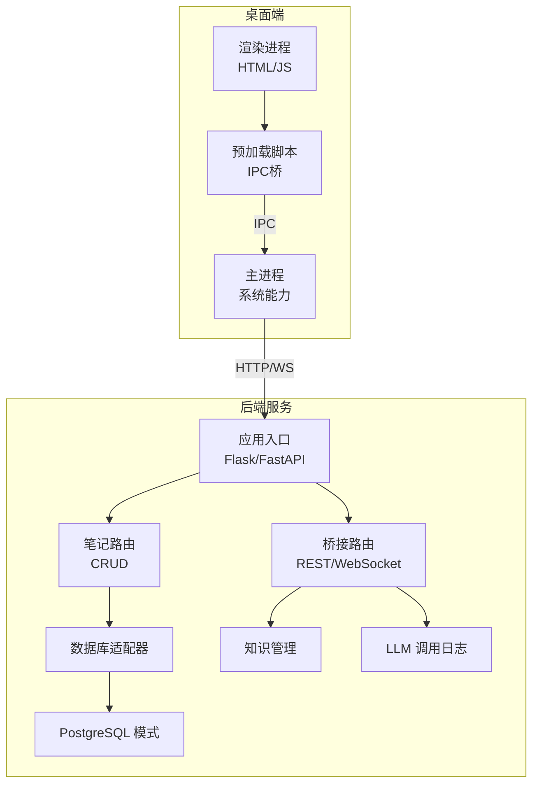
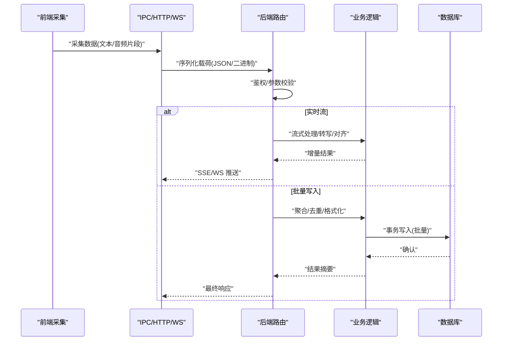
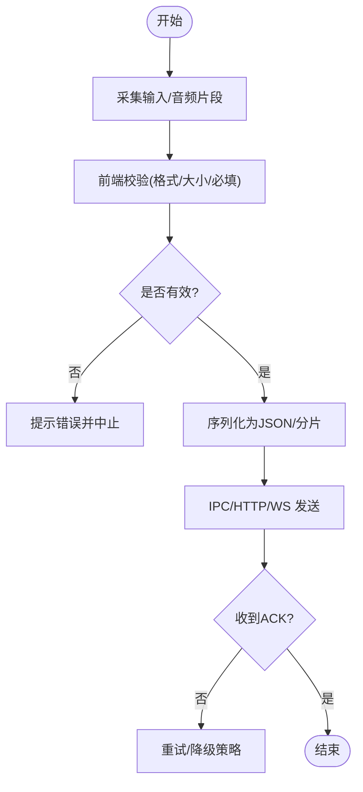
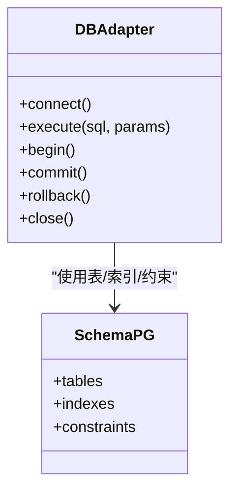
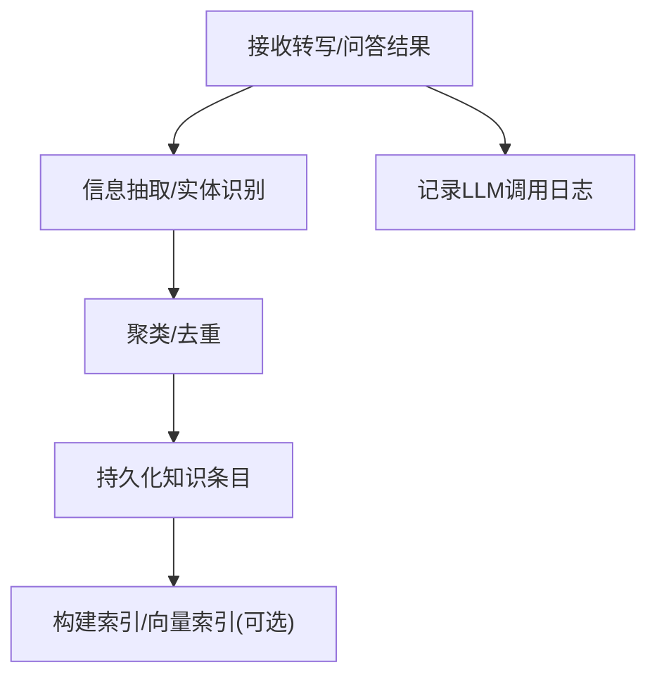
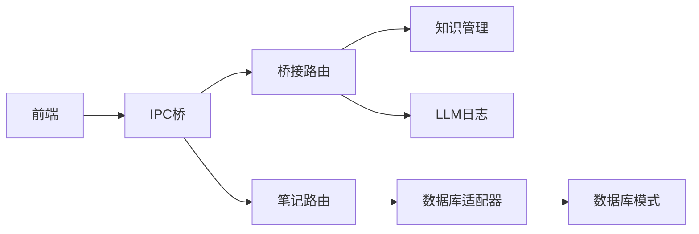

# 数据流设计

<cite>
**本文引用的文件**   
- [desktop/main.js](file://desktop/main.js)
- [desktop/preload.js](file://desktop/preload.js)
- [server/app.py](file://server/app.py)
- [server/routes_bridge.py](file://server/routes_bridge.py)
- [server/routes_notes.py](file://server/routes_notes.py)
- [server/database/db_adapter.py](file://server/database/db_adapter.py)
- [server/database/schema_postgres.py](file://server/database/schema_postgres.py)
- [server/knowledge_management.py](file://server/knowledge_management.py)
- [server/llm_call_logger.py](file://server/llm_call_logger.py)
- [server/config.py](file://server/config.py)
</cite>

## 目录
1. [引言](#引言)
2. [项目结构](#项目结构)
3. [核心组件](#核心组件)
4. [架构总览](#架构总览)
5. [详细组件分析](#详细组件分析)
6. [依赖关系分析](#依赖关系分析)
7. [性能考虑](#性能考虑)
8. [故障排查指南](#故障排查指南)
9. [结论](#结论)
10. [附录](#附录)

## 引言
本文件为 LectureLearnLoop 的数据流设计文档，聚焦从用户输入到数据存储的完整链路：前端采集、IPC 传输、后端处理、数据库操作。文档覆盖数据格式转换、序列化/反序列化、数据验证机制；说明实时同步、异步处理与批量策略；给出一致性保证、事务管理、错误恢复与备份策略；并提供性能优化建议、监控指标与排障指南。

## 项目结构
LectureLearnLoop 采用桌面端（Electron）+ Web 后端的双端架构：
- 桌面端负责音频采集、页面渲染与 IPC 通信。
- 后端提供 REST API、模板渲染、LLM 调用日志与知识管理。
- 数据持久化通过数据库适配器抽象，支持 SQLite/PostgreSQL 等。



图表来源
- [desktop/main.js:1-200](file://desktop/main.js#L1-L200)
- [desktop/preload.js:1-200](file://desktop/preload.js#L1-L200)
- [server/app.py:1-200](file://server/app.py#L1-L200)
- [server/routes_bridge.py:1-200](file://server/routes_bridge.py#L1-L200)
- [server/routes_notes.py:1-200](file://server/routes_notes.py#L1-L200)
- [server/database/db_adapter.py:1-200](file://server/database/db_adapter.py#L1-L200)
- [server/database/schema_postgres.py:1-200](file://server/database/schema_postgres.py#L1-L200)
- [server/knowledge_management.py:1-200](file://server/knowledge_management.py#L1-L200)
- [server/llm_call_logger.py:1-200](file://server/llm_call_logger.py#L1-L200)

章节来源
- [desktop/main.js:1-200](file://desktop/main.js#L1-L200)
- [desktop/preload.js:1-200](file://desktop/preload.js#L1-L200)
- [server/app.py:1-200](file://server/app.py#L1-L200)
- [server/routes_bridge.py:1-200](file://server/routes_bridge.py#L1-L200)
- [server/routes_notes.py:1-200](file://server/routes_notes.py#L1-L200)
- [server/database/db_adapter.py:1-200](file://server/database/db_adapter.py#L1-L200)
- [server/database/schema_postgres.py:1-200](file://server/database/schema_postgres.py#L1-L200)
- [server/knowledge_management.py:1-200](file://server/knowledge_management.py#L1-L200)
- [server/llm_call_logger.py:1-200](file://server/llm_call_logger.py#L1-L200)

## 核心组件
- 桌面端主进程与预加载脚本：封装 IPC 通道，统一请求/响应模型，屏蔽底层差异。
- 后端路由层：桥接路由负责实时流式数据与外部服务交互；笔记路由负责结构化数据的 CRUD。
- 数据库适配器：统一 SQL 执行、连接池、事务边界与结果映射。
- 知识管理与 LLM 日志：对非结构化/半结构化数据进行加工与审计。

章节来源
- [desktop/main.js:1-200](file://desktop/main.js#L1-L200)
- [desktop/preload.js:1-200](file://desktop/preload.js#L1-L200)
- [server/routes_bridge.py:1-200](file://server/routes_bridge.py#L1-L200)
- [server/routes_notes.py:1-200](file://server/routes_notes.py#L1-L200)
- [server/database/db_adapter.py:1-200](file://server/database/db_adapter.py#L1-L200)

## 架构总览
整体数据流分为四层：
- 采集层：前端捕获用户输入或音频流，进行本地预处理与校验。
- 传输层：通过 IPC/HTTP/WebSocket 将数据序列化后发送到后端。
- 处理层：后端路由解析、鉴权、业务编排、LLM 调用、批处理与缓存。
- 存储层：数据库适配器执行事务性写入，必要时触发备份与索引重建。



图表来源
- [desktop/preload.js:1-200](file://desktop/preload.js#L1-L200)
- [server/routes_bridge.py:1-200](file://server/routes_bridge.py#L1-L200)
- [server/routes_notes.py:1-200](file://server/routes_notes.py#L1-L200)
- [server/database/db_adapter.py:1-200](file://server/database/db_adapter.py#L1-L200)

## 详细组件分析

### 前端采集与 IPC 传输
- 数据采集：表单输入、录音片段、时间戳与元数据组装为统一载荷。
- 数据校验：前端进行基础格式检查（必填、长度、类型），减少无效请求。
- IPC 封装：预加载脚本暴露稳定接口，主进程转发至后端；失败重试与超时控制。



图表来源
- [desktop/preload.js:1-200](file://desktop/preload.js#L1-L200)
- [desktop/main.js:1-200](file://desktop/main.js#L1-L200)

章节来源
- [desktop/preload.js:1-200](file://desktop/preload.js#L1-L200)
- [desktop/main.js:1-200](file://desktop/main.js#L1-L200)

### 后端路由与数据处理
- 桥接路由：接收实时流数据，进行鉴权、限流、转写/对齐、与 LLM 交互，并通过 SSE/WS 回推。
- 笔记路由：提供结构化数据的增删改查，支持批量写入与分页查询。
- 数据验证：后端对入参进行严格校验，拒绝非法字段与越界值。

```mermaid
sequenceDiagram
participant IPC as "IPC/HTTP/WS"
participant Bridge as "桥接路由"
participant Notes as "笔记路由"
participant Biz as "业务逻辑"
participant DB as "数据库"
IPC->>Bridge : "POST /bridge/stream"
Bridge->>Bridge : "鉴权/限流/校验"
Bridge->>Biz : "流式处理/LLM调用"
Biz-->>Bridge : "增量结果"
Bridge-->>IPC : "SSE/WS 推送"
IPC->>Notes : "POST /notes/batch"
Notes->>Notes : "参数校验/去重"
Notes->>DB : "BEGIN; INSERT/UPDATE ... COMMIT"
DB-->>Notes : "返回影响行数"
Notes-->>IPC : "批量结果摘要"
```

图表来源
- [server/routes_bridge.py:1-200](file://server/routes_bridge.py#L1-L200)
- [server/routes_notes.py:1-200](file://server/routes_notes.py#L1-L200)
- [server/database/db_adapter.py:1-200](file://server/database/db_adapter.py#L1-L200)

章节来源
- [server/routes_bridge.py:1-200](file://server/routes_bridge.py#L1-L200)
- [server/routes_notes.py:1-200](file://server/routes_notes.py#L1-L200)

### 数据库适配与事务管理
- 连接管理：连接池复用，避免频繁创建销毁。
- 事务边界：批量写入使用显式事务，确保原子性与一致性。
- 结果映射：统一行对象到领域模型的映射，简化上层逻辑。



图表来源
- [server/database/db_adapter.py:1-200](file://server/database/db_adapter.py#L1-L200)
- [server/database/schema_postgres.py:1-200](file://server/database/schema_postgres.py#L1-L200)

章节来源
- [server/database/db_adapter.py:1-200](file://server/database/db_adapter.py#L1-L200)
- [server/database/schema_postgres.py:1-200](file://server/database/schema_postgres.py#L1-L200)

### 知识管理与 LLM 日志
- 知识管理：对转写/问答结果进行抽取、聚类与关联，形成可检索的知识条目。
- LLM 日志：记录每次调用的输入、输出、耗时与状态，便于审计与回溯。



图表来源
- [server/knowledge_management.py:1-200](file://server/knowledge_management.py#L1-L200)
- [server/llm_call_logger.py:1-200](file://server/llm_call_logger.py#L1-L200)

章节来源
- [server/knowledge_management.py:1-200](file://server/knowledge_management.py#L1-L200)
- [server/llm_call_logger.py:1-200](file://server/llm_call_logger.py#L1-L200)

### 配置与环境
- 配置文件集中管理数据库连接、第三方服务密钥、日志级别与功能开关。
- 运行时根据环境切换 SQLite/PostgreSQL 等后端。

章节来源
- [server/config.py:1-200](file://server/config.py#L1-L200)

## 依赖关系分析
- 前端依赖 IPC 桥，IPC 桥依赖后端路由。
- 路由层依赖数据库适配器与业务模块（知识管理、LLM 日志）。
- 数据库适配器依赖具体数据库模式定义。



图表来源
- [desktop/preload.js:1-200](file://desktop/preload.js#L1-L200)
- [server/routes_bridge.py:1-200](file://server/routes_bridge.py#L1-L200)
- [server/routes_notes.py:1-200](file://server/routes_notes.py#L1-L200)
- [server/database/db_adapter.py:1-200](file://server/database/db_adapter.py#L1-L200)
- [server/database/schema_postgres.py:1-200](file://server/database/schema_postgres.py#L1-L200)

章节来源
- [desktop/preload.js:1-200](file://desktop/preload.js#L1-L200)
- [server/routes_bridge.py:1-200](file://server/routes_bridge.py#L1-L200)
- [server/routes_notes.py:1-200](file://server/routes_notes.py#L1-L200)
- [server/database/db_adapter.py:1-200](file://server/database/db_adapter.py#L1-L200)
- [server/database/schema_postgres.py:1-200](file://server/database/schema_postgres.py#L1-L200)

## 性能考虑
- 实时流：使用分片传输与背压控制，避免前端阻塞；后端采用增量处理与流式返回。
- 批量写入：合并小写为批量事务，减少锁竞争与网络往返。
- 连接池：数据库连接复用，合理设置最大连接数与空闲超时。
- 缓存：热点数据（如知识条目索引）可引入内存缓存以降低读放大。
- 索引：对高频查询字段建立合适索引，避免全表扫描。
- 监控：统计吞吐、延迟、错误率、队列深度与连接池利用率。

[本节为通用指导，不直接分析具体文件]

## 故障排查指南
- 前端侧：检查 IPC 通道是否就绪、请求是否被拦截、重试与超时策略是否生效。
- 后端侧：查看路由日志、参数校验失败原因、LLM 调用异常与限流触发情况。
- 数据库侧：检查事务是否提交、死锁与长事务、慢查询与索引缺失。
- 恢复策略：失败重试、幂等键、补偿任务与人工介入流程。

章节来源
- [server/routes_bridge.py:1-200](file://server/routes_bridge.py#L1-L200)
- [server/routes_notes.py:1-200](file://server/routes_notes.py#L1-L200)
- [server/database/db_adapter.py:1-200](file://server/database/db_adapter.py#L1-L200)

## 结论
本设计以“采集-传输-处理-存储”为主线，结合实时流与批量写入两种路径，兼顾一致性与性能。通过 IPC 桥与路由分层，实现前后端解耦；通过数据库适配器与事务管理保障数据可靠性；通过知识管理与 LLM 日志支撑可观测与可追溯。后续可在缓存、索引与监控方面持续优化。

[本节为总结性内容，不直接分析具体文件]

## 附录
- 数据一致性：优先使用事务与唯一约束，必要时引入版本号或时间戳。
- 备份策略：定期快照与增量备份，关键表增加归档与保留策略。
- 安全与合规：敏感字段加密、访问控制与审计日志。

[本节为补充说明，不直接分析具体文件]