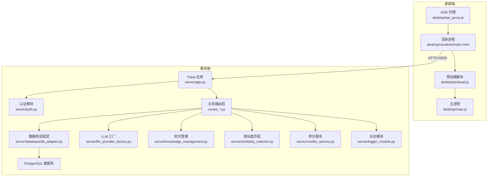
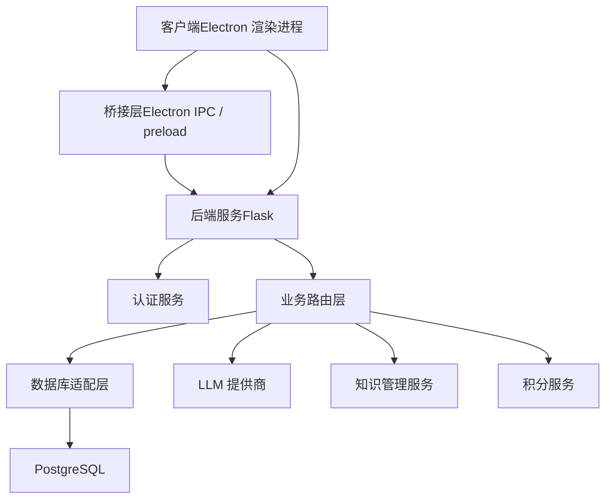
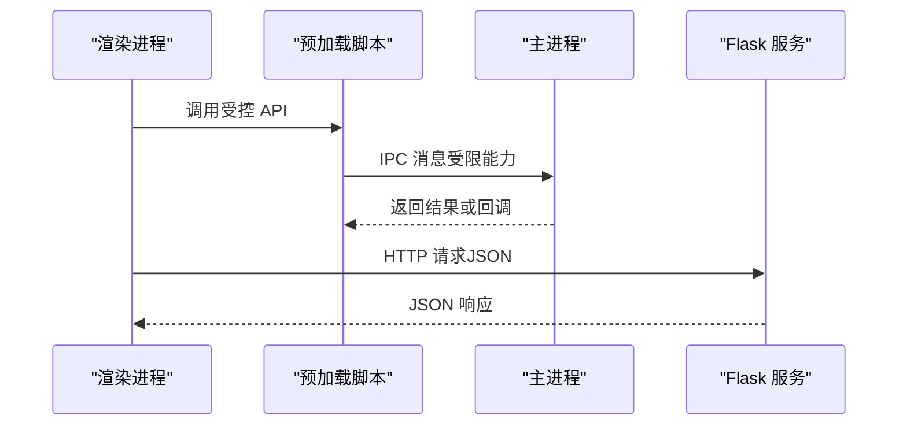
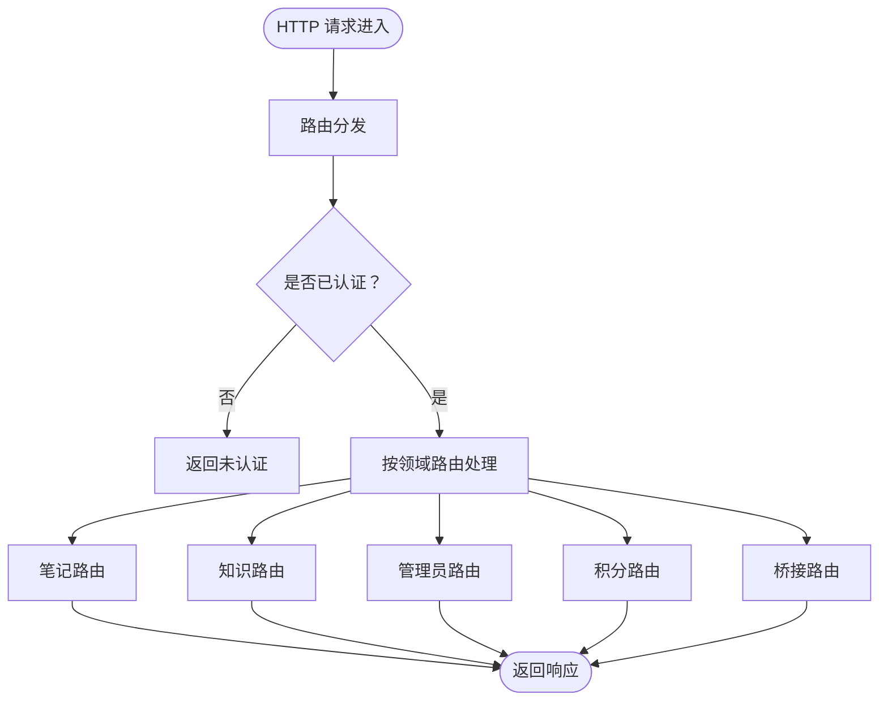
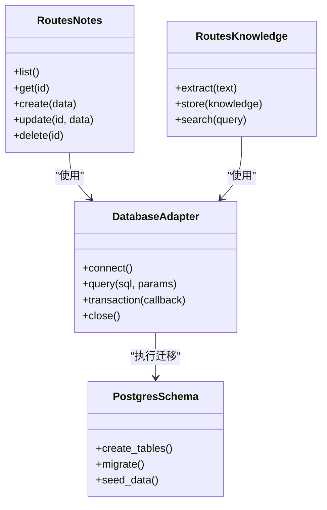
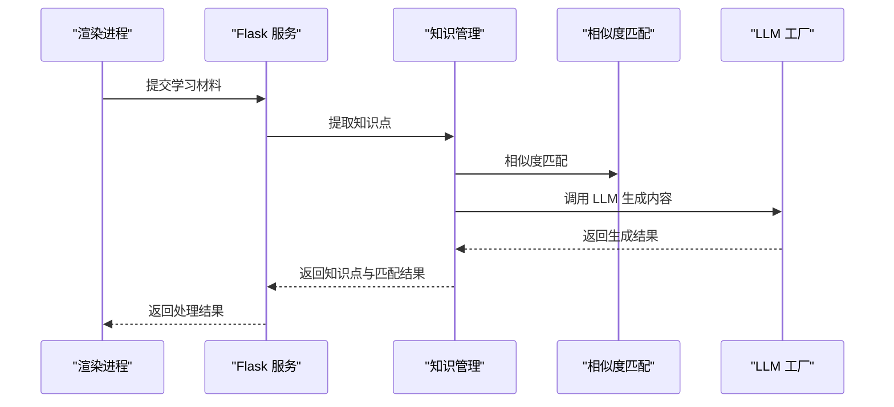
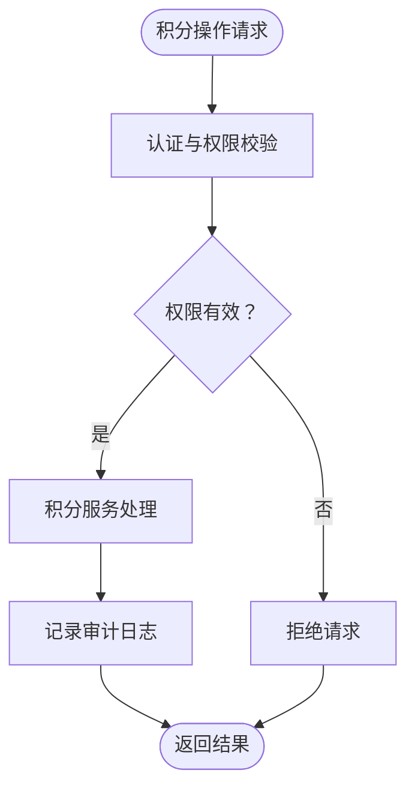
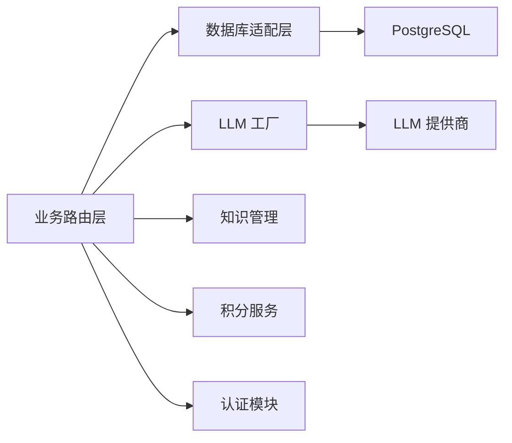
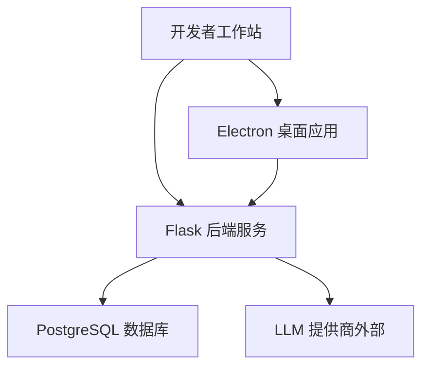
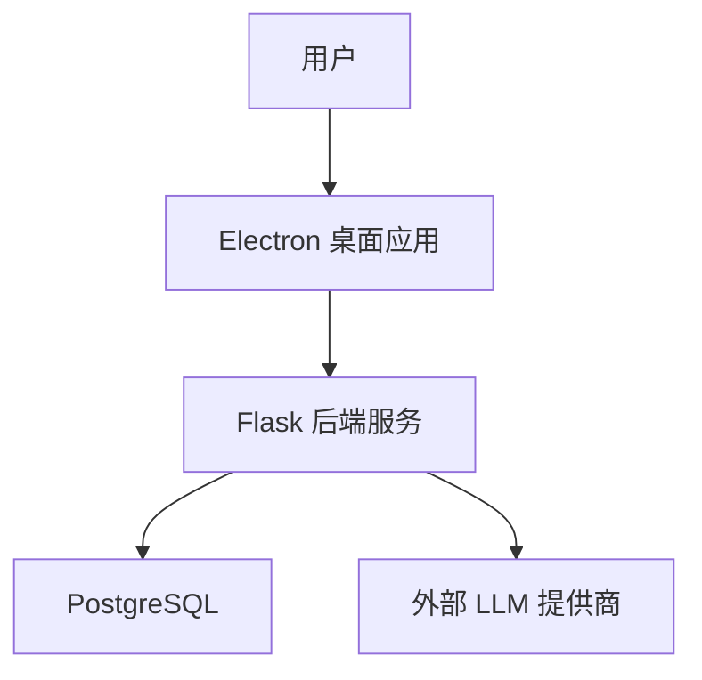

# 整体架构设计

<cite>
**本文引用的文件**   
- [desktop/main.js](file://desktop/main.js)
- [desktop/preload.js](file://desktop/preload.js)
- [desktop/renderer/index.html](file://desktop/renderer/index.html)
- [desktop/asr_proxy.js](file://desktop/asr_proxy.js)
- [server/app.py](file://server/app.py)
- [server/config.py](file://server/config.py)
- [server/auth.py](file://server/auth.py)
- [server/routes_bridge.py](file://server/routes_bridge.py)
- [server/routes_notes.py](file://server/routes_notes.py)
- [server/routes_knowledge.py](file://server/routes_knowledge.py)
- [server/routes_admin.py](file://server/routes_admin.py)
- [server/routes_credits.py](file://server/routes_credits.py)
- [server/database/db_adapter.py](file://server/database/db_adapter.py)
- [server/database/schema_postgres.py](file://server/database/schema_postgres.py)
- [server/llm_provider_factory.py](file://server/llm_provider_factory.py)
- [server/knowledge_management.py](file://server/knowledge_management.py)
- [server/similarity_matcher.py](file://server/similarity_matcher.py)
- [server/credits_service.py](file://server/credits_service.py)
- [server/logger_module.py](file://server/logger_module.py)
- [server/templates/spa/page.html](file://server/templates/spa/page.html)
- [start_app.ps1](file://start_app.ps1)
</cite>

## 目录
1. [引言](#引言)
2. [项目结构](#项目结构)
3. [核心组件](#核心组件)
4. [架构总览](#架构总览)
5. [详细组件分析](#详细组件分析)
6. [依赖关系分析](#依赖关系分析)
7. [性能考虑](#性能考虑)
8. [故障排查指南](#故障排查指南)
9. [结论](#结论)
10. [附录](#附录)

## 引言
本文件为 LectureLearnLoop 的整体架构设计文档，面向技术读者与非技术读者，系统阐述 Electron 桌面应用与 Python Flask 后端服务的分层架构、职责边界、交互协议、数据流向与安全策略。重点说明主进程、渲染进程与 Flask 服务层的职责划分，解释技术选型（Electron + Flask + PostgreSQL）的原因与优势，并提供系统上下文图、部署架构图与组件依赖图，帮助团队在扩展与维护中保持一致的设计方向。

## 项目结构
仓库采用前后端分离的桌面应用形态：
- desktop 目录：Electron 桌面应用，包含主进程、预加载脚本与渲染页面，负责 UI 呈现、本地能力调用与跨进程通信桥接。
- server 目录：Python Flask 后端服务，提供业务路由、认证鉴权、LLM 调用、知识管理与数据库访问等能力。
- docs 目录：业务规则、计划与测试文档。
- tools 目录：辅助工具与脚本。
- start_app.ps1：一键启动脚本，协调 Electron 与 Flask 的启动顺序与端口配置。

**图表来源** 
- [desktop/main.js:1-200](file://desktop/main.js#L1-L200)
- [desktop/preload.js:1-200](file://desktop/preload.js#L1-L200)
- [desktop/renderer/index.html:1-200](file://desktop/renderer/index.html#L1-L200)
- [desktop/asr_proxy.js:1-200](file://desktop/asr_proxy.js#L1-L200)
- [server/app.py:1-200](file://server/app.py#L1-L200)
- [server/auth.py:1-200](file://server/auth.py#L1-L200)
- [server/routes_bridge.py:1-200](file://server/routes_bridge.py#L1-L200)
- [server/routes_notes.py:1-200](file://server/routes_notes.py#L1-L200)
- [server/routes_knowledge.py:1-200](file://server/routes_knowledge.py#L1-L200)
- [server/routes_admin.py:1-200](file://server/routes_admin.py#L1-L200)
- [server/routes_credits.py:1-200](file://server/routes_credits.py#L1-L200)
- [server/database/db_adapter.py:1-200](file://server/database/db_adapter.py#L1-L200)
- [server/database/schema_postgres.py:1-200](file://server/database/schema_postgres.py#L1-L200)
- [server/llm_provider_factory.py:1-200](file://server/llm_provider_factory.py#L1-L200)
- [server/knowledge_management.py:1-200](file://server/knowledge_management.py#L1-L200)
- [server/similarity_matcher.py:1-200](file://server/similarity_matcher.py#L1-L200)
- [server/credits_service.py:1-200](file://server/credits_service.py#L1-L200)
- [server/logger_module.py:1-200](file://server/logger_module.py#L1-L200)

**章节来源**
- [start_app.ps1:1-200](file://start_app.ps1#L1-L200)

## 核心组件
- 主进程（Electron main.js）：负责创建窗口、生命周期管理、IPC 通道、与后端服务协同启动与端口探测。
- 预加载脚本（preload.js）：暴露安全的 API 给渲染进程，屏蔽 Node.js 直接访问，实现最小权限原则。
- 渲染进程（renderer/index.html）：承载前端 SPA 页面，发起 HTTP 请求到 Flask，处理用户交互与状态展示。
- Flask 应用（app.py）：统一入口，注册路由、中间件、错误处理与静态资源托管。
- 认证模块（auth.py）：登录、会话、权限校验与令牌管理。
- 业务路由层（routes_*.py）：按领域拆分的路由集合，如笔记、知识、管理员、积分、桥接接口等。
- 数据库适配层（database/db_adapter.py）：封装 PostgreSQL 连接、事务、查询与迁移执行。
- LLM 工厂（llm_provider_factory.py）：抽象不同大模型提供商的统一调用接口。
- 知识管理（knowledge_management.py）：知识点抽取、存储、检索与关联。
- 相似度匹配（similarity_matcher.py）：文本相似度计算与匹配策略。
- 积分服务（credits_service.py）：积分获取、消耗与审计。
- 日志模块（logger_module.py）：结构化日志记录与输出。

**章节来源**
- [desktop/main.js:1-200](file://desktop/main.js#L1-L200)
- [desktop/preload.js:1-200](file://desktop/preload.js#L1-L200)
- [desktop/renderer/index.html:1-200](file://desktop/renderer/index.html#L1-L200)
- [server/app.py:1-200](file://server/app.py#L1-L200)
- [server/auth.py:1-200](file://server/auth.py#L1-L200)
- [server/routes_bridge.py:1-200](file://server/routes_bridge.py#L1-L200)
- [server/routes_notes.py:1-200](file://server/routes_notes.py#L1-L200)
- [server/routes_knowledge.py:1-200](file://server/routes_knowledge.py#L1-L200)
- [server/routes_admin.py:1-200](file://server/routes_admin.py#L1-L200)
- [server/routes_credits.py:1-200](file://server/routes_credits.py#L1-L200)
- [server/database/db_adapter.py:1-200](file://server/database/db_adapter.py#L1-L200)
- [server/database/schema_postgres.py:1-200](file://server/database/schema_postgres.py#L1-L200)
- [server/llm_provider_factory.py:1-200](file://server/llm_provider_factory.py#L1-L200)
- [server/knowledge_management.py:1-200](file://server/knowledge_management.py#L1-L200)
- [server/similarity_matcher.py:1-200](file://server/similarity_matcher.py#L1-L200)
- [server/credits_service.py:1-200](file://server/credits_service.py#L1-L200)
- [server/logger_module.py:1-200](file://server/logger_module.py#L1-L200)

## 架构总览
系统采用三层架构：
- 表现层（Electron 渲染进程）：UI 与交互逻辑，通过预加载脚本安全地调用主进程能力，并通过 HTTP 与后端通信。
- 服务层（Flask 后端）：提供 RESTful API，编排业务逻辑，协调认证、数据库、LLM、知识管理与积分等服务。
- 数据层（PostgreSQL）：持久化存储用户、笔记、知识点、积分与系统配置等数据。

**图表来源**
- [desktop/main.js:1-200](file://desktop/main.js#L1-L200)
- [desktop/preload.js:1-200](file://desktop/preload.js#L1-L200)
- [server/app.py:1-200](file://server/app.py#L1-L200)
- [server/auth.py:1-200](file://server/auth.py#L1-L200)
- [server/routes_bridge.py:1-200](file://server/routes_bridge.py#L1-L200)
- [server/database/db_adapter.py:1-200](file://server/database/db_adapter.py#L1-L200)
- [server/llm_provider_factory.py:1-200](file://server/llm_provider_factory.py#L1-L200)
- [server/knowledge_management.py:1-200](file://server/knowledge_management.py#L1-L200)
- [server/credits_service.py:1-200](file://server/credits_service.py#L1-L200)

## 详细组件分析

### 跨进程通信机制（Electron IPC）
- 主进程负责创建窗口并初始化 IPC 通道，预加载脚本暴露受限 API 给渲染进程，避免直接访问 Node.js 能力。
- 渲染进程通过预加载脚本调用主进程提供的能力（如文件系统、音频设备、系统通知等），同时通过 HTTP 与 Flask 服务通信。
- asr_proxy.js 作为 ASR（语音转写）代理，协调本地录音、流式传输与服务端转写结果回传。

**图表来源**
- [desktop/main.js:1-200](file://desktop/main.js#L1-L200)
- [desktop/preload.js:1-200](file://desktop/preload.js#L1-L200)
- [desktop/asr_proxy.js:1-200](file://desktop/asr_proxy.js#L1-L200)

**章节来源**
- [desktop/main.js:1-200](file://desktop/main.js#L1-L200)
- [desktop/preload.js:1-200](file://desktop/preload.js#L1-L200)
- [desktop/asr_proxy.js:1-200](file://desktop/asr_proxy.js#L1-L200)

### Flask 服务层与路由组织
- app.py 作为统一入口，注册路由、中间件、错误处理器与静态资源。
- routes_bridge.py 提供与 Electron 桥接的接口，用于跨进程协作与能力扩展。
- routes_notes.py、routes_knowledge.py、routes_admin.py、routes_credits.py 分别负责笔记、知识、管理员与积分等业务域。
- 所有路由均通过认证模块进行鉴权，确保访问控制。

**图表来源**
- [server/app.py:1-200](file://server/app.py#L1-L200)
- [server/routes_bridge.py:1-200](file://server/routes_bridge.py#L1-L200)
- [server/routes_notes.py:1-200](file://server/routes_notes.py#L1-L200)
- [server/routes_knowledge.py:1-200](file://server/routes_knowledge.py#L1-L200)
- [server/routes_admin.py:1-200](file://server/routes_admin.py#L1-L200)
- [server/routes_credits.py:1-200](file://server/routes_credits.py#L1-L200)
- [server/auth.py:1-200](file://server/auth.py#L1-L200)

**章节来源**
- [server/app.py:1-200](file://server/app.py#L1-L200)
- [server/routes_bridge.py:1-200](file://server/routes_bridge.py#L1-L200)
- [server/routes_notes.py:1-200](file://server/routes_notes.py#L1-L200)
- [server/routes_knowledge.py:1-200](file://server/routes_knowledge.py#L1-L200)
- [server/routes_admin.py:1-200](file://server/routes_admin.py#L1-L200)
- [server/routes_credits.py:1-200](file://server/routes_credits.py#L1-L200)
- [server/auth.py:1-200](file://server/auth.py#L1-L200)

### 数据库访问与 PostgreSQL 集成
- db_adapter.py 封装数据库连接、事务、查询与迁移执行，屏蔽底层驱动差异。
- schema_postgres.py 定义数据库模式与迁移脚本，确保表结构与约束一致性。
- 所有业务路由通过适配层访问数据库，保证事务一致性与错误隔离。

**图表来源**
- [server/database/db_adapter.py:1-200](file://server/database/db_adapter.py#L1-L200)
- [server/database/schema_postgres.py:1-200](file://server/database/schema_postgres.py#L1-L200)
- [server/routes_notes.py:1-200](file://server/routes_notes.py#L1-L200)
- [server/routes_knowledge.py:1-200](file://server/routes_knowledge.py#L1-L200)

**章节来源**
- [server/database/db_adapter.py:1-200](file://server/database/db_adapter.py#L1-L200)
- [server/database/schema_postgres.py:1-200](file://server/database/schema_postgres.py#L1-L200)

### LLM 调用与知识管理
- llm_provider_factory.py 抽象不同 LLM 提供商的统一接口，便于扩展新的模型供应商。
- knowledge_management.py 负责知识点抽取、存储与检索，结合 similarity_matcher.py 进行相似度匹配。
- 路由层将 LLM 调用与知识管理组合成业务流程，例如从材料中学习、生成问题与练习。

**图表来源**
- [server/llm_provider_factory.py:1-200](file://server/llm_provider_factory.py#L1-L200)
- [server/knowledge_management.py:1-200](file://server/knowledge_management.py#L1-L200)
- [server/similarity_matcher.py:1-200](file://server/similarity_matcher.py#L1-L200)

**章节来源**
- [server/llm_provider_factory.py:1-200](file://server/llm_provider_factory.py#L1-L200)
- [server/knowledge_management.py:1-200](file://server/knowledge_management.py#L1-L200)
- [server/similarity_matcher.py:1-200](file://server/similarity_matcher.py#L1-L200)

### 积分系统与审计
- credits_service.py 提供积分获取、消耗与审计功能，确保积分变更可追溯。
- routes_credits.py 暴露积分相关 API，供前端与后台任务调用。
- 积分变更需经过认证与权限校验，并与日志模块联动记录审计信息。

**图表来源**
- [server/credits_service.py:1-200](file://server/credits_service.py#L1-L200)
- [server/routes_credits.py:1-200](file://server/routes_credits.py#L1-L200)
- [server/logger_module.py:1-200](file://server/logger_module.py#L1-L200)

**章节来源**
- [server/credits_service.py:1-200](file://server/credits_service.py#L1-L200)
- [server/routes_credits.py:1-200](file://server/routes_credits.py#L1-L200)
- [server/logger_module.py:1-200](file://server/logger_module.py#L1-L200)

## 依赖关系分析
- 组件耦合度：
  - 路由层对数据库适配层、LLM 工厂、知识管理与积分服务存在明确依赖，但通过接口抽象降低耦合。
  - 预加载脚本仅暴露必要能力，减少渲染进程对 Node.js 的直接依赖。
- 外部依赖：
  - PostgreSQL 作为持久化存储。
  - LLM 提供商作为外部 AI 服务。
- 潜在循环依赖：
  - 当前路由层与业务服务之间无循环依赖；若新增服务需注意避免反向引用。

**图表来源**
- [server/routes_notes.py:1-200](file://server/routes_notes.py#L1-L200)
- [server/routes_knowledge.py:1-200](file://server/routes_knowledge.py#L1-L200)
- [server/routes_admin.py:1-200](file://server/routes_admin.py#L1-L200)
- [server/routes_credits.py:1-200](file://server/routes_credits.py#L1-L200)
- [server/database/db_adapter.py:1-200](file://server/database/db_adapter.py#L1-L200)
- [server/llm_provider_factory.py:1-200](file://server/llm_provider_factory.py#L1-L200)
- [server/knowledge_management.py:1-200](file://server/knowledge_management.py#L1-L200)
- [server/credits_service.py:1-200](file://server/credits_service.py#L1-L200)
- [server/auth.py:1-200](file://server/auth.py#L1-L200)

**章节来源**
- [server/routes_notes.py:1-200](file://server/routes_notes.py#L1-L200)
- [server/routes_knowledge.py:1-200](file://server/routes_knowledge.py#L1-L200)
- [server/routes_admin.py:1-200](file://server/routes_admin.py#L1-L200)
- [server/routes_credits.py:1-200](file://server/routes_credits.py#L1-L200)
- [server/database/db_adapter.py:1-200](file://server/database/db_adapter.py#L1-L200)
- [server/llm_provider_factory.py:1-200](file://server/llm_provider_factory.py#L1-L200)
- [server/knowledge_management.py:1-200](file://server/knowledge_management.py#L1-L200)
- [server/credits_service.py:1-200](file://server/credits_service.py#L1-L200)
- [server/auth.py:1-200](file://server/auth.py#L1-L200)

## 性能考虑
- 数据库连接池与事务优化：通过 db_adapter.py 统一管理连接与事务，减少连接开销与死锁风险。
- LLM 调用异步化：建议对耗时 LLM 调用采用异步队列与重试机制，避免阻塞请求线程。
- 缓存策略：对热点知识点与相似度结果引入内存缓存，降低重复计算与数据库压力。
- 前端渲染优化：SPA 页面按需加载与懒加载，减少首屏资源体积。
- 日志与监控：通过 logger_module.py 输出结构化日志，配合指标采集进行性能监控。

[本节为通用性能指导，不直接分析具体文件]

## 故障排查指南
- 认证失败：检查 auth.py 中的会话与令牌逻辑，确认前端传递的凭证是否正确。
- 数据库连接异常：检查 db_adapter.py 的连接参数与 schema_postgres.py 的迁移状态。
- LLM 调用超时：检查 llm_provider_factory.py 的配置与网络连通性，必要时增加重试与降级策略。
- 积分不一致：核对 credits_service.py 的事务与审计日志，确保并发场景下的幂等性。
- 前端无法调用后端：确认 Flask 服务端口与 CORS 设置，检查浏览器控制台与服务器日志。

**章节来源**
- [server/auth.py:1-200](file://server/auth.py#L1-L200)
- [server/database/db_adapter.py:1-200](file://server/database/db_adapter.py#L1-L200)
- [server/database/schema_postgres.py:1-200](file://server/database/schema_postgres.py#L1-L200)
- [server/llm_provider_factory.py:1-200](file://server/llm_provider_factory.py#L1-L200)
- [server/credits_service.py:1-200](file://server/credits_service.py#L1-L200)

## 结论
LectureLearnLoop 采用 Electron + Flask + PostgreSQL 的分层架构，清晰划分了桌面端与服务端的职责边界。通过预加载脚本与 IPC 机制保障安全与可控，Flask 路由层按领域拆分提升可维护性，PostgreSQL 提供稳定可靠的持久化能力。该架构具备良好的扩展性与安全性，适合持续迭代与团队协作。

[本节为总结性内容，不直接分析具体文件]

## 附录

### 技术选型决策
- Electron：提供原生桌面体验与本地能力（音频、文件系统、系统通知），便于构建富交互的学习工具。
- Flask：轻量、易扩展，适合快速构建 RESTful API 与模板渲染，便于前后端分离开发。
- PostgreSQL：强一致性、事务支持完善，适合复杂业务数据的持久化与高并发访问。

[本节为概念性说明，不直接分析具体文件]

### 部署架构图

**图表来源**
- [start_app.ps1:1-200](file://start_app.ps1#L1-L200)
- [server/app.py:1-200](file://server/app.py#L1-L200)

### 系统上下文图

**图表来源**
- [desktop/main.js:1-200](file://desktop/main.js#L1-L200)
- [server/app.py:1-200](file://server/app.py#L1-L200)