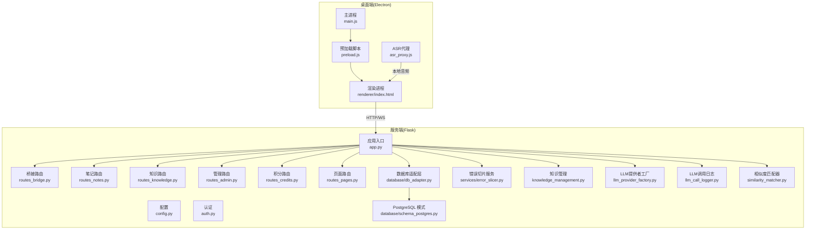
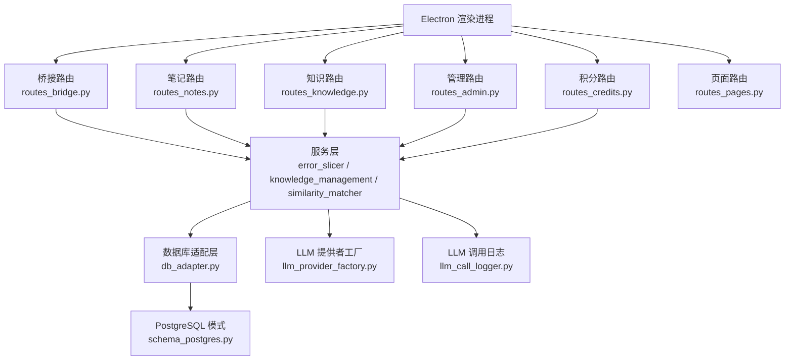
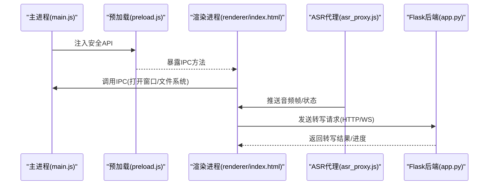
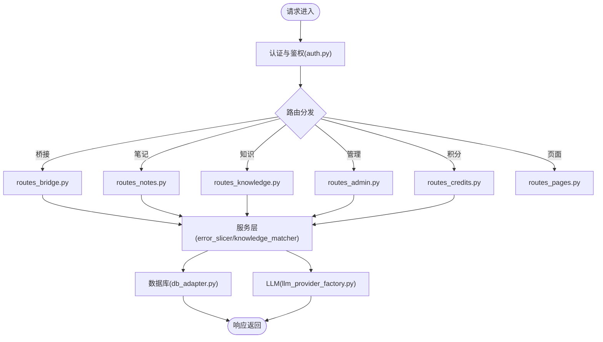
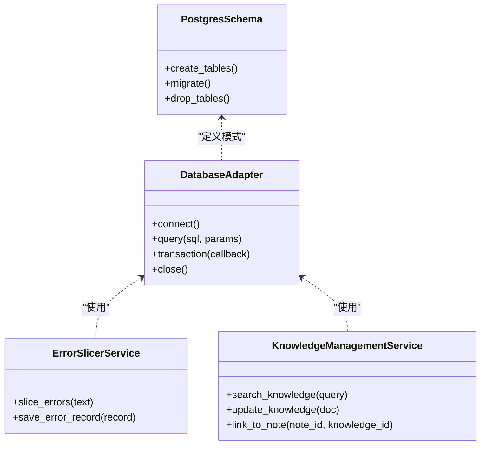
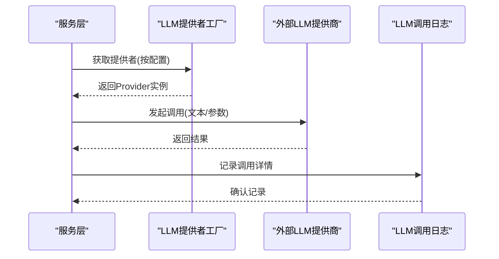
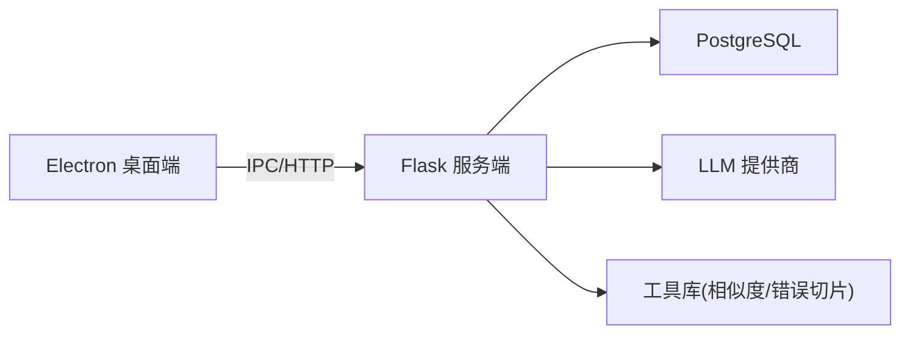

# 系统架构设计

<cite>
**本文引用的文件**   
- [desktop/main.js](file://desktop/main.js)
- [desktop/preload.js](file://desktop/preload.js)
- [desktop/renderer/index.html](file://desktop/renderer/index.html)
- [desktop/asr_proxy.js](file://desktop/asr_proxy.js)
- [server/app.py](file://server/app.py)
- [server/config.py](file://server/config.py)
- [server/auth.py](file://server/auth.py)
- [server/routes_bridge.py](file://server/routes_bridge.py)
- [server/routes_notes.py](file://server/routes_notes.py)
- [server/routes_knowledge.py](file://server/routes_knowledge.py)
- [server/routes_admin.py](file://server/routes_admin.py)
- [server/routes_credits.py](file://server/routes_credits.py)
- [server/routes_pages.py](file://server/routes_pages.py)
- [server/database/db_adapter.py](file://server/database/db_adapter.py)
- [server/database/schema_postgres.py](file://server/database/schema_postgres.py)
- [server/services/error_slicer.py](file://server/services/error_slicer.py)
- [server/knowledge_management.py](file://server/knowledge_management.py)
- [server/llm_provider_factory.py](file://server/llm_provider_factory.py)
- [server/llm_call_logger.py](file://server/llm_call_logger.py)
- [server/similarity_matcher.py](file://server/similarity_matcher.py)
- [server/static/js/api.js](file://server/static/js/api.js)
- [server/templates/spa/page.html](file://server/templates/spa/page.html)
- [start_app.ps1](file://start_app.ps1)
</cite>

## 目录
1. [简介](#简介)
2. [项目结构](#项目结构)
3. [核心组件](#核心组件)
4. [架构总览](#架构总览)
5. [详细组件分析](#详细组件分析)
6. [依赖关系分析](#依赖关系分析)
7. [性能与可扩展性](#性能与可扩展性)
8. [故障排查指南](#故障排查指南)
9. [结论](#结论)
10. [附录](#附录)

## 简介
本文件为 LectureLearnLoop 系统的全面架构文档，覆盖高层设计、架构模式、系统边界、Electron 主进程与渲染进程的通信机制、Flask 后端组织结构、前后端数据流、技术决策与权衡、基础设施需求、可扩展性与部署拓扑，以及安全性、监控与灾难恢复等横切关注点。文档同时记录 IPC 通信、路由设计与中间件架构，并给出系统上下文图与组件分解图。

## 项目结构
LectureLearnLoop 采用“桌面客户端 + Web 后端”的混合架构：
- 桌面端基于 Electron，包含主进程、预加载脚本与渲染页面，负责本地交互、音频采集与与后端的桥接通信。
- 服务端基于 Flask，提供 REST API、模板渲染、认证鉴权、知识管理、LLM 调用日志与数据库访问能力。
- 前端资源由 Flask 托管静态资源与模板，Electron 渲染进程通过浏览器网络栈与服务端交互。

图表来源
- [desktop/main.js:1-200](file://desktop/main.js#L1-L200)
- [desktop/preload.js:1-200](file://desktop/preload.js#L1-L200)
- [desktop/renderer/index.html:1-200](file://desktop/renderer/index.html#L1-L200)
- [desktop/asr_proxy.js:1-200](file://desktop/asr_proxy.js#L1-L200)
- [server/app.py:1-200](file://server/app.py#L1-L200)
- [server/config.py:1-200](file://server/config.py#L1-L200)
- [server/auth.py:1-200](file://server/auth.py#L1-L200)
- [server/routes_bridge.py:1-200](file://server/routes_bridge.py#L1-L200)
- [server/routes_notes.py:1-200](file://server/routes_notes.py#L1-L200)
- [server/routes_knowledge.py:1-200](file://server/routes_knowledge.py#L1-L200)
- [server/routes_admin.py:1-200](file://server/routes_admin.py#L1-L200)
- [server/routes_credits.py:1-200](file://server/routes_credits.py#L1-L200)
- [server/routes_pages.py:1-200](file://server/routes_pages.py#L1-L200)
- [server/database/db_adapter.py:1-200](file://server/database/db_adapter.py#L1-L200)
- [server/database/schema_postgres.py:1-200](file://server/database/schema_postgres.py#L1-L200)
- [server/services/error_slicer.py:1-200](file://server/services/error_slicer.py#L1-L200)
- [server/knowledge_management.py:1-200](file://server/knowledge_management.py#L1-L200)
- [server/llm_provider_factory.py:1-200](file://server/llm_provider_factory.py#L1-L200)
- [server/llm_call_logger.py:1-200](file://server/llm_call_logger.py#L1-L200)
- [server/similarity_matcher.py:1-200](file://server/similarity_matcher.py#L1-L200)

章节来源
- [desktop/main.js:1-200](file://desktop/main.js#L1-L200)
- [desktop/preload.js:1-200](file://desktop/preload.js#L1-L200)
- [desktop/renderer/index.html:1-200](file://desktop/renderer/index.html#L1-L200)
- [desktop/asr_proxy.js:1-200](file://desktop/asr_proxy.js#L1-L200)
- [server/app.py:1-200](file://server/app.py#L1-L200)
- [server/config.py:1-200](file://server/config.py#L1-L200)

## 核心组件
- Electron 主进程：负责窗口生命周期、菜单、系统级能力与与渲染进程的安全 IPC 通道。
- 预加载脚本：在渲染进程上下文中暴露受控 API，隔离原生模块直接访问。
- 渲染进程：承载 UI 与业务逻辑，通过浏览器网络栈与 Flask 后端进行 HTTP/WebSocket 通信。
- ASR 代理：封装本地音频采集与转写流程，向渲染进程提供统一接口。
- Flask 应用：集中注册路由、中间件、认证、日志与数据库连接。
- 路由层：按领域划分（桥接、笔记、知识、管理、积分、页面），实现职责分离。
- 数据访问层：抽象数据库适配器，支持 PostgreSQL 模式定义。
- 服务层：错误切片、知识管理、LLM 提供者工厂、LLM 调用日志、相似度匹配器等。

章节来源
- [desktop/main.js:1-200](file://desktop/main.js#L1-L200)
- [desktop/preload.js:1-200](file://desktop/preload.js#L1-L200)
- [desktop/asr_proxy.js:1-200](file://desktop/asr_proxy.js#L1-L200)
- [server/app.py:1-200](file://server/app.py#L1-L200)
- [server/routes_bridge.py:1-200](file://server/routes_bridge.py#L1-L200)
- [server/routes_notes.py:1-200](file://server/routes_notes.py#L1-L200)
- [server/routes_knowledge.py:1-200](file://server/routes_knowledge.py#L1-L200)
- [server/routes_admin.py:1-200](file://server/routes_admin.py#L1-L200)
- [server/routes_credits.py:1-200](file://server/routes_credits.py#L1-L200)
- [server/routes_pages.py:1-200](file://server/routes_pages.py#L1-L200)
- [server/database/db_adapter.py:1-200](file://server/database/db_adapter.py#L1-L200)
- [server/database/schema_postgres.py:1-200](file://server/database/schema_postgres.py#L1-L200)
- [server/services/error_slicer.py:1-200](file://server/services/error_slicer.py#L1-L200)
- [server/knowledge_management.py:1-200](file://server/knowledge_management.py#L1-L200)
- [server/llm_provider_factory.py:1-200](file://server/llm_provider_factory.py#L1-L200)
- [server/llm_call_logger.py:1-200](file://server/llm_call_logger.py#L1-L200)
- [server/similarity_matcher.py:1-200](file://server/similarity_matcher.py#L1-L200)

## 架构总览
系统采用分层与模块化设计：
- 表现层：Electron 渲染进程承载 SPA 页面，通过 Flask 托管的模板与静态资源提供服务。
- 接入层：Flask 路由层按领域拆分，统一处理请求、鉴权、参数校验与响应格式化。
- 服务层：封装业务逻辑（知识管理、错误切片、LLM 调用、相似度匹配）。
- 数据层：数据库适配器与模式定义，屏蔽底层存储差异。
- 外部集成：LLM 提供商、语音识别服务、浏览器自动化（CDP）等。

图表来源
- [server/app.py:1-200](file://server/app.py#L1-L200)
- [server/routes_bridge.py:1-200](file://server/routes_bridge.py#L1-L200)
- [server/routes_notes.py:1-200](file://server/routes_notes.py#L1-L200)
- [server/routes_knowledge.py:1-200](file://server/routes_knowledge.py#L1-L200)
- [server/routes_admin.py:1-200](file://server/routes_admin.py#L1-L200)
- [server/routes_credits.py:1-200](file://server/routes_credits.py#L1-L200)
- [server/routes_pages.py:1-200](file://server/routes_pages.py#L1-L200)
- [server/services/error_slicer.py:1-200](file://server/services/error_slicer.py#L1-L200)
- [server/knowledge_management.py:1-200](file://server/knowledge_management.py#L1-L200)
- [server/similarity_matcher.py:1-200](file://server/similarity_matcher.py#L1-L200)
- [server/database/db_adapter.py:1-200](file://server/database/db_adapter.py#L1-L200)
- [server/database/schema_postgres.py:1-200](file://server/database/schema_postgres.py#L1-L200)
- [server/llm_provider_factory.py:1-200](file://server/llm_provider_factory.py#L1-L200)
- [server/llm_call_logger.py:1-200](file://server/llm_call_logger.py#L1-L200)

## 详细组件分析

### Electron 主进程与渲染进程通信
- 主进程负责创建 BrowserWindow、加载渲染页面、注册全局快捷键与系统事件。
- 预加载脚本通过 contextBridge 暴露安全 API，限制渲染进程对 Node.js 原生模块的直接访问。
- 渲染进程通过预加载脚本提供的 API 与主进程进行 IPC 通信，执行如打开文件、控制窗口等行为。
- ASR 代理在主进程或独立进程中运行，捕获本地音频流并通过 IPC 推送给渲染进程，渲染进程再转发到后端进行实时转写。

图表来源
- [desktop/main.js:1-200](file://desktop/main.js#L1-L200)
- [desktop/preload.js:1-200](file://desktop/preload.js#L1-L200)
- [desktop/renderer/index.html:1-200](file://desktop/renderer/index.html#L1-L200)
- [desktop/asr_proxy.js:1-200](file://desktop/asr_proxy.js#L1-L200)

章节来源
- [desktop/main.js:1-200](file://desktop/main.js#L1-L200)
- [desktop/preload.js:1-200](file://desktop/preload.js#L1-L200)
- [desktop/renderer/index.html:1-200](file://desktop/renderer/index.html#L1-L200)
- [desktop/asr_proxy.js:1-200](file://desktop/asr_proxy.js#L1-L200)

### Flask 后端组织与路由设计
- 应用入口 app.py 集中初始化配置、注册蓝图与中间件。
- 路由按领域拆分：
  - routes_bridge.py：桥接协议，统一封装桌面端与后端的数据交换。
  - routes_notes.py：笔记的增删改查与同步。
  - routes_knowledge.py：知识点检索、关联与更新。
  - routes_admin.py：管理员功能（用户、权限、系统设置）。
  - routes_credits.py：积分管理与计费。
  - routes_pages.py：SPA 页面与模板渲染。
- 认证 auth.py 提供登录、鉴权与权限检查；配置 config.py 管理环境变量与运行时参数。

图表来源
- [server/app.py:1-200](file://server/app.py#L1-L200)
- [server/auth.py:1-200](file://server/auth.py#L1-L200)
- [server/routes_bridge.py:1-200](file://server/routes_bridge.py#L1-L200)
- [server/routes_notes.py:1-200](file://server/routes_notes.py#L1-L200)
- [server/routes_knowledge.py:1-200](file://server/routes_knowledge.py#L1-L200)
- [server/routes_admin.py:1-200](file://server/routes_admin.py#L1-L200)
- [server/routes_credits.py:1-200](file://server/routes_credits.py#L1-L200)
- [server/routes_pages.py:1-200](file://server/routes_pages.py#L1-L200)
- [server/database/db_adapter.py:1-200](file://server/database/db_adapter.py#L1-L200)
- [server/llm_provider_factory.py:1-200](file://server/llm_provider_factory.py#L1-L200)

章节来源
- [server/app.py:1-200](file://server/app.py#L1-L200)
- [server/auth.py:1-200](file://server/auth.py#L1-L200)
- [server/routes_bridge.py:1-200](file://server/routes_bridge.py#L1-L200)
- [server/routes_notes.py:1-200](file://server/routes_notes.py#L1-L200)
- [server/routes_knowledge.py:1-200](file://server/routes_knowledge.py#L1-L200)
- [server/routes_admin.py:1-200](file://server/routes_admin.py#L1-L200)
- [server/routes_credits.py:1-200](file://server/routes_credits.py#L1-L200)
- [server/routes_pages.py:1-200](file://server/routes_pages.py#L1-L200)

### 数据模型与数据库访问
- 数据库适配层 db_adapter.py 提供统一的查询、事务与连接管理。
- PostgreSQL 模式 schema_postgres.py 定义表结构与约束，确保数据一致性与可迁移性。
- 服务层通过适配层访问数据，避免在路由中直接操作数据库。

图表来源
- [server/database/db_adapter.py:1-200](file://server/database/db_adapter.py#L1-L200)
- [server/database/schema_postgres.py:1-200](file://server/database/schema_postgres.py#L1-L200)
- [server/services/error_slicer.py:1-200](file://server/services/error_slicer.py#L1-L200)
- [server/knowledge_management.py:1-200](file://server/knowledge_management.py#L1-L200)

章节来源
- [server/database/db_adapter.py:1-200](file://server/database/db_adapter.py#L1-L200)
- [server/database/schema_postgres.py:1-200](file://server/database/schema_postgres.py#L1-L200)
- [server/services/error_slicer.py:1-200](file://server/services/error_slicer.py#L1-L200)
- [server/knowledge_management.py:1-200](file://server/knowledge_management.py#L1-L200)

### LLM 调用与日志
- llm_provider_factory.py 根据配置选择不同 LLM 提供商，统一接口调用。
- llm_call_logger.py 记录每次调用的输入、输出、耗时与成本，便于审计与分析。
- 服务层在需要时调用 LLM，并将结果持久化或通过缓存提升性能。

图表来源
- [server/llm_provider_factory.py:1-200](file://server/llm_provider_factory.py#L1-L200)
- [server/llm_call_logger.py:1-200](file://server/llm_call_logger.py#L1-L200)

章节来源
- [server/llm_provider_factory.py:1-200](file://server/llm_provider_factory.py#L1-L200)
- [server/llm_call_logger.py:1-200](file://server/llm_call_logger.py#L1-L200)

### 前端静态资源与模板
- Flask 托管静态 JS 文件（如 api.js）与 HTML 模板（如 spa/page.html）。
- 渲染进程通过浏览器网络栈加载这些资源，并与后端 API 交互。
- 模板用于服务端渲染部分页面，SPA 则通过前端路由切换视图。

章节来源
- [server/static/js/api.js:1-200](file://server/static/js/api.js#L1-L200)
- [server/templates/spa/page.html:1-200](file://server/templates/spa/page.html#L1-L200)

## 依赖关系分析
- 桌面端依赖 Electron 框架与 Node.js 生态，通过预加载脚本暴露安全 API。
- 服务端依赖 Flask、数据库驱动（PostgreSQL）、LLM SDK（通过工厂抽象）与工具库（相似度匹配、错误切片）。
- 启动脚本 start_app.ps1 协调桌面端与服务端的启动顺序与环境变量。

图表来源
- [start_app.ps1:1-200](file://start_app.ps1#L1-L200)
- [server/app.py:1-200](file://server/app.py#L1-L200)

章节来源
- [start_app.ps1:1-200](file://start_app.ps1#L1-L200)
- [server/app.py:1-200](file://server/app.py#L1-L200)

## 性能与可扩展性
- 异步与并发：Flask 可通过 Gunicorn/uwsgi 多进程部署，结合异步 I/O 提升吞吐。
- 缓存策略：对热点知识与相似度计算结果进行缓存，降低重复计算开销。
- 数据库优化：索引设计、分页查询与连接池管理，避免长事务与锁竞争。
- 扩展点：LLM 提供者工厂支持新增提供商；路由层可按领域继续拆分；服务层可引入消息队列处理异步任务。
- 部署拓扑：建议将 Electron 作为本地客户端，Flask 部署于容器化环境，数据库独立部署，外部 LLM 通过 API 网关访问。

[本节为通用指导，不直接分析具体文件]

## 故障排查指南
- 认证失败：检查 auth.py 中的登录逻辑与权限校验，确认用户凭据与会话状态。
- 路由未命中：核对 routes_*.py 中的 URL 前缀与方法映射，确认 app.py 是否正确注册蓝图。
- 数据库连接异常：验证 db_adapter.py 的连接参数与 schema_postgres.py 的模式一致性。
- LLM 调用超时：检查 llm_provider_factory.py 的配置与 llm_call_logger.py 的日志输出。
- 音频采集问题：确认 asr_proxy.js 的设备枚举与权限设置，查看渲染进程日志。

章节来源
- [server/auth.py:1-200](file://server/auth.py#L1-L200)
- [server/routes_bridge.py:1-200](file://server/routes_bridge.py#L1-L200)
- [server/database/db_adapter.py:1-200](file://server/database/db_adapter.py#L1-L200)
- [server/database/schema_postgres.py:1-200](file://server/database/schema_postgres.py#L1-L200)
- [server/llm_provider_factory.py:1-200](file://server/llm_provider_factory.py#L1-L200)
- [server/llm_call_logger.py:1-200](file://server/llm_call_logger.py#L1-L200)
- [desktop/asr_proxy.js:1-200](file://desktop/asr_proxy.js#L1-L200)

## 结论
LectureLearnLoop 采用清晰的层次化与模块化架构，Electron 负责本地交互与音频采集，Flask 提供稳定的后端服务。通过领域路由、服务层抽象与数据库适配层，系统在可维护性与可扩展性上具备良好基础。未来可在缓存、异步任务与多租户方面进一步增强，以满足更大规模的使用场景。

[本节为总结性内容，不直接分析具体文件]

## 附录
- 技术栈：Electron、Node.js、Flask、Python、PostgreSQL、LLM API。
- 第三方依赖：详见 server/requirements.txt 与 desktop/package.json（未在本文中展开）。
- 版本兼容性：建议锁定 Python 与 Node.js 版本，确保依赖库兼容。
- 安全建议：启用 HTTPS、最小权限原则、敏感配置加密、输入校验与速率限制。
- 监控与告警：集成日志聚合、指标采集与错误追踪，建立健康检查与自动重启机制。
- 灾难恢复：定期备份数据库、配置灰度发布与回滚策略。

[本节为补充信息，不直接分析具体文件]