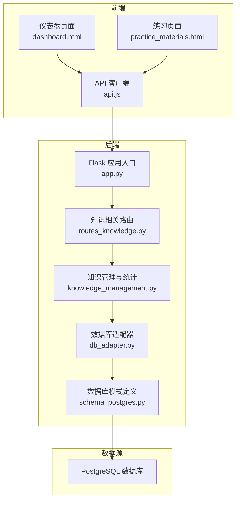
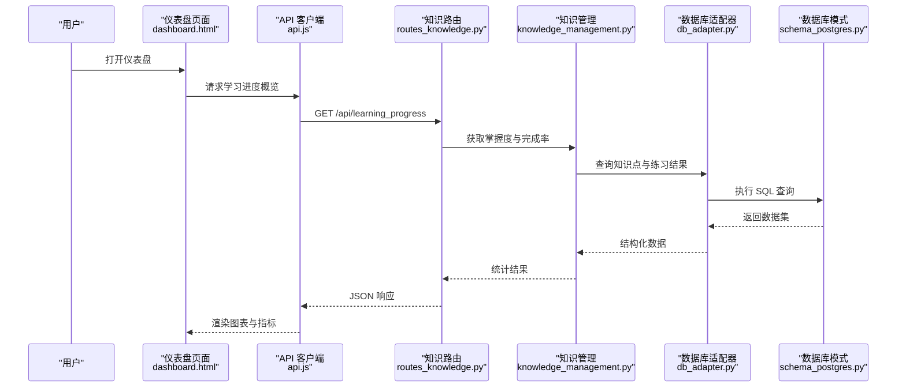
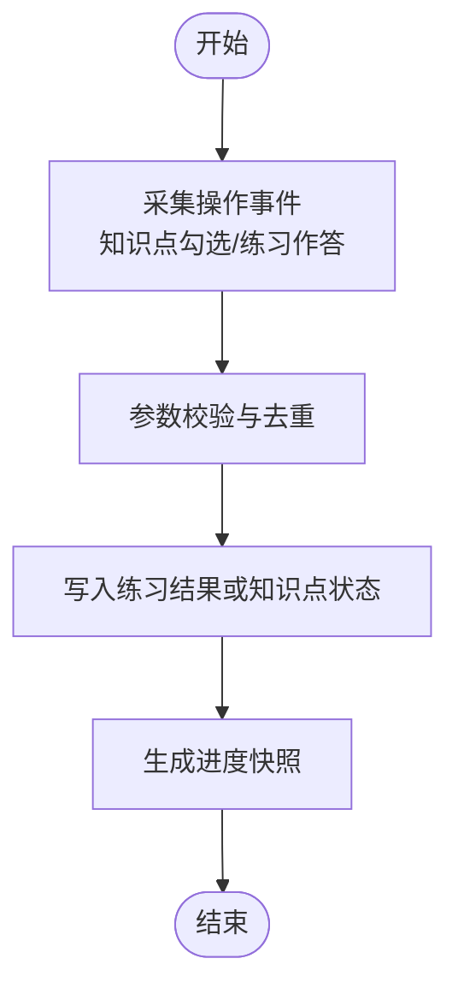
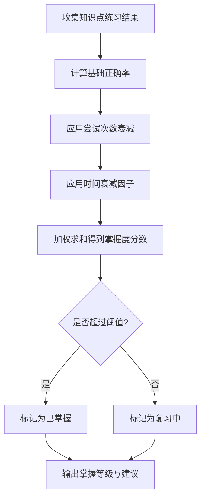
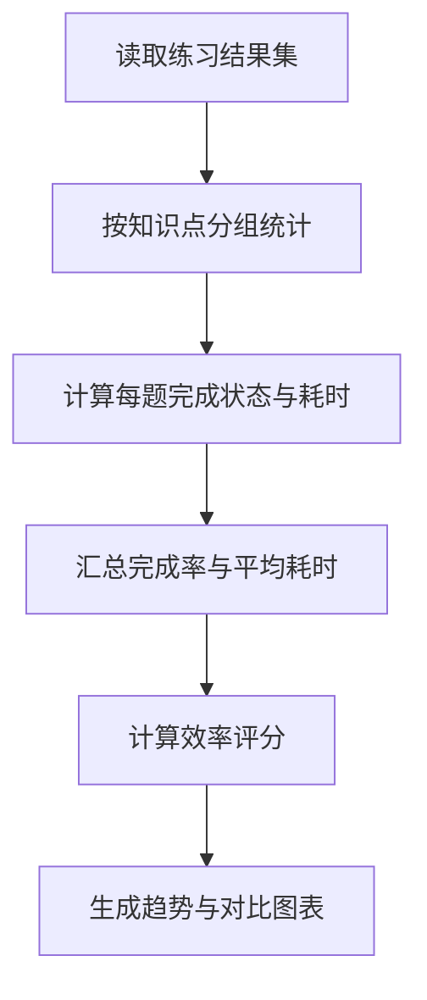
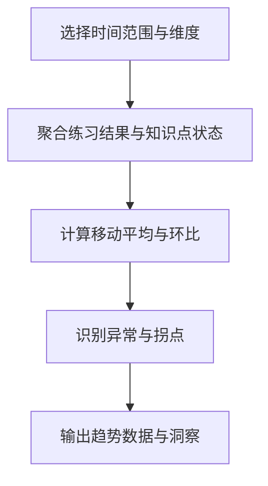
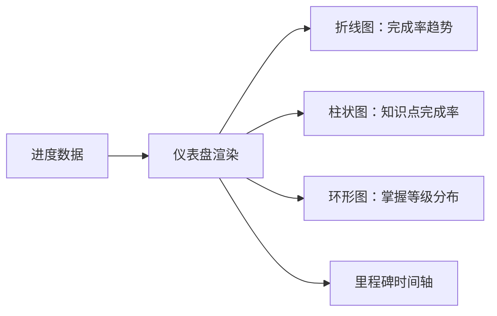
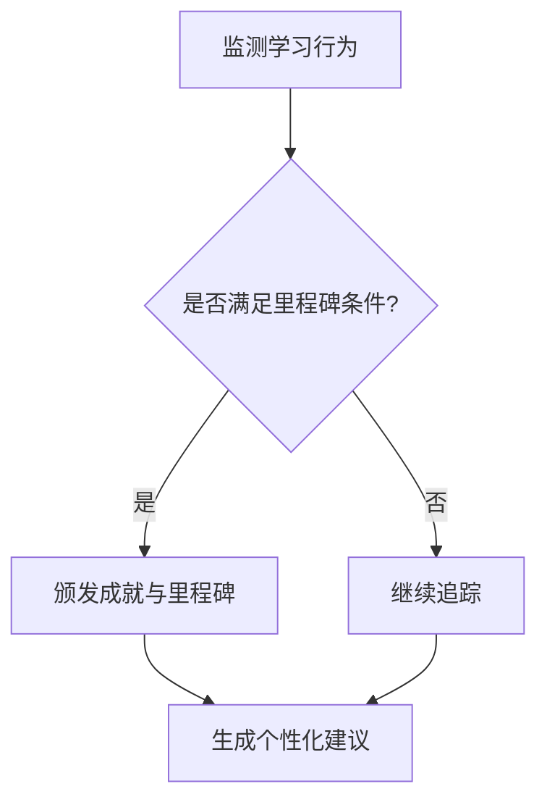
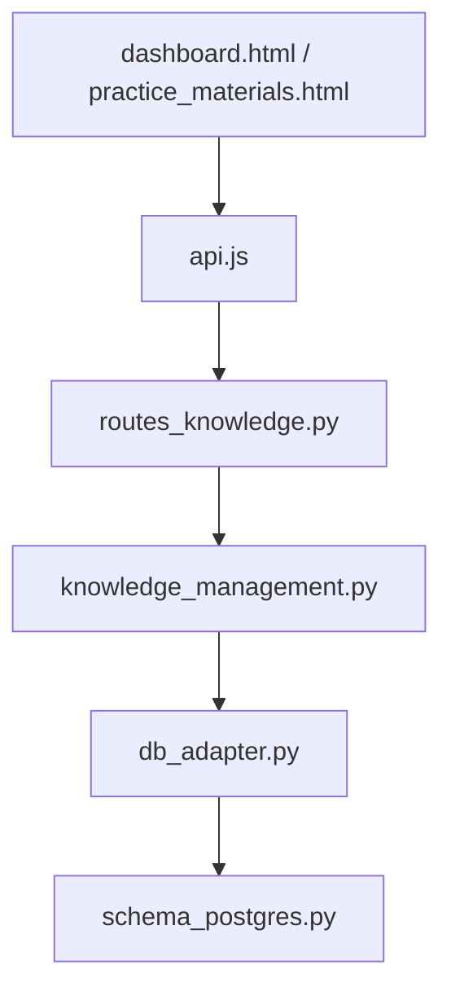

# 学习进度跟踪

<cite>
**本文引用的文件**   
- [app.py](file://server/app.py)
- [config.py](file://server/config.py)
- [routes_knowledge.py](file://server/routes_knowledge.py)
- [knowledge_management.py](file://server/knowledge_management.py)
- [db_adapter.py](file://server/database/db_adapter.py)
- [schema_postgres.py](file://server/database/schema_postgres.py)
- [dashboard.html](file://server/templates/pages/dashboard.html)
- [practice_materials.html](file://server/templates/pages/practice_materials.html)
- [api.js](file://server/static/js/api.js)
- [业务规则总览.md](file://docs/业务规则/业务规则总览.md)
- [练记系统全功能测试文档.md](file://docs/测试/2026-09-28-练记系统全功能测试文档.md)
</cite>

## 目录
1. [引言](#引言)
2. [项目结构](#项目结构)
3. [核心组件](#核心组件)
4. [架构总览](#架构总览)
5. [详细组件分析](#详细组件分析)
6. [依赖关系分析](#依赖关系分析)
7. [性能考量](#性能考量)
8. [故障排查指南](#故障排查指南)
9. [结论](#结论)
10. [附录](#附录)

## 引言
本文件为“LectureLearnLoop 学习进度跟踪系统”的技术与产品文档，聚焦以下目标：
- 进度数据采集、统计分析与可视化展示机制
- 知识点掌握度计算、练习完成率统计和学习效率评估
- 进度数据存储结构、历史数据查询与趋势分析方法
- 进度报告生成示例与图表展示说明
- 里程碑设置、成就系统与个性化学习建议生成

该系统以服务端 Python 应用为核心，结合前端模板与静态脚本，提供知识管理、练习闭环与学习仪表盘等能力。

## 项目结构
本项目采用前后端分离的 Web 架构：
- 后端服务：Flask 应用，负责路由、业务逻辑、数据库访问与外部服务集成
- 前端页面：Jinja 模板渲染页面，配合静态 JS 进行交互与 API 调用
- 数据层：PostgreSQL（通过适配器封装）存储知识、练习、用户行为与统计数据
- 文档与测试：业务规则、测试用例与开发日志辅助理解与验证

**图示来源**
- [app.py:1-200](file://server/app.py#L1-L200)
- [routes_knowledge.py:1-200](file://server/routes_knowledge.py#L1-L200)
- [knowledge_management.py:1-200](file://server/knowledge_management.py#L1-L200)
- [db_adapter.py:1-200](file://server/database/db_adapter.py#L1-L200)
- [schema_postgres.py:1-200](file://server/database/schema_postgres.py#L1-L200)
- [dashboard.html:1-200](file://server/templates/pages/dashboard.html#L1-L200)
- [practice_materials.html:1-200](file://server/templates/pages/practice_materials.html#L1-L200)
- [api.js:1-200](file://server/static/js/api.js#L1-L200)

**章节来源**
- [app.py:1-200](file://server/app.py#L1-L200)
- [config.py:1-100](file://server/config.py#L1-L100)

## 核心组件
- 应用入口与配置
  - Flask 应用初始化、蓝图注册、中间件与全局配置
  - 配置文件集中管理数据库连接、日志级别、第三方服务密钥等
- 知识管理与统计
  - 知识点状态维护、掌握度计算、练习结果聚合、趋势指标计算
- 数据库适配与模式
  - 统一数据库操作封装、SQL 构建与事务管理
  - PostgreSQL 表结构与约束定义
- 前端交互与可视化
  - 仪表盘展示总体进度、知识点掌握度、练习完成率
  - 练习页面记录答题过程、提交结果并刷新进度

**章节来源**
- [app.py:1-200](file://server/app.py#L1-L200)
- [config.py:1-100](file://server/config.py#L1-L100)
- [routes_knowledge.py:1-200](file://server/routes_knowledge.py#L1-L200)
- [knowledge_management.py:1-200](file://server/knowledge_management.py#L1-L200)
- [db_adapter.py:1-200](file://server/database/db_adapter.py#L1-L200)
- [schema_postgres.py:1-200](file://server/database/schema_postgres.py#L1-L200)
- [dashboard.html:1-200](file://server/templates/pages/dashboard.html#L1-L200)
- [practice_materials.html:1-200](file://server/templates/pages/practice_materials.html#L1-L200)
- [api.js:1-200](file://server/static/js/api.js#L1-L200)

## 架构总览
系统遵循分层架构：
- 表现层：HTML 模板 + 静态 JS，负责用户交互与图表渲染
- 控制层：Flask 路由处理请求、参数校验、权限检查
- 业务层：知识管理与统计模块，实现掌握度、完成率、效率评估等算法
- 数据层：数据库适配器与模式定义，保证数据一致性与可查询性

**图示来源**
- [dashboard.html:1-200](file://server/templates/pages/dashboard.html#L1-L200)
- [api.js:1-200](file://server/static/js/api.js#L1-L200)
- [routes_knowledge.py:1-200](file://server/routes_knowledge.py#L1-L200)
- [knowledge_management.py:1-200](file://server/knowledge_management.py#L1-L200)
- [db_adapter.py:1-200](file://server/database/db_adapter.py#L1-L200)
- [schema_postgres.py:1-200](file://server/database/schema_postgres.py#L1-L200)

## 详细组件分析

### 进度数据采集与存储
- 采集点
  - 知识点勾选与状态变更：在知识管理界面中更新知识点掌握状态
  - 练习答题记录：在练习页面记录题目作答、正确与否、耗时等
  - 会话与时间戳：每次操作附带用户标识、时间戳与上下文信息
- 存储结构
  - 知识点表：包含知识点 ID、名称、所属主题、掌握状态、更新时间
  - 练习结果表：包含题目 ID、用户 ID、答案、是否正确、耗时、时间戳
  - 进度快照表：周期性汇总用户维度与知识点维度的进度指标
- 数据一致性
  - 使用事务确保知识点状态与练习结果写入原子性
  - 外键约束保证引用完整性

**图示来源**
- [routes_knowledge.py:1-200](file://server/routes_knowledge.py#L1-L200)
- [knowledge_management.py:1-200](file://server/knowledge_management.py#L1-L200)
- [db_adapter.py:1-200](file://server/database/db_adapter.py#L1-L200)
- [schema_postgres.py:1-200](file://server/database/schema_postgres.py#L1-L200)

**章节来源**
- [routes_knowledge.py:1-200](file://server/routes_knowledge.py#L1-L200)
- [knowledge_management.py:1-200](file://server/knowledge_management.py#L1-L200)
- [db_adapter.py:1-200](file://server/database/db_adapter.py#L1-L200)
- [schema_postgres.py:1-200](file://server/database/schema_postgres.py#L1-L200)

### 知识点掌握度计算
- 输入
  - 知识点关联的练习结果集合（正确率、尝试次数、最近一次作答时间）
  - 知识点状态标记（已掌握/未掌握/复习中）
- 算法要点
  - 加权综合：正确率权重、尝试次数衰减、时间衰减因子
  - 阈值判定：达到阈值标记为“已掌握”，否则进入“复习中”
  - 平滑更新：避免单次作答导致掌握度剧烈波动
- 输出
  - 知识点掌握度分数（0-100）
  - 掌握等级（未掌握/入门/熟练/精通）
  - 建议复习间隔与优先级

**图示来源**
- [knowledge_management.py:1-200](file://server/knowledge_management.py#L1-L200)

**章节来源**
- [knowledge_management.py:1-200](file://server/knowledge_management.py#L1-L200)

### 练习完成率统计与学习效率评估
- 练习完成率
  - 分母：该知识点关联的题目总数
  - 分子：已完成且正确的题目数
  - 完成率 = 分子 / 分母 × 100%
- 学习效率评估
  - 单位时间内完成题量与正确率的综合指标
  - 考虑平均作答时长与错误重试次数
  - 与历史基线对比，识别提升或退步趋势
- 可视化
  - 折线图展示完成率随时间变化
  - 柱状图展示不同知识点完成率对比
  - 雷达图展示各维度效率评分

**图示来源**
- [knowledge_management.py:1-200](file://server/knowledge_management.py#L1-L200)
- [dashboard.html:1-200](file://server/templates/pages/dashboard.html#L1-L200)

**章节来源**
- [knowledge_management.py:1-200](file://server/knowledge_management.py#L1-L200)
- [dashboard.html:1-200](file://server/templates/pages/dashboard.html#L1-L200)

### 历史数据查询与趋势分析
- 查询维度
  - 用户维度：整体进度、知识点覆盖、练习总量
  - 知识点维度：掌握度变化、完成率趋势、错误热点
  - 时间维度：日/周/月粒度聚合
- 趋势方法
  - 移动平均平滑短期波动
  - 环比与同比比较识别增长/下降
  - 异常检测：错误率突增、耗时异常
- 输出
  - 时间序列数据用于折线图
  - 分类汇总用于柱状图与热力图

**图示来源**
- [knowledge_management.py:1-200](file://server/knowledge_management.py#L1-L200)
- [db_adapter.py:1-200](file://server/database/db_adapter.py#L1-L200)

**章节来源**
- [knowledge_management.py:1-200](file://server/knowledge_management.py#L1-L200)
- [db_adapter.py:1-200](file://server/database/db_adapter.py#L1-L200)

### 进度报告生成与图表展示
- 报告内容
  - 总体进度概览：知识点覆盖率、练习完成率、效率评分
  - 知识点明细：掌握度分数、等级、建议复习计划
  - 趋势分析：近 7/30 天完成率与效率曲线
  - 成就与里程碑：达成条件、解锁图标、下次目标
- 图表类型
  - 折线图：完成率与效率随时间变化
  - 柱状图：知识点完成率对比
  - 环形图：掌握等级分布
  - 里程碑时间轴：解锁时间与下一阶段目标
- 交互
  - 筛选时间范围与知识点类别
  - 点击图表钻取到知识点详情

**图示来源**
- [dashboard.html:1-200](file://server/templates/pages/dashboard.html#L1-L200)
- [api.js:1-200](file://server/static/js/api.js#L1-L200)

**章节来源**
- [dashboard.html:1-200](file://server/templates/pages/dashboard.html#L1-L200)
- [api.js:1-200](file://server/static/js/api.js#L1-L200)

### 里程碑设置、成就系统与个性化建议
- 里程碑
  - 条件：知识点覆盖率、练习完成率、连续学习天数
  - 奖励：徽章、提示音、解锁新主题
- 成就系统
  - 成就项：首次掌握、连续正确、效率突破、复习达人
  - 触发时机：满足条件时即时通知并持久化
- 个性化建议
  - 基于薄弱知识点推荐复习材料
  - 根据学习效率调整练习难度与间隔
  - 提醒与激励：推送待办与阶段性目标

**图示来源**
- [knowledge_management.py:1-200](file://server/knowledge_management.py#L1-L200)
- [dashboard.html:1-200](file://server/templates/pages/dashboard.html#L1-L200)

**章节来源**
- [knowledge_management.py:1-200](file://server/knowledge_management.py#L1-L200)
- [dashboard.html:1-200](file://server/templates/pages/dashboard.html#L1-L200)

## 依赖关系分析
- 模块耦合
  - 路由层依赖知识管理模块提供统计与计算能力
  - 知识管理模块依赖数据库适配器进行数据读写
  - 前端页面依赖 API 客户端与服务端路由进行数据交互
- 外部依赖
  - PostgreSQL 作为主数据存储
  - 可选第三方服务（如 LLM 调用）用于建议生成与内容增强

**图示来源**
- [routes_knowledge.py:1-200](file://server/routes_knowledge.py#L1-L200)
- [knowledge_management.py:1-200](file://server/knowledge_management.py#L1-L200)
- [db_adapter.py:1-200](file://server/database/db_adapter.py#L1-L200)
- [schema_postgres.py:1-200](file://server/database/schema_postgres.py#L1-L200)
- [dashboard.html:1-200](file://server/templates/pages/dashboard.html#L1-L200)
- [practice_materials.html:1-200](file://server/templates/pages/practice_materials.html#L1-L200)
- [api.js:1-200](file://server/static/js/api.js#L1-L200)

**章节来源**
- [routes_knowledge.py:1-200](file://server/routes_knowledge.py#L1-L200)
- [knowledge_management.py:1-200](file://server/knowledge_management.py#L1-L200)
- [db_adapter.py:1-200](file://server/database/db_adapter.py#L1-L200)
- [schema_postgres.py:1-200](file://server/database/schema_postgres.py#L1-L200)
- [dashboard.html:1-200](file://server/templates/pages/dashboard.html#L1-L200)
- [practice_materials.html:1-200](file://server/templates/pages/practice_materials.html#L1-L200)
- [api.js:1-200](file://server/static/js/api.js#L1-L200)

## 性能考量
- 查询优化
  - 对常用查询字段建立索引（用户 ID、知识点 ID、时间戳）
  - 分页与增量加载减少前端渲染压力
- 计算优化
  - 掌握度与效率评分采用缓存与异步任务更新
  - 批量聚合减少数据库往返次数
- 前端优化
  - 图表数据按需加载与懒渲染
  - 防抖与节流减少频繁 API 调用

[本节为通用指导，不直接分析具体文件]

## 故障排查指南
- 常见问题
  - 进度数据缺失：检查练习结果写入与知识点状态更新是否成功
  - 掌握度异常：核查时间衰减与尝试次数衰减参数配置
  - 图表不更新：确认 API 响应格式与前端解析逻辑
- 诊断步骤
  - 查看服务端日志与数据库记录
  - 使用测试用例验证关键流程
  - 逐步缩小问题范围至路由、业务或数据层

**章节来源**
- [练记系统全功能测试文档.md:1-200](file://docs/测试/2026-09-28-练记系统全功能测试文档.md#L1-L200)

## 结论
本系统通过规范化的数据采集、严谨的统计计算与直观的前端可视化，构建了完整的学习进度跟踪闭环。知识点掌握度、练习完成率与学习效率评估共同支撑个性化学习建议与成就体系，帮助用户持续提升学习效果。建议在后续迭代中持续优化查询与计算性能，并扩展更多可视化维度与智能建议能力。

[本节为总结性内容，不直接分析具体文件]

## 附录
- 业务规则参考
  - 业务规则总览：涵盖进度跟踪、练习闭环与知识管理的核心规则
- 测试文档参考
  - 练记系统全功能测试文档：覆盖端到端流程与边界场景

**章节来源**
- [业务规则总览.md:1-200](file://docs/业务规则/业务规则总览.md#L1-L200)
- [练记系统全功能测试文档.md:1-200](file://docs/测试/2026-09-28-练记系统全功能测试文档.md#L1-L200)