# 成绩分析与报告

<cite>
**本文引用的文件**   
- [app.py](file://server/app.py)
- [routes_bridge.py](file://server/routes_bridge.py)
- [routes_knowledge.py](file://server/routes_knowledge.py)
- [routes_pages.py](file://server/routes_pages.py)
- [config.py](file://server/config.py)
- [database/db_adapter.py](file://server/database/db_adapter.py)
- [database/schema_postgres.py](file://server/database/schema_postgres.py)
- [templates/pages/practice_materials.html](file://server/templates/pages/practice_materials.html)
- [templates/pages/practice_materials_simple.html](file://server/templates/pages/practice_materials_simple.html)
- [templates/pages/dashboard.html](file://server/templates/pages/dashboard.html)
- [tests/test_p5_practice_loop.py](file://server/tests/test_p5_practice_loop.py)
- [tests/fixtures/p6_questions.json](file://server/tests/fixtures/p6_questions.json)
- [tests/fixtures/p6_result.json](file://server/tests/fixtures/p6_result.json)
</cite>

## 目录
1. [引言](#引言)
2. [项目结构](#项目结构)
3. [核心组件](#核心组件)
4. [架构总览](#架构总览)
5. [详细组件分析](#详细组件分析)
6. [依赖关系分析](#依赖关系分析)
7. [性能考量](#性能考量)
8. [故障排查指南](#故障排查指南)
9. [结论](#结论)
10. [附录](#附录)

## 引言
本文件面向“LectureLearnLoop 成绩分析与报告系统”，聚焦以下目标：
- 解释成绩计算方法与多维度统计分析方法
- 说明考试模式下的评分规则、答题时间分析与正确率统计
- 文档化报告生成模板、数据导出与分享机制
- 提供分析报告示例与自定义指标配置
- 阐述薄弱知识点识别、改进建议与长期进步追踪

该系统以 Flask 后端为核心，结合前端页面与数据库模型，实现从练习/考试数据采集、成绩计算、知识维度分析到报告展示与导出的完整闭环。

## 项目结构
围绕成绩分析与报告相关能力，主要涉及以下模块：
- 路由层：对外暴露成绩计算、报告生成、数据导出等接口
- 视图层：渲染练习与仪表盘页面，承载交互与可视化
- 数据层：通过数据库适配器访问持久化数据，包含用户、题目、作答记录、知识点关联等
- 配置层：统一加载运行参数（如默认分数权重、时间阈值、导出格式）
- 测试层：覆盖练习循环、题目与结果样例，用于验证成绩计算与分析逻辑

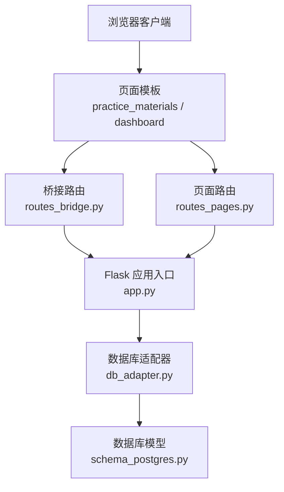

**图示来源** 
- [app.py:1-200](file://server/app.py#L1-L200)
- [routes_bridge.py:1-200](file://server/routes_bridge.py#L1-L200)
- [routes_pages.py:1-200](file://server/routes_pages.py#L1-L200)
- [db_adapter.py:1-200](file://server/database/db_adapter.py#L1-L200)
- [schema_postgres.py:1-200](file://server/database/schema_postgres.py#L1-L200)

**章节来源**
- [app.py:1-200](file://server/app.py#L1-L200)
- [routes_bridge.py:1-200](file://server/routes_bridge.py#L1-L200)
- [routes_pages.py:1-200](file://server/routes_pages.py#L1-L200)
- [db_adapter.py:1-200](file://server/database/db_adapter.py#L1-L200)
- [schema_postgres.py:1-200](file://server/database/schema_postgres.py#L1-L200)

## 核心组件
- 成绩计算引擎：基于题目类型、分值权重、答题时间与正确性，计算单次练习/考试的总分与分项得分
- 多维度统计分析：按知识点、题型、难度、时间区间进行聚合统计，输出趋势与对比
- 个人能力画像：将多维统计映射为能力雷达图与成长曲线，支持历史对比
- 报告模板：HTML 报告模板与可下载的数据包（CSV/JSON），支持分享链接
- 数据导出与分享：导出当前或历史成绩明细、统计摘要与知识点薄弱点清单；生成可分享的只读报告链接

**章节来源**
- [routes_bridge.py:1-200](file://server/routes_bridge.py#L1-L200)
- [routes_pages.py:1-200](file://server/routes_pages.py#L1-L200)
- [db_adapter.py:1-200](file://server/database/db_adapter.py#L1-L200)
- [schema_postgres.py:1-200](file://server/database/schema_postgres.py#L1-L200)

## 架构总览
成绩分析与报告的整体流程如下：
- 用户在练习/考试页面提交答案与时间戳
- 后端校验并持久化作答记录
- 根据评分规则计算成绩与知识点掌握度
- 生成多维度统计与个人能力画像
- 渲染报告页面并提供导出与分享功能

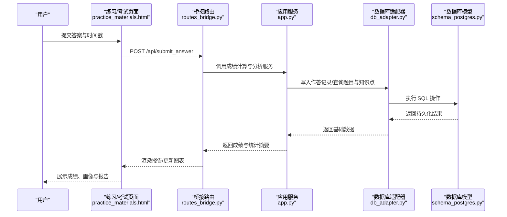

**图示来源**
- [routes_bridge.py:1-200](file://server/routes_bridge.py#L1-L200)
- [app.py:1-200](file://server/app.py#L1-L200)
- [db_adapter.py:1-200](file://server/database/db_adapter.py#L1-L200)
- [schema_postgres.py:1-200](file://server/database/schema_postgres.py#L1-L200)
- [practice_materials.html:1-200](file://server/templates/pages/practice_materials.html#L1-L200)

## 详细组件分析

### 成绩计算引擎
- 输入：题目集合、每题分值权重、用户答案、答题时间、知识点标签
- 处理：
  - 正确性判定：逐题比对标准答案
  - 时间惩罚：超过阈值的答题时间按比例扣减
  - 权重加权：按题型/知识点权重汇总
  - 归一化：转换为百分制或等级分
- 输出：总分、各维度得分、时间效率分、知识点掌握度

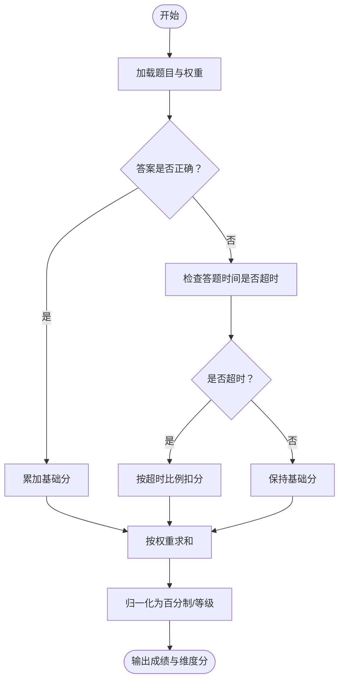

**图示来源**
- [routes_bridge.py:1-200](file://server/routes_bridge.py#L1-L200)
- [app.py:1-200](file://server/app.py#L1-L200)
- [db_adapter.py:1-200](file://server/database/db_adapter.py#L1-L200)

**章节来源**
- [routes_bridge.py:1-200](file://server/routes_bridge.py#L1-L200)
- [app.py:1-200](file://server/app.py#L1-L200)
- [db_adapter.py:1-200](file://server/database/db_adapter.py#L1-L200)

### 多维度统计分析
- 维度划分：
  - 知识点维度：按知识点聚合正确率、平均用时、失分占比
  - 题型维度：按题型统计得分分布与时间效率
  - 难度维度：按难度等级统计通过率与时间消耗
  - 时间序列：按日期/周/月统计成绩趋势
- 输出：
  - 统计摘要表（含均值、方差、分位数）
  - 趋势折线图与柱状图
  - 知识点热力图与雷达图

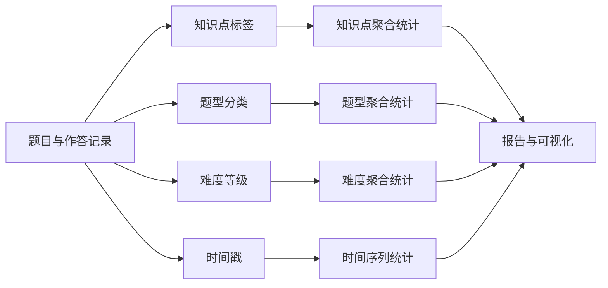

**图示来源**
- [db_adapter.py:1-200](file://server/database/db_adapter.py#L1-L200)
- [schema_postgres.py:1-200](file://server/database/schema_postgres.py#L1-L200)
- [routes_bridge.py:1-200](file://server/routes_bridge.py#L1-L200)

**章节来源**
- [db_adapter.py:1-200](file://server/database/db_adapter.py#L1-L200)
- [schema_postgres.py:1-200](file://server/database/schema_postgres.py#L1-L200)
- [routes_bridge.py:1-200](file://server/routes_bridge.py#L1-L200)

### 个人能力画像构建
- 能力维度：
  - 知识掌握度：按知识点正确率与稳定性
  - 时间效率：平均用时与超时率
  - 题型适配：不同题型的得分表现
  - 难度适应：对高难度题目的突破情况
- 画像输出：
  - 雷达图：多能力维度综合展示
  - 成长曲线：历史成绩与关键指标趋势
  - 薄弱点清单：低掌握度知识点与改进建议

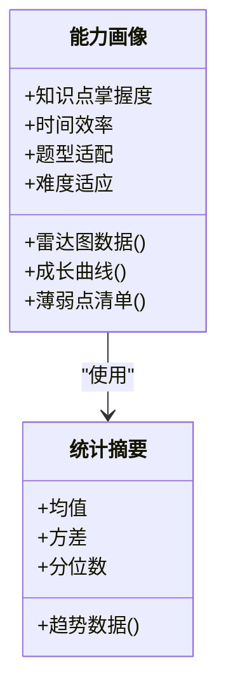

**图示来源**
- [routes_bridge.py:1-200](file://server/routes_bridge.py#L1-L200)
- [dashboard.html:1-200](file://server/templates/pages/dashboard.html#L1-L200)

**章节来源**
- [routes_bridge.py:1-200](file://server/routes_bridge.py#L1-L200)
- [dashboard.html:1-200](file://server/templates/pages/dashboard.html#L1-L200)

### 考试模式评分规则
- 规则要点：
  - 每题固定分值或按权重计分
  - 超时扣分：超过设定阈值的答题时间按比例扣减
  - 漏答/错答：按题型设置不同扣分策略
  - 附加分：快速完成且全对的题目可获得奖励分
- 输出：
  - 总分与分项得分
  - 时间效率分与排名参考
  - 知识点维度得分与薄弱点提示

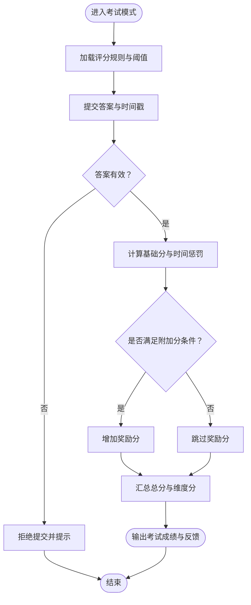

**图示来源**
- [routes_bridge.py:1-200](file://server/routes_bridge.py#L1-L200)
- [config.py:1-200](file://server/config.py#L1-L200)

**章节来源**
- [routes_bridge.py:1-200](file://server/routes_bridge.py#L1-L200)
- [config.py:1-200](file://server/config.py#L1-L200)

### 答题时间分析与正确率统计
- 时间分析：
  - 单题用时分布（均值、中位数、分位数）
  - 超时率与时间效率分
  - 时间趋势（随练习次数变化）
- 正确率统计：
  - 总体正确率与分题型正确率
  - 知识点正确率与稳定性（波动范围）
  - 难度分层正确率

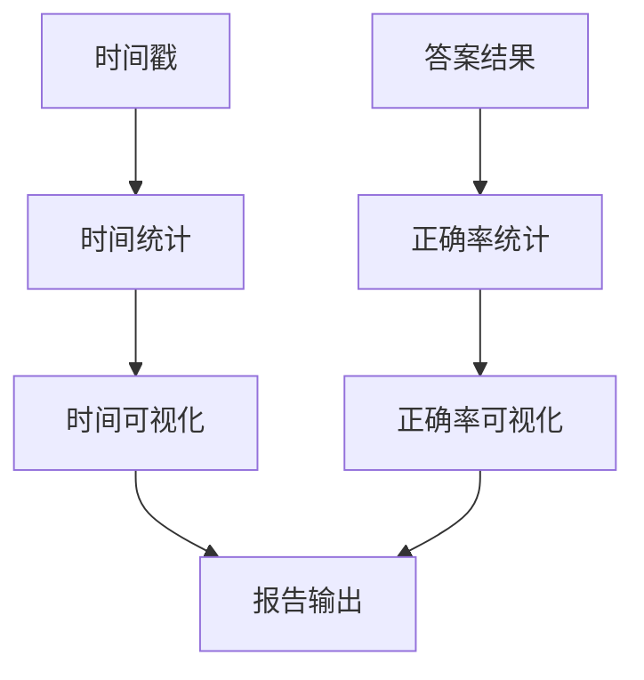

**图示来源**
- [db_adapter.py:1-200](file://server/database/db_adapter.py#L1-L200)
- [routes_bridge.py:1-200](file://server/routes_bridge.py#L1-L200)

**章节来源**
- [db_adapter.py:1-200](file://server/database/db_adapter.py#L1-L200)
- [routes_bridge.py:1-200](file://server/routes_bridge.py#L1-L200)

### 报告生成模板、数据导出与分享机制
- 报告模板：
  - HTML 报告页面，包含成绩概览、维度统计、能力画像与薄弱点清单
  - 支持打印与截图分享
- 数据导出：
  - CSV/JSON 导出：成绩明细、统计摘要、知识点薄弱点
  - 批量导出：按时间段或批次导出
- 分享机制：
  - 生成只读分享链接，附带报告 ID
  - 权限控制：仅查看，不可编辑

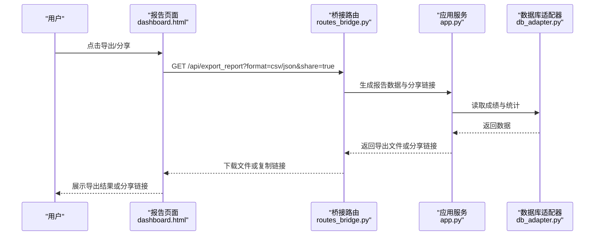

**图示来源**
- [routes_bridge.py:1-200](file://server/routes_bridge.py#L1-L200)
- [dashboard.html:1-200](file://server/templates/pages/dashboard.html#L1-L200)
- [db_adapter.py:1-200](file://server/database/db_adapter.py#L1-L200)

**章节来源**
- [routes_bridge.py:1-200](file://server/routes_bridge.py#L1-L200)
- [dashboard.html:1-200](file://server/templates/pages/dashboard.html#L1-L200)
- [db_adapter.py:1-200](file://server/database/db_adapter.py#L1-L200)

### 薄弱知识点识别、改进建议与长期进步追踪
- 薄弱知识点识别：
  - 基于知识点维度的低正确率与高波动
  - 结合时间效率与难度分层，筛选需优先提升的知识点
- 改进建议：
  - 针对性练习推荐（同知识点、同题型、相近难度）
  - 学习资源与复习计划建议
- 长期进步追踪：
  - 月度/季度趋势对比
  - 关键指标（总分、正确率、时间效率）的成长曲线

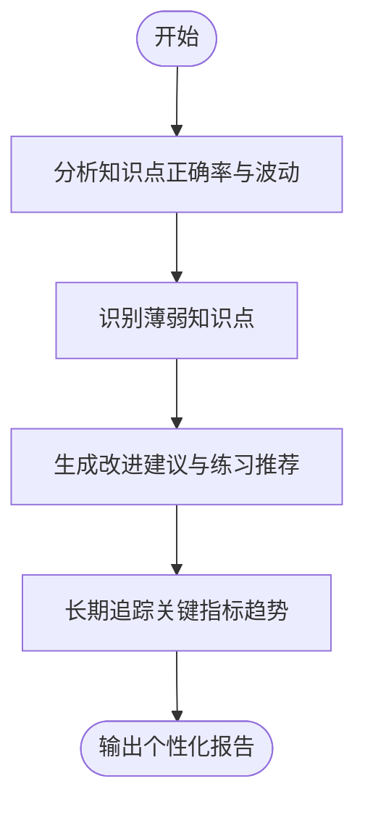

**图示来源**
- [routes_bridge.py:1-200](file://server/routes_bridge.py#L1-L200)
- [db_adapter.py:1-200](file://server/database/db_adapter.py#L1-L200)

**章节来源**
- [routes_bridge.py:1-200](file://server/routes_bridge.py#L1-L200)
- [db_adapter.py:1-200](file://server/database/db_adapter.py#L1-L200)

### 具体分析报告示例与自定义指标配置
- 分析报告示例：
  - 单次考试报告：总分、各维度得分、时间效率、薄弱知识点与建议
  - 周期总结报告：趋势图、能力画像变化、重点提升项
- 自定义指标配置：
  - 权重配置：题型/知识点权重调整
  - 阈值配置：超时阈值、附加分条件
  - 导出字段：选择需要导出的统计维度与字段

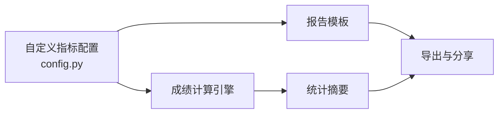

**图示来源**
- [config.py:1-200](file://server/config.py#L1-L200)
- [routes_bridge.py:1-200](file://server/routes_bridge.py#L1-L200)

**章节来源**
- [config.py:1-200](file://server/config.py#L1-L200)
- [routes_bridge.py:1-200](file://server/routes_bridge.py#L1-L200)

## 依赖关系分析
- 路由层依赖应用服务与数据库适配器
- 页面模板依赖路由层提供的数据接口
- 数据库适配器依赖数据库模型定义
- 配置层被路由层与应用服务共同引用

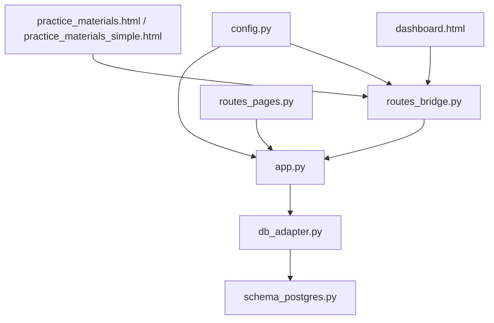

**图示来源**
- [routes_bridge.py:1-200](file://server/routes_bridge.py#L1-L200)
- [routes_pages.py:1-200](file://server/routes_pages.py#L1-L200)
- [app.py:1-200](file://server/app.py#L1-L200)
- [db_adapter.py:1-200](file://server/database/db_adapter.py#L1-L200)
- [schema_postgres.py:1-200](file://server/database/schema_postgres.py#L1-L200)
- [config.py:1-200](file://server/config.py#L1-L200)
- [practice_materials.html:1-200](file://server/templates/pages/practice_materials.html#L1-L200)
- [practice_materials_simple.html:1-200](file://server/templates/pages/practice_materials_simple.html#L1-L200)
- [dashboard.html:1-200](file://server/templates/pages/dashboard.html#L1-L200)

**章节来源**
- [routes_bridge.py:1-200](file://server/routes_bridge.py#L1-L200)
- [routes_pages.py:1-200](file://server/routes_pages.py#L1-L200)
- [app.py:1-200](file://server/app.py#L1-L200)
- [db_adapter.py:1-200](file://server/database/db_adapter.py#L1-L200)
- [schema_postgres.py:1-200](file://server/database/schema_postgres.py#L1-L200)
- [config.py:1-200](file://server/config.py#L1-L200)
- [practice_materials.html:1-200](file://server/templates/pages/practice_materials.html#L1-L200)
- [practice_materials_simple.html:1-200](file://server/templates/pages/practice_materials_simple.html#L1-L200)
- [dashboard.html:1-200](file://server/templates/pages/dashboard.html#L1-L200)

## 性能考量
- 批量计算优化：对大规模成绩与统计数据进行分页与缓存
- 数据库查询优化：合理使用索引与聚合查询，减少 N+1 问题
- 前端渲染优化：按需加载图表数据，避免一次性加载过多数据
- 导出性能：异步任务与流式导出，降低阻塞

[本节为通用指导，不直接分析具体文件]

## 故障排查指南
- 常见问题：
  - 成绩计算异常：检查评分规则配置与权重设置
  - 时间统计偏差：核对时间戳格式与时区设置
  - 导出失败：确认文件格式与字段映射
  - 分享链接无效：检查权限与过期策略
- 定位步骤：
  - 查看日志与错误堆栈
  - 复现最小用例，逐步缩小范围
  - 校验数据库记录完整性与一致性

**章节来源**
- [routes_bridge.py:1-200](file://server/routes_bridge.py#L1-L200)
- [app.py:1-200](file://server/app.py#L1-L200)
- [db_adapter.py:1-200](file://server/database/db_adapter.py#L1-L200)

## 结论
本系统通过统一的成绩计算引擎与多维度统计分析，构建了完整的个人能力画像与报告体系。借助灵活的配置与导出分享机制，用户可获取个性化的学习反馈与长期进步追踪，从而制定科学的改进计划。

[本节为总结性内容，不直接分析具体文件]

## 附录
- 测试用例参考：
  - 练习循环测试：验证成绩计算与分析流程
  - 题目与结果样例：用于模拟真实场景的数据集

**章节来源**
- [test_p5_practice_loop.py:1-200](file://server/tests/test_p5_practice_loop.py#L1-L200)
- [p6_questions.json:1-200](file://server/tests/fixtures/p6_questions.json#L1-L200)
- [p6_result.json:1-200](file://server/tests/fixtures/p6_result.json#L1-L200)