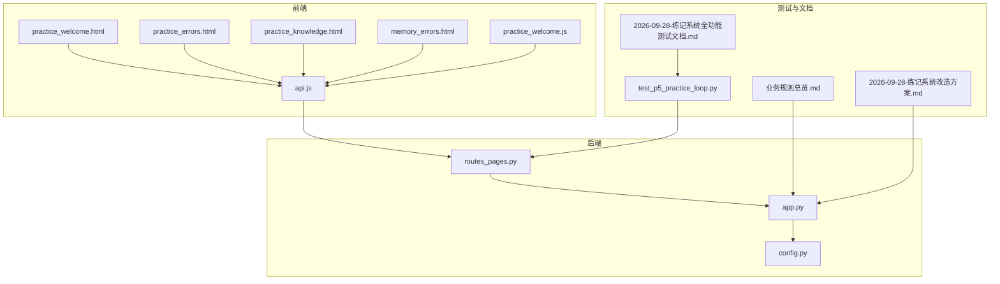
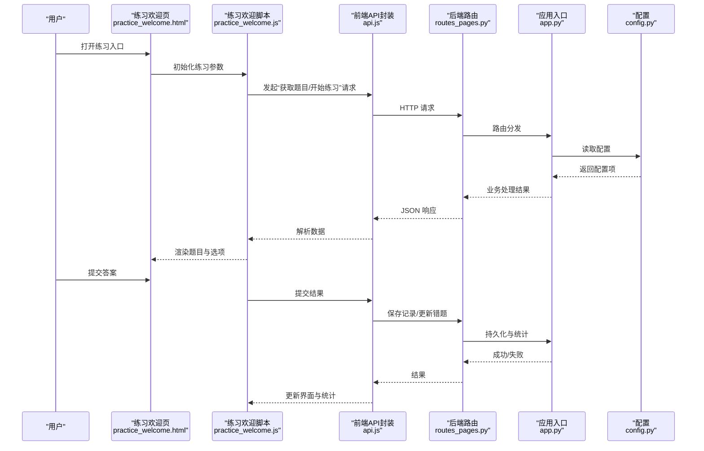
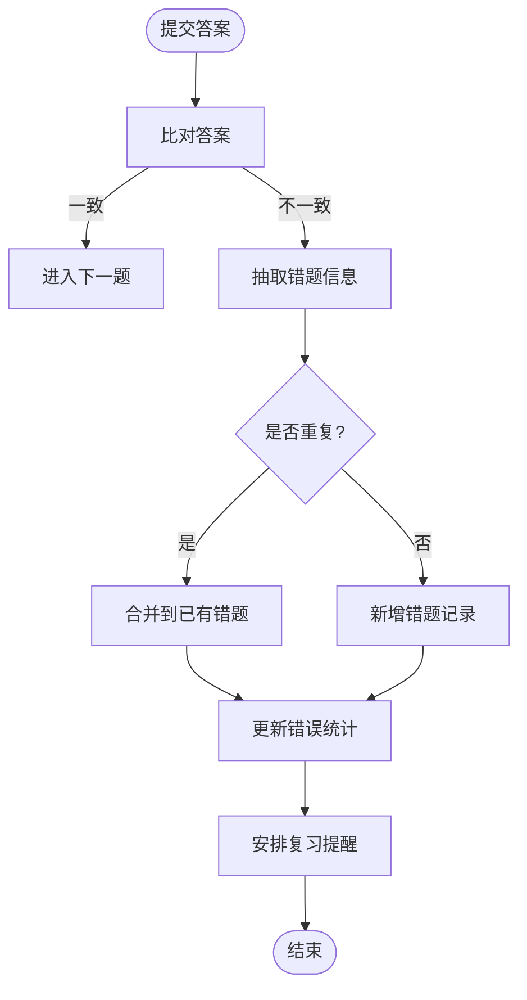
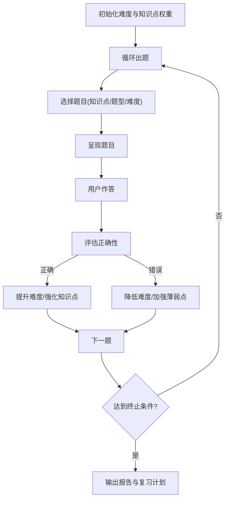
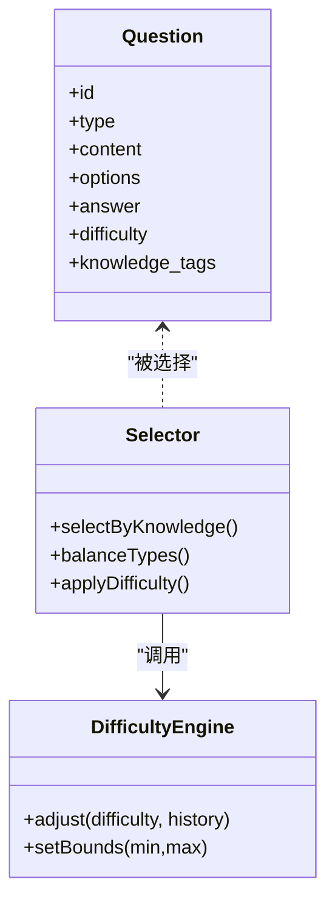
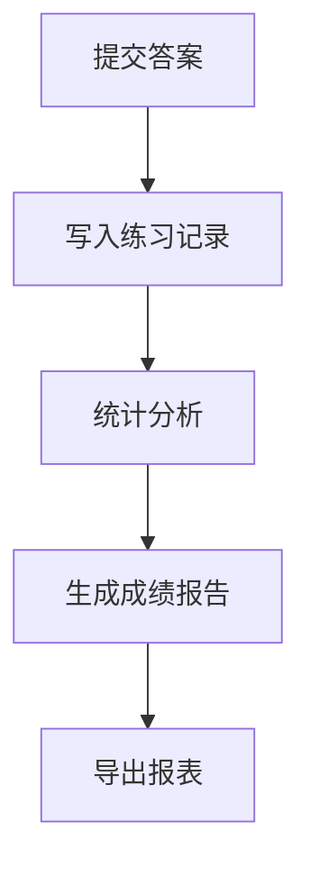
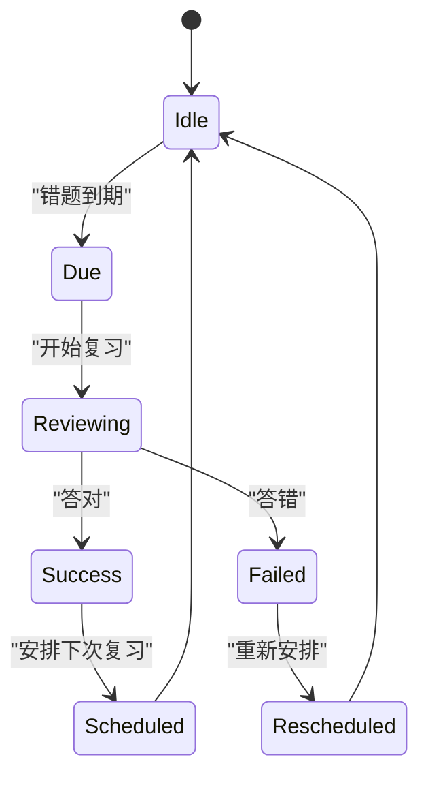
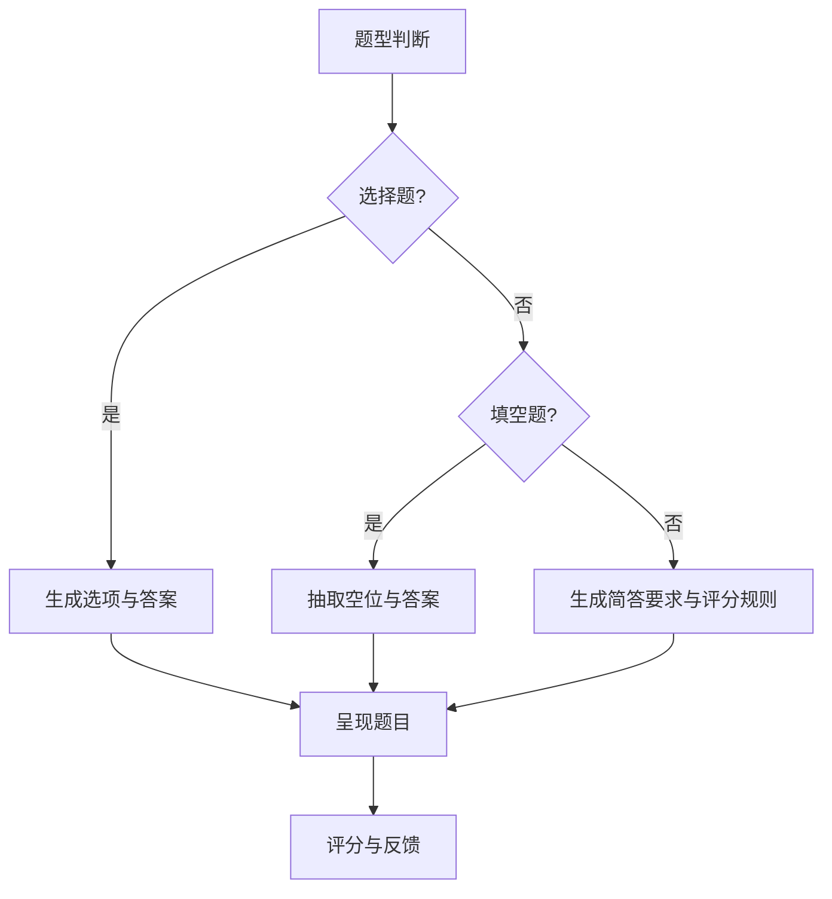
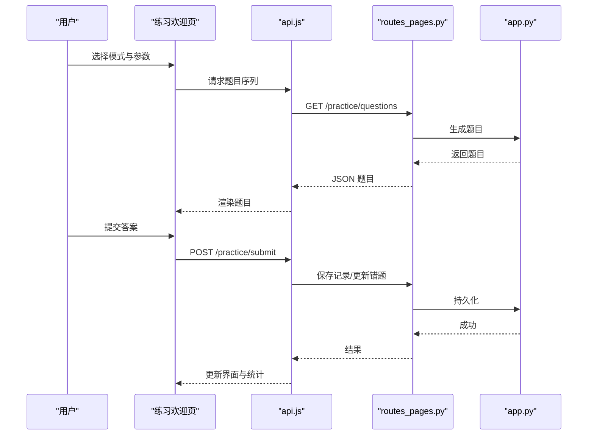
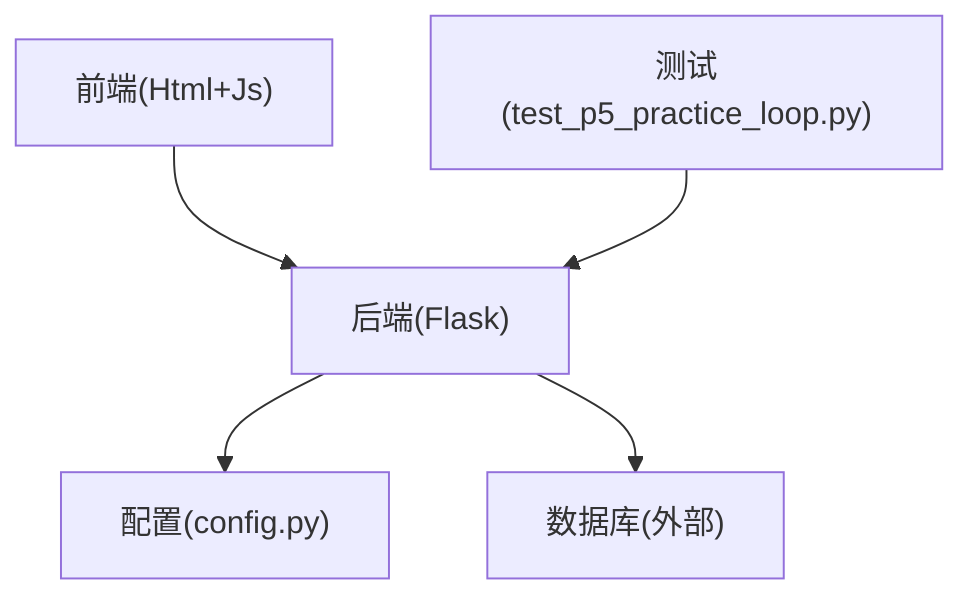

# 练习系统

<cite>
**本文引用的文件**   
- [app.py](file://server/app.py)
- [config.py](file://server/config.py)
- [routes_pages.py](file://server/routes_pages.py)
- [practice_welcome.html](file://server/templates/components/practice_welcome.html)
- [practice_errors.html](file://server/templates/pages/practice_errors.html)
- [practice_knowledge.html](file://server/templates/pages/practice_knowledge.html)
- [memory_errors.html](file://server/templates/pages/memory_errors.html)
- [api.js](file://server/static/js/api.js)
- [practice_welcome.js](file://server/static/js/practice_welcome.js)
- [test_p5_practice_loop.py](file://server/tests/test_p5_practice_loop.py)
- [业务规则总览.md](file://docs/业务规则/业务规则总览.md)
- [2026-09-28-练记系统改造方案.md](file://docs/计划/2026-09-28-练记系统改造方案.md)
- [2026-09-28-练记系统全功能测试文档.md](file://docs/测试/2026-09-28-练记系统全功能测试文档.md)
</cite>

## 目录
1. [引言](#引言)
2. [项目结构](#项目结构)
3. [核心组件](#核心组件)
4. [架构总览](#架构总览)
5. [详细组件分析](#详细组件分析)
6. [依赖关系分析](#依赖关系分析)
7. [性能与可扩展性](#性能与可扩展性)
8. [故障排查指南](#故障排查指南)
9. [结论](#结论)
10. [附录](#附录)

## 引言
本文件面向“LectureLearnLoop”练习系统的实现说明，聚焦以下目标：
- 错题收集机制：如何从练习结果中识别、抽取并持久化错题。
- 自适应测试算法：基于历史表现动态调整题目难度与组合策略。
- 学习进度跟踪：记录练习轨迹、统计成绩、可视化复习提醒。
- 练习题生成与选择：题型覆盖（选择题、填空题、简答题）及难度调节策略。
- 练习记录保存与成绩分析：数据模型、存储路径、报表维度。
- 错题本管理、知识点关联与个性化推荐：知识图谱联动与推荐逻辑。
- 练习模式多样性与流程示例：端到端用户交互与后端处理链路。

## 项目结构
练习系统位于服务端（Python + Jinja2 模板 + 前端 JS），主要涉及：
- Web 路由与页面渲染：提供练习入口、错题本、知识点练习等页面。
- 前端交互：练习欢迎页、API 调用封装、练习流程控制。
- 测试与验收：端到端练习循环测试与全功能测试文档。
- 业务规则与改造方案：定义练习系统的设计原则与演进路线。

图表来源
- [app.py:1-200](file://server/app.py#L1-L200)
- [routes_pages.py:1-200](file://server/routes_pages.py#L1-L200)
- [config.py:1-120](file://server/config.py#L1-L120)
- [practice_welcome.html:1-200](file://server/templates/components/practice_welcome.html#L1-L200)
- [practice_errors.html:1-200](file://server/templates/pages/practice_errors.html#L1-L200)
- [practice_knowledge.html:1-200](file://server/templates/pages/practice_knowledge.html#L1-L200)
- [memory_errors.html:1-200](file://server/templates/pages/memory_errors.html#L1-L200)
- [api.js:1-200](file://server/static/js/api.js#L1-L200)
- [practice_welcome.js:1-200](file://server/static/js/practice_welcome.js#L1-L200)
- [test_p5_practice_loop.py:1-200](file://server/tests/test_p5_practice_loop.py#L1-L200)
- [业务规则总览.md:1-200](file://docs/业务规则/业务规则总览.md#L1-L200)
- [2026-09-28-练记系统改造方案.md:1-200](file://docs/计划/2026-09-28-练记系统改造方案.md#L1-L200)
- [2026-09-28-练记系统全功能测试文档.md:1-200](file://docs/测试/2026-09-28-练记系统全功能测试文档.md#L1-L200)

章节来源
- [app.py:1-200](file://server/app.py#L1-L200)
- [routes_pages.py:1-200](file://server/routes_pages.py#L1-L200)
- [config.py:1-120](file://server/config.py#L1-L120)

## 核心组件
- 练习入口与欢迎页：提供练习模式选择、参数配置与开始按钮。
- 错题本页面：展示错题列表、详情、知识点标签与复习建议。
- 知识点练习页：按知识点聚合题目，支持按难度与正确率筛选。
- 记忆错题页：与长期记忆相关的错题视图，便于间隔复习。
- 前端 API 封装：统一请求封装、错误处理与重试策略。
- 练习欢迎脚本：编排练习流程、状态管理与结果回传。
- 练习循环测试：模拟完整练习流程，验证端到端行为。

章节来源
- [practice_welcome.html:1-200](file://server/templates/components/practice_welcome.html#L1-L200)
- [practice_errors.html:1-200](file://server/templates/pages/practice_errors.html#L1-L200)
- [practice_knowledge.html:1-200](file://server/templates/pages/practice_knowledge.html#L1-L200)
- [memory_errors.html:1-200](file://server/templates/pages/memory_errors.html#L1-L200)
- [api.js:1-200](file://server/static/js/api.js#L1-L200)
- [practice_welcome.js:1-200](file://server/static/js/practice_welcome.js#L1-L200)
- [test_p5_practice_loop.py:1-200](file://server/tests/test_p5_practice_loop.py#L1-L200)

## 架构总览
练习系统采用前后端分离的轻量架构：前端通过 HTML 模板与 JS 脚本驱动交互，后端通过 Flask 路由暴露页面与 API，结合配置文件与业务规则进行控制。

图表来源
- [practice_welcome.html:1-200](file://server/templates/components/practice_welcome.html#L1-L200)
- [practice_welcome.js:1-200](file://server/static/js/practice_welcome.js#L1-L200)
- [api.js:1-200](file://server/static/js/api.js#L1-L200)
- [routes_pages.py:1-200](file://server/routes_pages.py#L1-L200)
- [app.py:1-200](file://server/app.py#L1-L200)
- [config.py:1-120](file://server/config.py#L1-L120)

## 详细组件分析

### 错题收集机制
- 触发时机：当用户提交的答案与标准答案不一致时，系统判定为错题。
- 数据抽取：提取题目内容、用户答案、正确答案、知识点标签、难度等级、时间戳。
- 持久化：将错题写入错题表，并与知识点建立多对多关联。
- 去重与合并：依据题目 ID 或语义相似度进行去重；对相似错题进行合并，避免冗余。
- 复习策略：根据错误次数与最近错误时间计算复习优先级，支持间隔重复。

图表来源
- [practice_welcome.js:1-200](file://server/static/js/practice_welcome.js#L1-L200)
- [api.js:1-200](file://server/static/js/api.js#L1-L200)
- [routes_pages.py:1-200](file://server/routes_pages.py#L1-L200)
- [app.py:1-200](file://server/app.py#L1-L200)

章节来源
- [practice_welcome.js:1-200](file://server/static/js/practice_welcome.js#L1-L200)
- [api.js:1-200](file://server/static/js/api.js#L1-L200)
- [routes_pages.py:1-200](file://server/routes_pages.py#L1-L200)
- [app.py:1-200](file://server/app.py#L1-L200)

### 自适应测试算法
- 初始难度：根据用户历史正确率或默认难度设置确定起始难度。
- 难度调整：
  - 连续正确：提升难度等级或增加干扰项数量。
  - 连续错误：降低难度等级或减少干扰项数量。
  - 波动区间：在难度上下限之间平滑过渡，避免剧烈变化。
- 题目选择：
  - 知识点覆盖：优先选择薄弱知识点相关题目。
  - 题型平衡：按比例分配选择题、填空题、简答题。
  - 随机性与可重现：使用种子保证同一会话内可重现。
- 终止条件：达到目标题数、时间上限或掌握阈值。

图表来源
- [practice_welcome.js:1-200](file://server/static/js/practice_welcome.js#L1-L200)
- [api.js:1-200](file://server/static/js/api.js#L1-L200)
- [routes_pages.py:1-200](file://server/routes_pages.py#L1-L200)
- [app.py:1-200](file://server/app.py#L1-L200)

章节来源
- [practice_welcome.js:1-200](file://server/static/js/practice_welcome.js#L1-L200)
- [api.js:1-200](file://server/static/js/api.js#L1-L200)
- [routes_pages.py:1-200](file://server/routes_pages.py#L1-L200)
- [app.py:1-200](file://server/app.py#L1-L200)

### 学习进度跟踪
- 指标采集：答题总数、正确率、平均用时、知识点掌握度、错题数量。
- 趋势分析：按日/周/月统计正确率与错题分布，识别退步趋势。
- 可视化：折线图展示正确率趋势，饼图展示知识点分布。
- 复习提醒：基于遗忘曲线与最近错误时间推送复习任务。

图表来源
- [practice_welcome.js:1-200](file://server/static/js/practice_welcome.js#L1-L200)
- [api.js:1-200](file://server/static/js/api.js#L1-L200)
- [routes_pages.py:1-200](file://server/routes_pages.py#L1-L200)
- [app.py:1-200](file://server/app.py#L1-L200)

章节来源
- [practice_welcome.js:1-200](file://server/static/js/practice_welcome.js#L1-L200)
- [api.js:1-200](file://server/static/js/api.js#L1-L200)
- [routes_pages.py:1-200](file://server/routes_pages.py#L1-L200)
- [app.py:1-200](file://server/app.py#L1-L200)

### 练习题目的生成、选择与难度调整
- 生成策略：
  - 题库来源：知识点映射的题目集合。
  - 题型混合：选择题、填空题、简答题按比例生成。
  - 干扰项构造：基于同义词、反义项、常见错误选项。
- 选择策略：
  - 知识点权重：薄弱知识点优先。
  - 难度梯度：由易到难逐步提升。
  - 随机种子：保证可重现与公平性。
- 难度调整：
  - 正确率阈值：高于阈值提升难度，低于阈值降低难度。
  - 连续命中/失误：连续正确提升，连续错误降低。
  - 知识点难度：不同知识点设定基础难度系数。

图表来源
- [routes_pages.py:1-200](file://server/routes_pages.py#L1-L200)
- [app.py:1-200](file://server/app.py#L1-L200)
- [config.py:1-120](file://server/config.py#L1-L120)

章节来源
- [routes_pages.py:1-200](file://server/routes_pages.py#L1-L200)
- [app.py:1-200](file://server/app.py#L1-L200)
- [config.py:1-120](file://server/config.py#L1-L120)

### 练习记录保存与成绩分析
- 记录字段：用户ID、题目ID、答案、是否正确、用时、时间戳、知识点标签、难度等级。
- 存储路径：后端服务持久化至数据库（具体适配器见数据库模块）。
- 成绩分析：
  - 总体正确率、分知识点正确率、难度分布。
  - 错题占比与趋势、进步/退步标记。
- 报表导出：支持 CSV/JSON 导出用于离线分析。

图表来源
- [routes_pages.py:1-200](file://server/routes_pages.py#L1-L200)
- [app.py:1-200](file://server/app.py#L1-L200)

章节来源
- [routes_pages.py:1-200](file://server/routes_pages.py#L1-L200)
- [app.py:1-200](file://server/app.py#L1-L200)

### 复习提醒机制
- 触发条件：错题存在且距离上次复习超过阈值。
- 优先级计算：错误次数、最近错误时间、知识点重要性。
- 提醒方式：页面通知、待办清单、定时任务。
- 间隔重复：遵循艾宾浩斯遗忘曲线，动态调整复习间隔。

图表来源
- [memory_errors.html:1-200](file://server/templates/pages/memory_errors.html#L1-L200)
- [routes_pages.py:1-200](file://server/routes_pages.py#L1-L200)
- [app.py:1-200](file://server/app.py#L1-L200)

章节来源
- [memory_errors.html:1-200](file://server/templates/pages/memory_errors.html#L1-L200)
- [routes_pages.py:1-200](file://server/routes_pages.py#L1-L200)
- [app.py:1-200](file://server/app.py#L1-L200)

### 错题本管理与知识点关联
- 错题本视图：列出所有错题，支持按知识点、难度、时间筛选。
- 知识点关联：每个错题绑定多个知识点标签，便于聚合分析。
- 个性化推荐：基于错题与知识点权重，推荐针对性练习。
- 批量操作：批量删除、批量加入复习队列。

图表来源
- [practice_errors.html:1-200](file://server/templates/pages/practice_errors.html#L1-L200)
- [routes_pages.py:1-200](file://server/routes_pages.py#L1-L200)
- [app.py:1-200](file://server/app.py#L1-L200)

章节来源
- [practice_errors.html:1-200](file://server/templates/pages/practice_errors.html#L1-L200)
- [routes_pages.py:1-200](file://server/routes_pages.py#L1-L200)
- [app.py:1-200](file://server/app.py#L1-L200)

### 练习模式的多样性（选择题、填空题、简答题）
- 选择题：
  - 选项生成：正确答案 + 干扰项（同义、反义、常见错误）。
  - 评分：完全匹配得分。
- 填空题：
  - 空位抽取：关键术语或数字。
  - 评分：模糊匹配（忽略大小写、空格）。
- 简答题：
  - 评分：关键词匹配或 LLM 辅助评分（可选）。
  - 反馈：给出要点提示与改进建议。

图表来源
- [routes_pages.py:1-200](file://server/routes_pages.py#L1-L200)
- [app.py:1-200](file://server/app.py#L1-L200)

章节来源
- [routes_pages.py:1-200](file://server/routes_pages.py#L1-L200)
- [app.py:1-200](file://server/app.py#L1-L200)

### 练习流程示例
- 步骤：
  1. 用户打开练习欢迎页，选择模式与参数。
  2. 前端调用 API 获取题目序列。
  3. 用户逐题作答，系统实时评估并更新错题本。
  4. 练习结束后生成报告，包含正确率、知识点分布与复习建议。
- 关键点：
  - 前端状态管理：当前题号、已答记录、计时器。
  - 后端校验：答案合法性、防作弊（如频繁刷新）。
  - 数据一致性：事务性保存练习记录与错题更新。

图表来源
- [practice_welcome.html:1-200](file://server/templates/components/practice_welcome.html#L1-L200)
- [practice_welcome.js:1-200](file://server/static/js/practice_welcome.js#L1-L200)
- [api.js:1-200](file://server/static/js/api.js#L1-L200)
- [routes_pages.py:1-200](file://server/routes_pages.py#L1-L200)
- [app.py:1-200](file://server/app.py#L1-L200)

章节来源
- [practice_welcome.html:1-200](file://server/templates/components/practice_welcome.html#L1-L200)
- [practice_welcome.js:1-200](file://server/static/js/practice_welcome.js#L1-L200)
- [api.js:1-200](file://server/static/js/api.js#L1-L200)
- [routes_pages.py:1-200](file://server/routes_pages.py#L1-L200)
- [app.py:1-200](file://server/app.py#L1-L200)

### 进度统计功能
- 统计维度：
  - 总体：答题数、正确率、用时。
  - 知识点：各知识点正确率与错题数。
  - 难度：各难度等级正确率与分布。
- 可视化：
  - 折线图：正确率趋势。
  - 柱状图：知识点分布。
  - 雷达图：能力维度对比。
- 导出：CSV/JSON 格式，便于二次分析。

图表来源
- [routes_pages.py:1-200](file://server/routes_pages.py#L1-L200)
- [app.py:1-200](file://server/app.py#L1-L200)

章节来源
- [routes_pages.py:1-200](file://server/routes_pages.py#L1-L200)
- [app.py:1-200](file://server/app.py#L1-L200)

## 依赖关系分析
- 前端依赖：HTML 模板与 JS 脚本，负责 UI 与交互。
- 后端依赖：Flask 路由与应用入口，负责业务逻辑与数据持久化。
- 配置依赖：全局配置项（如难度范围、题型比例、复习间隔）。
- 测试依赖：端到端测试脚本验证练习循环与数据一致性。

图表来源
- [routes_pages.py:1-200](file://server/routes_pages.py#L1-L200)
- [app.py:1-200](file://server/app.py#L1-L200)
- [config.py:1-120](file://server/config.py#L1-L120)
- [test_p5_practice_loop.py:1-200](file://server/tests/test_p5_practice_loop.py#L1-L200)

章节来源
- [routes_pages.py:1-200](file://server/routes_pages.py#L1-L200)
- [app.py:1-200](file://server/app.py#L1-L200)
- [config.py:1-120](file://server/config.py#L1-L120)
- [test_p5_practice_loop.py:1-200](file://server/tests/test_p5_practice_loop.py#L1-L200)

## 性能与可扩展性
- 性能优化：
  - 题目缓存：热点题目与知识点缓存，减少重复计算。
  - 异步处理：长耗时任务（如 LLM 评分）异步执行。
  - 分页加载：大量题目时分页加载，降低前端压力。
- 可扩展性：
  - 插件化题型：新增题型只需扩展生成与评分逻辑。
  - 多后端存储：支持 SQLite/PostgreSQL 切换。
  - 多语言支持：国际化文案与单位适配。

[本节为通用指导，不直接分析具体文件]

## 故障排查指南
- 常见问题：
  - 题目加载失败：检查 API 路由与网络请求。
  - 答案提交无响应：确认后端事务与数据库连接。
  - 错题未更新：核对答案比对逻辑与去重规则。
  - 复习提醒缺失：检查到期计算与调度任务。
- 调试建议：
  - 启用日志：记录关键步骤与异常堆栈。
  - 单元测试：针对题目生成与评分逻辑编写用例。
  - 端到端测试：使用 test_p5_practice_loop.py 验证全流程。

章节来源
- [test_p5_practice_loop.py:1-200](file://server/tests/test_p5_practice_loop.py#L1-L200)
- [routes_pages.py:1-200](file://server/routes_pages.py#L1-L200)
- [app.py:1-200](file://server/app.py#L1-L200)

## 结论
本练习系统围绕错题收集、自适应测试与学习进度跟踪构建，覆盖选择题、填空题、简答题等多种题型，并通过知识点关联与个性化推荐提升学习效果。前端交互流畅，后端逻辑清晰，测试与文档完善，具备良好的可扩展性与维护性。

[本节为总结性内容，不直接分析具体文件]

## 附录
- 业务规则参考：[业务规则总览.md](file://docs/业务规则/业务规则总览.md)
- 改造方案参考：[2026-09-28-练记系统改造方案.md](file://docs/计划/2026-09-28-练记系统改造方案.md)
- 全功能测试参考：[2026-09-28-练记系统全功能测试文档.md](file://docs/测试/2026-09-28-练记系统全功能测试文档.md)

[本节为参考资料索引，不直接分析具体文件]