# 自适应测试算法

<cite>
**本文引用的文件**   
- [app.py](file://server/app.py)
- [config.py](file://server/config.py)
- [routes_knowledge.py](file://server/routes_knowledge.py)
- [knowledge_management.py](file://server/knowledge_management.py)
- [test_p5_practice_loop.py](file://server/tests/test_p5_practice_loop.py)
- [p6_endtoend.py](file://server/tests/p6_endtoend.py)
- [practice_welcome.html](file://server/templates/components/practice_welcome.html)
- [practice_materials_simple.html](file://server/templates/pages/practice_materials_simple.html)
</cite>

## 目录
1. [引言](#引言)
2. [项目结构](#项目结构)
3. [核心组件](#核心组件)
4. [架构总览](#架构总览)
5. [详细组件分析](#详细组件分析)
6. [依赖关系分析](#依赖关系分析)
7. [性能考量](#性能考量)
8. [故障排查指南](#故障排查指南)
9. [结论](#结论)
10. [附录](#附录)

## 引言
本文件为 LectureLearnLoop 的“自适应测试算法”提供系统化文档，聚焦以下目标：
- 题目难度动态调整机制
- 知识掌握度评估模型
- 个性化题目推荐算法
- 测试流程控制、题目选择策略与实时反馈机制
- 学习曲线分析、能力值计算与预测模型
- 多知识点交叉测试、间隔重复算法与遗忘曲线应用
- 具体测试场景示例与算法参数配置

该算法服务于练习/测评闭环，结合用户答题表现与知识点状态，动态生成或挑选题目，并在过程中持续更新用户能力估计与知识点掌握度。

## 项目结构
围绕自适应测试的核心代码主要位于 server 层（后端服务）与 templates（前端模板），以及 tests（端到端与单元测试）。关键路径如下：
- 服务端入口与路由挂载：app.py
- 配置项：config.py
- 知识管理与评测相关接口：routes_knowledge.py、knowledge_management.py
- 练习/测试页面模板：templates/pages/practice_materials_simple.html、templates/components/practice_welcome.html
- 测试用例：tests/test_p5_practice_loop.py、tests/p6_endtoend.py

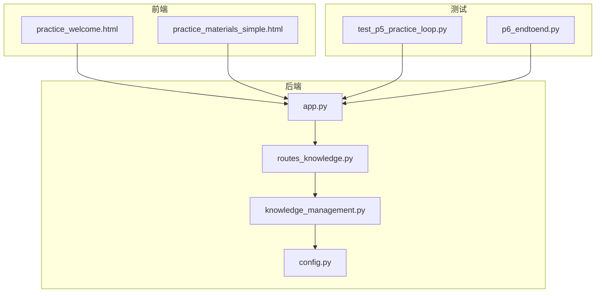

**图表来源**
- [app.py:1-200](file://server/app.py#L1-L200)
- [routes_knowledge.py:1-200](file://server/routes_knowledge.py#L1-L200)
- [knowledge_management.py:1-200](file://server/knowledge_management.py#L1-L200)
- [config.py:1-200](file://server/config.py#L1-L200)
- [practice_welcome.html:1-200](file://server/templates/components/practice_welcome.html#L1-L200)
- [practice_materials_simple.html:1-200](file://server/templates/pages/practice_materials_simple.html#L1-L200)
- [test_p5_practice_loop.py:1-200](file://server/tests/test_p5_practice_loop.py#L1-L200)
- [p6_endtoend.py:1-200](file://server/tests/p6_endtoend.py#L1-L200)

**章节来源**
- [app.py:1-200](file://server/app.py#L1-L200)
- [config.py:1-200](file://server/config.py#L1-L200)

## 核心组件
- 自适应测试控制器：负责测试会话生命周期管理、题目调度、结果聚合与反馈。
- 知识掌握度评估器：基于历史答题数据与知识点标签，维护用户对各知识点的掌握度。
- 难度调节器：依据当前能力估计与目标区分度，动态调整题目难度。
- 推荐引擎：在多知识点交叉约束下，按遗忘曲线与间隔重复策略挑选题目。
- 学习曲线与预测模块：拟合学习曲线，预测未来掌握度与所需复习次数。
- 配置中心：集中管理算法超参（如难度步长、遗忘衰减率、最大尝试次数等）。

**章节来源**
- [routes_knowledge.py:1-200](file://server/routes_knowledge.py#L1-L200)
- [knowledge_management.py:1-200](file://server/knowledge_management.py#L1-L200)
- [config.py:1-200](file://server/config.py#L1-L200)

## 架构总览
自适应测试的整体调用链从前端发起请求开始，经后端路由进入业务逻辑，最终由知识管理与算法模块完成题目选择与掌握度更新，并返回结果给前端展示。

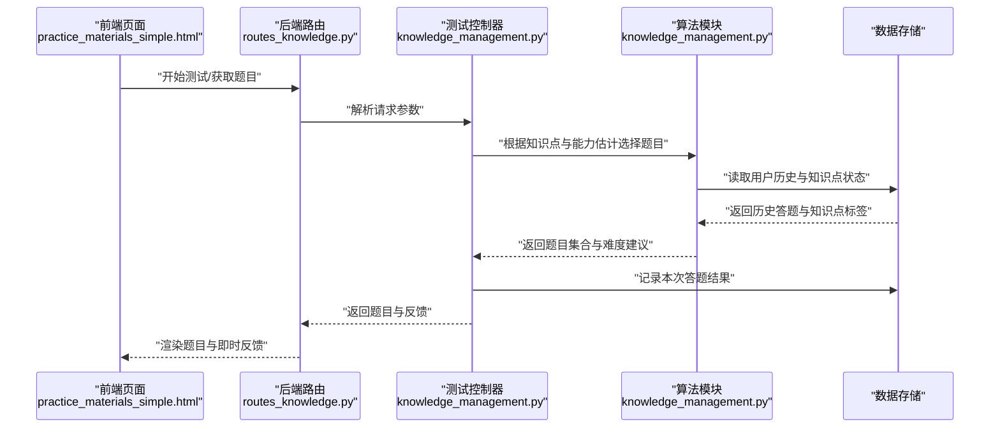

**图表来源**
- [routes_knowledge.py:1-200](file://server/routes_knowledge.py#L1-L200)
- [knowledge_management.py:1-200](file://server/knowledge_management.py#L1-L200)
- [practice_materials_simple.html:1-200](file://server/templates/pages/practice_materials_simple.html#L1-L200)

## 详细组件分析

### 测试流程控制
- 会话初始化：校验用户身份、加载上次会话状态（如有）、初始化能力估计与知识点掌握度。
- 题目轮次控制：每轮从推荐引擎获取一组题目，支持单题或多题模式；支持暂停/继续。
- 结果采集与反馈：收集用户答案、耗时、错误类型，实时计算正确率与掌握度变化，并给出即时反馈。
- 结束条件：达到预设题量、时间上限或掌握度阈值时结束测试，输出总结报告。

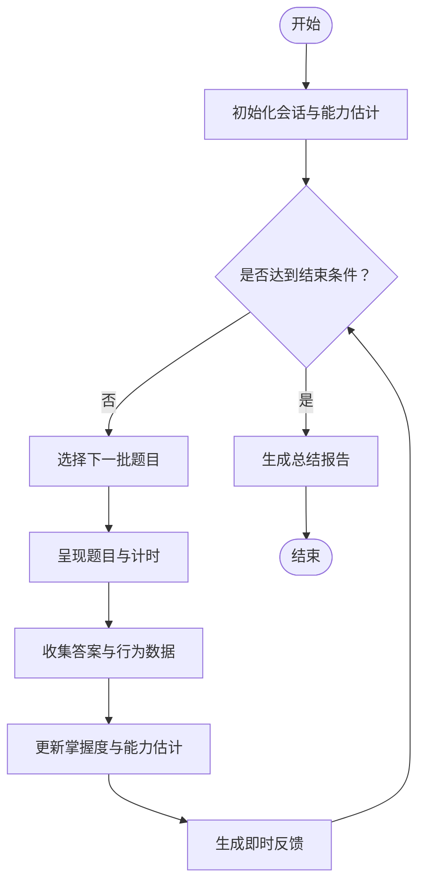

**图表来源**
- [routes_knowledge.py:1-200](file://server/routes_knowledge.py#L1-L200)
- [knowledge_management.py:1-200](file://server/knowledge_management.py#L1-L200)

**章节来源**
- [routes_knowledge.py:1-200](file://server/routes_knowledge.py#L1-L200)
- [knowledge_management.py:1-200](file://server/knowledge_management.py#L1-L200)

### 题目选择策略
- 知识点覆盖：确保每个目标知识点在测试中出现的频率符合权重分布。
- 难度匹配：以能力估计为中心，选择能最大化信息增益的题目难度区间。
- 间隔重复与遗忘曲线：对低掌握度知识点提高出现概率，并结合最近复习时间与遗忘速率决定优先级。
- 多知识点交叉：避免连续重复同一知识点，采用轮换与打散策略提升迁移效果。

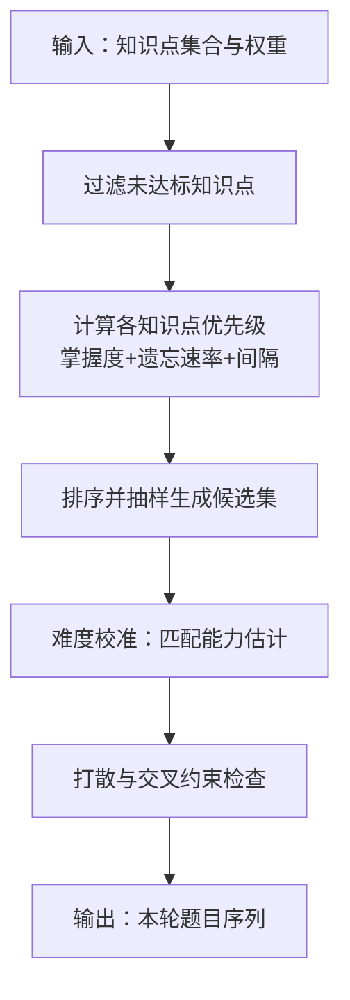

**图表来源**
- [knowledge_management.py:1-200](file://server/knowledge_management.py#L1-L200)

**章节来源**
- [knowledge_management.py:1-200](file://server/knowledge_management.py#L1-L200)

### 知识掌握度评估模型
- 初始值：根据先验知识或首次答题表现设定。
- 更新规则：结合答题正确性、难度系数、作答时长与错误类型进行加权更新。
- 平滑与稳定：引入指数移动平均或贝叶斯更新，防止单次异常导致剧烈波动。
- 可视化：输出各知识点掌握度曲线，便于学习者理解进步轨迹。

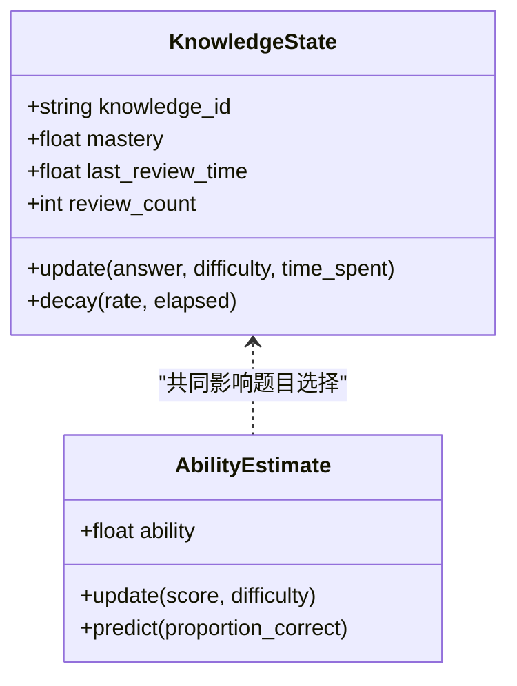

**图表来源**
- [knowledge_management.py:1-200](file://server/knowledge_management.py#L1-L200)

**章节来源**
- [knowledge_management.py:1-200](file://server/knowledge_management.py#L1-L200)

### 难度动态调整机制
- 目标区分度：通过选择接近能力估计难度的题目，使正确率趋近于目标值（如 0.6~0.8）。
- 步进策略：根据偏差方向与大小调整难度步长，避免震荡。
- 置信区间：当估计不确定性较高时，扩大探索范围；随着数据积累收敛到更精确的难度区间。

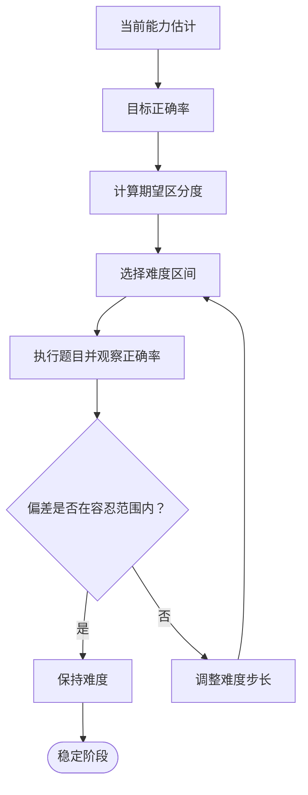

**图表来源**
- [knowledge_management.py:1-200](file://server/knowledge_management.py#L1-L200)

**章节来源**
- [knowledge_management.py:1-200](file://server/knowledge_management.py#L1-L200)

### 个性化题目推荐算法
- 特征输入：知识点标签、历史正确率、最近复习时间、错误模式、用户偏好。
- 评分函数：综合掌握度、遗忘风险、多样性惩罚与难度匹配得分。
- 约束优化：满足最小覆盖率、最大连续重复限制、时间预算与难度带宽。
- 输出：按优先级排序的题目列表，附带解释字段（为何选择该题）。

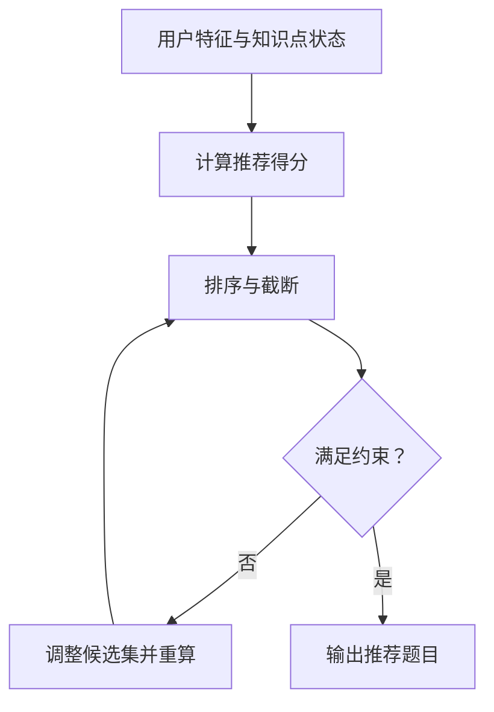

**图表来源**
- [knowledge_management.py:1-200](file://server/knowledge_management.py#L1-L200)

**章节来源**
- [knowledge_management.py:1-200](file://server/knowledge_management.py#L1-L200)

### 实时反馈机制
- 即时判定：每题提交后即刻判断正误，并显示简要解析。
- 掌握度提示：根据本题难度与用户能力估计，给出掌握度变化趋势提示。
- 学习建议：针对错误类型给出下一步学习建议（如回看材料、专项练习）。

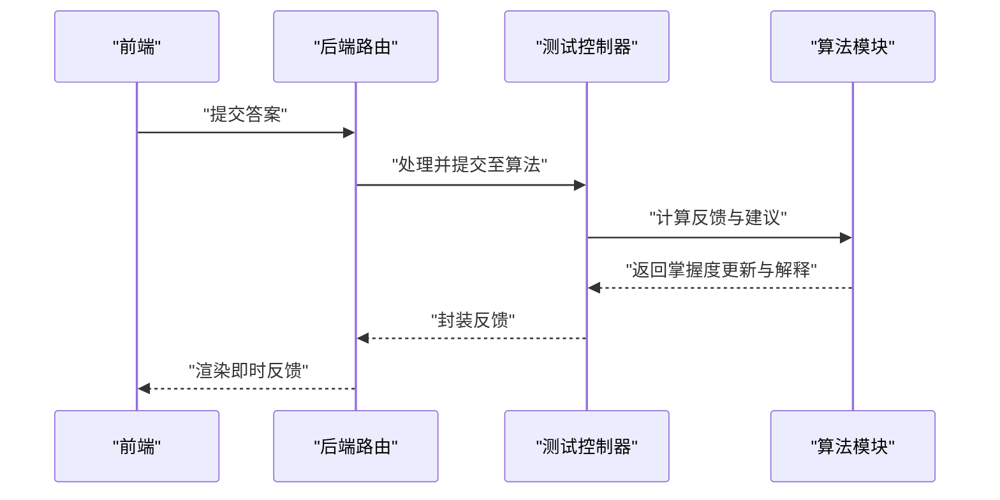

**图表来源**
- [routes_knowledge.py:1-200](file://server/routes_knowledge.py#L1-L200)
- [knowledge_management.py:1-200](file://server/knowledge_management.py#L1-L200)

**章节来源**
- [routes_knowledge.py:1-200](file://server/routes_knowledge.py#L1-L200)
- [knowledge_management.py:1-200](file://server/knowledge_management.py#L1-L200)

### 学习曲线分析与预测模型
- 学习曲线拟合：基于时间序列的正确率与掌握度，拟合增长曲线（如逻辑斯蒂或指数饱和）。
- 预测能力：预测未来某时间点掌握度，估算达到目标掌握度所需的练习次数与时间。
- 干预建议：当曲线停滞或下降时，触发复习提醒或降低难度以提升信心。

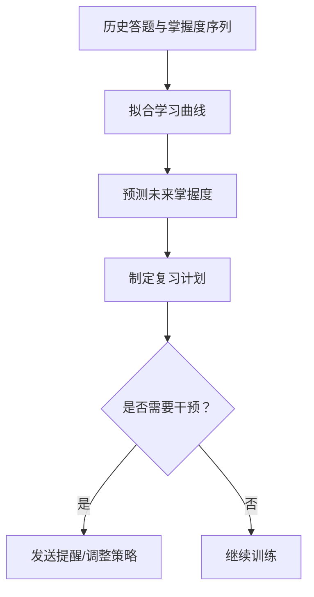

**图表来源**
- [knowledge_management.py:1-200](file://server/knowledge_management.py#L1-L200)

**章节来源**
- [knowledge_management.py:1-200](file://server/knowledge_management.py#L1-L200)

### 多知识点交叉测试
- 设计原则：避免长时间单一知识点导致的疲劳与浅层记忆，采用轮换与打散。
- 实现方式：在推荐阶段加入“最近使用惩罚”，保证知识点分布均匀。
- 效果评估：对比连续与交叉模式的学习曲线斜率与迁移效果。

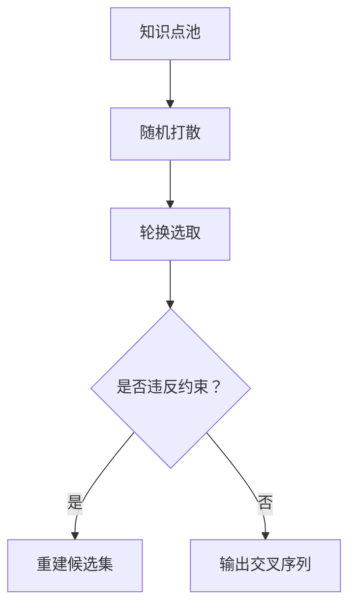

**图表来源**
- [knowledge_management.py:1-200](file://server/knowledge_management.py#L1-L200)

**章节来源**
- [knowledge_management.py:1-200](file://server/knowledge_management.py#L1-L200)

### 间隔重复算法与遗忘曲线应用
- 间隔策略：根据艾宾浩斯遗忘曲线或变体模型，安排复习间隔随掌握度增加而拉长。
- 动态调整：若答题表现不佳则缩短间隔，反之延长。
- 指标监控：跟踪复习命中率与间隔效率，优化参数。

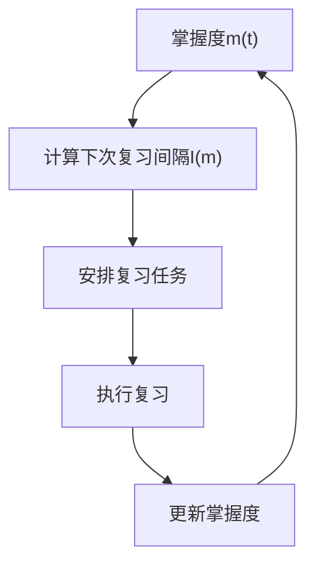

**图表来源**
- [knowledge_management.py:1-200](file://server/knowledge_management.py#L1-L200)

**章节来源**
- [knowledge_management.py:1-200](file://server/knowledge_management.py#L1-L200)

### 能力值计算与预测
- 能力估计：基于答题正确性与题目难度，迭代更新用户能力值。
- 预测模型：用能力值预测未来题目的正确率，辅助难度调节与复习规划。
- 稳定性：引入正则化或平滑因子，避免短期波动影响长期估计。

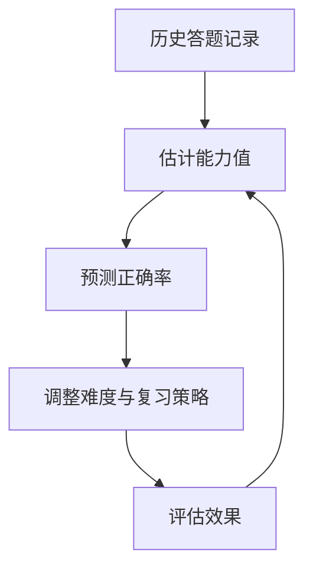

**图表来源**
- [knowledge_management.py:1-200](file://server/knowledge_management.py#L1-L200)

**章节来源**
- [knowledge_management.py:1-200](file://server/knowledge_management.py#L1-L200)

### 具体测试场景示例
- 场景A：新知识点入门测试
  - 目标：快速定位薄弱点，建立初始掌握度基线。
  - 策略：低难度起步，逐步提升；高频错误知识点优先复习。
- 场景B：阶段性巩固测试
  - 目标：检验一段时间内多个知识点的掌握情况。
  - 策略：多知识点交叉，间隔重复强化薄弱环节。
- 场景C：冲刺提分测试
  - 目标：在有限时间内提升整体正确率。
  - 策略：高区分度题目为主，动态难度逼近目标正确率。

**章节来源**
- [test_p5_practice_loop.py:1-200](file://server/tests/test_p5_practice_loop.py#L1-L200)
- [p6_endtoend.py:1-200](file://server/tests/p6_endtoend.py#L1-L200)

### 算法参数配置
- 难度调节参数：目标正确率、难度步长、收敛阈值。
- 遗忘曲线参数：衰减率、基础间隔、复习倍率。
- 推荐权重：掌握度权重、遗忘风险权重、多样性惩罚、难度匹配权重。
- 测试控制参数：题量上限、时间上限、结束阈值、最小覆盖率。

**章节来源**
- [config.py:1-200](file://server/config.py#L1-L200)

## 依赖关系分析
- 路由层依赖知识管理模块，知识管理模块依赖配置中心与数据访问层。
- 前端模板依赖后端提供的接口与数据结构。
- 测试用例验证端到端流程与关键算法分支。

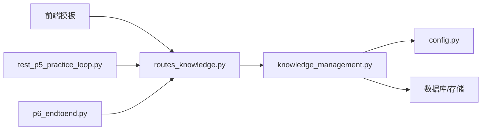

**图表来源**
- [routes_knowledge.py:1-200](file://server/routes_knowledge.py#L1-L200)
- [knowledge_management.py:1-200](file://server/knowledge_management.py#L1-L200)
- [config.py:1-200](file://server/config.py#L1-L200)
- [practice_materials_simple.html:1-200](file://server/templates/pages/practice_materials_simple.html#L1-L200)
- [test_p5_practice_loop.py:1-200](file://server/tests/test_p5_practice_loop.py#L1-L200)
- [p6_endtoend.py:1-200](file://server/tests/p6_endtoend.py#L1-L200)

**章节来源**
- [routes_knowledge.py:1-200](file://server/routes_knowledge.py#L1-L200)
- [knowledge_management.py:1-200](file://server/knowledge_management.py#L1-L200)
- [config.py:1-200](file://server/config.py#L1-L200)

## 性能考量
- 题目选择复杂度：建议在大规模知识点池中采用分层抽样与缓存策略，减少每次选择的计算开销。
- 掌握度更新频率：批量更新而非逐题更新，以降低数据库写入压力。
- 并发与锁：多用户并发测试时需对知识点状态加锁，避免竞态条件。
- 监控与日志：记录关键指标（正确率、难度变化、间隔长度）以便离线分析与调优。

[本节为通用指导，不直接分析具体文件]

## 故障排查指南
- 症状：题目难度不升反降
  - 排查：检查目标正确率设置与难度步长是否合理；确认能力估计是否被异常值污染。
- 症状：知识点覆盖不均
  - 排查：检查多样性惩罚与轮换策略是否生效；确认最小覆盖率约束是否过严。
- 症状：掌握度波动剧烈
  - 排查：检查平滑因子与正则化参数；确认是否存在极端难度或异常作答时长。
- 症状：复习间隔过长或过短
  - 排查：核对遗忘曲线参数与掌握度更新规则；检查最近复习时间是否正确记录。

**章节来源**
- [test_p5_practice_loop.py:1-200](file://server/tests/test_p5_practice_loop.py#L1-L200)
- [p6_endtoend.py:1-200](file://server/tests/p6_endtoend.py#L1-L200)

## 结论
本自适应测试算法通过能力估计、知识掌握度评估与难度动态调节，实现了个性化题目推荐与高效复习。结合多知识点交叉、间隔重复与遗忘曲线，系统能够在真实学习场景中持续提升学习效率与效果。建议在生产环境中持续监控关键指标，并根据实际数据微调参数以获得最佳体验。

[本节为总结性内容，不直接分析具体文件]

## 附录
- 术语表
  - 能力估计：对用户整体水平的量化表示。
  - 掌握度：用户对特定知识点的熟练程度。
  - 间隔重复：按遗忘规律安排复习的策略。
  - 遗忘曲线：描述记忆随时间衰减的模型。
- 参考实现位置
  - 路由与接口：routes_knowledge.py
  - 算法与状态管理：knowledge_management.py
  - 配置项：config.py
  - 前端交互：practice_materials_simple.html、practice_welcome.html
  - 测试验证：test_p5_practice_loop.py、p6_endtoend.py

**章节来源**
- [routes_knowledge.py:1-200](file://server/routes_knowledge.py#L1-L200)
- [knowledge_management.py:1-200](file://server/knowledge_management.py#L1-L200)
- [config.py:1-200](file://server/config.py#L1-L200)
- [practice_materials_simple.html:1-200](file://server/templates/pages/practice_materials_simple.html#L1-L200)
- [practice_welcome.html:1-200](file://server/templates/components/practice_welcome.html#L1-L200)
- [test_p5_practice_loop.py:1-200](file://server/tests/test_p5_practice_loop.py#L1-L200)
- [p6_endtoend.py:1-200](file://server/tests/p6_endtoend.py#L1-L200)