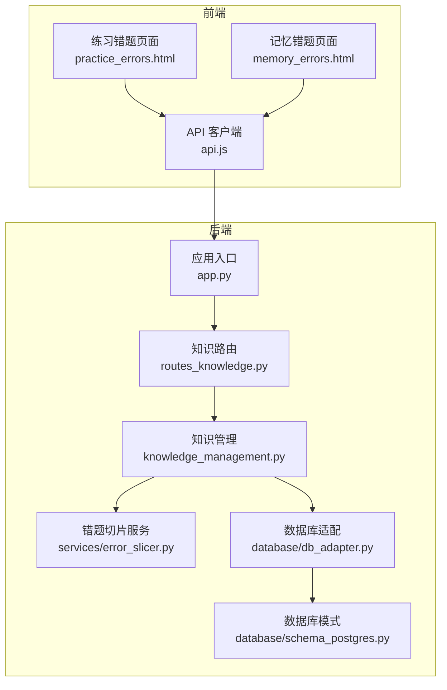
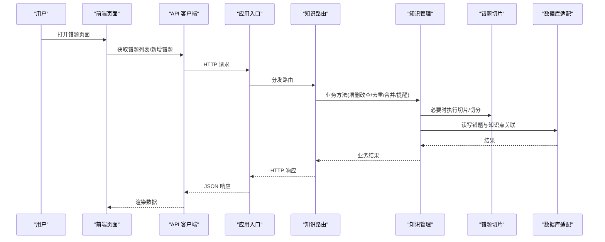
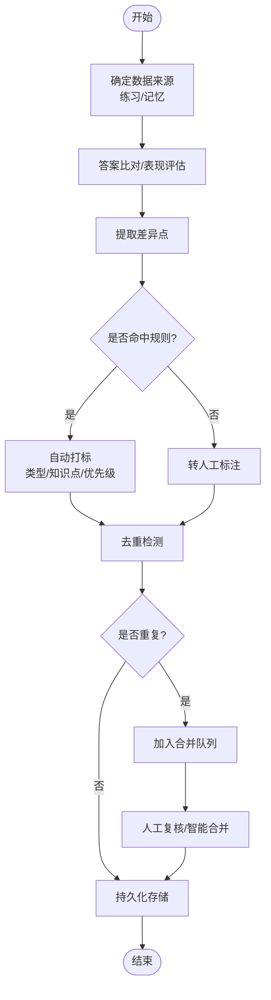
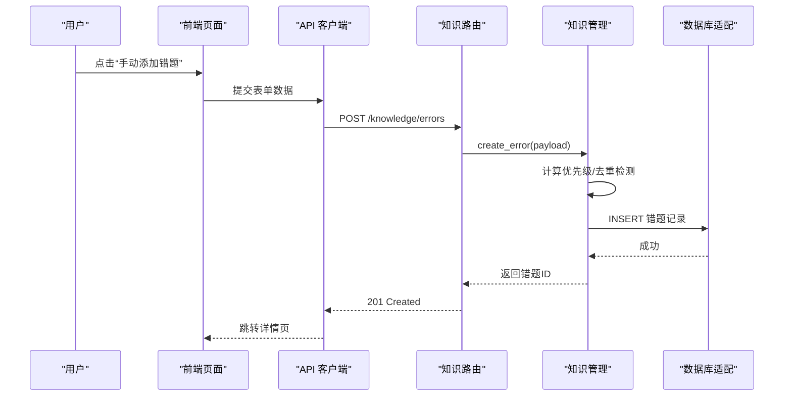
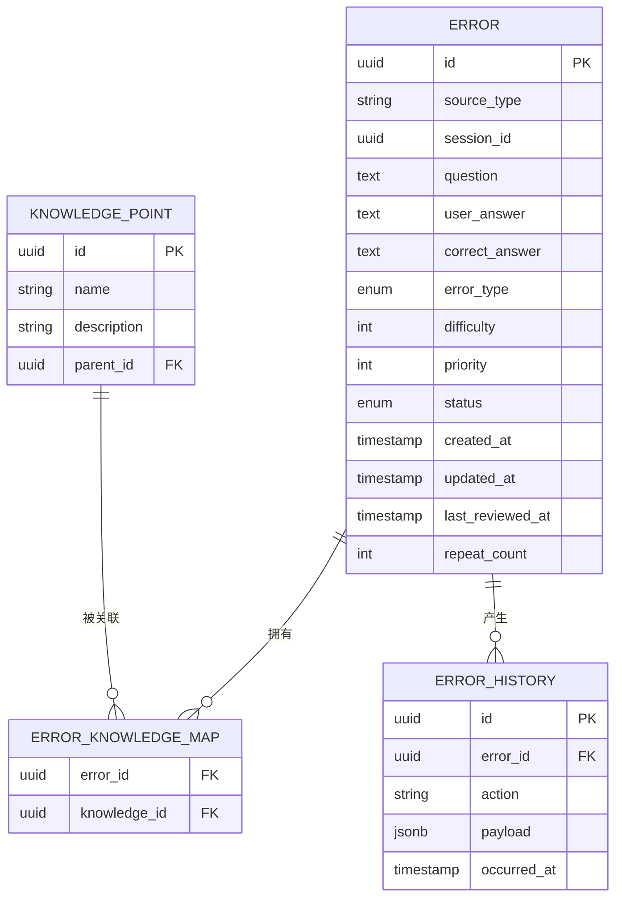
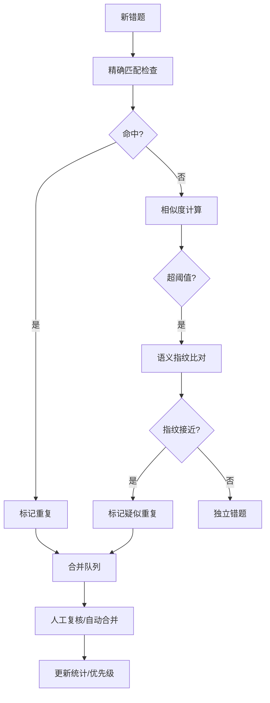
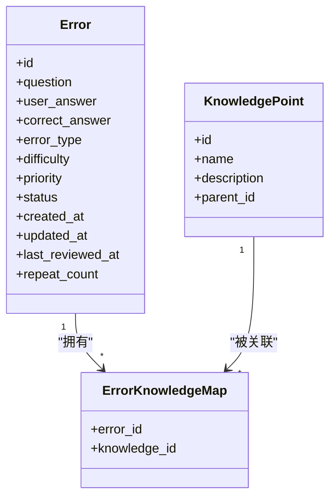
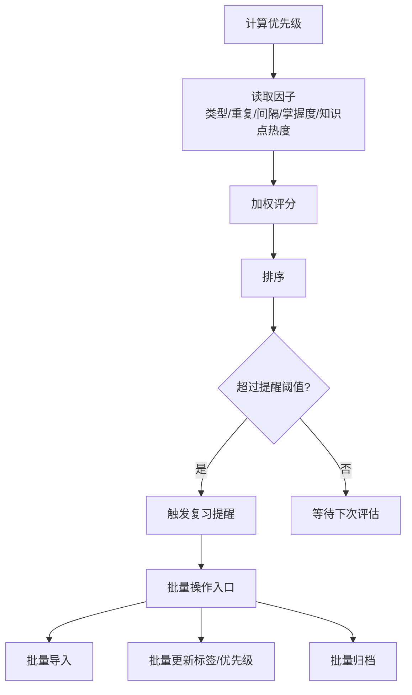
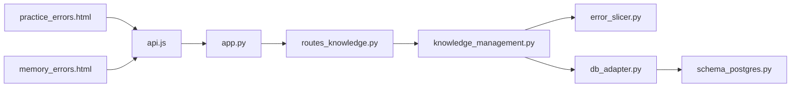

# 错题收集机制

<cite>
**本文引用的文件**   
- [app.py](file://server/app.py)
- [routes_knowledge.py](file://server/routes_knowledge.py)
- [knowledge_management.py](file://server/knowledge_management.py)
- [error_slicer.py](file://server/services/error_slicer.py)
- [db_adapter.py](file://server/database/db_adapter.py)
- [schema_postgres.py](file://server/database/schema_postgres.py)
- [practice_errors.html](file://server/templates/pages/practice_errors.html)
- [memory_errors.html](file://server/templates/pages/memory_errors.html)
- [api.js](file://server/static/js/api.js)
- [AGENTS.md](file://AGENTS.md)
</cite>

## 目录
1. [引言](#引言)
2. [项目结构](#项目结构)
3. [核心组件](#核心组件)
4. [架构总览](#架构总览)
5. [详细组件分析](#详细组件分析)
6. [依赖关系分析](#依赖关系分析)
7. [性能考虑](#性能考虑)
8. [故障排查指南](#故障排查指南)
9. [结论](#结论)
10. [附录](#附录)

## 引言
本文件面向“LectureLearnLoop”的错题收集机制，系统性说明错题识别算法、自动标记逻辑、错题数据持久化存储、用户手动添加错题流程、错误类型分类与知识点关联、去重策略与重复检测、智能合并、优先级排序、复习提醒触发条件以及批量处理机制。文档同时提供数据模型设计、流程图与时序图，帮助开发者与产品人员快速理解并扩展该能力。

## 项目结构
围绕错题收集机制，相关代码主要分布在以下模块：
- Web 路由层：暴露错题录入、查询、更新等接口
- 知识管理域：负责错题实体、错误类型、知识点关联、去重与合并
- 服务层：错题切片/切分（如从练习或记忆流中抽取错误片段）
- 数据库适配层与模式定义：统一访问 SQLite/PostgreSQL，定义错题表结构
- 前端模板与静态脚本：渲染错题列表、交互入口与调用后端 API

**图表来源**
- [app.py](file://server/app.py)
- [routes_knowledge.py](file://server/routes_knowledge.py)
- [knowledge_management.py](file://server/knowledge_management.py)
- [error_slicer.py](file://server/services/error_slicer.py)
- [db_adapter.py](file://server/database/db_adapter.py)
- [schema_postgres.py](file://server/database/schema_postgres.py)
- [practice_errors.html](file://server/templates/pages/practice_errors.html)
- [memory_errors.html](file://server/templates/pages/memory_errors.html)
- [api.js](file://server/static/js/api.js)

**章节来源**
- [AGENTS.md](file://AGENTS.md)

## 核心组件
- 错题实体与生命周期
  - 字段包括：唯一标识、来源会话/材料、题目内容、用户答案、正确答案、错误类型、知识点标签、优先级、创建/更新时间、是否已解决、最近复习时间、重复计数等。
  - 状态流转：待学习 → 学习中 → 已掌握；支持回退与重置。
- 错误类型分类
  - 概念性错误、计算/推导错误、审题/理解错误、表达/输出错误、工具/环境错误等。
  - 每种类型可映射到不同复习策略与权重。
- 知识点关联
  - 多对多关系：一个错题可关联多个知识点，一个知识点可被多个错题引用。
  - 支持按知识点聚合统计与定向复习。
- 去重与合并
  - 基于文本相似度、语义指纹、来源上下文进行重复检测。
  - 支持人工确认后的智能合并，保留历史轨迹与统计信息。
- 优先级与复习提醒
  - 优先级由错误类型、重复次数、最近复习间隔、掌握度等综合计算。
  - 复习提醒在达到阈值时触发，支持静默与通知两种模式。
- 批量处理
  - 支持导入批量错题、批量打标签、批量调整优先级、批量归档。

**章节来源**
- [knowledge_management.py](file://server/knowledge_management.py)
- [routes_knowledge.py](file://server/routes_knowledge.py)
- [schema_postgres.py](file://server/database/schema_postgres.py)

## 架构总览
错题收集机制采用分层架构：前端通过 API 调用后端路由，路由将请求委派给知识管理服务，服务层协调错题切片、去重合并、优先级计算与复习提醒，最终通过数据库适配层持久化。

**图表来源**
- [app.py](file://server/app.py)
- [routes_knowledge.py](file://server/routes_knowledge.py)
- [knowledge_management.py](file://server/knowledge_management.py)
- [error_slicer.py](file://server/services/error_slicer.py)
- [db_adapter.py](file://server/database/db_adapter.py)

## 详细组件分析

### 错题识别算法与自动标记逻辑
- 识别来源
  - 练习阶段：对比用户提交与标准答案，定位差异点。
  - 记忆阶段：根据回忆失败率、延迟回忆表现、提示强度等指标判定错误。
- 算法要点
  - 差异比对：逐题逐项比较，生成差异摘要。
  - 语义相似度：对自由文本类题目使用相似度阈值判断是否属于同一错误模式。
  - 规则引擎：结合错误类型规则库，自动归类并赋予初始优先级。
- 自动标记
  - 为每条错题打上错误类型、知识点标签、难度等级、首次出现时间。
  - 若检测到重复模式，则标记为“疑似重复”，进入合并队列。

**图表来源**
- [knowledge_management.py](file://server/knowledge_management.py)
- [error_slicer.py](file://server/services/error_slicer.py)

**章节来源**
- [knowledge_management.py](file://server/knowledge_management.py)
- [error_slicer.py](file://server/services/error_slicer.py)

### 用户手动添加错题流程
- 入口
  - 练习错题页面与记忆错题页面均提供“手动添加错题”按钮。
- 步骤
  - 选择来源（练习/记忆/外部导入）。
  - 填写题目、用户答案、正确答案（可选）、错误类型、知识点标签。
  - 系统自动计算初始优先级并执行去重检测。
  - 保存后返回错题详情，支持后续编辑与归档。

**图表来源**
- [routes_knowledge.py](file://server/routes_knowledge.py)
- [knowledge_management.py](file://server/knowledge_management.py)
- [db_adapter.py](file://server/database/db_adapter.py)
- [practice_errors.html](file://server/templates/pages/practice_errors.html)
- [memory_errors.html](file://server/templates/pages/memory_errors.html)
- [api.js](file://server/static/js/api.js)

**章节来源**
- [routes_knowledge.py](file://server/routes_knowledge.py)
- [knowledge_management.py](file://server/knowledge_management.py)
- [practice_errors.html](file://server/templates/pages/practice_errors.html)
- [memory_errors.html](file://server/templates/pages/memory_errors.html)
- [api.js](file://server/static/js/api.js)

### 错题数据持久化存储
- 存储目标
  - 支持 SQLite 与 PostgreSQL，通过统一适配层访问。
- 关键表
  - 错题主表：包含题目、答案、错误类型、知识点、优先级、状态、时间戳等。
  - 知识点表：知识点名称、描述、层级等。
  - 错题-知识点关联表：多对多关系。
  - 错题历史/审计表：变更记录、合并来源、重复计数等。
- 一致性
  - 事务保护写入操作，确保错题与关联表的一致性。
  - 索引优化查询与去重检测性能。

**图表来源**
- [schema_postgres.py](file://server/database/schema_postgres.py)

**章节来源**
- [schema_postgres.py](file://server/database/schema_postgres.py)
- [db_adapter.py](file://server/database/db_adapter.py)

### 错题去重策略、重复检测与智能合并
- 去重维度
  - 精确匹配：题目+用户答案完全一致。
  - 模糊匹配：文本相似度超过阈值。
  - 语义指纹：对自由文本进行归一化与特征提取，降低噪声。
  - 上下文匹配：来源会话、材料、时间点相近时提高置信度。
- 重复检测
  - 计算相似度分数，超过阈值即标记为“疑似重复”。
  - 支持白名单/黑名单条目，避免误判。
- 智能合并
  - 合并候选集展示，允许用户确认合并。
  - 合并后保留历史轨迹、重复计数、知识点聚合与优先级继承。

**图表来源**
- [knowledge_management.py](file://server/knowledge_management.py)

**章节来源**
- [knowledge_management.py](file://server/knowledge_management.py)

### 错误类型分类与知识点关联机制
- 错误类型
  - 概念性错误：对概念理解偏差。
  - 计算/推导错误：公式/推理过程出错。
  - 审题/理解错误：题意误解或遗漏条件。
  - 表达/输出错误：表述不清、格式不符。
  - 工具/环境错误：平台/工具问题导致作答异常。
- 知识点关联
  - 支持多选知识点，便于按知识点聚合复习。
  - 知识点层级结构支持父子关系，便于自上而下或自下而上的复习路径规划。

**图表来源**
- [schema_postgres.py](file://server/database/schema_postgres.py)

**章节来源**
- [schema_postgres.py](file://server/database/schema_postgres.py)
- [knowledge_management.py](file://server/knowledge_management.py)

### 错题优先级排序、复习提醒触发条件与批量处理
- 优先级排序
  - 综合因素：错误类型权重、重复次数、最近复习间隔、掌握度、知识点热度。
  - 动态调整：每次复习后根据表现更新优先级。
- 复习提醒
  - 触发条件：优先级高于阈值且超过复习间隔；或连续失败达到阈值。
  - 提醒方式：站内通知、邮件/消息推送（可扩展）。
- 批量处理
  - 批量导入：支持 CSV/JSON 导入，自动解析与校验。
  - 批量操作：批量打标签、批量调整优先级、批量归档/删除。

**图表来源**
- [knowledge_management.py](file://server/knowledge_management.py)

**章节来源**
- [knowledge_management.py](file://server/knowledge_management.py)

## 依赖关系分析
- 路由层依赖知识管理服务，知识管理服务依赖错题切片服务与数据库适配层。
- 前端通过 api.js 调用后端 REST 接口，渲染模板页面。
- 数据库模式定义与适配层解耦，便于切换存储后端。

**图表来源**
- [practice_errors.html](file://server/templates/pages/practice_errors.html)
- [memory_errors.html](file://server/templates/pages/memory_errors.html)
- [api.js](file://server/static/js/api.js)
- [app.py](file://server/app.py)
- [routes_knowledge.py](file://server/routes_knowledge.py)
- [knowledge_management.py](file://server/knowledge_management.py)
- [error_slicer.py](file://server/services/error_slicer.py)
- [db_adapter.py](file://server/database/db_adapter.py)
- [schema_postgres.py](file://server/database/schema_postgres.py)

**章节来源**
- [app.py](file://server/app.py)
- [routes_knowledge.py](file://server/routes_knowledge.py)
- [knowledge_management.py](file://server/knowledge_management.py)
- [error_slicer.py](file://server/services/error_slicer.py)
- [db_adapter.py](file://server/database/db_adapter.py)
- [schema_postgres.py](file://server/database/schema_postgres.py)

## 性能考虑
- 去重检测
  - 使用近似哈希与索引加速相似度检索，避免全表扫描。
  - 分批处理大批量导入，降低内存峰值。
- 优先级计算
  - 异步任务计算与缓存热点数据，减少实时计算开销。
- 数据库
  - 针对高频查询字段建立复合索引（如状态、优先级、知识点 ID）。
  - 读写分离（如适用）提升并发性能。

[本节为通用性能建议，不直接分析具体文件]

## 故障排查指南
- 无法新增错题
  - 检查路由是否正确注册、表单字段是否完整、数据库连接是否正常。
- 去重误判
  - 调整相似度阈值与指纹参数，查看合并队列中的候选集。
- 优先级异常
  - 检查因子权重配置与最近复习时间是否更新。
- 提醒未触发
  - 检查阈值配置与定时任务是否运行。

**章节来源**
- [routes_knowledge.py](file://server/routes_knowledge.py)
- [knowledge_management.py](file://server/knowledge_management.py)
- [db_adapter.py](file://server/database/db_adapter.py)

## 结论
错题收集机制以知识管理为核心，结合错题切片、去重合并、优先级与复习提醒，形成闭环的学习反馈系统。通过清晰的数据模型与分层架构，系统具备良好的可扩展性与可维护性，能够支撑大规模错题数据的采集、治理与复习调度。

[本节为总结性内容，不直接分析具体文件]

## 附录
- 错题录入示例（字段说明）
  - 来源类型：练习/记忆/外部导入
  - 题目内容：题干文本
  - 用户答案：作答文本
  - 正确答案：标准答案文本
  - 错误类型：概念性/计算/审题/表达/工具
  - 知识点标签：多选知识点
  - 优先级：系统计算值
  - 状态：待学习/学习中/已掌握
  - 时间戳：创建/更新/最近复习
  - 重复计数：重复检测累计

[本节为概念性说明，不直接分析具体文件]