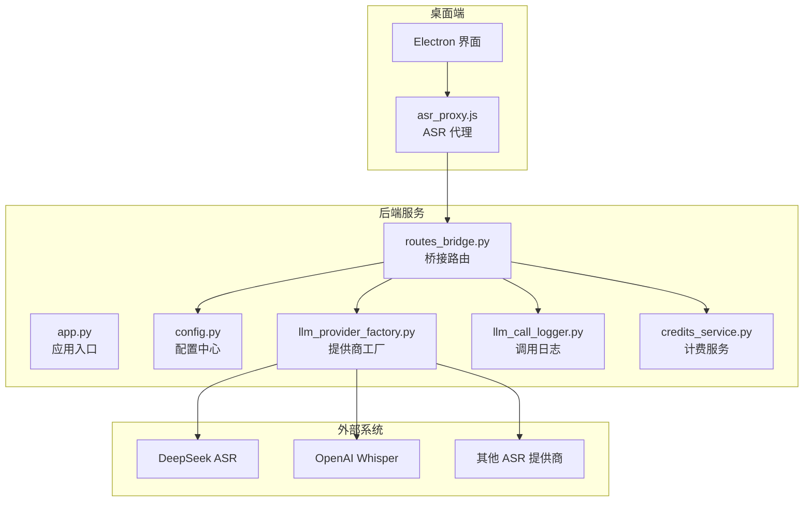
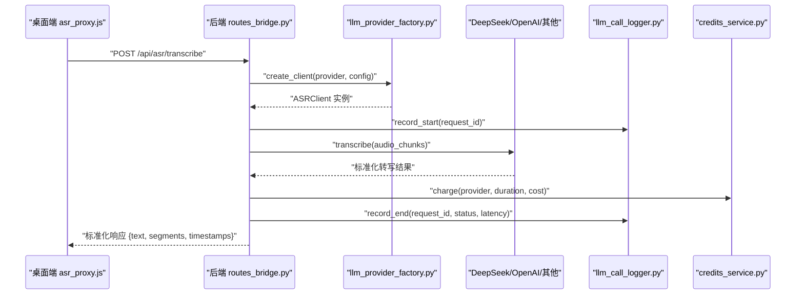
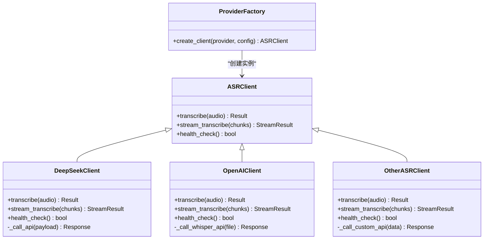
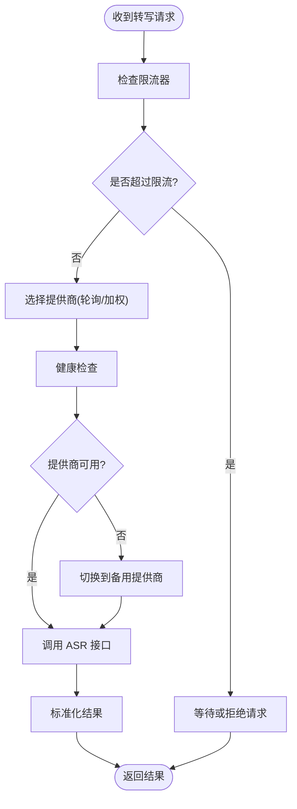
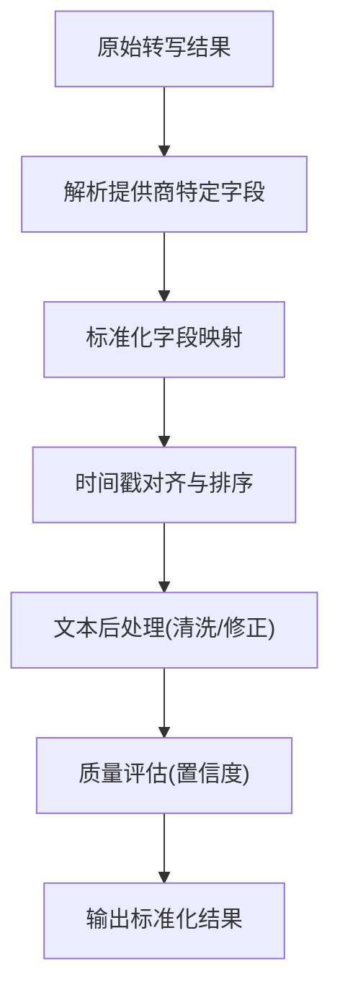
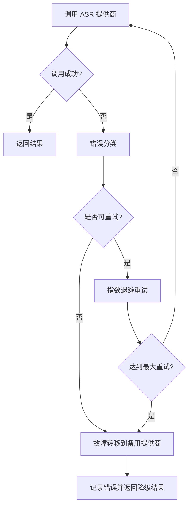
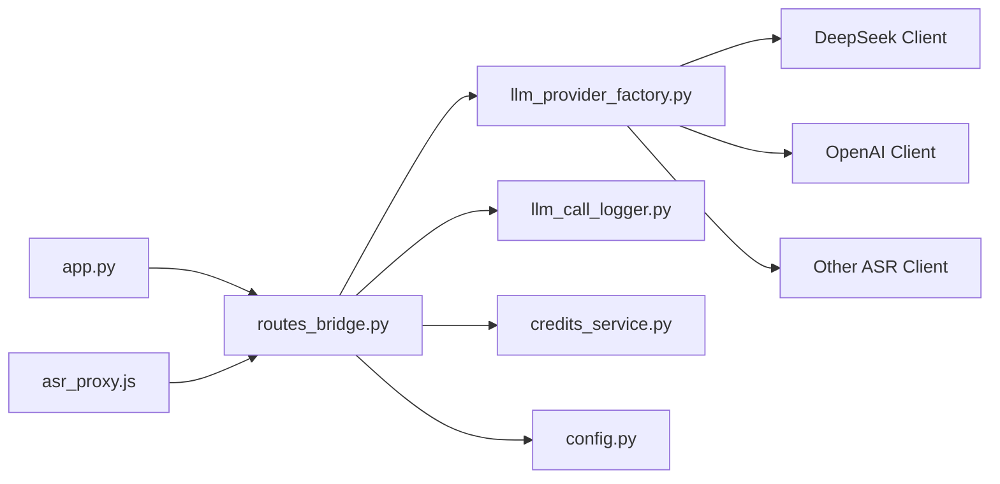

# ASR服务集成

<cite>
**本文引用的文件**   
- [app.py](file://server/app.py)
- [config.py](file://server/config.py)
- [routes_bridge.py](file://server/routes_bridge.py)
- [llm_provider_factory.py](file://server/llm_provider_factory.py)
- [llm_call_logger.py](file://server/llm_call_logger.py)
- [credits_service.py](file://server/credits_service.py)
- [asr_proxy.js](file://desktop/asr_proxy.js)
- [p4_deepgram_prerecorded.py](file://server/tests/p4_deepgram_prerecorded.py)
- [probe_deepseek.py](file://server/tests/probe_deepseek.py)
</cite>

## 目录
1. [简介](#简介)
2. [项目结构](#项目结构)
3. [核心组件](#核心组件)
4. [架构总览](#架构总览)
5. [详细组件分析](#详细组件分析)
6. [依赖关系分析](#依赖关系分析)
7. [性能与成本优化](#性能与成本优化)
8. [故障排查指南](#故障排查指南)
9. [结论](#结论)
10. [附录](#附录)

## 简介
本文件为 LectureLearnLoop 的语音识别（ASR）服务集成提供系统化架构文档。重点包括：
- 多 ASR 提供商的统一适配器模式设计，覆盖 DeepSeek、OpenAI 等厂商
- API 密钥管理、请求限流与负载均衡策略
- 转写结果的标准化处理、时间戳对齐与文本后处理
- ASR 客户端配置示例与自定义提供商接入指南
- 性能监控、调用统计与成本优化
- 错误分类、重试机制与故障转移方案

## 项目结构
本项目采用“后端 Python + 桌面端 Electron”的分层架构：
- 后端 server 提供统一路由、配置、计费与日志能力，并通过工厂模式扩展不同 LLM/ASR 提供商
- 桌面端 desktop 通过 asr_proxy.js 与后端交互，负责音频采集、流式传输与结果展示
- 测试脚本用于验证各 ASR 提供商连通性与行为

**图表来源**
- [app.py:1-200](file://server/app.py#L1-L200)
- [routes_bridge.py:1-200](file://server/routes_bridge.py#L1-L200)
- [config.py:1-200](file://server/config.py#L1-L200)
- [llm_provider_factory.py:1-200](file://server/llm_provider_factory.py#L1-L200)
- [llm_call_logger.py:1-200](file://server/llm_call_logger.py#L1-L200)
- [credits_service.py:1-200](file://server/credits_service.py#L1-L200)
- [asr_proxy.js:1-200](file://desktop/asr_proxy.js#L1-L200)

**章节来源**
- [app.py:1-200](file://server/app.py#L1-L200)
- [routes_bridge.py:1-200](file://server/routes_bridge.py#L1-L200)
- [config.py:1-200](file://server/config.py#L1-L200)
- [llm_provider_factory.py:1-200](file://server/llm_provider_factory.py#L1-L200)
- [llm_call_logger.py:1-200](file://server/llm_call_logger.py#L1-L200)
- [credits_service.py:1-200](file://server/credits_service.py#L1-L200)
- [asr_proxy.js:1-200](file://desktop/asr_proxy.js#L1-L200)

## 核心组件
- 应用入口 app.py：初始化 Flask/FastAPI 应用、注册路由、启动服务
- 桥接路由 routes_bridge.py：暴露统一的 ASR 接口，聚合日志、计费与配置
- 配置中心 config.py：集中管理 API Key、模型选择、并发限制、超时与重试参数
- 提供商工厂 llm_provider_factory.py：根据配置动态创建具体 ASR 客户端实例
- 调用日志 llm_call_logger.py：记录每次 ASR 调用的元数据、耗时、状态码与错误信息
- 计费服务 credits_service.py：按调用次数或时长扣费，支持配额与限额控制
- 桌面代理 asr_proxy.js：封装音频采集、分片上传、流式接收与结果渲染

**章节来源**
- [app.py:1-200](file://server/app.py#L1-L200)
- [routes_bridge.py:1-200](file://server/routes_bridge.py#L1-L200)
- [config.py:1-200](file://server/config.py#L1-L200)
- [llm_provider_factory.py:1-200](file://server/llm_provider_factory.py#L1-L200)
- [llm_call_logger.py:1-200](file://server/llm_call_logger.py#L1-L200)
- [credits_service.py:1-200](file://server/credits_service.py#L1-L200)
- [asr_proxy.js:1-200](file://desktop/asr_proxy.js#L1-L200)

## 架构总览
整体流程如下：
- 桌面端采集音频并分片上传至后端
- 后端路由将请求转发给工厂创建的 ASR 客户端
- 客户端调用具体提供商（DeepSeek/OpenAI/其他），返回标准化结果
- 日志与计费模块记录调用详情并扣费
- 前端对结果进行时间戳对齐与文本后处理

**图表来源**
- [routes_bridge.py:1-200](file://server/routes_bridge.py#L1-L200)
- [llm_provider_factory.py:1-200](file://server/llm_provider_factory.py#L1-L200)
- [llm_call_logger.py:1-200](file://server/llm_call_logger.py#L1-L200)
- [credits_service.py:1-200](file://server/credits_service.py#L1-L200)
- [asr_proxy.js:1-200](file://desktop/asr_proxy.js#L1-L200)

## 详细组件分析

### 统一适配器模式与多提供商实现
- 抽象层：定义统一的 ASRClient 接口，包含 transcribe、stream_transcribe、health_check 等方法
- 具体实现：DeepSeekClient、OpenAIClient、OtherASRClient 分别对接各自 SDK/API
- 工厂模式：llm_provider_factory.py 根据 provider 名称与配置创建对应客户端实例
- 配置驱动：config.py 中维护 provider 列表、默认模型、并发限制、超时与重试策略

**图表来源**
- [llm_provider_factory.py:1-200](file://server/llm_provider_factory.py#L1-L200)
- [config.py:1-200](file://server/config.py#L1-L200)

**章节来源**
- [llm_provider_factory.py:1-200](file://server/llm_provider_factory.py#L1-L200)
- [config.py:1-200](file://server/config.py#L1-L200)

### API 密钥管理与安全
- 密钥来源：环境变量、配置文件或密钥管理服务
- 加载顺序：优先使用运行时注入的环境变量，其次读取配置文件中的密钥
- 安全建议：避免在代码中硬编码密钥；生产环境建议使用密钥管理服务（如 Vault、AWS Secrets Manager）
- 访问控制：仅允许受信任的后端进程访问密钥；对外接口不暴露敏感信息

**章节来源**
- [config.py:1-200](file://server/config.py#L1-L200)

### 请求限流与负载均衡
- 限流策略：基于令牌桶或滑动窗口算法，限制每秒/每分钟请求数
- 负载均衡：轮询或加权随机选择可用提供商，避免单点过载
- 健康检查：定期探测各提供商可用性，自动剔除不可用节点
- 降级策略：当主提供商不可用时，自动切换到备用提供商

**图表来源**
- [routes_bridge.py:1-200](file://server/routes_bridge.py#L1-L200)
- [config.py:1-200](file://server/config.py#L1-L200)

**章节来源**
- [routes_bridge.py:1-200](file://server/routes_bridge.py#L1-L200)
- [config.py:1-200](file://server/config.py#L1-L200)

### 转写结果标准化、时间戳对齐与文本后处理
- 标准化字段：text、segments、timestamps、provider、model、duration
- 时间戳对齐：将各提供商的时间戳转换为统一格式（秒/毫秒），并按段落排序
- 文本后处理：去除多余空格、标点规范化、专有名词修正、语言检测与翻译（可选）
- 质量评估：计算置信度分数，低置信度片段标记需人工复核

**图表来源**
- [routes_bridge.py:1-200](file://server/routes_bridge.py#L1-L200)

**章节来源**
- [routes_bridge.py:1-200](file://server/routes_bridge.py#L1-L200)

### ASR 客户端配置示例与自定义提供商接入
- 配置项：provider、model、api_key、timeout、max_retries、rate_limit、load_balance_strategy
- 示例配置：
  - DeepSeek：provider="deepseek", model="deepseek-asr-v1", api_key="${DEEPSEEK_API_KEY}"
  - OpenAI：provider="openai", model="whisper-1", api_key="${OPENAI_API_KEY}"
- 自定义接入步骤：
  1. 实现 ASRClient 接口
  2. 在 ProviderFactory 中注册新提供商
  3. 在 config.py 中添加配置项
  4. 编写单元测试验证连通性与结果标准化

**章节来源**
- [config.py:1-200](file://server/config.py#L1-L200)
- [llm_provider_factory.py:1-200](file://server/llm_provider_factory.py#L1-L200)

### 性能监控、调用统计与成本优化
- 监控指标：QPS、延迟分布、错误率、提供商可用性、资源占用
- 调用统计：记录每次调用的 provider、model、duration、cost、status_code
- 成本优化：
  - 动态切换低成本提供商
  - 批量处理短音频以降低固定开销
  - 缓存重复音频的转写结果（可选）
  - 调整采样率与分片大小以平衡精度与带宽

**章节来源**
- [llm_call_logger.py:1-200](file://server/llm_call_logger.py#L1-L200)
- [credits_service.py:1-200](file://server/credits_service.py#L1-L200)

### 错误分类、重试机制与故障转移
- 错误分类：网络错误、认证失败、速率限制、服务端错误、超时
- 重试策略：指数退避 + 抖动，最大重试次数可配置
- 故障转移：当主提供商连续失败时，自动切换到备用提供商
- 熔断机制：当错误率超过阈值时，暂时停止调用该提供商，冷却后恢复

**图表来源**
- [routes_bridge.py:1-200](file://server/routes_bridge.py#L1-L200)
- [config.py:1-200](file://server/config.py#L1-L200)

**章节来源**
- [routes_bridge.py:1-200](file://server/routes_bridge.py#L1-L200)
- [config.py:1-200](file://server/config.py#L1-L200)

## 依赖关系分析
- 后端依赖：Flask/FastAPI、HTTP 客户端库、日志库、数据库（可选）
- 桌面端依赖：Electron、Web Audio API、WebSocket/HTTP 客户端
- 外部依赖：DeepSeek、OpenAI、其他 ASR 提供商 API

**图表来源**
- [app.py:1-200](file://server/app.py#L1-L200)
- [routes_bridge.py:1-200](file://server/routes_bridge.py#L1-L200)
- [llm_provider_factory.py:1-200](file://server/llm_provider_factory.py#L1-L200)
- [llm_call_logger.py:1-200](file://server/llm_call_logger.py#L1-L200)
- [credits_service.py:1-200](file://server/credits_service.py#L1-L200)
- [config.py:1-200](file://server/config.py#L1-L200)
- [asr_proxy.js:1-200](file://desktop/asr_proxy.js#L1-L200)

**章节来源**
- [app.py:1-200](file://server/app.py#L1-L200)
- [routes_bridge.py:1-200](file://server/routes_bridge.py#L1-L200)
- [llm_provider_factory.py:1-200](file://server/llm_provider_factory.py#L1-L200)
- [llm_call_logger.py:1-200](file://server/llm_call_logger.py#L1-L200)
- [credits_service.py:1-200](file://server/credits_service.py#L1-L200)
- [config.py:1-200](file://server/config.py#L1-L200)
- [asr_proxy.js:1-200](file://desktop/asr_proxy.js#L1-L200)

## 性能与成本优化
- 音频预处理：降噪、静音切除、重采样到目标频率
- 分片策略：合理设置分片大小与重叠，平衡实时性与准确率
- 并发控制：限制同时进行的转写任务数，避免资源耗尽
- 缓存策略：对相同音频指纹的结果进行缓存，减少重复调用
- 成本监控：按提供商统计调用量与费用，设置预算告警

[本节为通用指导，无需具体文件引用]

## 故障排查指南
- 常见问题：
  - API Key 无效：检查环境变量与配置文件
  - 速率限制：降低 QPS 或升级套餐
  - 超时错误：增加 timeout 或优化音频分片
  - 结果不准确：调整模型或启用后处理
- 诊断工具：
  - 使用 p4_deepgram_prerecorded.py 验证 DeepSeek 连通性
  - 使用 probe_deepseek.py 探测 DeepSeek 服务状态
  - 查看 llm_call_logger.py 记录的调用日志与错误堆栈

**章节来源**
- [p4_deepgram_prerecorded.py:1-200](file://server/tests/p4_deepgram_prerecorded.py#L1-L200)
- [probe_deepseek.py:1-200](file://server/tests/probe_deepseek.py#L1-L200)
- [llm_call_logger.py:1-200](file://server/llm_call_logger.py#L1-L200)

## 结论
本架构通过适配器模式与工厂模式实现了多 ASR 提供商的统一接入，结合限流、负载均衡、错误重试与故障转移机制，提供了高可用、可扩展的语音识别服务。通过标准化结果处理与成本优化策略，系统在性能与经济性之间取得良好平衡。未来可进一步引入智能路由、动态定价与更精细的质量评估。

[本节为总结性内容，无需具体文件引用]

## 附录
- 术语表：ASR、LLM、QPS、SLA、熔断、降级
- 参考链接：DeepSeek API 文档、OpenAI Whisper 文档
- 配置模板：提供 YAML/JSON 格式的完整配置示例（见 config.py）

[本节为补充信息，无需具体文件引用]