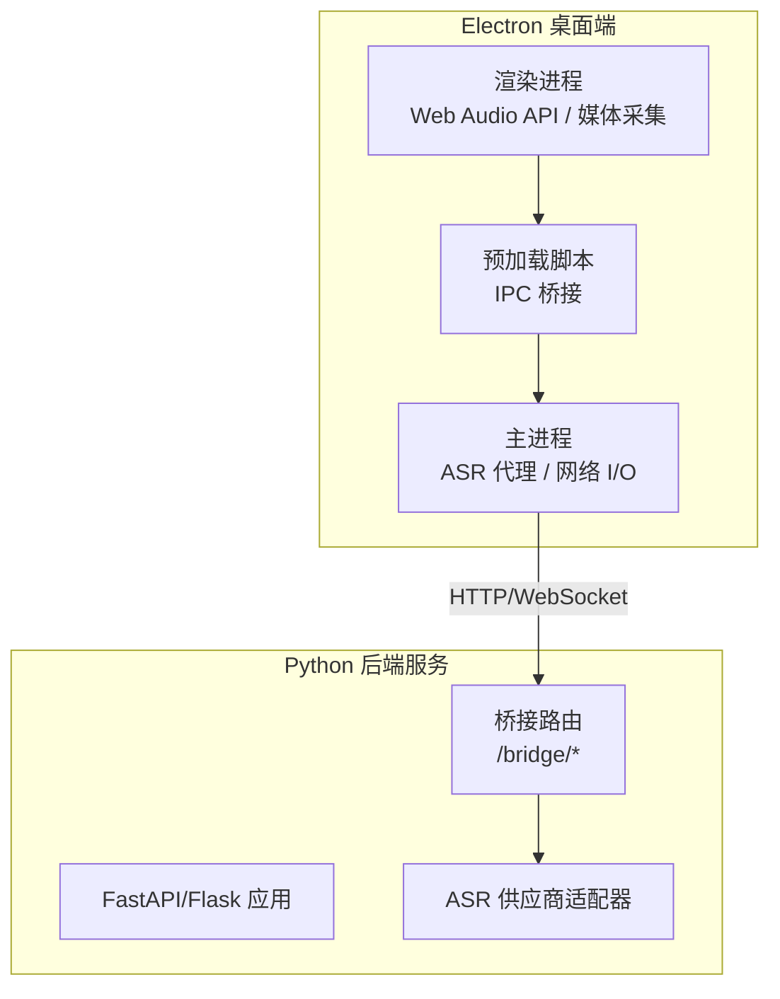
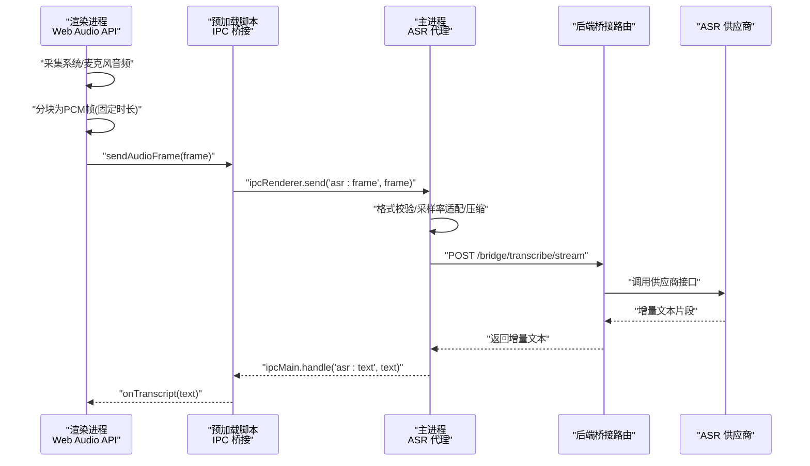
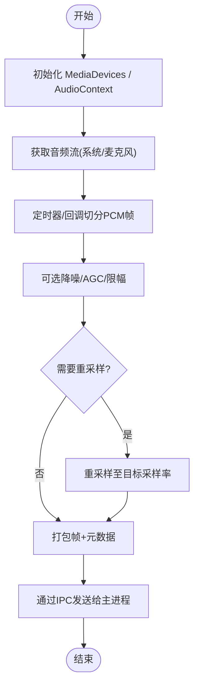
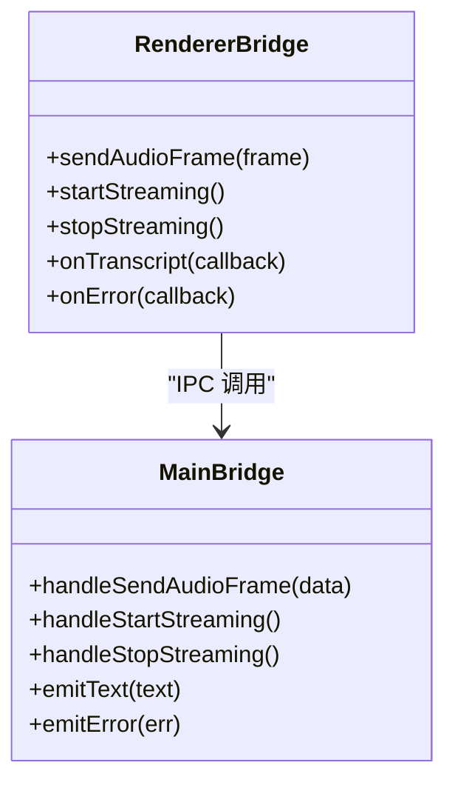
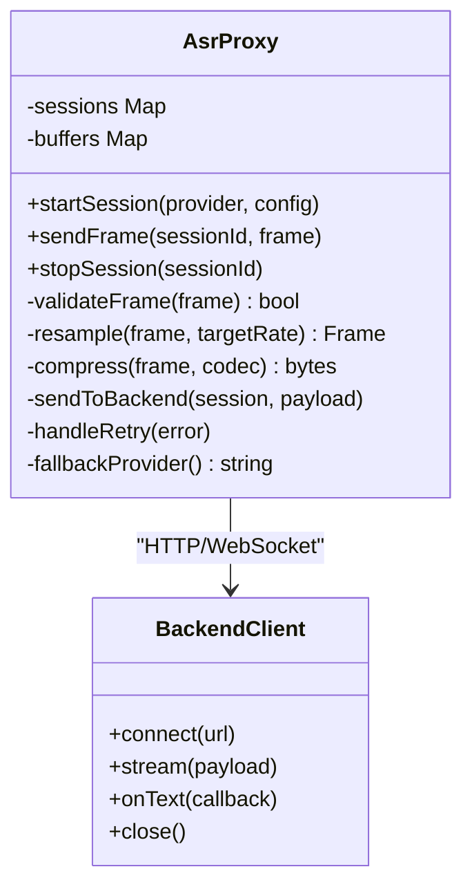
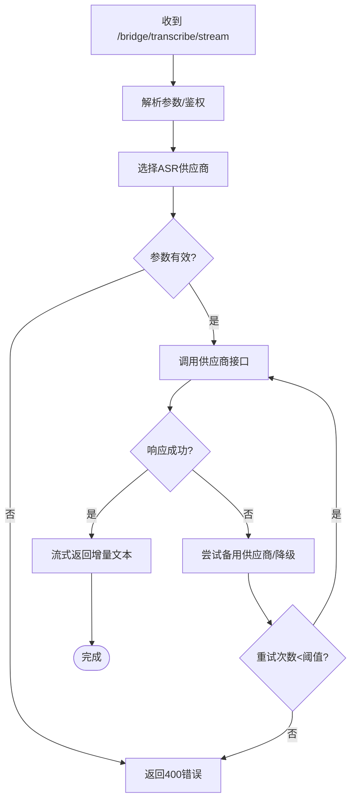
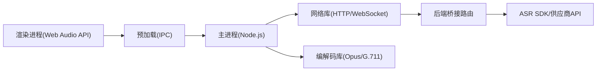

# 实时语音转写

<cite>
**本文引用的文件**   
- [desktop/main.js](file://desktop/main.js)
- [desktop/preload.js](file://desktop/preload.js)
- [desktop/asr_proxy.js](file://desktop/asr_proxy.js)
- [desktop/renderer/index.html](file://desktop/renderer/index.html)
- [server/app.py](file://server/app.py)
- [server/routes_bridge.py](file://server/routes_bridge.py)
- [server/config.py](file://server/config.py)
</cite>

## 目录
1. [简介](#简介)
2. [项目结构](#项目结构)
3. [核心组件](#核心组件)
4. [架构总览](#架构总览)
5. [详细组件分析](#详细组件分析)
6. [依赖关系分析](#依赖关系分析)
7. [性能与延迟优化](#性能与延迟优化)
8. [故障排查指南](#故障排查指南)
9. [结论](#结论)

## 简介
本技术文档聚焦于 LectureLearnLoop 的“实时语音转写”能力，重点解释 Electron 主进程与渲染进程之间的音频流传输机制、Web Audio API 的使用方式、音频数据分块处理与 IPC 通信优化；同时深入说明 ASR 代理的实现原理（音频格式转换、采样率适配、压缩策略）、实时转写的延迟优化策略、缓冲区管理与内存控制，并给出错误处理、网络异常恢复与降级策略。文档还包含如何配置不同 ASR 提供商与参数调优的实践建议。

## 项目结构
本项目采用“Electron 桌面端 + Python 后端服务”的分层架构：
- Electron 桌面端负责采集系统/麦克风音频、使用 Web Audio API 进行音频预处理、通过 IPC 将音频帧转发给主进程，再由主进程经 ASR 代理转发到后端服务。
- Python 后端提供桥接路由，接收来自桌面的音频流，调用外部 ASR 服务并将转写结果回传。

**图表来源**
- [desktop/renderer/index.html:1-200](file://desktop/renderer/index.html#L1-L200)
- [desktop/preload.js:1-200](file://desktop/preload.js#L1-L200)
- [desktop/main.js:1-200](file://desktop/main.js#L1-L200)
- [server/app.py:1-200](file://server/app.py#L1-L200)
- [server/routes_bridge.py:1-200](file://server/routes_bridge.py#L1-L200)

**章节来源**
- [desktop/renderer/index.html:1-200](file://desktop/renderer/index.html#L1-L200)
- [desktop/preload.js:1-200](file://desktop/preload.js#L1-L200)
- [desktop/main.js:1-200](file://desktop/main.js#L1-L200)
- [server/app.py:1-200](file://server/app.py#L1-L200)
- [server/routes_bridge.py:1-200](file://server/routes_bridge.py#L1-L200)

## 核心组件
- 渲染进程音频采集与预处理：基于 Web Audio API 获取系统或麦克风音频流，按固定时间片切分为小块 PCM 数据，并进行必要的重采样与降噪/增益控制。
- 预加载脚本 IPC 桥接：在渲染进程与主进程之间暴露安全的 IPC 通道，用于发送音频帧与接收转写结果。
- 主进程 ASR 代理：聚合多个 ASR 供应商实现，负责音频格式封装、采样率适配、压缩与网络传输，以及重试与降级逻辑。
- 后端桥接路由：统一入口，解析请求参数，选择具体 ASR 供应商，返回增量转写文本。

**章节来源**
- [desktop/renderer/index.html:1-200](file://desktop/renderer/index.html#L1-L200)
- [desktop/preload.js:1-200](file://desktop/preload.js#L1-L200)
- [desktop/main.js:1-200](file://desktop/main.js#L1-L200)
- [server/routes_bridge.py:1-200](file://server/routes_bridge.py#L1-L200)

## 架构总览
下图展示了从音频采集到转写出结果的端到端流程，包括关键的数据形态与边界。

**图表来源**
- [desktop/renderer/index.html:1-200](file://desktop/renderer/index.html#L1-L200)
- [desktop/preload.js:1-200](file://desktop/preload.js#L1-L200)
- [desktop/main.js:1-200](file://desktop/main.js#L1-L200)
- [server/routes_bridge.py:1-200](file://server/routes_bridge.py#L1-L200)

## 详细组件分析

### 渲染进程：Web Audio API 与音频分块
- 音频源接入：优先使用系统捕获（如 Windows Core Audio 或 macOS Screen Capture）作为首选，其次回退到麦克风输入。
- 分块策略：以固定时长（例如 100–200ms）切分 PCM 帧，保证低延迟与稳定吞吐。
- 预处理：可选降噪、限幅、自动增益；必要时进行重采样至目标采样率（如 16kHz）。
- 输出：二进制 PCM 帧，附带元数据（采样率、声道数、时间戳）。

**图表来源**
- [desktop/renderer/index.html:1-200](file://desktop/renderer/index.html#L1-L200)

**章节来源**
- [desktop/renderer/index.html:1-200](file://desktop/renderer/index.html#L1-L200)

### 预加载脚本：安全 IPC 桥接
- 职责：在渲染进程与主进程之间暴露最小化、类型化的 IPC 方法，避免直接暴露 Node API。
- 事件模型：
  - 渲染进程 -> 主进程：发送音频帧、启动/停止转写、查询状态。
  - 主进程 -> 渲染进程：推送增量转写文本、错误事件、状态变更。
- 安全性：仅暴露必要方法，对入参进行基本校验（长度、采样率范围等）。

**图表来源**
- [desktop/preload.js:1-200](file://desktop/preload.js#L1-L200)
- [desktop/main.js:1-200](file://desktop/main.js#L1-L200)

**章节来源**
- [desktop/preload.js:1-200](file://desktop/preload.js#L1-L200)
- [desktop/main.js:1-200](file://desktop/main.js#L1-L200)

### 主进程：ASR 代理与网络 I/O
- 职责：
  - 接收渲染进程的音频帧，执行格式校验、采样率适配、压缩（如 Opus/G.711/PCM 打包）。
  - 维护会话上下文（会话ID、超时、重试计数）。
  - 与后端桥接路由建立连接（HTTP 长轮询或 WebSocket），发送音频流并消费增量文本。
  - 实现重试、熔断与降级（切换供应商或降低质量）。
- 关键数据结构：
  - Frame：{pcm, sampleRate, channels, timestamp}
  - Session：{id, provider, config, retryCount, lastActivity}
  - Buffer：环形缓冲，控制内存占用与延迟。

**图表来源**
- [desktop/main.js:1-200](file://desktop/main.js#L1-L200)
- [desktop/asr_proxy.js:1-200](file://desktop/asr_proxy.js#L1-L200)

**章节来源**
- [desktop/main.js:1-200](file://desktop/main.js#L1-L200)
- [desktop/asr_proxy.js:1-200](file://desktop/asr_proxy.js#L1-L200)

### 后端桥接路由：供应商调度与结果回传
- 职责：
  - 统一入口解析请求参数（provider、sampleRate、codec、session 信息）。
  - 根据配置选择 ASR 供应商，组装请求体（可能为 multipart/form-data 或二进制流）。
  - 流式返回增量文本，支持断点续传与会话保持。
- 错误处理：
  - 供应商不可用：自动切换到备选供应商。
  - 网络异常：指数退避重试，超过阈值触发降级（降低采样率或关闭实时模式）。

**图表来源**
- [server/routes_bridge.py:1-200](file://server/routes_bridge.py#L1-L200)
- [server/app.py:1-200](file://server/app.py#L1-L200)

**章节来源**
- [server/routes_bridge.py:1-200](file://server/routes_bridge.py#L1-L200)
- [server/app.py:1-200](file://server/app.py#L1-L200)

## 依赖关系分析
- 渲染进程依赖浏览器环境提供的 Web Audio API 与媒体设备枚举。
- 预加载脚本依赖 Electron 的 ipcRenderer/ipcMain 模块。
- 主进程依赖 Node.js 的网络库（http/https/ws）与可能的音频编解码库（如 opusenc/g711）。
- 后端依赖 Python Web 框架（Flask/FastAPI）与第三方 ASR SDK。

**图表来源**
- [desktop/renderer/index.html:1-200](file://desktop/renderer/index.html#L1-L200)
- [desktop/preload.js:1-200](file://desktop/preload.js#L1-L200)
- [desktop/main.js:1-200](file://desktop/main.js#L1-L200)
- [server/routes_bridge.py:1-200](file://server/routes_bridge.py#L1-L200)

**章节来源**
- [desktop/renderer/index.html:1-200](file://desktop/renderer/index.html#L1-L200)
- [desktop/preload.js:1-200](file://desktop/preload.js#L1-L200)
- [desktop/main.js:1-200](file://desktop/main.js#L1-L200)
- [server/routes_bridge.py:1-200](file://server/routes_bridge.py#L1-L200)

## 性能与延迟优化
- 分块大小与延迟平衡：
  - 推荐帧时长 100–200ms，兼顾实时性与编码开销。
  - 在网络抖动时动态调整帧大小（增大以降低频率，减小以提升实时性）。
- 采样率适配：
  - 统一目标采样率（如 16kHz），减少供应商侧重采样成本。
  - 仅在必要时进行重采样，避免重复计算。
- 压缩与带宽：
  - 优先使用有损高效编码（如 Opus）以降低带宽；在弱网下可回退到 G.711。
  - 合理设置码率（如 32–64kbps）以平衡音质与延迟。
- 缓冲区与内存控制：
  - 使用环形缓冲限制最大未处理帧数，避免内存泄漏。
  - 定期清理过期会话与空闲缓冲。
- IPC 优化：
  - 批量发送小帧合并为中等批次，减少 IPC 调用次数。
  - 使用结构化克隆或共享 ArrayBuffer（若平台支持）降低拷贝开销。
- 后端优化：
  - 启用流式处理，避免整段音频等待。
  - 供应商侧并行解码与文本拼接，减少首字延迟。

[本节为通用性能指导，不直接分析具体文件]

## 故障排查指南
- 音频采集失败：
  - 检查权限与设备枚举；确认系统音源是否可用。
  - 在渲染进程中记录错误日志，提示用户切换设备。
- IPC 通信异常：
  - 检查预加载脚本是否正确注入；确认主进程监听对应频道。
  - 对大帧进行分片与重试，避免阻塞事件循环。
- 网络异常与供应商不可用：
  - 实现指数退避重试；超过阈值后切换到备用供应商或降级为离线转写（若有）。
  - 记录供应商健康状态，动态选择最优路径。
- 内存溢出与卡顿：
  - 监控缓冲队列长度与内存峰值；超限则丢弃最旧帧或暂停采集。
  - 定期 GC 与释放资源（关闭流、断开连接）。
- 转写结果错乱：
  - 确保帧顺序与时间戳一致；在后端进行序列号校验。
  - 对增量文本进行去重与合并，避免重复输出。

**章节来源**
- [desktop/preload.js:1-200](file://desktop/preload.js#L1-L200)
- [desktop/main.js:1-200](file://desktop/main.js#L1-L200)
- [server/routes_bridge.py:1-200](file://server/routes_bridge.py#L1-L200)

## 结论
本方案通过“渲染进程采集 + 预加载 IPC 桥接 + 主进程 ASR 代理 + 后端桥接路由”的分层架构，实现了低延迟、可扩展的实时语音转写能力。通过合理的音频分块、采样率适配、压缩策略与缓冲区管理，结合重试、熔断与降级机制，系统在弱网与供应商不稳定场景下仍能提供稳定的转写体验。后续可根据业务需求扩展更多 ASR 供应商，并进一步优化前端预处理与后端并发处理能力。