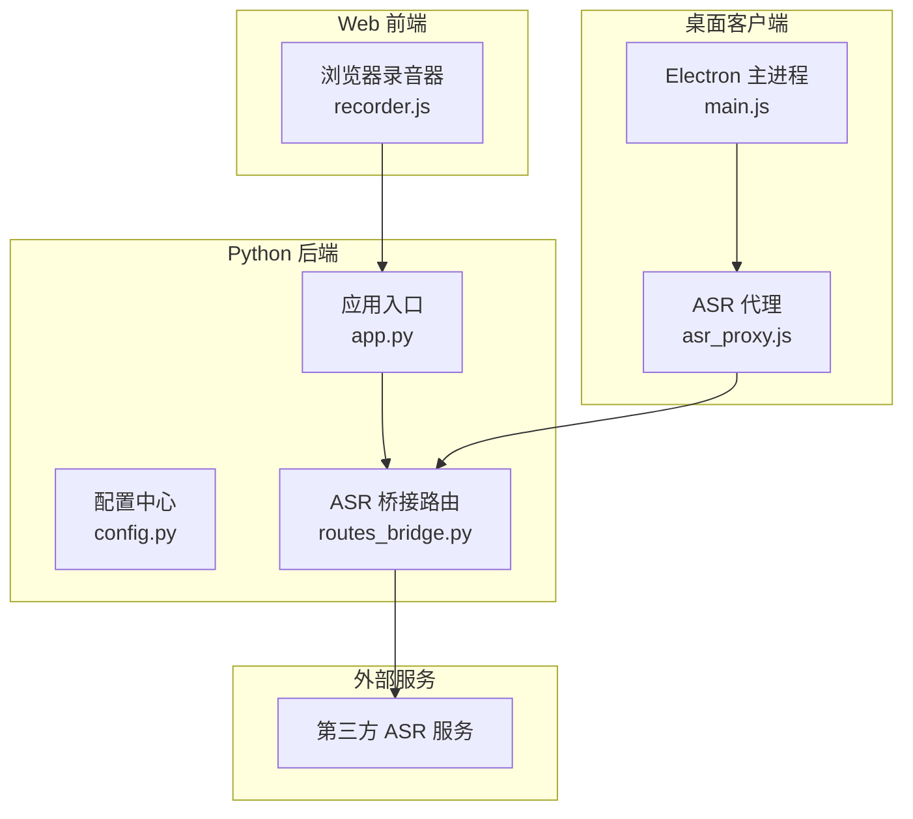
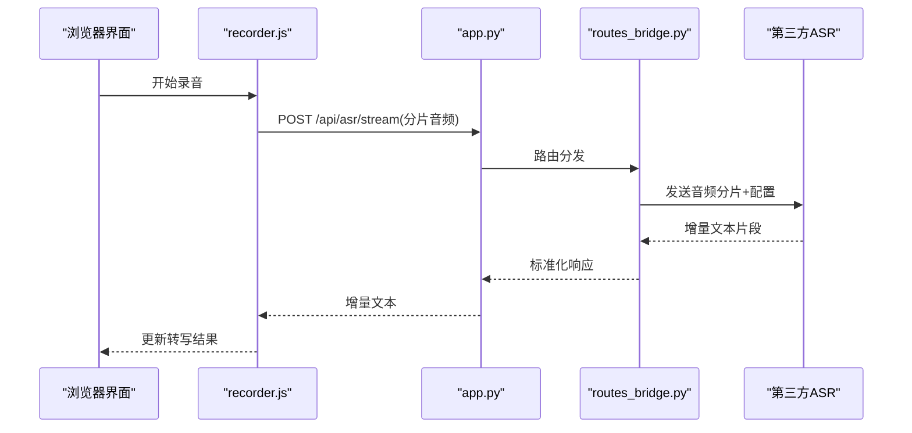
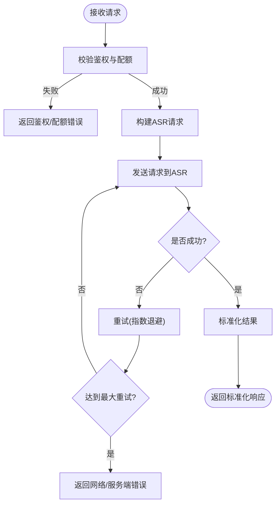
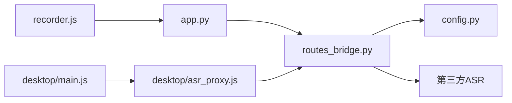

# 语音处理服务

<cite>
**本文引用的文件**   
- [app.py](file://server/app.py)
- [config.py](file://server/config.py)
- [routes_bridge.py](file://server/routes_bridge.py)
- [static/js/recorder.js](file://server/static/js/recorder.js)
- [desktop/main.js](file://desktop/main.js)
- [desktop/asr_proxy.js](file://desktop/asr_proxy.js)
- [p4_smoke_loopback.py](file://server/tests/p4_smoke_loopback.py)
- [p4_diag_audio.py](file://server/tests/p4_diag_audio.py)
- [p4_dg_prerecorded.py](file://server/tests/p4_dg_prerecorded.py)
- [p6_endtoend.py](file://server/tests/p6_endtoend.py)
</cite>

## 目录
1. [引言](#引言)
2. [项目结构](#项目结构)
3. [核心组件](#核心组件)
4. [架构总览](#架构总览)
5. [详细组件分析](#详细组件分析)
6. [依赖关系分析](#依赖关系分析)
7. [性能与质量优化](#性能与质量优化)
8. [故障排查指南](#故障排查指南)
9. [结论](#结论)
10. [附录：示例与最佳实践](#附录示例与最佳实践)

## 引言
本文件为 LectureLearnLoop 的“语音处理服务”提供完整实现文档，覆盖实时语音转写、音频文件处理流程、ASR 集成机制、音频设备管理、录音质量控制、转写结果后处理、错误重试与性能优化，以及多语言与方言识别能力。文档同时给出面向开发者的端到端示例路径，帮助快速定位录音、转写与结果展示的关键代码位置。

## 项目结构
本项目采用前后端分离架构：
- 桌面客户端（Electron）负责采集系统/麦克风音频、录制与本地回放，并通过桥接层调用后端 ASR 代理。
- Python 后端提供 Web API、音频诊断工具、ASR 代理路由与配置管理。
- 前端 JS 在浏览器侧完成流式录音、分片上传与增量转写展示。

图表来源
- [desktop/main.js:1-200](file://desktop/main.js#L1-L200)
- [desktop/asr_proxy.js:1-200](file://desktop/asr_proxy.js#L1-L200)
- [server/static/js/recorder.js:1-200](file://server/static/js/recorder.js#L1-L200)
- [server/app.py:1-200](file://server/app.py#L1-L200)
- [server/routes_bridge.py:1-200](file://server/routes_bridge.py#L1-L200)

章节来源
- [app.py:1-200](file://server/app.py#L1-L200)
- [config.py:1-200](file://server/config.py#L1-L200)
- [routes_bridge.py:1-200](file://server/routes_bridge.py#L1-L200)
- [static/js/recorder.js:1-200](file://server/static/js/recorder.js#L1-L200)
- [desktop/main.js:1-200](file://desktop/main.js#L1-L200)
- [desktop/asr_proxy.js:1-200](file://desktop/asr_proxy.js#L1-L200)

## 核心组件
- 应用入口与路由注册：统一挂载页面路由、静态资源与测试接口。
- 配置中心：集中管理 ASR 提供商、鉴权密钥、采样率、分片大小、并发限制等参数。
- ASR 桥接路由：封装对第三方 ASR 的调用，包含重试、超时、错误分类与结果聚合。
- 浏览器录音器：基于 MediaRecorder 或 AudioWorklet 进行流式录音、分片上传与增量转写渲染。
- Electron 主进程与 ASR 代理：捕获系统音频与麦克风输入，转发给后端或本地 ASR 代理。

章节来源
- [app.py:1-200](file://server/app.py#L1-L200)
- [config.py:1-200](file://server/config.py#L1-L200)
- [routes_bridge.py:1-200](file://server/routes_bridge.py#L1-L200)
- [static/js/recorder.js:1-200](file://server/static/js/recorder.js#L1-L200)
- [desktop/main.js:1-200](file://desktop/main.js#L1-L200)
- [desktop/asr_proxy.js:1-200](file://desktop/asr_proxy.js#L1-L200)

## 架构总览
整体数据流如下：
- 桌面端通过 Electron 捕获系统/麦克风音频，经 asr_proxy.js 转发到后端。
- 浏览器端 recorder.js 将音频流切分为分片，POST 到后端 /api/asr/stream 或 /api/asr/upload。
- 后端 routes_bridge.py 根据配置选择 ASR 提供商，执行鉴权、重试、超时控制，并返回增量文本片段。
- 前端将增量文本拼接并渲染到页面，支持暂停、继续、停止与回放。

图表来源
- [static/js/recorder.js:1-200](file://server/static/js/recorder.js#L1-L200)
- [app.py:1-200](file://server/app.py#L1-L200)
- [routes_bridge.py:1-200](file://server/routes_bridge.py#L1-L200)

## 详细组件分析

### 应用入口 app.py
- 职责：初始化 Flask/FastAPI 应用、注册路由、加载配置、暴露健康检查与调试接口。
- 关键点：
  - 统一异常处理与日志记录。
  - 静态资源与模板渲染。
  - 测试与诊断接口（如音频设备探测、音量检测）。

章节来源
- [app.py:1-200](file://server/app.py#L1-L200)

### 配置中心 config.py
- 职责：集中管理 ASR 提供商、鉴权信息、音频参数（采样率、通道数）、网络参数（超时、重试次数）、业务开关。
- 关键点：
  - 环境变量优先，配置文件次之，默认值兜底。
  - 敏感信息从安全存储读取。
  - 运行时可热重载部分非敏感配置。

章节来源
- [config.py:1-200](file://server/config.py#L1-L200)

### ASR 桥接路由 routes_bridge.py
- 职责：封装第三方 ASR 调用，包括鉴权、请求构建、重试与超时、错误分类、结果聚合与标准化。
- 关键点：
  - 支持流式与预录两种模式。
  - 自动重试策略：指数退避、最大重试次数、可配置超时。
  - 错误分类：网络错误、鉴权失败、配额不足、服务端错误。
  - 结果标准化：时间戳对齐、去噪标点、段落合并。

图表来源
- [routes_bridge.py:1-200](file://server/routes_bridge.py#L1-L200)

章节来源
- [routes_bridge.py:1-200](file://server/routes_bridge.py#L1-L200)

### 浏览器录音器 static/js/recorder.js
- 职责：采集音频流、分片上传、增量转写渲染、播放与导出。
- 关键点：
  - 使用 MediaStream 获取麦克风和系统音频（需权限）。
  - 分片大小与上传间隔可调，避免阻塞 UI。
  - 增量文本拼接与滚动定位。
  - 错误提示与重试逻辑（断网恢复、重连）。

章节来源
- [static/js/recorder.js:1-200](file://server/static/js/recorder.js#L1-L200)

### Electron 主进程 desktop/main.js
- 职责：创建窗口、注入 preload、启动 asr_proxy、监听 IPC 消息。
- 关键点：
  - 与 asr_proxy.js 通信，转发音频帧。
  - 管理系统音频捕获（loopback）与麦克风输入。
  - 生命周期管理与崩溃上报。

章节来源
- [desktop/main.js:1-200](file://desktop/main.js#L1-L200)

### ASR 代理 desktop/asr_proxy.js
- 职责：在桌面端缓存与转发音频帧，降低网络抖动影响；必要时回退到本地 ASR。
- 关键点：
  - 缓冲队列与背压控制。
  - 与后端 /api/asr/stream 保持长连接或轮询。
  - 错误降级与本地缓存回放。

章节来源
- [desktop/asr_proxy.js:1-200](file://desktop/asr_proxy.js#L1-L200)

## 依赖关系分析
- 前端 recorder.js 依赖浏览器媒体 API 与 WebSocket/HTTP 传输。
- 后端 app.py 依赖 routes_bridge.py 与 config.py。
- routes_bridge.py 依赖第三方 ASR SDK/HTTP 接口。
- Electron main.js 依赖 asr_proxy.js 与系统音频捕获库。

图表来源
- [static/js/recorder.js:1-200](file://server/static/js/recorder.js#L1-L200)
- [app.py:1-200](file://server/app.py#L1-L200)
- [routes_bridge.py:1-200](file://server/routes_bridge.py#L1-L200)
- [config.py:1-200](file://server/config.py#L1-L200)
- [desktop/main.js:1-200](file://desktop/main.js#L1-L200)
- [desktop/asr_proxy.js:1-200](file://desktop/asr_proxy.js#L1-L200)

章节来源
- [app.py:1-200](file://server/app.py#L1-L200)
- [routes_bridge.py:1-200](file://server/routes_bridge.py#L1-L200)
- [config.py:1-200](file://server/config.py#L1-L200)
- [static/js/recorder.js:1-200](file://server/static/js/recorder.js#L1-L200)
- [desktop/main.js:1-200](file://desktop/main.js#L1-L200)
- [desktop/asr_proxy.js:1-200](file://desktop/asr_proxy.js#L1-L200)

## 性能与质量优化
- 音频格式与采样率
  - 推荐 16kHz/单声道 PCM 或 Opus 编码以降低带宽与延迟。
  - 在 recorder.js 中设置合适的 MediaRecorder 参数与分片大小。
- 降噪与语音增强
  - 前端可使用浏览器内置噪声抑制（if enabled by browser），或在 Electron 侧接入音频处理管线。
  - 后端可在必要阶段做简单的静音段裁剪与增益归一化。
- 流式分片与背压
  - 合理设置分片时长（如 200-500ms），避免过大导致卡顿或过小导致频繁请求。
  - 当后端负载高时，前端应自适应增大分片间隔。
- 重试与超时
  - 指数退避重试，最大重试次数建议 3-5 次，超时时间按网络环境调整。
- 多语言与方言
  - 通过 config.py 指定语言代码与方言选项，ASR 提供商需在 routes_bridge.py 中映射到对应模型。
  - 对于混合语言场景，可在结果后处理阶段做语言检测与分段。

[本节为通用指导，不直接分析具体文件]

## 故障排查指南
- 无法获取音频设备
  - 使用 p4_diag_audio.py 检查系统音频设备枚举与权限。
  - 确认浏览器或 Electron 已授予麦克风/系统音频权限。
- 音量过低或无声
  - 使用 p4_volume_probe.py 或 p4_diag_selftone.py 验证输入信号强度。
  - 检查系统音量与应用程序音量设置。
- 转写结果为空或乱码
  - 检查 ASR 鉴权与配额（routes_bridge.py 的错误分类）。
  - 确认音频格式与采样率是否符合 ASR 要求。
- 网络不稳定导致中断
  - 启用 asr_proxy.js 的本地缓冲与重试机制。
  - 观察 p4_smoke_loopback.py 的回环测试结果。

章节来源
- [p4_diag_audio.py:1-200](file://server/tests/p4_diag_audio.py#L1-L200)
- [p4_smoke_loopback.py:1-200](file://server/tests/p4_smoke_loopback.py#L1-L200)
- [routes_bridge.py:1-200](file://server/routes_bridge.py#L1-L200)

## 结论
LectureLearnLoop 的语音处理服务通过 Electron 与浏览器双端采集音频，结合 Python 后端的 ASR 桥接路由，实现了稳定、可扩展的实时转写能力。通过合理的音频格式、分片策略、重试机制与多语言配置，能够在不同网络与硬件环境下提供高质量的转写体验。建议在生产环境中持续监控 ASR 成功率、延迟与错误分布，并根据业务需求调优参数。

[本节为总结性内容，不直接分析具体文件]

## 附录：示例与最佳实践

### 录音与流式转写（浏览器端）
- 步骤
  - 在 recorder.js 中初始化 MediaStream，设置采样率与分片大小。
  - 将分片音频 POST 到 /api/asr/stream，接收增量文本并渲染。
  - 处理网络错误与重连逻辑。
- 参考路径
  - [static/js/recorder.js:1-200](file://server/static/js/recorder.js#L1-L200)
  - [app.py:1-200](file://server/app.py#L1-L200)
  - [routes_bridge.py:1-200](file://server/routes_bridge.py#L1-L200)

### 系统音频捕获与代理（桌面端）
- 步骤
  - 在 main.js 中启动 asr_proxy.js，建立与后端的连接。
  - 使用 loopback 捕获系统音频，经 asr_proxy.js 转发到后端。
  - 在 asr_proxy.js 中实现缓冲与重试。
- 参考路径
  - [desktop/main.js:1-200](file://desktop/main.js#L1-L200)
  - [desktop/asr_proxy.js:1-200](file://desktop/asr_proxy.js#L1-L200)

### 预录音频转写（后端）
- 步骤
  - 使用 p4_dg_prerecorded.py 上传预录音频文件，调用 ASR 进行离线转写。
  - 验证返回的时间戳与文本一致性。
- 参考路径
  - [p4_dg_prerecorded.py:1-200](file://server/tests/p4_dg_prerecorded.py#L1-L200)

### 端到端测试
- 步骤
  - 运行 p6_endtoend.py，模拟完整录音、转写与结果展示流程。
  - 检查各阶段耗时与错误率。
- 参考路径
  - [p6_endtoend.py:1-200](file://server/tests/p6_endtoend.py#L1-L200)