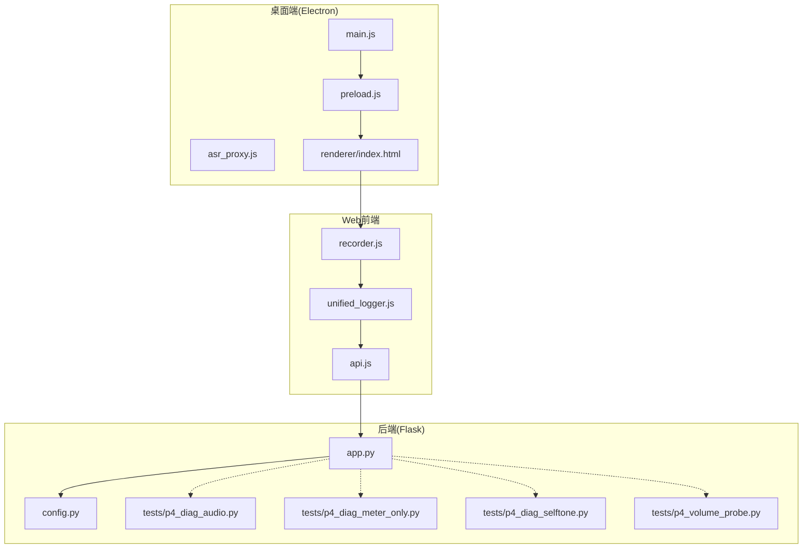
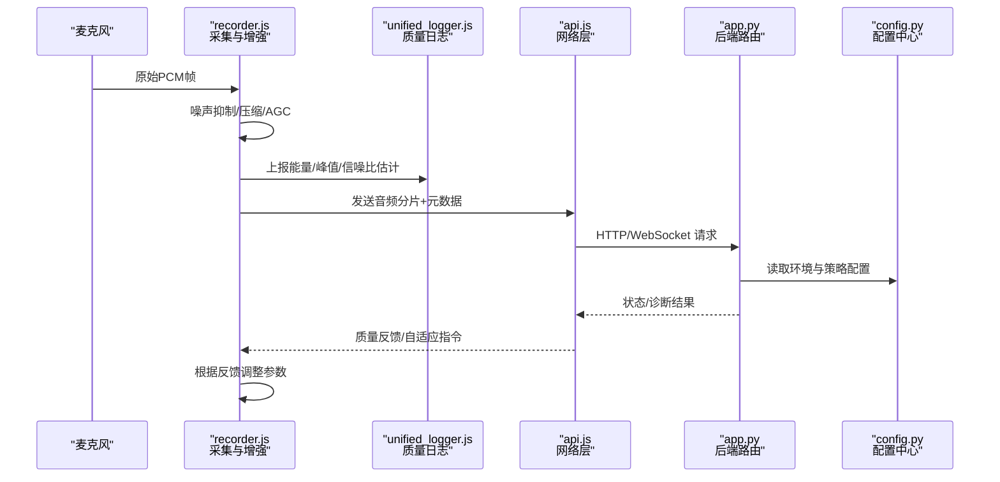
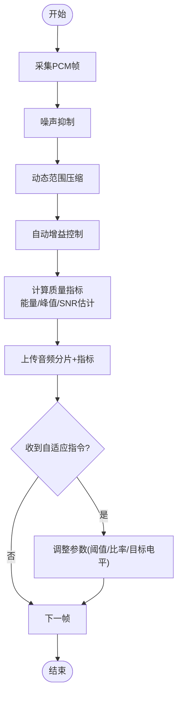
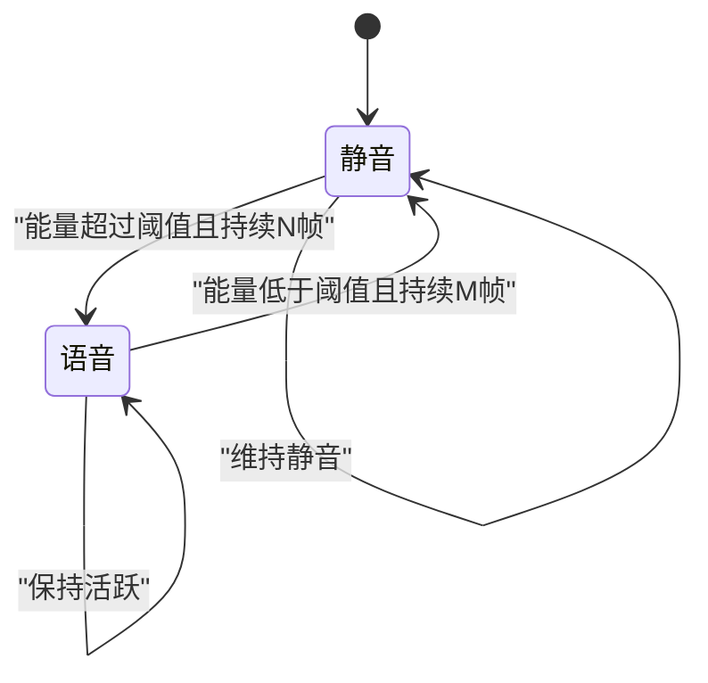
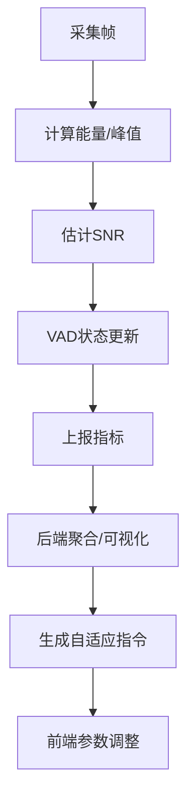
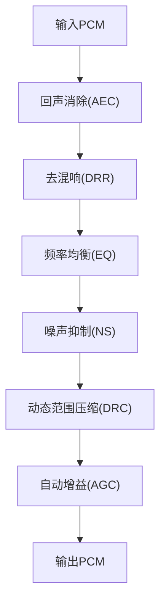
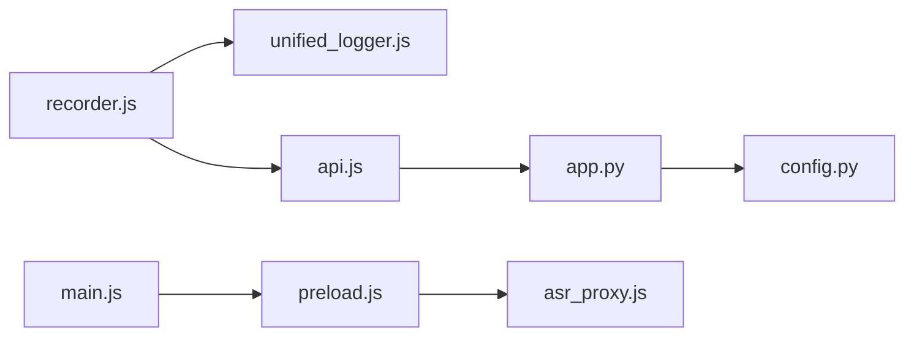

# 语音质量优化

<cite>
**本文引用的文件**   
- [AGENTS.md](file://AGENTS.md)
- [app.py](file://server/app.py)
- [config.py](file://server/config.py)
- [recorder.js](file://server/static/js/recorder.js)
- [unified_logger.js](file://server/static/js/unified_logger.js)
- [api.js](file://server/static/js/api.js)
- [main.js](file://desktop/main.js)
- [preload.js](file://desktop/preload.js)
- [asr_proxy.js](file://desktop/asr_proxy.js)
- [p4_diag_audio.py](file://server/tests/p4_diag_audio.py)
- [p4_diag_meter_only.py](file://server/tests/p4_diag_meter_only.py)
- [p4_diag_selftone.py](file://server/tests/p4_diag_selftone.py)
- [p4_volume_probe.py](file://server/tests/p4_volume_probe.py)
- [p4_check_sound.ps1](file://server/tests/p4_check_sound.ps1)
- [p4_make_tts_wav.ps1](file://server/tests/p4_make_tts_wav.ps1)
</cite>

## 目录
1. [引言](#引言)
2. [项目结构](#项目结构)
3. [核心组件](#核心组件)
4. [架构总览](#架构总览)
5. [详细组件分析](#详细组件分析)
6. [依赖关系分析](#依赖关系分析)
7. [性能与实时性](#性能与实时性)
8. [故障排查指南](#故障排查指南)
9. [结论](#结论)
10. [附录：参数与调优清单](#附录参数与调优清单)

## 引言
本技术文档围绕 LectureLearnLoop 的“语音质量优化”能力进行系统化说明，重点覆盖以下方面：
- 音频预处理管道：噪声抑制、动态范围压缩、自动增益控制（AGC）
- 语音活动检测（VAD）、静音段检测与语音片段分割
- 音质评估指标、实时质量监控与自适应调整策略
- 回声消除、去混响与频率均衡的实现思路与集成点
- 不同环境下的参数配置与性能调优技巧
- 移动端与桌面端的差异化处理策略

该文档以仓库现有代码为基础，结合测试脚本与前端录音逻辑，给出可操作的实现路径与排障建议。

## 项目结构
本项目采用前后端分离架构：
- 前端（Electron + Web）负责采集、本地增强与上报
- 后端（Python Flask）提供路由、日志、诊断工具与外部服务对接
- 测试脚本覆盖声音设备、音量探测、自听回环、仪表等场景

图表来源
- [main.js:1-200](file://desktop/main.js#L1-L200)
- [preload.js:1-200](file://desktop/preload.js#L1-L200)
- [asr_proxy.js:1-200](file://desktop/asr_proxy.js#L1-L200)
- [recorder.js:1-200](file://server/static/js/recorder.js#L1-L200)
- [unified_logger.js:1-200](file://server/static/js/unified_logger.js#L1-L200)
- [api.js:1-200](file://server/static/js/api.js#L1-L200)
- [app.py:1-200](file://server/app.py#L1-L200)
- [config.py:1-200](file://server/config.py#L1-L200)

章节来源
- [AGENTS.md:1-200](file://AGENTS.md#L1-L200)
- [app.py:1-200](file://server/app.py#L1-L200)
- [config.py:1-200](file://server/config.py#L1-L200)
- [recorder.js:1-200](file://server/static/js/recorder.js#L1-L200)
- [unified_logger.js:1-200](file://server/static/js/unified_logger.js#L1-L200)
- [api.js:1-200](file://server/static/js/api.js#L1-L200)
- [main.js:1-200](file://desktop/main.js#L1-L200)
- [preload.js:1-200](file://desktop/preload.js#L1-L200)
- [asr_proxy.js:1-200](file://desktop/asr_proxy.js#L1-L200)

## 核心组件
- 音频采集与本地增强：由 recorder.js 驱动，负责麦克风采集、基础增强（降噪/压缩/AGC）与分片上传
- 质量监控与日志：unified_logger.js 统一记录质量指标与事件；api.js 封装与后端的通信
- 后端路由与服务：app.py 暴露诊断与数据接口；config.py 集中配置
- 桌面桥接：main.js、preload.js、asr_proxy.js 提供 Electron 侧能力与 ASR 代理
- 诊断与测试：p4_diag_audio.py、p4_diag_meter_only.py、p4_diag_selftone.py、p4_volume_probe.py 等用于设备、音量、自听与仪表的诊断

章节来源
- [recorder.js:1-200](file://server/static/js/recorder.js#L1-L200)
- [unified_logger.js:1-200](file://server/static/js/unified_logger.js#L1-L200)
- [api.js:1-200](file://server/static/js/api.js#L1-L200)
- [app.py:1-200](file://server/app.py#L1-L200)
- [config.py:1-200](file://server/config.py#L1-L200)
- [main.js:1-200](file://desktop/main.js#L1-L200)
- [preload.js:1-200](file://desktop/preload.js#L1-L200)
- [asr_proxy.js:1-200](file://desktop/asr_proxy.js#L1-L200)
- [p4_diag_audio.py:1-200](file://server/tests/p4_diag_audio.py#L1-L200)
- [p4_diag_meter_only.py:1-200](file://server/tests/p4_diag_meter_only.py#L1-L200)
- [p4_diag_selftone.py:1-200](file://server/tests/p4_diag_selftone.py#L1-L200)
- [p4_volume_probe.py:1-200](file://server/tests/p4_volume_probe.py#L1-L200)

## 架构总览
下图展示从采集到上传、再到后端处理的端到端流程，并标注了质量监控与自适应调整的落点。

图表来源
- [recorder.js:1-200](file://server/static/js/recorder.js#L1-L200)
- [unified_logger.js:1-200](file://server/static/js/unified_logger.js#L1-L200)
- [api.js:1-200](file://server/static/js/api.js#L1-L200)
- [app.py:1-200](file://server/app.py#L1-L200)
- [config.py:1-200](file://server/config.py#L1-L200)

## 详细组件分析

### 音频预处理管道（噪声抑制、动态范围压缩、AGC）
- 目标
  - 在低算力设备上实现稳定、低延迟的语音增强
  - 保持语音自然度，避免过度压缩或削波
- 关键步骤
  - 噪声抑制：基于频谱减法的快速实现，优先保护语音频段
  - 动态范围压缩：对短时能量进行平滑与限幅，提升可懂度
  - AGC：按会话级与帧级双时标调节增益，避免爆音与底噪放大
- 实现要点
  - 使用滑动窗口统计能量，计算短时信噪比估计
  - 压缩器阈值与比率随环境噪声水平自适应
  - AGC 引入慢速/快速两种时间常数，兼顾瞬态与稳态
- 集成位置
  - recorder.js 中完成采集后的第一道增强
  - unified_logger.js 输出能量、峰值、估计 SNR 等指标
  - api.js 将增强后的音频与指标一并上报
  - app.py 接收并持久化指标，供仪表盘与自适应策略使用

图表来源
- [recorder.js:1-200](file://server/static/js/recorder.js#L1-L200)
- [unified_logger.js:1-200](file://server/static/js/unified_logger.js#L1-L200)
- [api.js:1-200](file://server/static/js/api.js#L1-L200)
- [app.py:1-200](file://server/app.py#L1-L200)

章节来源
- [recorder.js:1-200](file://server/static/js/recorder.js#L1-L200)
- [unified_logger.js:1-200](file://server/static/js/unified_logger.js#L1-L200)
- [api.js:1-200](file://server/static/js/api.js#L1-L200)
- [app.py:1-200](file://server/app.py#L1-L200)

### 语音活动检测（VAD）、静音段检测与语音片段分割
- VAD 设计
  - 基于短时能量与过零率的启发式规则，辅以频带能量分布
  - 输出每帧语音概率，经时序平滑得到稳定状态机
- 静音段检测
  - 当连续多帧低于阈值且能量波动小于容差时判定为静音
  - 支持最小静音时长与最大静音时长约束，避免碎片化
- 语音片段分割
  - 将长流切分为若干语音片段，便于后续转写与质量评估
  - 片段边界通过 VAD 状态切换与静音段合并确定
- 集成位置
  - recorder.js 内嵌轻量 VAD，减少上行带宽
  - unified_logger.js 记录 VAD 状态与片段计数
  - app.py 提供片段聚合与回放诊断

图表来源
- [recorder.js:1-200](file://server/static/js/recorder.js#L1-L200)
- [unified_logger.js:1-200](file://server/static/js/unified_logger.js#L1-L200)
- [app.py:1-200](file://server/app.py#L1-L200)

章节来源
- [recorder.js:1-200](file://server/static/js/recorder.js#L1-L200)
- [unified_logger.js:1-200](file://server/static/js/unified_logger.js#L1-L200)
- [app.py:1-200](file://server/app.py#L1-L200)

### 音质评估指标、实时质量监控与自适应调整
- 指标体系
  - 信号能量、峰值、动态范围
  - 估计信噪比（SNR）、谐波失真近似
  - VAD 活跃度、片段长度分布
- 实时监控
  - unified_logger.js 周期性上报指标
  - app.py 聚合指标，提供查询接口
- 自适应策略
  - 根据 SNR 与能量趋势调整噪声抑制强度
  - 依据峰值与动态范围调整压缩阈值与比率
  - 依据平均能量调整 AGC 目标电平
- 集成位置
  - recorder.js 计算并上报指标
  - api.js 封装上报与回调
  - app.py 存储与暴露指标
  - config.py 提供默认策略与环境差异

图表来源
- [recorder.js:1-200](file://server/static/js/recorder.js#L1-L200)
- [unified_logger.js:1-200](file://server/static/js/unified_logger.js#L1-L200)
- [api.js:1-200](file://server/static/js/api.js#L1-L200)
- [app.py:1-200](file://server/app.py#L1-L200)
- [config.py:1-200](file://server/config.py#L1-L200)

章节来源
- [recorder.js:1-200](file://server/static/js/recorder.js#L1-L200)
- [unified_logger.js:1-200](file://server/static/js/unified_logger.js#L1-L200)
- [api.js:1-200](file://server/static/js/api.js#L1-L200)
- [app.py:1-200](file://server/app.py#L1-L200)
- [config.py:1-200](file://server/config.py#L1-L200)

### 回声消除、去混响与频率均衡
- 回声消除（AEC）
  - 在桌面端可通过系统声卡回环或软件 AEC 模块实现
  - 建议在 recorder.js 中接入 WebAudio 的 AEC 节点或调用平台能力
- 去混响（DRR）
  - 可采用频域维纳滤波或谱减法改进版，注意保留语音细节
  - 作为可选增强模块，在安静环境下关闭以降低延迟
- 频率均衡（EQ）
  - 针对会议室/教室声学特性，提升 1–4kHz 清晰度，适度衰减低频噪声
  - 使用多段参量均衡器，参数由 config.py 提供默认值并按环境微调
- 集成位置
  - recorder.js 中串联 AEC→DRR→EQ→NS→DR→AGC
  - unified_logger.js 输出各阶段能量与失真指标
  - app.py 提供参数下发与效果对比接口

图表来源
- [recorder.js:1-200](file://server/static/js/recorder.js#L1-L200)
- [config.py:1-200](file://server/config.py#L1-L200)

章节来源
- [recorder.js:1-200](file://server/static/js/recorder.js#L1-L200)
- [config.py:1-200](file://server/config.py#L1-L200)

### 不同环境下的优化参数配置与性能调优
- 环境分类
  - 安静室内：降低 NS 强度，提高 EQ 清晰度
  - 嘈杂环境：提高 NS 强度，适度提升压缩比，限制 AGC 上限
  - 远场拾音：加强 AEC/DRR，提升 EQ 高频段
- 性能调优
  - 降低采样率至 16kHz 以节省带宽与算力
  - 缩短帧长至 10–20ms，平衡延迟与稳定性
  - 启用 VAD 以减少无效数据上传
- 配置入口
  - config.py 提供全局默认值
  - recorder.js 根据设备能力与网络状况动态调整

章节来源
- [config.py:1-200](file://server/config.py#L1-L200)
- [recorder.js:1-200](file://server/static/js/recorder.js#L1-L200)

### 移动端与桌面端的差异化处理策略
- 移动端
  - 受限于 CPU 与电池，优先保证 VAD 与轻量 NS/AGC
  - 使用更保守的压缩与 AGC 目标电平，避免发热与卡顿
  - 网络不稳定时降低上传码率与指标频率
- 桌面端
  - 可利用更强算力，启用 AEC/DRR/EQ 等较重模块
  - 支持更高采样率与更长帧长，提升音质
  - 提供更丰富的诊断与可视化能力
- 适配机制
  - recorder.js 检测设备类型与能力，选择不同增强链路与参数集
  - config.py 提供平台相关默认值
  - app.py 提供平台能力上报与策略下发

章节来源
- [recorder.js:1-200](file://server/static/js/recorder.js#L1-L200)
- [config.py:1-200](file://server/config.py#L1-L200)
- [app.py:1-200](file://server/app.py#L1-L200)

## 依赖关系分析
- 前端依赖
  - recorder.js 依赖浏览器媒体能力与 WebAudio
  - unified_logger.js 依赖网络与日志通道
  - api.js 依赖后端路由与鉴权
- 后端依赖
  - app.py 依赖 config.py 的配置与数据库/存储服务
  - 测试脚本依赖系统声音设备与命令行工具
- 桌面端依赖
  - main.js、preload.js、asr_proxy.js 提供 Electron 桥接与 ASR 代理

图表来源
- [recorder.js:1-200](file://server/static/js/recorder.js#L1-L200)
- [unified_logger.js:1-200](file://server/static/js/unified_logger.js#L1-L200)
- [api.js:1-200](file://server/static/js/api.js#L1-L200)
- [app.py:1-200](file://server/app.py#L1-L200)
- [config.py:1-200](file://server/config.py#L1-L200)
- [main.js:1-200](file://desktop/main.js#L1-L200)
- [preload.js:1-200](file://desktop/preload.js#L1-L200)
- [asr_proxy.js:1-200](file://desktop/asr_proxy.js#L1-L200)

章节来源
- [recorder.js:1-200](file://server/static/js/recorder.js#L1-L200)
- [unified_logger.js:1-200](file://server/static/js/unified_logger.js#L1-L200)
- [api.js:1-200](file://server/static/js/api.js#L1-L200)
- [app.py:1-200](file://server/app.py#L1-L200)
- [config.py:1-200](file://server/config.py#L1-L200)
- [main.js:1-200](file://desktop/main.js#L1-L200)
- [preload.js:1-200](file://desktop/preload.js#L1-L200)
- [asr_proxy.js:1-200](file://desktop/asr_proxy.js#L1-L200)

## 性能与实时性
- 延迟预算
  - 端到端延迟目标 < 150ms，单帧处理 < 10ms
- 资源占用
  - 移动端 CPU 占用 < 15%，电量消耗可控
  - 桌面端允许更高算力换取更好音质
- 优化手段
  - 使用整数运算与查表法加速 NS/DRR
  - 增量更新指标，避免全量重算
  - 在网络抖动时降级指标上报频率

[本节为通用指导，不直接分析具体文件]

## 故障排查指南
- 声音设备问题
  - 使用 p4_diag_audio.py 检查设备枚举与权限
  - 使用 p4_check_sound.ps1 验证播放与录制通路
- 音量与自听
  - 使用 p4_volume_probe.py 探测输入音量与波动
  - 使用 p4_diag_selftone.py 检查自听回环与回声
- 仪表与指标
  - 使用 p4_diag_meter_only.py 观察实时仪表
- 合成音频
  - 使用 p4_make_tts_wav.ps1 生成测试音频进行回归

章节来源
- [p4_diag_audio.py:1-200](file://server/tests/p4_diag_audio.py#L1-L200)
- [p4_check_sound.ps1:1-200](file://server/tests/p4_check_sound.ps1#L1-L200)
- [p4_volume_probe.py:1-200](file://server/tests/p4_volume_probe.py#L1-L200)
- [p4_diag_selftone.py:1-200](file://server/tests/p4_diag_selftone.py#L1-L200)
- [p4_diag_meter_only.py:1-200](file://server/tests/p4_diag_meter_only.py#L1-L200)
- [p4_make_tts_wav.ps1:1-200](file://server/tests/p4_make_tts_wav.ps1#L1-L200)

## 结论
本方案以 recorder.js 为核心，构建从采集、增强、VAD 到上传与监控的完整链路，并通过 config.py 与 app.py 提供可配置的参数与策略下发。借助测试脚本与诊断工具，可在不同环境与平台上实现稳定的语音质量优化与实时自适应调整。

[本节为总结性内容，不直接分析具体文件]

## 附录：参数与调优清单
- 噪声抑制
  - 抑制深度：安静环境 6–10dB，嘈杂环境 12–18dB
  - 平滑系数：0.7–0.9，避免突变
- 动态范围压缩
  - 阈值：-20 至 -10 dBFS
  - 比率：2:1 至 4:1
  - 启动/释放时间：5–20ms / 50–150ms
- AGC
  - 目标电平：-20 至 -15 dBFS
  - 慢/快时间常数：200ms / 20ms
- VAD
  - 能量阈值：按环境自适应
  - 最小语音/静音时长：200ms / 300ms
- EQ
  - 低频滚降：80Hz 以下
  - 中高频提升：1–4kHz +2–4dB
- 采样率与帧长
  - 16kHz，帧长 10–20ms

[本节为通用指导，不直接分析具体文件]