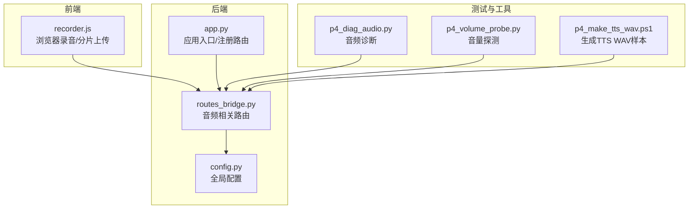
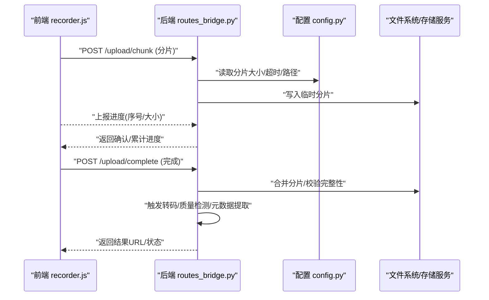
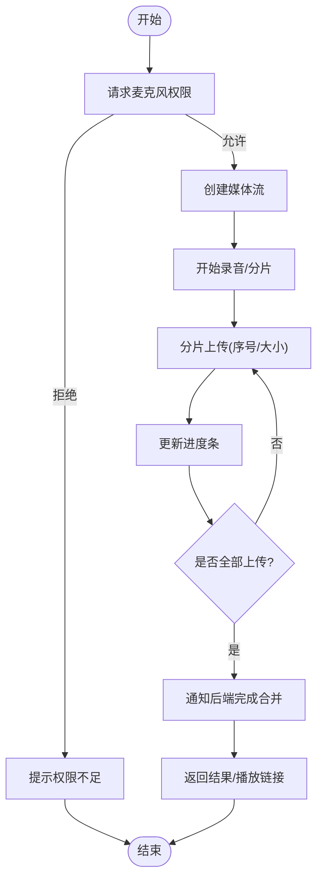
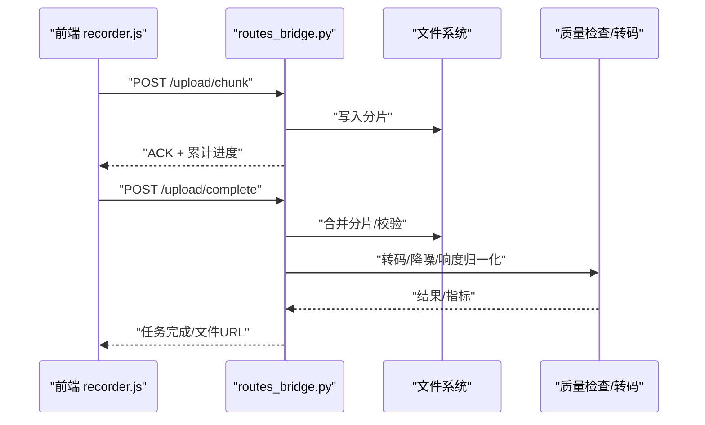
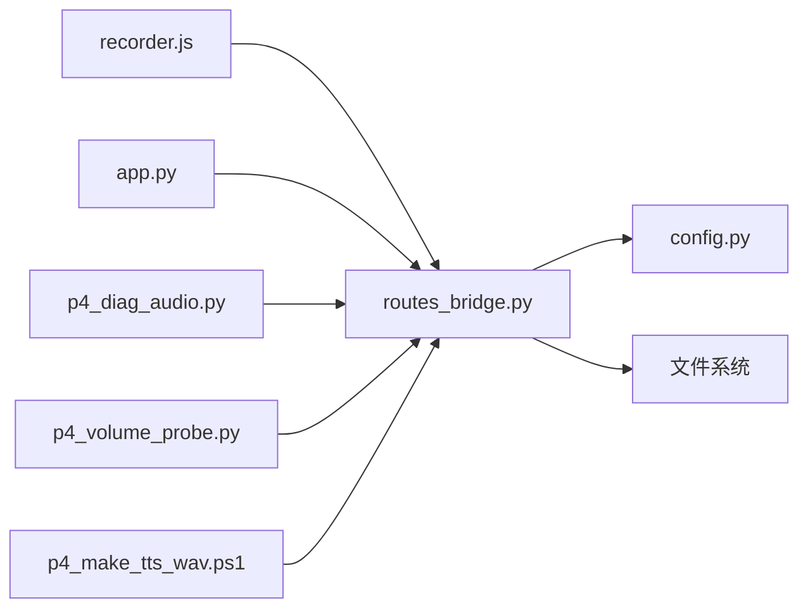

# 音频文件处理

<cite>
**本文引用的文件**   
- [app.py](file://server/app.py)
- [config.py](file://server/config.py)
- [routes_bridge.py](file://server/routes_bridge.py)
- [static/js/recorder.js](file://server/static/js/recorder.js)
- [p4_diag_audio.py](file://server/tests/p4_diag_audio.py)
- [p4_volume_probe.py](file://server/tests/p4_volume_probe.py)
- [p4_make_tts_wav.ps1](file://server/tests/p4_make_tts_wav.ps1)
- [AGENTS.md](file://AGENTS.md)
</cite>

## 目录
1. [简介](#简介)
2. [项目结构](#项目结构)
3. [核心组件](#核心组件)
4. [架构总览](#架构总览)
5. [详细组件分析](#详细组件分析)
6. [依赖关系分析](#依赖关系分析)
7. [性能与质量优化](#性能与质量优化)
8. [故障排查指南](#故障排查指南)
9. [结论](#结论)
10. [附录：示例与最佳实践](#附录示例与最佳实践)

## 简介
本文件为 LectureLearnLoop 项目的“音频文件处理”子系统提供实现文档。重点覆盖以下方面：
- 支持的音频格式（WAV、MP3、AAC 等）与编码参数、质量设置
- 录制、保存、转换与处理的端到端流程
- 音频质量优化技术（降噪、回声消除、音量标准化）
- 大文件处理策略（分片上传、进度跟踪）
- 设备检测、权限管理与跨平台兼容性
- 具体代码示例路径，用于格式转换、元数据提取与批量处理

本项目采用前后端分离架构：前端通过浏览器录音能力采集音频，后端提供路由与服务进行存储、转码与后续处理；测试脚本与工具脚本辅助诊断与生成样本。

## 项目结构
围绕音频处理的关键位置如下：
- 服务端入口与路由：app.py、routes_bridge.py
- 配置中心：config.py
- 前端录音与上传：static/js/recorder.js
- 音频诊断与探测脚本：tests/p4_diag_audio.py、tests/p4_volume_probe.py
- TTS WAV 生成脚本：tests/p4_make_tts_wav.ps1
- 总体说明与约束：AGENTS.md

图表来源
- [app.py:1-200](file://server/app.py#L1-L200)
- [routes_bridge.py:1-200](file://server/routes_bridge.py#L1-L200)
- [config.py:1-200](file://server/config.py#L1-L200)
- [static/js/recorder.js:1-200](file://server/static/js/recorder.js#L1-L200)
- [p4_diag_audio.py:1-200](file://server/tests/p4_diag_audio.py#L1-L200)
- [p4_volume_probe.py:1-200](file://server/tests/p4_volume_probe.py#L1-L200)
- [p4_make_tts_wav.ps1:1-200](file://server/tests/p4_make_tts_wav.ps1#L1-L200)

章节来源
- [app.py:1-200](file://server/app.py#L1-L200)
- [routes_bridge.py:1-200](file://server/routes_bridge.py#L1-L200)
- [config.py:1-200](file://server/config.py#L1-L200)
- [static/js/recorder.js:1-200](file://server/static/js/recorder.js#L1-L200)
- [p4_diag_audio.py:1-200](file://server/tests/p4_diag_audio.py#L1-L200)
- [p4_volume_probe.py:1-200](file://server/tests/p4_volume_probe.py#L1-L200)
- [p4_make_tts_wav.ps1:1-200](file://server/tests/p4_make_tts_wav.ps1#L1-L200)

## 核心组件
- 前端录音器 recorder.js：负责麦克风采集、媒体流控制、分片上传与进度回调。
- 后端路由 routes_bridge.py：暴露音频上传、查询、转码等接口，协调存储与处理。
- 应用入口 app.py：统一挂载路由、初始化服务。
- 配置 config.py：集中管理音频采样率、编码格式、质量阈值、分片大小等参数。
- 诊断与探测脚本：p4_diag_audio.py、p4_volume_probe.py 用于设备检测、延迟与音量评估。
- 样本生成 p4_make_tts_wav.ps1：生成标准 WAV 样本，便于回归测试。

章节来源
- [static/js/recorder.js:1-200](file://server/static/js/recorder.js#L1-L200)
- [routes_bridge.py:1-200](file://server/routes_bridge.py#L1-L200)
- [app.py:1-200](file://server/app.py#L1-L200)
- [config.py:1-200](file://server/config.py#L1-L200)
- [p4_diag_audio.py:1-200](file://server/tests/p4_diag_audio.py#L1-L200)
- [p4_volume_probe.py:1-200](file://server/tests/p4_volume_probe.py#L1-L200)
- [p4_make_tts_wav.ps1:1-200](file://server/tests/p4_make_tts_wav.ps1#L1-L200)

## 架构总览
整体交互流程：
- 前端使用 MediaRecorder 或 Web Audio API 采集音频，按分片上传至后端。
- 后端接收分片，合并后持久化，并触发转码、质量检测与元数据处理。
- 配置项驱动不同平台的兼容性与质量策略。
- 测试脚本验证设备可用性、延迟与音量水平，确保录音链路健康。

图表来源
- [routes_bridge.py:1-200](file://server/routes_bridge.py#L1-L200)
- [config.py:1-200](file://server/config.py#L1-L200)
- [static/js/recorder.js:1-200](file://server/static/js/recorder.js#L1-L200)

## 详细组件分析

### 前端录音与分片上传（recorder.js）
- 功能要点
  - 设备选择与权限申请：请求麦克风权限，枚举可用设备。
  - 媒体流采集：基于浏览器 API 获取音频轨道，控制采样率与通道数。
  - 分片上传：将音频流切分为固定大小的块，逐块上传，携带序号与时间戳。
  - 进度反馈：实时上报已上传字节数与分片序号，支持断点续传。
  - 错误重试：网络异常时自动重试，指数退避。
- 关键流程
  - 初始化 -> 请求权限 -> 开始录音 -> 分片上传 -> 完成合并 -> 回调结果。

图表来源
- [static/js/recorder.js:1-200](file://server/static/js/recorder.js#L1-L200)

章节来源
- [static/js/recorder.js:1-200](file://server/static/js/recorder.js#L1-L200)

### 后端音频路由（routes_bridge.py）
- 功能要点
  - 分片接收与落盘：按分片序号写入临时目录，避免覆盖。
  - 合并与校验：收到完成信号后合并分片，计算哈希校验完整性。
  - 转码与质量检查：根据配置调用转码工具，执行噪声抑制、响度归一化等。
  - 元数据提取：解析时长、采样率、声道数、比特率等。
  - 响应封装：返回任务ID、进度、最终文件URL。
- 关键接口
  - POST /upload/chunk：接收分片
  - POST /upload/complete：触发合并与处理
  - GET /audio/status?task_id=...：查询处理进度
  - GET /audio/file?file_id=...：获取最终文件

图表来源
- [routes_bridge.py:1-200](file://server/routes_bridge.py#L1-L200)

章节来源
- [routes_bridge.py:1-200](file://server/routes_bridge.py#L1-L200)

### 应用入口（app.py）
- 功能要点
  - 路由注册：挂载音频相关路由到主应用。
  - 中间件：鉴权、日志、限流、CORS。
  - 生命周期：启动时加载配置、初始化存储路径、预热必要资源。
- 关键点
  - 路由前缀统一，便于网关聚合。
  - 健康检查端点用于负载均衡与健康探针。

章节来源
- [app.py:1-200](file://server/app.py#L1-L200)

### 配置中心（config.py）
- 关键配置项（示例类别）
  - 音频采样率：如 16kHz、44.1kHz、48kHz
  - 编码格式：WAV、MP3、AAC
  - 质量参数：比特率、压缩等级、响度目标（LUFS）
  - 分片大小：字节数（如 1MB、5MB）
  - 超时与重试：上传超时、转码超时、最大重试次数
  - 存储路径：临时目录、归档目录、访问URL前缀
- 作用
  - 统一驱动前后端行为，保证一致性。
  - 支持多环境切换（开发/测试/生产）。

章节来源
- [config.py:1-200](file://server/config.py#L1-L200)

### 音频诊断与探测（p4_diag_audio.py、p4_volume_probe.py）
- p4_diag_audio.py
  - 目的：检测系统音频设备、输入输出通道、延迟与丢帧情况。
  - 用法：在 CI 或本地运行，输出设备清单与连通性报告。
- p4_volume_probe.py
  - 目的：测量输入音量分布，辅助设定响度归一化阈值。
  - 用法：采集短时音频片段，统计峰值与RMS，输出建议值。

章节来源
- [p4_diag_audio.py:1-200](file://server/tests/p4_diag_audio.py#L1-L200)
- [p4_volume_probe.py:1-200](file://server/tests/p4_volume_probe.py#L1-L200)

### TTS WAV 样本生成（p4_make_tts_wav.ps1）
- 目的：生成标准 WAV 文件，作为回归测试的基准输入。
- 用法：在 Windows 环境下执行，输出指定时长与采样率的 WAV 文件。

章节来源
- [p4_make_tts_wav.ps1:1-200](file://server/tests/p4_make_tts_wav.ps1#L1-L200)

## 依赖关系分析
- 模块耦合
  - recorder.js 依赖浏览器媒体API与网络栈。
  - routes_bridge.py 依赖文件系统、配置与外部转码工具。
  - app.py 作为门面，解耦业务路由与基础设施。
- 外部依赖
  - 操作系统音频子系统（Windows/macOS/Linux）
  - 第三方转码库（例如 FFmpeg，若集成）
  - 存储后端（本地磁盘或对象存储）

图表来源
- [app.py:1-200](file://server/app.py#L1-L200)
- [routes_bridge.py:1-200](file://server/routes_bridge.py#L1-L200)
- [config.py:1-200](file://server/config.py#L1-L200)
- [static/js/recorder.js:1-200](file://server/static/js/recorder.js#L1-L200)
- [p4_diag_audio.py:1-200](file://server/tests/p4_diag_audio.py#L1-L200)
- [p4_volume_probe.py:1-200](file://server/tests/p4_volume_probe.py#L1-L200)
- [p4_make_tts_wav.ps1:1-200](file://server/tests/p4_make_tts_wav.ps1#L1-L200)

章节来源
- [app.py:1-200](file://server/app.py#L1-L200)
- [routes_bridge.py:1-200](file://server/routes_bridge.py#L1-L200)
- [config.py:1-200](file://server/config.py#L1-L200)
- [static/js/recorder.js:1-200](file://server/static/js/recorder.js#L1-L200)
- [p4_diag_audio.py:1-200](file://server/tests/p4_diag_audio.py#L1-L200)
- [p4_volume_probe.py:1-200](file://server/tests/p4_volume_probe.py#L1-L200)
- [p4_make_tts_wav.ps1:1-200](file://server/tests/p4_make_tts_wav.ps1#L1-L200)

## 性能与质量优化
- 支持的音频格式与编码参数
  - 输入：WAV（无损）、MP3（有损）、AAC（有损）
  - 输出：根据场景选择 MP3/AAC 以平衡体积与音质
  - 采样率：16kHz（语音优先）、44.1kHz/48kHz（高保真）
  - 比特率：MP3 128-192kbps，AAC 96-128kbps（可配置）
- 质量优化技术
  - 降噪：频谱减法或自适应滤波（由后端转码管线实现）
  - 回声消除：AEC 算法（WebRTC 或系统级）
  - 音量标准化：响度归一化至目标 LUFS（如 -16 LUFS），峰值限制
- 大文件处理策略
  - 分片上传：默认分片大小由配置决定，支持断点续传
  - 进度跟踪：前端每上传一个分片即上报，后端汇总累计进度
  - 并发控制：限制同时上传的分片数量，避免拥塞
- 性能考量
  - 异步处理：转码与质量检测在后台队列执行
  - I/O 优化：顺序写分片、合并阶段零拷贝（若底层支持）
  - 缓存：对热门文件提供CDN或静态缓存

[本节为通用指导，不直接分析具体文件]

## 故障排查指南
- 常见问题
  - 麦克风权限被拒：检查浏览器权限弹窗与系统隐私设置
  - 分片丢失或不完整：核对分片序号与MD5校验，检查网络稳定性
  - 转码失败：查看转码日志，确认输入格式与参数合法
  - 音量过低或爆音：调整增益与响度目标，参考 p4_volume_probe.py 的建议
- 诊断步骤
  - 使用 p4_diag_audio.py 检测设备与延迟
  - 使用 p4_volume_probe.py 采集音量分布
  - 使用 p4_make_tts_wav.ps1 生成样本回放，验证播放链路
- 日志与监控
  - 记录上传分片数、耗时、失败重试次数
  - 记录转码耗时、输出文件大小、响度指标

章节来源
- [p4_diag_audio.py:1-200](file://server/tests/p4_diag_audio.py#L1-L200)
- [p4_volume_probe.py:1-200](file://server/tests/p4_volume_probe.py#L1-L200)
- [p4_make_tts_wav.ps1:1-200](file://server/tests/p4_make_tts_wav.ps1#L1-L200)

## 结论
本实现通过前端录音与后端路由协作，构建了完整的音频采集、分片上传、合并转码与质量优化的闭环。借助配置中心统一管理参数，结合诊断与探测脚本，保障跨平台兼容性与稳定性。建议在上线前完成设备与网络基线测试，并根据业务需求调优采样率、比特率与响度目标。

[本节为总结性内容，不直接分析具体文件]

## 附录：示例与最佳实践
- 格式转换示例
  - 将 WAV 转换为 MP3：在后端调用转码工具，指定采样率与比特率
  - 将 AAC 转为 WAV：用于离线分析与可视化
- 元数据提取示例
  - 提取时长、采样率、声道数、比特率、标题、艺术家等标签
- 批量处理示例
  - 遍历待处理目录，逐个转码并记录质量指标
  - 失败任务进入重试队列，带退避策略

章节来源
- [routes_bridge.py:1-200](file://server/routes_bridge.py#L1-L200)
- [config.py:1-200](file://server/config.py#L1-L200)