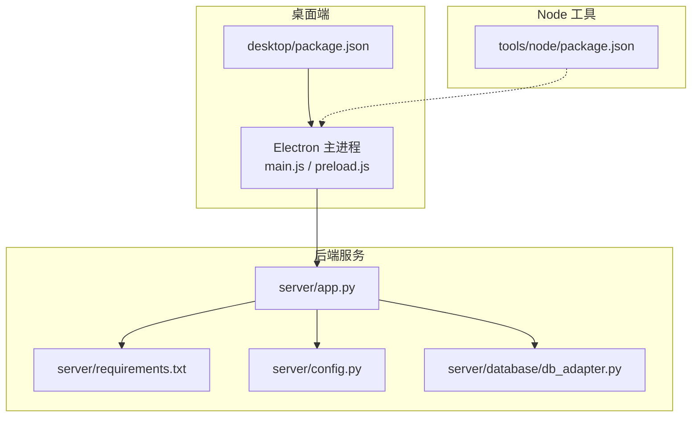
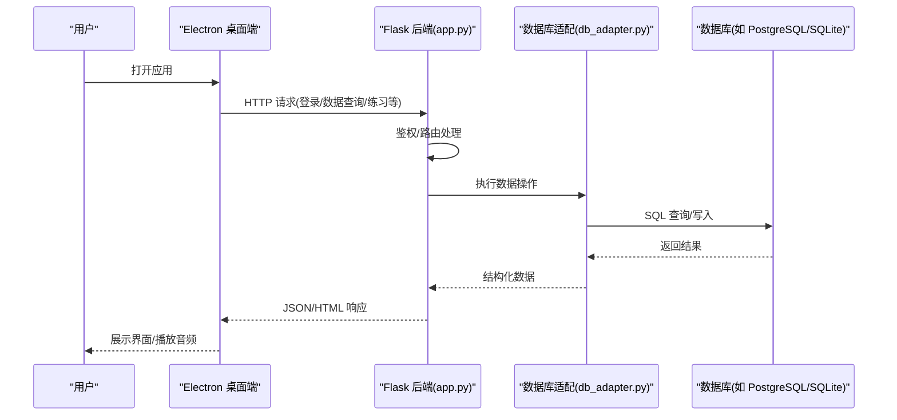
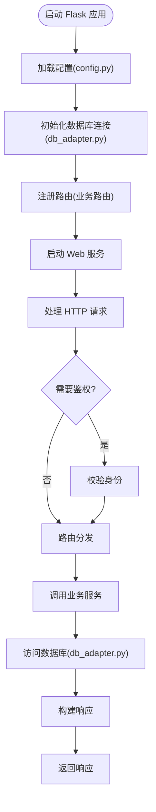
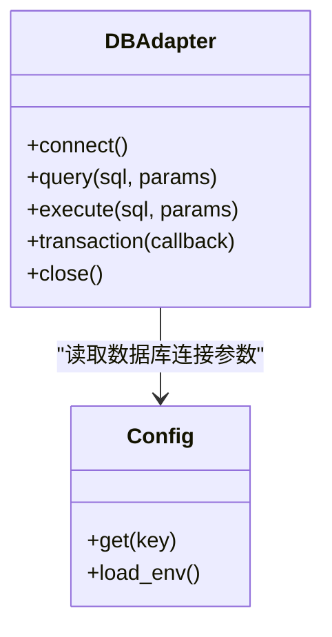
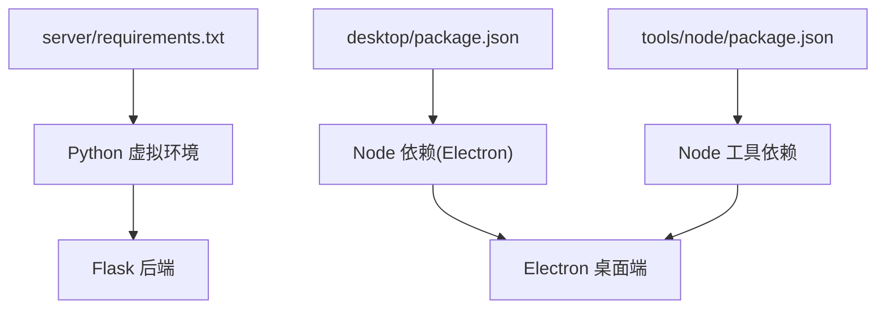

# 快速开始

<cite>
**本文引用的文件**   
- [start_app.ps1](file://start_app.ps1)
- [server/requirements.txt](file://server/requirements.txt)
- [server/config.py](file://server/config.py)
- [server/database/db_adapter.py](file://server/database/db_adapter.py)
- [server/app.py](file://server/app.py)
- [desktop/package.json](file://desktop/package.json)
- [tools/node/package.json](file://tools/node/package.json)
</cite>

## 目录
1. [简介](#简介)
2. [项目结构](#项目结构)
3. [核心组件](#核心组件)
4. [架构总览](#架构总览)
5. [详细组件分析](#详细组件分析)
6. [依赖关系分析](#依赖关系分析)
7. [性能注意事项](#性能注意事项)
8. [故障排除指南](#故障排除指南)
9. [结论](#结论)
10. [附录：安装与运行步骤](#附录安装与运行步骤)

## 简介
本指南面向首次接触 LectureLearnLoop 的新用户，目标是帮助你在本地环境快速完成环境准备、安装配置、数据库初始化，并成功启动应用。你将了解后端 Python 服务、前端桌面端（Electron）以及 Node.js 工具链之间的关系，并通过“验证方法”确认安装是否成功。

## 项目结构
LectureLearnLoop 采用前后端分离的桌面应用形态：
- 后端服务：Python + Flask（由 app.py 启动），负责业务逻辑、路由、模板渲染、数据库访问等。
- 桌面端：Electron 应用（desktop 目录），用于承载前端页面、录音、ASR 代理等能力。
- Node.js 工具：tools/node 提供辅助脚本或打包相关依赖。

**图表来源**
- [desktop/package.json](file://desktop/package.json)
- [server/app.py](file://server/app.py)
- [server/requirements.txt](file://server/requirements.txt)
- [server/config.py](file://server/config.py)
- [server/database/db_adapter.py](file://server/database/db_adapter.py)

**章节来源**
- [start_app.ps1](file://start_app.ps1)
- [desktop/package.json](file://desktop/package.json)
- [server/app.py](file://server/app.py)
- [server/requirements.txt](file://server/requirements.txt)
- [server/config.py](file://server/config.py)
- [server/database/db_adapter.py](file://server/database/db_adapter.py)
- [tools/node/package.json](file://tools/node/package.json)

## 核心组件
- 后端入口与服务：app.py 作为 Flask 应用的入口，加载配置、注册路由、启动 Web 服务。
- 配置管理：config.py 集中管理环境变量、数据库连接参数、第三方服务密钥等。
- 数据库适配层：db_adapter.py 封装数据库连接与基础操作，屏蔽底层差异。
- 桌面端：Electron 应用通过 package.json 声明依赖与启动脚本，负责 UI 与音频采集等能力。
- Node.js 工具：tools/node/package.json 提供辅助脚本所需的依赖。

**章节来源**
- [server/app.py](file://server/app.py)
- [server/config.py](file://server/config.py)
- [server/database/db_adapter.py](file://server/database/db_adapter.py)
- [desktop/package.json](file://desktop/package.json)
- [tools/node/package.json](file://tools/node/package.json)

## 架构总览
下图展示了从 Electron 到后端服务的调用链路，以及数据库访问路径。

**图表来源**
- [server/app.py](file://server/app.py)
- [server/database/db_adapter.py](file://server/database/db_adapter.py)

## 详细组件分析

### 后端服务（Flask）
- 职责：接收 HTTP 请求、鉴权、路由分发、模板渲染、调用业务模块、返回响应。
- 关键文件：
  - app.py：应用入口、中间件、路由注册、服务启动。
  - config.py：统一配置项（数据库、日志、第三方服务等）。
  - requirements.txt：Python 依赖清单。

**图表来源**
- [server/app.py](file://server/app.py)
- [server/config.py](file://server/config.py)
- [server/database/db_adapter.py](file://server/database/db_adapter.py)

**章节来源**
- [server/app.py](file://server/app.py)
- [server/config.py](file://server/config.py)
- [server/requirements.txt](file://server/requirements.txt)

### 数据库适配层
- 职责：封装数据库连接、会话管理、事务、错误处理；为上层提供统一的读写接口。
- 关键点：
  - 支持多种数据库（例如 SQLite/PostgreSQL），通过配置切换。
  - 提供连接池、重试机制、SQL 注入防护等最佳实践。

**图表来源**
- [server/database/db_adapter.py](file://server/database/db_adapter.py)
- [server/config.py](file://server/config.py)

**章节来源**
- [server/database/db_adapter.py](file://server/database/db_adapter.py)
- [server/config.py](file://server/config.py)

### 桌面端（Electron）
- 职责：提供用户界面、音频采集、与后端通信、本地缓存等。
- 关键点：
  - package.json 定义依赖与启动脚本。
  - main.js/preload.js 负责主进程与渲染进程通信。

**图表来源**
- [desktop/package.json](file://desktop/package.json)
- [server/app.py](file://server/app.py)

**章节来源**
- [desktop/package.json](file://desktop/package.json)

### Node.js 工具
- 职责：提供辅助脚本或打包所需依赖。
- 关键点：
  - tools/node/package.json 声明依赖。
  - 通常由 Electron 或 CI 流程调用。

**章节来源**
- [tools/node/package.json](file://tools/node/package.json)

## 依赖关系分析
- Python 依赖：由 server/requirements.txt 统一管理，包含 Web 框架、数据库驱动、工具库等。
- Node.js 依赖：
  - desktop/package.json：Electron 及前端相关依赖。
  - tools/node/package.json：工具类依赖。

**图表来源**
- [server/requirements.txt](file://server/requirements.txt)
- [desktop/package.json](file://desktop/package.json)
- [tools/node/package.json](file://tools/node/package.json)

**章节来源**
- [server/requirements.txt](file://server/requirements.txt)
- [desktop/package.json](file://desktop/package.json)
- [tools/node/package.json](file://tools/node/package.json)

## 性能注意事项
- 数据库连接：建议在生产环境使用连接池，避免频繁创建/销毁连接。
- 静态资源：将静态文件托管在 CDN 或启用浏览器缓存。
- 并发模型：Flask 默认单线程开发模式，生产建议使用 Gunicorn/uWSGI + 多 worker。
- 音频流：注意内存占用与缓冲区大小，避免阻塞事件循环。

[本节为通用指导，不直接分析具体文件]

## 故障排除指南
- 无法启动后端服务
  - 检查 Python 版本与依赖是否安装完整。
  - 查看端口是否被占用，必要时更换端口。
  - 确认配置文件中的数据库连接参数正确。
- 数据库连接失败
  - 核对数据库类型、主机、端口、用户名、密码。
  - 确保数据库服务已启动并可远程访问（如适用）。
  - 检查 db_adapter.py 的连接初始化逻辑是否正确。
- Electron 无法加载页面
  - 检查 desktop/package.json 的依赖是否安装成功。
  - 确认 renderer/index.html 路径正确且可访问。
  - 查看控制台是否有跨域或网络请求错误。
- 权限或路径问题
  - 确保对 static/templates 目录有读取权限。
  - Windows 下注意路径分隔符与 PowerShell 执行策略。

**章节来源**
- [server/config.py](file://server/config.py)
- [server/database/db_adapter.py](file://server/database/db_adapter.py)
- [desktop/package.json](file://desktop/package.json)

## 结论
通过本指南，你应已完成环境准备、依赖安装、配置设置与数据库初始化，并能成功启动后端服务与桌面端应用。若遇到问题，请参考“故障排除指南”逐项排查。建议在正式使用前先完成基本功能验证，确保各组件协同工作正常。

[本节为总结性内容，不直接分析具体文件]

## 附录：安装与运行步骤

### 前置要求
- Python 3.x（建议使用 3.9+）
- Node.js 16+（用于 Electron 与工具依赖）
- 数据库（根据配置选择 SQLite 或 PostgreSQL）
- 可选：PowerShell（Windows 用户使用 start_app.ps1）

### 安装与配置
1. 克隆仓库并进入项目根目录。
2. 安装 Python 依赖：
   - 在项目根目录或 server 目录下创建并激活虚拟环境。
   - 安装依赖：pip install -r server/requirements.txt
3. 安装 Node.js 依赖：
   - 安装桌面端依赖：cd desktop && npm install
   - 安装工具依赖：cd ../tools/node && npm install
4. 配置环境变量与数据库：
   - 编辑 server/config.py，设置数据库连接参数（类型、主机、端口、用户名、密码、数据库名）。
   - 如需使用 PostgreSQL，请确保数据库服务已启动并已创建目标数据库。
5. 初始化数据库：
   - 根据 db_adapter.py 提供的初始化逻辑，执行建表语句或迁移脚本（如有）。
   - 若使用 SQLite，确保存储路径存在且有写入权限。

### 启动应用
- 方式一：使用 PowerShell 一键启动（Windows）
  - 在项目根目录执行：.\start_app.ps1
  - 该脚本会同时启动后端服务与 Electron 桌面端。
- 方式二：手动启动
  - 启动后端：cd server && python app.py
  - 启动桌面端：cd desktop && npm start

### 基本使用示例与验证
- 打开桌面端应用后，尝试以下操作以验证安装成功：
  - 登录系统（如启用鉴权）。
  - 访问知识库或练习页面，确认页面能正常加载。
  - 进行简单的录音或音频播放测试，确认音频设备可用。
- 后端健康检查：
  - 在浏览器访问后端健康接口（如 /health 或 /status，具体以路由为准），确认返回正常状态。

**章节来源**
- [start_app.ps1](file://start_app.ps1)
- [server/app.py](file://server/app.py)
- [server/config.py](file://server/config.py)
- [server/database/db_adapter.py](file://server/database/db_adapter.py)
- [desktop/package.json](file://desktop/package.json)
- [tools/node/package.json](file://tools/node/package.json)