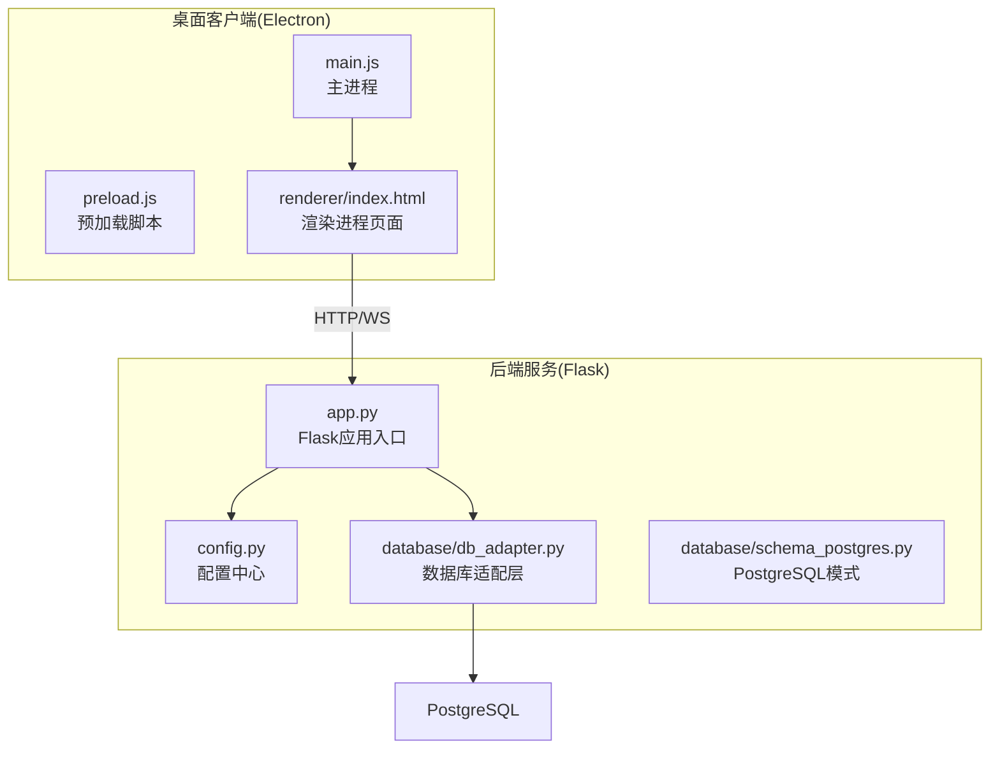
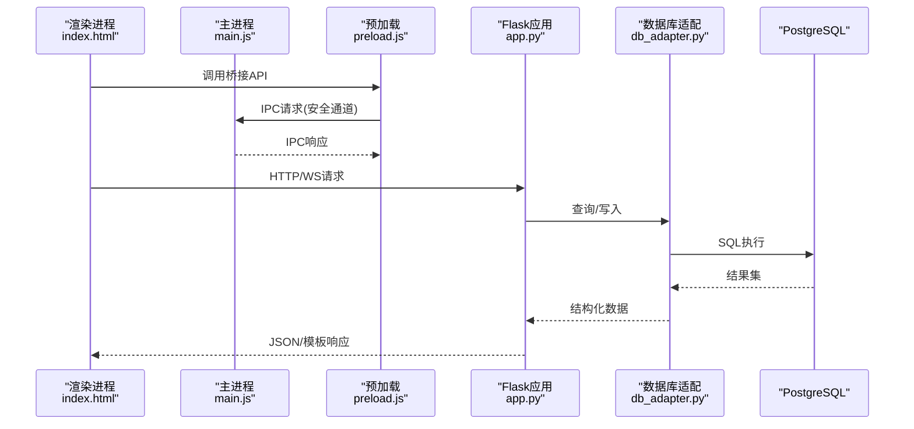
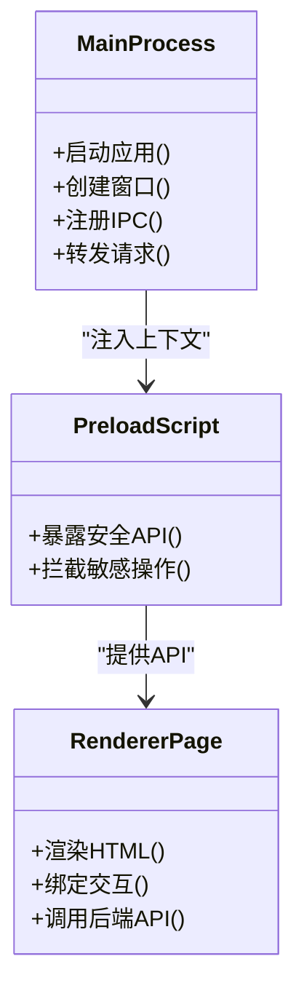
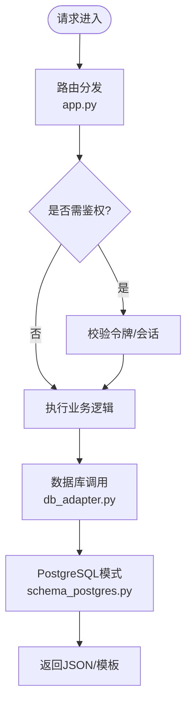
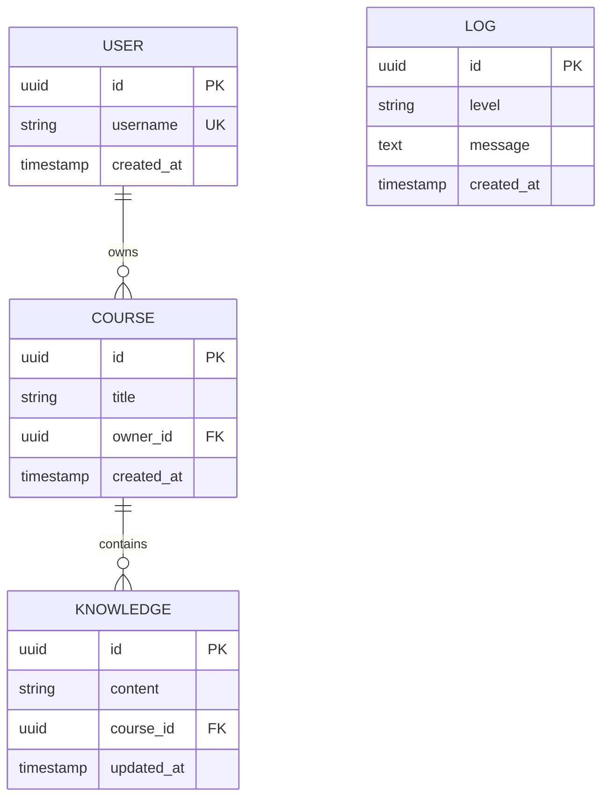
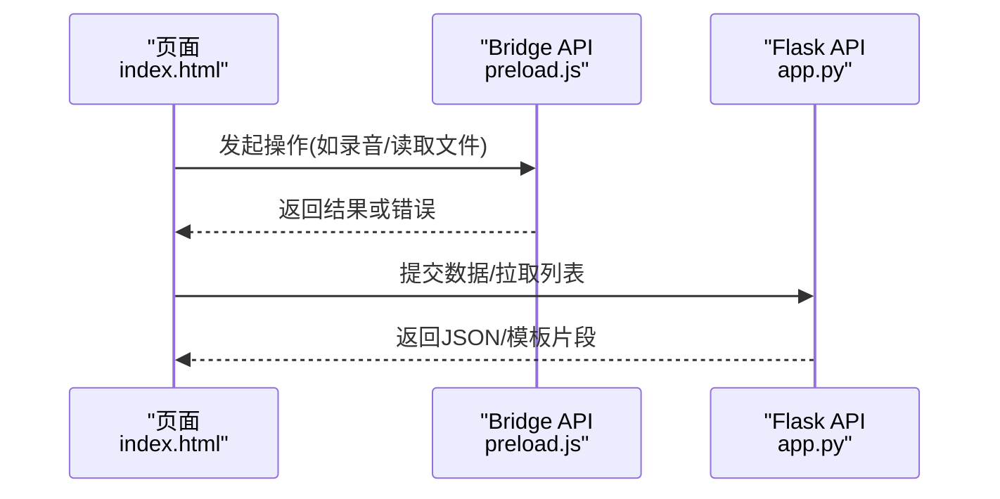
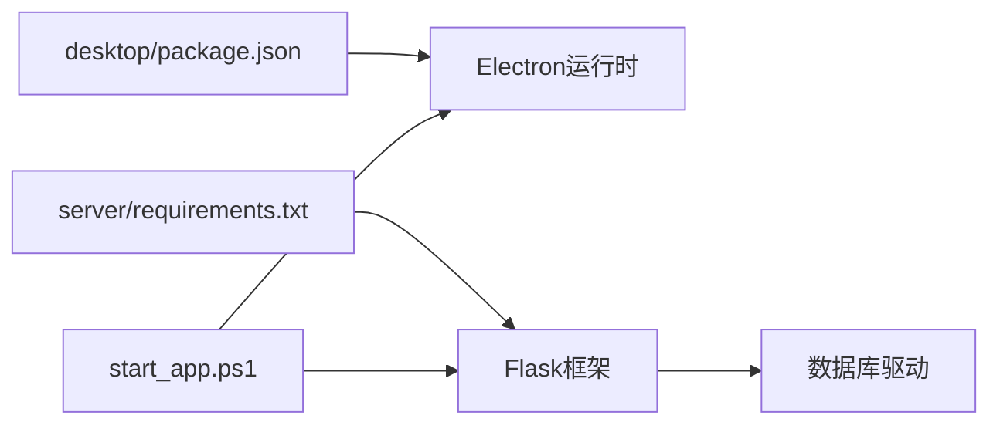

# 技术栈

<cite>
**本文引用的文件**   
- [desktop/package.json](file://desktop/package.json)
- [desktop/main.js](file://desktop/main.js)
- [desktop/preload.js](file://desktop/preload.js)
- [desktop/renderer/index.html](file://desktop/renderer/index.html)
- [server/app.py](file://server/app.py)
- [server/config.py](file://server/config.py)
- [server/database/db_adapter.py](file://server/database/db_adapter.py)
- [server/database/schema_postgres.py](file://server/database/schema_postgres.py)
- [server/requirements.txt](file://server/requirements.txt)
- [start_app.ps1](file://start_app.ps1)
</cite>

## 目录
1. [简介](#简介)
2. [项目结构](#项目结构)
3. [核心组件](#核心组件)
4. [架构总览](#架构总览)
5. [详细组件分析](#详细组件分析)
6. [依赖关系分析](#依赖关系分析)
7. [性能考量](#性能考量)
8. [故障排查指南](#故障排查指南)
9. [结论](#结论)
10. [附录](#附录)

## 简介
本技术栈文档面向LectureLearnLoop项目的开发者与维护者，系统梳理Electron桌面应用、Python Flask后端服务、PostgreSQL数据库与JavaScript前端等核心技术选型。文档从职责分工、相互关系、选型理由、版本兼容性与依赖管理策略等维度展开，帮助读者理解系统架构决策与技术边界。

## 项目结构
项目采用前后端分离的桌面应用形态：
- desktop：Electron主进程与渲染进程，负责本地交互、系统集成与页面呈现。
- server：Python Flask后端，提供业务API、模板渲染、认证、知识管理与LLM调用日志等能力。
- docs：业务规则、计划、测试与交付文档。
- tools：辅助脚本与迁移工具。

**图表来源**
- [desktop/main.js:1-200](file://desktop/main.js#L1-L200)
- [desktop/preload.js:1-200](file://desktop/preload.js#L1-L200)
- [desktop/renderer/index.html:1-200](file://desktop/renderer/index.html#L1-L200)
- [server/app.py:1-200](file://server/app.py#L1-L200)
- [server/config.py:1-200](file://server/config.py#L1-L200)
- [server/database/db_adapter.py:1-200](file://server/database/db_adapter.py#L1-L200)
- [server/database/schema_postgres.py:1-200](file://server/database/schema_postgres.py#L1-L200)

**章节来源**
- [desktop/main.js:1-200](file://desktop/main.js#L1-L200)
- [desktop/preload.js:1-200](file://desktop/preload.js#L1-L200)
- [desktop/renderer/index.html:1-200](file://desktop/renderer/index.html#L1-L200)
- [server/app.py:1-200](file://server/app.py#L1-L200)
- [server/config.py:1-200](file://server/config.py#L1-L200)
- [server/database/db_adapter.py:1-200](file://server/database/db_adapter.py#L1-L200)
- [server/database/schema_postgres.py:1-200](file://server/database/schema_postgres.py#L1-L200)

## 核心组件
- Electron桌面应用
  - 主进程负责窗口生命周期、菜单、系统集成与IPC桥接。
  - 预加载脚本暴露安全API给渲染进程，隔离Node API访问。
  - 渲染进程承载HTML/CSS/JS前端界面。
- Python Flask后端
  - 统一路由与视图（含模板与SPA布局）。
  - 认证鉴权、知识管理、练习循环、LLM调用日志与计费相关接口。
  - 通过数据库适配层访问PostgreSQL。
- PostgreSQL数据库
  - 持久化用户、课程、知识点、练习记录、审计日志等数据。
  - 由schema定义表结构与约束。
- JavaScript前端
  - 基于HTML模板与静态资源，配合Flask模板引擎或SPA模式运行。
  - 在Electron中通过渲染进程展示并处理用户交互。

**章节来源**
- [desktop/package.json:1-200](file://desktop/package.json#L1-L200)
- [desktop/main.js:1-200](file://desktop/main.js#L1-L200)
- [desktop/preload.js:1-200](file://desktop/preload.js#L1-L200)
- [desktop/renderer/index.html:1-200](file://desktop/renderer/index.html#L1-L200)
- [server/app.py:1-200](file://server/app.py#L1-L200)
- [server/config.py:1-200](file://server/config.py#L1-L200)
- [server/database/db_adapter.py:1-200](file://server/database/db_adapter.py#L1-L200)
- [server/database/schema_postgres.py:1-200](file://server/database/schema_postgres.py#L1-L200)

## 架构总览
整体采用“Electron + Flask + PostgreSQL”的经典三层架构：
- 表现层：Electron渲染进程承载Web界面，提供富交互体验。
- 应用层：Flask聚合业务逻辑、路由与模板渲染，对外暴露REST/WS接口。
- 数据层：PostgreSQL作为唯一可信数据源，通过db_adapter统一访问。

**图表来源**
- [desktop/renderer/index.html:1-200](file://desktop/renderer/index.html#L1-L200)
- [desktop/preload.js:1-200](file://desktop/preload.js#L1-L200)
- [desktop/main.js:1-200](file://desktop/main.js#L1-L200)
- [server/app.py:1-200](file://server/app.py#L1-L200)
- [server/database/db_adapter.py:1-200](file://server/database/db_adapter.py#L1-L200)

## 详细组件分析

### Electron桌面应用
- 主进程(main.js)
  - 创建应用窗口、加载渲染页面、注册IPC通道、处理系统事件。
  - 与后端Flask服务通信，转发渲染进程请求。
- 预加载(preload.js)
  - 向渲染进程暴露最小化API，避免直接暴露Node API，提升安全性。
- 渲染进程(renderer/index.html)
  - 承载前端页面，使用Flask模板或SPA模式进行内容渲染。
- 包管理(package.json)
  - 声明Electron、开发依赖与打包脚本，驱动构建流程。

**图表来源**
- [desktop/main.js:1-200](file://desktop/main.js#L1-L200)
- [desktop/preload.js:1-200](file://desktop/preload.js#L1-L200)
- [desktop/renderer/index.html:1-200](file://desktop/renderer/index.html#L1-L200)
- [desktop/package.json:1-200](file://desktop/package.json#L1-L200)

**章节来源**
- [desktop/main.js:1-200](file://desktop/main.js#L1-L200)
- [desktop/preload.js:1-200](file://desktop/preload.js#L1-L200)
- [desktop/renderer/index.html:1-200](file://desktop/renderer/index.html#L1-L200)
- [desktop/package.json:1-200](file://desktop/package.json#L1-L200)

### Python Flask后端服务
- 应用入口(app.py)
  - 初始化Flask应用、注册蓝图/路由、挂载中间件、启动服务。
- 配置中心(config.py)
  - 集中管理数据库连接、密钥、端口、功能开关等配置项。
- 数据库适配(db_adapter.py)
  - 封装连接池、事务、SQL执行与错误映射，屏蔽底层差异。
- 模式定义(schema_postgres.py)
  - 定义PostgreSQL表结构、索引与约束，确保数据一致性。

**图表来源**
- [server/app.py:1-200](file://server/app.py#L1-L200)
- [server/config.py:1-200](file://server/config.py#L1-L200)
- [server/database/db_adapter.py:1-200](file://server/database/db_adapter.py#L1-L200)
- [server/database/schema_postgres.py:1-200](file://server/database/schema_postgres.py#L1-L200)

**章节来源**
- [server/app.py:1-200](file://server/app.py#L1-L200)
- [server/config.py:1-200](file://server/config.py#L1-L200)
- [server/database/db_adapter.py:1-200](file://server/database/db_adapter.py#L1-L200)
- [server/database/schema_postgres.py:1-200](file://server/database/schema_postgres.py#L1-L200)

### PostgreSQL数据库
- 角色与职责
  - 存储用户信息、课程资料、知识点、练习记录、LLM日志与审计数据。
  - 通过schema_postgres.py维护一致的表结构与约束。
- 访问方式
  - 由db_adapter统一封装连接、事务与查询，保证上层代码简洁一致。

**图表来源**
- [server/database/schema_postgres.py:1-200](file://server/database/schema_postgres.py#L1-L200)

**章节来源**
- [server/database/schema_postgres.py:1-200](file://server/database/schema_postgres.py#L1-L200)
- [server/database/db_adapter.py:1-200](file://server/database/db_adapter.py#L1-L200)

### JavaScript前端
- 渲染进程(index.html)
  - 通过Flask模板或SPA模式加载页面，结合preload暴露的API与后端交互。
- 与Electron集成
  - 借助preload的安全API调用主进程能力，如文件系统、音频设备、系统通知等。

**图表来源**
- [desktop/renderer/index.html:1-200](file://desktop/renderer/index.html#L1-L200)
- [desktop/preload.js:1-200](file://desktop/preload.js#L1-L200)
- [server/app.py:1-200](file://server/app.py#L1-L200)

**章节来源**
- [desktop/renderer/index.html:1-200](file://desktop/renderer/index.html#L1-L200)
- [desktop/preload.js:1-200](file://desktop/preload.js#L1-L200)
- [server/app.py:1-200](file://server/app.py#L1-L200)

## 依赖关系分析
- 桌面端依赖
  - package.json声明Electron运行时与前端构建依赖，支持开发与打包。
- 服务端依赖
  - requirements.txt声明Flask、数据库驱动、认证库、日志与工具库等。
- 启动编排
  - start_app.ps1协调Electron与Flask服务的启动顺序与环境变量。

**图表来源**
- [desktop/package.json:1-200](file://desktop/package.json#L1-L200)
- [server/requirements.txt:1-200](file://server/requirements.txt#L1-L200)
- [start_app.ps1:1-200](file://start_app.ps1#L1-L200)

**章节来源**
- [desktop/package.json:1-200](file://desktop/package.json#L1-L200)
- [server/requirements.txt:1-200](file://server/requirements.txt#L1-L200)
- [start_app.ps1:1-200](file://start_app.ps1#L1-L200)

## 性能考量
- 数据库连接与并发
  - 使用连接池与事务封装减少连接开销，合理设置超时与重试策略。
- I/O与网络
  - 对大对象与流式数据采用分页与流式传输，避免阻塞主线程。
- 前端渲染
  - 合理使用模板缓存与静态资源压缩，降低首屏时间。
- 日志与监控
  - 分级日志与采样策略，避免高吞吐场景下的IO瓶颈。

[本节为通用指导，不直接分析具体文件]

## 故障排查指南
- 常见问题定位
  - 确认Electron主进程已启动且能加载渲染页面。
  - 检查Flask服务端口、数据库连接参数与权限。
  - 验证preload桥接API是否正确暴露与调用。
- 日志与诊断
  - 查看Flask访问日志与数据库错误日志，定位慢查询与异常。
  - 使用调试工具检查IPC消息与HTTP请求链路。
- 回滚与恢复
  - 通过schema变更与迁移脚本进行受控升级，必要时回滚到稳定版本。

**章节来源**
- [server/app.py:1-200](file://server/app.py#L1-L200)
- [server/config.py:1-200](file://server/config.py#L1-L200)
- [server/database/db_adapter.py:1-200](file://server/database/db_adapter.py#L1-L200)

## 结论
本项目以Electron提供跨平台桌面体验，Flask承担后端业务与模板渲染，PostgreSQL保障数据一致性与扩展性。三者职责清晰、耦合度低，便于独立演进与团队协作。通过统一的配置与依赖管理，项目在可维护性、可扩展性与稳定性方面具备良好基础。

[本节为总结性内容，不直接分析具体文件]

## 附录
- 技术选型要点
  - Electron：原生能力与Web生态结合，适合桌面端复杂交互。
  - Flask：轻量灵活，易于快速迭代与模块化组织。
  - PostgreSQL：成熟稳定，支持复杂查询与事务，适合企业级数据管理。
  - JavaScript：前端主流语言，与Electron天然契合。
- 版本与兼容性
  - 参考package.json与requirements.txt锁定关键依赖版本，确保环境一致性。
  - 建议CI中固定Python与Node版本，避免环境漂移。
- 依赖管理策略
  - 前端使用npm/yarn锁定依赖树；后端使用requirements.txt与虚拟环境隔离。
  - 通过start_app.ps1统一启动流程，减少人为配置差异。

[本节为补充说明，不直接分析具体文件]