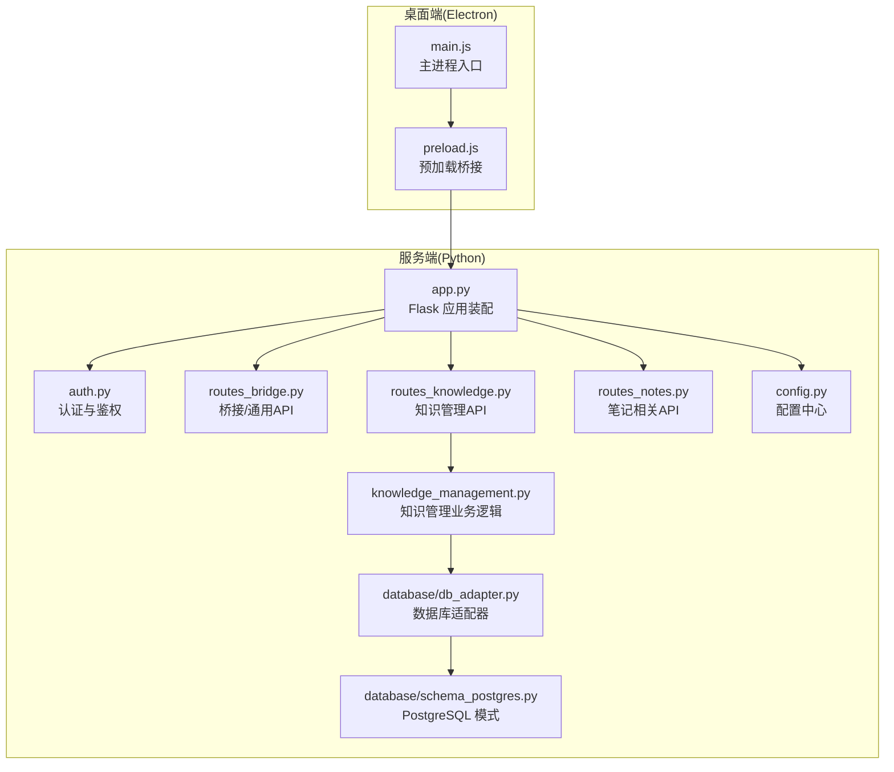
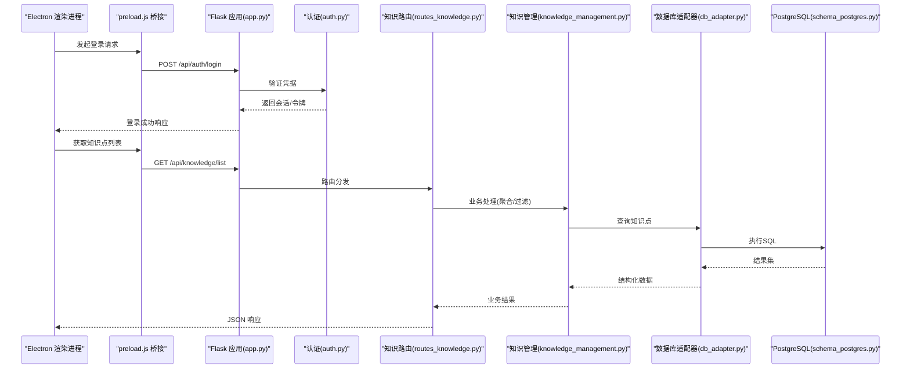
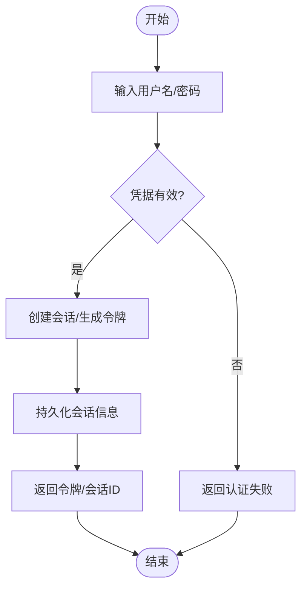
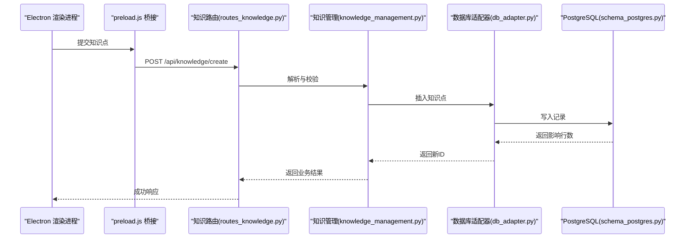
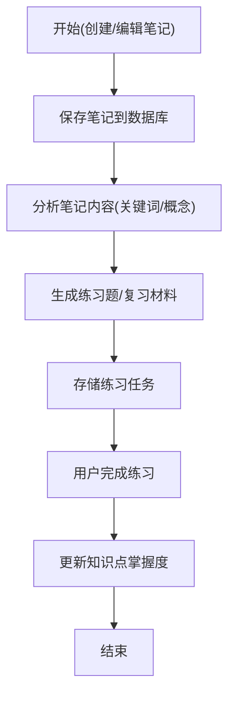
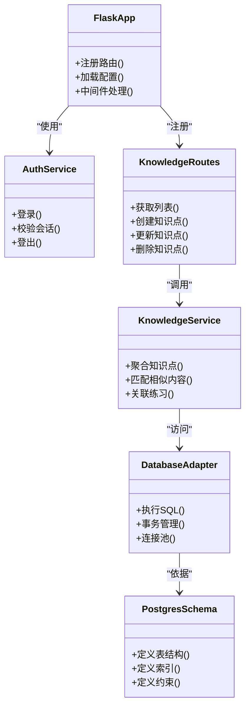
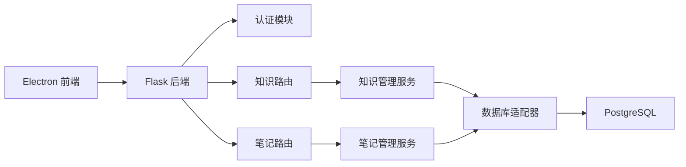

# 系统概览

<cite>
**本文引用的文件**   
- [desktop/main.js](file://desktop/main.js)
- [desktop/preload.js](file://desktop/preload.js)
- [server/app.py](file://server/app.py)
- [server/auth.py](file://server/auth.py)
- [server/routes_bridge.py](file://server/routes_bridge.py)
- [server/routes_knowledge.py](file://server/routes_knowledge.py)
- [server/routes_notes.py](file://server/routes_notes.py)
- [server/knowledge_management.py](file://server/knowledge_management.py)
- [server/database/db_adapter.py](file://server/database/db_adapter.py)
- [server/database/schema_postgres.py](file://server/database/schema_postgres.py)
- [server/config.py](file://server/config.py)
</cite>

## 目录
1. [简介](#简介)
2. [项目结构](#项目结构)
3. [核心组件](#核心组件)
4. [架构总览](#架构总览)
5. [详细组件分析](#详细组件分析)
6. [依赖关系分析](#依赖关系分析)
7. [性能考虑](#性能考虑)
8. [故障排查指南](#故障排查指南)
9. [结论](#结论)

## 简介
本系统为 LectureLearnLoop 的桌面端学习闭环应用，采用“Electron 桌面前端 + Python Web 后端 + 数据库层”的分层架构。Electron 负责用户界面与本地能力（如音频采集、渲染页面），Python 后端提供认证、知识管理、笔记、练习等 API，并通过数据库适配器访问持久化存储。整体目标是围绕“听-记-练-忆”的学习闭环，提供稳定的桌面体验与可扩展的后端服务。

## 项目结构
仓库主要包含以下层次：
- desktop：Electron 主进程与预加载脚本，承载 UI 与本地能力桥接。
- server：Python 后端，包含路由、业务逻辑、模板与静态资源、数据库适配与配置。
- docs：业务规则、交付文档、测试与计划等说明性文档。
- tools：辅助工具脚本。

图表来源
- [desktop/main.js:1-200](file://desktop/main.js#L1-L200)
- [desktop/preload.js:1-200](file://desktop/preload.js#L1-L200)
- [server/app.py:1-200](file://server/app.py#L1-L200)
- [server/auth.py:1-200](file://server/auth.py#L1-L200)
- [server/routes_bridge.py:1-200](file://server/routes_bridge.py#L1-L200)
- [server/routes_knowledge.py:1-200](file://server/routes_knowledge.py#L1-L200)
- [server/routes_notes.py:1-200](file://server/routes_notes.py#L1-L200)
- [server/knowledge_management.py:1-200](file://server/knowledge_management.py#L1-L200)
- [server/database/db_adapter.py:1-200](file://server/database/db_adapter.py#L1-L200)
- [server/database/schema_postgres.py:1-200](file://server/database/schema_postgres.py#L1-L200)
- [server/config.py:1-200](file://server/config.py#L1-L200)

章节来源
- [desktop/main.js:1-200](file://desktop/main.js#L1-L200)
- [desktop/preload.js:1-200](file://desktop/preload.js#L1-L200)
- [server/app.py:1-200](file://server/app.py#L1-L200)
- [server/config.py:1-200](file://server/config.py#L1-L200)

## 核心组件
- Electron 主进程(main.js)：创建窗口、加载页面、处理生命周期事件，并暴露 IPC 通道给渲染进程。
- 预加载脚本(preload.js)：在渲染进程安全地注入桥接方法，调用后端 API。
- Flask 应用(app.py)：装配路由、中间件、模板与静态资源，统一错误处理与配置。
- 认证模块(auth.py)：实现登录、会话/令牌校验、权限控制。
- 桥接路由(routes_bridge.py)：提供跨端通用接口，如状态查询、设备检测、日志上报等。
- 知识管理路由(routes_knowledge.py)：对外暴露知识点增删改查、导入导出、关联练习等接口。
- 笔记路由(routes_notes.py)：提供笔记创建、更新、检索、同步等接口。
- 知识管理业务(knowledge_management.py)：封装知识点聚合、匹配、与练习系统的联动逻辑。
- 数据库适配器(db_adapter.py)：抽象 SQL 执行、事务、连接池等能力，屏蔽底层差异。
- PostgreSQL 模式(schema_postgres.py)：定义表结构、索引、约束等数据模型。
- 配置(config.py)：集中管理后端运行参数、数据库连接、第三方服务密钥等。

章节来源
- [desktop/main.js:1-200](file://desktop/main.js#L1-L200)
- [desktop/preload.js:1-200](file://desktop/preload.js#L1-L200)
- [server/app.py:1-200](file://server/app.py#L1-L200)
- [server/auth.py:1-200](file://server/auth.py#L1-L200)
- [server/routes_bridge.py:1-200](file://server/routes_bridge.py#L1-L200)
- [server/routes_knowledge.py:1-200](file://server/routes_knowledge.py#L1-L200)
- [server/routes_notes.py:1-200](file://server/routes_notes.py#L1-L200)
- [server/knowledge_management.py:1-200](file://server/knowledge_management.py#L1-L200)
- [server/database/db_adapter.py:1-200](file://server/database/db_adapter.py#L1-L200)
- [server/database/schema_postgres.py:1-200](file://server/database/schema_postgres.py#L1-L200)
- [server/config.py:1-200](file://server/config.py#L1-L200)

## 架构总览
系统采用前后端分离的桌面应用架构：
- 前端：Electron 渲染进程通过预加载脚本调用后端 REST API。
- 后端：Flask 提供认证、知识、笔记、桥接等路由；业务逻辑集中在服务层；数据访问通过数据库适配器统一。
- 数据库：使用 PostgreSQL（可通过适配器切换），由 schema 文件定义数据模型。

图表来源
- [desktop/preload.js:1-200](file://desktop/preload.js#L1-L200)
- [server/app.py:1-200](file://server/app.py#L1-L200)
- [server/auth.py:1-200](file://server/auth.py#L1-L200)
- [server/routes_knowledge.py:1-200](file://server/routes_knowledge.py#L1-L200)
- [server/knowledge_management.py:1-200](file://server/knowledge_management.py#L1-L200)
- [server/database/db_adapter.py:1-200](file://server/database/db_adapter.py#L1-L200)
- [server/database/schema_postgres.py:1-200](file://server/database/schema_postgres.py#L1-L200)

## 详细组件分析

### 用户认证流程
认证流程涵盖客户端登录、服务端校验与会话/令牌管理，确保后续请求具备鉴权上下文。

图表来源
- [server/auth.py:1-200](file://server/auth.py#L1-L200)
- [server/app.py:1-200](file://server/app.py#L1-L200)

章节来源
- [server/auth.py:1-200](file://server/auth.py#L1-L200)
- [server/app.py:1-200](file://server/app.py#L1-L200)

### 知识管理流程
知识管理包括知识点的创建、检索、更新、删除以及与练习系统的联动。

图表来源
- [server/routes_knowledge.py:1-200](file://server/routes_knowledge.py#L1-L200)
- [server/knowledge_management.py:1-200](file://server/knowledge_management.py#L1-L200)
- [server/database/db_adapter.py:1-200](file://server/database/db_adapter.py#L1-L200)
- [server/database/schema_postgres.py:1-200](file://server/database/schema_postgres.py#L1-L200)

章节来源
- [server/routes_knowledge.py:1-200](file://server/routes_knowledge.py#L1-L200)
- [server/knowledge_management.py:1-200](file://server/knowledge_management.py#L1-L200)
- [server/database/db_adapter.py:1-200](file://server/database/db_adapter.py#L1-L200)
- [server/database/schema_postgres.py:1-200](file://server/database/schema_postgres.py#L1-L200)

### 笔记与练习联动
笔记作为学习过程中的输入，可被用于生成练习题目或复习材料；练习结果反馈到知识掌握度，形成闭环。

图表来源
- [server/routes_notes.py:1-200](file://server/routes_notes.py#L1-L200)
- [server/knowledge_management.py:1-200](file://server/knowledge_management.py#L1-L200)
- [server/database/db_adapter.py:1-200](file://server/database/db_adapter.py#L1-L200)

章节来源
- [server/routes_notes.py:1-200](file://server/routes_notes.py#L1-L200)
- [server/knowledge_management.py:1-200](file://server/knowledge_management.py#L1-L200)
- [server/database/db_adapter.py:1-200](file://server/database/db_adapter.py#L1-L200)

### 组件类图（后端）

图表来源
- [server/app.py:1-200](file://server/app.py#L1-L200)
- [server/auth.py:1-200](file://server/auth.py#L1-L200)
- [server/routes_knowledge.py:1-200](file://server/routes_knowledge.py#L1-L200)
- [server/knowledge_management.py:1-200](file://server/knowledge_management.py#L1-L200)
- [server/database/db_adapter.py:1-200](file://server/database/db_adapter.py#L1-L200)
- [server/database/schema_postgres.py:1-200](file://server/database/schema_postgres.py#L1-L200)

章节来源
- [server/app.py:1-200](file://server/app.py#L1-L200)
- [server/auth.py:1-200](file://server/auth.py#L1-L200)
- [server/routes_knowledge.py:1-200](file://server/routes_knowledge.py#L1-L200)
- [server/knowledge_management.py:1-200](file://server/knowledge_management.py#L1-L200)
- [server/database/db_adapter.py:1-200](file://server/database/db_adapter.py#L1-L200)
- [server/database/schema_postgres.py:1-200](file://server/database/schema_postgres.py#L1-L200)

## 依赖关系分析
- 前端依赖：Electron 主进程与预加载脚本共同构成前端运行时，通过 HTTP 调用后端 API。
- 后端依赖：Flask 应用装配路由与中间件；认证模块为受保护路由提供鉴权；知识/笔记路由依赖业务服务；业务服务依赖数据库适配器；适配器依赖具体数据库模式。
- 外部依赖：PostgreSQL 作为持久化存储；可能集成第三方 LLM/ASR/TTS 服务（由配置与工厂类管理）。

图表来源
- [desktop/main.js:1-200](file://desktop/main.js#L1-L200)
- [desktop/preload.js:1-200](file://desktop/preload.js#L1-L200)
- [server/app.py:1-200](file://server/app.py#L1-L200)
- [server/auth.py:1-200](file://server/auth.py#L1-L200)
- [server/routes_knowledge.py:1-200](file://server/routes_knowledge.py#L1-L200)
- [server/routes_notes.py:1-200](file://server/routes_notes.py#L1-L200)
- [server/knowledge_management.py:1-200](file://server/knowledge_management.py#L1-L200)
- [server/database/db_adapter.py:1-200](file://server/database/db_adapter.py#L1-L200)
- [server/database/schema_postgres.py:1-200](file://server/database/schema_postgres.py#L1-L200)

章节来源
- [desktop/main.js:1-200](file://desktop/main.js#L1-L200)
- [desktop/preload.js:1-200](file://desktop/preload.js#L1-L200)
- [server/app.py:1-200](file://server/app.py#L1-L200)
- [server/auth.py:1-200](file://server/auth.py#L1-L200)
- [server/routes_knowledge.py:1-200](file://server/routes_knowledge.py#L1-L200)
- [server/routes_notes.py:1-200](file://server/routes_notes.py#L1-L200)
- [server/knowledge_management.py:1-200](file://server/knowledge_management.py#L1-L200)
- [server/database/db_adapter.py:1-200](file://server/database/db_adapter.py#L1-L200)
- [server/database/schema_postgres.py:1-200](file://server/database/schema_postgres.py#L1-L200)

## 性能考虑
- 数据库连接池：通过数据库适配器统一管理连接，减少握手开销，提升并发处理能力。
- 缓存策略：对热点知识点与练习结果进行缓存，降低重复计算与查询压力。
- 异步处理：将耗时操作（如批量导入、LLM 调用）放入后台任务队列，避免阻塞请求。
- 分页与筛选：知识列表与笔记列表支持分页与条件筛选，减少单次传输数据量。
- 前端优化：Electron 渲染进程按需加载页面与资源，避免首屏过重。

[本节为通用指导，不直接分析具体文件]

## 故障排查指南
- 认证失败：检查用户名/密码是否正确、会话是否过期、后端鉴权中间件是否启用。
- 知识接口异常：确认路由是否正确注册、业务服务是否抛出异常、数据库连接是否正常。
- 笔记同步问题：检查笔记路由与业务逻辑是否一致、数据库写入是否成功、是否存在并发冲突。
- 数据库连接失败：核对配置中的连接串、端口、用户名/密码、SSL 设置等。
- 日志定位：查看后端日志输出与前端控制台，结合桥接日志定位请求链路。

章节来源
- [server/auth.py:1-200](file://server/auth.py#L1-L200)
- [server/routes_knowledge.py:1-200](file://server/routes_knowledge.py#L1-L200)
- [server/routes_notes.py:1-200](file://server/routes_notes.py#L1-L200)
- [server/config.py:1-200](file://server/config.py#L1-L200)

## 结论
LectureLearnLoop 以 Electron 桌面端为载体，通过 Python Flask 后端提供认证、知识管理与笔记/练习联动能力，并以 PostgreSQL 作为持久化存储。该架构清晰分层、职责明确，便于扩展与维护。开发者可基于本文档快速理解系统全貌，并在认证、知识、笔记与练习等关键流程上开展二次开发与优化。