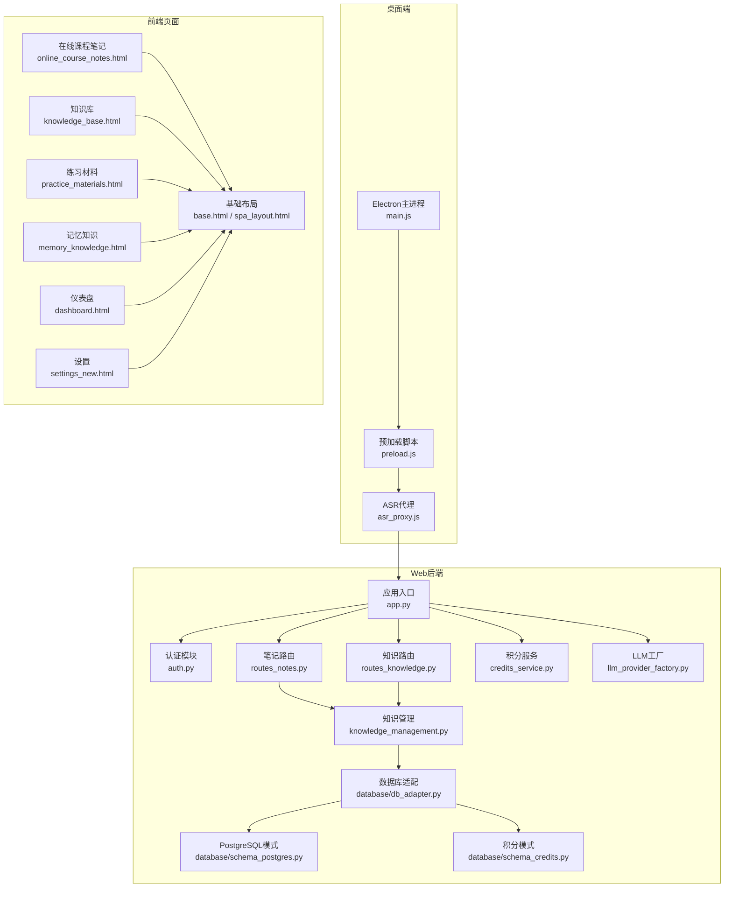
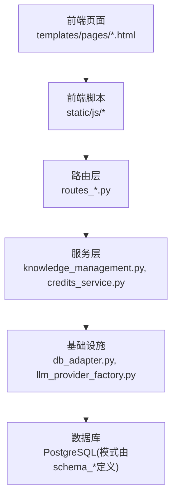
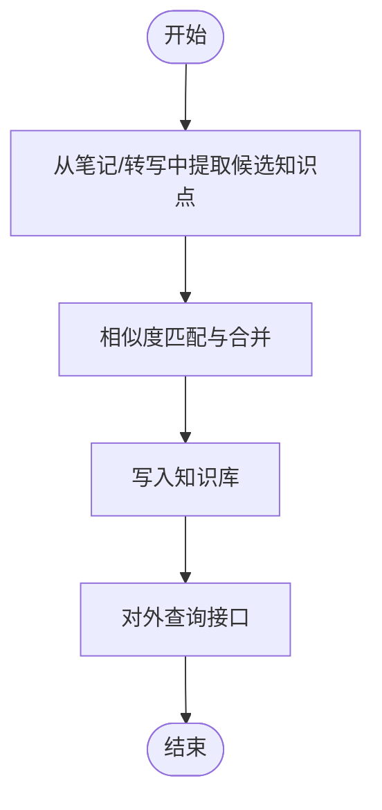
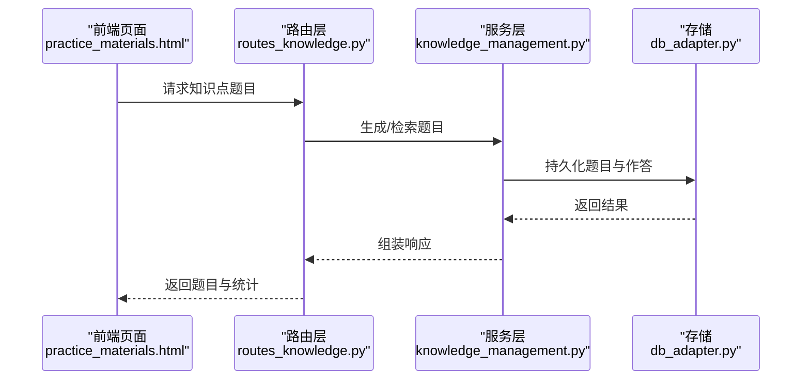
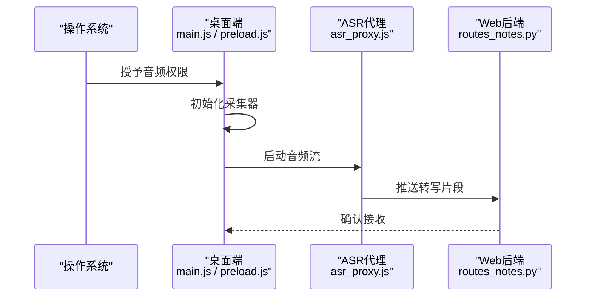
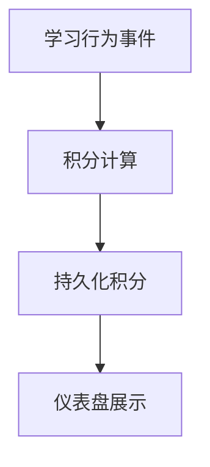
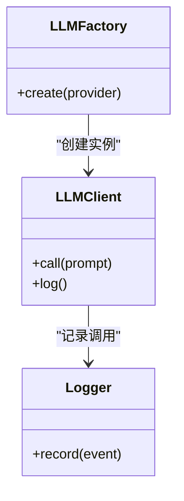
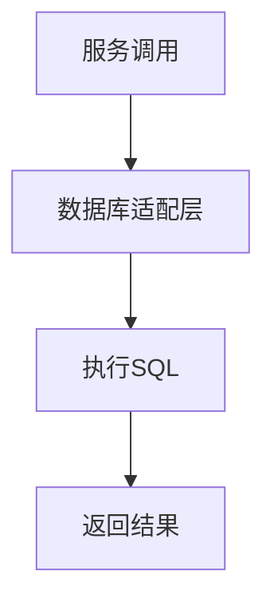
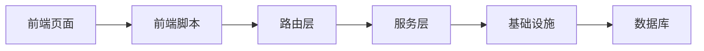

# 项目介绍

<cite>
**本文引用的文件**   
- [app.py](file://server/app.py)
- [config.py](file://server/config.py)
- [auth.py](file://server/auth.py)
- [routes_notes.py](file://server/routes_notes.py)
- [routes_knowledge.py](file://server/routes_knowledge.py)
- [knowledge_management.py](file://server/knowledge_management.py)
- [credits_service.py](file://server/credits_service.py)
- [llm_provider_factory.py](file://server/llm_provider_factory.py)
- [llm_call_logger.py](file://server/llm_call_logger.py)
- [similarity_matcher.py](file://server/similarity_matcher.py)
- [db_adapter.py](file://server/database/db_adapter.py)
- [schema_postgres.py](file://server/database/schema_postgres.py)
- [schema_credits.py](file://server/database/schema_credits.py)
- [error_slicer.py](file://server/services/error_slicer.py)
- [main.js](file://desktop/main.js)
- [preload.js](file://desktop/preload.js)
- [asr_proxy.js](file://desktop/asr_proxy.js)
- [recorder.js](file://server/static/js/recorder.js)
- [api.js](file://server/static/js/api.js)
- [unified_logger.js](file://server/static/js/unified_logger.js)
- [online_course_notes.html](file://server/templates/pages/online_course_notes.html)
- [knowledge_base.html](file://server/templates/pages/knowledge_base.html)
- [practice_materials.html](file://server/templates/pages/practice_materials.html)
- [memory_knowledge.html](file://server/templates/pages/memory_knowledge.html)
- [dashboard.html](file://server/templates/pages/dashboard.html)
- [settings_new.html](file://server/templates/pages/settings_new.html)
- [base.html](file://server/templates/base.html)
- [spa_layout.html](file://server/templates/spa_layout.html)
- [业务规则总览.md](file://docs/业务规则/业务规则总览.md)
- [系统架构梳理.md](file://docs/原则/系统架构梳理.md)
- [练记系统改造方案.md](file://docs/计划/2026-09-28-练记系统改造方案.md)
- [练记系统全功能测试文档.md](file://docs/测试/2026-09-28-练记系统全功能测试文档.md)
</cite>

## 目录
1. [引言](#引言)
2. [项目结构](#项目结构)
3. [核心组件](#核心组件)
4. [架构总览](#架构总览)
5. [详细组件分析](#详细组件分析)
6. [依赖关系分析](#依赖关系分析)
7. [性能与可扩展性](#性能与可扩展性)
8. [故障排查指南](#故障排查指南)
9. [结论](#结论)
10. [附录](#附录)

## 引言
LectureLearnLoop 是一个面向在线课程学习与知识内化的桌面+Web学习管理系统。它围绕“听、记、练、忆”的学习闭环，提供在线课程笔记、知识管理、练习系统与语音处理等核心能力，帮助学习者把课堂内容转化为可检索、可复习、可巩固的知识资产。

- 愿景：让每一次听课都成为一次结构化知识沉淀，让每一次练习都成为一次有效记忆强化。
- 使命：用技术降低知识获取与内化的门槛，提升学习效率与长期记忆效果。
- 核心价值主张：
  - 以“知识点”为中心组织笔记与练习，打通输入到输出的完整链路。
  - 通过语音识别与转写，将课堂音频快速转化为可编辑的文本素材。
  - 借助大模型能力进行智能问答、摘要与错因分析，辅助理解与反思。
  - 以积分与进度可视化驱动持续学习行为。

目标用户群体：
- 在线课程学习者、备考人群、终身学习者
- 教师与助教（用于整理讲义与错题）
- 小型培训团队（需要统一知识库与练习体系）

典型使用场景：
- 边听直播或回放边做结构化笔记，自动转写并标注关键知识点
- 基于知识点生成练习题，完成“学-练-测-评”闭环
- 对错题进行错因分析与重复训练，形成个性化复习路径
- 在桌面端录制系统音或麦克风音，实时转写并同步到网页端

## 项目结构
项目采用“桌面客户端 + Web后端 + 模板前端”的分层架构：
- 桌面端（Electron）：负责音频采集、ASR代理、本地桥接与系统集成
- Web后端（Python）：提供路由、认证、知识管理、积分服务、LLM调用、数据库适配等
- 前端页面（Jinja模板 + 少量JS）：承载在线课程笔记、知识库、练习、记忆与设置等界面



图示来源
- [main.js:1-200](file://desktop/main.js#L1-L200)
- [preload.js:1-200](file://desktop/preload.js#L1-L200)
- [asr_proxy.js:1-200](file://desktop/asr_proxy.js#L1-L200)
- [app.py:1-200](file://server/app.py#L1-L200)
- [auth.py:1-200](file://server/auth.py#L1-L200)
- [routes_notes.py:1-200](file://server/routes_notes.py#L1-L200)
- [routes_knowledge.py:1-200](file://server/routes_knowledge.py#L1-L200)
- [knowledge_management.py:1-200](file://server/knowledge_management.py#L1-L200)
- [db_adapter.py:1-200](file://server/database/db_adapter.py#L1-L200)
- [schema_postgres.py:1-200](file://server/database/schema_postgres.py#L1-L200)
- [schema_credits.py:1-200](file://server/database/schema_credits.py#L1-L200)

章节来源
- [系统架构梳理.md](file://docs/原则/系统架构梳理.md)
- [app.py:1-200](file://server/app.py#L1-L200)
- [main.js:1-200](file://desktop/main.js#L1-L200)

## 核心组件
- 在线课程笔记：支持从音频转写流中抽取要点、按知识点组织笔记，并与练习和记忆模块联动。
- 知识管理：以知识点为核心实体，提供创建、检索、关联、相似度匹配与可视化展示。
- 练习系统：基于知识点生成题目、记录作答结果、统计错误类型，并驱动复习策略。
- 语音处理：桌面端采集系统音/麦克风音，经ASR代理转写为文本流，供笔记与知识提取使用。
- 积分与进度：通过积分服务记录学习行为，支撑激励与进度追踪。
- LLM集成：通过工厂模式接入不同大模型提供商，提供智能问答、摘要、错因分析等能力。
- 数据持久化：通过数据库适配层抽象存储实现，当前包含PostgreSQL模式与积分模式定义。

章节来源
- [routes_notes.py:1-200](file://server/routes_notes.py#L1-L200)
- [routes_knowledge.py:1-200](file://server/routes_knowledge.py#L1-L200)
- [knowledge_management.py:1-200](file://server/knowledge_management.py#L1-L200)
- [credits_service.py:1-200](file://server/credits_service.py#L1-L200)
- [llm_provider_factory.py:1-200](file://server/llm_provider_factory.py#L1-L200)
- [db_adapter.py:1-200](file://server/database/db_adapter.py#L1-L200)
- [schema_postgres.py:1-200](file://server/database/schema_postgres.py#L1-L200)
- [schema_credits.py:1-200](file://server/database/schema_credits.py#L1-L200)

## 架构总览
系统遵循分层与职责分离原则：
- 表现层：HTML模板与少量JS，承载页面交互与状态提示
- 应用层：路由与控制器，协调业务用例
- 领域层：知识管理、积分服务等核心业务能力
- 基础设施层：数据库适配、LLM工厂、日志与配置



图示来源
- [online_course_notes.html:1-200](file://server/templates/pages/online_course_notes.html#L1-L200)
- [knowledge_base.html:1-200](file://server/templates/pages/knowledge_base.html#L1-L200)
- [practice_materials.html:1-200](file://server/templates/pages/practice_materials.html#L1-L200)
- [memory_knowledge.html:1-200](file://server/templates/pages/memory_knowledge.html#L1-L200)
- [dashboard.html:1-200](file://server/templates/pages/dashboard.html#L1-L200)
- [settings_new.html:1-200](file://server/templates/pages/settings_new.html#L1-L200)
- [routes_notes.py:1-200](file://server/routes_notes.py#L1-L200)
- [routes_knowledge.py:1-200](file://server/routes_knowledge.py#L1-L200)
- [knowledge_management.py:1-200](file://server/knowledge_management.py#L1-L200)
- [credits_service.py:1-200](file://server/credits_service.py#L1-L200)
- [db_adapter.py:1-200](file://server/database/db_adapter.py#L1-L200)
- [schema_postgres.py:1-200](file://server/database/schema_postgres.py#L1-L200)
- [schema_credits.py:1-200](file://server/database/schema_credits.py#L1-L200)

## 详细组件分析

### 在线课程笔记组件
- 功能要点：
  - 接收来自ASR代理的转写文本流，按时间轴或段落组织笔记
  - 支持知识点标记、关键词高亮、段落折叠与搜索
  - 与练习系统联动，将笔记中的知识点映射到对应练习
- 关键流程：
  - 桌面端采集音频 -> ASR代理转写 -> Web后端路由接收 -> 笔记服务解析 -> 存储与渲染

```mermaid
sequenceDiagram
participant DESK as "桌面端<br/>asr_proxy.js"
participant WEB as "Web后端<br/>routes_notes.py"
participant NOTE as "笔记服务<br/>routes_notes.py"
participant STORE as "存储<br/>db_adapter.py"
participant UI as "前端页面<br/>online_course_notes.html"
DESK->>WEB : 推送转写片段
WEB->>NOTE : 解析与清洗
NOTE->>STORE : 保存笔记片段
STORE-->>NOTE : 返回持久化结果
NOTE-->>UI : 返回渲染数据
UI-->>DESK : 更新界面显示
```

图示来源
- [asr_proxy.js:1-200](file://desktop/asr_proxy.js#L1-L200)
- [routes_notes.py:1-200](file://server/routes_notes.py#L1-L200)
- [db_adapter.py:1-200](file://server/database/db_adapter.py#L1-L200)
- [online_course_notes.html:1-200](file://server/templates/pages/online_course_notes.html#L1-L200)

章节来源
- [routes_notes.py:1-200](file://server/routes_notes.py#L1-L200)
- [online_course_notes.html:1-200](file://server/templates/pages/online_course_notes.html#L1-L200)

### 知识管理组件
- 功能要点：
  - 知识点CRUD、标签与分类、知识点间关联
  - 相似度匹配，辅助合并与去重
  - 与练习、记忆模块共享知识点ID，保证一致性
- 关键流程：
  - 从笔记中提取知识点 -> 相似度匹配 -> 入库 -> 对外暴露查询接口



图示来源
- [routes_knowledge.py:1-200](file://server/routes_knowledge.py#L1-L200)
- [knowledge_management.py:1-200](file://server/knowledge_management.py#L1-L200)
- [similarity_matcher.py:1-200](file://server/similarity_matcher.py#L1-L200)
- [db_adapter.py:1-200](file://server/database/db_adapter.py#L1-L200)

章节来源
- [routes_knowledge.py:1-200](file://server/routes_knowledge.py#L1-L200)
- [knowledge_management.py:1-200](file://server/knowledge_management.py#L1-L200)
- [similarity_matcher.py:1-200](file://server/similarity_matcher.py#L1-L200)

### 练习系统组件
- 功能要点：
  - 基于知识点生成题目，记录作答与错误类型
  - 支持按知识点维度统计正确率与薄弱点
  - 与记忆模块联动，驱动间隔复习
- 关键流程：
  - 选择知识点 -> 生成/拉取题目 -> 作答 -> 记录结果 -> 统计与反馈



图示来源
- [practice_materials.html:1-200](file://server/templates/pages/practice_materials.html#L1-L200)
- [routes_knowledge.py:1-200](file://server/routes_knowledge.py#L1-L200)
- [knowledge_management.py:1-200](file://server/knowledge_management.py#L1-L200)
- [db_adapter.py:1-200](file://server/database/db_adapter.py#L1-L200)

章节来源
- [practice_materials.html:1-200](file://server/templates/pages/practice_materials.html#L1-L200)
- [routes_knowledge.py:1-200](file://server/routes_knowledge.py#L1-L200)
- [knowledge_management.py:1-200](file://server/knowledge_management.py#L1-L200)

### 语音处理组件
- 功能要点：
  - 桌面端采集系统音或麦克风音
  - 通过ASR代理将音频流转为文本片段
  - 与笔记与知识管理模块对接，形成端到端流水线
- 关键流程：
  - 设备检测与权限申请 -> 音频采集 -> 转写 -> 传输至Web后端



图示来源
- [main.js:1-200](file://desktop/main.js#L1-L200)
- [preload.js:1-200](file://desktop/preload.js#L1-L200)
- [asr_proxy.js:1-200](file://desktop/asr_proxy.js#L1-L200)
- [routes_notes.py:1-200](file://server/routes_notes.py#L1-L200)

章节来源
- [main.js:1-200](file://desktop/main.js#L1-L200)
- [preload.js:1-200](file://desktop/preload.js#L1-L200)
- [asr_proxy.js:1-200](file://desktop/asr_proxy.js#L1-L200)
- [routes_notes.py:1-200](file://server/routes_notes.py#L1-L200)

### 积分与进度组件
- 功能要点：
  - 记录学习行为（听课、记笔记、做题、复习）
  - 计算积分与等级，支撑激励与排行榜
  - 与仪表盘页面联动，展示进度与成就
- 关键流程：
  - 行为事件触发 -> 积分服务计算 -> 持久化 -> 仪表盘展示



图示来源
- [credits_service.py:1-200](file://server/credits_service.py#L1-L200)
- [schema_credits.py:1-200](file://server/database/schema_credits.py#L1-L200)
- [dashboard.html:1-200](file://server/templates/pages/dashboard.html#L1-L200)

章节来源
- [credits_service.py:1-200](file://server/credits_service.py#L1-L200)
- [schema_credits.py:1-200](file://server/database/schema_credits.py#L1-L200)
- [dashboard.html:1-200](file://server/templates/pages/dashboard.html#L1-L200)

### LLM集成组件
- 功能要点：
  - 通过工厂模式接入不同LLM提供商，统一调用接口
  - 支持智能问答、摘要、错因分析等场景
  - 调用日志记录，便于审计与调试
- 关键流程：
  - 选择提供商 -> 构建客户端 -> 发起调用 -> 记录日志 -> 返回结果



图示来源
- [llm_provider_factory.py:1-200](file://server/llm_provider_factory.py#L1-L200)
- [llm_call_logger.py:1-200](file://server/llm_call_logger.py#L1-L200)

章节来源
- [llm_provider_factory.py:1-200](file://server/llm_provider_factory.py#L1-L200)
- [llm_call_logger.py:1-200](file://server/llm_call_logger.py#L1-L200)

### 数据持久化组件
- 功能要点：
  - 通过数据库适配层屏蔽底层差异
  - 定义PostgreSQL与积分相关表结构
  - 提供事务、连接池与错误封装
- 关键流程：
  - 路由/服务调用 -> 适配层执行SQL -> 返回结果对象



图示来源
- [db_adapter.py:1-200](file://server/database/db_adapter.py#L1-L200)
- [schema_postgres.py:1-200](file://server/database/schema_postgres.py#L1-L200)
- [schema_credits.py:1-200](file://server/database/schema_credits.py#L1-L200)

章节来源
- [db_adapter.py:1-200](file://server/database/db_adapter.py#L1-L200)
- [schema_postgres.py:1-200](file://server/database/schema_postgres.py#L1-L200)
- [schema_credits.py:1-200](file://server/database/schema_credits.py#L1-L200)

## 依赖关系分析
- 组件耦合：
  - 路由层依赖服务层，服务层依赖基础设施层（数据库、LLM工厂）
  - 前端页面依赖静态JS脚本与模板基座
- 外部依赖：
  - 桌面端依赖Electron运行时与系统音频API
  - Web后端依赖数据库与可选LLM提供商
- 潜在风险：
  - 若ASR代理不稳定，会影响笔记实时性与完整性
  - LLM调用失败需具备降级与重试机制



图示来源
- [online_course_notes.html:1-200](file://server/templates/pages/online_course_notes.html#L1-L200)
- [api.js:1-200](file://server/static/js/api.js#L1-L200)
- [routes_notes.py:1-200](file://server/routes_notes.py#L1-L200)
- [knowledge_management.py:1-200](file://server/knowledge_management.py#L1-L200)
- [db_adapter.py:1-200](file://server/database/db_adapter.py#L1-L200)

章节来源
- [api.js:1-200](file://server/static/js/api.js#L1-L200)
- [routes_notes.py:1-200](file://server/routes_notes.py#L1-L200)
- [knowledge_management.py:1-200](file://server/knowledge_management.py#L1-L200)
- [db_adapter.py:1-200](file://server/database/db_adapter.py#L1-L200)

## 性能与可扩展性
- 性能考虑：
  - 音频转写建议分片处理，避免长连接阻塞
  - 知识库相似度匹配应缓存热点知识点，减少重复计算
  - 积分计算与统计可异步批处理，降低实时压力
- 可扩展性：
  - LLM工厂支持多提供商扩展，便于替换与升级
  - 数据库适配层便于迁移或增加新存储后端
  - 前端模板与JS脚本可按功能域拆分，提升可维护性

[本节为通用指导，不直接分析具体文件]

## 故障排查指南
- 常见问题定位：
  - 音频采集失败：检查桌面端权限与设备枚举逻辑
  - 转写延迟或中断：检查ASR代理与网络状况
  - 知识点未入库：检查相似度阈值与去重逻辑
  - 积分不增长：检查行为事件是否触发与积分规则配置
- 工具与日志：
  - 统一日志脚本用于前端与后端日志聚合
  - 错误切片服务用于错误归因与分段定位

章节来源
- [unified_logger.js:1-200](file://server/static/js/unified_logger.js#L1-L200)
- [error_slicer.py:1-200](file://server/services/error_slicer.py#L1-L200)

## 结论
LectureLearnLoop以“知识点”为核心，串联在线课程笔记、知识管理、练习系统与语音处理，构建了从输入到输出、从理解到记忆的完整学习闭环。通过桌面端与Web后端的协同、LLM能力的引入以及积分激励机制，项目在提升学习效率与长期记忆效果方面具有显著价值。未来可在ASR稳定性、相似度算法与练习生成质量上持续优化，进一步释放学习者的潜能。

[本节为总结性内容，不直接分析具体文件]

## 附录
- 业务规则总览：明确知识点、练习、积分等核心概念与规则边界
- 系统架构梳理：阐述分层设计、职责划分与演进路线
- 练记系统改造方案：规划练习与记忆模块的迭代方向
- 全功能测试文档：覆盖端到端测试用例与验收标准

章节来源
- [业务规则总览.md](file://docs/业务规则/业务规则总览.md)
- [系统架构梳理.md](file://docs/原则/系统架构梳理.md)
- [练记系统改造方案.md](file://docs/计划/2026-09-28-练记系统改造方案.md)
- [练记系统全功能测试文档.md](file://docs/测试/2026-09-28-练记系统全功能测试文档.md)