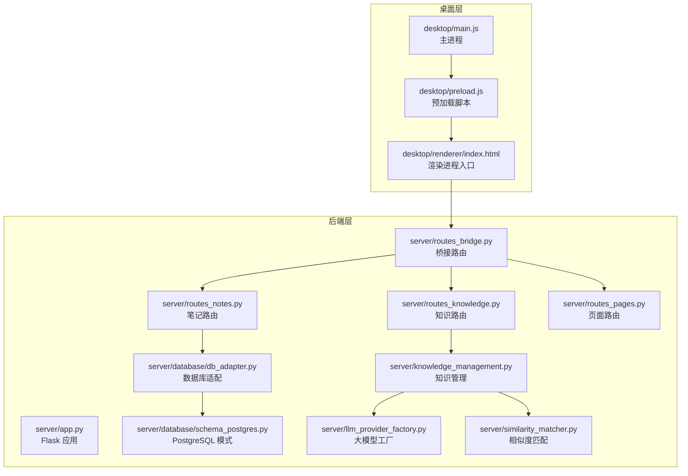
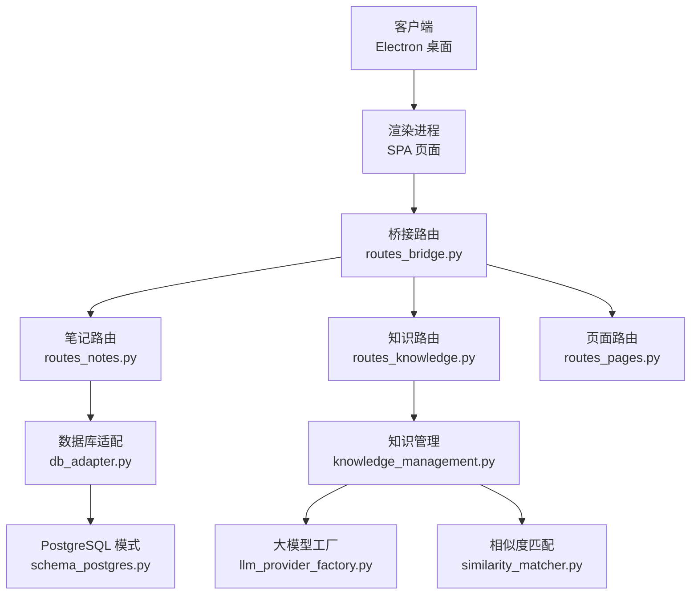
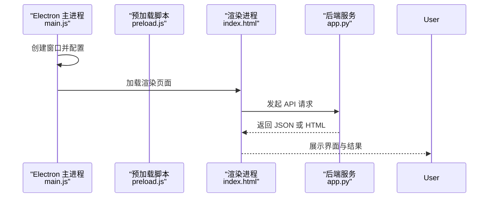
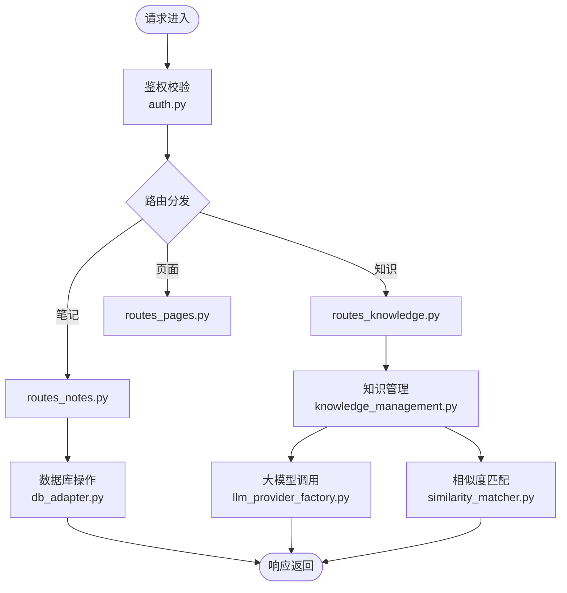
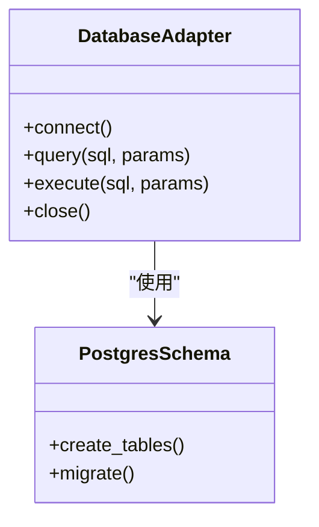
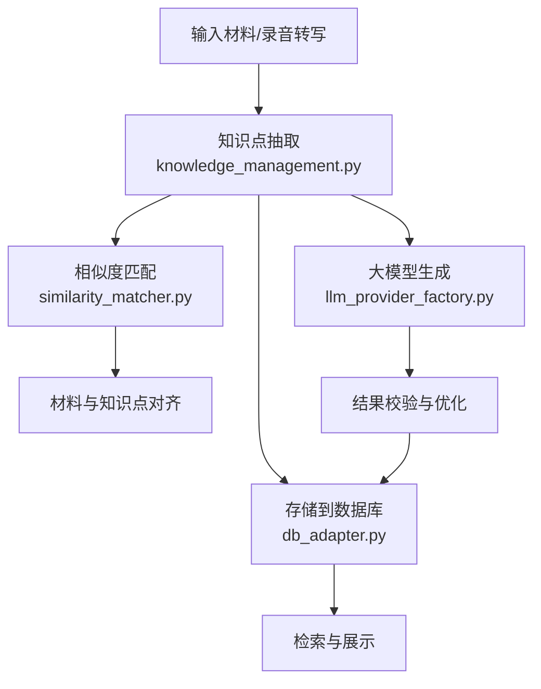
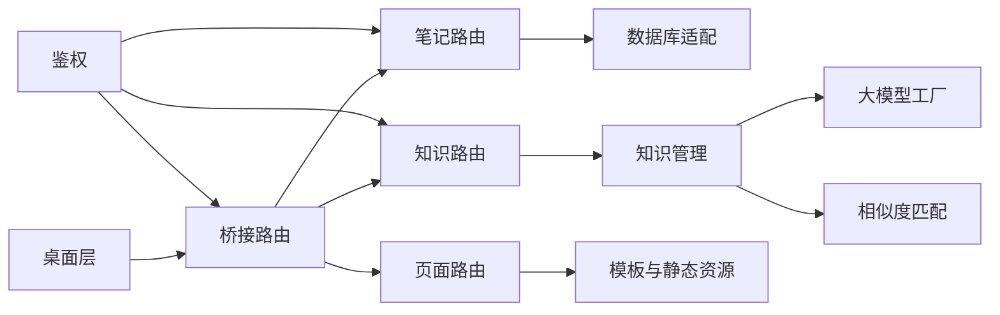

# 项目概述

<cite>
**本文引用的文件**   
- [start_app.ps1](file://start_app.ps1)
- [desktop/main.js](file://desktop/main.js)
- [desktop/preload.js](file://desktop/preload.js)
- [desktop/renderer/index.html](file://desktop/renderer/index.html)
- [server/app.py](file://server/app.py)
- [server/config.py](file://server/config.py)
- [server/auth.py](file://server/auth.py)
- [server/routes_notes.py](file://server/routes_notes.py)
- [server/routes_knowledge.py](file://server/routes_knowledge.py)
- [server/routes_bridge.py](file://server/routes_bridge.py)
- [server/routes_pages.py](file://server/routes_pages.py)
- [server/templates/spa_layout.html](file://server/templates/spa_layout.html)
- [server/database/db_adapter.py](file://server/database/db_adapter.py)
- [server/database/schema_postgres.py](file://server/database/schema_postgres.py)
- [server/knowledge_management.py](file://server/knowledge_management.py)
- [server/llm_provider_factory.py](file://server/llm_provider_factory.py)
- [server/similarity_matcher.py](file://server/similarity_matcher.py)
- [AGENTS.md](file://AGENTS.md)
</cite>

## 目录
1. [引言](#引言)
2. [项目结构](#项目结构)
3. [核心组件](#核心组件)
4. [架构总览](#架构总览)
5. [详细组件分析](#详细组件分析)
6. [依赖关系分析](#依赖关系分析)
7. [性能与可扩展性](#性能与可扩展性)
8. [快速开始指南](#快速开始指南)
9. [故障排查](#故障排查)
10. [结论](#结论)

## 引言
LectureLearnLoop（简称“练记系统”）是一个面向在线课程学习与知识内化的桌面学习管理系统。它以 Electron 作为桌面壳，Python Flask 作为后端服务，结合数据库、大模型调用与语音处理等能力，提供在线课程笔记、知识管理、练习系统与语音转写等核心功能。系统通过前后端分离的 SPA 页面与桥接路由，将桌面交互、Web 界面与后端业务逻辑解耦，便于扩展与维护。

从业务价值看，该系统帮助学习者：
- 在观看在线课程时同步生成结构化笔记，沉淀关键知识点；
- 对知识点进行检索、关联与可视化，形成个人知识库；
- 基于知识点自动生成练习题并闭环训练，提升记忆与理解；
- 利用语音转写与文本相似度匹配，辅助课堂录音整理与内容对齐；
- 以统一入口和跨平台桌面体验，降低使用门槛，提高学习效率。

## 项目结构
仓库采用多模块组织方式，主要包含：
- desktop：Electron 桌面应用，负责窗口管理、渲染进程初始化、与后端桥接通信；
- server：Flask 后端服务，包含路由、模板、静态资源、数据库适配、业务服务与大模型集成；
- docs：项目文档、测试与计划；
- tools：工具脚本；
- start_app.ps1：一键启动脚本，协调桌面与后端服务。

图表来源
- [desktop/main.js:1-200](file://desktop/main.js#L1-L200)
- [desktop/preload.js:1-200](file://desktop/preload.js#L1-L200)
- [desktop/renderer/index.html:1-200](file://desktop/renderer/index.html#L1-L200)
- [server/app.py:1-200](file://server/app.py#L1-L200)
- [server/routes_notes.py:1-200](file://server/routes_notes.py#L1-L200)
- [server/routes_knowledge.py:1-200](file://server/routes_knowledge.py#L1-L200)
- [server/routes_bridge.py:1-200](file://server/routes_bridge.py#L1-L200)
- [server/routes_pages.py:1-200](file://server/routes_pages.py#L1-L200)
- [server/database/db_adapter.py:1-200](file://server/database/db_adapter.py#L1-L200)
- [server/database/schema_postgres.py:1-200](file://server/database/schema_postgres.py#L1-L200)
- [server/knowledge_management.py:1-200](file://server/knowledge_management.py#L1-L200)
- [server/llm_provider_factory.py:1-200](file://server/llm_provider_factory.py#L1-L200)
- [server/similarity_matcher.py:1-200](file://server/similarity_matcher.py#L1-L200)

章节来源
- [start_app.ps1:1-200](file://start_app.ps1#L1-L200)
- [desktop/main.js:1-200](file://desktop/main.js#L1-L200)
- [server/app.py:1-200](file://server/app.py#L1-L200)

## 核心组件
- 桌面应用（Electron）
  - 主进程负责创建窗口、生命周期管理与与后端通信；
  - 预加载脚本暴露安全 API 给渲染进程；
  - 渲染进程承载前端 SPA 页面，负责用户交互与数据展示。
- 后端服务（Flask）
  - 应用入口注册蓝图与中间件；
  - 路由层按功能划分：笔记、知识、桥接、页面；
  - 数据库适配层封装连接与查询；
  - 业务服务层实现知识管理、相似度匹配与大模型调用；
  - 模板与静态资源支撑 SPA 页面与服务端渲染。
- 数据库
  - 支持 SQLite 与 PostgreSQL，通过适配器抽象；
  - 提供模式定义与迁移脚本。
- 大模型与语音处理
  - 大模型提供商工厂统一管理不同 LLM 接入；
  - 相似度匹配用于知识点与材料对齐；
  - 语音转写通过桥接路由与桌面侧 ASR 代理协作。

章节来源
- [desktop/main.js:1-200](file://desktop/main.js#L1-L200)
- [desktop/preload.js:1-200](file://desktop/preload.js#L1-L200)
- [desktop/renderer/index.html:1-200](file://desktop/renderer/index.html#L1-L200)
- [server/app.py:1-200](file://server/app.py#L1-L200)
- [server/routes_notes.py:1-200](file://server/routes_notes.py#L1-L200)
- [server/routes_knowledge.py:1-200](file://server/routes_knowledge.py#L1-L200)
- [server/routes_bridge.py:1-200](file://server/routes_bridge.py#L1-L200)
- [server/routes_pages.py:1-200](file://server/routes_pages.py#L1-L200)
- [server/database/db_adapter.py:1-200](file://server/database/db_adapter.py#L1-L200)
- [server/database/schema_postgres.py:1-200](file://server/database/schema_postgres.py#L1-L200)
- [server/knowledge_management.py:1-200](file://server/knowledge_management.py#L1-L200)
- [server/llm_provider_factory.py:1-200](file://server/llm_provider_factory.py#L1-L200)
- [server/similarity_matcher.py:1-200](file://server/similarity_matcher.py#L1-L200)

## 架构总览
系统采用“桌面 + Web + 后端 + 数据库”的分层架构：
- 桌面层：Electron 提供跨平台桌面体验，承载渲染进程与本地能力；
- 前端层：SPA 页面由 Flask 模板与静态资源驱动，通过桥接路由与后端交互；
- 后端层：Flask 路由分发到各业务模块，统一鉴权与日志；
- 数据层：数据库适配器屏蔽底层差异，提供一致的数据访问接口；
- 智能层：大模型工厂与相似度匹配为知识管理与练习生成提供能力。

图表来源
- [desktop/renderer/index.html:1-200](file://desktop/renderer/index.html#L1-L200)
- [server/routes_bridge.py:1-200](file://server/routes_bridge.py#L1-L200)
- [server/routes_notes.py:1-200](file://server/routes_notes.py#L1-L200)
- [server/routes_knowledge.py:1-200](file://server/routes_knowledge.py#L1-L200)
- [server/routes_pages.py:1-200](file://server/routes_pages.py#L1-L200)
- [server/database/db_adapter.py:1-200](file://server/database/db_adapter.py#L1-L200)
- [server/database/schema_postgres.py:1-200](file://server/database/schema_postgres.py#L1-L200)
- [server/knowledge_management.py:1-200](file://server/knowledge_management.py#L1-L200)
- [server/llm_provider_factory.py:1-200](file://server/llm_provider_factory.py#L1-L200)
- [server/similarity_matcher.py:1-200](file://server/similarity_matcher.py#L1-L200)

## 详细组件分析

### 桌面应用（Electron）
- 主进程 main.js：负责创建 BrowserWindow、加载渲染页面、监听生命周期事件、与后端桥接通信；
- 预加载 preload.js：注入安全 API，隔离渲染进程与 Node 环境；
- 渲染进程 index.html：加载 SPA 页面，发起 HTTP 请求至后端桥接路由。

图表来源
- [desktop/main.js:1-200](file://desktop/main.js#L1-L200)
- [desktop/preload.js:1-200](file://desktop/preload.js#L1-L200)
- [desktop/renderer/index.html:1-200](file://desktop/renderer/index.html#L1-L200)
- [server/app.py:1-200](file://server/app.py#L1-L200)

章节来源
- [desktop/main.js:1-200](file://desktop/main.js#L1-L200)
- [desktop/preload.js:1-200](file://desktop/preload.js#L1-L200)
- [desktop/renderer/index.html:1-200](file://desktop/renderer/index.html#L1-L200)

### 后端服务（Flask）
- app.py：应用初始化、蓝图注册、中间件与错误处理；
- routes_notes.py：笔记相关接口，包括创建、更新、查询与删除；
- routes_knowledge.py：知识管理接口，包括知识点增删改查、与材料关联；
- routes_bridge.py：桥接路由，统一对外暴露 API，转发到具体业务路由；
- routes_pages.py：服务端渲染页面与 SPA 布局；
- auth.py：鉴权与用户会话管理；
- config.py：配置项与环境变量管理。

图表来源
- [server/app.py:1-200](file://server/app.py#L1-L200)
- [server/auth.py:1-200](file://server/auth.py#L1-L200)
- [server/routes_notes.py:1-200](file://server/routes_notes.py#L1-L200)
- [server/routes_knowledge.py:1-200](file://server/routes_knowledge.py#L1-L200)
- [server/routes_pages.py:1-200](file://server/routes_pages.py#L1-L200)
- [server/database/db_adapter.py:1-200](file://server/database/db_adapter.py#L1-L200)
- [server/knowledge_management.py:1-200](file://server/knowledge_management.py#L1-L200)
- [server/llm_provider_factory.py:1-200](file://server/llm_provider_factory.py#L1-L200)
- [server/similarity_matcher.py:1-200](file://server/similarity_matcher.py#L1-L200)

章节来源
- [server/app.py:1-200](file://server/app.py#L1-L200)
- [server/auth.py:1-200](file://server/auth.py#L1-L200)
- [server/routes_notes.py:1-200](file://server/routes_notes.py#L1-L200)
- [server/routes_knowledge.py:1-200](file://server/routes_knowledge.py#L1-L200)
- [server/routes_pages.py:1-200](file://server/routes_pages.py#L1-L200)

### 数据库与模式
- db_adapter.py：数据库连接与查询封装，支持 SQLite 与 PostgreSQL；
- schema_postgres.py：PostgreSQL 表结构与约束定义；
- 其他 schema 文件：如 credits 相关模式。

图表来源
- [server/database/db_adapter.py:1-200](file://server/database/db_adapter.py#L1-L200)
- [server/database/schema_postgres.py:1-200](file://server/database/schema_postgres.py#L1-L200)

章节来源
- [server/database/db_adapter.py:1-200](file://server/database/db_adapter.py#L1-L200)
- [server/database/schema_postgres.py:1-200](file://server/database/schema_postgres.py#L1-L200)

### 知识管理与智能能力
- knowledge_management.py：知识点抽取、关联、存储与检索；
- llm_provider_factory.py：大模型提供商工厂，统一调用不同 LLM；
- similarity_matcher.py：文本相似度匹配，用于知识点与材料对齐。

图表来源
- [server/knowledge_management.py:1-200](file://server/knowledge_management.py#L1-L200)
- [server/llm_provider_factory.py:1-200](file://server/llm_provider_factory.py#L1-L200)
- [server/similarity_matcher.py:1-200](file://server/similarity_matcher.py#L1-L200)
- [server/database/db_adapter.py:1-200](file://server/database/db_adapter.py#L1-L200)

章节来源
- [server/knowledge_management.py:1-200](file://server/knowledge_management.py#L1-L200)
- [server/llm_provider_factory.py:1-200](file://server/llm_provider_factory.py#L1-L200)
- [server/similarity_matcher.py:1-200](file://server/similarity_matcher.py#L1-L200)

## 依赖关系分析
- 桌面层依赖后端桥接路由进行数据交互；
- 后端路由层依赖数据库适配与业务服务；
- 知识管理依赖大模型工厂与相似度匹配；
- 页面路由依赖模板与静态资源；
- 鉴权模块贯穿所有需要认证的接口。

图表来源
- [desktop/main.js:1-200](file://desktop/main.js#L1-L200)
- [server/routes_bridge.py:1-200](file://server/routes_bridge.py#L1-L200)
- [server/routes_notes.py:1-200](file://server/routes_notes.py#L1-L200)
- [server/routes_knowledge.py:1-200](file://server/routes_knowledge.py#L1-L200)
- [server/routes_pages.py:1-200](file://server/routes_pages.py#L1-L200)
- [server/database/db_adapter.py:1-200](file://server/database/db_adapter.py#L1-L200)
- [server/knowledge_management.py:1-200](file://server/knowledge_management.py#L1-L200)
- [server/llm_provider_factory.py:1-200](file://server/llm_provider_factory.py#L1-L200)
- [server/similarity_matcher.py:1-200](file://server/similarity_matcher.py#L1-L200)
- [server/auth.py:1-200](file://server/auth.py#L1-L200)

章节来源
- [server/app.py:1-200](file://server/app.py#L1-L200)
- [server/auth.py:1-200](file://server/auth.py#L1-L200)

## 性能与可扩展性
- 路由分层清晰，便于横向扩展新功能模块；
- 数据库适配层屏蔽底层差异，支持多引擎切换；
- 大模型工厂支持多提供商接入，便于替换与升级；
- 相似度匹配可独立优化算法与缓存策略；
- 桌面与后端解耦，便于独立迭代与部署。

[本节为通用指导，不直接分析具体文件]

## 快速开始指南
- 环境要求
  - Python 3.x 与 pip；
  - Node.js 与 npm；
  - 可选：PostgreSQL（默认支持 SQLite）。
- 安装步骤
  - 克隆仓库；
  - 安装后端依赖：pip install -r server/requirements.txt；
  - 安装桌面依赖：cd desktop && npm install；
  - 配置环境变量（数据库连接、LLM 密钥等）；
  - 运行后端服务：python server/app.py；
  - 启动桌面应用：双击 start_app.ps1 或在 desktop 目录执行 npm start。
- 基本使用方法
  - 打开桌面应用后，登录系统；
  - 在“在线课程笔记”中记录要点，保存至知识库；
  - 在“知识管理”中查看、编辑与关联知识点；
  - 在“练习系统”中基于知识点生成练习题并进行训练；
  - 使用语音转写功能上传或录制音频，自动提取知识点。

章节来源
- [start_app.ps1:1-200](file://start_app.ps1#L1-L200)
- [server/app.py:1-200](file://server/app.py#L1-L200)
- [AGENTS.md:1-200](file://AGENTS.md#L1-L200)

## 故障排查
- 无法启动后端服务
  - 检查 Python 环境与依赖是否安装；
  - 确认数据库连接配置正确；
  - 查看服务器日志输出定位错误。
- 桌面应用无法连接后端
  - 确认后端服务已启动且端口可达；
  - 检查桥接路由地址与 CORS 设置；
  - 查看浏览器控制台与网络请求。
- 语音转写失败
  - 检查音频设备权限与格式；
  - 确认 ASR 代理与后端桥接正常；
  - 查看日志中的错误码与提示信息。
- 大模型调用异常
  - 检查密钥与配额；
  - 验证提供商工厂配置；
  - 查看调用日志与重试策略。

章节来源
- [server/app.py:1-200](file://server/app.py#L1-L200)
- [server/routes_bridge.py:1-200](file://server/routes_bridge.py#L1-L200)
- [server/llm_provider_factory.py:1-200](file://server/llm_provider_factory.py#L1-L200)

## 结论
LectureLearnLoop 通过 Electron + Flask 的全栈架构，将桌面体验、Web 界面、后端服务与数据库有效解耦，提供了在线课程笔记、知识管理、练习系统与语音处理等核心能力。系统具备良好的可扩展性与可维护性，适合持续迭代与功能增强。对于初学者，建议从快速开始指南入手，逐步熟悉各模块职责；对于有经验的开发者，可重点关注路由分层、数据库适配与大模型工厂的设计，以便进行深度定制与优化。